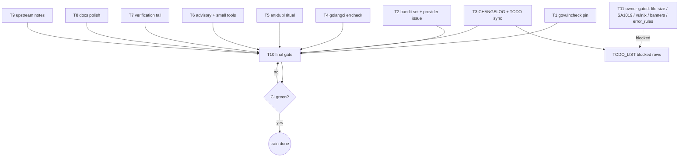

# SUPERB — findings zeroing: honest dispositions for all 13 reporting tools

Date: 2026-10-11 10:47 · Train owner input: "FUCKING GO AND START
FIXING ALL! PROPERLY" + "CHANGELOG should stay up to date!" (2026-10-11
06:41); re-armed 10:47. Supersedes the execution lists of
`docs/status/2026-10-11_09-38_*` §f (research window that produced the
classification this plan executes).

## Context (what this train fixes, and what it deliberately does NOT)

The 2026-10-11 buildflow full run displays **642 findings across 13
tools**. Research (09-38 report) classified them: **~42 genuinely
actionable rows**; ~510 rows are three tool/config defects (bandit
provider swallows stdout as findings; govulncheck binary is go1.26 and
cannot load the go1.27 module; the registry-ratified art-dupl baseline
file was never built); the rest are policy-shaped advisory classes.

Three dispositions are **OWNER-GATED and NOT executed by this train**
(the 09-38 §g questions, unanswered): file-size 350 policy, the SA1019
usermgmt→identity-model migration (the 2026-10-05 ruling conflict),
and vulnix gate ownership. They stay visible in TODO_LIST as blocked
rows. Nothing in this train may verschlimmbessern: no file splits, no
`lo` adoption, no passkey-seam edits, no blanket skipping — every
suppression carries a reason, every config change a rationale.

## Pareto breakdown

- **1% → 51%** (2 moves, 429/642 displayed rows = 67%): govulncheck
  tool_paths pin (−94, restores a DEAD security scanner) + bandit
  honest set & provider issue (−335 display).
- **4% → 64%** (add 3): golangci errcheck real fixes; CHANGELOG +
  TODO_LIST sync (owner mandate); art-dupl ratified baseline ritual
  (−90). Cumulative ≈ 525/642 = 82%.
- **20% → 80%** (add 3): advisory/small-tool polish (go-auto-upgrade
  budget marker, vulture, jscpd, nix meta.description, lychee
  reconcile); verification tail (flake check, pre-commit, drift alarm,
  smoke); docs polish + upstream notes.
- **Other 20% to 100%**: the five owner-gated dispositions, the daemon
  push watchdog (→ ROADMAP), the settingsRow adoption train (carried),
  quarterly-audit standing row (bookkeeping).

## Comprehensive plan (30–100 min tasks, sorted by importance/impact/effort/customer-value)

| ID | Task | Impact | Effort | Size |
|----|------|--------|--------|------|
| T1 | Noise-kill A: pin a go1.27-built govulncheck via `tool_paths`; verify a REAL scan completes | Critical (restores vuln scanning, −94) | S | 45m |
| T2 | Noise-kill B: triage bandit's ~6 real rows (nosec-with-reason / minimal fixes in scripts); file BuildFlow provider issue (stdout parsed as findings) | Critical (−335 display, honest 6) | S | 45m |
| T3 | CHANGELOG `[Unreleased]` lines (needle rename, gate rewiring, this train) + TODO_LIST/ROADMAP sync (strike done items 2b/3, add disposition + blocked-owner + quarterly rows) | Critical (owner mandate) | S | 30m |
| T4 | golangci real fixes: errcheck rows.Close/testDB.Close per repo idiom; SA1019 rows marked BLOCKED-owner in TODO_LIST | High (real bug class) | S | 30m |
| T5 | art-dupl ratified ritual: `-t 1` sweep → attribute every group vs the registry → `art-dupl baseline` file → CI `art-dupl check` (new-only) → sweep-log line | High (−90, new-only gate) | M | 90m |
| T6 | Advisory + small-tool polish: go-auto-upgrade `warnings_budget` marker w/ rationale; vulture `binary_location` removal (if dead) + override-FP attribution; jscpd 6 → registry test-fixture attribution; nix `meta.description` for the vulnix app; lychee 5-vs-0 reconciliation | High (honest noise floor) | S-M | 60m |
| T7 | Verification tail: full `nix flake check`; pre-commit hook exercise; drift alarm (branching-flow findings == baseline count); smoke re-run | High (proof, not claims) | M | 60m |
| T8 | Docs polish: 02-19 status doc formatting fix (third notice); `.buildflow.yml` UNSKIPPED/baseline narrative dedup | Medium | S | 30m |
| T9 | Upstream notes: sweep-extension comment on branching-flow#12 (8 unsuppressed analyzers); go-error-family peek (confirm nothing actionable for the error_rules wait-state); error_rules wait-state re-confirm | Medium | S | 30m |
| T10 | Final gate: full buildflow green, whitespace-drift check, detailed commit(s), push, CI to green | Critical (ship) | S | 45m |
| T11 | OWNER-GATED — blocked, do NOT execute: file-size policy; SA1019 migration; vulnix ownership; #12/#13 banner ticks; error_rules application post-release | High | — | blocked |

## Micro-breakdown (≤12 min each, sorted by importance/impact/effort/customer-value)

| # | Microtask | Parent |
|---|-----------|--------|
| 1 | Locate a go1.27-built govulncheck (nixpkgs current, flake input, or `nix develop -c go install`-built); record which | T1 |
| 2 | Wire `tool_paths` in `.buildflow.yml` with rationale comment | T1 |
| 3 | Verify: `buildflow -s govulncheck` runs a real scan (no loader errors); record verdict | T1 |
| 4 | Extract bandit's ~6 real rows with file:line from the drill JSON | T2 |
| 5 | Read each site (webphone-smoke.py, perf-baseline.py, drill scripts); decide fix vs nosec-with-reason | T2 |
| 6 | Apply the 6 dispositions | T2 |
| 7 | Verify: bandit-only drill shows 0 unresolved real rows | T2 |
| 8 | File BuildFlow issue: bandit provider counts stdout lines (banner/progress) as findings; should parse `-f json` — evidence from this run | T2 |
| 9 | CHANGELOG: needle-rename Changed line + gate-rewiring line (baseline + unskip) under [Unreleased] | T3 |
| 10 | TODO_LIST: strike sitting items 2b + 3 (done this session, cite hashes/issues) | T3 |
| 11 | TODO_LIST: add rows — tool dispositions landed, blocked-owner trio, quarterly 2027-01-11, daemon-watchdog → ROADMAP | T3 |
| 12 | ROADMAP: watchdog idea + lo-adoption decline note | T3 |
| 13 | golangci: read the errcheck rows; fix per `_ = x // reason` / defer-closure idiom | T4 |
| 14 | Verify: `buildflow -s golangci-lint` count drops by the fixed rows; SA1019 remainder == blocked set | T4 |
| 15 | art-dupl: run the ratified `-t 1` sweep, save report | T5 |
| 16 | art-dupl: attribute every shown group against the registry standing rulings (read every site at HEAD) | T5 |
| 17 | art-dupl: mint the `art-dupl baseline` file for intentional groups | T5 |
| 18 | art-dupl: wire CI `art-dupl check` (new-only) where the registry says | T5 |
| 19 | art-dupl: registry sweep-log line + status note | T5 |
| 20 | go-auto-upgrade: add `warnings_budget` marker + rationale comment (lo/jsonv1 declined per doctrine) | T6 |
| 21 | vulture: verify `binary_location` dead → remove; attribute do_POST/log_message as http.server overrides (nosec/config) | T6 |
| 22 | jscpd: attribute the 6 island-test clone rows (test-fixture class; registry note) | T6 |
| 23 | nix: add `meta.description` to the vulnix app; rerun nix-flake-check step | T6 |
| 24 | lychee: rerun with -v; reconcile the 5-vs-0 delta; fix real dead links if any | T6 |
| 25 | Full `nix flake check` (background, KVM-gated legs may defer on this host) | T7 |
| 26 | Pre-commit hook exercise: stage a trivial change, run the hook, confirm gate behavior with baseline | T7 |
| 27 | Drift alarm: CI-assertable check that branching-flow findings == baseline count (test or script) | T7 |
| 28 | Smoke: `scripts/webphone-smoke.py` on a fresh binary | T7 |
| 29 | 02-19 doc formatting fix | T8 |
| 30 | `.buildflow.yml` narrative dedup (UNSKIPPED note vs baseline block) | T8 |
| 31 | Comment on branching-flow#12: extend the suppression sweep list (8 more analyzers) | T9 |
| 32 | go-error-family peek: check for anything usable by the error_rules wait-state; note verdict | T9 |
| 33 | Re-confirm the error_rules ready-to-paste block is accurate in `.buildflow.yml` | T9 |
| 34 | Full buildflow run: expect bandit ~0, govulncheck real-only, art-dupl gated, branching-flow 19-accepted | T10 |
| 35 | `scripts/whitespace-drift.sh` after staging | T10 |
| 36 | Detailed commit(s) per the repo message style | T10 |
| 37 | Push + CI watch to green; record verdict | T10 |

## Execution graph

## Guardrails (verschlimmbesserung ban)

- No file splits for line counts (file-size stays owner-gated).
- No `lo` adoption, no passkey-seam edits, no migration while gated.
- Every suppression carries a reason; every config key a rationale.
- If no go1.27-built govulncheck exists cleanly: skip-step-with-
  rationale + TODO row (honest) — never a hacky pin.
- The smoke script's verdict lines stay byte-stable (CI + stack E2E
  grep them).
