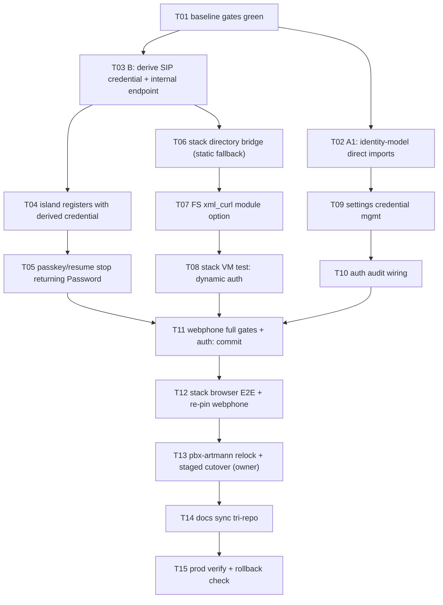

# SUPERB Plan — Unified Auth (A: cqrs-htmx identity adoption) + SIP credential brokering (B)

**Date:** 2026-10-12 01:05 (CEST)
**Input:** session 2026-10-11/12 — auth surface review ("How is our auth working?") + the A/B architecture question.
**Mission:** A = make cqrs-htmx's identity stack the ONE identity home in webphone (identity-model direct imports, adopt the hook-free AuthHandler routes, audit auth events). B = the directory SIP password never reaches the browser again: the island registers with a SESSION-DERIVED credential that FreeSWITCH validates dynamically. Without verschlimmbessern a live PBX.

**A+B verdict (from the exploration round):** A is in-repo and safe. B is cross-repo (webphone + nix-international-telephony + pbx-artmann) and touches the live PBX — it ships with a static-fallback binding and an instant rollback (flip `directory.mode` back to `static`). Go-side SIP termination stays REJECTED doctrine; the browser stays the SIP endpoint.

## Contracts pinned this session (researched, verified in the local repos)

**cqrs-htmx identity stack (local checkout, HEAD 4b4c12aa 2026-10-11):**

- `usermgmt.UserID = identitymodel.UserID` and `WebAuthnProvider`/`TOTPProvider`/`OAuth2Provider`/`Action`/`Effect`/`Role`/`Policy` are PURE type aliases (usermgmt `id.go:13`, `auth_interfaces.go`, `authz_types.go`) — the 8+ deprecation hints in webphone (`internal/userauth`, `internal/server/passkey_api.go`) die by an import-path swap; `identity-model/v4 v4.12.1` is already in go.sum (indirect).
- `usermgmt.AuthHandler` (http.go:42) is a complete auth surface: `POST /auth/register`, `POST /auth/webauthn/{register,login}/{begin,finish}`, `POST /auth/logout`, `GET /auth/me`, `GET/DELETE /auth/credentials`, plus TOTP and OAuth2 routes; `HandlerConfig` covers cookie name/Secure/MaxAge and per-group rate limits (WebAuthn/TOTP/OAuth/Registration).
- **NO post-login hook exists in `HandlerConfig`** — webphone's finish-and-mint flow (extension mapping → directory verify → webphone session) cannot ride the library's finish handler. Decision: mount only the HOOK-FREE routes (`/auth/me`, `/auth/credentials`); login stays in webphone's `passkey_api.go` handlers calling the service.
- usermgmt HAS a persistent `SQLSessionStore` + `NewSessionMiddleware` + Bearer extraction + impersonation (corrects an earlier session claim that its sessions are memory-only). Webphone KEEPS its own SQLite session store anyway: the row carries the SIP directory password for the `/phone-api` proxy and the 7d-idle/30d-absolute sliding policy.
- usermgmt has built-in audit (`audit_log.go`, `audit_context.go`) — auth events need wiring, not a new system.
- `loginpage` is a standalone redirect-style page — conflicts with the island's no-reload login (`adoptServerSession`). Deferred with a written ruling; not this train.

**Stack (nix-international-telephony, modules/telephony/pbx.nix):**

- FreeSWITCH directory is STATIC today: `extensionsForFs` renders number → password, where `passwordFile` entries become runtime-substituted placeholder tokens (`@TELEPHONY_EXT_<n>_PASSWORD@`). No mod_xml_curl anywhere.
- Caddy fronts WSS `/sip` → FreeSWITCH; webphone is loopback behind Caddy.

**Webphone (this session's read):**

- The browser RECEIVES the directory password today: `GET /api/session` returns `Password` (session_api.go:174, no-store) and passkey finish returns the file-sourced password (passkey_api.go:127). The island's sip.js needs A password to REGISTER — but it does NOT need the directory password.
- The session row carries extension + directory password ALSO for the `/phone-api` proxy — a SERVER-side password need that survives B (until the operator API grows session-token auth, deferred).
- `extension_password_files` stays for the proxy credential, but its browser exposure dies with B.

**B wire design (pinned for this plan):**

- `sipCredential = HMAC-SHA256(WEBPHONE_SIP__CREDENTIAL_SECRET, session_token)` — never the raw session token, never the directory password; a dedicated server secret (env, like the gateway secret).
- Webphone exposes `GET /internal/directory/{extension}` (loopback + Bearer secret) answering `{"credentials": [...]}` — the derived credentials of every LIVE session for that extension.
- The stack gets a directory bridge (telnyx-webhooks.py pattern): answers FreeSWITCH mod_xml_curl directory lookups by querying webphone's internal endpoint, with the static password as FALLBACK binding (operator/ring-group extensions never move).
- Module option `telephony.pbx.directory.mode = "static" | "xml_curl"`; rollback = flip to static + rebuild.
- Revocation is inherent: logout/dead session → derived credential dies at the next REGISTER.

## Pareto breakdown

### The 1% that delivers 51%

1. **B-core:** the island stops receiving the directory password — REGISTER with the session-derived credential (webphone derive + internal endpoint + island swap; T03/T04/T05).
2. **A1:** identity-model/v4 direct imports — kills every deprecation hint before bigger work builds on the seam (T02).

### The 4% that delivers 64% (add)

3. Stack directory bridge service (FS xml_curl → webphone, static fallback) (T06).
4. FreeSWITCH module option + xml_curl wiring (T07).
5. Stack VM test proving dynamic-auth registration end-to-end (T08).

### The 20% that delivers 80% (add)

6. Passkey finish + resume responses drop `Password` (island re-registers via derived credential in BOTH login modes) (T04/T05).
7. Settings: passkey credential management via usermgmt's hook-free `/auth/credentials` (list/revoke a passkey from the UI) (T09).
8. Auth audit events visible in logs (T10).
9. Full gates + browser E2E + tri-repo docs/release ritual (T11–T14), prod verification with rollback check (T15).

### The other 20% to reach 100% (deliberately deferred — NOT silently dropped)

- Mapping as a usermgmt Membership relation instead of the `auth.passkey.users` config map (identity-model has Tenants/Orgs/Membership).
- `loginpage` adoption ruling (standalone page vs island no-reload flow) — written decision owed.
- TOTP and OAuth2 as additional webphone login modes (usermgmt supports both; island + DOM contract work).
- Operator-API session-token auth → then `extension_password_files` dies entirely (the 2026-10-01 outage class disappears).
- Extension-login lockout parity with passkey account lockout (today: rate limit only).
- `passwordFile` perm assertions for the server-side secret files.

## Execution graph

## Medium-granularity plan (30–100 min, impact-sorted)

| #   | Task                                                                                                                                            | Repo      | Impact   | Effort  | Depends     |
| --- | ----------------------------------------------------------------------------------------------------------------------------------------------- | --------- | -------- | ------- | ----------- |
| T01 | Baseline: full `buildflow` (train-start rule) + `go test -count=1 ./...` green before touching anything                                          | webphone  | gate     | 45m     | —           |
| T02 | A1: import `identity-model/v4` directly in `internal/userauth` + `internal/server` (+ CLI), make it a direct dep, zero behavior change           | webphone  | 🔥🔥     | 60m     | T01         |
| T03 | B1: `sipCredential` derivation (HMAC-SHA256, new `WEBPHONE_SIP__CREDENTIAL_SECRET`) + `GET /internal/directory/{extension}` (Bearer, loopback) + tests | webphone  | 🔥🔥🔥   | 100m    | T01         |
| T04 | B4: island registers with the derived credential — `session.js`/`auth.js` stop consuming a directory password; `GET /api/session` drops `Password` | webphone  | 🔥🔥🔥   | 100m    | T03         |
| T05 | B5: passkey finish drops `Password`; password files stay SERVER-side (proxy creds); auth-regression suite (`auth:` commit prefix)               | webphone  | 🔥🔥🔥   | 60m     | T04         |
| T06 | Stack directory bridge: answers FS xml_curl lookups via webphone's internal endpoint; static-password fallback binding; secrets wiring          | stack     | 🔥🔥🔥   | 100m    | T03         |
| T07 | `telephony.pbx.directory.mode` option (static\|xml_curl) + FreeSWITCH xml_curl config wiring, loopback-only bridge endpoint                     | stack     | 🔥🔥     | 100m    | T06         |
| T08 | Stack VM test: extension registers via derived credential; static fallback proven; rollback path exercised                                      | stack     | 🔥🔥🔥   | 100m    | T07         |
| T09 | A2 slice: Settings passkey credential management (list/delete via usermgmt `/auth/credentials`, session-gated, CSP-safe, en/de)                 | webphone  | 🔥🔥     | 100m    | T02         |
| T10 | A3: audit wiring — login/logout/enroll events surfaced via usermgmt's built-in audit (verify activation path)                                   | webphone  | 🔥       | 45m     | T02         |
| T11 | Webphone gates: `nix fmt` first, buildflow full, `go test ./...`, `nix flake check`, island tests, smoke with passkey on; `auth:` commit          | webphone  | gate     | 60m     | T05,T08,T10 |
| T12 | Stack: browser E2E against the new pin (registration flow changed → runbook obligation), re-pin webphone input, stack gates                      | stack     | gate     | 60m     | T11         |
| T13 | pbx-artmann relock + STAGED prod cutover (owner-gated): deploy with `directory.mode=xml_curl`, static fallback intact, instant rollback plan     | pbx-artmann | 🔥🔥🔥 | 60m     | T12         |
| T14 | Docs: README § Passkey sign-in rewrite (no browser password), error-contract rows, AGENTS owner-decision updates, CHANGELOGs ×3                 | all       | 🔥       | 60m     | T13         |
| T15 | Prod verify: register via derived credential; logout kills re-REGISTER; static extensions unaffected; flip back to static = clean rollback        | prod      | 🔥🔥🔥   | 45m     | T13         |

## Fine-granularity plan (≤12 min each, includes ALL todos)

### T01 — baseline (3 × 12m)

| #   | Step                                                                 | Verify                        |
| --- | -------------------------------------------------------------------- | ----------------------------- |
| F01 | Run full `buildflow` (train-start rule; re-read `.buildflow.yml` after daemon activity near it) | exit 0, findings gate green |
| F02 | `nix develop -c go test -count=1 ./...`                              | all ok                        |
| F03 | `git status` snapshot; note concurrent-session files, never touch them | clean baseline noted          |

### T02 — A1 identity-model imports (5 × 12m)

| #   | Step                                                                                                                               | Verify                     |
| --- | ---------------------------------------------------------------------------------------------------------------------------------- | -------------------------- |
| F04 | `go get github.com/larsartmann/cqrs-htmx/identity-model/v4@latest` (becomes direct); `go mod tidy` immediately (vendorHash rule)    | go.mod direct require      |
| F05 | Swap `usermgmt.UserID`/`ParseUserID`/`Err*`/`WebAuthnProvider` → `identitymodel.*` in `internal/userauth`                          | compiles; gopls hints gone |
| F06 | Same swap in `internal/server/passkey_api.go` + any CLI call sites                                                                  | compiles; hints gone       |
| F07 | `go mod vendor` + vendorHash re-pin (`nix build .#webphone.goModules --rebuild` recipe)                                            | build resolves             |
| F08 | `go test -count=1 ./internal/userauth/ ./internal/server/ -run 'Test|TestServer'` + push behind the daemon-free bump rule (no auto-commit ride) | tests ok                   |

### T03 — B1 derive + internal endpoint (8 × 12m)

| #   | Step                                                                                                                            | Verify                        |
| --- | ------------------------------------------------------------------------------------------------------------------------------- | ----------------------------- |
| F09 | Config: `sip.credential_secret` scalar (env `WEBPHONE_SIP__CREDENTIAL_SECRET`); boot fails closed when `gateway.mode=webhook`… loopback dev: derive disabled → browser path unchanged | config test                   |
| F10 | `internal/sipcred` (or session-package home): `Derive(secret, token)` HMAC-SHA256 → base64url; property tests (deterministic, token-bound, secret-bound) | unit + vectors                |
| F11 | Session store: enumerate live tokens by extension (`ActiveTokens(ext)`) — SQLite + MemStore implementations                      | unit both stores              |
| F12 | Handler `GET /internal/directory/{extension}`: Bearer secret (constant-time), loopback posture, `{"credentials":[...]}` JSON      | handler test                  |
| F13 | Wire route OUTSIDE the CSRF/session surface (webhooks-class: secret-gated), rate-limited like hooks                             | route + limiter test          |
| F14 | 404/empty answer when passkey/derived mode disabled (honest 404, styled-rule consistency)                                       | handler test                  |
| F15 | family_test.go pins (`sipcred.*` codes) + error-contract rows                                                                    | tier-2 green                  |
| F16 | Docs stub in README § auth internals (filled in T14)                                                                            | —                             |

### T04 — B4 island swap (8 × 12m)

| #   | Step                                                                                                                               | Verify                        |
| --- | ---------------------------------------------------------------------------------------------------------------------------------- | ----------------------------- |
| F17 | `getSession` response: drop `Password`, add `sipCredential` (derived, only when mode on); no-store stays                            | session tests updated         |
| F18 | `island/app/session.js` resume: use `sipCredential` for REGISTER; keep in-memory only (never persisted — existing invariant)        | island node:test              |
| F19 | `island/app/auth.js` fresh-login path: same swap; register BEFORE session open order preserved (adoptServerSession untouched)       | island node:test              |
| F20 | Extension-login response: does NOT echo the typed password back as directory password (it never did) — but browser must ALSO get `sipCredential` here | session_api tests             |
| F21 | DOM contract re-check (no id changes expected; re-run `TestServedPageHoldsTheDomContract`)                                         | test green                    |
| F22 | Island honesty contract: offline banner + re-REGISTER on resume still driven by server-confirmed state                             | island tests                  |
| F23 | `nix fmt` (island files are treefmt-owned)                                                                                         | whitespace-drift clean        |
| F24 | Island tests suite (`nix run nixpkgs#nodejs -- --test ...`)                                                                        | green                         |

### T05 — B5 passkey path (5 × 12m)

| #   | Step                                                                                                                               | Verify                        |
| --- | ---------------------------------------------------------------------------------------------------------------------------------- | ----------------------------- |
| F25 | `passkeyFinishLogin`: drop `response.Password`; keep file-read for the session row (proxy creds) — file-empty still Rejection       | passkey_api tests             |
| F26 | Update `TestPasskeyFinishMintsTheSessionWithIdentity` + sessionIdentity omitempty wire docs                                        | tests green                   |
| F27 | `getSession`/finish response parity: ONE shape (`sessionIdentity`) with `sipCredential`                                             | parity test                   |
| F28 | README § Passkey sign-in: browser-never-sees-password rewrite (draft; finalized T14)                                              | —                             |
| F29 | `go test ./internal/server/ ./internal/session/ ./internal/userauth/` + `auth:` commit-prefix convention                            | green                         |

### T06 — stack directory bridge (8 × 12m)

| #   | Step                                                                                                                               | Verify                        |
| --- | ---------------------------------------------------------------------------------------------------------------------------------- | ----------------------------- |
| F30 | Read `telnyx-webhooks.py` once more; same module shape (env config, stdlib HTTP, no new deps)                                      | —                             |
| F31 | Bridge endpoint `GET /fs-directory`: parse FS xml_curl POST (params: user, domain, action=sip_auth|group_call), answer XML         | unit w/ stub                  |
| F32 | Auth: Bearer secret (LoadCredential), loopback bind, 503 fail-closed when webphone unreachable AND no static fallback cached       | unit                          |
| F33 | Fallback: config-driven static password map for non-webphone extensions (operator, ring groups) — never proxied to webphone        | unit                          |
| F34 | Proxy to webphone `GET /internal/directory/{extension}`; pass through `credentials[]` into the XML answer (a1-hash optional field)  | unit                          |
| F35 | Caching/behavior: FS re-queries at every REGISTER — no cache; logout kills at next REGISTER (contract note in answer headers)      | unit                          |
| F36 | Secrets: `webphone_directory_secret` in generate.sh + webhooks.nix LoadCredential wiring                                            | nix eval                      |
| F37 | Bridge docs + AGENTS section in stack repo                                                                                          | read-through                  |

### T07 — FS module wiring (8 × 12m)

| #   | Step                                                                                                                               | Verify                        |
| --- | ---------------------------------------------------------------------------------------------------------------------------------- | ----------------------------- |
| F38 | Options: `telephony.pbx.directory.mode` (enum static\|xml_curl, default static), `.bridge.url`, `.bridge.secretFile`               | nix eval                      |
| F39 | FreeSWITCH config: acl for loopback, xml_curl directory binding URL + bindings param `directory`                                   | generated-xml check           |
| F40 | Static directory stays rendered as the FALLBACK binding (order: xml_curl first, static second) when mode=xml_curl                  | generated-xml check           |
| F41 | mode=static renders byte-identical config to today (verschlimmbesser guard: golden test)                                           | golden diff                   |
| F42 | Bridge systemd unit (DynamicUser, LoadCredential, hardening parity with telnyx-webhooks)                                           | unit eval                     |
| F43 | Caddy/loopback posture: bridge ↔ webphone on 127.0.0.1, no new public surface                                                      | nixos-config eval             |
| F44 | Module option docs + assertions (secret file required iff xml_curl)                                                                | eval test                     |
| F45 | Stack CHANGELOG/TODO rows                                                                                                           | —                             |

### T08 — stack VM test (6 × 12m)

| #   | Step                                                                                                                               | Verify                        |
| --- | ---------------------------------------------------------------------------------------------------------------------------------- | ----------------------------- |
| F46 | Extend webphone VM test: boot with `directory.mode=xml_curl`, derived-credential registration via SIP over WSS                     | VM test green                 |
| F47 | Negative: wrong credential rejected; revoked (logged-out) credential rejected at next REGISTER                                     | VM test green                 |
| F48 | Static fallback: non-webphone extension (operator) still registers under xml_curl mode                                             | VM test green                 |
| F49 | Rollback drill: flip to static, extension registers with file password again                                                        | VM test green                 |
| F50 | webphone unit test: `Derive` matches what the bridge answers (contract fixture shared via test vector in both repos)               | green both repos              |
| F51 | Stack flake check subset (KVM-gated tests only where available)                                                                     | green                         |

### T09 — A2 settings credential mgmt (7 × 12m)

| #   | Step                                                                                                                               | Verify                        |
| --- | ---------------------------------------------------------------------------------------------------------------------------------- | ----------------------------- |
| F52 | Server: session-gated proxy handlers `GET/DELETE /api/passkeys` → usermgmt credentials API (owner-match rule)                      | handler tests                 |
| F53 | Wire `usermgmt.AuthHandler` hook-free routes assessment; if cleaner: mount `/auth/credentials` under session middleware            | decision note + tests         |
| F54 | Settings partial: "Passkeys" section (list name/created/last-used; revoke button; empty state en/de)                               | render tests                  |
| F55 | i18n keys BOTH maps (parity + unused-key tests)                                                                                    | i18n tests                    |
| F56 | CSP-safe interactions (no inline), morph-safe list ids, `hx-swap="morph:innerHTML"` idiom                                          | twcss/CSP tests               |
| F57 | Revocation flows into the island (toast + list refresh nudge)                                                                      | island test                   |
| F58 | DOM contract: new ids appended + test updated; fresh stack browser E2E owed (scheduled T12)                                        | contract test green           |

### T10 — A3 audit (3 × 12m)

| #   | Step                                                                                                                               | Verify                        |
| --- | ---------------------------------------------------------------------------------------------------------------------------------- | ----------------------------- |
| F59 | Verify usermgmt audit activation path (audit_log.go: how records are enabled/persisted) — decide log-vs-table exposure             | code read + decision note     |
| F60 | Wire login/logout/enroll events into slog (structured, greppable) at minimum; usermgmt table if trivial                            | unit/log assertion            |
| F61 | Never log secrets (password, tokens, ceremony bodies) — requestlog test extended                                                    | test green                    |

### T11 — webphone gates (4 × 12m)

| #   | Step                                                                                                                               | Verify                        |
| --- | ---------------------------------------------------------------------------------------------------------------------------------- | ----------------------------- |
| F62 | `nix fmt` BEFORE gates (island + Go); `scripts/whitespace-drift.sh` after staging                                                                  | clean                         |
| F63 | Full `buildflow` + `nix develop -c go test -count=1 ./...`                                                                          | green                         |
| F64 | `nix flake check` (island-lint, island-js, module check, backup drill) + smoke with passkey ON (fresh binary)                       | green + smoke verdicts        |
| F65 | Commit(s) with `auth:` prefix (session/cookie surface changed → convention), then verify push (`git ls-remote`) + CI verdict        | CI green                      |

### T12 — stack E2E + re-pin (4 × 12m)

| #   | Step                                                                                                                               | Verify                        |
| --- | ---------------------------------------------------------------------------------------------------------------------------------- | ----------------------------- |
| F66 | Stack: bump webphone input to the pushed rev (ride-main per-train rule)                                                             | lock updated                  |
| F67 | Browser E2E (budget 445s, known ~90s transfer flake: re-run once) — DOM contract intact, registration via derived credential        | E2E green                     |
| F68 | Stack gates: `nix flake check` + webphone VM test (T08 included)                                                                    | green                         |
| F69 | Stack push; verify `git ls-remote` + CI verdict                                                                                     | CI green                      |

### T13 — pbx cutover (4 × 12m, owner-gated)

| #   | Step                                                                                                                               | Verify                        |
| --- | ---------------------------------------------------------------------------------------------------------------------------------- | ----------------------------- |
| F70 | pbx-artmann: stack re-lock (tree CLEAN before re-lock; narHash covers whole tree)                                                    | relock committed              |
| F71 | Stage deploy: `nixos-rebuild switch --flake .#pbx --target-host root@pbx.artmann.tech` with `directory.mode=xml_curl`                | switch ok                     |
| F72 | ROLLBACK PLAN pinned in the runbook: `directory.mode=static` + rebuild = full revert (<2 min)                                       | documented                    |
| F73 | pbx-artmann gates: toplevel eval/build + `nix flake check` subset                                                                   | green                         |

### T14 — docs sync (4 × 12m)

| #   | Step                                                                                                                               | Verify                        |
| --- | ---------------------------------------------------------------------------------------------------------------------------------- | ----------------------------- |
| F74 | Webphone README § Passkey sign-in rewrite (browser never sees the directory password; internal endpoint contract)                   | read-through                  |
| F75 | docs/error-contract.md rows (sipcred.*, directory bridge failures, passkey surface changes)                                         | cross-check                   |
| F76 | AGENTS.md: owner-decision updates (password exposure), tri-repo rules unchanged; CHANGELOG `[Unreleased]` entries                    | agents-md size ≤ cap          |
| F77 | Stack + pbx-artmann CHANGELOG/AGENTS rows                                                                                           | read-through                  |

### T15 — prod verify (4 × 12m)

| #   | Step                                                                                                                               | Verify                        |
| --- | ---------------------------------------------------------------------------------------------------------------------------------- | ----------------------------- |
| F78 | Live registration via derived credential (browser + a softphone test account if available)                                          | 200/OK REGISTER               |
| F79 | Logout → next REGISTER fails (revocation proof); re-login recovers                                                                  | observed                      |
| F80 | Static extensions (operator, ring group) unaffected                                                                                 | observed                      |
| F81 | Rollback drill on prod (flip static + rebuild) executed ONCE and reverted                                                           | both modes proven             |

## Risks & verschlimmbesser guards

- **Live PBX lockout** is the one catastrophic mode: the static-fallback binding + golden byte-identical static rendering (F41) + the <2 min rollback (F72/F81) are the guards. No prod step before T08 green.
- **Scope creep**: TOTP/OAuth2/loginpage/membership-remap are EXPLICITLY deferred (listed above); this train ships A1 + A2-slice + A3 + B only.
- **Proxy credential reality**: `extension_password_files` and the session-row password STAY (the `/phone-api` proxy needs them). B removes the BROWSER exposure, not the server-side secret. The file-outage class shrinks but does not die until the operator API grows session auth (deferred).
- **Dependency bump rule**: T02's go.mod change does NOT ride the auto-commit daemon (ratified rule) — manual bump tail: tidy → vendorHash re-pin → push → CI-watch.
- **Concurrent sessions**: re-read shared files (i18n.go, pages.go, flake.nix) before editing; never revert in-flight changes we did not author.

## Execution record

_(filled as trains land; keep the table checkmarks honest)_
