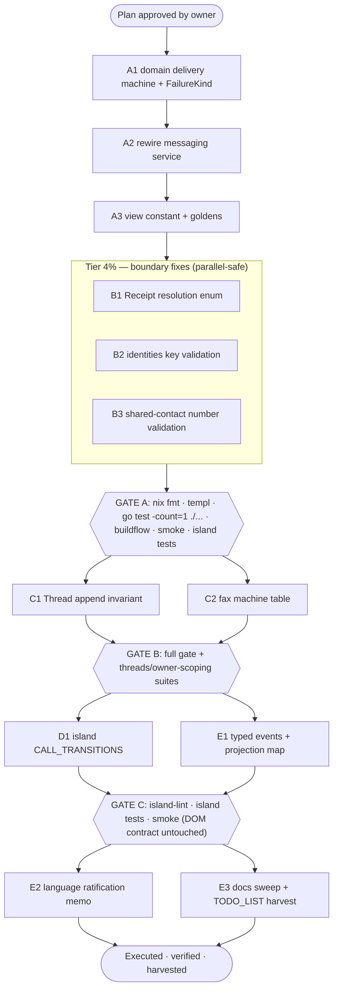

# SUPERB plan: declarative + DDD model — webphone

> STATUS: PLAN (2026-10-14 17:15, pareto-planning session) — pending owner approval.
> Scope: the four opportunities from the 2026-10-14 declarative/DDD analysis, cross-referenced
> against `docs/reviews/2026-09-30_data-model-review.html` (series entry 2; this plan executes
> its three open findings plus the lifecycle-as-data direction). NOT executed in this session.

## Goal

Make the webphone model *declarative* (state machines as data, invariants by construction)
without Verschlimmbessern: every change is a behavior-parity refactor on the Go and wire
level. No schema migration, no byte change in DB values, SSE payloads, `/config.js`, or
rendered HTML. The doc contract (`docs/dom-contract.md`), the greppable SSE row classes, and
the island honesty contract are HARD constraints; a served-markup change (none is planned
except the A3 literal→constant swap, which is byte-identical) would owe a stack browser E2E.

## Where the model already stands (do not re-litigate)

Branded ids (`domain/ids.go`), constructor-validated `Extension`/`Phone`, pure `internal/domain`
(arch-test enforced), closed enums (`Channel`, `Direction`, `OutboundStatus`, `FaxStatus`),
inbound/outbound lifecycle split, CQRS-shaped reads (`store.ThreadSummary`), error families
with `<seam>.<op>` codes, `docs/DOMAIN_LANGUAGE.md` (DRAFT, unratified — owner question g2).
The 2026-09-30 review verdict: "invalid states mostly cannot be constructed"; three open
findings remain (P5 `gateway.Receipt` too thin, P4 `identities` keys unvalidated, P4
`SharedContact.Number` unbranded).

## Pareto breakdown

| Tier | Delivers | Content |
| --- | --- | --- |
| **1%** | **51%** | **A: outbound-message delivery machine as data** — `deliveryMoves` table + pure `DeliveryAdvance` + `FailureKind` typed. Messaging is the product core; the machine governs send, verdict hooks, the retry affordance (`messages.templ:617` keys on the literal `"transient"`), and duplicate-verdict handling. Centralizing it removes the highest-traffic scattered conditionals and gives "replayed verdict" a single declarative home. |
| **4%** | **64%** | 1% **+ B: the two fail-silent boundary fixes** — `gateway.Receipt.Resolution` closed enum (kills the `fax.drive` `(*gateway.Loopback)` type-assert: a latent wrong-branch bug for any second synchronous gateway), and `config.Identities` key validation at `Load` (boot-fail on typos instead of silent feature miss). |
| **20%** | **80%** | 4% **+ C: aggregates as invariants** — `domain.AppendToThread` (LastActivity/Unread/auto-unarchive in ONE pure function the store must use) and the fax machine table (`faxMoves` + `FaxAdvance`; outbound lifecycle vs inbound fact split). |
| **100%** | **rest** | + D: island `CALL_TRANSITIONS` declarative table (calls/hold pending machine) · E: typed domain events + `project(event) → SSE nudge` map, DOMAIN_LANGUAGE ratification memo (owner-gated), docs sweep. |

## Non-goals (YAGNI, ratified)

- **No event sourcing, no store rewrite, no go-cqrs-lite migration.** Single-process,
  low-traffic; the typed-event seam keeps that port mechanical if ever wanted.
- **No schema migration.** `FailureKind` values stay `""|transient|rejected|provider` TEXT;
  only the Go type closes.
- **No behavior change.** Out-of-order verdict semantics (e.g. `delivered` after `failed`
  beyond the 1h hook-idempotency TTL) are ENCODED AS TODAY first; tightening them is an
  explicit owner call (row A1.7), never a silent side effect.

## Comprehensive plan (30–100 min tasks)

Sorted by tier → impact → effort. Every train ends with the full gate (§ Gates).

| # | Task | Tier | Est | Why it matters | Risk |
| --- | --- | --- | --- | --- | --- |
| A1 | Domain delivery machine: `FailureKind` type + `deliveryMoves` table + pure `DeliveryAdvance`; behavior-parity table tests | 1% | 75m | The core lifecycle becomes data; one home for verdict legality | Low (pure, additive) |
| A2 | Rewire `messaging.Service.Send` failure path + `DeliveryReceipt` onto the machine; signatures unchanged | 1% | 45m | Deletes the scattered conditionals | Low (parity tests pin) |
| A3 | `messages.templ` retry literal → `domain` constant; `templ generate`; goldens byte-identical | 1% | 30m | Last stringly consumer of the vocabulary | None |
| B1 | `gateway.Receipt.Resolution` enum (`final`/`pending`); `fax.drive` switches on it; delete type-assert | 4% | 90m | Latent wrong-branch bug dies at the model level (09-30 P5) | Medium (interface change; all gateways touched) |
| B2 | `config.Load` validates `identities` keys via `ParseExtension`; named boot failure | 4% | 30m | Typo fails the boot instead of silently missing lookups (09-30 P4) | Low |
| B3 | `config.Load` validates shared-contact numbers via `ParsePhone`; named boot failure; wire bytes unchanged | 4% | 30m | Malformed operator entry can't render verbatim into the dial typeahead (09-30 P4) | Low |
| C1 | `domain.AppendToThread` pure invariant fn (unread/lastActivity/auto-unarchive); store append uses it | 20% | 60m | Thread aggregate invariant gets ONE home; drift unrepresentable | Medium (store touch) |
| C2 | `faxMoves` table + `FaxAdvance`; `drive`/`UpdateProviderStatus`/`Resend` onto it; replay = no move = inert | 20% | 75m | Second state machine made declarative; status-hook idempotency expressed by data | Medium |
| D1 | Island `CALL_TRANSITIONS` table + single `applyTransition`; hold pending/queued folded in; node:test specs | 100% | 90m | The JS side of the honesty contract becomes data | Medium (island; tests must cover render outcomes) |
| E1 | Typed domain events (`MessageReceived`, `MessageDeliveryAdvanced`, `ThreadFlagChanged`, `FaxAdvanced`) + `project(event)` map → existing SSE nudges | 100% | 90m | Notification policy declarative + table-testable; go-cqrs-lite stepping stone | Medium (SSE goldens must stay byte-identical) |
| E2 | DOMAIN_LANGUAGE.md ratification memo + ROADMAP g2 cross-link | 100% | 30m | Ubiquitous language doc is DDD's core artifact; owner decides | None (owner-gated) |
| E3 | Docs sweep: CHANGELOG `[Unreleased]` per shipped train, TODO_LIST harvest, AGENTS machine-table rule, registry sweep-log | 100% | 30m | One home per fact; future sessions find the tables | None |

## Fine breakdown (≤12 min tasks)

### Train A — delivery machine (1%)

| # | Task | Min |
| --- | --- | --- |
| A1.1 | Re-read `messaging.Service.Send`/`DeliveryReceipt` + failure sites; write the observed transition list | 10 |
| A1.2 | `domain`: `FailureKind` type + 4 constants + Parse/Clear helpers (errorfamily-clean) | 10 |
| A1.3 | `domain`: `deliveryMoves` table + `Verdict` type + pure `DeliveryAdvance` | 15 |
| A1.4 | Table-driven behavior-parity tests: every legal move from today's semantics | 15 |
| A1.5 | Pin duplicate/out-of-order verdict semantics (handler idempotency + table); document in doc comment | 10 |
| A1.6 | `nix fmt` + `go test ./internal/domain/` | 5 |
| A1.7 | Draft owner-call row: tighten out-of-order verdicts (yes/no) → TODO_LIST | 5 |
| A2.1 | Rewire `DeliveryReceipt` onto `DeliveryAdvance` | 15 |
| A2.2 | Rewire `Send` failure path onto `FailureKind` constants (`failureKindOf` returns constant) | 10 |
| A2.3 | `messaging` family_test + selfsend tests green | 10 |
| A2.4 | `nix fmt` + `go test ./internal/messaging/` | 10 |
| A3.1 | `messages.templ:617` literal → constant; `templ generate` | 10 |
| A3.2 | Payload goldens + `panels_test` byte-compare | 10 |
| A3.3 | `go test ./internal/web/...` | 10 |

### Train B — boundary fixes (4%)

| # | Task | Min |
| --- | --- | --- |
| B1.1 | Re-read `fax.drive` + `gateway` interface; confirm every assert site | 10 |
| B1.2 | Add `Resolution` closed enum to `Receipt` (`final`/`pending`) + doc comment | 10 |
| B1.3 | `Loopback` returns `final`; webhook lane returns `pending` | 15 |
| B1.4 | `fax.drive` switches on `Resolution`; delete the `(*gateway.Loopback)` type-assert | 20 |
| B1.5 | Fax tests incl. a second-synchronous-gateway simulation taking the right branch | 15 |
| B1.6 | Cross-ref: 09-30 review P5 resolved (registry/AGENTS line) | 5 |
| B1.7 | `nix fmt` + `go test ./internal/fax/ ./internal/gateway/` | 15 |
| B2.1 | `ParseExtension` on `identities` keys at `Load`; boot failure names the offending key | 10 |
| B2.2 | Config tests: typo key fails boot with the key in the message | 10 |
| B2.3 | README config section note (validation contract) | 10 |
| B3.1 | `ParsePhone` on shared-contact numbers at `Load`; boot failure names the entry | 10 |
| B3.2 | Config tests | 10 |
| B3.3 | Wire-bytes check: `/config.js` output unchanged | 10 |

### Train C — aggregates (20%)

| # | Task | Min |
| --- | --- | --- |
| C1.1 | Re-read the message append path; write the invariant list (unread, lastActivity, auto-unarchive, read state) | 10 |
| C1.2 | `domain.AppendToThread(thread, msg) Thread` pure function | 15 |
| C1.3 | Store append path uses it (one call site) | 15 |
| C1.4 | `threads_flags_test` + `owner_scoping_test` green | 10 |
| C1.5 | `nix fmt` + `go test ./internal/store/ ./internal/domain/` | 10 |
| C2.1 | Observed fax transition list from `drive`/`UpdateProviderStatus`/`Resend` | 10 |
| C2.2 | `faxMoves` table + `FaxAdvance` pure fn | 15 |
| C2.3 | Outbound-lifecycle vs inbound-fact split documented at the type (no enum change; machine in domain) | 10 |
| C2.4 | Rewire service call sites | 15 |
| C2.5 | Replay verdict = no legal move = inert success; pinned by test | 10 |
| C2.6 | `nix fmt` + `go test ./internal/fax/` | 15 |

### Train D — island declarative calls (100%)

| # | Task | Min |
| --- | --- | --- |
| D1.1 | Inventory current call-state moves (ringing/established/ending, hold pending/queued) from `calls.js` | 15 |
| D1.2 | `CALL_TRANSITIONS` table + single `applyTransition` helper | 20 |
| D1.3 | Fold the hold pending/queued machine into the table | 15 |
| D1.4 | node:test specs per move incl. honesty contract (failed toggle returns the SETTLED state) | 20 |
| D1.5 | island-lint + island tests | 10 |
| D1.6 | `nix fmt` (prettier owns island files) | 10 |

### Train E — events, language, docs (100%)

| # | Task | Min |
| --- | --- | --- |
| E1.1 | Event types + payloads (4 events listed above) | 15 |
| E1.2 | Emit from service seams; map `ChangeFunc` call sites | 20 |
| E1.3 | `project(event) → SSE nudge` map; replace direct `notify` calls | 20 |
| E1.4 | SSE payload goldens byte-identical (greppable classes intact) | 15 |
| E1.5 | Projection dedup tests (list-only `threads` nudge rule preserved) | 10 |
| E1.6 | `nix fmt` + `go test ./internal/...` | 10 |
| E2.1 | Ratification memo for `docs/DOMAIN_LANGUAGE.md` (drafted, NOT self-answered) | 15 |
| E2.2 | ROADMAP g2 cross-link to the memo | 15 |
| E3.1 | CHANGELOG `[Unreleased]` lines per shipped train (docs-only deltas stay silent) | 10 |
| E3.2 | TODO_LIST harvest of remaining rows + the A1.7 owner call | 10 |
| E3.3 | AGENTS invariant line: machine tables are the ONE home for lifecycle legality | 5 |
| E3.4 | Registry sweep-log line if `art-dupl` ran during the trains | 5 |

## Execution graph

## Gates (every train, no exceptions)

1. `nix fmt` BEFORE the gates (formatter-drift rule; treefmt owns island files, oxfmt the rest).
2. `templ generate` after any `.templ` edit (A3).
3. `nix develop -c go test -count=1 ./...` green.
4. `buildflow` rc=0 (run at train START too — `.buildflow.yml` daemon-truncation lesson).
5. Island tests: `nix run nixpkgs#nodejs -- --test --test-force-exit internal/web/assets/island-tests/*.test.mjs`.
6. Fresh-binary smoke: `python3 scripts/webphone-smoke.py --bin …` — verdict lines printed, never assumed.
7. `scripts/whitespace-drift.sh` after `git add`, before commit.
8. After push: verify CI verdict (`gh run list`), never trust push logs.

## Risks & guards

| Risk | Guard |
| --- | --- |
| Machine table silently changes verdict semantics | A1.1/A1.4 derive the table FROM current behavior; parity tests are written before any rewiring; out-of-order tightening is owner-gated (A1.7) |
| `FailureKind` typing ripples into webhook DTOs / goldens | Values and DB TEXT unchanged; only Go types close; goldens byte-compared (A3.2) |
| Receipt interface change breaks a hidden implementer | B1.1 enumerates implementers first (lsp_references); the interface gains a field, implementations declare |
| Island refactor breaks the honesty contract | D1.4 tests render OUTCOMES (stub-DOM lesson); hold pending/queued semantics pinned before folding |
| SSE nudge policy changes under E1 | E1.4/E1.5 goldens + dedup tests; list-only `threads` rule (zero thread id skips transcript push) is a pinned test |
| Concurrent sessions / daemon commits mid-edit | Re-View shared files before each Edit; small committed units per train; never revert in-flight files |

## Open owner calls surfaced by this plan

1. **A1.7** — tighten out-of-order delivery verdicts (reject `delivered` after `failed`) or keep today's overwrite? (Recommend: keep overwrite today; revisit with the events train.)
2. **E2** — ratify or delete `docs/DOMAIN_LANGUAGE.md` (ROADMAP g2, drafted 2026-09-23, still DRAFT).
3. Deferred rows (post-100%): split `FaxJob` into inbound/outbound types (bigger ripple than C2), voicemail transcribe-button test #37, 429-combined-load #5 (existing TODO_LIST rows, unrelated to this plan).
