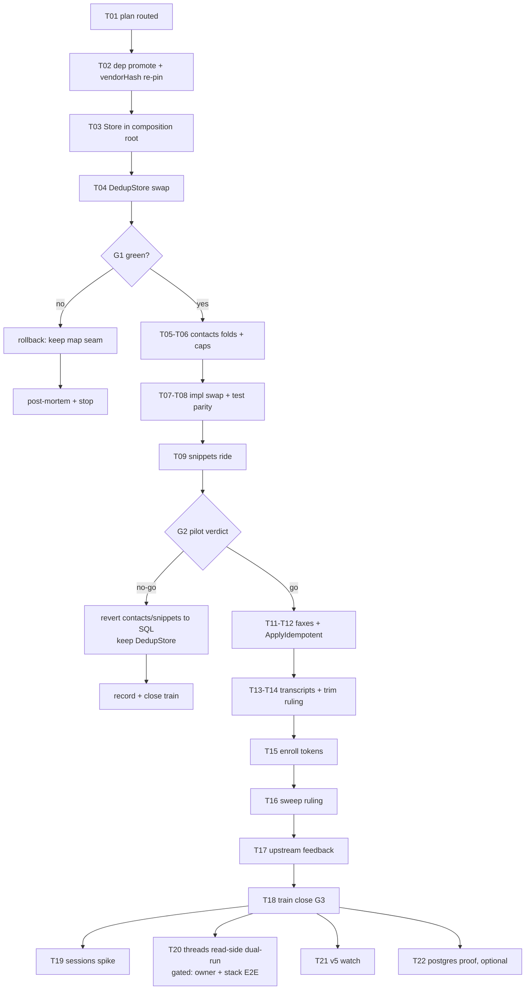

# SUPERB: metaengine dogfooding — verdict + Pareto adoption plan

**Date:** 2026-10-14 23:05 · **Status:** PLAN (owner-ratifiable; P0 tasks executable without owner input) · **Repo:** webphone
**Upstream:** [go-cqrs-lite](https://github.com/LarsArtmann/go-cqrs-lite) local checkout `/home/lars/projects/go-cqrs-lite` (skill: `go-cqrs-lite`, loaded)
**Rule zero:** Do NOT verschlimmbessern. This plan adopts the library where it beats hand-rolled SQL, and names the seams where migration would make the system worse.

---

## 1. Audit findings (why this plan exists)

Measured 2026-10-14 (rg over `internal/` + `cmd/`, non-vendor):

- **First-party imports of `go-cqrs-lite/*`: ZERO.** `metaengine/v4 v4.17.0` rides `// indirect` (via cqrs-htmx/usermgmt); `system/v4` is absent from the module graph entirely. The only go-cqrs-lite machinery that executes anywhere in webphone lives inside the embedded `usermgmt` identity layer — the library's internals, never our choice.
- **Manual SQL: ~108 statement sites across 9 production files** (see §2) + 5 test files carrying their own SQL. All hand-rolled `database/sql` over modernc SQLite, governed by `listRows[T]` and the versioned migration ladder in `store/db.go`.
- Meanwhile the 2026-10-14 declarative/DDD train already minted typed domain facts (`deliveryMoves`/`DeliveryAdvance`, `faxMoves`/`FaxAdvance`, `domain.AppendToThread`, `Notifier.Project`) — the on-ramp for metaengine folds already exists in embryo. This plan is its continuation, not a new direction.

### 2. Manual SQL inventory (baseline for the delta metric)

| File                   | Sites | Tables                             | Verdict in this plan                      |
| ---------------------- | ----- | ---------------------------------- | ----------------------------------------- |
| `store/db.go`          | 22    | migration ladder v0→v3, all tables | **STAYS** (N5/N6)                         |
| `store/messages.go`    | 28    | threads/messages/attachments       | **STAYS** (N2); read-side spike T20 gated |
| `store/sweep.go`       | 14    | retention + stats                  | **STAYS** for hand tables (T16 ruling)    |
| `store/transcripts.go` | 10    | call_transcripts                   | MIGRATE (T13/T14)                         |
| `store/contacts.go`    | 7     | contacts                           | **MIGRATE — pilot** (T05–T08)             |
| `store/snippets.go`    | 7     | snippets                           | MIGRATE (T09)                             |
| `session/sqlite.go`    | 9     | sessions                           | NO-GO by default (N4)                     |
| `store/faxes.go`       | 5     | fax_jobs                           | MIGRATE (T11/T12) — the showcase          |
| `userauth/enroll.go`   | 6     | wp_enroll_tokens                   | MIGRATE (T15)                             |

## 3. Verified upstream API (read from source, not docs)

- `metaengine.Query[Q,R](name, folds...)`, `metaengine.Plan(engines, queries...) (*Store, error)` — cost-based planner.
- Write side: `Store.Apply(ctx, eventType, payload)`, `ApplyBatch([]EventInput)` (atomic), **`ApplyIdempotent(ctx, eventID, eventType, payload)`** — eventID maps 1:1 onto Telnyx `provider_ref` receipt dedup.
- Canonical folds: `OnRecord[E](sample, handler)` / `OnRecordTyped` (the `On/OnTyped/Delta` forms are deprecated, v5-removal). Convention CRUD: `AutoCRUDByConvention[R](keyField, Created{}, Updated{}, Deleted{})`.
- Read side: `NewReader[V](store, name)`, `Scan/ScanPage` with `WithFilter/WithSort/WithLimit/WithCursor` — the filter+sort tier fits every list endpoint we hand-roll.
- Dedup: engine-native `DedupStore.DedupCheckAndRecord` (atomic CAS) + `DedupSeen` + `DedupSweep` (SQL engines native; map engines degraded).
- SQLite engine: **own module** `metaengine/sqliteengine/v4 v4.5.3` — NOT currently vendored (only the metaengine root package is). `sqliteengine.NewFromDSN(dsn) (Engine, *sql.DB, error)`; engine owns its DDL (`ddl_lock.go`).

## 4. Fit verdict per seam

| Seam                                            | Shape                                                 | metaengine home                                           | Verdict                                                                                       |
| ----------------------------------------------- | ----------------------------------------------------- | --------------------------------------------------------- | --------------------------------------------------------------------------------------------- |
| webhook/call idem (`server/idempotency.go` map) | TTL dedup keys                                        | `DedupStore`                                              | **GO now** — fixes restart-loss (today a restart inside the 1h TTL window forgets seen hooks) |
| contacts                                        | owner-scoped CRUD, cap 500, upsert-keep-id            | Map query + owner filter + Counter cap                    | **GO — pilot**                                                                                |
| snippets                                        | owner-scoped CRUD, caps 100/5                         | same pattern                                              | GO (rides pilot)                                                                              |
| fax_jobs                                        | external receipt ingestion + status ladder            | folds over `FaxReceipted/FaxAdvanced` + `ApplyIdempotent` | GO — best conceptual fit; reuses train-C `faxMoves`                                           |
| call_transcripts                                | append + bounded trim (5000) + search                 | folds + reader.Scan; trim is the risk                     | GO, trim ruled at T14                                                                         |
| wp_enroll_tokens                                | keyed + TTL + consume-once                            | Map query + delete folds                                  | GO (small)                                                                                    |
| sessions                                        | kv + sliding TTL, creds at rest                       | Map (kv-tier)                                             | **NO-GO default** (N4)                                                                        |
| threads/messages                                | source-of-truth relational + correlated-subquery list | planned tables (read side only)                           | **NO-GO as migration**; gated spike T20                                                       |
| migration ladder                                | DDL                                                   | —                                                         | STAYS (N5/N6)                                                                                 |

## 5. NOT-DO list (verschlimmbessern guards, with re-triggers)

- **N1 — No `system.New` composition-root swap.** samber/do v2 root is a ratified architecture invariant (AGENTS); ADR-0123's `system` targets greenfield event-sourced apps. Re-trigger: a new event-sourced service, or a full webphone rewrite.
- **N2 — No event-sourcing rewrite of threads/messages as source of truth.** Telnyx is the system of record; the tables are external-fact state, not read models; the list query, morph-SSE nudge and `wp-thread-row`/`wp-bubble` payloads are pinned by the DOM contract + stack browser E2E. Re-trigger: an outbound-message state machine whose retries deserve replay.
- **N3 — No SSE swap to `metaengine.ServeSSE`.** The nudge Broadcaster contract (`threads` list-only, `thread`, `fax`, …) is stack-E2E-pinned. No foreseen trigger.
- **N4 — Sessions stay on `session/sqlite.go`.** Security-seam, TestServer-suite-pinned, kv shape, sliding TTL already correct. Re-trigger: storage-format touch or multi-node need.
- **N5 — Engine-owned tables get NO `schema_version` ladder entries.** The db.go doctrine ("new schema change = new migration step") governs HAND-owned tables; metaengine's DDL is the engine's business. Ruling lands in this file (here it is) + a one-line pointer comment in `store/db.go`.
- **N6 — The existing ladder (v0→v3) is never rewritten** to "clean up" history.
- **N7 — No wholesale deletion of `listRows[T]`** while hand-owned tables remain (messages/sweep keep it; one-home doctrine intact until its last consumer dies).

## 6. Pareto tiers

- **1% → 51%:** Ratified decision + dep promoted + `metaengine.Store` in the composition root + **DedupStore swap**. Smallest real adoption, kills a real defect (restart-loss), unblocks everything.
- **4% → 64%:** **Contacts pilot** end-to-end + snippets riding it. Proves/disproves the whole thesis in one train behind an unchanged store interface.
- **20% → 80%:** Faxes (the external-fact showcase, `ApplyIdempotent` on `provider_ref`) + transcripts + enroll tokens + sweep ruling + upstream feedback filed + train close.
- **Remaining 20% → 100%:** Gated tail — sessions evaluation, threads read-side dual-run spike, v5 watch (`usermgmt`'s deprecated `stack.Materialize` adapter dies at v5 — upstream cqrs-htmx's duty, we watch), optional postgres proof.

## 7. Phases, gates, rollback

- **G1** (after T04): full `go test`, buildflow, smoke green → else rollback = keep `newIdemStore` map (the constructor IS the seam).
- **G2** (after T10): pilot verdict — metrics below; NO-GO = record why, revert contacts/snippets to SQL (interface swap = one commit), keep DedupStore.
- **G3** (after T18): train close per release-runbook; served markup untouched in P0–P2 → no stack E2E owed until T20.

**Metrics:** SQL sites 108 → ≤73 (−35: contacts 7, snippets 7, faxes 5, transcripts 10, enroll 6); restart-durability test for dedup passes; `/api/contacts` + fax resolution-arm coverage parity; boot + list-latency smoke within noise of baseline.

## 8. Comprehensive plan — coarse tasks (30–100 min each; sorted by impact within tier)

| #   | Phase | Task                                                                                                                                                                                                                                                               | Impact           | Effort |
| --- | ----- | ------------------------------------------------------------------------------------------------------------------------------------------------------------------------------------------------------------------------------------------------------------------ | ---------------- | ------ |
| T01 | P0    | Route plan: TODO_LIST row (done this session), CHANGELOG silent (docs-only)                                                                                                                                                                                        | Critical         | 30     |
| T02 | P0    | Dep promote: `go get` metaengine (direct) + `sqliteengine/v4` (new), tidy → vendor → vendorHash re-pin (`nix build .#webphone.goModules --rebuild` recipe) → push → CI green                                                                                       | Critical         | 90     |
| T03 | P0    | Composition root: named `metaengine` service in `internal/app` — `sqliteengine.NewFromDSN(dataDir/readmodels.db)` (separate file: engine DDL isolated from the hand ladder; covered by backup), eager invoke, shutdown, nil-safe test compositions, arch-test pass | High             | 90     |
| T04 | P0    | `server/idempotency.go` → engine `DedupStore` (same constructor seam), `DedupSweep` goroutine, restart-durability test, contract parity → **G1**                                                                                                                   | High             | 60     |
| T05 | P1    | Contacts: `ContactSaved/ContactDeleted` records (domain, framework-free) + `OnRecord` folds + `Query` + owner filter + name sort                                                                                                                                   | High             | 90     |
| T06 | P1    | Contacts caps: per-owner Counter check at Apply; keep-old-id upsert semantics; race test                                                                                                                                                                           | High             | 60     |
| T07 | P1    | Contacts impl swap behind the store interface; delete `store/contacts.go` SQL; `/api/contacts` parity (limiter untouched)                                                                                                                                          | High             | 90     |
| T08 | P1    | Contacts tests: `owner_scoping` + `family_test` port; list-payload byte parity                                                                                                                                                                                     | High             | 60     |
| T09 | P1    | Snippets ride the pattern (caps 100/5, quick flag) + tests                                                                                                                                                                                                         | Med              | 90     |
| T10 | P1    | **G2 pilot verdict**: metrics, decision recorded here + TODO_LIST                                                                                                                                                                                                  | Critical         | 45     |
| T11 | P2    | Faxes: `FaxReceipted/FaxAdvanced` folds (reuse `faxMoves` semantics — same-status verdicts are refreshing moves) + `ApplyIdempotent(provider_ref)`                                                                                                                 | High             | 100    |
| T12 | P2    | Faxes parity: both `Resolution` arms, paperless seam fire-and-forget unchanged; delete `store/faxes.go` SQL                                                                                                                                                        | High             | 90     |
| T13 | P2    | Transcripts: write folds + `reader.Scan` search/export shapes                                                                                                                                                                                                      | Med              | 90     |
| T14 | P2    | Transcripts bounded trim (5000) — ruling: counter + oldest-id `ApplyBatch` of deletes vs keep trim SQL; test                                                                                                                                                       | Med              | 60     |
| T15 | P2    | Enroll tokens: Map query + consume-once fold + expiry sweep parity; `userauth` tests                                                                                                                                                                               | Med              | 60     |
| T16 | P2    | Sweep ruling: hand-table retention stays SQL; transcript/attachment legs follow their seams; stats via engine_stats vs SQL — rule + implement                                                                                                                      | Med              | 45     |
| T17 | P2    | Upstream feedback: file dogfood findings (cap-check ergonomics, trim story, anything awkward) as go-cqrs-lite issues/ADRs                                                                                                                                          | High (owner ROI) | 45     |
| T18 | P2    | Train close: smoke, full buildflow, vulnix, CHANGELOG `[Unreleased]` lines, runbook obligations → **G3**                                                                                                                                                           | Critical         | 60     |
| T19 | P3    | Sessions evaluation spike ONLY (no migration; N4 stands)                                                                                                                                                                                                           | Low              | 60     |
| T20 | P3    | Threads read-side planned-tables dual-run spike (compare lists byte-wise; NO cutover without owner + stack E2E)                                                                                                                                                    | Low (gated)      | 100    |
| T21 | P3    | v5 watch row: `usermgmt` `stack.Materialize` deprecation; cqrs-htmx bump cadence rides quarterly re-check                                                                                                                                                          | Low              | 15     |
| T22 | P3    | Optional: postgres-engine proof of interchangeability (dogfood evidence for the library, zero product value today)                                                                                                                                                 | Low              | 60     |

## 9. Fine breakdown (≤12 min per task)

### P0 — Foundation (1%)

| #   | Task                                                                               | Dep |
| --- | ---------------------------------------------------------------------------------- | --- |
| F01 | Write this plan file                                                               | —   |
| F02 | Add TODO_LIST routing row for the train                                            | F01 |
| F03 | Commit (detailed) + push + `git ls-remote` + `gh run list` verify                  | F02 |
| F04 | `nix develop -c go get github.com/larsartmann/go-cqrs-lite/metaengine/v4@latest`   | T01 |
| F05 | `go get …/metaengine/sqliteengine/v4@latest`                                       | F04 |
| F06 | `go mod tidy` (immediately — AGENTS rule)                                          | F05 |
| F07 | `go mod vendor`; confirm `vendor/…/sqliteengine/` appeared                         | F06 |
| F08 | Build: `nix develop -c go build ./...` green                                       | F07 |
| F09 | `nix build .#webphone.goModules --rebuild`; read `got:` hash                       | F08 |
| F10 | Apply vendorHash to flake; `nix build .#webphone` sanity                           | F09 |
| F11 | Manual auth-grade commit (hook blocks daemon-pattern on go.mod) + push + CI watch  | F10 |
| F12 | T03a: decide DSN = `dataDir/readmodels.db`; write decision note in app wiring      | F11 |
| F13 | T03b: `metaengine.New(...)` provider in `internal/app` (named `metaengine`, eager) | F12 |
| F14 | T03c: shutdown wiring (engine close) + lifecycle conformance assert                | F13 |
| F15 | T03d: nil-fallback for test compositions; boot smoke green                         | F14 |
| F16 | T04a: extract idem interface (constructor seam stays `newIdemStore` shape)         | F15 |
| F17 | T04b: DedupStore impl over the engine + `DedupSweep` ticker                        | F16 |
| F18 | T04c: restart-durability test (rebuild store from same file, CAS still seen)       | F17 |
| F19 | T04d: contract-test parity (`helpers_contract_test.go`) + hot-path latency sanity  | F18 |
| F20 | G1: full `go test -count=1 ./...` + buildflow + smoke → record verdict             | F19 |

### P1 — Pilot (4%)

| #   | Task                                                                   | Dep |
| --- | ---------------------------------------------------------------------- | --- |
| F21 | T05a: `ContactSaved/ContactDeleted` records in domain (framework-free) | G1  |
| F22 | T05b: `OnRecord` folds → `ContactView`; owner filter + name sort       | F21 |
| F23 | T05c: fold unit tests (insert/update/delete/remove semantics)          | F22 |
| F24 | T06a: per-owner Counter query + cap gate at Apply                      | F23 |
| F25 | T06b: keep-old-id upsert semantics port + race test                    | F24 |
| F26 | T07a: swap store impl behind interface; handlers untouched             | F25 |
| F27 | T07b: delete `store/contacts.go`; grep zero stray refs                 | F26 |
| F28 | T07c: `/api/contacts` suite green (incl. 60/min limiter)               | F27 |
| F29 | T08a: `owner_scoping_test.go` cases ported to the seam                 | F28 |
| F30 | T08b: family_test parity + list payload byte-parity golden             | F29 |
| F31 | T09a: `SnippetSaved/Deleted` folds + Query (quick flag)                | F30 |
| F32 | T09b: caps 100/5 + tests; delete `store/snippets.go`                   | F31 |
| F33 | T10/G2: collect metrics; write verdict; update TODO_LIST               | F32 |

### P2 — Expansion (20%)

| #   | Task                                                              | Dep |
| --- | ----------------------------------------------------------------- | --- |
| F34 | T11a: `FaxReceipted/FaxAdvanced` records reusing `faxMoves`       | G2  |
| F35 | T11b: folds + status-ladder semantics (refreshing moves legal)    | F34 |
| F36 | T11c: `ApplyIdempotent(provider_ref)` on the receipt lane         | F35 |
| F37 | T11d: receipt-path tests (out-of-order, replay)                   | F36 |
| F38 | T12a: resolution-arm parity (immediate vs deferred)               | F37 |
| F39 | T12b: paperless seam unchanged-verified; delete `store/faxes.go`  | F38 |
| F40 | T13a: transcript append folds + owner keying                      | F39 |
| F41 | T13b: search/export via `reader.Scan` shapes                      | F40 |
| F42 | T14: trim ruling + impl + cap tests                               | F41 |
| F43 | T15a: enroll-token Map query + consume-once fold                  | F42 |
| F44 | T15b: expiry sweep parity; delete `enroll.go` SQL; userauth tests | F43 |
| F45 | T16: sweep split ruling + impl + stats source                     | F44 |
| F46 | T17: upstream issues filed from findings log                      | F45 |
| F47 | T18a: CHANGELOG `[Unreleased]` lines                              | F45 |
| F48 | T18b/G3: smoke + full buildflow + vulnix + runbook                | F47 |

### P3 — Gated tail (100%)

| #   | Task                                                    | Dep      |
| --- | ------------------------------------------------------- | -------- |
| F49 | T19: sessions spike memo (no code cutover)              | G3       |
| F50 | T20a: planned-tables dual-run harness over threads list | G3+owner |
| F51 | T20b: byte-compare report; owner decision row           | F50      |
| F52 | T21: v5 watch row into TODO_LIST Standing watches       | —        |
| F53 | T22: postgres-engine proof (optional, library evidence) | G3       |

## 10. Execution graph

## 11. Dependency ritual (T02, verbatim per AGENTS)

`go get` (both modules) → `go mod tidy` IMMEDIATELY → `go mod vendor` → `nix build .#webphone.goModules --rebuild` → read `got:` → apply vendorHash → manual auth-grade commit (the `.githooks/commit-msg` daemon-guard covers go.mod) → push → CI-watch to green. Never ride the daemon for this.

## 12. Risks

| Risk                                               | Mitigation                                                                                                               |
| -------------------------------------------------- | ------------------------------------------------------------------------------------------------------------------------ |
| Cap check-then-apply race (contacts/snippets)      | Engine-serialized writes + Counter; fallback: keep the single cap SQL stmt at the seam until upstream answers (T17 asks) |
| Dedup on the hot webhook lane adds sqlite writes   | Measure at F19; rollback = constructor seam (map impl kept one commit away)                                              |
| Engine DDL vs `schema_version` doctrine clash      | Ruling N5; separate `readmodels.db` file                                                                                 |
| List-scan perf vs hand-tuned correlated subqueries | Why threads stays gated (T20 dual-run before any cutover)                                                                |
| Vendor/dep drift, stale FOD                        | The §11 ritual; `nix flake check` sandbox build remains the real gate                                                    |

**Sources:** this session's audit (§1–2); metaengine source read 2026-10-14 (`auto_naming.go:144`, `dedup_store.go`, `sqliteengine/dsl.go:22`, store `Apply/ApplyBatch/ApplyIdempotent`); TODO_LIST DDD-train state; AGENTS.md invariants.
