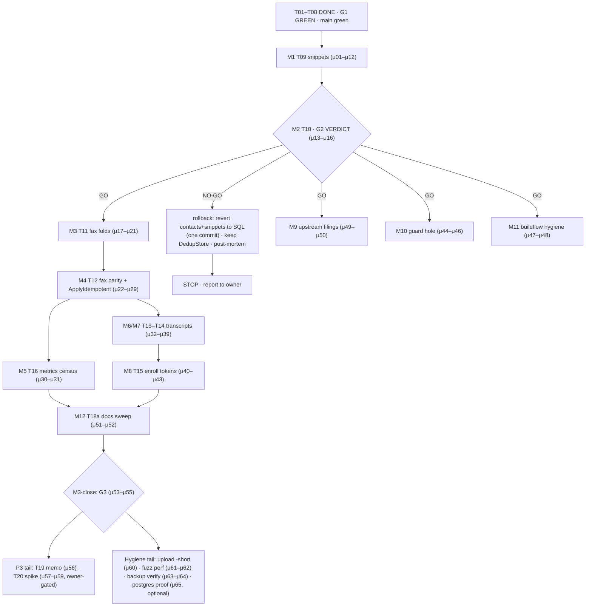

# SUPERB — Metaengine Train Remainder: Pareto Execution Plan (2026-10-15 17:14)

Status snapshot: T01–T08 DONE, G1 GREEN (CI 38689670760; plan §7 verdict), main green,
smoke 47+4+8+9 zero-fail. This plan covers the REMAINDER: fine tasks F31–F53 of the
2026-10-14 train plan (`docs/planning/2026-10-14_23-05_SUPERB-metaengine-dogfooding.md`,
which stays the task-source of truth) plus process-hygiene items surfaced on 2026-10-15
(status report `docs/status/2026-10-15_17-10_metaengine-t07-swap-g1-green.md`).

Hard rules carried: N1–N7 stand (no system.New, no threads/messages rewrite, no SSE swap,
sessions stay SQL, ladder never rewritten, listRows stays while hand tables remain).
Rule zero: do NOT verschlimmbessern — every swap is parity-gated; rollback per gate is
one commit (G2) / runbook (G3). Owner answers still pending: G2 hard-stop, upload-test
`-short`, guard-hole triage, v4 app_flags ratification.

## 1. Pareto breakdown

- **The 1% that delivers 51%: T09+T10 (F31–F33) — finish the pilot, record G2.**
  The G2 verdict is the decision gate EVERY later hour is conditional on: GO multiplies
  T11–T18 value; NO-GO ends the migration safely with DedupStore kept (one commit).
  T09 snippets is the cheap second seam that makes the verdict evidence-based (pattern
  generalization) instead of n=1. Highest risk-adjusted value; smallest effort.
- **The 4% that delivers 64%: Faxes T11–T12 (F34–F39) + the T16 SQL-site measurement.**
  Faxes are the SHOWCASE (`ApplyIdempotent(provider_ref)` reusing the declarative
  `faxMoves` train) and the largest behavioral-risk surface left (resolution arms,
  provider replays) — proving the engine there unlocks transcripts/enroll as mechanical
  follow-ons. T16's census turns the plan's headline metric (108 → ≤73 SQL sites) from
  claim into measurement.
- **The 20% that delivers 80%: + Transcripts (F40–F42), Enroll tokens (F43–F44),
  T17 upstream filing (F46), T18/G3 close (F47–F48), commit-msg guard-hole fix,
  buildflow baseline hygiene.** All parity swaps on the proven pattern plus the
  integrity items that keep main green while the train lands.
- **The other 20% to reach 100%: T19 sessions spike memo, T20 threads dual-run spike
  (owner-gated), v5 watch row, postgres proof (optional), upload-test `-short`,
  fuzz-iteration perf check, backup-drill coverage verify, quarterly dedup-baseline
  audit, stack browser E2E (owed ONLY on served-markup change — none in P0–P2).**

## 2. Comprehensive plan — medium tasks (30–100 min each), sorted

| #   | Task                                                                                                                                                           | Size (min) | Impact          | Effort | Customer value                      | Dep         |
| --- | -------------------------------------------------------------------------------------------------------------------------------------------------------------- | ---------: | --------------- | ------ | ----------------------------------- | ----------- |
| M1  | T09 snippets read model: `SnippetSaved/Deleted` folds + Query (quick flag), caps 100/5 + tests, delete `store/snippets.go` (F31–F32)                           |         90 | High            | M      | Same resilience story as contacts   | F30         |
| M2  | T10/G2 VERDICT: pilot metrics snapshot (SQL census, latency smoke vs baseline), verdict written into plan §7 + TODO_LIST; respect owner hard-stop answer (F33) |         45 | CRITICAL        | S      | Direction gate                      | M1          |
| M3  | T11 faxes records + folds: `FaxReceipted/FaxAdvanced` reusing `faxMoves` semantics; status-ladder tests incl. out-of-order + replay (F34–F35, F37)             |        100 | High            | L      | Durable fax status truth            | M2 (GO)     |
| M4  | T11c/T12: `ApplyIdempotent(provider_ref)` receipt lane + resolution-arm parity (immediate vs deferred) + delete `store/faxes.go` (F36, F38–F39)                |         90 | High            | L      | Provider replays become inert       | M3          |
| M5  | T16 metrics: SQL-site census re-run, list-latency smoke vs pre-train baseline, numbers into plan §7 (F45 stats source)                                         |         60 | High            | S      | The train's headline metric         | M4          |
| M6  | T13 transcripts: append folds + owner keying + search/export `reader.Scan` shapes (F40–F41)                                                                    |         90 | Med             | M      | Parity only                         | M4          |
| M7  | T14 transcripts: trim ruling (5000-segment cap) + impl + cap tests (F42)                                                                                       |         60 | Med             | S      | Bounded growth kept                 | M6          |
| M8  | T15 enroll tokens: Map query + consume-once fold + expiry sweep parity + delete `enroll.go` SQL + userauth tests (F43–F44)                                     |         90 | Med             | M      | Parity only                         | M7          |
| M9  | T17 upstream findings filed: scan-ceiling-100 vs list-all, check-then-apply cap ergonomics (github-voice + verify-before-filing) (F46)                         |         60 | High (upstream) | S      | Library improvements                | M2          |
| M10 | Commit-msg guard-hole investigation + fix: why daemon go.mod commits bypass `.githooks/commit-msg` (914a174 + 2026-10-15 evidence)                             |         60 | High            | S      | Protects main from dep incidents    | —           |
| M11 | buildflow hygiene: collect findings verdict; refresh/delete stale `.buildflow-baseline.json` (189 dead accepted entries)                                       |         30 | Med             | S      | Honest quality gate                 | —           |
| M12 | T18a docs sweep: CHANGELOG `[Unreleased]` for T09–T15, README/FEATURES/AGENTS readmodels rows (F47)                                                            |         60 | Med             | S      | Documentation truth                 | M8          |
| M13 | T18b/G3 CLOSE: smoke + full buildflow + vulnix + release-runbook dance (version bump, CHANGELOG cut, tag, push, CI to green, stack notification) (F48)         |        100 | CRITICAL        | L      | The release itself                  | M12         |
| M14 | T19 sessions evaluation spike: memo only, no cutover (N4 stands) (F49)                                                                                         |         60 | Low             | M      | Future decision input               | M13         |
| M15 | T20 threads dual-run spike: planned-tables harness + byte-compare report + owner decision row (F50–F51)                                                        |         90 | Low (research)  | L      | Evidence for the NO-GO stance       | M13 + owner |
| M16 | Upload-test `-short` marking (61 MiB / 9-min-under-load test) once owner answers                                                                               |         15 | Low             | XS     | Faster local suites                 | owner       |
| M17 | Fuzz-perf check: `newTestReadmodels` per fuzz iteration (t.TempDir) — measure fuzz-mode throughput; share one engine if determinism holds                      |         30 | Low             | S      | Fuzz ergonomics                     | —           |
| M18 | Backup coverage verify: `webphone-backup`/`backup-drill` VM tests exercise dataDir copy incl. readmodels.db (assert restore path)                              |         45 | Med             | S      | The backup promise for the NEW file | —           |

## 3. Fine breakdown — every task ≤ 12 min, sorted (execution order within dependency groups)

| #   | Micro-task                                                                      | Est (min) | Parent |
| --- | ------------------------------------------------------------------------------- | --------: | ------ |
| μ01 | domain: `SnippetSaved`/`SnippetDeleted` records + `SnippetKey` (framework-free) |        10 | M1     |
| μ02 | readmodels: `snippetsQuery` (insert fold + Remove + owner filter + sort)        |        12 | M1     |
| μ03 | readmodels: `Snippets` store seam (Save/List/Delete + quick-flag query variant) |        12 | M1     |
| μ04 | readmodels: quick-5 windowing (limit 5) + per-owner cap 100 via WithLimit       |        10 | M1     |
| μ05 | readmodels tests: save/list/delete order + owner scoping + restart durability   |        12 | M1     |
| μ06 | readmodels tests: caps (100 per-owner, quick 5) + rename-free semantics         |        12 | M1     |
| μ07 | server: Deps.Snippets type swap + snippets handlers sentinel re-point           |         8 | M1     |
| μ08 | app.go: delete store.Snippets provider, wire engine.Snippets()                  |         8 | M1     |
| μ09 | family pins: ErrSnippetListFull homing decision + registration move             |        10 | M1     |
| μ10 | delete `store/snippets.go` + grep zero stray refs + test rewires                |        12 | M1     |
| μ11 | T09 gates: readmodels+server+store tests green; nix fmt; whitespace check       |        12 | M1     |
| μ12 | T09 commit (detailed message) + push + CI watch to green                        |        10 | M1     |
| μ13 | metrics snapshot: SQL-site census script run (pre/post numbers)                 |         8 | M2     |
| μ14 | latency smoke: list endpoints vs pre-train baseline, record deltas              |        12 | M2     |
| μ15 | write G2 verdict into plan §7 (GO/NO-GO + numbers + rollback state)             |        10 | M2     |
| μ16 | update TODO_LIST train row; stop here if owner says hard-stop                   |         6 | M2     |
| μ17 | domain: `FaxReceipted`/`FaxAdvanced` records aligned to faxMoves vocabulary     |        12 | M3     |
| μ18 | readmodels: fax insert/update folds (same-status = refreshing move)             |        12 | M3     |
| μ19 | readmodels: owner-scoped fax list query (sort, paging shape parity)             |        10 | M3     |
| μ20 | fax folds tests: legality table mirror (every faxMoves row exercised)           |        12 | M3     |
| μ21 | out-of-order verdict tests: deferred resolution after sending, replay refresh   |        12 | M3     |
| μ22 | ApplyIdempotent receipt lane: provider_ref eventID wiring                       |        12 | M4     |
| μ23 | replay tests: duplicate provider verdict inert (idempotent apply)               |        10 | M4     |
| μ24 | resolution-arm parity A: immediate (hook before sweep)                          |        12 | M4     |
| μ25 | resolution-arm parity B: deferred (poll/timeout path)                           |        12 | M4     |
| μ26 | paperless seam unchanged-verify (archiver fire-and-forget test still green)     |         8 | M4     |
| μ27 | server: Deps.Faxes swap + hooks seam re-point at readmodels faxes               |        12 | M4     |
| μ28 | delete `store/faxes.go` + stray-ref grep + test rewires                         |        12 | M4     |
| μ29 | T11/T12 gates: full fax+hooks suites; fmt; whitespace; commit; push; CI         |        12 | M4     |
| μ30 | SQL census re-run post-faxes; record delta (−12 target: 7+5)                    |         6 | M5     |
| μ31 | boot + list-latency smoke vs baseline; numbers into plan §7                     |        12 | M5     |
| μ32 | domain: transcript-append record + owner keying                                 |         8 | M6     |
| μ33 | readmodels: transcript append fold + owner/call filter + sort                   |        12 | M6     |
| μ34 | transcript read shapes: search (filter+scan) + export parity vs SQL             |        12 | M6     |
| μ35 | transcript parity tests (order, scoping, search hits)                           |        12 | M6     |
| μ36 | trim ruling re-read + impl port (5000-segment scalar-bounded trim)              |        10 | M7     |
| μ37 | trim cap tests (boundary at 5000, trim keeps newest)                            |        10 | M7     |
| μ38 | transcripts swap: Deps + provider wiring + delete transcripts SQL + tests       |        12 | M6     |
| μ39 | transcripts gates: fmt; suites; commit; push; CI                                |        10 | M7     |
| μ40 | enroll-token Map query declaration + consume-once fold                          |        12 | M8     |
| μ41 | expiry sweep parity via engine (due-claim pattern or sweeper)                   |        12 | M8     |
| μ42 | userauth tests green; delete enroll.go SQL; Deps wiring                         |        12 | M8     |
| μ43 | enroll gates: fmt; suites; commit; push; CI                                     |        10 | M8     |
| μ44 | guard triage: reproduce daemon-pattern commit locally (hooked clone)            |        12 | M10    |
| μ45 | guard fix: detect daemon pattern where it slips (env/author/msg) + test         |        12 | M10    |
| μ46 | guard regression: fake daemon commit on go.mod must be refused                  |        10 | M10    |
| μ47 | buildflow: collect findings verdict from a completed run                        |         6 | M11    |
| μ48 | buildflow: refresh baseline (or delete) so accepted entries match reality       |        10 | M11    |
| μ49 | upstream drafts: scan-ceiling-100 + cap-ergonomics issue bodies (verify-first)  |        12 | M9     |
| μ50 | upstream: file both issues; links into TODO_LIST Standing watches               |        10 | M9     |
| μ51 | CHANGELOG `[Unreleased]`: snippets/faxes/transcripts/enroll lines               |        10 | M12    |
| μ52 | docs sweep: README + FEATURES + AGENTS rows for the new seams                   |        12 | M12    |
| μ53 | G3 pre-flight: full suite + buildflow + `nix run .#vulnix`                      |        12 | M13    |
| μ54 | release: version bump + CHANGELOG cut + tag + push + CI to green                |        12 | M13    |
| μ55 | release: stack notification (webphone train done; relock window open)           |         8 | M13    |
| μ56 | T19 sessions spike memo (SQL-vs-engine evaluation, no cutover)                  |        12 | M14    |
| μ57 | T20 dual-run harness behind build tag + threads-list byte-compare               |        12 | M15    |
| μ58 | T20 byte-compare report + owner decision row                                    |        10 | M15    |
| μ59 | v5 watch row (usermgmt stack.Materialize adapter) into TODO_LIST                |         5 | M15    |
| μ60 | upload-test `-short` marking (if owner approves) + suite timing check           |         8 | M16    |
| μ61 | fuzz-perf: run 30s fuzz on contacts target; judge t.TempDir cost                |        10 | M17    |
| μ62 | fuzz-perf: share one engine across iterations IF verdicts stay deterministic    |        12 | M17    |
| μ63 | backup verify: read module-check/VM-test coverage of readmodels.db              |        10 | M18    |
| μ64 | backup: extend drill assertion to restore+open readmodels.db if missing         |        12 | M18    |
| μ65 | postgres proof (OPTIONAL): sqliteengine→postgres engine smoke on scratch DB     |        12 | F53    |

## 4. Execution graph

## 5. Standing orders while executing

- One seam per commit; full local gates before push (`nix fmt`, targeted suites,
  whitespace check); CI watched to green after EVERY push; auth-grade paths keep the
  `auth:` prefix convention.
- Daemon discipline: work in small committed units; experiments in worktrees; re-View
  before every edit; `go get` bumps NEVER ride the daemon (tidy → vendor → vendorHash
  → push → CI).
- Parity or death: every swap keeps wire bytes and verdicts identical; the byte-parity
  golden (F30b remainder) rides T09's commit as a list-payload golden for snippets too.
- The owner's pending answers gate: G2 hard-stop (M2 → M3), upload `-short` (μ60),
  v4 app_flags ratification (recorded assumption: stands until vetoed).
