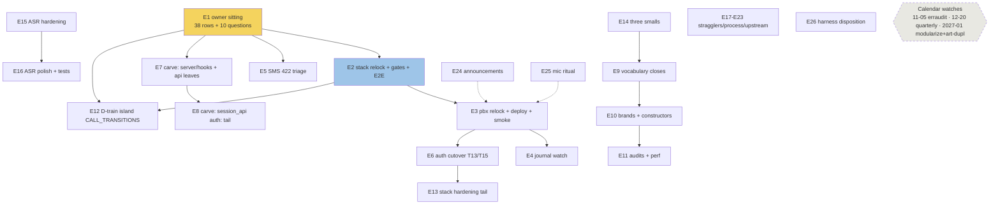

# SUPERB Round-5 Pareto Plan — every open TODO, post-2.9.0, post-4th-modularization-entry

**Written:** 2026-10-17 20:55 CEST · **Supersedes:** round-4 plan (2026-10-06_13-31) for all OPEN work — its D-rows carry forward here re-lettered **E** where still open; D-rows shipped since (dedup baseline+CI gate, push-stall watchdog, commit-msg guard, erraudit re-measures, brandid-zero, metaengine swaps, declarative trains A/B/C/E, health-css canary, md-table detector) are dropped per CHANGELOG [Unreleased]+[2.9.0].
**Inputs:** TODO_LIST.md (24 live sections, sweep 2026-10-12 + 10-14/10-15 train updates), ROADMAP.md (38-row owner briefing + open questions), round-4 plan D-statuses, this week's status reports (10-15 M1–M12, 10-16 2.9.0, 10-17 modularization ×2), CHANGELOG [2.9.0].
**Method:** tables at natural width — the daemon reflows once, accepted per the 04-12 §e.3 ruling. Fine tasks are ≤12 min per the dispatch (skill default 15).

## Errata (stale backlog findings, verified against code/CHANGELOG this session)

1. **metaengine row "G3 release = next" is stale:** v2.9.0 (tagged 2026-10-16) folded the metaengine changelog (commit `0f1031d`) — the release leg of G3 is DONE; what remains is row hygiene + the two cqrs-lint polish hints. Task E22 verifies and closes the row; no code work implied.
2. **Dedup sitting item 3 (branching-flow re-triage):** the 2026-10-15 unskip + baselines landed (.buildflow.yml documents the classifications) — item is DONE; the sitting row's remaining live items are drafts→upstream filing (item 2) and the quarterly audits.
3. **v2.8.0 deploy tail row predates v2.9.0:** superseded by the v2.9.0 deploy train (E3) — the row's stack-relock caddy-rename edits still apply verbatim.
4. **Standing-watches "next due 2026-12-20" header** coexists with per-item dates (2026-11-05, 2027-01, 2027-01-11) — the header is the QUARTERLY cadence anchor, items fire on their own dates; not drift, recorded to stop future confusion.

## Pareto verdict

**1% → 51%: E1 THE OWNER SITTING (again, and bigger).** One 90-minute sitting now carries 38 briefing rows + 7 accumulated §g questions + this week's 3 (next-train sequencing, commit granularity, d2 upstreaming). Round 4 named it the 1% on 10-06; eleven days later it has compounded — every owner-gated cluster (deploy sequencing, auth cutover, passkey switch, announcements) queues behind it. Nothing in the owner lane moves without it.

**4% → 64%: E1 + the v2.9.0 DEPLOY TRAIN (E2→E3→E4) + E5 SMS-422 triage.** Five sessions of shipped-and-green product (passkey mode, metaengine/readmodels, declarative lifecycle tables, ASR live transcription, auth hardening, brandid-zero) are UNDEPLOYED — prod still runs the pre-2.8 binary. Getting 2.9.0 live behind pbx.artmann.tech converts the entire queue into customer value, and the deploy train's browser-E2E leg simultaneously discharges the markup obligations two trains owe. E5 is the one live customer-facing breakage (outbound SMS 422), owner-journal, 20 minutes.

**20% → 80%: + E6 auth cutover cluster (T13/T15 xml_curl — credential brokering goes live), E7 server carve phase 1+2 (the biggest assistant-executable structural debt; trigger due since 10-12, mapped), E8 data-model series-3 harvest (typing depth where bugs actually live), E9 declarative D-train close (island CALL_TRANSITIONS), E10 stack hardening tail (suite dedup + watch wiring).**

**Remaining 20% → 100%:** carve phase 3 (E7's auth-prefixed tail), the three twice-carried smalls (E11), ASR polish + test debt (E12), gate-recovery stragglers (E13), metaengine row close + hints (E22), process folds from the 10-17 sessions (E23), markdownlint posture execution (E14), upstream filings (E15 d2 cheat-sheet, E16 branching-flow drafts), harvest audits (E17), announcements + mic ritual + harness disposition (E18/E19/E20), cross-repo stack batch (E21), date-gated watches (calendar, not tasks), standing NO-GOs stay (scheduled sends; split blueprint dormant; JsSIP fallback).

## Comprehensive plan (30–100 min tasks, ALL open TODOs, sorted by importance/impact/effort/customer-value)

| #   | Task                                                                                                                                                                                                                                                                                                           | Owner                   | Effort | Impact                     | Value   | Depends           |
| --- | -------------------------------------------------------------------------------------------------------------------------------------------------------------------------------------------------------------------------------------------------------------------------------------------------------------- | ----------------------- | ------ | -------------------------- | ------- | ----------------- |
| E1  | Owner sitting: 38-row briefing + 7 §g + 3 new (next train, commit granularity, d2 upstream)                                                                                                                                                                                                                    | owner                   | 90m    | unblocks 9 TODO rows       | highest | —                 |
| E2  | Stack relock to webphone v2.9.0 + full gates incl. browser E2E (covers cascade-fix + passkey-tail markup obligations; caddy-rename edits from the old deploy row)                                                                                                                                              | assistant (stack repo)  | 100m   | prod parity                | high    | E1 (sequencing)   |
| E3  | pbx-artmann relock + deploy + post-deploy smoke (`--expect-version`) + sign-in banner browser check                                                                                                                                                                                                            | owner (terminal)        | 100m   | 5 trains go live           | high    | E2                |
| E4  | Post-deploy journal watch: auth logout lines, directory query, MOH/recordings/CDR recipe legs                                                                                                                                                                                                                  | owner                   | 30m    | confidence                 | med     | E3                |
| E5  | SMS 422 prod triage (journal → creds → restart → test SMS; command sheet §4)                                                                                                                                                                                                                                   | owner                   | 20m    | fixes live breakage        | high    | —                 |
| E6  | Auth cutover T13/T15: relock+backup+rollback drill → xml_curl cutover + watch → live proofs + CHANGELOG-in-commit                                                                                                                                                                                              | owner                   | 3×100m | credential brokering live  | high    | E1, E3            |
| E7  | Server carve phase 1 `server/hooks` (webhooks+idem out of wiring) + phase 2 `server/api` leaf moves (csrf→contacts→calls; 401-allowlist + DOM pins update mechanically)                                                                                                                                        | assistant               | 3×100m | structural, CI-time        | high    | E1 (sequencing)   |
| E8  | Carve phase 3: `session_api` last under `auth:` prefix + TestServer session-behavior suite                                                                                                                                                                                                                     | assistant               | 100m   | closes the carve           | high    | E7                |
| E9  | Data-model harvest batch 1: vocabulary closes (Must parsers ×4 + corrupt-row test; retention_days reject; gateway exhaustive dispatch; ParsePhone at island boundary; ThreadFlag switch)                                                                                                                       | assistant               | 100m   | bug-class kill             | high    | —                 |
| E10 | Data-model harvest batch 2: brands (`session.Token` through Store+Derive; `domain.RelPath` type home) + constructors (New{In,Out}Message/Fax; collapse UpdateStatus params)                                                                                                                                    | assistant               | 2×100m | illegal states unbuildable | high    | E9                |
| E11 | Data-model harvest batch 3: audits/docs (fax Resolution arms, dedup-registry cross-check, idempotency TTL invariants, Lang 10th enum, time-granularity note) + perf (attachAttachments IN-query, caps×window table test, ExtensionHubs keyed)                                                                  | assistant               | 2×100m | durability                 | med     | E9                |
| E12 | Declarative D-train: island CALL_TRANSITIONS + memo ratification fold                                                                                                                                                                                                                                          | assistant               | 100m   | closes 10-14 plan          | med     | E1 (g3), E2 (E2E) |
| E13 | Stack hardening: tests/common.nix helpers (journal-assert, secretFile fixture) + dynamic-directory suite merge + fs-directory→operatorWatchedUnits + health leg                                                                                                                                                | assistant (stack repo)  | 2×100m | CI cost + watchability     | med     | E6                |
| E14 | The three smalls: fax receipt-verbosity seam; config fail-closed typing; schema_version gate — ADJUDICATED ALREADY-DONE-AT-HEAD 2026-10-18 (see F63–F65)                                                                                                                                                       | assistant               | 3×45m  | old cheap debt             | med     | —                 |
| E15 | ASR provider hardening: retry/backoff + unavailable toast (#43/#44), latency metric (#23), optional health leg (#22), memory ceiling (#47)                                                                                                                                                                     | assistant               | 100m   | robustness                 | med     | —                 |
| E16 | ASR client polish + test debt: language hint (#11/#12), DOM cap (#41), per-call affordance (#39), download (#40); voicemail button test (#37), 429 combined load (#5)                                                                                                                                          | assistant               | 2×100m | UX + coverage              | med     | E15               |
| E17 | Gate-recovery stragglers: ui-capture 14-shot pass on v1.20.1 tree; module-cache janitor + zero-byte .tmp sweep; errorpage tagging upstream note                                                                                                                                                                | assistant               | 100m   | tool trust                 | med     | —                 |
| E18 | Markdownlint posture execution (post-sitting row-18 verdict; config-or-detect-only AGENTS line)                                                                                                                                                                                                                | assistant               | 30m    | corpus safety              | low     | E1                |
| E19 | d2 cheat-sheet upstream fix in skills repo (`stroke-dash` on v0.9.0; verify-before-filing → PR)                                                                                                                                                                                                                | assistant (skills repo) | 30m    | tooling truth              | low     | E1 (Q3)           |
| E20 | Branching-flow upstream drafts → file (phantom-analysis class scoping; panic-analysis FP precision)                                                                                                                                                                                                            | assistant               | 60m    | detector health            | low     | —                 |
| E21 | Harvest audits: 10-14 status 26 follow-ups routing check; carve row two-method number refresh                                                                                                                                                                                                                  | assistant               | 60m    | docs truth                 | low     | —                 |
| E22 | Metaengine row close-out: verify G3-via-2.9.0, refresh TODO row, F019/F026 cqrs-lint hints on query declarations                                                                                                                                                                                               | assistant               | 60m    | row hygiene + polish       | low     | —                 |
| E23 | Process folds (10-17 sessions): lessons refinements (self-verifying scripts, verify-before-describing), snapshot-rot header convention, GOPROXY fallback + BuildFlow retry (BuildFlow-repo side, S)                                                                                                            | assistant               | 60m    | process debt               | low     | —                 |
| E24 | Announcements: post drafts for v2.1–v2.3/2.5/2.6/2.7 (+2.8/2.9 to draft)                                                                                                                                                                                                                                       | owner                   | 60m    | presence                   | low     | E3                |
| E25 | Mic pre-warm live ritual (accept→speak sub-second, indicator at ring, warm release)                                                                                                                                                                                                                            | owner                   | 30m    | closes T07/T11             | low     | E3                |
| E26 | Visual-harness disposition: eyeball 18-shot matrix, per-release vs per-train persistence, vision-CLI provider call                                                                                                                                                                                             | owner                   | 30m    | QA posture                 | low     | E1 (§g1)          |
| CAL | Date-gated watches (NOT tasks): erraudit re-measure 2026-11-05 · quarterly watches 2026-12-20 · modularize re-review + art-dupl baseline audit 2027-01(+11) · sip.js/templ/oxlint/E2E-budget/QMD/go-health/brandid standing · upstream #71/#72 · XFF flip (stack proof) · blueprint dormant absent §09 trigger | —                       | —      | —                          | —       | calendar          |

## Fine breakdown (≤12 min each, grouped by parent, sorted by importance/impact/effort/customer-value)

**E1 sitting (owner)**

| #   | Micro-task                                                                                                                                              | Est |
| --- | ------------------------------------------------------------------------------------------------------------------------------------------------------- | --- |
| F01 | Print briefing + this plan's owner-gate list; timebox 90m                                                                                               | 5m  |
| F02 | Answer rows 15–28 (original + 10-01 batch)                                                                                                              | 30m |
| F03 | Answer rows 29–38 (10-05/10-06 batches: mixin home, URL+Token twins, vcard triad, errorfamily.Join, auth:×daemon, devShell tools, lychee, express-push) | 25m |
| F04 | Answer the 7 §g + 3 new (next train, commit granularity, d2 upstream)                                                                                   | 20m |
| F05 | Record verdicts into briefing doc + TODO rows same-sitting                                                                                              | 10m |

**E2/E3/E4 deploy train**

| #   | Micro-task                                                                            | Est |
| --- | ------------------------------------------------------------------------------------- | --- |
| F06 | Stack repo: bump webphone input to v2.9.0 tag                                         | 10m |
| F07 | Stack: apply the two caddy-rename eval fixes from the old deploy row                  | 12m |
| F08 | Stack: `nix flake check` + triage                                                     | 12m |
| F09 | Stack: browser E2E run (budget 445s; re-run once on the known transfer flake)         | 12m |
| F10 | pbx-artmann: clean-tree check + relock + `nixos-rebuild test`                         | 12m |
| F11 | pbx-artmann: smoke `--base https://pbx.artmann.tech --expect-version 2.9.0`           | 10m |
| F12 | Browser sign-in rejection-banner check (self-send 422 copy)                           | 8m  |
| F13 | `nixos-rebuild switch` + journal watch (auth logout, directory, MOH, recordings, CDR) | 12m |

**E5 SMS triage (owner)**

| #   | Micro-task                                                         | Est |
| --- | ------------------------------------------------------------------ | --- |
| F14 | `systemctl status telnyx-webhooks` + journal grep sms/422/error    | 10m |
| F15 | Act on findings (restart or creds per command sheet §4) + test SMS | 10m |
| F16 | Record root cause in TODO row + stack runbook                      | 8m  |

**E6 cutover cluster (owner, after deploy)**

| #   | Micro-task                                                                                        | Est |
| --- | ------------------------------------------------------------------------------------------------- | --- |
| F17 | pbx-artmann relock to stack HEAD (clean tree)                                                     | 12m |
| F18 | Pre-cutover backup + rehearse <2-min rollback drill once                                          | 12m |
| F19 | Verify derivation secret file owner/mode (webphone read + bridge LoadCredential)                  | 10m |
| F20 | Set `telephony.directory.mode = "xml_curl"` + `staticFallbackExtensions` (operator + ring groups) | 12m |
| F21 | Rebuild + CI + journal watch (logout, directory query lines)                                      | 12m |
| F22 | T15 proofs: derived-cred REGISTER (browser + one softphone)                                       | 12m |
| F23 | T15 proofs: logout-revocation live, static extensions unaffected                                  | 12m |
| F24 | Rollback drill ONCE on prod + pbx-artmann CHANGELOG in the cutover commit                         | 12m |

**E7/E8 carve (assistant; each phase = build+test+gates green before next)**

| #   | Micro-task                                                                                          | Est |
| --- | --------------------------------------------------------------------------------------------------- | --- |
| F25 | Carve pre-flight: refresh counts (two methods), re-read dependency map, branch `carve/server-hooks` | 12m |
| F26 | Move webhook ingest + idem files to `internal/server/hooks`; package decl + imports                 | 12m |
| F27 | Move their tests; fix 401-allowlist contract test allowlist entry                                   | 12m |
| F28 | Gates: go test ./internal/server/... + buildflow + arch; commit                                     | 12m |
| F29 | `server/api`: carve csrf_api (zero-dep leaf) first                                                  | 10m |
| F30 | carve contacts_api (+notifyContactsChanged interface)                                               | 12m |
| F31 | carve calls_api (+callsIdem/recordCrmCall wiring)                                                   | 12m |
| F32 | carve transcribe/transcripts (+Deps threading)                                                      | 12m |
| F33 | DOM-contract pin re-run + island closure test                                                       | 12m |
| F34 | carve passkey_settings + internal_directory + auth_audit                                            | 12m |
| F35 | Phase 3: session_api under `auth:` prefix; shared-methods narrow interface                          | 12m |
| F36 | TestServer session-behavior suite + full gates + smoke; CHANGELOG `[Unreleased]` line               | 12m |

**E9–E11 data-model harvest (assistant)**

| #   | Micro-task                                                                              | Est |
| --- | --------------------------------------------------------------------------------------- | --- |
| F37 | `Must*` enum parsers: messages scan site + corrupt-row panic test                       | 12m |
| F38 | `Must*`: fax scan site + test                                                           | 12m |
| F39 | `Must*`: transcripts + ThreadFlag exhaustive switch                                     | 12m |
| F40 | retention_days negative reject at config.validate + named boot failure test             | 12m |
| F41 | Gateway exhaustive dispatch: unknown mode panics, drop Loopback fallback + test         | 12m |
| F42 | Transcript remote `ParsePhone` at island-POST boundary + test                           | 12m |
| F43 | `session.Token` brand: type + constructors through Store seam (part 1)                  | 12m |
| F44 | `session.Token` brand: sipcred.Derive + TestServer suite green (part 2, `auth:` prefix) | 12m |
| F45 | `domain.RelPath`: type + blob edge conversion + arch-test note                          | 12m |
| F46 | Constructors: New{In,Out}boundMessage + illegal-pair test                               | 12m |
| F47 | Constructors: New{In,Out}boundFax + test                                                | 12m |
| F48 | Collapse UpdateStatus loose params onto delivery-machine value                          | 12m |
| F49 | Fax tests: cover both Resolution arms                                                   | 10m |
| F50 | Dedup-registry end-to-end cross-check of cited rulings                                  | 12m |
| F51 | idempotency.go TTL-map invariant audit note + `views.Lang` 10th-enum stat fix           | 12m |
| F52 | Time-granularity doc note (millis vs s) + Lifetime single-home ruling                   | 10m |
| F53 | attachAttachments N+1 → single IN-query + test                                          | 12m |
| F54 | Caps × transcriptFetchWindow table test; ExtensionHubs keyed by domain.Extension        | 12m |

**E12 D-train close**

| #   | Micro-task                                                 | Est |
| --- | ---------------------------------------------------------- | --- |
| F55 | Island CALL_TRANSITIONS emission points + state.js map     | 12m |
| F56 | Island test + DOM-contract conditional check               | 12m |
| F57 | DOMAIN_LANGUAGE ratification memo fold per sitting verdict | 10m |

**E13 stack hardening (stack repo)**

| #   | Micro-task                                                          | Est |
| --- | ------------------------------------------------------------------- | --- |
| F58 | tests/common.nix: journal-assert helper port                        | 12m |
| F59 | tests/common.nix: secretFile fixture helper                         | 12m |
| F60 | Merge dynamic-directory suite into telephony-webphone (one machine) | 12m |
| F61 | fs-directory → operatorWatchedUnits + health-leg consideration note | 12m |
| F62 | sipcred wire vector pin + fail2ban interplay check                  | 12m |

**E14 smalls (assistant)**

| #   | Micro-task                                                                                                                                        | Est             |
| --- | ------------------------------------------------------------------------------------------------------------------------------------------------- | --------------- |
| F63 | Fax receipt-verbosity seam: typed receipt levels + tests — done at HEAD: the closed `domain` fax Resolution enum, both arms tested                | 12m ×2 (F63a/b) |
| F64 | Config fail-closed typing: twin-option struct validation + boot test — done at HEAD: load-time identities-keys + shared-contact number validation | 12m             |
| F65 | Schema_version gate: table + first migration step wired — done at HEAD: the versioned migration chain in store/db.go (schema v4 markers)          | 12m ×2 (F65a/b) |

**E15/E16 ASR (assistant)**

| #   | Micro-task                                                                                                                                   | Est             |
| --- | -------------------------------------------------------------------------------------------------------------------------------------------- | --------------- |
| F66 | Segment retry/backoff with cap + "transcription unavailable" toast — done at HEAD (verified 2026-10-18; pre-shipped by an earlier ASR train) | 12m ×2 (F66a/b) |
| F67 | Provider latency metric + optional non-critical health leg                                                                                   | 12m             |
| F68 | Memory ceiling for concurrent live transcriptions                                                                                            | 12m             |
| F69 | Language hint from wp-lang + asr.language wire — done at HEAD (verified 2026-10-18)                                                          | 12m             |
| F70 | Client transcript DOM cap + per-call scroll/clear affordance                                                                                 | 12m             |
| F71 | Transcript download leg                                                                                                                      | 12m             |
| F72 | Voicemail transcribe-button test (#37) — done at HEAD (verified 2026-10-18)                                                                  | 12m             |
| F73 | 429 combined live+auto load test (#5)                                                                                                        | 12m             |

**E17–E23 stragglers/process (assistant)**

| #   | Micro-task                                                                                                                                                                                                                             | Est             |
| --- | -------------------------------------------------------------------------------------------------------------------------------------------------------------------------------------------------------------------------------------- | --------------- |
| F74 | ui-capture 14-shot pass on v1.20.1 tree + diff vs matrix                                                                                                                                                                               | 12m             |
| F75 | Module-cache janitor script + zero-byte .tmp sweep                                                                                                                                                                                     | 12m             |
| F76 | templ-components errorpage tagging discipline: upstream note filed — ALREADY UPSTREAM (verified 2026-10-18: issue #27 + docs/release-checklist.md + release-smoke workflow encode the discipline)                                      | 10m             |
| F77 | Markdownlint posture line in AGENTS per sitting verdict                                                                                                                                                                                | 10m             |
| F78 | d2 cheat-sheet: verify snippet matrix on v0.9.0, fix reference, PR skills repo                                                                                                                                                         | 12m ×2 (F78a/b) |
| F79 | Branching-flow drafts: finalize + file both upstream — ALREADY FILED + COMPLETED upstream (verified 2026-10-18: panic FP shapes = issue #9 COMPLETED, phantom class scoping = issues #15/#16 COMPLETED; drafts remain in docs/drafts/) | 12m ×2 (F79a/b) |
| F80 | 10-14 status 26-followup routing audit (grep TODO/ROADMAP per item)                                                                                                                                                                    | 12m ×2 (F80a/b) |
| F81 | Carve row number refresh (two-method count) + row close if E7/E8 done                                                                                                                                                                  | 10m             |
| F82 | Metaengine row: verify G3-via-2.9.0, rewrite row to closed state                                                                                                                                                                       | 10m             |
| F83 | F019 Volume hints + F026 WithPrefetch on live query declarations                                                                                                                                                                       | 12m             |
| F84 | lessons.md: fold self-verifying-scripts + verify-before-describing refinements                                                                                                                                                         | 10m             |
| F85 | Snapshot-rot header convention added to next status report; note in AGENTS if kept                                                                                                                                                     | 8m              |
| F86 | GOPROXY fallback + BuildFlow retry wrapper (BuildFlow-repo side)                                                                                                                                                                       | 12m             |
| F87 | Human eyeball of the two D2 diagrams (owner glance, replaces image-blind ceiling)                                                                                                                                                      | 5m              |

**E24–E26 owner terminals**

| #   | Micro-task                                                                  | Est |
| --- | --------------------------------------------------------------------------- | --- |
| F88 | Announcements: pick channels + approve wording (v2.1–v2.3/2.5/2.6/2.7)      | 30m |
| F89 | Draft v2.8/v2.9 announcement from the 2.8.0 drafts pattern                  | 12m |
| F90 | Mic ritual: accept→speak sub-second + indicator + warm release checks       | 30m |
| F91 | Harness disposition: eyeball matrix + persistence cadence + vision-CLI call | 30m |

## Execution graph

## Owner gates this plan does NOT self-answer (per house rule)

1. Next-train sequencing: carve (E7) vs three smalls (E14) — this plan ORDERS carve first on impact (structural, CI-time lever, trigger due since 10-12), smalls as gap-filler; the sitting ratifies or inverts.
2. Commit granularity under the daemon (micro per-edit-cluster vs end-of-pass).
3. d2 cheat-sheet upstreaming (E19 blocked on it).
4. All 38 briefing rows + 7 §g (E1).
5. ASR owner cluster (M1/M2/M4/M6, 429 cooldown, SILENCE_RMS) — carried unchanged.
6. Scheduled sends stay DECIDED-AGAINST; split blueprint stays dormant (§09 triggers only).

## Verification battery for this plan

- Every E-row traced to a live TODO_LIST section (24/24 sections accounted: executed rows dropped with CHANGELOG evidence in Errata; watches → CAL; NO-GOs → standing list).
- New tasks this plan surfaces (F84–F87 session-tail folds, F82 metaengine close) get ONE consolidated TODO_LIST row pointing here — added with this plan (HARVEST direction, one home).
- Round-4 D-rows cross-checked: shipped ones dropped, open ones re-lettered; nothing silently lost.
- Plan is a snapshot: bring-current = docs-health ANNOTATE, never rewrite.
