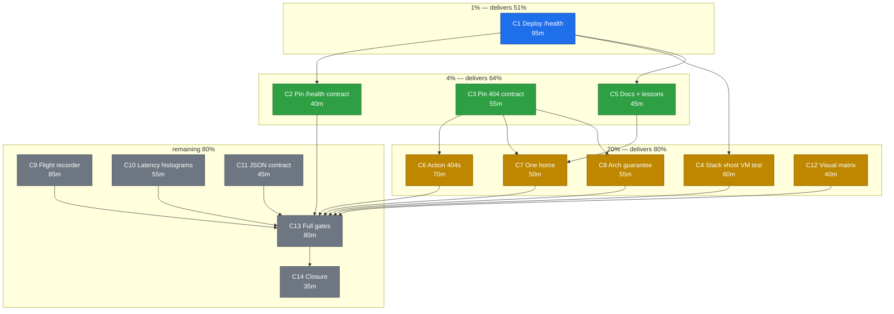

# SUPERB plan — 404 contract, `/health` deployment, observability depth

**Created:** 2026-10-23 15:29 (+02:00)
**Source:** `docs/status/2026-10-23_15-25_404-health-appkit-session.md` (§a–§g) and
`docs/research/2026-10-23_go-appkit-deep-dive.html`.
**Scope rule:** every task below traces to an open item from *this* session. No
speculative rewrites. If a task would change behaviour nobody asked about, it is
not in this plan.

**State at plan time (verified):**

| Repo | Branch | Ahead of remote | Working tree |
|------|--------|-----------------|--------------|
| webphone | main | 4 commits | clean |
| nix-international-telephony | main | 11 commits | clean |
| pbx-artmann | master | 1 commit | `AGENTS.md` dirty (another session) |

---

## 1. What actually matters: the Pareto layers

### The 1% that delivers 51%

**The deploy chain.** Everything for `/health` is already written and
eval-proven; what is missing is that the stack never reached `main`, so
pbx-artmann cannot lock it. Five mechanical steps (push webphone, push stack,
relock, eval, record) turn ~4 hours of finished work into a live operator surface
at `https://pbx.artmann.tech/health`. Nothing else in this plan matters if the
surface never reaches the host.

Also in this layer: the **last verification that the fence actually works** -
logged-out request must hit the SSO redirect, not the cards.

### The 4% that delivers 64% (cumulative)

**Making the two contracts durable**, so the work does not rot: the `/health`
styled-404 and the new 404 panel are only real if tests pin them.
- smoke probe for `/health` while the dashboard is off
- `Cache-Control: no-store`, `HEAD`, German keys, path-echo-only assertions
- 405 reachability test (the error contract now *claims* 405 is unreachable)
- the two lessons entries (contract grep first, formatter isolation)
- the README paragraph that tells an operator the surface exists

Without this layer the 404 regresses the first time someone "cleans up" the mux.

### The 20% that delivers 80% (cumulative)

**Structural guarantees and the operator-facing surface.**
- A stack VM test that proves the nginx location + fence (not just the eval).
- An arch test that every HTML route family answers through the shell.
- Converting the *reachable* action 404s (thread/fax/snippet misses) to the panel.
- One home for the 404/405 knowledge instead of three partial statements.
- Visual matrix coverage so the 404 is seen, not just asserted.

### The remaining 80% (the long tail to 100%)

**Observability depth and closure.** The flight recorder (the one genuinely
unadopted go-appkit capability that solves a real problem), latency histograms,
the JSON error-contract decision for `/api`, the styled 405 only if buffering is
proven safe, the full gate run, and the reconciliation of plan/docs/report
citations. These are real but none of them block the operator surface.

---

## 2. Comprehensive plan — 14 tasks, 30-100 min each

Sorted by importance x impact x effort x customer value. Tier column follows §1.

| # | Task | Tier | Impact | Effort | Value | Depends on |
|---|------|------|--------|--------|-------|------------|
| C1 | Deploy `/health` to pbx.artmann.tech: push webphone, push stack, relock, eval-verify, record | 1% | Operator surface goes live | 95m | Highest (the complaint) | - |
| C2 | Pin the `/health` contract in tests (smoke probe, no-store, HEAD, aliases) | 4% | Stops regression | 40m | High | C1 |
| C3 | Pin the 404 contract end to end (405 reachability, golden panel, German, query handling) | 4% | Honest documented claims | 55m | High | - |
| C4 | Prove the stack vhost path with a VM test (location + fence, not just eval) | 20% | Catches nginx drift | 60m | Medium-high | C1 |
| C5 | Operator and lesson documentation (README section + 2 lessons + checklist) | 4% | Discoverability | 45m | Medium-high | C1 |
| C6 | Convert the reachable action 404s (thread, fax, snippet misses) to the styled panel | 20% | Consistent experience | 70m | Medium | C3 |
| C7 | One home for 404/405 knowledge (consolidate, delete duplication) | 20% | Less drift | 50m | Medium | C3, C5 |
| C8 | Arch test: every HTML route family answers through the shell | 20% | Structural guarantee | 55m | Medium | C3 |
| C9 | Flight recorder seam (default off) over `go-flightrecorder` | 80% | Diagnosability | 85m | Medium | - |
| C10 | Latency histograms on `/metrics` (aggregates only) | 80% | Capacity answers | 55m | Medium | - |
| C11 | JSON error-contract decision for `/api` (adopt shape or reject) | 80% | Uniform machine errors | 45m | Low-medium | - |
| C12 | Visual matrix refresh (404 surfaces in `ui-capture`) | 20% | Seen not just asserted | 40m | Medium | - |
| C13 | Full gate run (`nix fmt`, tests, buildflow, flake check, vulnix, smoke) | 80% | Proof | 80m | High (for release) | all code tasks |
| C14 | Reconciliation and closure (plan vs shipped, FEATURES/ROADMAP, report citations, commit+push) | 80% | No lying docs | 35m | High | C13 |

**Total:** ~810 min ≈ 13.5 h of focused work. The 1% layer alone is ~95 min and
delivers the only externally visible outcome.

---

## 3. Fine breakdown — 71 tasks, max 12 min each

Every fine task is independently verifiable. `min` is wall-clock.

### C1 — Deploy `/health` (9)

| # | Task | min |
|---|------|-----|
| C1.1 | Verify webphone tree clean and confirm the 4 unpushed commits are the intended ones | 3 |
| C1.2 | `git push origin main` (webphone) | 2 |
| C1.3 | Confirm the webphone CI run starts and note its id | 5 |
| C1.4 | `git push origin main` (stack, 11 commits) | 2 |
| C1.5 | Verify both remotes resolve to the expected revs (`git ls-remote`) | 3 |
| C1.6 | `nix flake update telephony` in pbx-artmann | 5 |
| C1.7 | Eval the pbx host: `dashboard.enable` present, `/health` locations rendered | 8 |
| C1.8 | Commit the lock bump with the mandatory tail note (tidy not needed: no Go delta) | 5 |
| C1.9 | Update the TODO_LIST deploy row to "pushed, awaiting host rebuild" | 5 |

### C2 — Pin the `/health` contract (5)

| # | Task | min |
|---|------|-----|
| C2.1 | Add the smoke probe: `/health` is the styled 404 while the dashboard is off | 10 |
| C2.2 | Extend the Go 404 test to `/health/readyz` and `/health/startupz` | 6 |
| C2.3 | Assert `Cache-Control: no-store` on the 404 | 5 |
| C2.4 | Assert `HEAD` on the 404 answers no body | 6 |
| C2.5 | Run the server package and the smoke suite | 10 |

### C3 — Pin the 404 contract (5)

| # | Task | min |
|---|------|-----|
| C3.1 | Test: tokenless unsafe request is 403 (CSRF), never 405 | 10 |
| C3.2 | Golden-bytes test for `NotFoundPanel` markup | 10 |
| C3.3 | Test German title and back-link keys through the handler | 6 |
| C3.4 | Test that `/nope?a=b` echoes only the path | 8 |
| C3.5 | Run the server package | 8 |

### C4 — Prove the stack vhost (5)

| # | Task | min |
|---|------|-----|
| C4.1 | Eval-render both `/health` patterns and diff the bodies are identical | 8 |
| C4.2 | Add the dashboard case to the stack's webphone VM test | 12 |
| C4.3 | Wire it into `checks` | 8 |
| C4.4 | Run that check once | 12 |
| C4.5 | Document the check in the stack README | 8 |

### C5 — Documentation (4)

| # | Task | min |
|---|------|-----|
| C5.1 | README "Health dashboard" section (what, who, fence) | 10 |
| C5.2 | `docs/lessons.md`: "changed a pinned contract before grepping" | 8 |
| C5.3 | `docs/lessons.md`: "repo-wide formatter vs concurrent session" | 8 |
| C5.4 | AGENTS checklist line: grep smoke + E2E before touching served markup | 5 |

### C6 — Reachable action 404s (6)

| # | Task | min |
|---|------|-----|
| C6.1 | List the reachable subset with its tab context (thread, fax, snippet) | 10 |
| C6.2 | Thread miss answers the styled panel instead of bare text | 12 |
| C6.3 | Fax miss answers the styled panel | 12 |
| C6.4 | Snippet miss answers the styled panel | 12 |
| C6.5 | Tests for the three conversions | 12 |
| C6.6 | Full server package run | 8 |

### C7 — One home (4)

| # | Task | min |
|---|------|-----|
| C7.1 | Draft the consolidated 404/405 section in `docs/error-contract.md` | 10 |
| C7.2 | Replace the duplicated AGENTS/dom-contract prose with pointers | 10 |
| C7.3 | Re-run the docs/views tests | 5 |
| C7.4 | Grep for contradicting claims (`data-reload`, "error panel") | 8 |

### C8 — Arch guarantee (4)

| # | Task | min |
|---|------|-----|
| C8.1 | Enumerate the HTML route families from the mux | 10 |
| C8.2 | Write the table-driven shell-404 test | 12 |
| C8.3 | Place it with the other contract tests | 8 |
| C8.4 | Run it | 8 |

### C9 — Flight recorder (7)

| # | Task | min |
|---|------|-----|
| C9.1 | Read the `go-flightrecorder` API and fix the seam shape | 10 |
| C9.2 | Config knob (`debug.flightrecorder.*`, default off) | 12 |
| C9.3 | Middleware plus snapshot endpoint | 12 |
| C9.4 | Session gate plus rate limit on the endpoint | 10 |
| C9.5 | Tests: off answers 404, on captures | 12 |
| C9.6 | Document in README and the error contract | 10 |
| C9.7 | Full package run plus buildflow | 12 |

### C10 — Latency metrics (5)

| # | Task | min |
|---|------|-----|
| C10.1 | Choose buckets and re-check the privacy line | 10 |
| C10.2 | Histogram in the request logging path | 12 |
| C10.3 | Expose it in the `/metrics` text exposition | 10 |
| C10.4 | Test the exposition shape | 8 |
| C10.5 | Document the new metric | 5 |

### C11 — JSON error contract (4)

| # | Task | min |
|---|------|-----|
| C11.1 | Inventory the actual `/api` error bodies | 10 |
| C11.2 | Draft the contract and test it against `errorpages`' shape | 10 |
| C11.3 | Record the ruling in `docs/error-contract.md` | 8 |
| C11.4 | Pilot one handler if adopted | 12 |

### C12 — Visual matrix (3)

| # | Task | min |
|---|------|-----|
| C12.1 | Add the 404 surfaces to `scripts/ui-capture.py` | 10 |
| C12.2 | Run the matrix | 12 |
| C12.3 | Review the new shots | 8 |

### C13 — Gates (6)

| # | Task | min |
|---|------|-----|
| C13.1 | `nix fmt` | 6 |
| C13.2 | `go test -count=1 ./...` | 12 |
| C13.3 | `buildflow` | 12 |
| C13.4 | `nix flake check` | 12 |
| C13.5 | `nix run .#vulnix` (a real scan, not the 0 ms cache hit) | 10 |
| C13.6 | `python3 scripts/webphone-smoke.py --bin <fresh>` | 12 |

### C14 — Closure (4)

| # | Task | min |
|---|------|-----|
| C14.1 | Reconcile this plan against what shipped | 10 |
| C14.2 | FEATURES/ROADMAP delta if any user-visible surface changed | 8 |
| C14.3 | Re-verify the go-appkit report's `path:line` citations | 8 |
| C14.4 | Commit everything with a narrative message and push | 6 |

---

## 4. Execution graph



---

## 5. Guardrails (no verschlimmbessern)

1. **Do not touch behaviour outside this list.** The plan contains no refactors,
   no renames, no "while we are here" cleanups.
2. **Never change served markup without grepping the three pin sites**: Go tests,
   `scripts/webphone-smoke.py`, the stack's `tests/browser-e2e.py`. This session
   already paid for that lesson once.
3. **On a concurrent-session tree, format only touched files.** `nix fmt` scans
   the whole repo; use explicit paths.
4. **A red gate that is not mine gets attributed, not silently fixed.** The one
   exception this session was the generated error-code registry, which blocked
   everyone; future foreign reds are reported instead.
5. **Do not enable the dashboard publicly.** The fence is the point: operator SSO
   when `forwardAuth` is on, loopback otherwise.
6. **Stop before a remote rebuild.** The host rebuild and the browser check after
   sign-in are outside this environment; they are recorded as hand-off steps.

---

## 6. How this plan is verified

```console
# deploy chain
git -C ~/projects/webphone ls-remote origin main
git -C ~/projects/nix-international-telephony ls-remote origin main
cd ~/projects/pbx-artmann && nix eval --json .#nixosConfigurations.pbx.config.services.nginx.virtualHosts \
  --apply 'vs: builtins.mapAttrs (n: v: builtins.attrNames v.locations) vs'

# contracts
nix develop -c go test -count=1 ./internal/server/ ./internal/web/views/ ./internal/arch/
python3 scripts/webphone-smoke.py --bin /tmp/wp-404b

# gates
nix fmt && nix develop -c go test -count=1 ./... && buildflow
nix run .#vulnix
```
