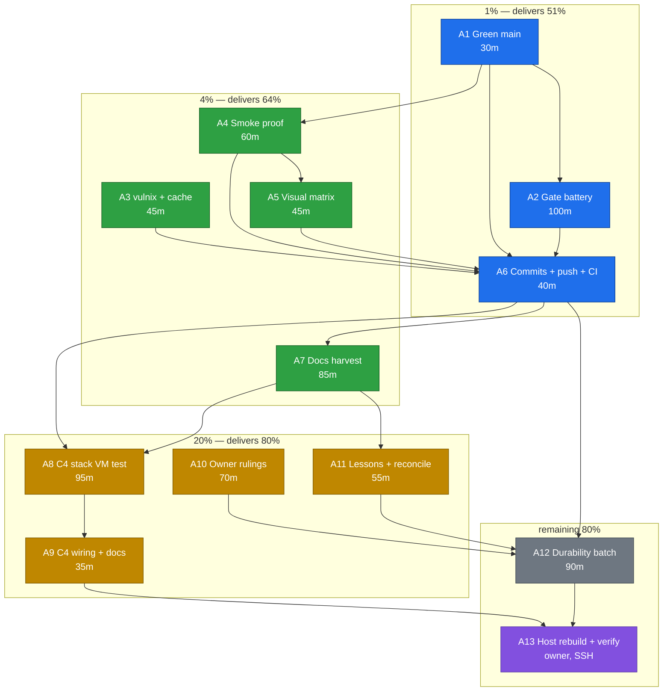

# SUPERB plan — observability closeout (green, proven, attributable)

**Created:** 2026-10-23 18:13 (+02:00)
**Source:** `docs/status/2026-10-23_18-08_404-health-observability-continuation-status.md`
(§a–§g) and the previous plan
`docs/planning/2026-10-23_15-29_SUPERB-404-health-observability-plan.md`.
**Scope rule:** every task below traces to an unfinished item from those two
documents. No refactors, no renames, no "while we are here" cleanups. If a task
would change behaviour nobody asked about, it is not in this plan.

**State at plan time (verified 18:12):**

| Fact                           | Value                                                                         |
| ------------------------------ | ----------------------------------------------------------------------------- |
| Branch                         | `main`                                                                        |
| Working tree                   | clean apart from an in-flight fix (A1.1) and another session's docs           |
| `go build ./...`               | exit 0                                                                        |
| `go test ./...`                | **green** after the A1.1 fix                                                  |
| Commits ahead of `origin/main` | 6+ (the daemon's push leg is behind)                                          |
| Blocking foreign red           | `internal/matrix/matrix_test.go` — **fixed here** (3 lines, `_ =` → `_, _ =`) |
| Prior plan status              | C1/C2/C3/C5/C6/C7/C8/C9/C10/C11 done; C12 surface only; C4, C13, C14 open     |

---

## 1. What actually matters: the Pareto layers

### The 1% that delivers 51% — **green, proven, attributable, pushed**

Three facts decide whether last turn's work exists for the owner:

1. **The tree is green.** It is now, locally (A1.1 closed the one blocker). It
   must STAY green through formatting (the `e62fe34` class: oxfmt-green ≠
   treefmt-green) and the sandbox gates.
2. **The gates actually ran.** Targeted `go test` is not a gate. `buildflow`,
   `nix flake check`, `vulnix` and the smoke suite are.
3. **The history says what happened and CI agrees.** Every change from the
   previous two turns sits in `chore: auto-commit N changed file(s)` commits.
   That is the single largest defect of this train, and it is fixed only by
   committing the remaining units by hand and watching CI to green.

If this layer is skipped, nothing else in the plan has any value: a red or
unattributed `main` cannot be released to the stack, so `/health` never reaches
the host.

### The 4% that delivers 64% (cumulative) — **the surfaces are PROVEN, not assumed**

- The smoke suite exercises the styled 404 and the dashboard subtree against a
  fresh binary.
- The visual matrix produces the 20th shot so the 404 is seen, not just asserted.
- The sandbox build proves the package still builds without a local module cache.
- Docs stop lying: FEATURES/ROADMAP/TODO_LIST carry the new seams, and the old
  plan is amended where its wording contradicts the shipped behaviour
  (C6's "styled panel for every miss" and C9's "config knob").

### The 20% that delivers 80% (cumulative) — **the delivery layer and the rulings**

- **C4**: a stack VM test proving the nginx `/health` location and its fence —
  the only thing that catches nginx drift between eval and a real boot.
- **The two owner rulings** now, because they change what the new seams write to
  disk (backup inflation) and how a declarative deployment can turn tracing on.
- **Memory**: two lessons entries so the next session does not repeat the
  daemon-commit and plan-vs-code mistakes.

### The remaining 80% (long tail to 100%) — durability and polish

Arch guarantee that `h.notFound` stays the only HTML-router 404 writer, an audit
of the 24 remaining bare `http.NotFound` sites, metrics/latency polish, the
errorfamily tier re-measure, and the art-dupl baseline re-check after the
concurrent chat-network train.

---

## 2. Comprehensive plan — 12 tasks, 30-100 min each

Sorted by importance x impact x effort x customer value. `Tier` follows §1.

| #   | Task                                                                                 | Tier | Impact                               | Effort | Customer value              | Depends on |
| --- | ------------------------------------------------------------------------------------ | ---- | ------------------------------------ | ------ | --------------------------- | ---------- |
| A1  | Green main: land the matrix fix, format explicit paths, whitespace-drift, full suite | 1%   | Unblocks every other gate            | 30m    | Highest (nothing ships red) | —          |
| A2  | Gate battery: `buildflow` + full `go test` + `nix flake check`                       | 1%   | Turns "I tested" into "proven"       | 100m   | Highest                     | A1         |
| A3  | Supply chain: real `vulnix` scan + module-cache sanity                               | 4%   | Release-blocking proof               | 45m    | High                        | —          |
| A4  | Live proof: fresh binary + `webphone-smoke.py`                                       | 4%   | End-to-end truth for 404 + `/health` | 60m    | Highest                     | A1         |
| A5  | Visual proof: `ui-capture` 20 shots + review the 404 shot                            | 4%   | Seen, not asserted                   | 45m    | High                        | A4         |
| A6  | Narrative commits + push + CI watched to green                                       | 1%   | Attribution + release truth          | 40m    | Highest                     | A1–A5      |
| A7  | Docs harvest: FEATURES/ROADMAP/TODO_LIST + amend the old plan                        | 4%   | Stops doc drift                      | 85m    | High                        | A6         |
| A8  | C4: stack VM test — dashboard location + fence + trailing slash                      | 20%  | Catches nginx drift                  | 95m    | Medium-high                 | A6         |
| A9  | C4 wiring + stack docs + stack push                                                  | 20%  | Discoverability                      | 35m    | Medium                      | A8         |
| A10 | Owner rulings applied: trace-snapshot directory + opt-in surface                     | 20%  | Correct new-seam behaviour           | 70m    | Medium-high                 | ruling     |
| A11 | Lessons (2 entries) + go-appkit report reconciliation                                | 20%  | Memory that survives                 | 55m    | Medium                      | A7         |
| A12 | Durability batch: arch test, 24-site audit, metrics polish, tier re-measure          | 80%  | Less future rot                      | 90m    | Medium                      | A6         |

**Total:** ~750 min ≈ 12.5 h. The 1% layer alone is ~170 min (A1+A2+A6) and is
the entire difference between "we built it" and "it exists".

---

## 3. Fine breakdown — 63 tasks, max 12 min each

Every fine task is independently verifiable. `min` is wall-clock.

### A1 — Green main (4)

| #    | Task                                                                                                   | min |
| ---- | ------------------------------------------------------------------------------------------------------ | --- |
| A1.1 | Commit the committed-broken matrix test fix (`_ =` → `_, _ =`, 3 lines, test-only, blocking exception) | 3   |
| A1.2 | `nix fmt` on explicit paths only (a concurrent session is live)                                        | 6   |
| A1.3 | `scripts/whitespace-drift.sh` after `git add`, before commit                                           | 4   |
| A1.4 | `go test -count=1 ./...` and read the verdict, not the exit code alone                                 | 12  |

### A2 — Gate battery (9)

| #    | Task                                                                    | min |
| ---- | ----------------------------------------------------------------------- | --- |
| A2.1 | `buildflow` full run inside `nix develop`                               | 12  |
| A2.2 | Read every finding; classify mine vs foreign                            | 10  |
| A2.3 | Fix my findings                                                         | 12  |
| A2.4 | Re-run buildflow to zero remaining findings                             | 12  |
| A2.5 | `nix flake check` (package + tests + treefmt + island-lint + island-js) | 12  |
| A2.6 | Read the check log; attribute flakes vs breaks                          | 10  |
| A2.7 | `nix build .#checks.x86_64-linux.webphone-module` alone                 | 10  |
| A2.8 | Re-read `.buildflow.yml` after daemon activity near it                  | 6   |
| A2.9 | Record the verdict lines in the plan's execution log                    | 6   |

### A3 — Supply chain (4)

| #    | Task                                                     | min |
| ---- | -------------------------------------------------------- | --- |
| A3.1 | `nix run .#vulnix` (a real scan, not the 0 ms cache hit) | 10  |
| A3.2 | Read the triage verdict                                  | 10  |
| A3.3 | `scripts/module-cache-janitor.sh` report                 | 6   |
| A3.4 | Record the closure summary                               | 5   |

### A4 — Live proof (5)

| #    | Task                                                          | min |
| ---- | ------------------------------------------------------------- | --- |
| A4.1 | `nix develop -c go build -o /tmp/webphone-bin ./cmd/webphone` | 6   |
| A4.2 | `python3 scripts/webphone-smoke.py --bin /tmp/webphone-bin`   | 12  |
| A4.3 | Read the three verdict lines (smoke / restart / boot failure) | 6   |
| A4.4 | Fix any probe the new markup broke                            | 12  |
| A4.5 | Re-run to green                                               | 12  |

### A5 — Visual proof (4)

| #    | Task                                                          | min |
| ---- | ------------------------------------------------------------- | --- |
| A5.1 | Run the PYSEL dance and `ui-capture.py`                       | 12  |
| A5.2 | Confirm 20 shots exist and the `not-found` pair is among them | 8   |
| A5.3 | Review the two 404 shots (light + dark) for chrome/clipping   | 10  |
| A5.4 | Fix the surface if the marker or wait hung                    | 12  |

### A6 — Attribution and push (5)

| #    | Task                                                         | min |
| ---- | ------------------------------------------------------------ | --- |
| A6.1 | `git status` + `git diff --stat` to see exactly what is mine | 5   |
| A6.2 | Stage my files in ONE call (add + commit together)           | 3   |
| A6.3 | Write the narrative commit body (why, not which files)       | 6   |
| A6.4 | `git push origin main`                                       | 3   |
| A6.5 | `gh run list` and watch the run to green                     | 12  |

### A7 — Docs harvest (9)

| #    | Task                                                             | min |
| ---- | ---------------------------------------------------------------- | --- |
| A7.1 | FEATURES: latency-metrics row                                    | 12  |
| A7.2 | FEATURES: flight-recorder row (status: opt-in, unproven on host) | 8   |
| A7.3 | ROADMAP: observability-depth entry                               | 8   |
| A7.4 | TODO_LIST: harvest §d and §f of the status report                | 12  |
| A7.5 | Amend the old plan's C6 wording to the shape rule                | 10  |
| A7.6 | Amend the old plan's C9 wording (env var, not config knob)       | 8   |
| A7.7 | Mark C4/C13/C14 status in the old plan                           | 8   |
| A7.8 | Grep for contradicting claims across living docs                 | 8   |
| A7.9 | Commit the docs unit                                             | 5   |

### A8 — C4 stack VM test (8)

| #    | Task                                                                            | min |
| ---- | ------------------------------------------------------------------------------- | --- |
| A8.1 | Add `webphone.dashboard.enable = true` to `tests/webphone.nix`'s fixture        | 8   |
| A8.2 | Assert external `/health` → 403 (the fence)                                     | 8   |
| A8.3 | Assert loopback `https://localhost/health` → 200 with a stable dashboard marker | 8   |
| A8.4 | Assert `/health/` → 301 → `/health`                                             | 8   |
| A8.5 | Assert the app port answers `/health` directly (prove the source)               | 6   |
| A8.6 | Place the block next to the existing `/metrics` fence assertions                | 8   |
| A8.7 | Run `nix build .#checks.x86_64-linux.telephony-webphone`                        | 12  |
| A8.8 | Fix the marker/asserts from the real output                                     | 12  |

### A9 — C4 wiring and stack docs (4)

| #    | Task                                                                   | min |
| ---- | ---------------------------------------------------------------------- | --- |
| A9.1 | Confirm the check is picked up by the VM-suite loop (no wiring needed) | 8   |
| A9.2 | Stack README: the `/health` option + its fence                         | 10  |
| A9.3 | Stack AGENTS: one line for the new assertion                           | 8   |
| A9.4 | Commit + push the stack repo                                           | 6   |

### A10 — Owner rulings applied (6)

| #     | Task                                                                 | min |
| ----- | -------------------------------------------------------------------- | --- |
| A10.1 | Ruling 1 recorded: trace snapshots inside or outside the backup path | 10  |
| A10.2 | Implement the ruling (module exclusion + README) or document why not | 12  |
| A10.3 | Ruling 2 recorded: env var vs `debug.flightrecorder.*`               | 10  |
| A10.4 | Implement the chosen surface (config section + env nesting)          | 12  |
| A10.5 | Tests for the new config arm (both-or-neither style)                 | 12  |
| A10.6 | Docs: README + AGENTS + module option text                           | 8   |

### A11 — Lessons and reconciliation (4)

| #     | Task                                                                   | min |
| ----- | ---------------------------------------------------------------------- | --- |
| A11.1 | `docs/lessons.md`: "the daemon owns the commit unless you do"          | 10  |
| A11.2 | `docs/lessons.md`: "a plan line can contradict a deliberate pin"       | 10  |
| A11.3 | Reconcile the go-appkit report (go-flightrecorder is now a direct dep) | 10  |
| A11.4 | Commit the memory unit                                                 | 5   |

### A12 — Durability batch (8)

| #     | Task                                                                    | min |
| ----- | ----------------------------------------------------------------------- | --- |
| A12.1 | Arch test: `h.notFound` is the only HTML-router 404 writer              | 12  |
| A12.2 | Run it; fix any regression it finds                                     | 8   |
| A12.3 | Doc: the 24 remaining bare `http.NotFound` sites, re-ruled in one table | 12  |
| A12.4 | Snapshot counter + bytes as a metric family                             | 12  |
| A12.5 | `/metrics` shape test in the smoke suite                                | 10  |
| A12.6 | Pin the histogram bucket set with a test                                | 8   |
| A12.7 | errorfamily tier re-measure (tier 2 must stay 0)                        | 12  |
| A12.8 | art-dupl baseline re-check after the concurrent chat-network train      | 10  |

---

## 4. Execution graph



---

## 5. Coverage: every open item from the status report maps somewhere

The status report's §f listed 50 next steps. Nothing is dropped:

| Status-report item                                          | Lands in                                                       |
| ----------------------------------------------------------- | -------------------------------------------------------------- |
| f1 foreign matrix red                                       | **A1.1 (fixed 18:12)**                                         |
| f2 `nix fmt`                                                | A1.2                                                           |
| f3 `buildflow`                                              | A2.1–A2.4                                                      |
| f4 `nix flake check`                                        | A2.5–A2.7                                                      |
| f5 `vulnix`                                                 | A3.1–A3.2                                                      |
| f6 smoke                                                    | A4.2–A4.5                                                      |
| f7 ui-capture                                               | A5.1–A5.4                                                      |
| f8 narrative commit                                         | A1.3, A6.1–A6.3, A7.9, A11.4                                   |
| f9 push + CI                                                | A6.4–A6.5, A9.4                                                |
| f10–f14 host rebuild + fence + cards + livez + probe triple | A13 (owner)                                                    |
| f15 stack lock bump decision                                | A9.4 (surfaced for the owner)                                  |
| f16–f21 C4 VM test                                          | A8.1–A8.8                                                      |
| f22–f23 trace dir vs backup                                 | A10.1–A10.2                                                    |
| f24 config knob vs env                                      | A10.3–A10.5                                                    |
| f25 bucket constant table                                   | A12.6                                                          |
| f26 align trace with `/metrics` exclusion                   | A12.4 (same edit site)                                         |
| f27 runbook for `go tool trace`                             | A10.6                                                          |
| f28 Settings "recorder on?" line                            | A10.6 (optional, only if the knob lands)                       |
| f29–f31 plan amendments                                     | A7.5–A7.7                                                      |
| f32–f33 FEATURES/ROADMAP                                    | A7.1–A7.3                                                      |
| f34–f35 lessons                                             | A11.1–A11.2                                                    |
| f36 TODO_LIST harvest                                       | A7.4                                                           |
| f37 go-appkit reconcile                                     | A11.3                                                          |
| f38 module option docs                                      | A10.6                                                          |
| f39 rate limit on the snapshot endpoint                     | A12.3 (recorded ruling; implemented only if the audit says so) |
| f40 snapshot metrics                                        | A12.4                                                          |
| f41 startup log line                                        | A10.6                                                          |
| f42 disk-aware maxBytes                                     | A12.3 (recorded as rejected-unless-evidence)                   |
| f43 alternative profilers                                   | A12.3 (recorded)                                               |
| f44 bucket pin test                                         | A12.6                                                          |
| f45 `/metrics` smoke shape                                  | A12.5                                                          |
| f46 stack E2E 404 expectation                               | A9.2–A9.3                                                      |
| f47 arch test "only writer"                                 | A12.1–A12.2                                                    |
| f48 art-dupl baseline                                       | A12.8                                                          |
| f49 24-site audit                                           | A12.3                                                          |
| f50 errorfamily tiers                                       | A12.7                                                          |

---

## 6. Guardrails (no verschlimmbessern)

1. **Do not touch behaviour outside this list.** The plan contains no refactors,
   no renames, no "while we are here" cleanups.
2. **Never change served markup without grepping the three pin sites**: Go tests,
   `scripts/webphone-smoke.py`, the stack's `tests/browser-e2e.py`.
3. **On a concurrent-session tree, format only touched files.** `nix fmt` scans
   the whole repo; use explicit paths.
4. **A red gate that is not mine gets attributed.** The single exception is a
   committed break that blocks everyone (the matrix test) — fixed, and named as
   such in the commit body.
5. **Never stage another session's files.** `git add` takes explicit paths, never
   `-A`, while `FEATURES.md`/`README.md`/status docs show foreign edits.
6. **Dependency bumps do not ride the daemon.** Any `go.mod`/`go.sum` delta owes
   `go mod tidy` + a vendorHash re-pin via
   `nix build .#webphone.goModules --rebuild`.
7. **Do not enable the dashboard publicly.** The fence is the point: operator SSO
   in `forwardAuth` mode, loopback otherwise.
8. **Stop before the host rebuild.** It needs SSH this environment does not have;
   it is recorded as a hand-off, not attempted blindly.
9. **A debug surface must stay opt-in.** Tracing costs CPU and writes files; it
   never becomes a default.

---

## 7. How this plan is verified

```console
# green + gates
nix fmt <explicit paths> && nix develop -c go test -count=1 ./...
buildflow
nix flake check
nix run .#vulnix

# live + visual
nix develop -c go build -o /tmp/webphone-bin ./cmd/webphone
python3 scripts/webphone-smoke.py --bin /tmp/webphone-bin
nix build .#checks.x86_64-linux.webphone-module      # module check alone
nix build .#checks.x86_64-linux.telephony-webphone   # C4, after A8

# attribution
git status --short && git log --oneline -5
gh run list --limit 3
```

**Definition of done for this plan:** `main` green on CI, no `chore:`-only
attribution for the new work, the smoke suite printing its three verdict lines,
20 visual shots on disk including the 404 pair, the stack check running the
`/health` fence assertions, and every doc naming the behaviour it ships.
