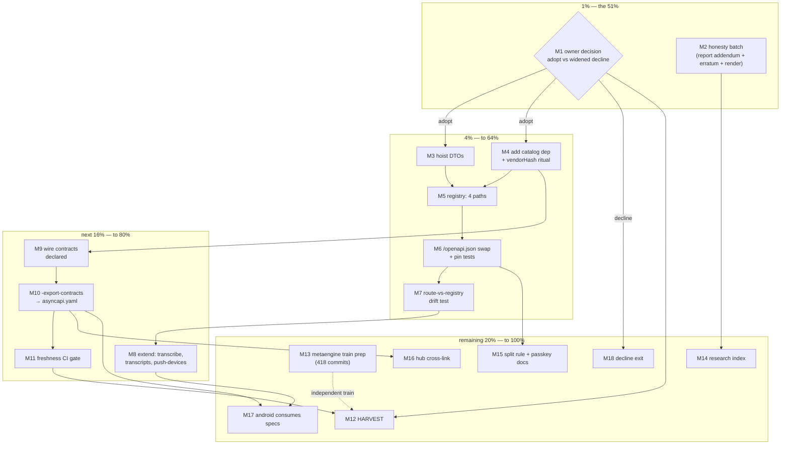

# SUPERB — Catalog Contracts Plan (webphone × go-cqrs-lite/catalog)

**Planned 2026-10-24 16:50 CEST** · Source: this session's deep-dive audit
(`docs/research/2026-10-24_go-cqrs-lite-catalog-deep-dive.html`, adoption 0/100,
0 of 3 applicable rows) + status report
(`docs/status/2026-10-24_16-22_catalog-deep-dive-session-status.md`).
Scope: EVERYTHING that session surfaced — the catalog adoption universe, the
session's honesty defects, and the adjacent open threads. Out of scope: every
other train in TODO_LIST.md (other plans own them).

## Context (why this plan exists)

webphone imports `go-cqrs-lite/catalog` **zero** times, yet hand-maintains
exactly what it generates: a 227-line OpenAPI JSON constant (4 of 23 `/api/*`
paths, schema bodies unbound from the Go DTOs) and cross-repo wire contracts
(ring hook, webhook lanes, SSE kinds) published only as Go comments and prose —
consumed by pbx-artmann's Telnyx bridge and webphone-android. The EventCatalog
path stays OUT by the recorded 2026-10-19 owner ruling (TODO_LIST.md:68 — no
CQRS write model, export would fabricate vocabulary); **this plan does not
touch that ruling.** OpenAPI + AsyncAPI document REAL wire surfaces — no
fabrication.

**Recommendation (One Alternative Protocol):** ADOPT `catalog/openapi` +
`catalog/asyncapi`. The one alternative — record a widened decline — is
dismissed for one reason: webphone already pays the documentation cost by hand
(constant + prose + pin tests) and the machine API is growing (Android P1
consumer), so the generated path strictly reduces maintenance while adding
type-binding. The decision itself is the plan's 1% gate; both exits are planned.

## Step-0 verification (all tasks confirmed open)

- Working tree clean; `openapiSpec` still the hand-written const
  (internal/server/server.go:717); TODO_LIST.md:68 ruling unchanged.
- **Pre-verified, resolves old item 12**: cqrs-htmx ships catalog plumbing at
  `event_catalog_handler.go` / `usermgmt/es_event_catalog.go` — that is the
  EventCatalog SSE-serving seam (event-sourced domains only, ruled out for
  webphone). **No OpenAPI generator to reuse — the registry is built fresh.**
- **Erratum vs the audit report**: the report called the metaengine
  v4.19.0→v4.20.0 bump "routine". `git log v4.19.0..v4.20.0` = **418 commits**
  (codec contract changes, typedfixture, branded-ID fixtures). It is a real
  train, not a routine bump — sized accordingly below (M13/M56).

## Pareto breakdown

| Tier                     | Deliver                                                                                                                                                                                              | The result it buys                                                                                                                                            |
| ------------------------ | ---------------------------------------------------------------------------------------------------------------------------------------------------------------------------------------------------- | ------------------------------------------------------------------------------------------------------------------------------------------------------------- |
| **1% → 51%**             | **M1** the owner decision gate (adopt vs widened decline, recorded in TODO_LIST.md:68) + **M2** the honesty batch (report addendum: DTO-hoisting prerequisite; "routine bump" erratum; render check) | Every other task is conditional on M1; M2 makes the audit artifact truthful. ~30 min total decides/prices the whole universe.                                 |
| **4% → 64%**             | **M3–M7**: hoist DTOs → add dep (vendorHash ritual) → build the 4-path registry → swap `/openapi.json` to generated output → route-vs-registry drift test                                            | The audit's #1 finding closed: machine API docs generated from the real Go types, pin tests now pin generated bytes, drift structurally impossible on bodies. |
| **20% → 80%**            | 4% **plus M8–M11**: extend to transcribe/transcripts/push-devices (Android + ASR consumers) → declare wire contracts → headless `-export-contracts` → CI freshness gate                              | Cross-repo contracts get a machine-readable one-home (asyncapi.yaml) instead of three prose homes; Android builds against a spec.                             |
| **Remaining 20% → 100%** | **M12–M18**: TODO_LIST harvest, metaengine train prep (418 commits), research index, split-rule + passkey docs, hub cross-link, android consumption, decline-exit                                    | Everything else: hygiene, adjacent value, and the honest alternative branch.                                                                                  |

## Safety rails (VERSCHLIMMBESSER guard — hard)

1. The 2026-10-19 EventCatalog ruling is NOT touched; no EventCatalog export.
2. The three OpenAPI pin tests stay green THROUGHOUT — red tests stop the train.
3. `/openapi.json` route, content-type, and `TestOpenAPIEndpoint` contract keep
   their shape; only the bytes' source changes (constant → generated).
4. DTO hoists are behavior-parity moves (port verbatim first, refactor never in
   the same change); wire bytes byte-pinned where tests already pin them.
5. Dependency add rides the mandatory tail: `go get` → `go mod tidy` →
   vendorHash re-pin recipe → buildflow — never a bare go.mod delta (daemon).
6. No handler re-architecture, no framework swap, no CSP change; catalog spec
   exporters link no templ.
7. Large artifacts written ATOMICALLY (one write), stage+commit in ONE call.
8. Decision-gated: M3–M11 start ONLY after M1 = adopt.

## Comprehensive plan — medium tasks (30–100 min each)

Sorted by tier → importance → impact → effort. `Dep` = dependency.

| ID  | Task                                                                                                                                      | Tier | Impact | Effort | Customer value                                               | Dep     |
| --- | ----------------------------------------------------------------------------------------------------------------------------------------- | ---- | ------ | ------ | ------------------------------------------------------------ | ------- |
| M1  | Owner decision gate: adopt catalog/openapi+asyncapi vs widened decline; record in TODO_LIST.md:68 section with this plan as pointer       | 1%   | 5      | 30     | Unblocks/prices 24 items; ruling stays honest                | –       |
| M2  | Honesty batch: report addendum (DTO-hoisting prerequisite in finding 1), "routine bump" erratum fix, headless render check of the report  | 1%   | 3      | 30     | Audit artifact tells the whole truth                         | –       |
| M3  | Hoist inline DTOs to named package-level types: session login/sessionIdentity, contacts, calls (behavior-parity, pin tests green)         | 4%   | 4      | 90     | Prereq for typed specs; also removes the inline-struct smell | M1      |
| M4  | Add `catalog/v4` dep: go get + tidy + vendorHash re-pin recipe + buildflow green                                                          | 4%   | 4      | 45     | The one new prod dep (go-faster/yaml) properly landed        | M1      |
| M5  | Build the catalog registry for the 4 documented paths (session×3, csrf, contacts×3, calls) + security scheme; `Validate()` = 0 violations | 4%   | 5      | 90     | The core swap material: generated-from-types spec            | M3, M4  |
| M6  | Swap `/openapi.json` to the generated spec; adapt the three pin tests to generated output; live smoke                                     | 4%   | 5      | 60     | Machine API docs type-bound; drift dies with bodies          | M5      |
| M7  | Route-vs-registry drift test: every declared path ⊆ registered mux routes (ghost-path red-test included)                                  | 4%   | 4      | 45     | `Validate()` can't see the mux; this closes that hole        | M6      |
| M8  | Extend registry: `/api/transcribe`, `/api/transcripts` ×2, `/api/push-devices` ×3 (config-conditional noted)                              | 20%  | 4      | 60     | Android + ASR consumers finally documented                   | M6      |
| M9  | Declare wire contracts as messages: ring (typed ringRequest), gateway receipt, webhook lanes, SSE kinds                                   | 20%  | 3      | 60     | Cross-repo vocabulary in one declaration                     | M4      |
| M10 | `webphone -export-contracts` headless subcommand → `docs/contracts/asyncapi.yaml` (bank-sync shape) + README contract section             | 20%  | 3      | 90     | pbx-artmann + android get a checkable contract file          | M9      |
| M11 | Export freshness CI gate: regenerate + diff must be clean                                                                                 | 20%  | 3      | 30     | Spec cannot rot silently                                     | M10     |
| M12 | docs-health HARVEST: this plan + report items → TODO_LIST; reconcile dupes                                                                | rest | 3      | 30     | Living backlog owns the work; plans don't entomb             | M1      |
| M13 | metaengine v4.20.0 train PREP: read the 418-commit delta, classify breaking-vs-inert for readmodels usage, write bump-train note          | rest | 3      | 100    | Correctly sized bump decision (NOT routine — erratum)        | –       |
| M14 | Create `docs/research/README.md` index (8 reports by then)                                                                                | rest | 2      | 30     | Discoverability; skill index rows get a home                 | M2      |
| M15 | Record the OpenAPI-vs-AsyncAPI split rule (`/hooks/*` → asyncapi home) + passkey conditional-surface doc note                             | rest | 2      | 30     | Prevents future seam confusion                               | M6      |
| M16 | Hub cross-link: wire-contract spec link from webphone's inventory page (eventcatalog-hub repo)                                            | rest | 2      | 30     | One click from family map to contracts                       | M10     |
| M17 | webphone-android: client layer consumes `/openapi.json` + `asyncapi.yaml` (other repo)                                                    | rest | 3      | 60     | Closes the loop that motivated finding 1                     | M8, M10 |
| M18 | DECLINE EXIT (only if M1 = decline): record widened ruling covering openapi+asyncapi, annotate report items closed-by-decision            | rest | 5*     | 30     | Honest alternative; *impact = decision-sized                 | M1      |

18 tasks · ~14.5 h total. Tiers: 1% ≈ 1 h, 4% ≈ 5.5 h, 20% ≈ +4 h, rest ≈ +4 h.

## Fine plan — micro tasks (≤ 12 min each, ALL todos)

Sorted by tier → impact → effort. `→M#` = parent task.

| ID  | Micro task                                                                  | min | I  | E | Parent |
| --- | --------------------------------------------------------------------------- | --- | -- | - | ------ |
| F1  | Draft the one-pager: adopt vs decline, priced (this plan §Context)          | 10  | 5  | 5 | M1     |
| F2  | Owner decision; extend TODO_LIST.md:68 section with the verdict + plan link | 12  | 5  | 5 | M1     |
| F3  | Changelog check: decision record is docs-only → silent (repo bar)           | 5   | 2  | 5 | M1     |
| F4  | Addendum to report finding 1: login DTO is inline; hoisting is the prereq   | 8   | 3  | 5 | M2     |
| F5  | Fix report's "routine bump candidate" → "418 commits, real train" (erratum) | 5   | 3  | 5 | M2     |
| F6  | Headless render check of the report (screenshot, sidebar + one finding)     | 12  | 2  | 5 | M2     |
| F7  | Re-run report "How to verify" commands; confirm all still pass              | 12  | 3  | 5 | M2     |
| F8  | Inventory inline request/response DTOs across api handlers (list file:line) | 12  | 3  | 4 | M3     |
| F9  | Hoist session login request + sessionIdentity to named types                | 12  | 4  | 4 | M3     |
| F10 | Hoist contacts request/response DTOs                                        | 12  | 4  | 4 | M3     |
| F11 | Hoist calls request DTO                                                     | 12  | 4  | 4 | M3     |
| F12 | Full server suite + session-behavior suite green after hoists               | 12  | 4  | 4 | M3     |
| F13 | Diff review: wire bytes unchanged (parity rule)                             | 12  | 4  | 4 | M3     |
| F14 | `go get catalog/v4` + immediate `go mod tidy`                               | 12  | 4  | 4 | M4     |
| F15 | vendorHash: `nix build .#webphone.goModules --rebuild` → apply `got:`       | 12  | 4  | 4 | M4     |
| F16 | `nix flake check` sandbox build green                                       | 12  | 4  | 4 | M4     |
| F17 | buildflow gate green (inside nix develop)                                   | 12  | 4  | 4 | M4     |
| F18 | Registry skeleton: service + bearer/cookie security schemes                 | 12  | 4  | 5 | M5     |
| F19 | Session POST message + responses (201/400/401/502/500)                      | 12  | 5  | 5 | M5     |
| F20 | Session GET (resume, no-store) message                                      | 12  | 5  | 5 | M5     |
| F21 | Session DELETE message                                                      | 12  | 5  | 5 | M5     |
| F22 | CSRF GET message                                                            | 12  | 4  | 5 | M5     |
| F23 | Contacts GET/POST/DELETE messages (429 + Retry-After header!)               | 12  | 5  | 5 | M5     |
| F24 | Calls POST message (204/400/401/403/422/429/502)                            | 12  | 5  | 5 | M5     |
| F25 | `Catalog.Validate()` → zero violations; fix what it flags                   | 12  | 4  | 5 | M5     |
| F26 | Render OpenAPI JSON; field-by-field diff vs hand-written spec               | 12  | 5  | 4 | M5     |
| F27 | Swap handler: serve generated bytes from the same route                     | 12  | 5  | 4 | M6     |
| F28 | Adapt `TestOpenAPIEndpoint` to generated doc                                | 12  | 5  | 4 | M6     |
| F29 | Adapt Contacts + Calls handler-match pin tests                              | 12  | 5  | 4 | M6     |
| F30 | Route + content-type tests green; gofmt/oxfmt clean                         | 12  | 5  | 4 | M6     |
| F31 | Live smoke: `/openapi.json` against a booted binary                         | 12  | 5  | 4 | M6     |
| F32 | Drift test: declared paths ⊆ registered mux routes                          | 12  | 4  | 4 | M7     |
| F33 | Red-test: inject a ghost path, watch it fail, remove                        | 12  | 4  | 4 | M7     |
| F34 | Wire drift test into `go test ./internal/server/`                           | 8   | 4  | 4 | M7     |
| F35 | Transcribe message (multipart, 25 MiB cap, hook-grade bucket)               | 12  | 4  | 4 | M8     |
| F36 | Transcripts POST/DELETE messages                                            | 12  | 4  | 4 | M8     |
| F37 | Push-devices GET/POST/DELETE + conditional-when-off note                    | 12  | 4  | 4 | M8     |
| F38 | Extend pin tests to the new paths                                           | 12  | 4  | 4 | M8     |
| F39 | Ring message (typed ringRequest, ring\|end states)                          | 12  | 3  | 3 | M9     |
| F40 | Gateway receipt message ({"provider_ref"})                                  | 12  | 3  | 3 | M9     |
| F41 | Webhook lane messages (message/fax/status multipart)                        | 12  | 3  | 3 | M9     |
| F42 | SSE kinds as channel messages (threads/thread/fax/voicemail/contacts)       | 12  | 3  | 3 | M9     |
| F43 | Validate + review: directions faithful (Sends/Receives)                     | 12  | 3  | 3 | M9     |
| F44 | `-export-contracts` flag skeleton on cmd/webphone                           | 12  | 3  | 3 | M10    |
| F45 | Wire asyncapi exporter into the flag                                        | 12  | 3  | 3 | M10    |
| F46 | Generate + commit `docs/contracts/asyncapi.yaml`                            | 12  | 3  | 3 | M10    |
| F47 | README § "Wire contracts" (how to regenerate, who consumes)                 | 12  | 3  | 3 | M10    |
| F48 | Freshness script: regen + git diff --exit-code                              | 12  | 3  | 4 | M11    |
| F49 | Wire freshness into flake check / CI leg                                    | 12  | 3  | 4 | M11    |
| F50 | docs-health HARVEST: plan + report → TODO_LIST rows                         | 12  | 3  | 4 | M12    |
| F51 | Reconcile TODO_LIST dupes (decision section vs new rows)                    | 12  | 3  | 4 | M12    |
| F52 | Read metaengine CHANGELOG between the two tags                              | 12  | 3  | 4 | M13    |
| F53 | Classify delta: readmodels-contract changes found                           | 12  | 3  | 4 | M13    |
| F54 | Classify delta: engine/DDL or capability-surface changes                    | 12  | 3  | 4 | M13    |
| F55 | Map findings to webphone usage (readmodels seam, capabilities asserted)     | 12  | 3  | 4 | M13    |
| F56 | Write bump-train note (own file or TODO_LIST row)                           | 12  | 3  | 4 | M13    |
| F57 | `docs/research/README.md` index skeleton                                    | 12  | 2  | 5 | M14    |
| F58 | Entries for all 8 reports (title, date, one-liner, verdict)                 | 12  | 2  | 5 | M14    |
| F59 | Passkey conditional-surface documentation note                              | 12  | 2  | 5 | M15    |
| F60 | Split-rule note: `/hooks/*` live in asyncapi, never OpenAPI                 | 12  | 2  | 5 | M15    |
| F61 | Hub inventory page: add contract-spec link (eventcatalog-hub repo)          | 12  | 2  | 5 | M16    |
| F62 | android: fetch + parse openapi.json in client bootstrap                     | 12  | 3  | 3 | M17    |
| F63 | android: derive push-devices client calls from the spec                     | 12  | 3  | 3 | M17    |
| F64 | android: parse asyncapi.yaml ring contract for push handling                | 12  | 3  | 3 | M17    |
| F65 | android: verify CSRF-dance paths against the spec                           | 12  | 3  | 3 | M17    |
| F66 | DECLINE EXIT: write widened ruling into TODO_LIST.md:68                     | 12  | 5* | 5 | M18    |
| F67 | DECLINE EXIT: annotate report items closed-by-decision                      | 12  | 5* | 5 | M18    |

67 micro tasks · ~11.5 h sum (parents include coordination overhead → 14.5 h).

## Execution graph (mermaid)

## Verification ladder (per phase)

1. **Gate**: TODO_LIST.md:68 section updated; this plan linked; both exits priced.
2. **4%**: `go test ./internal/server/` green incl. all three OpenAPI pin tests
   - drift test; `nix flake check` green; buildflow green; live smoke
     `/openapi.json` parses and documents ≥ the old 4 paths.
3. **20%**: `docs/contracts/asyncapi.yaml` committed, freshness gate green,
   ring/receipt/lane messages match the structs (spot-diff).
4. **Rest**: HARVEST rows visible in TODO_LIST; index lists all reports;
   android PR references the spec.

## Errata (recorded per pareto-planning Step 0)

- Report's "metaengine v4.20.0 — routine bump candidate" → **wrong sizing**:
  418 commits; corrected in M2/F5 and re-planned as M13.
- Report's finding-1 example implied a package-level `loginRequest` type —
  it is inline; hoisting (M3) is the unstated prerequisite; fixed in M2/F4.
