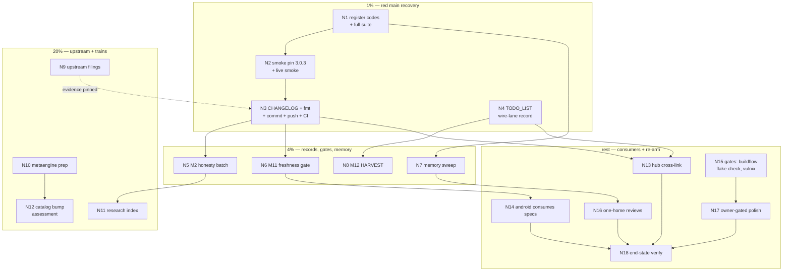

# SUPERB — Contracts completion plan (red-main recovery → rest)

**Planned 2026-10-24 19:27 CEST** · Sources: the execution status report
([docs/status/2026-10-24_19-15_catalog-contracts-execution-status.md](../status/2026-10-24_19-15_catalog-contracts-execution-status.md))

- the open tail of
  [docs/planning/2026-10-24_16-50_SUPERB-catalog-contracts-plan.md](2026-10-24_16-50_SUPERB-catalog-contracts-plan.md)
  (M1–M18; M3–M10+M15 SHIPPED there, 9 items).
  Scope: EVERYTHING the 19:15 report surfaced — red-main recovery, the plan
  remainder (M1/M2/M11–M17), memory/gate debts, upstream filings, and the
  polish tier. Out of scope: every other train in TODO_LIST.md.

## Context (state at 19:27, verified)

The machine-API surface SHIPPED: `/openapi.json` is generated from the
real DTOs over all 11 session-gated surfaces; the drift test is
red-verified; the wire contracts (5 `/hooks/*` lanes + gateway receipt +
5 SSE kinds) are declared from the real types; `webphone contracts`
writes the committed `docs/contracts/asyncapi.yaml`. **Main is RED on
pushed CI** (run 40113240902): three new error-family codes never got
registered, and the generator silently downgrades OpenAPI 3.1.0→3.0.3
while the smoke still pins 3.1.0. The auto-commit daemon pushes every
few minutes, so unverified work ships itself — this plan's 1% closes
that before anything else.

## Step-0 verification (facts, all checked 19:24–19:27)

- CI: run **40113240902 FAILED** (`TestErrorCodeRegistryIsFresh` in
  internal/arch; missing codes `webphone.cli.contracts`,
  `webphone.server.openapi_render`, `webphone.server.wire_render`).
- Registry mechanics: the block lives in `docs/error-contract.md`
  between generated markers; `go test ./internal/arch -run
  TestErrorCodeRegistryIsFresh -update` rewrites it (never hand-edit).
- Smoke pin: `scripts/webphone-smoke.py:774` asserts
  `"openapi": "3.1.0"`; the generated doc is **3.0.3** (exporter const).
- treefmt owns NO yaml (grep empty) → the generated asyncapi.yaml cannot
  fight the formatter; a freshness diff-gate is stable by construction.
- TODO_LIST.md:68 was REWRITTEN by the concurrent session:
  "Catalog adoption SHIPPED locally (2026-10-24 — push pending;
  supersedes the 2026-10-19 inventory-only record)" — that covers the
  EVENTCATALOG lane only. My M1 record is an EXTENSION for the
  openapi/asyncapi lanes, never a rewrite of their text.
- Push pair: the hub's next CI build REQUIRES webphone@main to carry the
  `catalog` command (already pushed: origin/main = c85aefb). Two local
  commits unpushed (c85aefb, f4c1d56) ride the next push — webphone
  FIRST, hub after (tri-repo ritual).
- docs/research holds **7** HTML reports, no README index.
- Siblings present: `~/projects/eventcatalog-hub` (sources.json lists
  webphone), `~/projects/webphone-android` (Gradle tree).

## Errata (recorded per pareto-planning Step 0)

- The 16-50 plan's M14 said "8 reports" — **7** exist; sized accordingly.
- The 16-50 plan's M1 framed adopt-vs-decline as an owner gate — it
  resolved by SHIP + the concurrent session's recorded supersession;
  N4 below is an EXTENSION (wire lanes), not a fresh gate.
- The 19:15 status report's item 32 ("fold wire-contracts catalog into
  domain.BuildCatalog?") is NOT silently dropped — it is N16's one-home
  review.

## Pareto breakdown

| Tier                     | Deliver                                                                                                                                        | The result it buys                                                                                                                                                             |
| ------------------------ | ---------------------------------------------------------------------------------------------------------------------------------------------- | ------------------------------------------------------------------------------------------------------------------------------------------------------------------------------ |
| **1% → 51%**             | **N1–N3**: register the 3 codes + full suite green → smoke pin fix + live smoke → CHANGELOG + fmt + one-call commit + push + CI watch to green | Red pushed main recovered; every served-bytes pin true; the hub push-pair unblocked. ~1.5 h makes the repo trustworthy again.                                                  |
| **4% → 64%**             | **N4–N8**: TODO_LIST wire-lane record → report honesty batch → freshness gate → memory sweep → HARVEST                                         | The shipped surface gets its decision record, its rot-proof, its truthful audit artifact, and its memory rows. Drift becomes structurally impossible for the new surfaces too. |
| **20% → 80%**            | **N9–N12**: upstream filings (verified, voiced) → metaengine v4.20.0 prep → research index → catalog bump assessment                           | The exporter's real limitations leave this repo as filed issues; the next two dependency trains are priced before they bite.                                                   |
| **Remaining 20% → 100%** | **N13–N18**: hub cross-link → android consumption → gates (buildflow/flake/vulnix) → one-home review → polish → end-state verification         | Consumers close the loop; the ratified gates re-arm; the two-catalog split gets a recorded ruling.                                                                             |

## Safety rails (VERSCHLIMMBESSER guard — hard)

1. **Red-test discipline**: every new gate proves its red first (the
   lowercase-method lesson) — no gate ships on a single green.
2. **Daemon hazards**: no temp/red-test files in watched package dirs;
   artifacts written ATOMICALLY (one `write`); stage+commit in ONE call.
3. **Concurrent session**: TODO_LIST.md, cmd/, go.mod are shared lanes —
   re-read immediately before every edit; their eventcatalog narrative
   is authoritative for that lane; extend, never rewrite.
4. **Generated files**: `asyncapi.yaml` and the served OpenAPI bytes are
   REGENERATED, never hand-edited; the error-code registry block likewise
   (markers + `-update`).
5. **Pins stay true**: the three OpenAPI pin tests + seam pins stay green
   THROUGHOUT; the smoke version pin changes WITH the version truth, in
   the same train, never leaving a red pin behind.
6. **Upstream filings**: verify-before-filing gate (source-level repro in
   the pinned v4.9.0) + github-voice; dupe search (open+closed) first.
7. **No scope creep into the eventcatalog lane**; no stack-repo changes
   (no nix module edits) in this plan.
8. **Push pair ritual**: webphone push first, hub re-pin after; CI watch
   to green after every push (the 2026-10-05 bar).
9. **android (N14)** respects that repo's own gates; no Go gates cross.
10. **Decision-gated**: N17 polish items are owner calls (recorded rows,
    not silent features).

## Comprehensive plan — medium tasks (30–100 min each)

Sorted by tier → importance → impact → effort. `Dep` = dependency.

| ID  | Task                                                                                                                                                                  | Tier | Impact | Effort | Customer value                                           | Dep    |
| --- | --------------------------------------------------------------------------------------------------------------------------------------------------------------------- | ---- | ------ | ------ | -------------------------------------------------------- | ------ |
| N1  | Register the 3 error codes (`-update`), review generated rows, full `go test -count=1 ./...` green                                                                    | 1%   | 5      | 30     | Red main's root fix; the arch gate re-arms               | –      |
| N2  | Smoke truth: pin `/openapi.json` version 3.0.3 in the smoke script + live smoke green against a fresh binary                                                          | 1%   | 4      | 30     | The ratified live gate stops lying about the served spec | N1     |
| N3  | Land + push: CHANGELOG `[Unreleased]`, `nix fmt`, whitespace-drift, one-call commit, push, CI watch to green (manual bar: red with verified fix; hub pair wants main) | 1%   | 5      | 25     | Green main; consumers can pull                           | N1, N2 |
| N4  | TODO_LIST: extend the catalog section with the wire-lane record (openapi/asyncapi shipped; links to plan + contracts README)                                          | 1%   | 3      | 30     | The decision record covers BOTH catalog lanes, not one   | –      |
| N5  | M2 honesty batch: report addenda (hoisting prereq EXECUTED; 418-commit erratum; zero-usage snapshot note), render check, verify-commands re-run                       | 4%   | 3      | 45     | The audit artifact tells the whole truth                 | N3     |
| N6  | M11 freshness gate: `scripts/contracts-fresh.sh` + flake check leg (treefmt-yaml risk cleared) + local green                                                          | 4%   | 4      | 60     | The committed contract cannot rot silently               | N3     |
| N7  | Memory sweep: AGENTS.md (contracts command, catalog API gotchas, lowercase-method trap), lessons.md (2 incidents), dedup sweep-log line                               | 4%   | 3      | 60     | The next session inherits today's scar tissue            | N1     |
| N8  | M12 HARVEST: this plan + the report's 50-item list → TODO_LIST rows, reconciled with the new catalog section                                                          | 4%   | 3      | 30     | The living backlog owns the remainder                    | N4     |
| N9  | Upstream: dupe-search + verify + file the exporter candidates in go-cqrs-lite (headers, 204 rule, param types, kafka default, multipart, operationId, 3.1.0)          | 20%  | 3      | 90     | The workarounds have an upstream path, not just prose    | N3     |
| N10 | M13 metaengine v4.19→v4.20 prep: read the 418-commit delta, classify readmodels impact, write the bump-train note                                                     | 20%  | 3      | 60     | Correctly sized bump decision, not "routine"             | –      |
| N11 | M14 `docs/research/README.md` index (7 reports, one-liners + verdicts)                                                                                                | 20%  | 2      | 25     | Research discoverability                                 | N5     |
| N12 | catalog v4.9.0→v4.10.0 assessment: tag delta, classification, owner-gated bump row                                                                                    | 20%  | 2      | 30     | The pin becomes a decision, not an accident              | N10    |
| N13 | M16 hub cross-link: contract-spec link from webphone's hub inventory page (hub repo, push-pair aware)                                                                 | rest | 2      | 30     | One click from family map to contracts                   | N3, N4 |
| N14 | M17 webphone-android consumes the specs: fetch/parse `/openapi.json`, derive push-devices calls, parse the ring contract, CSRF paths vs spec                          | rest | 3      | 60     | The consumer loop that motivated the whole train         | N3, N6 |
| N15 | Gates: buildflow full, `nix flake check`, `nix run .#vulnix`                                                                                                          | rest | 4      | 45     | The ratified quality gates re-arm                        | N1–N8  |
| N16 | One-home reviews: two-catalog split ruling (domain.BuildCatalog vs server.BuildWireContracts); content-type pin check; stack-E2E obligation scoping                   | rest | 2      | 30     | No split brains left behind                              | N7     |
| N17 | Owner-gated polish rows: /openapi.json ETag, golden fixture for generated bytes                                                                                       | rest | 1      | 15     | Recorded options, no silent features                     | N15    |
| N18 | End-state verification: ls-remote, CI green, hub CI unaffected, close-out note                                                                                        | rest | 3      | 15     | Claims verified, not assumed                             | all    |

18 tasks · ~12 h total. Tiers: 1% ≈ 1.5 h, 4% ≈ 4 h, 20% ≈ 3.5 h, rest ≈ 3 h.

## Fine plan — micro tasks (≤ 12 min each, ALL todos)

| ID  | Micro task                                                                                                               | min | I | E | Parent |
| --- | ------------------------------------------------------------------------------------------------------------------------ | --- | - | - | ------ |
| F1  | `go test ./internal/arch -run TestErrorCodeRegistryIsFresh -update`                                                      | 5   | 5 | 5 | N1     |
| F2  | Review the 3 generated error-contract rows (wording/seam families)                                                       | 8   | 4 | 5 | N1     |
| F3  | Full `go test -count=1 ./...` green                                                                                      | 12  | 5 | 5 | N1     |
| F4  | Smoke script: 3.1.0 → 3.0.3 pin + comment truth                                                                          | 5   | 4 | 5 | N2     |
| F5  | Boot fresh binary, run `scripts/webphone-smoke.py`, grep verdict counts                                                  | 12  | 4 | 5 | N2     |
| F6  | CHANGELOG `[Unreleased]`: generated /openapi.json (11 surfaces), `webphone contracts`, committed asyncapi.yaml           | 10  | 3 | 5 | N3     |
| F7  | `nix fmt` + stage + `whitespace-drift.sh`                                                                                | 5   | 3 | 5 | N3     |
| F8  | One-call commit (detailed message)                                                                                       | 5   | 3 | 5 | N3     |
| F9  | `git push` + `git ls-remote` end state                                                                                   | 5   | 4 | 5 | N3     |
| F10 | CI watch to green (`gh run watch`); state the manual-bar anchor                                                          | 12  | 5 | 5 | N3     |
| F11 | Draft the wire-lane subsection text (2 shipped documents, links)                                                         | 10  | 3 | 5 | N4     |
| F12 | Edit TODO_LIST catalog section (extend, never rewrite eventcatalog text)                                                 | 10  | 3 | 5 | N4     |
| F13 | Changelog-silence check (docs-only delta)                                                                                | 3   | 2 | 5 | N4     |
| F14 | Report addendum: finding-1 hoisting prereq → mark EXECUTED (M3 commits)                                                  | 10  | 3 | 5 | N5     |
| F15 | Report erratum: "routine bump" → 418 commits, real train                                                                 | 5   | 3 | 5 | N5     |
| F16 | Report addendum: zero-usage snapshot predates today's adoption                                                           | 8   | 3 | 5 | N5     |
| F17 | Headless render check of the report (F6)                                                                                 | 12  | 2 | 5 | N5     |
| F18 | Re-run the report's verify commands; note the changed go.mod answer                                                      | 12  | 3 | 5 | N5     |
| F19 | `scripts/contracts-fresh.sh` (regen + `git diff --exit-code`)                                                            | 12  | 4 | 4 | N6     |
| F20 | Flake check leg in nix/checks.nix (binary + diff)                                                                        | 12  | 4 | 4 | N6     |
| F21 | Local green of the new check; red-test it (touch the yaml)                                                               | 12  | 4 | 4 | N6     |
| F22 | AGENTS Commands: `webphone contracts` one-liner                                                                          | 5   | 2 | 5 | N7     |
| F23 | AGENTS: catalog API gotchas (Registry().AddSecurityScheme, Deterministic, doc tags, kafka default, no headers, 204 rule) | 12  | 3 | 5 | N7     |
| F24 | AGENTS: lowercase-method CSRF masking trap                                                                               | 5   | 3 | 5 | N7     |
| F25 | lessons.md: daemon-pushed-ghost incident (e9635bf/70bf5a9)                                                               | 10  | 3 | 5 | N7     |
| F26 | lessons.md: registry-drift red-main incident + root cause                                                                | 10  | 3 | 5 | N7     |
| F27 | dedup-registry: sweep-log line (apidocs/wirecontracts intentional sibling)                                               | 5   | 2 | 5 | N7     |
| F28 | HARVEST: report (f) rows → TODO_LIST                                                                                     | 12  | 3 | 4 | N8     |
| F29 | HARVEST: this plan's remainder rows → TODO_LIST                                                                          | 10  | 3 | 4 | N8     |
| F30 | Reconcile with the catalog section (no dupes, cross-links)                                                               | 8   | 3 | 4 | N8     |
| F31 | go-cqrs-lite dupe search (open+closed) for the 7 candidates                                                              | 10  | 3 | 4 | N9     |
| F32 | Verify + draft: response headers (Retry-After)                                                                           | 12  | 3 | 4 | N9     |
| F33 | Verify + draft: 204 schema-rule exemption                                                                                | 10  | 3 | 4 | N9     |
| F34 | Verify + draft: WithParam type + kafka default server                                                                    | 12  | 3 | 4 | N9     |
| F35 | Verify + draft: multipart bodies, operationId dots, 3.1.0                                                                | 12  | 3 | 4 | N9     |
| F36 | File the verified issues (github-voice); TODO_LIST rows for the rest                                                     | 12  | 3 | 4 | N9     |
| F37 | metaengine: fetch the v4.19.0..v4.20.0 log/CHANGELOG                                                                     | 10  | 3 | 4 | N10    |
| F38 | Classify: codec/typedfixture changes vs readmodels usage                                                                 | 12  | 3 | 4 | N10    |
| F39 | Write the bump-train note (docs/planning note + TODO_LIST row)                                                           | 10  | 3 | 4 | N10    |
| F40 | Research index README skeleton                                                                                           | 8   | 2 | 5 | N11    |
| F41 | Entries for the 7 reports (one-liner + verdict each)                                                                     | 10  | 2 | 5 | N11    |
| F42 | Diff catalog v4.9.0..v4.10.0                                                                                             | 10  | 2 | 4 | N12    |
| F43 | Classify + record the owner-gated bump verdict                                                                           | 10  | 2 | 4 | N12    |
| F44 | Hub: locate webphone inventory page in eventcatalog-hub                                                                  | 8   | 2 | 4 | N13    |
| F45 | Add the contract-spec link; commit hub repo (push-pair aware)                                                            | 10  | 2 | 4 | N13    |
| F46 | android: fetch + parse /openapi.json in client bootstrap                                                                 | 12  | 3 | 3 | N14    |
| F47 | android: derive push-devices client calls from the spec                                                                  | 12  | 3 | 3 | N14    |
| F48 | android: parse the asyncapi ring contract for push handling                                                              | 12  | 3 | 3 | N14    |
| F49 | android: verify the CSRF-dance paths against the spec                                                                    | 10  | 3 | 3 | N14    |
| F50 | buildflow full green (train gate, twice overdue)                                                                         | 12  | 4 | 4 | N15    |
| F51 | `nix flake check` green (incl. the new freshness leg)                                                                    | 12  | 4 | 4 | N15    |
| F52 | `nix run .#vulnix` verdict clean                                                                                         | 12  | 3 | 4 | N15    |
| F53 | Two-catalog one-home review note (merge-or-split ruling)                                                                 | 12  | 2 | 4 | N16    |
| F54 | Verify a /openapi.json content-type pin exists post-swap                                                                 | 8   | 2 | 4 | N16    |
| F55 | Stack-E2E obligation scoping note (served-bytes change = /openapi.json only)                                             | 8   | 2 | 4 | N16    |
| F56 | ETag owner-call row (recorded, not built)                                                                                | 5   | 1 | 5 | N17    |
| F57 | Golden-fixture consideration row                                                                                         | 5   | 1 | 5 | N17    |
| F58 | Final `git ls-remote` + CI green + hub CI unaffected                                                                     | 10  | 3 | 4 | N18    |
| F59 | Close-out note appended to the status report                                                                             | 5   | 2 | 5 | N18    |

59 micro tasks · ~10.5 h sum (parents carry coordination overhead → ~12 h).

## Execution graph (mermaid)

## Verification ladder (per phase)

1. **1%**: `go test -count=1 ./...` green; smoke verdict lines green
   (incl. the corrected openapi leg); CI run GREEN on the pushed HEAD;
   `git ls-remote` matches local.
2. **4%**: freshness check greens in `nix flake check` AND reds when the
   yaml is touched; report addenda render; AGENTS/lessons/dedup updated;
   TODO_LIST carries the wire-lane record + harvest rows without dupe.
3. **20%**: filed issues carry source-level repro + dupe-search evidence;
   M13 note classifies readmodels impact; index lists all 7 reports.
4. **Rest**: hub page links the spec; android bootstrap parses both
   documents; buildflow/flake/vulnix green; end states verified via
   ls-remote + CI.
