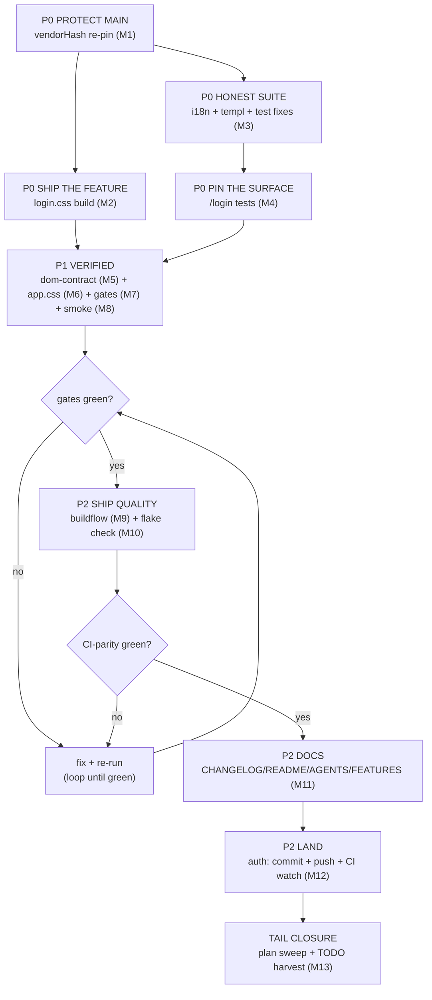

# SUPERB: loginpage adoption — finish the train

Plan created 2026-10-25 15:53 CET. Live status snapshot: `docs/status/2026-10-25_15-49_loginpage-adoption-mid-flight.md`.
Mission (owner directive): the cqrs-htmx `loginpage` library (v4.13.0, pinned tag = zero dependency bumps) IS the passkey login implementation; the hand-rolled island ceremony UI is dead. Core wiring landed (routes `/login` + `/api/auth/webauthn/login/{begin,finish}`, CSP nonce lane, island card link, passkey.js deleted). This plan finishes the train: styling artifact, honest tests, gates, docs, push.

Errata vs the 15-49 status report: none — plan written from live repo state (git status re-verified 15:53; the go.mod/go.sum daemon commits `fee3e57`+`b1cdd0d` are STILL unpushed, origin/main=`c7ca563` green).

## Pareto breakdown

### The 1% that delivers 51% — WITHOUT THESE THE TRAIN IS BROKEN
1. **vendorHash re-pin** — go.mod/go.sum sit in unpushed daemon commits; a daemon push without the re-pin = red main (the 2026-10-06 class). Rebuild RUNNING in background since 15:53.
2. **login.css artifact** — CSSPath already points at `/assets/login.css`; without the build the adopted page ships UNSTYLED. Includes fixing `build-tw-css.sh`'s dead `vendor/` dependency (pre-existing breakage: vendor/ trashed 2026-10-17, script never updated).
3. **Honest test suite** — `passkey_api_test.go` still pins the OLD paths (red), `passkey_view_test.go` asserts the DELETED form (red), `*_templ.go` is STALE (tests would lie), island i18n carries 6 dead keys ×2 maps.
4. **/login server tests** — a NEW auth surface ships unpinned otherwise (CSP nonce lane, session redirect, off-mode 404, CSRF meta, lp-* ids).

### The 4% that delivers 64% — VERIFIED CORRECTNESS
5. DOM contract doc + contract test (`passkey-login` link on `/`, `lp-*` on `/login`).
6. `app.css` styling for the passkey link anchor (`a.primary` + `.wp-passkey-link`).
7. Local gates: island node:test, `go test -count=1 ./...`, session-behavior suite, `nix fmt`.
8. Smoke boots: passkey-OFF byte-parity (`/login` = styled 404) + passkey-ON render (styled page, nonce'd CSP).

### The 20% that delivers 80% — SHIP QUALITY
9. `buildflow` full run (inside nix develop).
10. `nix flake check` (sandboxed build rides the NEW vendorHash).
11. Docs: CHANGELOG `[Unreleased]`, README § Passkey sign-in, AGENTS.md (bullet + DOM note + login.css story), FEATURES.md, TODO_LIST row, release-runbook stack-E2E obligation.
12. Narrative `auth:` commits + push + CI watch to green.

### The other 20% to reach 100% — CLOSURE
13. Plan/status close-out: mark tasks done, harvest any tail into TODO_LIST.

## Medium-granularity plan (30–100 min each, sorted by importance/impact ↓, effort, customer-value)

| # | Task | Tier | Impact | Effort | Customer value | Verify |
|---|------|------|--------|--------|----------------|--------|
| M1 | vendorHash re-pin (bg job 028 → apply `got:` to `nix/packages.nix`) | 1% | Blocks CI/main | 15m | Main stays green | `nix build .#webphone.goModules` succeeds |
| M2 | login.css: fix `build-tw-css.sh` (module-cache dirs via `go list -m`), write `login.css.input`, extend script for both artifacts, build + gates | 1% | Page ships styled | 90m | Usable login page | artifact greps + render check |
| M3 | Make suite honest: i18n prune (6 keys ×en/de), `templ generate`, `passkey_api_test.go` new paths, `passkey_view_test.go` link shape | 1% | Suite green = truth | 45m | Trust | `go test ./internal/server/ ./internal/web/views/` |
| M4 | New `/login` tests in `internal/server/login_page_test.go` (nonce CSP, 303, 404-off, CSRF meta, lp-*) | 1% | Auth surface pinned | 45m | Secure login | new tests pass |
| M5 | DOM contract: rewrite conditional passkey section in `docs/dom-contract.md` | 4% | External E2E contract | 20m | Integrators unblocked | `TestServedPageHoldsTheDomContract` |
| M6 | app.css: `.wp-passkey-link` anchor styling (match `.wp-sso`/primary button) | 4% | Visual correctness | 20m | Polished card | styles_logical_test + eyes |
| M7 | Local gates: island tests, full `go test -count=1 ./...`, session suite, `nix fmt` scoped | 4% | Regression fence | 60m | Reliability | all green |
| M8 | Smoke boots: OFF parity + ON render (JSON config, curl /login) | 4% | Real-world proof | 40m | It actually works | curl verdicts |
| M9 | buildflow full | 20% | Quality gate | 45m | Confidence | exit 0 |
| M10 | `nix flake check` | 20% | CI parity | 30m | Confidence | exit 0 |
| M11 | Docs wave: CHANGELOG, README, AGENTS.md, FEATURES, TODO_LIST, runbook note | 20% | Future sessions | 60m | Maintainability | docs-health greps |
| M12 | Commit (`auth:` prefix, detailed) + push + CI watch | 20% | Ships the train | 30m | Landed value | `gh run list` green |
| M13 | Close-out: plan checkbox sweep, status report annotation, TODO_LIST harvest | tail | Hygiene | 20m | Honest records | file updated |

## Fine-granularity plan (≤12 min each, sorted by importance/impact ↓)

| # | Task | Parent | Est | Done |
|---|------|--------|-----|------|
| F1 | Read bg job 028 output, extract `got:` hash | M1 | 2m | ☐ |
| F2 | Apply hash to `nix/packages.nix:127`, re-run goModules build → success | M1 | 6m | ☐ |
| F3 | `go list -m -f {{.Dir}}` templ-components + loginpage; verify feedback alert/spinner sources exist | M2 | 5m | ☐ |
| F4 | Patch `build-tw-css.sh`: resolve module dirs, stage from module cache (keep staged vendor/-shaped layout so tw.css.input stays byte-stable) | M2 | 12m | ☐ |
| F5 | Rebuild `tw.css` with fixed script → byte-compare vs committed (expect no drift) | M2 | 10m | ☐ |
| F6 | Write `internal/web/assets/login.css.input` (@import tailwindcss + ./app.css + extended dark variant incl. `.dark` + same @theme remap + @source set + loginpage + feedback) | M2 | 12m | ☐ |
| F7 | Extend script: build login.css (stage app.css + loginpage + feedback), @theme parity gate between inputs, artifact gates (`.min-h-dvh`, `var(--accent)`, `--accent:` token, `.hidden`) | M2 | 12m | ☐ |
| F8 | Build login.css, `nix fmt` artifact, commit-ready | M2 | 6m | ☐ |
| F9 | View + edit island `i18n.js`: drop passkeyEmail/Unknown/Throttled/BeginFailed/FinishFailed/NetFailed ×en/de | M3 | 8m | ☐ |
| F10 | `templ generate ./internal/web/views/` | M3 | 4m | ☐ |
| F11 | Fix `passkey_api_test.go`: `passkeyBegin` const → `/api/auth/webauthn/login/begin`, finish literals, off-404 list | M3 | 8m | ☐ |
| F12 | Rewrite `TestLoginCardAdaptsToPasskeyMode` for the link card | M3 | 10m | ☐ |
| F13 | Write `login_page_test.go`: nonce CSP + every inline script carries it + no unsafe-inline | M4 | 12m | ☐ |
| F14 | …303-on-live-session + styled-404-when-off + CSRF meta + lp-* ids + no-store | M4 | 10m | ☐ |
| F15 | Rewrite `docs/dom-contract.md` conditional section (passkey-login link; /login lp-* block) | M5 | 10m | ☐ |
| F16 | app.css `.wp-passkey-link` rule (display/width/padding to match `.wp-sso`) + comment | M6 | 8m | ☐ |
| F17 | Island tests: `nix run nixpkgs#nodejs -- --test --test-force-exit internal/web/assets/island-tests/*.test.mjs` | M7 | 8m | ☐ |
| F18 | `go test -count=1 ./...` | M7 | 12m | ☐ |
| F19 | Session suite `go test ./internal/server/ -run TestServer` | M7 | 10m | ☐ |
| F20 | `nix fmt` scoped (island, css, Go, generated) | M7 | 6m | ☐ |
| F21 | Smoke OFF: boot default binary, curl `/login` → styled 404, `/` parity | M8 | 8m | ☐ |
| F22 | Smoke ON: minimal JSON passkey config, boot, curl `/login` → 200 styled + nonce CSP + lp-* | M8 | 12m | ☐ |
| F23 | buildflow full run (nix develop) | M9 | 12m+ | ☐ |
| F24 | `nix flake check` | M10 | 12m+ | ☐ |
| F25 | CHANGELOG `[Unreleased]`: loginpage adoption entry | M11 | 6m | ☐ |
| F26 | README § Passkey sign-in: /login flow + new paths + theme caveat | M11 | 12m | ☐ |
| F27 | AGENTS.md: passkey bullet update (loginpage adoption, paths, nonce lane, login.css, v4.13.0 pin) | M11 | 10m | ☐ |
| F28 | FEATURES.md + TODO_LIST row + release-runbook stack-E2E obligation note | M11 | 10m | ☐ |
| F29 | `git status` review; whitespace-drift check; stage+commit in ONE call (`auth:` prefix, detailed body) | M12 | 12m | ☐ |
| F30 | Push (`git push`), then `gh run list`/watch to green | M12 | 10m | ☐ |
| F31 | Verify `git ls-remote` end state + record CI verdict | M12 | 4m | ☐ |
| F32 | Plan checkbox sweep + TODO_LIST harvest + status report annotated | M13 | 10m | ☐ |

## Execution graph

## Guardrails (verschlimmbesserung prevention)

- The ceremony HANDLERS are untouched — only paths moved; server-side session mint stays webphone's own.
- passkey-OFF deployments must stay byte-identical (`/login` 404s, card unchanged) — pinned by smoke + view test.
- `tw.css` must NOT drift from the committed artifact when the script fix lands (F5 byte-compare guards it).
- No edits to the library module; the pin is the published tag v4.13.0 (NOT cqrs-htmx HEAD, which wants usermgmt v4.16.0).
- Never rewrite the daemon's commits; the narrative rides MY commits.
