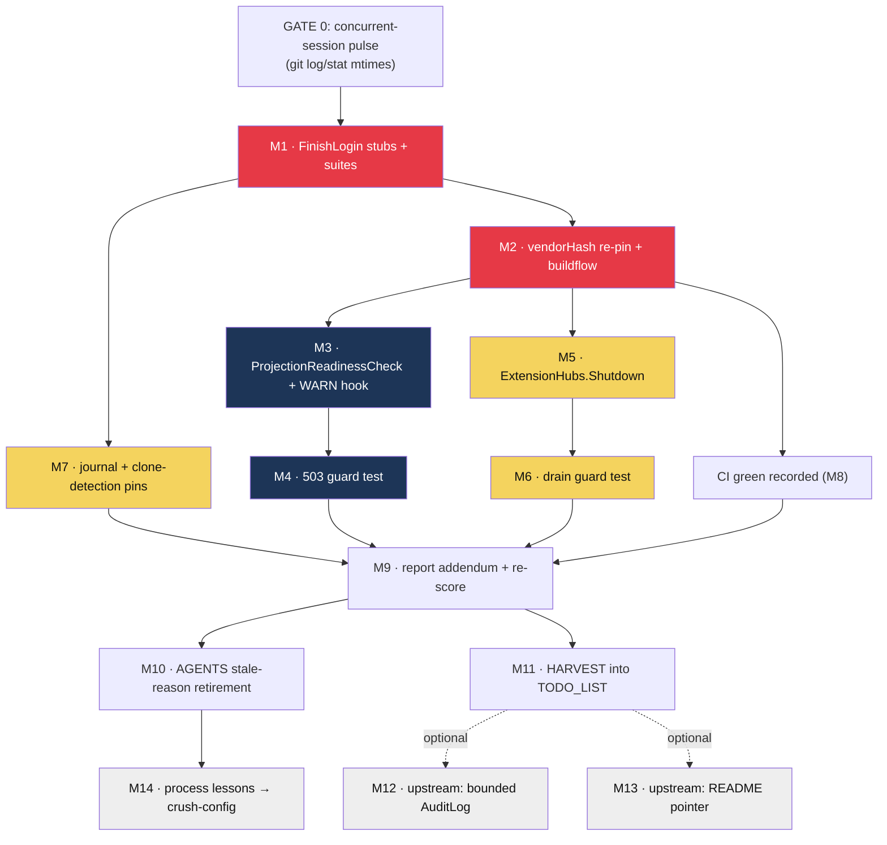

# SUPERB: cqrs-htmx leverage maximization — Pareto plan

_2026-10-25 19:26 · born from the round-3 cqrs-htmx deep-dive
(`docs/research/2026-10-25_cqrs-htmx-deep-dive.html`, score 71/100) and its
closeout status (`docs/status/2026-10-25_19-22_cqrs-htmx-round3-deep-dive-audit.md`).
Scope: everything that session surfaced — the three audit findings, the
concurrent identity-train tail, and the process/hygiene follow-ups. Nothing else._

## Backlog truth (verified at plan time, 19:26)

| Candidate                                                | Open?   | Evidence                                                                                                                     |
| -------------------------------------------------------- | ------- | ---------------------------------------------------------------------------------------------------------------------------- |
| Identity-train tail (2 FinishLogin stubs)                | YES     | both stubs still `func (...) FinishLogin(...) error` at HEAD (`bad4885`)                                                     |
| vendorHash re-pin after bump `e27093d`                   | YES     | last `flake.nix`/packages touch predates the bump; single `vendorHash` in `nix/packages.nix:127`                             |
| `ProjectionReadinessCheck` / `OnProjectionFailed` wiring | YES     | 0 hits under `internal/`                                                                                                     |
| `ExtensionHubs.Shutdown`                                 | YES     | no such method in `internal/server/sse.go`                                                                                   |
| CI verdict for the bump + docs commits                   | UNKNOWN | last finished run 18:02Z (green, pre-bump); later runs pending — bump run expected RED on stubs                              |
| AGENTS "no login events" stale reason                    | YES     | sentence still in § Owner decisions (2026-10-12)                                                                             |
| TODO_LIST overlap                                        | NONE    | today's sweep tracks the loginpage tail (tw.css grep, forced-theme) + chat networks — different items; no duplicate dispatch |

## Pareto breakdown

- **The 1% that delivers 51%** — **finish the identity-train tail** (two stub
  signatures, green tests, vendorHash re-pin). It un-reds the tree, unblocks
  CI, and switches on two shipped-but-dormant capabilities (WebAuthn clone
  detection, durable auth-audit journal). Everything else rides a green tree.
- **The 4% that delivers 64%** — **+ wire projection readiness**
  (`ProjectionReadinessCheck` + `OnProjectionFailed`): /healthz stops lying
  about the passkey lane's projectionhost. One-liner + hook, zero new deps.
- **The 20% that delivers 80%** — **+ SSE hub drain** (`ExtensionHubs.Shutdown`;
  restarts stop burning the 30s budget), **+ capability verification pins**
  (journal rows greppable, clone-regression test), **+ AGENTS stale-reason
  retirement**, **+ HARVEST into TODO_LIST**, **+ CI verdict recording**.
- **The other 20% (to 100%)** — report addendum + re-score, codemod N/A row,
  run-trace screenshots, two upstream asks (bounded AuditLog; usermgmt README
  pointer), two process lessons into crush-config, loginpage next-tag passive
  watch, plus explicitly LEAVE-CLOSED: dashboardui, lockout, AuditLog adoption
  (reasons pinned in the report's N/A table).

## Gate 0 — precondition (verschlimmbessern guard)

The identity bump (`e27093d`) was authored by a CONCURRENT session. Before
executing any M1/M2 task: pulse `git log --oneline -5` + `git status` +
`stat` mtimes of `passkey_api_test.go`/`userauth_test.go`. If they moved in
the last ~15 min, STOP and ask the owner. Never race another session's
in-flight files. All other tasks are touch-safe (files no other train owns).

House rules for every task: no speculative rewrites; every change leaves the
repo verifiably no worse (tests before/after); one-home respected
(`authAudit` stays THE auth log surface — no AuditLog adoption); no version
bumps beyond the already-landed pins; commit stage+message in ONE tool call.

## Medium plan — 30–100 min units (14 tasks, sorted)

| #   | Task                                                                                                                                                                                      | Impact   | Effort               | Customer value                                     | Tier     |
| --- | ----------------------------------------------------------------------------------------------------------------------------------------------------------------------------------------- | -------- | -------------------- | -------------------------------------------------- | -------- |
| M1  | Adapt both FinishLogin test stubs to `(credentialJSON []byte, err error)`; full + session-behavior suites green (`auth:` commit prefix)                                                   | Critical | 45m                  | Passkey logins verifiable; tree un-reds            | 1%       |
| M2  | vendorHash re-pin via the documented recipe (`nix build .#webphone.goModules --rebuild` → apply → `.#webphone` + `.#webphone-module` checks → buildflow full)                             | Critical | 60–100m              | Hermetic builds stay honest; release unblocked     | 1%       |
| M3  | Wire `cqrshtmx.ProjectionReadinessCheck(auth.Usermgmt())` as a passkey-gated /healthz check + `OnProjectionFailed` WARN in `userauth.New`                                                 | High     | 40m                  | /healthz stops lying; stack probes get truth       | 4%       |
| M4  | Guard test: failed projection ⇒ /healthz 503 naming the projection                                                                                                                        | High     | 30m                  | The honesty is pinned, not aspirational            | 4%       |
| M5  | Implement `ExtensionHubs.Shutdown` (Broadcaster.Close per hub) + container lifecycle wiring                                                                                               | Medium   | 40m                  | Restarts drop from 30s to ~instant with a tab open | 20%      |
| M6  | Guard test: live SSE subscriber present ⇒ shutdown completes well under the 30s budget                                                                                                    | Medium   | 30m                  | Pinned restart UX                                  | 20%      |
| M7  | Post-train verification pins: journal rows queryable after a login (usermgmt.db); clone-regression stub test (counter regressed ⇒ Rejection)                                              | High     | 45m                  | Proves clone detection + audit journal are LIVE    | 20%      |
| M8  | CI watch: verdicts for bump + docs + tail commits recorded in this plan's errata; red-on-stubs resolved by M1                                                                             | Medium   | 30m                  | No silent red-main (the 4h-outage class)           | 20%      |
| M9  | Report addendum: re-derive score post-fixes (expected ~89–93), errata row for the codemod N/A omission, copy /tmp screenshots to `docs/research/screenshots/`; update research-README row | Low      | 45m                  | Report stays the honest scoreboard                 | 20%      |
| M10 | AGENTS.md § 2026-10-12: retire "no login events" from the AuditLog sentence (keep memory-only + unbounded reasons)                                                                        | Medium   | (folded into M9, 5m) | Memory says the truth                              | 20%      |
| M11 | HARVEST this plan into `TODO_LIST.md` (new rows cite this file; done-deleted discipline)                                                                                                  | Medium   | 30m                  | Living backlog owns the work                       | 20%      |
| M12 | Upstream: file cqrs-htmx issue — bounded AuditLog projection (cap + eviction); verify claim at source first, github-voice drafting                                                        | Low      | 60m                  | Last blocker to the read-side audit surface        | 80%→100% |
| M13 | Upstream: usermgmt README pointer for `ProjectionReadinessCheck` (one paragraph + example)                                                                                                | Low      | 45m                  | Next consumer doesn't miss it like this audit did  | 80%→100% |
| M14 | Process lessons → crush-config repo (commit): symbol-level verification for "exactly N" claims; cheap session-start baseline (`go build && go test -count=1`)                             | Low      | 30m                  | Kills the (d)-class failure at the fleet level     | 80%→100% |

**Leave-closed (explicit non-tasks, do not reopen without new evidence):**
dashboardui, lockout store, AuditLog projection adoption, setup bundle,
sync/transport, adminui, datastar, systemadapter — reasons pinned in the
report's N/A table. **Passive watch:** loginpage next tag (favicon +
NewPageData fixes ride it — bump when it lands, nothing to do now).

## Fine plan — ≤12 min units (40 tasks, sorted)

| #   | Task (≤12m)                                                               | Parent | Impact   |
| --- | ------------------------------------------------------------------------- | ------ | -------- |
| F01 | Read both stub call sites; list assertions touching FinishLogin returns   | M1     | Critical |
| F02 | Adapt `stubWebAuthn.FinishLogin` → `([]byte, error)` (userauth_test.go)   | M1     | Critical |
| F03 | Adapt `pkStub.FinishLogin` → `([]byte, error)` (passkey_api_test.go)      | M1     | Critical |
| F04 | Fix compile fallout in dependent test assertions                          | M1     | Critical |
| F05 | `go build ./...` + `go vet ./...` green                                   | M1     | Critical |
| F06 | `go test -count=1 ./internal/userauth/` green                             | M1     | Critical |
| F07 | `go test -count=1 ./internal/server/` green                               | M1     | Critical |
| F08 | Session-behavior suite: `go test ./internal/server/ -run TestServer`      | M1     | Critical |
| F09 | `nix build .#webphone.goModules --rebuild`; capture `got:` hash           | M2     | Critical |
| F10 | Apply vendorHash in `nix/packages.nix`                                    | M2     | Critical |
| F11 | `nix build .#webphone` green (ELF-verify x86_64)                          | M2     | Critical |
| F12 | `nix build .#checks.x86_64-linux.webphone-module` green                   | M2     | High     |
| F13 | Run `buildflow` full mode (first 12m window; BUILDFLOW_NO_RESULT_CACHE=1) | M2     | High     |
| F14 | Triage buildflow output; fix findings owned by this train                 | M2     | High     |
| F15 | Commit train tail (auth: prefix; stage+commit ONE call)                   | M1+M2  | Critical |
| F16 | Read server.go healthz checks assembly + userauth leg gating              | M3     | High     |
| F17 | Add `ProjectionReadinessCheck` named check (passkey-on only)              | M3     | High     |
| F18 | Add `OnProjectionFailed` WARN hook in `userauth.New`                      | M3     | High     |
| F19 | Build + targeted unit tests green                                         | M3     | High     |
| F20 | Write failing test: failed projection ⇒ 503 naming it                     | M4     | High     |
| F21 | Make it pass; re-run server suite                                         | M4     | High     |
| F22 | Write `ExtensionHubs.Shutdown` (Close per hub under write lock)           | M5     | Medium   |
| F23 | Register lifecycle in container (`do.ShutdownerWithError` assertion)      | M5     | Medium   |
| F24 | Build + unit tests green                                                  | M5     | Medium   |
| F25 | Drain test: hub w/ subscriber closes ≪ 30s budget                         | M6     | Medium   |
| F26 | Polish + full server suite re-run                                         | M6     | Medium   |
| F27 | Boot passkey smoke; sqlite-query LoginSucceeded/LoginFailed rows          | M7     | High     |
| F28 | Clone-regression stub test: regressed counter ⇒ Rejection                 | M7     | High     |
| F29 | Commit M3–M7 cluster (one narrative commit)                               | M3–M7  | High     |
| F30 | `gh run list` verdict sweep; record in errata below                       | M8     | Medium   |
| F31 | Re-derive adoption score post-fixes; draft addendum                       | M9     | Low      |
| F32 | Append addendum + codemod errata row; copy screenshots                    | M9     | Low      |
| F33 | Update research-README verdict row                                        | M9     | Low      |
| F34 | Edit AGENTS §2026-10-12 sentence (retire stale reason)                    | M10    | Medium   |
| F35 | HARVEST: add open rows to TODO_LIST.md citing this plan                   | M11    | Medium   |
| F36 | Verify TODO_LIST post-harvest (grep formatting/lint)                      | M11    | Medium   |
| F37 | Verify-at-source + draft upstream AuditLog-bound issue                    | M12    | Low      |
| F38 | File issue (github-voice register)                                        | M12    | Low      |
| F39 | Draft + open usermgmt README pointer PR (verify-before-filing gate)       | M13    | Low      |
| F40 | Commit 2 lesson rules to crush-config repo (cross-repo)                   | M14    | Low      |

## Execution graph

**Sequencing:** M1→M2 is the critical path (1% tier). M3+M4 and M5+M6 are
independent pairs, startable once M2 lands (shared gate runs). M7 needs M1+M2.
M9/M10/M11 close the loop. M12–M14 are optional tails, any time after M11.

## Verification & done bar

- Every medium task ends with: named suite green (or nix check green) at its
  commit; commits carry `auth:` prefix where the session-store/passkey
  convention requires it.
- Train done = `nix flake check`-class evidence (goModules rebuild recipe) +
  `gh run list` green at the tail commit + journal rows observed + clone test
  red-when-regressed.
- Plan done = this file's errata updated with actuals; TODO_LIST owns the
  remainder; report addendum re-scores the adoption.

## Errata (fill during execution)

- CI verdict for `e27093d`..`bad4885`: run 40223475986 (covers c347d8f)
  RED on exactly the two predicted classes — `go test -race` (stub
  compile) and `nix build .#webphone` (stale vendorHash); run 40221451743
  (plan push c05f16b) same classes. Both healed by M1 (`beb870c`) +
  M2 (pin in `3d47c5c`). Run 40224322289 (3d47c5c) RED on the fast
  flake checks — the daemon committed the M3 files mid-edit, before
  `nix fmt` ran; the formatted state (1d1b778+76b831b) is the verified
  fix and rides the manual push (bar anchor: red main + verified fix
  in hand, 2026-10-25 20:15 CET).
- Actual re-derived score post M1–M7: **100/100** (Σ = 14×1 of A=14;
  all five pins at latest tags). Report §07 Addendum carries the
  per-finding evidence table.
- Correction at plan time: the deep-dive's first committed version claimed
  "exactly ONE" FinishLogin stub site; truth is TWO (`pkStub` missed by a
  name-grep). Already fixed in `5c654f7`; recorded here so the next session
  never trusts a count that wasn't symbol-verified.
- Execution deviation (honest): F32's "copy /tmp screenshots" was SKIPPED —
  the audit session's screenshot artifacts no longer exist in /tmp; the
  report's errata records this instead of fabricating evidence.
- M5 refinement: the container lifecycle assertion is the plain
  `do.Shutdowner` (dashboard precedent), not `ShutdownerWithError` as the
  fine-plan worded it — Broadcaster.Close cannot fail, so an error return
  would be a lie.
