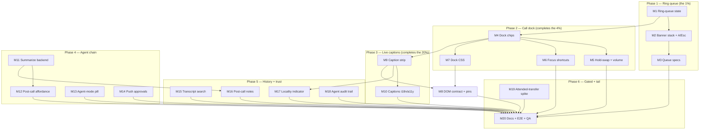

# SUPERB Multi-Call Dock + Agent-UX Pareto Plan

**Snapshot:** claims verified 2026-10-26 08:11 at HEAD `3c8522d`. Sources: island `calls.js`/`state.js`/`connection.js`/`shortcuts.js`/`transcribe.js`/`audioout.js`, `internal/server/textagent_api.go`, `internal/textagent/client.go`, `internal/server/server.go`, CHANGELOG, TODO_LIST. Adjacent in-flight work (NOT depended upon, NOT staged by this plan): `docs/research/2026-10-26_ai-agent-error-management.html` (concurrent session).

## 0. Problem

The island's call state machine already handles N concurrent sessions (`sessions` map, `focusedId`, per-call hold pending-state machine, `wp:calls-changed`), but the UX delivers a fraction of that: a second simultaneous **ringing** invite is turned away (`state.incomingSession` is a single slot in `connection.js` `onInvite`), all calls render as equal full cards, the dominant multi-call gesture (hold-and-switch) costs two taps across two cards, and the AI surfaces (drafts approval flow + ASR transcripts) are invisible outside their own tabs. The transcript segments are persisted but never rendered live — callers never see the words.

## 1. Pareto tiers

| Tier           | Delivers                                                                                                                                                                                                                                                                 | Items     |
| -------------- | ------------------------------------------------------------------------------------------------------------------------------------------------------------------------------------------------------------------------------------------------------------------------ | --------- |
| **1% → 51%**   | Ring queue: N-deep incoming invites, oldest-first answer. Without it "multiple calls" is false advertising at the front door.                                                                                                                                            | M1–M3     |
| **4% → 64%**   | + Call dock: chip strip (avatar, state pill, duration, one-tap focus) + one expanded focused card, with one-gesture hold-swap. The #1 multi-call gesture becomes one action.                                                                                             | M1–M5, M7 |
| **20% → 80%**  | + Keyboard focus cycling with announcements, Esc pinned to the newest ring (never the live call), and the **live caption strip** — the one agent UI with standalone accessibility value (deaf/HoH) and the substrate for all mid-call assist.                            | M1–M10    |
| **80% → 100%** | Post-call summarize→drafts chain, agent-mode pill (visibility of the existing `SetMode` autonomy), push-notified approvals, transcript search, post-call notes, processing-locality indicator, agent audit trail, attended transfer (stack-gated spike), docs/E2E tails. | M11–M20   |

## 2. Comprehensive plan (30–100 min tasks, sorted by importance/impact/effort/customer-value)

| #   | Task                                                                                                                                                                                                  | Phase   | Est  | Impact   | Effort | Value    | Depends on |
| --- | ----------------------------------------------------------------------------------------------------------------------------------------------------------------------------------------------------- | ------- | ---- | -------- | ------ | -------- | ---------- |
| M1  | Ring-queue state: `state.incomingSessions` list, `onInvite` appends, oldest-first answer, per-invite cleanup                                                                                          | Calls   | 60m  | Critical | M      | Critical | —          |
| M2  | Incoming banner **stack** (N slots), per-invite assertive announce, `A`=oldest, `Esc`=newest ring (never the live call)                                                                               | Calls   | 60m  | Critical | M      | Critical | M1         |
| M3  | Queue island specs: concurrent invites, banner slots, remote-cancel, answer path, oxlint clean                                                                                                        | Calls   | 45m  | High     | S      | High     | M1–M2      |
| M4  | Call dock: chip strip when N>1 (avatar, state pill, duration, focus one-tap) + single expanded focused card                                                                                           | Calls   | 90m  | Critical | M–L    | Critical | M1         |
| M5  | Hold-swap one gesture on chips ("hold & take", reuses `holdQueued` pending machine) + per-call volume slider + held-call attention blip                                                               | Calls   | 75m  | High     | M      | High     | M4         |
| M6  | Focus cycling shortcuts (`[`/`]`), focus-change announcements naming the remote party, shortcut log line + README cheat-sheet                                                                         | Calls   | 45m  | Medium   | S      | Medium   | M4         |
| M7  | Dock CSS: mobile above the fixed bottom tab bar, desktop `#tab-content` stretch seam (descendant selectors), token mirror in app.css + island/style.css, reduced-motion                               | Calls   | 60m  | High     | M      | High     | M4         |
| M8  | DOM contract + served-bytes pins: `docs/dom-contract.md`, `TestServedPageHoldsTheDomContract`, `scripts/webphone-smoke.py`, stack `tests/browser-e2e.py` greps                                        | Calls   | 45m  | High     | S      | High     | M4, M9     |
| M9  | Live caption strip under the expanded card (`transcribe.js` per-segment subscription → render, scrollback cap, clears on teardown, absent when ASR off)                                               | Agents  | 90m  | Critical | M–L    | Critical | —          |
| M10 | Captions i18n (en/de) + a11y ruling: strip is `aria-hidden` (no polite-live-region spam), reduced-motion, CHANGELOG                                                                                   | Agents  | 45m  | High     | S      | High     | M9         |
| M11 | Post-call summarize backend: verify `textagent.Client` ops → transcript→draft op, `POST /api/calls/{id}/summary-draft` (session-gated, CSRF, idempotent), errorfamily codes + registry regen, apidocs | Agents  | 100m | High     | L      | High     | —          |
| M12 | Post-call affordance: ended-card "Summarize → draft SMS" action (config-gated), busy/settled states, drafts nudge on success                                                                          | Agents  | 60m  | High     | M      | High     | M11        |
| M13 | Agent-mode pill: nav badge in `shell.js` showing the pinned draft mode (exposed via session identity), click cycles/resets via `POST /messages/drafts/mode`, polite announce, hidden when seam off    | Agents  | 75m  | High     | M      | High     | —          |
| M14 | Push-notified approvals: draft-ready fact via the shipped `internal/push` transports (priority 3), owner-scoped, inert when push off, `push.draft_*` family pins                                      | Agents  | 60m  | Medium   | M      | Medium   | —          |
| M15 | History transcript search: `GET /api/transcripts?q=` owner-scoped substring, filter-aware input + empty state                                                                                         | History | 60m  | Medium   | M      | Medium   | —          |
| M16 | Post-call notes: store migration v6 (`call_notes`), API GET/PUT, History row affordance, AI-draft prefill riding M11, backup-path check                                                               | History | 100m | Medium   | L      | Medium   | M11        |
| M17 | Processing-locality indicator: Settings ASR/agent rows + caption-strip footer chip name where audio is processed (config-honest)                                                                      | Trust   | 45m  | Low–Med  | S      | Medium   | M9         |
| M18 | Agent audit trail: greppable line per approve/discard (actor/draft/thread ids), durable-journal feasibility check, Settings last-N row                                                                | Trust   | 60m  | Medium   | M      | Medium   | —          |
| M19 | Attended transfer stack-verify spike: FS `Replaces` prerequisites + loopback smoke + island consult-flow sketch + GO/NO-GO note (NOT-DO documented if stack refuses)                                  | Gated   | 90m  | Medium   | M      | Medium   | M4         |
| M20 | Docs+QA tail: README § Calls, FEATURES, CHANGELOG consolidation, AGENTS.md invariants, stack browser E2E re-run, ui-capture refresh                                                                   | Tail    | 90m  | High     | M      | High     | all        |

Gated NOT-DOs recorded in §6: DND pill (dialplan territory — design note only, no task), CDR missed-call flag (PBX CDR carries none; the island `wp:call-missed` badge already shipped), CDR-side translation captions / semantic search / equalizers / PiP (no demonstrated user).

## 3. Fine breakdown (≤12 min tasks, ALL todos, sorted by the same order)

| ID   | Task                                                                                                                                                   | From | Min |
| ---- | ------------------------------------------------------------------------------------------------------------------------------------------------------ | ---- | --- |
| F001 | `state.js`: replace `incomingSession` with `incomingSessions: []`, JSDoc the oldest-first invariant                                                    | M1   | 10  |
| F002 | `connection.js` `onInvite`: append invite + per-invite terminated-cleanup removes exactly its slot                                                     | M1   | 12  |
| F003 | `calls.js` `answerIncoming()`: pop oldest pending invite, accept, mint session card                                                                    | M1   | 10  |
| F004 | `calls.js` `rejectIncoming()`: default target = newest; keep explicit-target form                                                                      | M1   | 8   |
| F005 | Spec: two concurrent invites both queue; answer takes oldest                                                                                           | M1   | 12  |
| F006 | Banner container renders N slots: caller line + Answer/Reject per invite                                                                               | M2   | 12  |
| F007 | Per-new-invite assertive announce (existing `announce(..., { assertive: true })` path)                                                                 | M2   | 8   |
| F008 | `Esc` rejects the newest ring only; never touches the focused live call (pin in shortcuts)                                                             | M2   | 8   |
| F009 | `A` answers oldest; update the shortcuts log line copy                                                                                                 | M2   | 8   |
| F010 | Hide a slot on accept/reject/remote-cancel; ring tone continues per remaining invite                                                                   | M2   | 12  |
| F011 | `notifyIncoming` per invite with dedup so N callers → N notifications                                                                                  | M2   | 8   |
| F012 | Spec: banner stack shows N slots with correct caller lines                                                                                             | M3   | 10  |
| F013 | Spec: `A`/`Esc` oldest/newest semantics                                                                                                                | M3   | 10  |
| F014 | Spec: remote-cancel mid-queue removes exactly its slot                                                                                                 | M3   | 10  |
| F015 | Spec: answer mints the session card and clears its slot                                                                                                | M3   | 10  |
| F016 | oxlint `no-undef` pass for any new browser global (island-lint config)                                                                                 | M3   | 5   |
| F017 | `renderCalls()` branches: N>1 → dock strip + expanded focused card; N≤1 → current card layout                                                          | M4   | 12  |
| F018 | Chip builder (`addCallCard` pattern, element-returning): avatar via `avatarFor`, state pill, duration, focus button, stable id `wp-dock-chip-<callId>` | M4   | 12  |
| F019 | Chip click → `focusSession`; expanded card keeps the existing full controls                                                                            | M4   | 10  |
| F020 | Duration ticker loop covers chips (existing 1s `renderCalls` interval)                                                                                 | M4   | 5   |
| F021 | `wp:calls-changed` fired on chip-relevant transitions (ice.js sync untouched)                                                                          | M4   | 8   |
| F022 | Spec: N=2 renders two chips + one expanded card                                                                                                        | M4   | 12  |
| F023 | Spec: focus switch moves the expanded card and re-runs `attachRemoteAudio`                                                                             | M4   | 12  |
| F024 | Chip "hold & take": `holdSession(current)` then focus + resume the other                                                                               | M5   | 12  |
| F025 | Honesty contract: swap waits `holdPending` settle; queue via `holdQueued` when mid-flight                                                              | M5   | 12  |
| F026 | Per-call volume slider on the expanded card → `entry.volume` applied to the remote audio element                                                       | M5   | 10  |
| F027 | Held-call attention blip, once per transition, `prefers-reduced-motion` respected                                                                      | M5   | 10  |
| F028 | i18n keys en+de for swap/volume/blip labels                                                                                                            | M5   | 8   |
| F029 | Specs: swap queues during a pending hold; volume persists per entry                                                                                    | M5   | 12  |
| F030 | `[`/`]` cycle `focusedId` across established sessions                                                                                                  | M6   | 10  |
| F031 | Announce focus change (polite) naming the remote party via `#wp-live`                                                                                  | M6   | 8   |
| F032 | Shortcuts log line + README cheat-sheet row for `[`/`]`                                                                                                | M6   | 8   |
| F033 | Spec: cycling skips ringing-only sessions                                                                                                              | M6   | 10  |
| F034 | `island/style.css`: dock strip, chip, pill layouts                                                                                                     | M7   | 12  |
| F035 | `app.css`: mirror new tokens (the MIRRORED token blocks rule)                                                                                          | M7   | 8   |
| F036 | Mobile: dock above the fixed bottom tab bar; banner stack scrolls                                                                                      | M7   | 10  |
| F037 | Desktop: dock respects the `#tab-content` stretch seam (DESCENDANT selectors only)                                                                     | M7   | 10  |
| F038 | Reduced-motion + `:focus-visible` states for chips                                                                                                     | M7   | 8   |
| F039 | `nix fmt` + dev-boot visual sanity                                                                                                                     | M7   | 12  |
| F040 | `docs/dom-contract.md`: dock ids, banner slots, caption strip id                                                                                       | M8   | 10  |
| F041 | Update `TestServedPageHoldsTheDomContract` expectations                                                                                                | M8   | 10  |
| F042 | Grep + update `scripts/webphone-smoke.py` asserted strings                                                                                             | M8   | 8   |
| F043 | Grep stack `tests/browser-e2e.py` for touched strings                                                                                                  | M8   | 8   |
| F044 | Run island tests + `go test ./internal/server/ -run TestServer` locally                                                                                | M8   | 9   |
| F045 | `transcribe.js`: expose a per-call segment subscription from the existing per-segment callback                                                         | M9   | 12  |
| F046 | `calls.js` caption strip DOM under the expanded card, last-N lines, id `wp-captions-<callId>`                                                          | M9   | 12  |
| F047 | Final-segment flush renders; strip clears on `teardownSession`                                                                                         | M9   | 10  |
| F048 | Keep `.call-transcript-saved` behavior unchanged                                                                                                       | M9   | 5   |
| F049 | Auto-start rides existing `ensureTranscription` (no new toggles)                                                                                       | M9   | 8   |
| F050 | Specs: segment → strip text; teardown clears; ASR-off renders nothing                                                                                  | M9   | 12  |
| F051 | Caption scrollback DOM cap (~30 lines, scalar-bounded like the store)                                                                                  | M9   | 10  |
| F052 | Wrap + speaker-tick styling in `island/style.css`                                                                                                      | M9   | 10  |
| F053 | Strip is `aria-hidden` + document the decision (no polite-live-region spam)                                                                            | M10  | 10  |
| F054 | en/de labels: "Live transcript", footer "processed on-server/remote"                                                                                   | M10  | 8   |
| F055 | `prefers-reduced-motion`: no caption animation                                                                                                         | M10  | 5   |
| F056 | Spec: strip absent when `window.PBX_CONFIG.asr` is falsy                                                                                               | M10  | 10  |
| F057 | CHANGELOG `[Unreleased]` line for captions                                                                                                             | M10  | 5   |
| F058 | i18n parity + unused-key tests pass                                                                                                                    | M10  | 7   |
| F059 | Read `internal/textagent/client.go` ops; verify transcript-summarize feasibility (STOP if the review API cannot express it — re-scope)                 | M11  | 12  |
| F060 | Extend the review API contract + client method: draft-from-transcript                                                                                  | M11  | 12  |
| F061 | `POST /api/calls/{id}/summary-draft`: session-gated, CSRF (`authedFetch`-grade bucket)                                                                 | M11  | 12  |
| F062 | Idempotency window (`callsIdem`-class) so double-clicks mint one draft                                                                                 | M11  | 8   |
| F063 | Error path: outage → `views.panelError`/toast with a stable code (`agent.summarize`)                                                                   | M11  | 10  |
| F064 | `family_test.go` pins + `TestErrorCodeRegistryIsFresh -update` regen (same-commit rule)                                                                | M11  | 12  |
| F065 | Add the surface to `internal/server/apidocs.go` + regenerate `/openapi.json`                                                                           | M11  | 12  |
| F066 | Server tests: gate, idem, outage                                                                                                                       | M11  | 12  |
| F067 | Ended-card action row "Summarize → draft SMS", gated by a config flag on `/config.js` when the seam is on                                              | M12  | 12  |
| F068 | `authedFetch` POST; busy + settled states per the island honesty contract                                                                              | M12  | 10  |
| F069 | Success → toast + drafts nudge (list-only `threads`-class nudge or `refreshNav` to Messages)                                                           | M12  | 12  |
| F070 | i18n en+de; shell copy stays English (D3)                                                                                                              | M12  | 8   |
| F071 | Spec: button absent when seam off; click → busy → toast                                                                                                | M12  | 12  |
| F072 | Smoke: boot-visible surface coverage if any                                                                                                            | M12  | 6   |
| F073 | Expose current draft mode + seam availability in the session identity response                                                                         | M13  | 12  |
| F074 | `shell.js` pill beside the call badge; hidden when the seam is off (404-style off detection)                                                           | M13  | 12  |
| F075 | Click cycles modes via `POST /messages/drafts/mode` (CSRF via the shell classic-script copy)                                                           | M13  | 10  |
| F076 | Polite announce on change; English label (D3)                                                                                                          | M13  | 8   |
| F077 | Reset affordance (server already accepts `mode=reset`)                                                                                                 | M13  | 8   |
| F078 | Spec: pill states off/idle/pinned (shell test stub)                                                                                                    | M13  | 12  |
| F079 | Keep the Messages panel toggle as the one settings home; pill is visibility only                                                                       | M13  | 8   |
| F080 | CHANGELOG line for the pill                                                                                                                            | M13  | 5   |
| F081 | Draft-creation point in the textagent review flow → `push.Fanout`, owner-scoped                                                                        | M14  | 12  |
| F082 | Payload: compact JSON fact in `message`, priority 3 (ring=5/end=3 precedent)                                                                           | M14  | 8   |
| F083 | Ride existing `push.ntfy.*`/`push.fcm.*` config; zero new knobs, OFF = inert                                                                           | M14  | 10  |
| F084 | `push.draft_*` codes + `family_test.go` pins                                                                                                           | M14  | 10  |
| F085 | Server tests: disabled seam sends nothing; enabled sends to registered devices                                                                         | M14  | 12  |
| F086 | Decide + document: internal-only fact → no asyncapi change (note in contracts README if needed)                                                        | M14  | 8   |
| F087 | `GET /api/transcripts?q=`: owner-scoped substring, bounded scan, cap                                                                                   | M15  | 12  |
| F088 | History view: search input + filtered transcript section                                                                                               | M15  | 12  |
| F089 | Filter-aware empty state (History M17 precedent)                                                                                                       | M15  | 8   |
| F090 | i18n en+de + parity tests                                                                                                                              | M15  | 8   |
| F091 | Spec: filter, empty, cap behavior                                                                                                                      | M15  | 12  |
| F092 | CHANGELOG line                                                                                                                                         | M15  | 5   |
| F093 | Migration v6: `call_notes` (owner + call key, scalar-bounded trim)                                                                                     | M16  | 12  |
| F094 | Store seam: upsert-keep semantics + readmodels wiring (cap enforcement = converging loops)                                                             | M16  | 12  |
| F095 | `GET/PUT /api/calls/{id}/note`: session-gated, CSRF                                                                                                    | M16  | 12  |
| F096 | History row: note affordance + render                                                                                                                  | M16  | 10  |
| F097 | AI-draft note button riding the M11 chain (prefill, human-edited)                                                                                      | M16  | 12  |
| F098 | Verify backup/drill + README restore path covers the new table's db                                                                                    | M16  | 10  |
| F099 | Specs + `store.note_*` family pins                                                                                                                     | M16  | 12  |
| F100 | i18n + CHANGELOG                                                                                                                                       | M16  | 10  |
| F101 | Settings ASR/agent rows name the processing location (config-honest label)                                                                             | M17  | 12  |
| F102 | Caption-strip footer chip: local vs remote provider                                                                                                    | M17  | 10  |
| F103 | i18n en+de                                                                                                                                             | M17  | 8   |
| F104 | Spec: labels match boot config                                                                                                                         | M17  | 10  |
| F105 | CHANGELOG line                                                                                                                                         | M17  | 5   |
| F106 | Greppable `authAudit`-class line per approve/discard (actor, draft id, thread id)                                                                      | M18  | 12  |
| F107 | Durable-journal feasibility check (usermgmt auth-audit precedent); else app_flags window — decide + document                                           | M18  | 12  |
| F108 | Settings row: last-N agent actions                                                                                                                     | M18  | 10  |
| F109 | Spec: line contents stable + queryable                                                                                                                 | M18  | 12  |
| F110 | CHANGELOG line                                                                                                                                         | M18  | 5   |
| F111 | Read stack FS dialplan + the island REFER path; list `Replaces` prerequisites                                                                          | M19  | 15  |
| F112 | FreeSWITCH loopback lab: attended-REFER smoke                                                                                                          | M19  | 30  |
| F113 | Island consult-flow sketch in the dock (two-call gesture)                                                                                              | M19  | 15  |
| F114 | GO/NO-GO note in this plan's errata + ROADMAP row if GO                                                                                                | M19  | 10  |
| F115 | README § Calls: queue, dock, shortcuts, captions                                                                                                       | M20  | 12  |
| F116 | FEATURES.md rows (DONE after ship)                                                                                                                     | M20  | 12  |
| F117 | CHANGELOG consolidation across the train                                                                                                               | M20  | 8   |
| F118 | AGENTS.md invariants: dock/caption contract lines, session-adjacent `auth:` note if session identity changed                                           | M20  | 12  |
| F119 | Stack browser E2E re-run (served-markup obligation), budget 445s, one re-run on the known transfer flake                                               | M20  | 30  |
| F120 | `scripts/ui-capture.py` refresh + eyeball light/dark                                                                                                   | M20  | 16  |

Total: 20 medium tasks / 120 micro tasks.

## 4. Execution graph

## 5. Constraints and verification gates (every phase)

- **DOM contract:** new ids go through `docs/dom-contract.md`; `TestServedPageHoldsTheDomContract`, `scripts/webphone-smoke.py`, and the stack's `tests/browser-e2e.py` grep served bytes — all three updated in the same change (M8 is the batch gate; served-markup phases owe the E2E re-run in M20).
- **Island honesty:** hold/swap affordances settle through the `holdPending`/`holdQueued` pending machine; the UI never shows a state the network hasn't confirmed.
- **Morph:** dock chips need stable ids (`wp-dock-chip-<callId>`, `wp-captions-<callId>`); stateful nodes survive `morph:innerHTML`.
- **i18n:** island copy en/de in BOTH maps (parity + unused-key tests); shell copy English (D3); `#log` English.
- **CSP/markup:** no inline styles/scripts; JS-created buttons carry inline SVG strings (existing `WP_PLAY_SVG` precedent); chips follow `addCallCard` element-building.
- **a11y:** incoming ring stays the one assertive announce; everything else polite; captions `aria-hidden`.
- **Error family:** any new server error path uses `errorfamily.New*/Wrap*` + a stable `<seam>.<op>` code, registered via `TestErrorCodeRegistryIsFresh -update` in the SAME commit; family pins per package.
- **Auth convention:** session-identity response changes (M13) ride the `auth:` commit prefix + `go test ./internal/server/ -run TestServer`.
- **Machine tables:** no new lifecycle transitions branch-by-branch in services; the queue is UI-state, hold-swap reuses the existing machine.
- **Formatter:** `nix fmt` after ANY island/shell/css/Go edit (treefmt gates Go; oxfmt-green ≠ treefmt-green).
- **Train start:** run `buildflow` once before the first code commit of this plan; `nix develop -c go test -count=1 ./...` per phase.

## 6. Errata (corrections vs the round-one brainstorm, verified at HEAD)

1. **Missed-call surfacing WITHDRAWN** — already shipped: the island dispatches `wp:call-missed` and `shell.js` renders the missed badge (CHANGELOG ~L1246). Residual NOT-DO: a CDR missed flag cannot exist client-side (the PBX CDR carries none) — server-side scope, dropped.
2. **Agent autonomy EXISTS server-side** — `SetMode` pins a persistent mode with confidence gating; M13 is visibility-only, no new mode machinery.
3. **Output device picker EXISTS** (`audioout.js` `setSinkId`) — M5's per-call volume is additive to it, not a duplicate.
4. **Ring-while-closed push seam SHIPPED** (2026-10-23) — M14 rides the existing transports; zero new config knobs.
5. **`textagent` is an external review-API client** (`internal/textagent/client.go`, loopback review API) — F059 verifies the API can express transcript-summarize BEFORE any promise; if not, M11 re-scopes to client+service extension or a local fallback.
6. **Attended transfer is stack-gated** — the island already sends blind REFER and parses the NOTIFY sipfrag; consult-then-transfer needs FS `Replaces`, verified by the M19 spike before any island work.
7. **DND pill NOT-DO** — auto-reject-to-voicemail is dialplan territory (stack), not this repo's UI; recorded, no task.

## 7. Deliberately not (YAGNI)

Translation captions, semantic/embedding transcript search, per-call equalizers, PiP multi-window, an answering bot — all heavy, none with a demonstrated user. Revisit triggers live in ROADMAP.md if ever needed.

## 8. Errata round two (train execution, 2026-10-26/27)

8. **M15 transcript search ALREADY SHIPPED** — `GET /api/transcripts?q=`
   owner-scoped substring search, the filter-aware History input and the
   filter-aware empty state all predate the train (History search train).
   Zero work; F087–F092 verified against the shipped surface.
9. **M16 notes home: readmodels, not the store ladder** — the plan's
   "store migration v6" wording is superseded: History-surface data lives
   in the readmodels engine since the T07/T09 swaps (the store's v3
   `call_transcripts` table is the retired SQL shape, kept only for the
   migration ladder). Notes ship as a declarative engine collection
   (`call_notes`) next to the transcripts they annotate — no webphone.db
   migration. The cap REJECTS (409) instead of trimming: hand-written
   content is never silently expunged, superseding the plan's
   "scalar-bounded trim" wording.
10. **M18 durable journal NO-GO** — the usermgmt auth-audit journal is
    the identity layer's store (agent approvals are not auth events;
    writing there crosses the seam); an app_flags window would be a
    lossy hand-rolled journal. The structured `agent <event>` journal
    line IS the audit home (F106 shipped, F107 decided, F108's Settings
    last-N row DEFERRED — it needs a durable read model; the trigger is
    an operator who greps the journal today).
11. **M19 attended transfer NO-GO (this host)** — F111 verified: the
    island's REFER+NOTIFY path is shipped and the dock's consult-flow
    sketch is below; the stack's `modules/freeswitch.nix` carries NO
    `Replaces`-aware dialplan handling (the only mentions are overlay
    wording), and this host has no FreeSWITCH lab (no `fs_cli`, no FS
    service), so F112's loopback smoke could not run. NOT-DO documented;
    the spike's full evidence: `docs/research/2026-10-27_attended-transfer-spike.md`.
    Re-open trigger: an FS lab (the stack's VM tests grow an
    attended-REFER scenario) — then the island work is a small delta on
    the shipped REFER path.

### M19 consult-flow sketch (F113, for the GO day)

Two-call gesture in the dock: (1) hold the live call (existing hold
machine — the held blip already shows); (2) dial the consult target —
the second call lands in the dock as its own entry; (3) on the consult
leg's Established, the transfer row of the CONSULT call offers "Bridge
to held" — sending REFER with Replaces toward the held dialog and
parsing the NOTIFY sipfrag exactly like the shipped blind path; (4) the
NOTIFY verdict tears down both local legs on success (the PBX bridged
them server-side). No new island state machine: hold + the existing
transfer pending path compose; the only new UI is the "Bridge to held"
button scoped to the case where exactly one held + one established
consult call exist.
