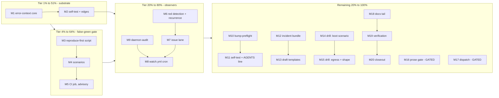

# SUPERB Error-Agents Pareto Plan

**Snapshot:** claims verified 2026-10-26 10:33 at HEAD `13fb114`. Sources:
`docs/research/2026-10-26_ai-agent-error-management.html` (the practice scan,
v2 — every claim source-pinned there), `.github/workflows/ci.yml` (jobs:
build / go-tests / fast-checks / dup-gate; `pull_request` trigger present;
NO scheduled workflow exists), `scripts/` inventory (whitespace-drift.sh,
push-stall-watch.sh exist; NO error-context / reproduce-first / red-watch /
bump-preflight / incident-bundle scripts exist — all verified missing, none
re-dispatched), `nix/vm-tests.nix` (webphone-backup-drill exists; NO
error-drill), `TODO_LIST.md` (adjacent train: multicall dock — ZERO file
overlap, different train), AGENTS.md at 171/377 lines (Commands one-liners
have cap headroom). Adjacent in-flight work: none blocking.

## 0. Problem

The practice scan (2026-10-26) found this repo holds the machine-readable
error structure agents need (`<seam>.<op>` codes, a test-pinned error
contract, flight recorder, structured logs) but uses NONE of it
agent-assisted: red-main hours are human-bounded (4h on 2026-10-05, ~2.5h on
2026-10-24), false greens are only convention-bounded (nothing mechanically
requires a fix's test to fail on the base commit), flake-ledger rows are
hand-written at 2am, dependency bumps burned main twice via vendorHash, and
every diagnosis starts from a blank page. Eight proposals (R1–R8) came out
of the scan. This train executes the Pareto slice of them as PURE TOOLING:
scripts, CI jobs, docs — **zero product code, zero island code, zero
behavior change to the binary.** That is the anti-verschlimmbesser frame:
the product cannot regress from anything in this plan; every piece is
advisory-first and independently deletable.

## 1. Pareto tiers

| Tier | Delivers | Items |
|---|---|---|
| **1% → 51%** | Error-code router (`error-context.py`): journal line in → context bundle out (seam files, contract row, family-test pin, lessons/ledger mentions, git history). Smallest surface, zero risk, and the SUBSTRATE every later piece consumes — watchers draft ledger rows through it, incident bundles cite it, future agent sessions arrive oriented through it. | M1–M2 |
| **4% → 64%** | + Fix-scoped reproduce-first check: a fix train's new tests must FAIL on the merge base. Kills the false-green class mechanically (an agent or human weakening a test to go green stops being invisible). Advisory-first: annotates, never blocks. | M3–M5 |
| **20% → 80%** | + The observers: main-red watcher (red main → recurrence-grep against ledger+lessons → auto-filed issue with a DRAFT ledger row — the human owns the verdict) and daemon-audit (the 2026-10-08 `.buildflow.yml` truncation class, mechanically caught). Directly attacks the two documented red-main hour-classes and the daemon guard hole. NO agent dispatch — the risky half stays gated. | M6–M9 |
| **80% → 100%** | Bump preflight (upstream diff pre-read; the vendorHash incident class), incident-bundle harvester (flight-recorder window → drafted lessons/CHANGELOG/ledger skeletons), error-contract drill VM test (assert failure SHAPE: fail-closed, honest healthz, styled 404, 5-part boot), gated sketches (LLM prose gate, agent dispatch — owner calls, NOT wired this train), docs/adoption/verification tails. | M10–M20 |

## 2. Comprehensive plan (30–100 min tasks, sorted by importance/impact/effort/customer-value)

Customer = the owner-operator + the consuming stack (pbx-artmann RIDES
main; red main blocks releases — that is the customer-value line).

| # | Task | Phase | Est | Impact | Effort | Value | Depends on |
|---|---|---|---|---|---|---|---|
| M1 | `scripts/error-context.py` core: code/journal-line in → bundle out (seam files via rg, error-contract.md registry row, family_test pin, lessons + flake-ledger mentions, last-5 seam commits; `--json` mode for agents) | Substrate | 60m | Critical | S | Critical | — |
| M2 | error-context self-test + edges: `--self-test` over 3 real registry codes, journal-line normalization, unknown-code verdict with nearest-code suggestions, contract-vs-source DRIFT verdict | Substrate | 45m | High | S | High | M1 |
| M3 | `scripts/reproduce-first-check.sh`: base/head ref resolution, changed `*_test.go` detection, fix-train detection (`fix:`/`auth:` head-commit prefix), temp worktree with ONLY the test diff applied to base, scoped `go test`, verdict REPRODUCES / NO-REPRO / SKIP | Gate | 60m | Critical | M | Critical | — |
| M4 | reproduce-first self-test: scratch-worktree scenarios — reproducing fix branch (expect REPRODUCES), feature branch with new passing test (expect SKIP not-fix-train), fix branch whose test passes on base too (expect NO-REPRO) — pinned as `--self-test` | Gate | 45m | High | M | High | M3 |
| M5 | ci.yml `reproduce-first` job (pull_request, advisory: `continue-on-error`, distinctive `reproduce-first:` log prefix, documented future blocking flip) — zero edits to existing jobs | Gate | 30m | High | S | High | M4 |
| M6 | `scripts/main-red-watch.sh`: latest main run red detection (conclusion=failure), issue-tracker dedup (`red-main run <id>` search — state lives in the tracker, not CI state), recurrence-grep of failing job/test against ci-flake-ledger.md + lessons.md | Watch | 60m | Critical | M | Critical | M1 |
| M7 | red-watch issue filing: `gh issue create` titled `red-main run <id>: <job>`, body = draft ledger row + recurrence matches + run link, label `ci-red`; NEWER red on an open issue → comment append, never duplicate | Watch | 45m | High | M | High | M6 |
| M8 | `.github/workflows/watch.yml`: cron */15 + workflow_dispatch + concurrency guard + `permissions: issues: write`, timeout, minimal perms; runs red-watch and daemon-audit as separate non-blocking steps | Watch | 30m | High | S | High | M7, M9 |
| M9 | `scripts/daemon-audit.sh`: daemon-pattern commit detection (`chore: auto-commit` prefix), whitespace-drift check on its diff (ref-mode adaptation), guarded-files audit (.buildflow.yml/go.mod/go.sum/flake.lock — the documented env-override guard hole), verdict + issue lane reuse. Push-stall anchor stays HOST-side (CI sees only pushed state — scoped honestly, not silently) | Watch | 45m | High | M | High | — |
| M10 | `scripts/bump-preflight.sh`: module path + old/new versions → both zips + .mod from proxy.golang.org (python3 urllib), diff overlapping files (capped), usage-site map (rg the changed package dirs against our imports), removed/renamed symbol flags, report renderer | Pre-read | 60m | High | M | High | — |
| M11 | bump-preflight self-test: real-history run (go-health v0.5.0→v0.5.1), offline fail-open verdict (WARN + exit 0, the repo's unreachable-peer doctrine), AGENTS bump-bullet one-liner (171/377 — headroom confirmed) | Pre-read | 45m | Medium | S | Medium | M10 |
| M12 | `scripts/incident-bundle.sh --since <ts> --dataDir <dir> [--log-file]`: flight-recorder snapshot window listing (size, gunzip + `go tool trace` instructions), `gh run list` window, `git log --since` context, error-context sweep of supplied logs → `docs/drafts/incident-<date>-<slug>/bundle.md` (drafts-dir precedent: catalog-exporter-2026-10-25) | Harvest | 60m | Medium | M | Medium | M1 |
| M13 | bundle templates: lessons.md row skeleton (TBD verdict + evidence slots), CHANGELOG candidate line, flake-ledger row skeleton — the owner fills every verdict; no doc is ever auto-merged (exoskeleton doctrine) | Harvest | 45m | Medium | S | Medium | M12 |
| M14 | `webphone-error-drill` VM test scaffolding (KVM-gated, backup-drill pattern) + Scenario A boot-failure: unreadable sqlite path → restart loop → assert journalctl carries the 5-part boot block markers + exit taxonomy + healthz 503 naming the failing leg while wedged | Drill | 90m | High | L | High | — |
| M15 | Drill scenarios B+C: webhook-egress blackhole (webhook-mode env + unreachable URL → send → saved-failed row + 502 classification), surface-shape asserts (browser-miss 404 styled vs `/api` miss terse; `/hooks/*` without secret → fail-closed 503); register the check in the checks list | Drill | 60m | High | M | High | M14 |
| M16 | GATED sketch (NOT implemented): LLM error-prose gate — scan surface inventory (i18n values, `http.Error` texts, bootreport copy), runtime/cost options, detect-only contract, trigger criteria (owner GO + CI LLM budget) | Gated | 30m | Medium | S | Medium | — |
| M17 | GATED sketch (NOT implemented): agent dispatch — evidence-pack PR template into docs/drafts/ (run id, repro commands, rollback line, prev green SHA), runtime decision menu (claude-code-action vs Devin vs Crush headless; secrets/cost), trigger criteria (owner GO) | Gated | 30m | Medium | S | Medium | M5, M8 |
| M18 | Docs/adoption tail: CHANGELOG `[Unreleased]` lines per shipped script, README troubleshooting one-liner for error-context, AGENTS Commands one-liners (cap-checked), TODO_LIST rows flipped to shipped with evidence | Tail | 45m | High | S | High | M1–M15 |
| M19 | Verification: `nix fmt` over new files (scope-check .sh/.py first), full `buildflow`, `nix flake check` fast checks, read-only red-watch dry-run against live `gh` | Tail | 45m | Critical | S | Critical | M18 |
| M20 | Closeout: status snapshot header ("claims verified as of HH:MM"), errata annotation, `git ls-remote` + `gh run list` CI-green verification after the final push | Tail | 30m | High | S | High | M19 |

## 3. Fine breakdown (≤12 min tasks, ALL todos, sorted by the same order)

| ID | Task | From | Min |
|---|---|---|---|
| F001 | CLI skeleton: argparse (code-or-journal-line, `--json`, `--self-test`), input normalization (strip `[family:code]`, extract code) | M1 | 12 |
| F002 | Code→seam files: `rg -l '<code>' internal/ cmd/`, constructor sites ranked first | M1 | 12 |
| F003 | error-contract.md registry-row extraction for the code (parse the generated block's table) | M1 | 12 |
| F004 | family_test pin lookup: `rg '<code>' **/*family_test.go` + owning test names | M1 | 10 |
| F005 | lessons.md + ci-flake-ledger.md mentions with line context | M1 | 8 |
| F006 | Last-5 commits touching the owning package (`git log --oneline -5 -- <pkg>`) | M1 | 8 |
| F007 | Output renderer: human bundle (sections) + `--json` machine mode for agents | M1 | 12 |
| F008 | Unknown-code verdict: exit 2 + nearest-code suggestions (prefix match over the registry) | M1 | 10 |
| F009 | Pick 3 real codes from the generated registry block (one per family) | M2 | 6 |
| F010 | `--self-test`: run the 3 codes, assert every bundle section non-empty | M2 | 12 |
| F011 | Edge: journal-line input with family prefix + trailing operator text | M2 | 8 |
| F012 | Edge: code in contract but absent from source → explicit DRIFT verdict (points at `TestErrorCodeRegistryIsFresh`) | M2 | 12 |
| F013 | CLI + base/head ref resolution (`git merge-base`) | M3 | 10 |
| F014 | Changed `*_test.go` list via `git diff --name-only`; empty → SKIP verdict | M3 | 10 |
| F015 | Fix-train detection: head-commit message scan for `fix:`/`auth:` prefix | M3 | 10 |
| F016 | Temp worktree: checkout base, apply ONLY the test-file diff | M3 | 12 |
| F017 | Scoped `go test` run (affected packages only) with timeout | M3 | 12 |
| F018 | Verdict logic: ≥1 failing new test = REPRODUCES; all green = NO-REPRO (advisory copy) | M3 | 10 |
| F019 | Cleanup trap + host-go guard (document the `nix develop -c go` / GOTOOLCHAIN=local note) | M3 | 10 |
| F020 | Self-test scenario 1: synthetic reproducing fix branch in a scratch clone → REPRODUCES | M4 | 12 |
| F021 | Self-test scenario 2: feature branch with a new passing test (`feat:` msg) → SKIP (not fix train) | M4 | 10 |
| F022 | Self-test scenario 3: `fix:` branch whose new test passes on base too → NO-REPRO | M4 | 12 |
| F023 | Pin the three verdicts as `--self-test` (temp-dir driven, no network) | M4 | 12 |
| F024 | ci.yml job: on pull_request, checkout (fetch-depth 0 for merge-base), run the script base=origin/main head=HEAD | M5 | 12 |
| F025 | Advisory posture: `continue-on-error` + `reproduce-first:` log prefix greppable in the run view | M5 | 8 |
| F026 | Non-PR-event guard + comment documenting the future blocking flip (after N clean trains) | M5 | 10 |
| F027 | `gh run list --branch main --limit 1` red detection (conclusion=failure; in_progress → exit 0) | M6 | 12 |
| F028 | Issue dedup: search open issues for `red-main run <id>`; exists → exit 0 (tracker is the state store) | M6 | 12 |
| F029 | Recurrence grep: failing job + test strings vs ci-flake-ledger.md + lessons.md, list matches as "known class?" candidates | M6 | 12 |
| F030 | Draft ledger-row renderer (markdown row, verdict column = TBD — owner rules) | M6 | 10 |
| F031 | Verdict bundle to stdout: run link, failing job, recurrence matches, draft row | M6 | 8 |
| F032 | `gh issue create` from the bundle; label `ci-red` (create-if-missing) | M7 | 12 |
| F033 | Newer red while an issue is open → `gh issue comment` append, never a second issue | M7 | 12 |
| F034 | Workflow `permissions: issues: write` + token scope verification | M7 | 10 |
| F035 | watch.yml: cron `*/15 * * *` + workflow_dispatch + `concurrency: watch` | M8 | 12 |
| F036 | Steps: checkout, main-red-watch step, daemon-audit step — each non-blocking verdicts | M8 | 12 |
| F037 | Timeout-minutes + minimal permissions matrix | M8 | 8 |
| F038 | Daemon-pattern detection: latest main commit message matches `chore: auto-commit` prefix | M9 | 10 |
| F039 | whitespace-drift ref-mode: run the drift check over that commit's diff (adapt the staged-diff script or pipe the diff in) | M9 | 12 |
| F040 | Guarded-files audit: `.buildflow.yml`/`go.mod`/`go.sum`/`flake.lock` touched by a daemon-pattern commit → flag (the env-override guard hole is the threat model) | M9 | 12 |
| F041 | Verdict renderer + exit codes; flags route through the M7 issue lane | M9 | 10 |
| F042 | CLI: module path + old/new versions; proxy.golang.org URL construction | M10 | 10 |
| F043 | Download both zips + `.mod` (python3 urllib — no curl dependency) | M10 | 12 |
| F044 | Unzip + diff overlapping files (difflib unified, capped file count + line count) | M10 | 12 |
| F045 | Usage-site map: for each changed upstream package dir, `rg` its import path across our repo | M10 | 12 |
| F046 | Report renderer: changed/removed symbols (best-effort), usage sites, verdict | M10 | 12 |
| F047 | Self-test: go-health v0.5.0→v0.5.1 real-history run renders non-empty | M11 | 12 |
| F048 | Offline fallback: unreachable proxy → WARN + exit 0 (fail-open, unreachable-peer doctrine) | M11 | 10 |
| F049 | AGENTS bump-bullet one-liner (171/377 cap — headroom verified) | M11 | 8 |
| F050 | `--since`/`--dataDir`/`--log-file` args; list `<dataDir>/traces` snapshots in window | M12 | 10 |
| F051 | Per-snapshot metadata: size, gzip note, `go tool trace` instruction line | M12 | 8 |
| F052 | `gh run list` window + `git log --since` context into the bundle | M12 | 10 |
| F053 | error-context sweep of the supplied log file (journald needs root — accept a file, document the `journalctl -u webphone > file` pre-step) | M12 | 12 |
| F054 | Write `docs/drafts/incident-<date>-<slug>/bundle.md` | M12 | 10 |
| F055 | lessons.md row skeleton (TBD verdict + evidence slots) in the bundle | M13 | 10 |
| F056 | CHANGELOG candidate line + flake-ledger row skeleton in the bundle | M13 | 8 |
| F057 | Runbook pointer: "assemble the bundle first" step in the plan doc + TODO cite (README untouched until an incident proves the shape) | M13 | 8 |
| F058 | vm-tests.nix `webphone-error-drill` skeleton (copy backup-drill scaffolding; KVM-gated) | M14 | 12 |
| F059 | Scenario A: unreadable sqlite path → restart loop → journalctl carries 5-part boot block markers + designed exit 1 | M14 | 12 |
| F060 | Scenario A healthz assert: 503 while wedged, body names the failing check | M14 | 12 |
| F061 | Scenario B: webhook-mode env + unreachable upstream → send → saved-failed row + 502 classification via loopback API | M15 | 12 |
| F062 | Scenario C: browser-miss 404 styled (marker grep) vs `/api` miss terse; `/hooks/*` sans secret → fail-closed 503 | M15 | 12 |
| F063 | Register the drill in the checks list; assert it is KVM-gated (does not slow consumer CI) | M15 | 12 |
| F064 | Prose-gate sketch: scan-surface inventory (i18n values, `http.Error` texts, bootreport copy), runtime/cost options, detect-only contract | M16 | 12 |
| F065 | Prose-gate trigger criteria recorded (owner GO + CI LLM budget decision) | M16 | 6 |
| F066 | Dispatch sketch: evidence-pack PR template into docs/drafts/ (run id, repro commands, rollback line, prev green SHA) | M17 | 12 |
| F067 | Dispatch runtime decision menu (claude-code-action vs Devin vs Crush headless; secrets/cost columns) | M17 | 12 |
| F068 | Dispatch trigger criteria (owner GO) | M17 | 6 |
| F069 | CHANGELOG `[Unreleased]` lines per shipped script | M18 | 10 |
| F070 | README troubleshooting one-liner for error-context | M18 | 8 |
| F071 | AGENTS Commands one-liners (cap re-checked at execution time) | M18 | 10 |
| F072 | TODO_LIST rows flipped to shipped with evidence links | M18 | 8 |
| F073 | `nix fmt` over new files (confirm .sh/.py treefmt scope first; if unowned, skip with a note) | M19 | 10 |
| F074 | Full `buildflow` run (train-end doctrine; `BUILDFLOW_NO_RESULT_CACHE=1` if suspicious) | M19 | 12 |
| F075 | `nix flake check` fast checks (or the targeted `nix build .#checks…` legs) | M19 | 12 |
| F076 | Read-only red-watch dry-run against live `gh` (verify detection + dedup paths on current-green main) | M19 | 10 |
| F077 | Status snapshot header with verification timestamp | M20 | 8 |
| F078 | Errata annotation (anything discovered during execution) | M20 | 10 |
| F079 | `git ls-remote` + `gh run list` CI-green verification after the final push | M20 | 10 |

## 4. Execution graph

## 5. Verification doctrine (anti-verschlimmbesser)

1. **Zero product code.** Everything lives in `scripts/`, `.github/workflows/`,
   `nix/vm-tests.nix` (new check only), and docs. The binary's behavior is
   bit-identical after this train (verified by the build job staying green
   with no Go-source diffs outside tests-that-test-tooling — there are none).
2. **Advisory-first.** reproduce-first annotates, never blocks (blocking is
   a deliberate later flip after N clean trains). Watchers file issues;
   they merge nothing, quarantine nothing, and write no doc without the
   owner's verdict.
3. **State lives in the tracker.** Red-watch dedup via issue search — no
   CI cache, no hidden state file, trivially inspectable.
4. **Every script self-tests** (`--self-test` precedent:
   `module-cache-janitor.sh`), offline fail-open where the doctrine says so
   (unreachable peer = WARN, wrong config = refuse).
5. **Gates at train start AND end** (buildflow doctrine); `nix fmt` before
   gates; whitespace-drift check in the same commit call as `git add`
   (daemon-race lesson).

## 6. Gated NOT-DOs (recorded, deliberately not built)

- **Agent dispatch (R2-full):** wiring a fix-dispatching agent into watch.yml
  needs an owner call on runtime (claude-code-action vs Devin vs Crush
  headless), secrets, and cost. The observer half ships; dispatch waits for
  GO (M17 records the menu).
- **LLM prose gate (R5):** an LLM call in CI needs an API-key + budget
  decision. Sketch only (M16).
- **Auto-quarantine / auto-retry:** rejected by doctrine (masks real bugs);
  the ledger draft keeps the human verdict.
- **SaaS telemetry lanes (Sentry/Datadog class):** rejected — self-hosted,
  local-first caller-data doctrine; vendor rows are proof-of-capability only.
- **Push-stall anchor in CI:** impossible honestly (CI sees pushed state
  only); `push-stall-watch.sh` stays a host-side manual bar tool.
- **README incident-runbook rewrite:** waits until the first real incident
  proves the bundle shape (M13 keeps the pointer minimal).

## 7. Errata

(none at plan birth; execution annotates here)
