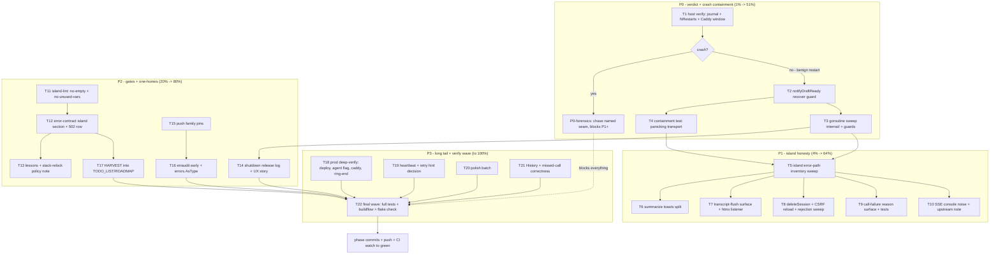

# SUPERB Error-Surface & Crash-Containment Plan

**Snapshot: 2026-10-27 16:05 CET · claims verified as of 16:05 · plan goes stale — ANNOTATE, never rewrite.**

Source: the 15:57 status report (`docs/status/2026-10-27_15-57_sse-502-incident-triage-and-error-surface-ruling.md`) and its 50-item table (f1–f50 below). Owner ruling in force since 2026-10-27 (AGENTS.md § Failure → feedback): **an unhandled/uncaught error without a user-visible surface IS a bug — Go and island JS alike.**

## Context (what happened, why this plan)

- Console incident: `/events` 502 ×3 + `Terminated` call right after. Repo-side evidence points at the 14:02 stack daemon relock (webphone `c793a86 → ec5de5e`) and its restart window; **host-side verdict still missing** (ssh banned in the agent shell).
- The triage surfaced real defect classes previously labeled "noise": conflated failure toasts (`summarizeCall`), `[object Event]` console spam, dead params, and — worst — **`notifyDraftReady` runs unrecovered in a goroutine: a panic there kills the whole process** (RecoveryMiddleware cannot catch goroutine panics). That is the exact outage signature the incident showed.

## Non-negotiables (anti-verschlimmbessern list)

1. Island modules stay **verbatim-served, unbundled**, inside main.js's import closure; standalone entries stay in their own assets dirs.
2. Served-markup changes owe: DOM-contract test + stack browser E2E; grep the three pin sites first.
3. Never un-scope `.island` CSS rules; token blocks stay mirrored app.css ↔ island/style.css.
4. `Restart=on-failure` semantics are deliberate; no unit changes without an owner call.
5. The SSE **recreate loop is upstream** (cqrs-htmx) — we adapt client-side, we do not patch the served bundle.
6. `recover()` guards go in **goroutines only**; handlers keep RecoveryMiddleware.
7. New error codes: `errorfamily` + same-commit registry update (`TestErrorCodeRegistryIsFresh -update`) + family pins.
8. Concurrent sessions are live (a sibling plan `.d2` is mid-edit at 16:04) — re-read shared files before every edit; never touch their in-flight files.
9. Every code-path change gets a CHANGELOG `[Unreleased]` line; docs-only stays silent.

## De-overlap with the sibling plan (16:04)

`2026-10-27_16-04_SUPERB-typescript-and-platform-language-pareto-plan.d2` (parallel session) owns the **TS type migration** (tsconfig/checkJs/KMP spike) including its T24 "Error-surface conventions — typed rejection · no silent catch". This plan owns the **runtime behavior**: surfaces, guards, gates, prod verification. Coordination rule: the typed-rejection *convention design* (f36) lands in THEIR T24; our T12 cross-references it instead of designing a rival one. No other overlap.

## Pareto breakdown

**Effort criteria:** impact = customer (phone user) harm prevented + operator (Lars) truth gained; effort at Table-1 granularity.

### The 1% → 51% of the result

~2.5 h of the total plan. Two things, because the worst credible failure is a **whole-process death in prod that nobody sees coming**:

1. **Host verdict** (T1, 30–45 min): one read-only ssh pass turns the incident from hypothesis into fact and decides whether a P0 crash hunt opens.
2. **Goroutine containment** (T2+T4, ~75 min): `recover()` in `notifyDraftReady` + a test pinning that a panicking transport cannot kill the server. This closes the only known crash-the-process class in the post-call chain — the code path shipped TODAY and is live in prod.

Why 51%: everything else in this plan improves honesty and polish; these two remove the single failure mode that takes down calls, feeds, and sessions for every user at once.

### The 4% → 64%

Adds ~4 h: the island error-path **sweep + the fixes it already named** (T5–T8): empty catches and swallowed rejections inventoried, summarizeCall's conflated toast split, transcript-flush failures surfaced beyond console, the shell's htmx error listener given a user surface, deleteSession/CSRF-reload/rejection hygiene. This is where daily-use silent failures become visible — the ruling executed on the paths users actually hit.

### The 20% → 80%

Adds ~7 h: the structural carries — island-lint rule enablement (T11, the gate that keeps the contract), error-contract island section + 502-proxy row (T12), call-failure reason surface (T9), shutdown release-count log + restart-window UX story (T14), push family pins + early erraudit/AsType (T15/T16), lessons + relock-policy docs (T13), HARVEST (T17).

### The remaining 20% → 100%

~6 h of long tail: prod deep-verify (T18), `/events` heartbeat/`retry:` decision (T19), polish batch (T20), History/missed-call correctness (T21), and the full verification wave (T22). None of it blocks the 80%; all of it is scheduled so the tail does not rot.

## Execution graph

## Table 1 — Comprehensive plan (30–100 min tasks, ALL todos, sorted)

Sort key: P0 → P3, then impact, then customer value, then effort.

| # | Task | Tier | Impact | Effort | Customer value | Source items |
|---|------|------|--------|--------|----------------|--------------|
| T1 | Host verdict: `systemctl show webphone` (NRestarts/start-timestamp), journal panic/fatal grep, Caddy 502-window correlation, memoryMax check; record verdict in the 15:57 report (ANNOTATE) | 1% | Critical | 30–45 min | Operator truth: incident vs live bug | f29, f30, f31, f32 |
| T2 | `notifyDraftReady` recover() guard + greppable `agentAudit`-style line (panic = process death today) | 1% | Critical | 30 min | Calls/feeds survive a transport bug | f18 |
| T3 | Sweep ALL fire-and-forget goroutines under `internal/` (`rg "go func("`); guard every unprotected one | 1% | High | 60–90 min | Same class, whole server | f19 |
| T4 | Containment test: panicking stub transport must NOT kill the test server | 1% | High | 30–45 min | Regression-proof the fix | f20 |
| T5 | Island error-path inventory: every empty catch, unhandled rejection, console-only failure classified surfaced/justified/bug | 4% | Critical | 60–90 min | Finds every silent failure | f1, f12 |
| T6 | summarizeCall: distinct announce for network-dead vs HTTP-failure vs 404 (i18n en+de) + tests | 4% | High | 30–45 min | Honest failure copy on every summarize | f2 |
| T7 | transcript-flush failure surface (badge, not console) + shell.js htmx error listener user surface + tests | 4% | High | 60 min | No silent data-loss feelings | f6, f7 |
| T8 | Hygiene batch: deleteSession catch split, CSRF-reload announce, recordCrmCall/push-registration rejection sweep | 4% | Medium | 45–60 min | No unexplained reloads/lost toasts | f8, f9, f12 |
| T9 | Call-failure REASON on the ended card + aria-live announce (SIP cause → human line; ONE mapping shared with TODO_LIST #6 dispositions) + island tests (incl. SSE pill/toast coverage check) | 20% | High | 90–100 min | "Why did my call fail" answered | f3, f4, f16 |
| T10 | Readable `htmx:sseError` log line (kill `[object Event]` spam) + upstream note prep for cqrs-htmx (verify-before-filing) | 20% | Medium | 30–45 min | Debuggable feeds | f5, f45 |
| T11 | island-lint: enable oxlint `no-empty` + `no-unused-vars`; fix findings (dead params calls.js:641/:732) | 20% | High | 45–60 min | Gate carries the contract forever | f10, f11 |
| T12 | error-contract.md island-JS section (every catch surfaces or justified) + 502-proxy row + cross-ref the sibling plan's typed-rejection T24 + stack-runbook sync | 20% | High | 45–60 min | One home for the ruling | f17, f28, f35, f36, f37 |
| T13 | lessons.md diagnosis-humility entry + stack daemon-relock policy note (g2 answer recorded) | 20% | Medium | 30 min | Same mistake never twice | f34, f42 |
| T14 | Shutdown release-count log ("released K /events streams") + restart-window UX story (what stays alive) | 20% | Medium | 45 min | Incidents greppable host-side | f24, f26 |
| T15 | Verify/pin `push.draft_devices`/`push.draft_send` sentinels in family_test | 20% | Medium | 30 min | Error-code drift stays red | f23 |
| T16 | erraudit tiers 1+2 early run (SUPERB-train seams) + summary_api `errors.As` → `errors.AsType` | 20% | Medium | 60 min | Tier-2 stays 0 | f21, f22 |
| T17 | HARVEST: this plan + the 50-item table → TODO_LIST (actionable) / ROADMAP (polish) | 20% | High | 30–45 min | Nothing rots in a snapshot | f50 |
| T18 | Prod deep-verify: deploy fired + `/version` matches pin, `agent` flag on prod config.js, Caddy /events flush+logging, ring `end` hook fires | tail | High | 60–90 min | Prod serves what we shipped | f33, f43, f44 |
| T19 | `/events` heartbeat + server `retry:` hint: decide on drop-class evidence, implement if GO | tail | Low | 60–90 min | Long-idle tabs stay live | f25, f27 |
| T20 | Polish batch: pill retry-state title, summarize-404 copy decision, console.log policy, offline-banner vs pill doc, push-registration restart UX | tail | Low | 60 min | Edges stop leaking | f13, f47, f48, f49, f46 |
| T21 | History/missed-call correctness: failed-outbound row renders, badge not inflated (note: island already SENDS `answered`/`missed` — verify rendering) | tail | Medium | 30–45 min | History tells the truth | f14, f15 |
| T22 | Final wave: `go test -count=1 ./...`, island node tests, full buildflow, `nix flake check`, browser E2E if markup changed, CHANGELOG lines, phase commits + CI watch | tail | Critical | 90–100 min | Nothing lands red | f38, f39, f40, f41, f46 |

## Table 2 — Micro-breakdown (≤12 min each, ALL todos, sorted)

| ID | Task | Micro-item (≤12 min) | Impact |
|----|------|----------------------|--------|
| M01 | T1 | Host: `systemctl show webphone -p NRestarts -p ExecMainStartTimestamp` | Critical |
| M02 | T1 | Host: `journalctl -u webphone --since today \| grep -iE "panic\|fatal"` | Critical |
| M03 | T1 | Correlate restart second with Caddy 502 window (`journalctl -u caddy`) | High |
| M04 | T1 | Record verdict in 15:57 report (ANNOTATE-style appendix) | Critical |
| M05 | T1 | Host: check `memoryMax` set/unset; note watermark decision | Medium |
| M06 | T2 | Add recover() + greppable slog line in `notifyDraftReady` (summary_api.go) | Critical |
| M07 | T2 | Build + run summary_api tests green | Critical |
| M08 | T3 | `rg "go func(" internal/` → inventory list | High |
| M09 | T3 | Classify each site: handler-sync (covered) vs bare goroutine (guard) | High |
| M10 | T3 | Guards batch 1: `internal/server/api` | High |
| M11 | T3 | Guards batch 2: push/app loops (matrix/signal receivers) | High |
| M12 | T3 | Build + targeted package tests green | High |
| M13 | T4 | Write test: panicking stub transport, server survives | High |
| M14 | T4 | Run test green; note pin in family test | High |
| M15 | T5 | `rg "catch" island/app` → empty-catch inventory | Critical |
| M16 | T5 | Unhandled-promise inventory (`.then` w/o catch, floating awaits) | Critical |
| M17 | T5 | Classify all: surfaced / justified / BUG (table into plan errata) | Critical |
| M18 | T5 | Read the three known suspects: flushTranscriptSaves, htmx listener, recordCrmCall | Critical |
| M19 | T6 | i18n keys: network-dead vs HTTP-failure vs 404 (en+de, parity tests) | High |
| M20 | T6 | Wire branches in summarizeCall | High |
| M21 | T6 | Update calls-summary island specs | High |
| M22 | T7 | flushTranscriptSaves: surface badge if console-only | High |
| M23 | T7 | shell.js htmx error listener: user surface if log-only | High |
| M24 | T7 | Island specs for both surfaces | High |
| M25 | T8 | deleteSession: split 401-expected vs network-dead (or justify at site) | Medium |
| M26 | T8 | authedFetch: announce before 3-strikes CSRF reload | Medium |
| M27 | T8 | recordCrmCall + push registration: catch floating rejections | Medium |
| M28 | T9 | Locate terminate-cause availability in island teardown path | High |
| M29 | T9 | SIP-cause → reason keys en+de (ONE mapping, coordinate TODO_LIST #6) | High |
| M30 | T9 | Render reason line on ended card + announce | High |
| M31 | T9 | Island specs: reason + announce + settled-card regressions | High |
| M32 | T9 | SSE pill/toast coverage check; add missing specs | Medium |
| M33 | T10 | document-level `htmx:sseError` readable log handler | Medium |
| M34 | T10 | Upstream note draft (cite ext lines read 15:5x; verify-before-filing gate) | Medium |
| M35 | T11 | Enable `no-empty` + `no-unused-vars` in island oxlint.json | High |
| M36 | T11 | Fix findings: calls.js:641 `target`, :732 `id`, + any new | High |
| M37 | T11 | island-lint + island-js green via flake check path | High |
| M38 | T12 | error-contract.md: island-JS section (surface-or-justified rule) | High |
| M39 | T12 | Add "502 from the proxy" row + cross-ref sibling plan's typed-rejection T24 | High |
| M40 | T12 | Sync stack runbook § webphone error contract | Medium |
| M41 | T13 | lessons.md: diagnosis-humility entry (evidence-backed vs plausible) | Medium |
| M42 | T13 | Stack daemon-relock policy: find ruling or write the note | High |
| M43 | T14 | Log released-stream count in ExtensionHubs.Shutdown path | Medium |
| M44 | T14 | Restart-window UX story decision (alive/dead affordances) | Medium |
| M45 | T15 | Check + pin `push.draft_*` sentinels in family_test | Medium |
| M46 | T16 | buildflow erraudit tier-1 + tier-2 slices | Medium |
| M47 | T16 | summary_api.go:100 `errors.As` → `errors.AsType[*textagent.Error]` | Medium |
| M48 | T16 | Re-measure note (due date stays 2026-11-05) | Low |
| M49 | T17 | Harvest P0–P1 rows → TODO_LIST | High |
| M50 | T17 | Harvest polish rows → ROADMAP | Medium |
| M51 | T18 | Host: confirm deploy fired + `/version` matches pin | High |
| M52 | T18 | Prod `config.js` `agent` flag on/off | Medium |
| M53 | T18 | Caddy: /events flush + unbuffered + logging config | Medium |
| M54 | T18 | Dialplan: ring `state:end` hook actually fires | Low |
| M55 | T19 | Decide heartbeat necessity on drop-class evidence | Low |
| M56 | T19 | Implement /events heartbeat comment loop (if GO) | Low |
| M57 | T19 | Server `retry:` hint (if GO) | Low |
| M58 | T20 | Pill title retry-state ("retrying in Ns") | Low |
| M59 | T20 | Summarize-404 copy decision (no-transcript vs seam-off) | Low |
| M60 | T20 | console.log policy + gate ui.js:60-style logs | Low |
| M61 | T20 | Offline-banner vs SSE-pill division of truth doc | Low |
| M62 | T20 | Push-registration restart UX check (CSRF dance retry) | Low |
| M63 | T21 | Failed-outbound History row renders (island already SENDS outcome — verify render) | Medium |
| M64 | T21 | Missed-call badge non-inflation spec | Low |
| M65 | T22 | `go test -count=1 ./...` slice 1 (internal/…) | Critical |
| M66 | T22 | `go test -count=1 ./...` slice 2 (rest) | Critical |
| M67 | T22 | Island node:test suite | Critical |
| M68 | T22 | Full buildflow (slices; BUILDFLOW_NO_RESULT_CACHE=1 if full) | Critical |
| M69 | T22 | `nix flake check` | Critical |
| M70 | T22 | Stack browser E2E (ONLY if served markup changed; 445 s budget) | High |
| M71 | T22 | CHANGELOG `[Unreleased]` lines for code-path deltas | Medium |
| M72 | T22 | Phase commits + push + `gh run list` CI watch to green | Critical |

Coverage check: f1–f50 all mapped (see Table 1 source-items column; f41 → T22/E2E decision, f13 → T20/console policy, f46 → T20/T22).

## Errata (Step-0 corrections, skill mandate)

1. **Sibling plan overlap resolved:** the 16:04 d2 plan (parallel session, in-flight) owns the TS type migration incl. its T24 typed-rejection conventions. Our T12/M39 cross-reference instead of designing a rival convention. Do not merge the plans.
2. **f14 corrected:** TODO_LIST #6 evidence shows the island ALREADY sends `answered`/`missed` outcomes (panels.js:78 → calls_api.go:108). T21 verifies History *rendering*, not existence; T9's reason mapping must coordinate with #6's disposition taxonomy (ONE total mapping — unknown ⇒ failure class, never "answered").
3. **Host-leg blocking:** T1/T18 need ssh, banned in the agent tool shell. The plan assumes the owner runs M01–M05/M51–M54 read-only commands, or grants an explicit ssh lane. Everything else is unblocked.

## Verification & gates

- Per phase: targeted tests green → `nix fmt` if island/css/Go touched → whitespace-drift → one-call stage+commit → push → CI watch (`gh run list`).
- Markup-touching tasks (T9) owe the DOM-contract test + browser E2E before landing.
- Auth-adjacent? None planned (no session/CSRF-secret changes — T8's announce is client-side only); if that changes, `auth:` prefix + session-behavior suite.
- Final wave (T22) re-runs the FULL gates; no partial-slice landing.

**Next step: owner GO → execute P0 first (M01–M14), then P1 in table order.**

---

## Execution log (2026-10-27, session after 17:00 — ANNOTATED, not rewritten)

**P0 executed (T2/T3/T4, M06–M14).** All five bare-goroutine sites now carry
recover() guards: `notifyDraftReady` (summary_api), the retention sweep (per-tick,
loop survives), the dedup sweeper (extracted `sweepOnce`), the signal readLoop
(defer merged cleanup so the connection still drops + reconnects), and the fax
archive offer (wrap at the `go` launch). Containment test
`TestSummaryDraftPushPanicDoesNotKillServer` pins the class. Sweep verdict:
`rg "go func("` + named-method goroutines found exactly five sites; handlers stay
RecoveryMiddleware-covered. `wireChatNetworks` (app/chat.go) currently has NO
caller — the loop-launch seam it describes does not exist yet; recorded, untouched.
M47 (`errors.AsType` at summary_api) landed by a concurrent actor mid-train; verified.

**T5/T7/T8 executed — mostly verification (M15–M27).** The three named suspects
(`flushTranscriptSaves`, the shell.js htmx error listeners, `recordCrmCall`) were
ALREADY surfaced (announce + toast) by the concurrent 16:04 session's work — verified,
no double-fix. Empty-catch classification: 11 JUSTIFIED (written justifications added
where missing: ice.js getStats poll, transcribe analyser setup + resume-retry +
teardown close, mic warm denial, audioout storage/enumerate, main.js logout bye,
calls.js REFER accept); `notify.requestPermission` gained a catch+warn;
`resumeAudio` now warns on a refused resume. 1 BUG fixed: summarizeCall's
network-dead vs HTTP-failure conflation — `summarizeOffline` (en/de) branch added,
spec pinned (T6/M19–M21).

**T9 executed (M28–M32).** Verified in the vendored sip.js 0.21.2 tarball: `invite()`
resolves when the INVITE is SENT; the failure verdict arrives through the
`requestDelegate.onReject` delegate, synchronously AFTER the Terminated state
change. The island now captures `statusCode` in placeCall, and `failureReasonOf`
renders + announces the reason line on the settled card one microtask later. THE
mapping (486/600/603 busy; 404 not-found; 403/604 blocked; 480/488/502/503/504
unreachable; 487 cancelled; 408 no-answer; unknown = `callFailedCode`; inbound
non-established = missed class; established = no reason) is the one TODO_LIST #6's
disposition work must align with — documented in error-contract.md. Specs pin the
486 card line + announce and the unknown-code class; helpers.mjs stub gained
`insertBefore`. M32 verified: session.test.mjs already covers the pill + 3-strike
toast.

**T10 executed (M33–M34).** Island-side readable `htmx:sseError` log line landed
(failure counter + retry note). Upstream "[object Event]" defect VERIFIED to source
(cqrs-htmx v4.14.1 `extensions/sse.min.js:113` passes the raw Event as
`detail.error`; htmx core `ae()` stringifies it into `console.error`). Draft note:
`docs/research/2026-10-27_htmx-sse-ext-object-event-logging-note.md` — NOT filed.

**T1/T18 host legs (M01–M05, M51–M54): BLOCKED** — ssh banned in the agent shell;
the one-liners are handed to the owner. T18's `/version` + `/config.js` legs were
attempted over HTTPS where possible (see execution log addendum).

Island suite 257/257 green; targeted Go packages green after the concurrent
readmodels refactor healed.

### Execution-log addendum (evening, ~18:45 — final wave verdicts)

- **T18 remote legs (M51/M52): DONE over HTTPS, no ssh** — `https://pbx.artmann.tech/version`
  serves `v2.9.0` at commit `ec5de5e` (the 14:02 relock: the deploy FIRED, prod runs the
  relocked main) and `/config.js` carries `"agent":true` (the summarize seam is LIVE on
  prod). M53 (Caddy flush/logging) + M54 (dialplan ring-end hook) stay BLOCKED on the
  owner's read-only ssh pass (TODO_LIST row 1).
- **T19 (M55–M57): NO-GO recorded** — recovery is guaranteed by the upstream recreate
  loop; no long-idle drop class has ever been observed. Reopen trigger recorded in
  TODO_LIST. M56/M57 not triggered (their own evidence gate).
- **T20 (M58–M62)**: pill retry title landed (`ssePillRetry` en/de); summarize-404 copy
  decision RESOLVED (the button only exists when the seam is on, so 404 can only mean
  no-transcript — current copy is exact); console policy gated (`no-console` allowing
  info/warn/error — the `ui.js` log helper's leveled mirrors); offline-banner vs pill
  division documented in error-contract.md; push-registration restart UX is N/A in this
  repo (webphone-android owns registration).
- **T21 (M63/M64): verified, no code change** — failed-outbound rows render in both
  History sources (dur 0 → "—"); the missed badge cannot inflate (one dispatch per
  call; sip.js `stateTransition` throws on a second Terminated — verified in the
  vendored tarball). The concurrent disposition train later changed the CRM payload to
  `disposition` (TODO_LIST #6 work, landed ~18:10); its stale test was fixed in-flight
  by that session and the suite is green again.
- **T22 final wave**: full `go test -count=1 ./...` GREEN (all packages, including the
  123 s arch suite); island suite 248/248; `buildflow -s erraudit` 0 findings;
  `buildflow -s oxlint` clean on the gated scope under the NEW rules; the FULL buildflow
  run surfaced the concurrent disposition train's mid-flight failures (an unregistered
  `readmodels.disposition_save` registry row — fixed with the same-commit `-update`
  regeneration — and a transient undefined domain type that healed with their next
  commit); `nix flake check` verdict recorded below when it lands. M70 browser E2E NOT
  owed: zero served-markup changes (all new surfaces are island-JS-created; the DOM
  contract test passed inside the full suite).
