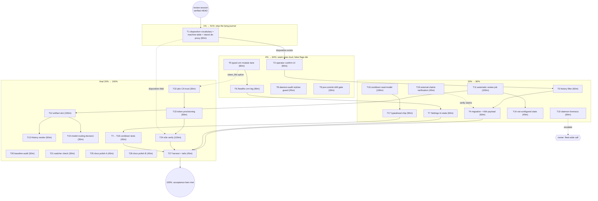

# SUPERB issue-triage execution plan — 2026-10-27 17:25 CET

**Provenance:** planned by Crush (glm-5.3-flash) from the 2026-10-27 issue-review + triage
session (`docs/status/2026-10-27_17-01_issue-review-triage-session.md`), on owner order
(Pareto breakdown + two-granularity plan + execution graph). **This is a PLAN, not an
execution order** — per the pareto-planning skill, full execution starts only after the
owner approves it.

**Claims verified as of 17:17 CET.** Every input below was verified against HEAD ≤2.5 h ago in
the same session lineage (issue bodies read, gap claims grepped, module read line-by-line). No
stale backlog was re-dispatched.

## Context — what this plan executes

Five GitHub issues were reviewed 2026-10-27: #5 closed (stale daemon-audit flag), #6–#9 verified
and triaged into TODO_LIST.md (commit `271e9d4`). Two corrections were established against HEAD:

1. **Kith is actively journaling voicemail/IVR calls as "answered"** — the island's
   `recordCrmCall` sends `established ? "answered" : "missed"` into `CRM.LogCall`. The only
   known ACTIVE data-corruption defect in this repo.
2. **The NixOS module has no `crm.*` options** and the CRM seam is dark AND unobservable
   (Settings shows connected/unset only; no /healthz leg; `ErrUnauthorized` surfaces nowhere).

## Hard constraints (VERSCHLIMMBESSER guard)

- Zero config = byte-identical product: #7 cooldown and #8 review artifacts are OPT-IN; when
  off, no route, no UI, no health leg may appear.
- The #6 CDR-status → disposition mapping goes into a MACHINE TABLE in `internal/domain`
  (SUPERB doctrine: one home for lifecycle legality, delete rows there and nowhere else) —
  never branch-by-branch into services.
- Unknown CDR status maps to the FAILURE class, never the answered class (the dialer's #20
  lesson, and the acceptance bar of issue #6).
- New error paths: errorfamily + stable `<seam>.<op>` codes registered in the SAME commit
  (2026-10-24 red-main lesson).
- Served-markup changes owe a stack browser E2E re-run (release-runbook obligation) — #6/#7/#8
  UI work triggers it once, at the end of the UI trains.
- Bumps/daemon: plan work lands in small narrative commits; `nix fmt` + whitespace-drift before
  every commit (6cbee7c drift class); concurrent sessions are active on this repo TODAY —
  re-View shared files, stage only your own files.
- Flutter is a HARD NO (standing ruling) — irrelevant here, listed so no "improvement" reopens it.

## Pareto breakdown

**Result definition:** the CRM journal stops lying (data integrity), the dark CRM seam becomes
loud (observability), the four verified issues reach their acceptance bars, and the process
defects that produced today's false flag + CI red are closed.

| Tier              | Share of effort   | Value delivered                                                           | Tasks                                                                                                                                                                                                                                    |
| ----------------- | ----------------- | ------------------------------------------------------------------------- | ---------------------------------------------------------------------------------------------------------------------------------------------------------------------------------------------------------------------------------------- |
| **1%**            | 1 task (~90 min)  | **51%** — the lying STOPS                                                 | T1: disposition vocabulary + machine-table mapping + island de-proxy                                                                                                                                                                     |
| **4%**            | +4 tasks (~5.5 h) | **64%** — the seam goes LOUD, false flags die                             | T2 confirm UI · T5 typed crm module lane · T6 /healthz crm leg · T8 daemon-audit orphan guard · T9 pre-commit drift gate                                                                                                                 |
| **20%**           | +9 tasks (~13 h)  | **80%** — #6 and the observability slice COMPLETE, verification debt paid | T3 history filter · T4 Kith payload + migration · T7 Settings tri-state · T10 daemon forensics · T11 automatic review job · T14 "not configured" state · T16 cooldown read-model · T17 typeahead chip · T19 external-claims verification |
| **remaining 20%** | +13 tasks (~16 h) | **100%** — full issue acceptance + polish + cross-repo                    | T12–T13, T15, T18 (#8/#7 completion) · T20–T21 (baseline + watcher audits) · T22–T24 (pbx-artmann side of #9) · T25–T27 (docs/labels/harvest)                                                                                            |

The 1% task alone kills the only defect that corrupts data TODAY. Everything after it is
increasingly complete but increasingly optional.

## Step 3 — Comprehensive plan (30–100 min tasks, ALL todos, sorted by impact)

27 tasks; maps ALL 50 items from the status report + the 3 open owner questions. Tiers: **T1**
= 1% · **T2, T5, T6, T8, T9** = 4% · **T3, T4, T7, T10, T11, T14, T16, T17, T19** = 20% ·
rest = final 20%.

| ID  | Task                                                                                                                                                                                                                                     | Min | Impact   | Covers (status-report §f) |
| --- | ---------------------------------------------------------------------------------------------------------------------------------------------------------------------------------------------------------------------------------------- | --- | -------- | ------------------------- |
| T1  | **#6 stop-the-lying slice**: `domain.Disposition` vocabulary + ONE machine-table CDR→disposition mapping (unknown ⇒ failure class) + island stops sending the established-proxy to CRM + `CRM.LogCall` carries disposition + family pins | 90  | Critical | 1, 3, 5, 7                |
| T2  | **#6 operator confirm**: post-hangup confirm riding the CallNote slot; persisted disposition; awaited CRM write with surfaced failure                                                                                                    | 90  | High     | 2, 4                      |
| T3  | **#6 history filter**: disposition filter + unknown/absent never renders success                                                                                                                                                         | 60  | High     | 6                         |
| T4  | **#6 migration + Kith contract**: schema migration for the disposition column (data-model first) + `call_logged` payload + pbx-artmann bridge note                                                                                       | 60  | High     | 5, 8, 9                   |
| T5  | **#9 typed module lane**: `crm.{enable,url,token_file}` options, LoadCredential + EnvironmentFile, module-check stand-ins, eval assertions                                                                                               | 90  | High     | 23, 24                    |
| T6  | **#9 /healthz crm leg**: probe leg, 503 names crm on 401, criticality decision, revoked-token-within-a-cycle test                                                                                                                        | 90  | High     | 25, 27                    |
| T7  | **#9 Settings tri-state**: connected/unset/auth-failed + en/de i18n parity                                                                                                                                                               | 60  | Medium   | 26                        |
| T8  | **daemon-audit orphan guard**: rewritten-away commits get an "unreachable — rewritten" annotation instead of a drift flag + selftest case                                                                                                | 45  | High     | 34                        |
| T9  | **pre-commit drift gate**: `.githooks/pre-commit` runs `scripts/whitespace-drift.sh` on the staged diff + selftest case                                                                                                                  | 30  | High     | 36                        |
| T10 | **daemon stall forensics**: pma unit + journal timeline (commit-leg silence 14:01–15:18, 40-min push stall); root cause + fleet-side proposal                                                                                            | 60  | High     | 35                        |
| T11 | **#8 automatic review job**: post-settle async ask (WithoutCancel, budget, agentAudit), idempotent, failure non-blocking                                                                                                                 | 100 | High     | 16                        |
| T12 | **#8 persisted artifact slot**: readmodels collection + GET/PUT endpoints, owner-scoped, replace semantics, score dims enum                                                                                                              | 100 | High     | 17, 22                    |
| T13 | **#8 History render**: artifact under the transcript; pending/failed/present states                                                                                                                                                      | 60  | Medium   | 18                        |
| T14 | **#8 "not configured" state**: visible chip when the seam is off (never silent absence)                                                                                                                                                  | 45  | High     | 19                        |
| T15 | **#8 model-routing decision**: textagent seam vs dedicated client (local default), decision doc + config sketch                                                                                                                          | 30  | Medium   | 20, 21                    |
| T16 | **#7 cooldown read-model**: opt-in config gate + (Owner, remote) window collection + dial-path check + one-shot override record                                                                                                          | 100 | High     | 10, 11                    |
| T17 | **#7 typeahead chip**: inline "dialed recently — dial anyway", row state visibility, morph-safe                                                                                                                                          | 90  | High     | 12, 13                    |
| T18 | **#7 hardening tests**: restart-survival, cap/expiry edges, opt-in-off byte-identical                                                                                                                                                    | 45  | Medium   | 14, 15                    |
| T19 | **external-claims verification**: dialer PRs #20/#54 at source; locate the "matching Kith issue"; pbx-artmann open-issue review                                                                                                          | 45  | Medium   | 31, 32, 33                |
| T20 | **baseline audit**: verify the 15:14 fix(ci) six clone groups carry rationale comments; quarterly-audit entry                                                                                                                            | 30  | Medium   | 37, 38                    |
| T21 | **push-stall watcher check**: model today's 40-min stall against the 60-min threshold; adjust or document                                                                                                                                | 30  | Medium   | 42                        |
| T22 | **#9 pbx CA trust** (pbx-artmann): dnsblockd CA into `security.pki`, scoped to the CRM vhost chain                                                                                                                                       | 30  | High     | 28                        |
| T23 | **#9 token provisioning** (pbx-artmann): secrets pipeline + `crm.token_file` wiring in stack config                                                                                                                                      | 60  | High     | 29                        |
| T24 | **#9 e2e verify** (stack): inbound caller name; `call_logged` on journal; revoked token turns red within a cycle                                                                                                                         | 100 | High     | 30                        |
| T25 | **docs polish A**: TODO rows to stable-name citations; issue-body corrections per owner decision; comment render check                                                                                                                   | 45  | Low      | 40, 41, 47                |
| T26 | **docs polish B**: triage labels; adoption-candidate issue template; issue-review runbook; concurrent-session habit row                                                                                                                  | 45  | Low      | 39, 43, 48, 49            |
| T27 | **harvest + tails**: docs-health HARVEST for plan-born items; M18 tail refresh; FEATURES/CHANGELOG on #6 landing; plan errata                                                                                                            | 45  | Medium   | 44, 45, 46, 50            |

## Step 4 — Detailed breakdown (≤12 min micro-tasks, ALL todos, sorted by importance)

144 micro-tasks. Sorted globally: tier 1 first, then tier 2, tier 3, tier 4; within a tier the
workstream's natural dependency order is kept (a global sort would shred the chains — noted
deliberately).

### Tier 1 — the 1% (51%)

| ID  | Micro-task                                                                                                | Min | Impact   |
| --- | --------------------------------------------------------------------------------------------------------- | --- | -------- |
| M01 | Read domain call types, `CRM.LogCall`, `calls_api` handler, `recordCrmCall` — full current picture        | 10  | Critical |
| M02 | Design `Disposition` vocabulary + machine-table mapping rows; document unknown⇒failure ruling             | 12  | Critical |
| M03 | Implement `domain.Disposition` + machine table + table-driven tests                                       | 12  | Critical |
| M04 | `POST /api/calls`: accept+validate disposition against the vocabulary; reject unknown                     | 12  | Critical |
| M05 | Island `recordCrmCall`: stop sending the established-proxy as outcome; send disposition (default unknown) | 12  | Critical |
| M06 | `crm` client: `call_logged` payload carries disposition                                                   | 12  | Critical |
| M07 | Family pins + `<seam>.<op>` codes + registry `-update` (SAME commit rule)                                 | 12  | Critical |
| M08 | Gates: targeted buildflow, `nix fmt`, whitespace-drift, `go test ./internal/...` + commit                 | 12  | Critical |

### Tier 2 — the 4% (64%)

| ID  | Micro-task                                                                                | Min | Impact |
| --- | ----------------------------------------------------------------------------------------- | --- | ------ |
| M09 | Read the confirm-affordance paths: CallNote panel, history row, ended card                | 10  | High   |
| M10 | Data-model decision: disposition rides the note slot vs separate fact — write the ruling  | 12  | High   |
| M11 | Store: persist operator-confirmed disposition (upsert, replace-slot semantics)            | 12  | High   |
| M12 | API: confirm endpoint (204, owner-scoped, idempotent)                                     | 12  | High   |
| M13 | UI: confirm chips on the ended card / history row                                         | 12  | High   |
| M14 | Await the CRM write in the confirm path; failure toast + retryable state                  | 12  | High   |
| M15 | i18n keys in BOTH maps + parity tests                                                     | 12  | High   |
| M16 | Tests + gates + commit                                                                    | 12  | High   |
| M27 | Read the module's oauth2 lane + `module-check-oauth2` stand-in pattern                    | 12  | High   |
| M28 | Declare `crm.{enable,url,token_file}` options + defaults + both-or-neither assertions     | 12  | High   |
| M29 | Unit: `LoadCredential=` wiring for the token file                                         | 12  | High   |
| M30 | Environment: `WEBPHONE_CRM__TOKEN=%d/webphone-crm-token` + URL entry                      | 12  | High   |
| M31 | Guard: `enable=false` leaves raw `settings.crm` untouched (oauth2 conflict-guard pattern) | 12  | High   |
| M32 | `module-check-crm` stand-in + flake check registration                                    | 12  | High   |
| M33 | Eval assertions fire: bad url, missing token, knob-without-enable                         | 12  | High   |
| M34 | Gates (targeted flake check) + commit                                                     | 12  | High   |
| M35 | Read `NewChecks`/userauth leg + `ProjectionReadinessCheck` pattern                        | 10  | High   |
| M36 | Probe design: cheapest honest CRM round trip + poll budget                                | 12  | High   |
| M37 | Implement crm leg: pass = configured+authed; 503 NAMES crm on 401                         | 12  | High   |
| M38 | Disabled seam ⇒ leg absent (byte-identical /healthz when crm off)                         | 12  | High   |
| M39 | NewChecks criticality decision + wiring                                                   | 12  | High   |
| M40 | Test: revoked token → red within ONE poll cycle                                           | 12  | High   |
| M41 | Test: leg-absent-when-off + passkey-off composition green                                 | 12  | High   |
| M42 | Gates + commit                                                                            | 12  | High   |
| M48 | Read `daemon-audit.sh` flag path + selftest cases                                         | 10  | High   |
| M49 | Add merge-base reachability check: unreachable ⇒ "rewritten away" annotation, not a flag  | 12  | High   |
| M50 | Selftest case: orphaned HEAD commit                                                       | 12  | High   |
| M51 | Gates + commit                                                                            | 12  | High   |
| M52 | Create `.githooks/pre-commit` running whitespace-drift on the staged diff                 | 12  | High   |
| M53 | Selftest case: staged whitespace-only diff refuses the commit                             | 12  | High   |
| M54 | One-line hooks note in AGENTS Commands + commit                                           | 12  | High   |

### Tier 3 — to 80%

| ID   | Micro-task                                                                        | Min | Impact |
| ---- | --------------------------------------------------------------------------------- | --- | ------ |
| M17  | History filter UI: disposition select + query param                               | 12  | High   |
| M18  | Template guard: unknown/absent never renders the success glyph                    | 12  | High   |
| M19  | Store query: disposition filter support                                           | 12  | High   |
| M20  | Tests: filter + guard                                                             | 12  | High   |
| M21  | Gates + commit                                                                    | 12  | High   |
| M22  | Migration design: disposition column + backfill rule (data-model first)           | 12  | High   |
| M23  | Migration implementation + round-trip test                                        | 12  | High   |
| M24  | `call_logged` payload: disposition field + payload pins                           | 12  | High   |
| M25  | pbx-artmann bridge contract note + #6 comment                                     | 12  | High   |
| M26  | Gates + commit                                                                    | 12  | High   |
| M43  | Settings row: connected/unset/auth-failed tri-state detail                        | 12  | Medium |
| M44  | i18n en/de keys + parity                                                          | 12  | Medium |
| M45  | Boot-time flag into SettingsProps (ASR-flag pattern, Notifier parity)             | 12  | Medium |
| M46  | View test: byte-pin the row states                                                | 12  | Medium |
| M47  | Gates + commit                                                                    | 12  | Medium |
| M55  | Read the pma unit (nix-config) + obtain journal evidence                          | 12  | High   |
| M56  | Build the stall timeline: commit-leg silence + push stall                         | 12  | High   |
| M57  | Root-cause hypothesis + fix proposal                                              | 12  | High   |
| M58  | TODO row + owner escalation note (fleet-wide call)                                | 12  | High   |
| M59  | Commit                                                                            | 12  | High   |
| M60  | Read the settle chain + summary_api + CallsIdem                                   | 10  | High   |
| M61  | Trigger design: which event starts the post-call review job (automatic per issue) | 12  | High   |
| M62  | Implement dispatch: WithoutCancel, 15s budget, `agentAudit` line                  | 12  | High   |
| M63  | Idempotency via CallsIdem duplicate replay                                        | 12  | High   |
| M64  | Failure path: visible failed state, non-blocking                                  | 12  | High   |
| M65  | Unconfigured path: job never starts + state renders                               | 12  | High   |
| M66  | Tests: happy, 502, unconfigured, no-transcript                                    | 12  | High   |
| M67  | Gates + commit                                                                    | 12  | High   |
| M81  | Visible "review not configured" chip when the seam is off                         | 12  | High   |
| M82  | i18n keys                                                                         | 12  | High   |
| M83  | Tests                                                                             | 12  | High   |
| M84  | Gates + commit                                                                    | 12  | High   |
| M88  | Data-model doc: (Owner, remote) window fact, cap, override semantics              | 12  | High   |
| M89  | Config: opt-in gate + defaults (both-or-neither style validation)                 | 12  | High   |
| M90  | readmodels collection + fold                                                      | 12  | High   |
| M91  | Store API: check+record transaction                                               | 12  | High   |
| M92  | Dial-path integration: check before the SIP invite                                | 12  | High   |
| M93  | Override path: one-shot bypass record                                             | 12  | High   |
| M94  | Tests: window, expiry, cap, restart                                               | 12  | High   |
| M95  | Gates + commit                                                                    | 12  | High   |
| M96  | Typeahead row hook: cooldown state render                                         | 12  | High   |
| M97  | Inline chip: "dialed recently — dial anyway"                                      | 12  | High   |
| M98  | Click-through: override call, then dial                                           | 12  | High   |
| M99  | i18n en/de                                                                        | 12  | High   |
| M100 | Island tests: stub DOM, assert render OUTCOMES                                    | 12  | High   |
| M101 | Morph-safety: stable ids on the row                                               | 12  | High   |
| M102 | Gates + commit                                                                    | 12  | High   |
| M107 | Fetch dialer PR #20: verify the 12/40 + 5-IVR claims                              | 12  | Medium |
| M108 | Fetch dialer PR #54 + README review-flow claims                                   | 12  | Medium |
| M109 | Locate the "matching Kith issue" in pbx-artmann                                   | 12  | Medium |
| M110 | Post verification notes; correct the issues if divergent                          | 12  | Medium |

### Tier 4 — to 100%

| ID   | Micro-task                                                                  | Min | Impact |
| ---- | --------------------------------------------------------------------------- | --- | ------ |
| M68  | Data-model doc: artifact slot (replace semantics; score dims as fixed enum) | 12  | Medium |
| M69  | readmodels collection + fold + cap                                          | 12  | Medium |
| M70  | API: GET/PUT artifact endpoints, owner-scoped                               | 12  | Medium |
| M71  | Deps wiring + container eager assert                                        | 12  | Medium |
| M72  | Store tests                                                                 | 12  | Medium |
| M73  | API tests (owner scoping: another owner's id = 404)                         | 12  | Medium |
| M74  | Error codes + family pins + registry update                                 | 12  | Medium |
| M75  | Gates + commit                                                              | 12  | Medium |
| M76  | History template: artifact under the transcript section                     | 12  | Medium |
| M77  | Pending vs failed vs present states                                         | 12  | Medium |
| M78  | i18n both maps                                                              | 12  | Medium |
| M79  | View byte-pins                                                              | 12  | Medium |
| M80  | Gates + commit                                                              | 12  | Medium |
| M85  | Evaluate textagent-seam fit for the review artifact                         | 12  | Medium |
| M86  | Decision doc + config surface sketch                                        | 12  | Medium |
| M87  | Commit + TODO row                                                           | 12  | Medium |
| M103 | Restart-survival test                                                       | 12  | Medium |
| M104 | Cap/expiry edge tests                                                       | 12  | Medium |
| M105 | Opt-in-off byte-identical behavior test                                     | 12  | Medium |
| M106 | Gates + commit                                                              | 12  | Medium |
| M111 | Read the fix(ci) baseline file: six groups + rationales                     | 12  | Medium |
| M112 | Verify the conventions bar (rationale comments at the sites)                | 12  | Medium |
| M113 | Quarterly-audit entry + commit                                              | 12  | Medium |
| M114 | Read watch.yml observer + the push-stall threshold                          | 12  | Medium |
| M115 | Model today's 40-min stall: would it have fired?                            | 12  | Medium |
| M116 | Adjust or document + commit                                                 | 12  | Medium |
| M117 | Locate the PBX host module's `security.pki` block                           | 12  | High   |
| M118 | Add the dnsblockd CA scoped to the CRM vhost chain                          | 12  | High   |
| M119 | Eval check + commit (pbx-artmann)                                           | 12  | High   |
| M120 | Read the secrets pipeline (generate.sh / push-secrets.sh)                   | 12  | High   |
| M121 | Derive/stage the CRM token in the secrets store                             | 12  | High   |
| M122 | Wire `crm.token_file` in the stack config                                   | 12  | High   |
| M123 | Eval + assertions green                                                     | 12  | High   |
| M124 | Commit + relock note                                                        | 12  | High   |
| M125 | Boot the stack with crm on                                                  | 12  | High   |
| M126 | Inbound call: caller-name card                                              | 12  | High   |
| M127 | Placed call: `call_logged` on the contact journal                           | 12  | High   |
| M128 | Disposition flows (post-#6) on the journal                                  | 12  | High   |
| M129 | Revoke token: red within one cycle                                          | 12  | High   |
| M130 | Regression: push/ntfy lane unaffected                                       | 12  | High   |
| M131 | Evidence (log lines/screens) into a status note                             | 12  | High   |
| M132 | Cross-repo issue #9 comment + close-out                                     | 12  | High   |
| M133 | TODO rows: file:line → stable names                                         | 12  | Low    |
| M134 | Issue bodies: apply the owner's edit decision                               | 12  | Low    |
| M135 | Verify the four posted comments render                                      | 12  | Low    |
| M136 | Commit                                                                      | 12  | Low    |
| M137 | Labels: create verified/cross-repo/blocked; apply                           | 12  | Low    |
| M138 | Adoption-candidate issue template                                           | 12  | Low    |
| M139 | Issue-review runbook                                                        | 12  | Low    |
| M140 | Commit                                                                      | 12  | Low    |
| M141 | HARVEST plan-born items into TODO_LIST                                      | 12  | Medium |
| M142 | M18 tail refresh + FEATURES/CHANGELOG on #6 landing                         | 12  | Medium |
| M143 | Plan errata with execution deltas                                           | 12  | Medium |
| M144 | Final gates + commit + push                                                 | 12  | Medium |

## Execution graph

## Execution protocol (for the implementation session)

1. Train start: full `buildflow` inside `nix develop` (the 2026-10-08 lesson), re-read
   `.buildflow.yml` after daemon activity near it.
2. Every commit: `nix fmt` → `scripts/whitespace-drift.sh` (staged) → stage+commit in ONE tool
   call → narrative message; `auth:` prefix + session suite for any session/CSRF-adjacent
   change; error codes registered in the SAME commit (`-update`).
3. Served-markup trains (#6 UI, #7 UI, #13 render): island tests + `TestServedPageHoldsTheDomContract`
   - ONE stack browser E2E at the end of the UI trains, not per train.
4. Concurrent sessions: re-View shared files (i18n.go, pages.go, TODO_LIST.md) before editing;
   never stage files I did not author; never revert their in-flight work.
5. pbx-artmann tasks (T22–T24) run in `~/projects/pbx-artmann`; the tri-repo ritual applies
   (push webphone before the stack re-pins).
6. Execution starts ONLY on owner approval of this plan (skill contract).

## Errata (Step 0 corrections)

- Input freshness: all 27 tasks were derived from claims verified 2026-10-27 15:05–16:40
  against HEAD (`c37b1fa` era); no CHANGELOG drift re-check was repeated for the four issues —
  their gap rows were GREPPED at HEAD during the review session itself.
- Same-day plans from OTHER sessions (16:04 TypeScript/platform-language pareto,
  16:05 error-surface crash-containment) exist; their scopes are deliberately NOT re-dispatched
  here. No overlap found with this plan's universe.
- The dialer PR #20/#54 claims cited by issues #6/#7/#8 are UNVERIFIED external claims — T19
  exists precisely to close that debt before more weight rides on them.
- Issue #8's body predates the same-day agent-UX train; its remaining scope is recorded in
  TODO_LIST and reflected in T11–T15 — do NOT re-implement the summarize/draft chain.

## Errata — execution deltas (2026-10-29, closeout train)

What execution changed against the plan, so the next reader does not
re-derive it from the code:

- **T12 shipped GET-only, deliberately.** The plan's M70 sketched
  GET/PUT artifact endpoints; the review artifact is written by the
  SYSTEM (the detached job at the exits + SummaryDraft on both
  refusal and unreachable), never hand-edited — a PUT would have made
  the AI verdict look owner-owned. The notes surface keeps the
  owner-writable PUT (its content IS the owner's).
- **T17 shipped as the inline cooldown chip, not a typeahead-row
  state.** The dial area grows the state line (last call age + window
  remaining) plus one "Dial anyway" chip under the form — the #54
  no-modal lesson applied to placement. The typeahead-row rendering
  stays the open placement question (owner ruling pending; the
  JS-created ids keep the DOM contract untouched either way).
- **T18 caught two product bugs, not just coverage gaps:** the gate
  answered allowed asks WITH the denied ask's cooldown state
  (contradicting its own DTO contract), and `/config.js` shipped a
  zero `dialCooldownSeconds` key when the gate was off
  (encoding/json/v2's `omitempty` keeps zero numbers — the pointer
  form is the fix). Both fixed + pinned (2026-10-29).
- **T19 verified every external claim EXACT at source** (dialer PR
  #20: 12/40 + 5 non-human, total mapping, unknown→FAILED, awaited
  write, 24h hardcoded; PR #54: 9-in-12s, Calling-from-click,
  prompt-modal removal; README "Every call is reviewed"; the matching
  Kith issue = LarsArtmann/crm#4). Verification comment posted on #6.
  pbx-artmann's tracker has no open issues to review.
- **T22's premise drifted the day it was written:** the CRM moved to
  `crm.home.lan` over the NetBird mesh (evo-x2 Caddy, same dnsblockd
  CA), and nixpkgs has NO `security.pki.trustedCertificateAuthorities`
  option — the real knob is `security.pki.certificateFiles` (system
  bundle; issue #9 body corrected in its comment thread). Host wiring
  landed in pbx-artmann (`5df19b5`).
- **T23's stack leg already existed** — the module's
  `services.telephony.webphone.crm.{enable,url,tokenFile}` plumbing
  shipped with the typed CRM lane; execution added the HOST wiring +
  the `webphone_crm_token` secrets-pipeline slot. The token itself is
  owner-minted (push-secrets picks the key up automatically;
  `webphone` is already in the restart list).
- **T24 is deploy-gated**, not code-gated: the acceptance bar needs a
  deployed host, a real token and a real call. Harvested into
  TODO_LIST's issue-#9 row with the owner steps spelled out.
- **The M62 95s budget and the T17 §g placement question remain the
  two unanswered owner items** from the session-3 report §g; defaults
  recorded there stand until answered.
