# Island type gate — execution plan (Pareto, two levels of granularity)

> **STATUS 2026-10-27 21:00 — EXECUTED AND CLOSED.** The whole plan landed the same evening:
> `tsc -p . --noEmit` is green over all 26 served asset files, `tsconfig.all.json` is deleted, the
> debt list is replaced by stronger coverage pins, and the nix `island-typecheck` check enforces
> it. Read §9 Errata for the two corrections the execution forced (the subset was never blind in
> the way §0 claimed, and T19 replaced the debt list instead of emptying it).

**Snapshot: 2026-10-27 19:20 CET**, HEAD `c08c36f`, tree clean except two files owned by a
**concurrent session** (`AGENTS.md`, `docs/status/2026-10-27_18-23_erraudit-max-zero-typed-error-train.md`
— do not touch, do not commit). Every number below was measured at that minute with the command
shown; nothing is copied forward from the 16:04 planning doc without being re-checked.

**Scope of this plan:** take the island type gate from "a folder of `.d.ts` files and 680 errors"
to **enforced, green, and complete** — plus every adjacent TODO this session opened (self-inflicted
regressions, doc defects, the owed typed-rejection design, the android conditional).

**What is already true (do not redo):** `tsconfig.json`, `types/globals.d.ts`, `types/sip.d.ts`,
`types/island.d.ts` exist; `checkJs: true`, `strict: true`, `noEmit`; **16 of 26** asset files are at
zero errors; the checker is proven to bite (a `sipDomian` typo → `TS2551`, exit 1); 251/251 island
behaviour tests pass. Evidence: `docs/status/2026-10-27_18-59_island-type-gate-execution-status.md`.

---

## 0. The decision that unblocks everything (read this before the tables)

The gate is currently **red and wired to nothing**. Two ways out:

| Option                                                                                                                                                                                                                                                                                                           | What it means                                                                                                     | Verdict                                    |
| ---------------------------------------------------------------------------------------------------------------------------------------------------------------------------------------------------------------------------------------------------------------------------------------------------------------- | ----------------------------------------------------------------------------------------------------------------- | ------------------------------------------ |
| **(a)** Keep the whole tree in `include`, annotate 680 errors, wire nothing until green                                                                                                                                                                                                                          | Honest count, but **no enforcement for days**: a new typo lands as silently as the old ones                       | REJECT — a red gate nobody runs is theatre |
| **(b)** **Checked-subset include + a pin that names the debt** — `tsconfig.json` includes only the files at zero errors; `tsconfig.all.json` keeps the whole tree for the campaign; a Go pin test asserts the checked set never shrinks and that the _unchecked_ set equals a **declared, enumerated debt list** | Green today over 16/26 files, enforced from the moment it lands, and every later file is a one-line list addition | **CHOSEN**                                 |

**Why (b) is not a lie.** The subset is not blind: TypeScript still infers types _through_ an
unchecked module into a checked one, so a wrong export shape in `calls.js` surfaces as an error in
whatever checked file consumes it. The debt is not hidden — the pin test enumerates the 10
unchecked files by name, so the number can only go down, and adding a file is the campaign's whole
loop.

> **ERRATUM (2026-10-27 21:00, measured).** The sentence above is false in the one direction that
> mattered. TypeScript does not merely "infer through" an imported module — it FULLY CHECKS it and
> reports THAT module's errors. Including only `ui.js`, for instance, produced 79 errors, all of
> them in `i18n.js`. Consequences, both applied: `i18n.js` (the universal dependency) had to be
> typed FIRST because it blocked 17 files at once, and the pin test now asserts the include is
> import-CLOSED (`TestTypeGateIncludeIsClosed`) so a file can never be listed while silently
> dragging a red neighbour into the program. The subset did stay honest — it was just honest about
> a different set of files than this paragraph claimed.

**Why no `// @ts-check` pragmas.** A pragma line changes the byte that is served;
"island sources are served verbatim" is a live repo invariant. `checkJs: true` + an explicit
`include` gives the same checking with **zero** served-byte changes. This supersedes the 16:04
plan's per-file-pragma staging (§9 records the erratum).

**The one place I flip the 16:04 plan's own advice:** it wanted the flip (`checkJs: true`) LAST.
Flipping first and scoping the `include` instead is what makes the gate enforceable _now_.

---

## 1. Measured fact base (19:20 CET)

```
tsc -p . --noEmit  →  680 errors, 10 of 26 files red
```

| File                           |  Errors | Share of residue | Notes                                                       |
| ------------------------------ | ------: | ---------------: | ----------------------------------------------------------- |
| `internal/web/assets/shell.js` | **280** |             41 % | classic script (no imports), 1,976 LOC, IIFE-scoped helpers |
| `island/app/calls.js`          | **126** |             19 % | hold machine, cards, DTMF, transfers, CRM, transcript queue |
| `island/app/i18n.js`           |  **79** |             12 % | one dictionary-key union typedef should kill most of it     |
| `island/app/panels.js`         |  **46** |              7 % | history/contacts/voicemail row shapes                       |
| `island/app/transcribe.js`     |  **41** |              6 % | segment store + ASR wire                                    |
| `island/app/connection.js`     |  **34** |              5 % | agent handle, `withTimeout`, delegate params                |
| `island/app/typeahead.js`      |  **30** |              4 % | suggestion entries                                          |
| `enroll/enroll.js`             |  **28** |              4 % | one-shot ceremony page                                      |
| `island/app/main.js`           |  **12** |              2 % | boot + `htmx` call sites                                    |
| `enroll/webauthn.js`           |   **4** |              1 % | **my own regression** (`@type {const}` is not JSDoc)        |

Error codes: TS7006 ×280 (implicit-any params) · TS2339 ×157 · TS7005 ×81 · TS18047 ×46
(possibly null) · TS18046 ×36 (unknown) · TS7034 ×31 · TS7031 ×11 · tail ×38.

**Already green (16/26):** `audio.js`, `audioout.js`, `auth.js`, `config.js`, `csrf.js`, `ice.js`,
`mic.js`, `notify.js`, `pcsetup.js`, `selftest.js`, `session.js`, `shortcuts.js`, `ssoerror.js`,
`state.js`, `theme-preload.js`, `ui.js`.

**Adjacent debt opened by this session (all in scope of this plan):**

| Debt                                                                                                   | Where                          |
| ------------------------------------------------------------------------------------------------------ | ------------------------------ |
| 4 errors of my own making (`@type {const}`)                                                            | `enroll/webauthn.js`           |
| Gate unwired: no nix check, no `typescript` in the devshell, no pin test                               | `nix/`, `internal/web/assets/` |
| Go pins unrun after 26 asset edits (DOM contract, import closure, served-byte greps)                   | `go test ./...`                |
| `errorMessage` adopted at ~15 of 56 `err.message` sites, no micro-test                                 | island tree                    |
| Plan doc defects: §01 → §03 dangling reference; §11 "opted-in file" wording; §05 hour estimates        | 16:04 plan                     |
| Docs unwired: AGENTS stance (377-line cap), README, CHANGELOG, `.buildflow.yml` note, ROADMAP triggers | repo docs                      |
| Owed to the sibling plan: typed-rejection **design** (its T12 references "their T24")                  | `docs/error-contract.md`       |
| Island tests not type-checked (plan T21)                                                               | `island-tests/`                |
| android KMP conditional untouched (plan T26/T27, Tier 0)                                               | `~/projects/webphone-android`  |

---

## 2. Pareto — what actually moves the needle

Total realistic effort ≈ **22 h** (the 16:04 plan guessed 18–26 h; the measured error distribution
corroborates it, so the guess is now calibrated rather than replaced).

> **Honesty note on the percentages.** The "1 %" bucket is ~2.5 h ≈ 11 % of the _effort_ — because
> in this campaign the cost is annotation, not wiring. The percentages below are **share of the
> result** (what stops being broken / unenforced), not a literal effort ratio. Cosplaying 80/20 with
> a 15-minute bucket would be maths theatre.

### 2.1 The 1 % that delivers 51 % — **make the gate REAL** (~2.5 h, T01–T06)

Everything else in this plan is "add a file to a list". None of it is worth anything if nobody runs
the checker. This tier is: kill my own regression, split the two projects, put `tsc` in the devshell,
add the nix check, write the pin, wire it into `flake check`. After it, **no new type error can land
silently**, and each remaining file is a 5-minute list addition plus its annotations.

### 2.2 The 4 % that delivers 64 % — **the call core** (~4 h, T07–T10)

`calls.js` + `connection.js` + `main.js` = **172 errors** and every incident class this repo has
paid for: the hold honesty contract, the registration watchdog, the invite queue, the reconnect
teardown. A type error here is a dropped call; a type error in `typeahead.js` is a missing
suggestion. This is where "customer value" is real.

### 2.3 The 20 % that delivers 80 % — **the remaining surfaces** (~12 h, T11–T19)

`i18n.js` (one typedef), `panels.js`, `transcribe.js`, `typeahead.js`, `enroll.js`, then `shell.js`
in three sittings (280 errors, 41 % of everything). Ordered so each file only depends on files
already typed: leaves first, the shell last.

### 2.4 The remaining 20 % that delivers 100 % (~3.5 h, T20–T29)

The parts that are invisible until they are missing: `errorMessage` adoption + test, AGENTS/README/
CHANGELOG/ROADMAP wiring, the owed typed-rejection design, island-tests typing, the full verification
run (Go pins, `nix flake check`, `buildflow`, smoke), the 30-day retrofit, and the android
conditional (Tier 0 — may legitimately never start).

---

## 3. The comprehensive plan — 29 tasks, 30–100 min each

Impact and customer value: **C**ritical / **H**igh / **M**edium / **L**ow. Sorted by tier, then by
impact, then by dependency order.

| ID  | Task                                                                             | Why it matters                                                                           | Impact | Cust. value | Min | Tier | Depends on | Acceptance                                                                          |
| --- | -------------------------------------------------------------------------------- | ---------------------------------------------------------------------------------------- | ------ | ----------- | --- | ---- | ---------- | ----------------------------------------------------------------------------------- |
| T01 | Fix my `@type {const}` regression in `enroll/webauthn.js` and close its 4 errors | A self-inflicted syntax bug makes the honest count dishonest                             | C      | L           | 30  | 1 %  | —          | `tsc` reports 0 for webauthn.js; prettier clean                                     |
| T02 | Split into `tsconfig.json` (checked subset) + `tsconfig.all.json` (whole tree)   | Makes a green gate possible without pretending the debt is gone                          | C      | H           | 45  | 1 %  | T01        | `tsc -p .` exits 0; `tsc -p tsconfig.all.json` still reports the residue            |
| T03 | Add `typescript` + `nodejs` to `nix/devshell.nix`                                | The gate must be one command inside the shell, not a store path                          | C      | H           | 30  | 1 %  | —          | `nix develop -c tsc --version` → 7.0.2                                              |
| T04 | Add the `island-typecheck` nix check                                             | Sandboxed, network-free, the repo's native gate shape                                    | C      | H           | 60  | 1 %  | T02, T03   | `nix build .#checks.x86_64-linux.island-typecheck` green; fails on an injected typo |
| T05 | Write the pin test (`internal/web/assets/typecheck_pin_test.go`)                 | The gate becomes un-gameable: no shrinking include, no bare ignores, no `checkJs: false` | C      | H           | 90  | 1 %  | T02        | Test fails if any of the four properties is violated                                |
| T06 | Wire the check into `nix flake check` and run the suite                          | A gate outside the suite is advisory                                                     | C      | H           | 60  | 1 %  | T04, T05   | `nix flake check` runs it; verdict recorded                                         |
| T07 | `calls.js` pass 1 — entry field types + `errorMessage` (17 sites)                | The call table's shape is the file's spine                                               | C      | H           | 100 | 4 %  | T06        | calls.js ≤60 errors                                                                 |
| T08 | `calls.js` pass 2 — hold machine, cards, DTMF, transfers, CRM                    | The three incident classes live here                                                     | C      | H           | 100 | 4 %  | T07        | calls.js 0 errors, added to include, island tests green                             |
| T09 | `connection.js` — agent handle, `withTimeout` generic, delegate params           | Watchdog/reconnect is the most incident-prone 434 LOC in the repo                        | C      | H           | 90  | 4 %  | T08        | connection.js 0, include, tests green                                               |
| T10 | `main.js` — boot sequence + `window.htmx` sites                                  | The boot path is the first thing that can fail                                           | H      | H           | 60  | 4 %  | T09        | main.js 0, include                                                                  |
| T11 | `i18n.js` — the dictionary-key union                                             | One typedef retires most of 79 errors and makes a missing key a compile error            | H      | M           | 100 | 20 % | T10        | i18n.js 0, include, parity tests green                                              |
| T12 | `panels.js` — history/contacts/voicemail shapes + `recordHistory`                | The tab surfaces' data contracts                                                         | H      | M           | 90  | 20 % | T11        | panels.js 0, include, panels tests green                                            |
| T13 | `transcribe.js` — segment store + ASR wire                                       | Caller audio + persistence; a shape slip loses transcripts                               | H      | M           | 90  | 20 % | T12        | transcribe.js 0, include, tests green                                               |
| T14 | `typeahead.js` — suggestion entries                                              | Cheap, isolated                                                                          | M      | M           | 60  | 20 % | T13        | typeahead.js 0, include                                                             |
| T15 | `enroll.js` — ceremony page DOM + fetch wrappers                                 | One-shot page, low blast radius                                                          | M      | L           | 60  | 20 % | T14        | enroll.js 0, include, enroll tests green                                            |
| T16 | `shell.js` pass 1 — project shape, globals, toasts, nav                          | The shell must work when island scripts fail; typing it protects that                    | H      | H           | 100 | 20 % | T15        | shell.js ≤190 errors                                                                |
| T17 | `shell.js` pass 2 — palette, optimistic send, retry/dismiss                      | The trust surfaces                                                                       | H      | H           | 100 | 20 % | T16        | shell.js ≤90 errors                                                                 |
| T18 | `shell.js` pass 3 — diagnostics, SSE badge, morph focus                          | The last shell cluster                                                                   | H      | H           | 100 | 20 % | T17        | shell.js 0, include, shell tests green                                              |
| T19 | Flip the include to the whole tree; delete the debt list and `tsconfig.all.json` | The campaign's end marker                                                                | C      | H           | 45  | 20 % | T18        | pin test asserts 0 debt; nix check green; one project only                          |
| T20 | `errorMessage` adoption sweep + micro-test                                       | One narrowing home, no `[object Object]` in user copy                                    | H      | M           | 90  | 20 % | T19        | 0 bare `err.message`; `node:test` covers Error/string/object/null                   |
| T21 | AGENTS.md stance + hard-won rule (respect the 377-line cap)                      | Stops the next session re-asking the same three questions                                | H      | H           | 45  | rest | T20        | preflight passes; stance citable                                                    |
| T22 | README dev section + CHANGELOG line + `.buildflow.yml` note                      | A gate nobody can find is a gate nobody runs                                             | M      | M           | 60  | rest | T21        | all three landed                                                                    |
| T23 | ROADMAP triggers + fix the 16:04 plan's three defects                            | Closes the dangling reference and the wrong acceptance wording                           | H      | H           | 45  | rest | T22        | plan has no dangling refs                                                           |
| T24 | Typed-rejection convention **design** (owed to the sibling plan's T12)           | The error doctrine's island half                                                         | H      | H           | 90  | rest | T23        | design doc + hand-off line in the sibling plan                                      |
| T25 | Island-tests typing (`@types/node`, `helpers.mjs`, 5-spec pilot)                 | Tests are where the gate pays compound interest                                          | M      | M           | 100 | rest | T24        | verdict recorded (adopt or decline with reason)                                     |
| T26 | Full verification run: `go test ./...`, `nix flake check`, `buildflow`, smoke    | Every claim in this plan is unverified until this runs                                   | C      | H           | 60  | rest | T25        | four verdicts recorded                                                              |
| T27 | 30-day retrofit report + candidate-A trigger check                               | Turns "we added a gate" into "the gate caught X"                                         | M      | M           | 60  | rest | T26        | report committed                                                                    |
| T28 | android: KMP spike part (a) — codec + digest → `commonMain`                      | Only if a second target is ever committed                                                | L      | L           | 100 | 0    | —          | sip codec tests green under KMP                                                     |
| T29 | android: WebRTC evidence doc (no target added)                                   | Prevents re-opening KMP on vibes                                                         | L      | L           | 90  | 0    | —          | go/no-go conditions in ROADMAP                                                      |

**Tier 0 is explicitly optional.** Nothing in T28/T29 blocks the gate, the product, or any customer.

---

## 4. Execution graph

```mermaid
flowchart TD
    subgraph P1["1% of effort → 51% of result — make the gate REAL (~2.5 h)"]
        T01["T01 fix webauthn @type const<br/>4 errors → 0"]
        T02["T02 split tsconfig.json<br/>(checked subset) + tsconfig.all.json"]
        T03["T03 devshell: typescript + nodejs"]
        T04["T04 nix check island-typecheck"]
        T05["T05 pin test<br/>include / debt / ignores / strict"]
        T06["T06 wire into nix flake check"]
        T01 --> T02 --> T04
        T03 --> T04
        T02 --> T05
        T04 --> T06
        T05 --> T06
    end

    subgraph P4["4% → 64% — the call core (~4 h)"]
        T07["T07 calls.js pass 1<br/>entry fields + errorMessage"]
        T08["T08 calls.js pass 2<br/>hold · cards · DTMF · transfer"]
        T09["T09 connection.js<br/>agent · withTimeout · delegates"]
        T10["T10 main.js<br/>boot + htmx"]
        T07 --> T08 --> T09 --> T10
    end

    subgraph P20["20% → 80% — remaining surfaces (~12 h)"]
        T11["T11 i18n.js<br/>dictionary key union"]
        T12["T12 panels.js"]
        T13["T13 transcribe.js"]
        T14["T14 typeahead.js"]
        T15["T15 enroll.js"]
        T16["T16 shell.js pass 1"]
        T17["T17 shell.js pass 2"]
        T18["T18 shell.js pass 3"]
        T19["T19 flip include to whole tree<br/>debt list deleted"]
        T11 --> T12 --> T13 --> T14 --> T15 --> T16 --> T17 --> T18 --> T19
    end

    subgraph PR["remaining 20% → 100% (~3.5 h)"]
        T20["T20 errorMessage sweep + test"]
        T21["T21 AGENTS.md stance<br/>(377-line cap)"]
        T22["T22 README · CHANGELOG · buildflow"]
        T23["T23 ROADMAP + plan errata"]
        T24["T24 typed-rejection design"]
        T25["T25 island-tests typing"]
        T26["T26 full verification<br/>go · nix · buildflow · smoke"]
        T27["T27 30-day retrofit"]
        T20 --> T21 --> T22 --> T23 --> T24 --> T25 --> T26 --> T27
    end

    subgraph P0["Tier 0 — optional, may never start"]
        T28["T28 KMP codec+digest"]
        T29["T29 WebRTC evidence doc"]
        T28 --> T29
    end

    T06 --> T07
    T10 --> T11
    T19 --> T20
    T19 -.->|"only if a second target is committed"| T28
```



Read the graph as **one critical path** (T01 → T19 → T27) with two optional tails. The dashed edge is
the only place Tier 0 can attach, and it attaches to nothing that ships.

---

## 5. Fine breakdown — 158 tasks, **max 12 min each**

Every row is ≤12 minutes by construction: one file region, one assertion, one command, one document
section. Sorted in execution order; the `↳` column names the parent.

| ID   | Fine task                                                                                                         | ↳   | Min |
| ---- | ----------------------------------------------------------------------------------------------------------------- | --- | --- |
| F001 | Replace `/** @type {const} */ const byteFields` with `/** @type {Array<keyof IslandCredentialResponseFields>} */` | T01 | 10  |
| F002 | Fix the two `TS2322` in `prepareRegistrationOptions` (typed `prepared` + cast at return)                          | T01 | 10  |
| F003 | Run `tsc`; confirm `webauthn.js` 4 → 0                                                                            | T01 | 5   |
| F004 | Add `enroll/webauthn.js` to the checked include                                                                   | T01 | 5   |
| F005 | `prettier --check` on `enroll/webauthn.js`                                                                        | T01 | 5   |
| F006 | Write `tsconfig.json` with only the 16 green files + `types/**`                                                   | T02 | 10  |
| F007 | Write `tsconfig.all.json` extending it with the whole tree                                                        | T02 | 10  |
| F008 | Verify `tsc -p . --noEmit` exits 0                                                                                | T02 | 5   |
| F009 | Verify `tsc -p tsconfig.all.json --noEmit` still reports the residue                                              | T02 | 5   |
| F010 | Header comment: why two projects exist, and that only `tsconfig.json` gates                                       | T02 | 10  |
| F011 | Add `pkgs.nodejs` to `devShells.default`                                                                          | T03 | 5   |
| F012 | Add `pkgs.typescript` to `devShells.default`                                                                      | T03 | 5   |
| F013 | `nix develop -c tsc --version`, record 7.0.2                                                                      | T03 | 5   |
| F014 | Note the gate command in the devshell comment block                                                               | T03 | 10  |
| F015 | Add `island-typecheck` `runCommand` to `nix/checks.nix`                                                           | T04 | 10  |
| F016 | Body: `cd ${self} && tsc -p . --noEmit`                                                                           | T04 | 5   |
| F017 | Write the checked file list into `$out` (auditable artefact)                                                      | T04 | 10  |
| F018 | `nix build .#checks.x86_64-linux.island-typecheck`                                                                | T04 | 10  |
| F019 | Inject a deliberate typo, prove the check fails                                                                   | T04 | 10  |
| F020 | Revert the typo, re-run, record both verdicts                                                                     | T04 | 10  |
| F021 | Create `internal/web/assets/typecheck_pin_test.go` skeleton + helpers                                             | T05 | 10  |
| F022 | Assert `checkJs === true` and `strict === true` in `tsconfig.json`                                                | T05 | 10  |
| F023 | Assert every `include` entry resolves to ≥1 file                                                                  | T05 | 10  |
| F024 | Assert the declared debt list == (all asset files − included files)                                               | T05 | 10  |
| F025 | Assert no bare `@ts-ignore`/`@ts-nocheck` under `internal/web/assets`                                             | T05 | 10  |
| F026 | Assert the nix check reads `tsconfig.json` and never `tsconfig.all.json`                                          | T05 | 10  |
| F027 | `go test ./internal/web/assets/ -run TestTypeGate -v`                                                             | T05 | 10  |
| F028 | Add the new check to the flake's check set                                                                        | T06 | 10  |
| F029 | `nix build .#checks.x86_64-linux.webphone` (sanity that nothing else broke)                                       | T06 | 10  |
| F030 | Run the full `nix flake check`, capture the verdict                                                               | T06 | 10  |
| F031 | Record the check's wall-clock in this plan                                                                        | T06 | 5   |
| F032 | Import `errorMessage` in `calls.js`                                                                               | T07 | 5   |
| F033 | Type the `outgoingCount` forEach destructure                                                                      | T07 | 10  |
| F034 | JSDoc `attachRemoteAudio(id)` + `setTracks(entry, {recv, send})`                                                  | T07 | 10  |
| F035 | JSDoc `holdSession(id, hold)` + the queued-toggle fields                                                          | T07 | 10  |
| F036 | JSDoc `focusSession(id)` + `teardownSession(id)`                                                                  | T07 | 10  |
| F037 | JSDoc `settleEndedCall(id)` + `showEndedReason`                                                                   | T07 | 10  |
| F038 | `err.message` → `errorMessage`: calls.js sites 1–9                                                                | T07 | 10  |
| F039 | `err.message` → `errorMessage`: calls.js sites 10–17                                                              | T07 | 10  |
| F040 | `tsc`: calls.js 126 → ≤60, log the number                                                                         | T07 | 5   |
| F041 | Type `renderCalls` + `durationLabel` + `callStateText`                                                            | T08 | 10  |
| F042 | Type `setTracks` against `SipSessionDescriptionHandler` hooks                                                     | T08 | 10  |
| F043 | Type the DTMF relay path (`application/dtmf-relay`)                                                               | T08 | 10  |
| F044 | Type the blind transfer path (REFER + NOTIFY verdict)                                                             | T08 | 10  |
| F045 | Type the attended transfer path                                                                                   | T08 | 10  |
| F046 | Type `recordCrmCall` + its fire-and-forget catch                                                                  | T08 | 10  |
| F047 | Type `bindSession` + the `sipToView` map keys                                                                     | T08 | 10  |
| F048 | Type the transcript save queue (`IslandTranscriptSegment[]`)                                                      | T08 | 10  |
| F049 | `tsc`: calls.js → 0; add to include                                                                               | T08 | 5   |
| F050 | `nix run nixpkgs#nodejs -- --test ... island-tests/calls*.test.mjs`                                               | T08 | 10  |
| F051 | JSDoc the module-scope handles in `connection.js`                                                                 | T09 | 10  |
| F052 | Make `withTimeout` generic in JSDoc (`@template T`)                                                               | T09 | 10  |
| F053 | Type `scheduleReconnect` + `armReconnectCycleDeadline`                                                            | T09 | 10  |
| F054 | Type `attemptReconnect` + `rebuildConnection`                                                                     | T09 | 10  |
| F055 | Type `buildConnection`'s delegate handlers (`onInvite`, `onDisconnect`)                                           | T09 | 10  |
| F056 | `err.message` → `errorMessage` (7 sites)                                                                          | T09 | 10  |
| F057 | `tsc`: connection.js → 0; add to include                                                                          | T09 | 10  |
| F058 | Type the boot sequence in `main.js`                                                                               | T10 | 10  |
| F059 | Guard the `window.htmx.ajax` sites (path is `string`, not `string \| null`)                                       | T10 | 10  |
| F060 | `tsc`: main.js → 0; add to include                                                                                | T10 | 10  |
| F061 | Define `IslandI18nKey` from the `en` dictionary object                                                            | T11 | 10  |
| F062 | Type `t(key)` → the interpolation-carrying function type                                                          | T11 | 10  |
| F063 | Type the language detection (`wp-lang`, `Accept-Language`, default)                                               | T11 | 10  |
| F064 | Type the 153-key `en`/`de` pair without flattening them                                                           | T11 | 10  |
| F065 | `tsc`: i18n.js errors triaged into "key union" vs "residue" buckets                                               | T11 | 10  |
| F066 | Close the residue; i18n.js → 0                                                                                    | T11 | 10  |
| F067 | Add `i18n.js` to include; re-run i18n + parity tests                                                              | T11 | 10  |
| F068 | Type the history row shape                                                                                        | T12 | 10  |
| F069 | Type the contacts row shape                                                                                       | T12 | 10  |
| F070 | Type the voicemail row shape                                                                                      | T12 | 10  |
| F071 | Type `recordHistory` + `refreshServerHistory`                                                                     | T12 | 10  |
| F072 | Type `scheduleVoicemailRefresh` + its timer                                                                       | T12 | 10  |
| F073 | `err.message` → `errorMessage` (13 sites, two rows)                                                               | T12 | 10  |
| F074 | `err.message` → `errorMessage` (remainder) + `tsc` panels → 0                                                     | T12 | 10  |
| F075 | Add to include; re-run panels tests                                                                               | T12 | 10  |
| F076 | Type the live-segment store and its subscription                                                                  | T13 | 10  |
| F077 | Type the ASR request/answer wire (`/api/transcribe`)                                                              | T13 | 10  |
| F078 | Type the capture state machine (start/pause/stop)                                                                 | T13 | 10  |
| F079 | Type `saveTranscriptSegment` + its JSON body                                                                      | T13 | 10  |
| F080 | `err.message` → `errorMessage` (5 sites); `tsc` transcribe → 0                                                    | T13 | 10  |
| F081 | Add to include; re-run transcribe + captions tests                                                                | T13 | 10  |
| F082 | Type the typeahead entry/contact shapes                                                                           | T14 | 10  |
| F083 | Type the ranking/dedup helpers                                                                                    | T14 | 10  |
| F084 | Type the DOM list rendering                                                                                       | T14 | 10  |
| F085 | `tsc` → 0; add to include; re-run typeahead tests                                                                 | T14 | 10  |
| F086 | Type the enroll ceremony state                                                                                    | T15 | 10  |
| F087 | Type the fetch wrappers (CSRF + JSON bodies)                                                                      | T15 | 10  |
| F088 | Replace remaining `getElementById` calls with `$` ids                                                             | T15 | 10  |
| F089 | `tsc` → 0; add to include; re-run enroll tests                                                                    | T15 | 10  |
| F090 | Decide the shell project shape; record the decision in the file header                                            | T16 | 10  |
| F091 | Register the shell's browser globals in `types/globals.d.ts`                                                      | T16 | 10  |
| F092 | Annotate the IIFE helper cluster 1 (DOM/format helpers)                                                           | T16 | 10  |
| F093 | Annotate the IIFE helper cluster 2 (tab/nav helpers)                                                              | T16 | 10  |
| F094 | Annotate the IIFE helper cluster 3 (event delegation)                                                             | T16 | 10  |
| F095 | `tsc`: shell.js 280 → ≤190                                                                                        | T16 | 10  |
| F096 | Type the toast path (`wp:toast` consumer + kinds)                                                                 | T17 | 10  |
| F097 | Type the nav skeleton reveal + language re-fetch                                                                  | T17 | 10  |
| F098 | Type the command palette                                                                                          | T17 | 10  |
| F099 | Type the optimistic send bubble                                                                                   | T17 | 10  |
| F100 | Type retry/dismiss + the draft restore                                                                            | T17 | 10  |
| F101 | `tsc`: shell.js ≤190 → ≤90                                                                                        | T17 | 10  |
| F102 | Type the diagnostics gear (advanced toggle)                                                                       | T18 | 10  |
| F103 | Type the SSE live badge                                                                                           | T18 | 10  |
| F104 | Type the morph focus move + `aria-current` mirror                                                                 | T18 | 10  |
| F105 | `err.message` → `errorMessage` (2 sites)                                                                          | T18 | 10  |
| F106 | `tsc`: shell.js → 0                                                                                               | T18 | 10  |
| F107 | Add `shell.js` to include                                                                                         | T18 | 5   |
| F108 | Re-run `shell.test.mjs`                                                                                           | T18 | 5   |
| F109 | Delete the debt list from the pin test                                                                            | T19 | 10  |
| F110 | Move the whole tree into `tsconfig.json`'s include                                                                | T19 | 10  |
| F111 | Delete `tsconfig.all.json`; update the two doc references                                                         | T19 | 10  |
| F112 | Pin test: assert debt == 0 and the include covers all 26 files                                                    | T19 | 10  |
| F113 | `nix build .#checks.x86_64-linux.island-typecheck` on the full tree                                               | T19 | 10  |
| F114 | `grep -rn "err.message"` and list the residue by file                                                             | T20 | 10  |
| F115 | Convert the `calls.js` residue                                                                                    | T20 | 10  |
| F116 | Convert the `panels.js` residue                                                                                   | T20 | 10  |
| F117 | Convert `connection/main/transcribe/shell` residue; assert 0 remain                                               | T20 | 10  |
| F118 | Write `errorMessage` micro-test (Error / string / object / null)                                                  | T20 | 10  |
| F119 | Run the island suite; record 251+ pass                                                                            | T20 | 10  |
| F120 | Draft the 6-line stance block                                                                                     | T21 | 10  |
| F121 | Measure AGENTS.md line count against the 377 cap                                                                  | T21 | 5   |
| F122 | Choose and compress the line to trade                                                                             | T21 | 10  |
| F123 | Insert the block; re-run `docs/agents-md-size` preflight                                                          | T21 | 10  |
| F124 | README dev section: how to run the gate locally                                                                   | T22 | 10  |
| F125 | CHANGELOG `[Unreleased]` line (a gate is a code-path change)                                                      | T22 | 5   |
| F126 | `.buildflow.yml` note: island excluded, the type gate is a nix check                                              | T22 | 5   |
| F127 | `buildflow` format/step sanity on the touched files                                                               | T22 | 10  |
| F128 | ROADMAP: npm dep / JSDoc ceiling / framework triggers                                                             | T23 | 10  |
| F129 | Fix the 16:04 plan's §01 → §03 dangling reference                                                                 | T23 | 10  |
| F130 | Fix §11's "every opted-in file" wording for whole-tree checking                                                   | T23 | 10  |
| F131 | Re-label §05's hour estimates as estimates                                                                        | T23 | 10  |
| F132 | Read the 16:05 plan's catch inventory (do not re-run it)                                                          | T24 | 10  |
| F133 | Define the typed rejection shape (kind + message, TS-annotatable)                                                 | T24 | 10  |
| F134 | Write the design section into `docs/error-contract.md`'s island half                                              | T24 | 10  |
| F135 | Add the hand-off line to the sibling plan's T12                                                                   | T24 | 10  |
| F136 | Add `@types/node` to the dev toolchain                                                                            | T25 | 10  |
| F137 | Create the second tsconfig for `island-tests/`                                                                    | T25 | 10  |
| F138 | Type `helpers.mjs`'s DOM stub                                                                                     | T25 | 10  |
| F139 | Pilot 5 specs; measure the error count                                                                            | T25 | 10  |
| F140 | Record the adopt/decline verdict with the measured cost                                                           | T25 | 10  |
| F141 | `go test -count=1 ./...`                                                                                          | T26 | 10  |
| F142 | `nix flake check`                                                                                                 | T26 | 10  |
| F143 | `buildflow`                                                                                                       | T26 | 10  |
| F144 | `scripts/webphone-smoke.py --bin …` against a fresh build                                                         | T26 | 10  |
| F145 | Record all four verdicts + timings in this plan                                                                   | T26 | 5   |
| F146 | Collect the defects the gate caught so far (2 + whatever T07–T18 adds)                                            | T27 | 10  |
| F147 | Write the 30-day retrofit report                                                                                  | T27 | 10  |
| F148 | Decide whether any candidate-A trigger has fired                                                                  | T27 | 10  |
| F149 | android: add the `shared` KMP module skeleton                                                                     | T28 | 10  |
| F150 | Move `SipMessage.kt` → `commonMain`                                                                               | T28 | 10  |
| F151 | Move `Digest.kt` → `commonMain`                                                                                   | T28 | 10  |
| F152 | Extract the okhttp call as `expect` + android `actual`                                                            | T28 | 10  |
| F153 | Move `SipEngine.kt`; run the sip suite                                                                            | T28 | 10  |
| F154 | Record the build-time delta                                                                                       | T28 | 10  |
| F155 | Write the spike verdict (keep or revert)                                                                          | T28 | 10  |
| F156 | Collect linuxX64 WebRTC candidates with activity evidence                                                         | T29 | 10  |
| F157 | Define the 3-call audio smoke (bidirectional, AEC/NS, two machines)                                               | T29 | 10  |
| F158 | Record go/no-go conditions in ROADMAP and stop                                                                    | T29 | 10  |

**Coverage check:** every task T01–T29 has ≥3 fine rows; every fine row belongs to a parent; no row
exceeds 12 minutes; the android rows are the only ones that may never run.

---

## 6. Risk register, non-goals, and the verschlimmbessern guards

| Risk                                                          | Mitigation                                                                                                                                                                                                        |
| ------------------------------------------------------------- | ----------------------------------------------------------------------------------------------------------------------------------------------------------------------------------------------------------------- |
| **The pin becomes the thing people delete**                   | The pin asserts `checkJs`/`strict` are still true; deleting the gate is a red test, not a quiet commit                                                                                                            |
| **Green-over-a-subset becomes permanent green-over-a-subset** | The debt list is enumerated by name and asserted to equal the real difference; T19 deletes it                                                                                                                     |
| **Annotation drifts into behaviour change**                   | Every JSDoc edit is inert; the only behaviour edits this session were two bug fixes (`NaN s`, defensive state compare), each with a comment. Any further behaviour change moves to its own task with its own test |
| **`shell.js` gets "split while we're in there"**              | Explicit non-goal: T16–T18 annotate only. Splitting is a separate train with its own risk decision                                                                                                                |
| **Concurrent session collision**                              | Only T07–T08 touch `calls.js`, the file the other train may also edit; re-read before every edit, never revert foreign changes, commit per file                                                                   |
| **TypeScript 7 vs 5 in editors (vtsls) phantom errors**       | Documented in AGENTS (T21) and lessons; `tsc` from the devshell is the only authority                                                                                                                             |
| **Annotation work eats the session budget**                   | Tiers are independently shippable: T01–T06 alone leaves the repo strictly better and green                                                                                                                        |

**Non-goals (deliberate):** no bundler, no npm dependency for the island, no `.ts` files, no `@ts-*`
suppression culture, no shell split, no KMP target, no markup or DOM-contract change, no Go change,
no second type checker, no CI job beyond the nix check.

---

## 7. Acceptance criteria for the whole train

1. `nix build .#checks.x86_64-linux.island-typecheck` is green, sandboxed, network-free — and it was
   _proven_ to fail on an injected typo before being trusted.
2. `tsc -p tsconfig.all.json --noEmit` reports **0 errors** across all 26 asset files (T19).
3. `TestTypeGate` fails if `checkJs`/`strict` is disabled, the include shrinks, the debt list gains a
   name, or a bare `@ts-ignore` appears.
4. Served bytes are unchanged except where a real bug was fixed: **no pragmas, no build step, no
   bundler**, and the three served-byte pin sites (Go tests, smoke script, stack E2E) still pass.
5. `go test -count=1 ./...`, `nix flake check`, `buildflow`, the smoke script and the island suite
   are all green in one recorded run (T26).
6. The repo can answer "how do I run the type gate?" from AGENTS.md alone.

---

## 8. Open owner questions (defaults I will execute unless told otherwise)

| # | Question                                                                | Default                                                                                                                                                                                                                                   |
| - | ----------------------------------------------------------------------- | ----------------------------------------------------------------------------------------------------------------------------------------------------------------------------------------------------------------------------------------- |
| 1 | Red-then-green in one train, or green-over-a-subset with a growing pin? | **Subset + pin, wired now** (§0). The alternative leaves the repo unenforced for days                                                                                                                                                     |
| 2 | `shell.js`: annotate in place or split first?                           | **Annotate in place.** Splitting the file the repo calls "must work when island scripts fail" is a behaviour-adjacent refactor that deserves its own train                                                                                |
| 3 | AGENTS.md stance — which existing line dies?                            | **None, if possible:** compress the `go-appkit` audit paragraph by ~2 lines first; only if that fails, drop the cqrs-htmx round-3 historical detail (it is already fully recorded in `docs/research/2026-10-25_cqrs-htmx-deep-dive.html`) |

---

## 9. Errata

**2026-10-27 21:00 — T19 executed; the campaign is over.** `tsconfig.json` now includes the whole
served tree (`internal/web/assets/**/*.js` + `types/**/*.d.ts`) with exactly one exclusion
(`internal/web/assets/vendor/**`, the vendored sip.js bundle). `tsconfig.all.json` is DELETED: with
the gate green the measuring project measured nothing. The debt list is gone from
`internal/web/assets/typecheck_pin_test.go`, replaced by two stronger pins —
`TestTypeGateCoversEveryAssetSource` (every embedded asset source must be in the checked set) and
`TestTypeGateOnlyExcludesTheVendoredBundle` (a second exclusion is a test failure, because excluding
a red file is how a gate rots). Measured end state: `tsc -p . --noEmit` exits 0 over 26 files,
`nix build .#checks.x86_64-linux.island-typecheck` is green, 260 island specs pass.

**2026-10-27 21:00 — §0 erratum, see the block in §"Why (b) is not a lie".** The subset was never
blind, but adding a file DID drag its imports in fully checked; the import-closure pin is the
correction.
against the 16:04 plan (`2026-10-27_16-04_SUPERB-…-pareto-plan.html`)

| 16:04 said                                                           | Now                                                                                    | Why                                                                                            |
| -------------------------------------------------------------------- | -------------------------------------------------------------------------------------- | ---------------------------------------------------------------------------------------------- |
| T02–T06: `checkJs: false` + per-file `// @ts-check`, flip last (T22) | `checkJs: true` from the start, no pragmas, scope by `include`                         | A pragma changes a served byte; the served-verbatim invariant outranks the staging convenience |
| "~18–26 h of annotation"                                             | ~22 h, corroborated by the measured 680-error distribution                             | The guess is now calibrated, not replaced by a different guess                                 |
| T26: "`sip/` → `commonMain`" in 100 min                              | codec+digest 100 min, `SipEngine` behind `expect`/`actual` 180 min                     | `sip/` is not uniformly platform-free (okhttp) — already fixed in the plan's T26/F103          |
| Acceptance: "`nix fmt` clean"                                        | `buildflow`-clean for `tsconfig.json`/`types/*.d.ts`, `nix fmt`-clean for island files | treefmt's prettier `includes` match neither new path — already fixed with an erratum           |
| §01 referenced a "pilot note in §03"                                 | **still dangling** — F129/T23 fixes it                                                 | My own defect from the last session                                                            |

---

## 10. What "done" looks like, in one line

`tsc` in the devshell, green over the whole island, enforced by a nix check that a test refuses to
let anyone weaken — with the call path typed first, the shell typed last, and every claim verified by
a command whose output is in this repo.

---

_Written 2026-10-27 19:20 CET at HEAD `c08c36f`. Two files in the working tree belong to a
concurrent session (`AGENTS.md`, the erraudit status report) and are deliberately excluded from this
plan's commit._
