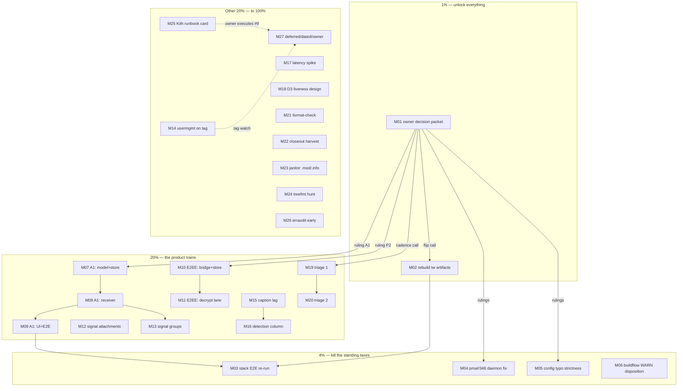

# SUPERB — Pareto execution plan (2026-10-29)

**Snapshot:** 2026-10-29 ~15:00 CET. Remote `main` green and pushed (`3fe2ce7`).
**Sources:** `TODO_LIST.md` (24 open sections), the 2026-10-29 14-09 dialer
closeout (T19–T27 shipped; Kith e2e owner-gated; stack E2E **still owed** —
verified in the closeout, NOT run), the 14-22 session report §f (40 items),
the 14-22 group-rooms spike + E2EE research (rulings pending), live CI state
(tw-freshness advisory firing on every run; all blocking lanes green).
**Method:** pareto-planning skill — Step 0 backlog verification done (errata
below), then 1%→4%→20% tiers, medium plan (30–100 min), fine plan (≤12 min).
**Guard:** no verschlimmbessern — every task must leave the repo verifiably no
worse; owner-gated items are packaged for decision, never pre-decided.

## Errata — backlog corrections found during Step 0

1. The 14-22 report §f-4 said "verify the concurrent session's stack-E2E
   closeout" — **verified: NOT run**. Their closeout (14-09 doc, TODO row 2)
   states the E2E re-run is OWED after the disposition-filter/CRM-tri-state/
   review/History/dial-cooldown markup changes. It stays an open task (M03).
2. The dialer closeout's numbered tails (smoke `/openapi.json` assertion,
   TODO_LIST stable-name sweep, History review-state SSE nudge) live only in
   the closeout doc — NOT yet harvested into TODO_LIST. Folded into M22
   rather than double-homed.
3. `unpushed:0` at plan time (the daemon pushed the 14-22 report) — the
   crush-config lessons commit is STILL unpushed (that repo's own daemon);
   tracked as M04-adjacent evidence, not a webphone task.

## Pareto breakdown

### The 1% that delivers 51%

1. **The owner decision packet (M01)** — six rulings in ONE sitting
   (group-rooms A1, E2EE P2, pma#348 ownership, tw-freshness flip, config
   strictness posture, triage pull-forward). Every big train (M04, M05,
   M07–M13, M19–M20) is parked behind exactly these. Half the plan's total
   value unlocks with one document + one human answer.
2. **Rebuild the tw artifacts (M02)** — the advisory has fired on every CI
   run for a day; green-main-with-drift erodes trust in the advisory class
   and shames every subsequent train. 30 minutes kills it.

### The 4% that delivers 64%

3. **Stack browser E2E re-run (M03)** — the standing release-runbook debt;
   five markup changes ride unverified against the DOM contract the E2E
   drives. Closing it re-arms the E2E as the safety net for M07–M09's UI
   work.
4. **pma#348 daemon push-leg fix (M04)** — stalls recurred twice on
   2026-10-29 alone (62 min webphone, ~2 h crush-config). Every future train
   pays this tax until fixed.
5. **Config typo strictness (M05)** — a typo'd key silently disables a seam
   (outage class); the docpin key-tree already exists to feed the allowed set.
6. **Buildflow WARN disposition (M06)** — govulncheck's Go-version mismatch
   may be masking real vulnerability findings; unknown-unknowns compound.

### The 20% that delivers 80%

7. Group-rooms A1 execution (M07–M09) — the chat product's biggest missing
   capability, spike-armed and waiting only on the ruling.
8. E2EE decrypt-only train (M10–M11) — second-biggest chat capability;
   research-armed.
9. Live-caption lag signal (M15) + error-contract detection column (M16) —
   the live-call UX honesty pair from the ai-phone steal-list.
10. Branching-flow triage (M19–M20) — 164 live vs 78 governed; debt
    compounds per train.
11. Dialer closeout harvest (M22) — three concrete tails sitting in a doc
    instead of their homes.
12. The hygiene set (M21, M23–M26) — each closes a documented trap
    (format-check authority, janitor blind spot, treefmt mystery, erraudit
    drift).

### The other 20% (to 100%)

13. Signal attachments/groups (M12–M13), usermgmt bump on tag (M14),
    latency spike (M17), D3 liveness design (M18) — sequenced behind the
    gates above.
14. The deferred/dated/owner bucket (M27): typeahead product call, KMP
    spike, M18/M19 product items, announcements, owner-calls batch,
    quarterlies (2026-11-05 erraudit → 2026-12-20 watches → 2026-12-30
    credentials → 2027-01 modularize).

## Medium plan — 27 tasks, 30–100 min each (sorted by importance/impact/effort/value)

| # | Task | Tier | Effort | Impact | Value | Depends | Gate |
|---|------|------|--------|--------|-------|---------|------|
| M01 | Owner decision packet: 6 rulings w/ evidence one-pagers (A1, P2, pma#348, tw-flip, config-strict, triage-pull) | 1% | 30m | Unlocks 10 tasks | Extreme | — | — |
| M02 | Rebuild tw.css/login.css from current templates; commit; verify advisory green | 1% | 30m | Kills daily advisory noise | High | — | — |
| M03 | Stack browser E2E re-run (owed markup set; flake rerun protocol) + add the E2E-owed rule line to release-runbook | 4% | 100m | Re-arms DOM-contract safety net | High | M02 | — |
| M04 | pma#348: SIGTERM flush + startup sweep + shutdown line in projects-management-automation | 4% | 100m | Ends recurring push stalls | High | M01 | ✋ owner |
| M05 | Config typo strictness: file-strict + env-warn via docpin allowed-set | 4% | 100m | Outage-class prevention | High | M01 | ✋ posture |
| M06 | Buildflow WARN disposition: govulncheck Go-mismatch, dprint md diffs, resume SQLITE_BUSY | 4% | 30m | Unmasks possible vuln findings | Med-High | — | — |
| M07 | Group-rooms A1 tranche 1: ParseAddress `!…` shape + Message.Sender v6 migration + store round-trip | 20% | 100m | Chat capability foundation | High | M01 | ✋ ruling |
| M08 | Group-rooms A1 tranche 2: receiver room-name cache (m.room.name/canonical_alias) + group ingest + Sender plumb | 20% | 100m | Groups actually arrive | High | M07 | — |
| M09 | Group-rooms A1 tranche 3: UI sender render + i18n + DOM-contract + E2E greps + CHANGELOG | 20% | 100m | Groups usable | High | M08, M03 | — |
| M10 | E2EE P2 tranche 1: OlmMachine bridge + crypto store home (verify concrete-client claim at source) | 20% | 100m | E2EE foundation | High | M01 | ✋ ruling |
| M11 | E2EE P2 tranche 2: sync feeding + to-device + recorded encrypted fixtures + fences narrow | 20% | 100m | Encrypted DMs readable | High | M10 | — |
| M12 | Signal inbound attachments (signal-cli plumbing read + receiver arm) | 20% | 100m | Chat parity | Med | — | stack-adj |
| M13 | Signal groups on the A1 Sender design | 20% | 100m | Chat parity | Med | M07–M09 | — |
| M14 | usermgmt bump + bounded AuditLog read projection wire (tag watch: v4.14.1 is 510 behind e7b62cd9) | 20% | 100m | Durable audit read surface | Med | tag | passive |
| M15 | Live-caption lag signal: segment stamps + streak-warn + island specs | 20% | 60m | Live-call UX honesty | Med-High | — | — |
| M16 | Error-contract detection column (quiet classes; row 1 = caption lag) | 20% | 60m | Operator detectability | Med-High | M15 | — |
| M17 | Caller-perceived latency spike: dial press → first media + ASR segment RT (measure, don't instrument all) | 20% | 100m | Informs future perf work | Med | — | — |
| M18 | D3 agent liveness design doc (filler/goodbye/timeout ladder from ai-phone prior art) | 20% | 60m | Designs the HITL lane | Med | — | owner-GO later |
| M19 | Branching-flow triage tranche 1: adjudicate ~50 of 86 ungoverned (same ruling classes as 10-28) | 20% | 100m | Stops baseline rot | Med | M01 | ✋ cadence |
| M20 | Branching-flow triage tranche 2: rest + governed baseline re-record + registry rows | 20% | 100m | Debt → governed state | Med | M19 | — |
| M21 | format-check convenience script (wraps `nix build .#checks.x86_64-linux.format`) + AGENTS pointer | 20% | 30m | Kills the nix-fmt trap | Med | — | — |
| M22 | Dialer closeout harvest: smoke `/openapi.json` `/api/dials` assertion, TODO stable-name sweep finish, History review SSE nudge | 20% | 60m | Tails land in homes | Med | — | — |
| M23 | module-cache-janitor: zero-byte .mod/.info detection + self-test case | 20% | 30m | Closes 10-28 lesson tail | Med | — | — |
| M24 | treefmt cache hunt: locate the v2 cache + `--clear-cache` behavior + lessons.md errata | 20% | 30m | Mystery → knowledge | Low-Med | — | — |
| M25 | Kith CRM owner-steps runbook card (token mint → secrets → deploy → acceptance bar, scripted checks) | 20% | 30m | Owner executes #9 in one go | High (owner time) | — | ✋ exec |
| M26 | erraudit tier-2 early re-measure (due 2026-11-05; cheap to pull forward) | 20% | 30m | Keeps tier-2 at 0 | Med | — | — |
| M27 | Deferred/dated/owner bucket: typeahead call, KMP spike, M18/M19 products, announcements, owner-calls sitting, quarterlies (11-05→12-20→12-30→01) | rest | — | — | — | — | ✋/dated |

## Fine plan — ≤12 min per task (grouped by parent; sorted by parent importance)

| # | Task (≤12 min) | Parent | Min | Tier |
|---|----------------|--------|-----|------|
| F01 | Draft ruling one-pager: group-rooms A1 (spike link + the 4 sub-decisions) | M01 | 10 | 1% |
| F02 | Draft ruling one-pager: E2EE P2 (+crypto store home, trust posture) | M01 | 10 | 1% |
| F03 | Draft ruling one-pager: pma#348 ownership + stall evidence table | M01 | 8 | 1% |
| F04 | Draft ruling one-pager: tw-freshness flip (fired-on-every-run evidence) | M01 | 8 | 1% |
| F05 | Draft ruling one-pager: config strictness posture (file vs env) | M01 | 8 | 1% |
| F06 | Draft ruling one-pager: triage cadence pull-forward (164/78) | M01 | 6 | 1% |
| F07 | Assemble packet doc + link from TODO_LIST owner section | M01 | 8 | 1% |
| F08 | Run `nix develop -c scripts/build-tw-css.sh` | M02 | 6 | 1% |
| F09 | Diff-verify artifacts (only expected class additions) | M02 | 6 | 1% |
| F10 | Commit + push + watch tw-freshness job to green | M02 | 10 | 1% |
| F11 | Boot stack E2E env (their runner; read its README leg) | M03 | 10 | 4% |
| F12 | Run browser-e2e.py (budget 445s; capture log durably) | M03 | 8 | 4% |
| F13 | On flake: single re-run per known 90s-transfer mode; second fail = triage | M03 | 12 | 4% |
| F14 | Attribute any real failure to the owning markup change | M03 | 12 | 4% |
| F15 | Fix fallout or file row (never silently rerun-red) | M03 | 12 | 4% |
| F16 | Add the "markup change owes stack E2E" line to release-runbook checklist | M03 | 6 | 4% |
| F17 | Read pma repo: daemon loop, signal handling, push leg (source-level) | M04 | 12 | 4% |
| F18 | Implement SIGTERM flush (drain + push before exit) | M04 | 12 | 4% |
| F19 | Implement startup sweep (unpushed-at-boot push) | M04 | 12 | 4% |
| F20 | Add shutdown log line + fixture test for both paths | M04 | 12 | 4% |
| F21 | Deploy/verify pma on host + observe one real stall cycle | M04 | 12 | 4% |
| F22 | Extend docpin_test.go: export the allowed-key set from the reflection helper | M05 | 12 | 4% |
| F23 | koanf file-load: strict unmarshal w/ allowed-set error (errorfamily code) | M05 | 12 | 4% |
| F24 | Env lane: warn-only unknown WEBPHONE_* config-shaped keys | M05 | 12 | 4% |
| F25 | Register codes same-commit + boot-failure render test | M05 | 10 | 4% |
| F26 | CHANGELOG + README config section note | M05 | 6 | 4% |
| F27 | Read govulncheck WARN in full log; classify (toolchain vs real) | M06 | 10 | 4% |
| F28 | Disposition dprint md diffs (own or skip with rationale) | M06 | 12 | 4% |
| F29 | Disposition resume SQLITE_BUSY (daemon contention class) | M06 | 8 | 4% |
| F30 | File/fix each finding per close-the-loop rule | M06 | 12 | 4% |
| F31 | ParseAddress: matrix `!room:server` branch + tests | M07 | 12 | 20% |
| F32 | Message.Sender field + zero-value DM-compat doc | M07 | 8 | 20% |
| F33 | Migration v6: nullable sender column (versioned, store ladder untouched) | M07 | 12 | 20% |
| F34 | Store scan/write plumbs sender; round-trip test | M07 | 12 | 20% |
| F35 | AppendToThread/legality: sender no-op for DM rows pinned | M07 | 8 | 20% |
| F36 | Receiver: room-name state cache (m.room.name + canonical_alias) | M08 | 12 | 20% |
| F37 | Receiver: non-DM room ingest via room-shaped remote (fence narrows to encrypted) | M08 | 12 | 20% |
| F38 | Receiver: per-event Sender capture into the message | M08 | 10 | 20% |
| F39 | Sender registry: group thread sends to its room id | M08 | 12 | 20% |
| F40 | Matrix receiver tests: group room fixture + own-echo skip + name fallback | M08 | 12 | 20% |
| F41 | Views: group thread head shows room name (raw-id fallback) | M09 | 10 | 20% |
| F42 | Views: per-message sender line (inbound group only) + i18n both maps | M09 | 12 | 20% |
| F43 | DOM-contract ids for sender nodes + doc update | M09 | 8 | 20% |
| F44 | E2E grep sites updated (stack browser-e2e strings) | M09 | 10 | 20% |
| F45 | CHANGELOG + FEATURES rows + fence-lift note in AGENTS chat seam | M09 | 8 | 20% |
| F46 | Verify NewOlmMachine signature at pkg.go.dev source (fix the overclaim) | M10 | 6 | 20% |
| F47 | Decide crypto store home (own sqlite vs sqlstore module) w/ owner one-pager input | M10 | 10 | 20% |
| F48 | Add mautrix dep + minimal client shim + machine Load | M10 | 12 | 20% |
| F49 | crypto.Store adapter over chosen home + capability assertions | M10 | 12 | 20% |
| F50 | Feed ProcessSyncResponse/HandleToDeviceEvent from our loop | M11 | 12 | 20% |
| F51 | DecryptMegolmEvent into receiver; WaitForSession + key requests | M11 | 12 | 20% |
| F52 | Narrow encrypted-room fence to post-decrypt failure only | M11 | 10 | 20% |
| F53 | Recorded encrypted fixtures (from a real account) + replay tests | M11 | 12 | 20% |
| F54 | Backup-set decision for crypto store + restore path | M11 | 8 | 20% |
| F55 | Read signal-cli attachment receiving API at source | M12 | 12 | 20% |
| F56 | Receiver attachment arm (reuse MMS blob path; honest content-type) | M12 | 12 | 20% |
| F57 | Attachment tests + size/family pins | M12 | 10 | 20% |
| F58 | Group id shape in ParseAddress signal branch (post-A1 pattern) | M13 | 10 | 20% |
| F59 | signal-cli group send/recv wire + sender capture | M13 | 12 | 20% |
| F60 | Group fence lift + tests + docs | M13 | 12 | 20% |
| F61 | Watch tag: `gh api repos/LarsArtmann/cqrs-htmx/tags` (repeat weekly) | M14 | 5 | 20% |
| F62 | On tag: bump pins via bump-preflight + vendorHash recipe | M14 | 12 | 20% |
| F63 | Wire bounded AuditLog read projection (Deps + /healthz gate already exists) | M14 | 12 | 20% |
| F64 | Projection tests + CHANGELOG | M14 | 10 | 20% |
| F65 | Island: stamp segments on capture (monotonic clock seam) | M15 | 10 | 20% |
| F66 | Lag detector: threshold + once-per-streak warn (visible surface per owner ruling D3-class) | M15 | 12 | 20% |
| F67 | Island specs: lag warn fires once; no warn under cadence | M15 | 12 | 20% |
| F68 | tsc + node suite green; CHANGELOG | M15 | 8 | 20% |
| F69 | error-contract.md: add detection column header + 5 quiet-class rows | M16 | 12 | 20% |
| F70 | Row 1: caption lag (from M15); rows 2-5: daemon stall, push-transport death, ASR silent-fail, CRM outage | M16 | 12 | 20% |
| F71 | Cross-link stack runbook § error contract (keep-in-sync note) | M16 | 6 | 20% |
| F72 | Define t0 points (dial press, INVITE ok, first media, ASR round trip) | M17 | 10 | 20% |
| F73 | Instrument island-side timing capture (log-only, no new metric home) | M17 | 12 | 20% |
| F74 | Collect a session's samples; write findings + instrument-or-not verdict | M17 | 12 | 20% |
| F75 | D3 design doc: liveness ladder (1.5s filler/10s filler/25s goodbye+BYE adapted) | M18 | 12 | 20% |
| F76 | D3 design doc: stalled-client slot release + named exit codes | M18 | 10 | 20% |
| F77 | D3 design doc: webphone seam mapping (textagent 3s probe extension points) | M18 | 12 | 20% |
| F78 | Triage batch 1: read findings list, group by 10-28 ruling classes | M19 | 12 | 20% |
| F79 | Apply nolints w/ reasons (statement/signature classes) batch 1 | M19 | 12 | 20% |
| F80 | Real-fix anything surviving the bar (extract one-homes) batch 1 | M19 | 12 | 20% |
| F81 | Triage batch 2 + nolints | M19 | 12 | 20% |
| F82 | FLAG_PARAM/TypeDecl rulings → baseline entries w/ rows | M20 | 12 | 20% |
| F83 | Re-record baseline (pinned tooling) + set-diff + registry sweep-log line | M20 | 12 | 20% |
| F84 | Verify suppression ACTIVE + findings gate green | M20 | 8 | 20% |
| F85 | Write scripts/format-check.sh (wraps check derivation, prints authority) | M21 | 10 | 20% |
| F86 | Self-test + AGENTS Commands line | M21 | 10 | 20% |
| F87 | Smoke: add `/openapi.json` contains `/api/dials` assertion | M22 | 10 | 20% |
| F88 | TODO_LIST: finish stable-name sweep (grep file:line citations) | M22 | 12 | 20% |
| F89 | History review-state SSE nudge design + island arm (or ruled-out row) | M22 | 12 | 20% |
| F90 | Janitor: detect zero-byte final `.mod`/`.info` under @v/ + report | M23 | 10 | 20% |
| F91 | Janitor self-test fixture case | M23 | 10 | 20% |
| F92 | Locate treefmt v2 cache (strace/lsof one run) | M24 | 10 | 20% |
| F93 | Test `--clear-cache` behavior; lessons.md errata (replace "not worth the hunt") | M24 | 10 | 20% |
| F94 | Runbook card: Kith token mint + secrets + push-secrets + deploy commands | M25 | 10 | 20% |
| F95 | Runbook card: acceptance-bar verification commands (caller name, journal, tri-state) | M25 | 10 | 20% |
| F96 | erraudit tier-1+2 run (--max, --no-suppress) + classify deltas | M26 | 12 | 20% |
| F97 | Suppressions/re-measure log row + tier-2 must-stay-0 check | M26 | 10 | 20% |
| F98 | Bucket groom: typeahead/KMP/M18/M19 rows carry gates + dates; quarterlies calendar-anchored | M27 | 12 | rest |

## Execution graph (mermaid)

## Standing execution rules

1. Never pre-decide an owner gate; package it (M01/M25 are the packaging).
2. Every code task: gates green before commit (`go test`, `tsc`, island
   suite, `nix fmt` + the format-check derivation where formatter-owned),
   CHANGELOG per the bar, errorfamily codes registered same-commit.
3. Concurrency: re-View before every edit; verify own commit stat; never
   touch in-flight files from other sessions.
4. Pushes: bar or verified-fix anchors only; verify CI after every push.
5. No verschlimmbessern: a task that cannot verify itself green leaves the
   repo exactly as found, plus a row explaining why.
