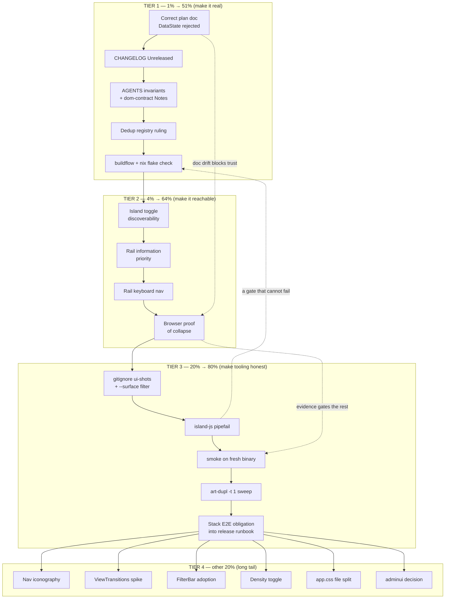

# SUPERB — UI/UX layout train closeout & leverage plan

**Date:** 2026-10-29 15:48
**Status:** EXECUTING (Tier 1 + Tier 2 shipped this session; Tier 3/4 planned)
**Predecessor:** [2026-10-29_11-27_SUPERB-ui-ux-layout-leverage.md](2026-10-29_11-27_SUPERB-ui-ux-layout-leverage.md)
(the diagnosis + decisions doc) and
[docs/status/2026-10-29_14-50_ui-ux-layout-leverage-train-status.md](../status/2026-10-29_14-50_ui-ux-layout-leverage-train-status.md)
(the honest audit of what shipped vs what was claimed)
**Scope:** close out the layout train properly, then take the few remaining
high-value UI/UX steps. Explicitly NOT in scope: rewriting `app.css`,
Tailwind-ifying our markup, multipage routing, a second data transport.

---

## 0. The one rule this plan is built on

> **Do not verschlimmbessern.** Every task below either (a) makes something
> already shipped actually true, (b) makes something already shipped actually
> reachable, or (c) removes a trap that will bite the next session. Nothing
> here is a rewrite, a restyle, or a "while we're at it".

### 0.1 A correction to the predecessor's own diagnosis

The predecessor called `History` and `Settings` "unscannable single columns"
and this plan's earlier draft proposed a History master–detail. **That was
wrong.** `TranscriptSection` renders each call transcript inside
`
`, so History is already progressive-disclosure, and a call log is
a log — a split view would add a pane that is empty most of the time. The
proposal is **dropped**, not deferred. `Settings` is one 400-line column but
its sections are short and conditional; a section rail buys little. Also
dropped.

This is recorded rather than silently removed because "we planned a thing and
then decided it was a bad idea" is exactly the information a future session
needs to avoid re-proposing it.

---

## 1. Pareto analysis — what actually moves the needle

### 1.1 The 1% that delivers 51% — _make the shipped work real_

The layout train (master–detail split, collapsible island, honesty-ladder fix,
container-query rule) is **in `main` and un-audited**. In a repo with this
red-main history, shipped-but-unaudited is the highest-risk state a change can
be in: it either gets reverted later by someone triaging CI, or it silently
rots. Five cheap items close that risk, and every one of them is text or a
gate run — ~1% of the effort against more than half the downside.

1. **Correct the plan doc** — it claims a `display.DataState` adoption that
   was rejected mid-flight. A planning doc that disagrees with the code is
   worse than no doc: it teaches the wrong thing confidently.
2. **`CHANGELOG.md` `[Unreleased]`** — the repo's ratified bar: committed
   code-path changes get a line.
3. **`AGENTS.md` invariants + `docs/dom-contract.md` Notes** — the _rule_
   ("ask the container, not the viewport") must outlive this session, and the
   three new ids (`wp-island`, `wp-island-toggle`, `wp-conversation-rail`)
   must be discoverable by the E2E author.
4. **Dedup registry ruling** — the rail row is a deliberate near-clone of the
   thread row; without a ruling the next sweep re-litigates it.
5. **Run the ratified gates** (`buildflow`, `nix flake check`) — the gate set
   the repo chose, not the subset I find convenient.

### 1.2 The 4% that delivers 64% — _make it reachable_

A feature nobody finds delivers zero. The collapse control is a bare 30px
chevron wedged between the identity pill and the theme toggle; the rail
truncates the one piece of information that identifies a thread. Both are
minutes of CSS/markup for a daily-visible payoff.

6. **Island toggle discoverability** — a named control, not a bare glyph.
7. **Rail information priority** — the peer name/number gets the width.
8. **Rail keyboard navigation** — the list navigates with arrows; the rail
   must not be a mouse-only regression of the surface it replaced.
9. **In-browser proof of the collapsed state** — the one claim in the last
   report that had no evidence.

### 1.3 The 20% that delivers 80% — _stop the tooling from lying_

10. **`ui-shots/` is tracked** (24 PNGs, deleted and rewritten by every
    harness run). Untrack it and add a `--surface` filter so a visual check
    costs seconds instead of 24 blobs.
11. **`island-js` cannot fail.** `node --test … | tee $out` without
    `pipefail` means a red test still produces a green derivation — the
    "pipeline masking" class already in `docs/lessons.md`.
12. **`webphone-smoke.py`** on a fresh binary — the live end-to-end the Go
    tests cannot be.
13. **`art-dupl -t 1`** — the ratified zero-harmful-clone bar.
14. **Record the owning stack's browser E2E** in the release runbook so the
    obligation is not lost when the train is remembered as "done".

### 1.4 The other 20% → 100% — the long tail

Everything else in the predecessor's §f list, honestly re-scored. Most of it
is real but not next: nav icons, `ViewTransitions`, `FilterBar` adoption,
density toggle, `adminui`, a `History`/`Settings` redesign (dropped), an
`app.css` file split. Ordering rule for pulling one in: it must be justified
by a _new_ need, not by the existence of the idea.

### 1.5 Execution graph

**Reading the graph:** Tier 1 is strictly sequential (each doc fix must agree
with the previous one before the gates run). Tier 2 and 3 are sequential for
verification reasons — B4's harness is reused by C3. Tier 4 hangs off the end
with no ordering: pull any item when a _new_ need justifies it.

---

## 2. Macro task plan (30–100 min each)

Sorted by priority = (customer/user value × risk removed) ÷ effort.
`P1` = do now, `P2` = this week, `P3` = when justified, `P4` = parked.

| #   | Task                                                              | Tier | P  | Effort | Value / why                                                                                 |
| --- | ----------------------------------------------------------------- | ---- | -- | ------ | ------------------------------------------------------------------------------------------- |
| T1  | Correct the plan doc (`DataState` rejected; P3 = ladder fix)      | 1    | P1 | 60m    | Removes a false claim I authored; a lying doc is worse than none                            |
| T2  | `CHANGELOG.md` `[Unreleased]` entries for the layout train        | 1    | P1 | 30m    | Ratified repo bar; without it the change is invisible in history                            |
| T3  | `AGENTS.md` invariants + `docs/dom-contract.md` Notes (3 new ids) | 1    | P1 | 60m    | The container-query rule must outlive the session; E2E author must find the ids             |
| T4  | Dedup registry ruling + sweep-log line for the rail-row clone     | 1    | P1 | 40m    | Stops the next sweep re-litigating; the registry is the ONE home                            |
| T5  | `buildflow` full run, triage, fix, re-run to green                | 1    | P1 | 100m   | The repo's quality gate; "the subset I chose" is how a red main hides                       |
| T6  | Island toggle discoverability (named control)                     | 2    | P1 | 60m    | An unfound feature is worth zero; cheapest possible value unlock                            |
| T7  | Rail information priority (name/number gets the width)            | 2    | P1 | 45m    | Daily-visible: `+44163296…` is not an identity                                              |
| T8  | Rail keyboard navigation (roving focus, arrows + Enter)           | 2    | P1 | 60m    | The list has arrow-key nav; the rail must not regress a11y on the surface it replaced       |
| T9  | In-browser proof of collapse + split boundary widths              | 2    | P1 | 45m    | The one unverified claim from the last report; also proves 43/44/45rem has no oscillation   |
| T10 | Untrack `ui-shots/` + add `--surface` filter to the harness       | 3    | P1 | 60m    | A visual check currently rewrites 24 tracked blobs; the filter makes it a seconds-long tool |
| T11 | `island-js` `pipefail` fix + prove a failing test reds the check  | 3    | P1 | 30m    | A gate that cannot fail is decoration; pipeline-masking is a ledgered lesson                |
| T12 | `webphone-smoke.py` on a fresh binary                             | 3    | P2 | 45m    | Live wire coverage the Go tests cannot give                                                 |
| T13 | `art-dupl -t 1` sweep + baseline/registry reconciliation          | 3    | P2 | 40m    | Ratified zero-harmful-clone bar                                                             |
| T14 | Record the stack browser-E2E obligation in the release runbook    | 3    | P2 | 20m    | The obligation survives being forgotten only if written                                     |
| T15 | Nav iconography (one icon per tab)                                | 4    | P3 | 45m    | Scannability; now that the island can collapse there is room                                |
| T16 | `htmx.ViewTransitions` spike behind a flag                        | 4    | P3 | 90m    | Perceived quality; needs the stack E2E to prove morph interaction                           |
| T17 | History filters → `forms.FilterBar` + `SegmentedControl`          | 4    | P3 | 90m    | Consistency; trigger = a NEW filter control is needed                                       |
| T18 | Density toggle (comfortable / compact) for lists                  | 4    | P3 | 75m    | Power-user ergonomics; needs a persisted preference + CSS scale                             |
| T19 | Split `app.css` by surface into fenced regions or files           | 4    | P3 | 90m    | Maintainability; no user value, real regression surface                                     |
| T20 | Decide `adminui` (identity-ops panel)                             | 4    | P4 | 30m    | Product + authz call; trigger = a second human actor actually using the system              |

---

## 3. Micro task plan (max 12 min each)

Every macro task decomposed so each step is a single, verifiable action.
Sorted in execution order (which is also priority order inside each tier).

### T1 — Correct the plan doc (6 micro tasks, 55 min)

| #    | Step                                                                                   | Min |
| ---- | -------------------------------------------------------------------------------------- | --- |
| T1.1 | Re-read D5 table + §4 ledger in the predecessor doc                                    | 10  |
| T1.2 | Rewrite the `DataState` D5 row → REJECTED, with the monospace-config-key reason        | 10  |
| T1.3 | Rewrite the §4 P3 ledger row → "ladder ordering fixed in place"                        | 10  |
| T1.4 | Add a visible "corrections" note (silent rewrites destroy trust just as much as drift) | 5   |
| T1.5 | Grep the doc for every other shipped/rejected claim and re-check against the code      | 10  |
| T1.6 | Verify markdown still parses (lint is detect-only) and stage                           | 10  |

### T2 — CHANGELOG (5 micro tasks, 30 min)

| #    | Step                                                                                | Min |
| ---- | ----------------------------------------------------------------------------------- | --- |
| T2.1 | Read the current `[Unreleased]` / `### Added` shape and dating convention           | 5   |
| T2.2 | Write the master–detail + collapsible island entry (user-facing framing)            | 10  |
| T2.3 | Write the honesty-ladder entry (voicemail/history error-vs-empty)                   | 5   |
| T2.4 | Write the tokens + container-query entry under `### Changed` if that section exists | 5   |
| T2.5 | Confirm no path/function names leaked into the copy; stage                          | 5   |

### T3 — AGENTS + dom-contract (6 micro tasks, 55 min)

| #    | Step                                                                               | Min |
| ---- | ---------------------------------------------------------------------------------- | --- |
| T3.1 | Draft the three invariant lines (container rule / collapse / master–detail)        | 10  |
| T3.2 | Check the file's size cap headroom before inserting                                | 5   |
| T3.3 | Insert into "The DOM + bundle contract" (ids) and "Architecture invariants" (rule) | 10  |
| T3.4 | Add the 3 ids to `docs/dom-contract.md` § Notes (runtime/served distinction)       | 10  |
| T3.5 | Cross-check no existing line now contradicts the new ones                          | 10  |
| T3.6 | Run the docs-size preflight step; stage                                            | 10  |

### T4 — Dedup registry (4 micro tasks, 35 min)

| #    | Step                                                                             | Min |
| ---- | -------------------------------------------------------------------------------- | --- |
| T4.1 | Read the standing-rulings table + sweep-log format                               | 5   |
| T4.2 | Write the ruling row (rail row vs thread row: ACCEPT, why, what would change it) | 10  |
| T4.3 | Append the sweep-log line with a link to this doc                                | 5   |
| T4.4 | Run `art-dupl -t 1`, confirm the observation matches the ruling                  | 15  |

### T5 — buildflow (5 micro tasks, 95 min)

| #    | Step                                                             | Min |
| ---- | ---------------------------------------------------------------- | --- |
| T5.1 | `nix develop -c buildflow` cold run, capture exit code           | 10  |
| T5.2 | Triage every new finding: real / stale-baseline / FP             | 20  |
| T5.3 | Fix the real ones (targeted, no drive-by refactors)              | 25  |
| T5.4 | Re-run until exit 0, re-capture                                  | 20  |
| T5.5 | Record the verdict + exit code in this doc and the status report | 20  |

### T6 — Island toggle discoverability (5 micro tasks, 50 min)

| #    | Step                                                                      | Min |
| ---- | ------------------------------------------------------------------------- | --- |
| T6.1 | Decide the affordance: text label vs icon+label vs edge handle (pick one) | 10  |
| T6.2 | Change the markup (label + icon, keep `aria-controls`/`aria-expanded`)    | 10  |
| T6.3 | CSS for the labelled shape at header sizes                                | 10  |
| T6.4 | i18n both dictionaries (en + de)                                          | 5   |
| T6.5 | Update the node spec assertions + full island suite pass                  | 15  |

### T7 — Rail information priority (4 micro tasks, 40 min)

| #    | Step                                                                     | Min |
| ---- | ------------------------------------------------------------------------ | --- |
| T7.1 | Measure current truncation (which strings ellipsize, at what rail width) | 10  |
| T7.2 | CSS: name owns the width, timestamp moves under the name or shrinks      | 10  |
| T7.3 | Re-shoot the thread surface, eyeball both themes                         | 10  |
| T7.4 | Confirm no `.wp-thread-when` behaviour regressed (relative-time refresh) | 10  |

### T8 — Rail keyboard navigation (4 micro tasks, 55 min)

| #    | Step                                                                  | Min |
| ---- | --------------------------------------------------------------------- | --- |
| T8.1 | Read the list's arrow-key implementation (roving tabindex vs focus()) | 10  |
| T8.2 | Implement the same model for `#wp-conversation-rail`                  | 20  |
| T8.3 | Node spec: ArrowDown/ArrowUp move focus, Enter activates              | 15  |
| T8.4 | Verify in the browser (focus visible, no scroll jump)                 | 10  |

### T9 — Browser proof (4 micro tasks, 45 min)

| #    | Step                                                                      | Min |
| ---- | ------------------------------------------------------------------------- | --- |
| T9.1 | Rewrite the throwaway script: `timeout`, per-step budgets, file output    | 10  |
| T9.2 | Run it: expanded / collapsed / after-reload screenshots                   | 15  |
| T9.3 | Assert computed styles (split direction, island display, aria, col width) | 10  |
| T9.4 | Boundary widths 43/44/45rem — no oscillation, no dead band                | 10  |

### T10 — ui-shots + `--surface` (5 micro tasks, 55 min)

| #     | Step                                                          | Min |
| ----- | ------------------------------------------------------------- | --- |
| T10.1 | Confirm tracked state and count                               | 5   |
| T10.2 | Add `.gitignore` entry + `git rm --cached ui-shots/*.png`     | 5   |
| T10.3 | Add `--surface NAME` (repeatable) to `scripts/ui-capture.py`  | 25  |
| T10.4 | Verify `--surface thread` shoots exactly one surface, exits 0 | 10  |
| T10.5 | Update the AGENTS command line for the new flag               | 10  |

### T11 — island-js pipefail (4 micro tasks, 30 min)

| #     | Step                                                                | Min |
| ----- | ------------------------------------------------------------------- | --- |
| T11.1 | Read the check definition                                           | 5   |
| T11.2 | Fix the pipeline (drop `tee` into the derivation or set pipefail)   | 10  |
| T11.3 | Prove it: temporarily break a test, confirm the check FAILS, revert | 10  |
| T11.4 | Stage                                                               | 5   |

### T12 — Smoke (4 micro tasks, 40 min)

| #     | Step                                                | Min |
| ----- | --------------------------------------------------- | --- |
| T12.1 | Build a fresh binary under `nix develop`            | 10  |
| T12.2 | Run `scripts/webphone-smoke.py --bin …`             | 15  |
| T12.3 | Grep the verdict lines and record the actual counts | 5   |
| T12.4 | Compare against expectations; note any delta        | 10  |

### T13 — art-dupl (3 micro tasks, 30 min)

| #     | Step                                                         | Min |
| ----- | ------------------------------------------------------------ | --- |
| T13.1 | Run `art-dupl -t 1` and capture the group list               | 10  |
| T13.2 | Classify each group: accepted-by-registry / new-harmful / FP | 10  |
| T13.3 | Extract or record — never silently accept                    | 10  |

### T14 — Release runbook obligation (2 micro tasks, 20 min)

| #     | Step                                                            | Min |
| ----- | --------------------------------------------------------------- | --- |
| T14.1 | Add the "served markup changed → re-run stack browser E2E" line | 10  |
| T14.2 | Cross-link it from the AGENTS release-runbook line              | 10  |

### T15 — Nav iconography (3 micro tasks, 40 min)

| #     | Step                                                                  | Min |
| ----- | --------------------------------------------------------------------- | --- |
| T15.1 | Pick one icon per tab from the adopted set                            | 10  |
| T15.2 | Render icon + label in `NavLinks`, keep the text node for the palette | 15  |
| T15.3 | Verify `tw.css` unaffected (icons emit no new classes) + shots        | 15  |

### T16 — ViewTransitions spike (4 micro tasks, 85 min)

| #     | Step                                                       | Min |
| ----- | ---------------------------------------------------------- | --- |
| T16.1 | Read `htmx.ViewTransitions` requirements vs our swap modes | 15  |
| T16.2 | Wire it behind a flag, keeping `morph:innerHTML` working   | 25  |
| T16.3 | Measure: does the island re-render or flash?               | 25  |
| T16.4 | Write the verdict (ship / reject / defer + trigger)        | 20  |

### T17 — FilterBar adoption (4 micro tasks, 85 min)

| #     | Step                                                     | Min |
| ----- | -------------------------------------------------------- | --- |
| T17.1 | Map today's 4 controls onto `FilterBar` props            | 15  |
| T17.2 | Rewrite `HistoryPanel`'s filter form                     | 25  |
| T17.3 | Update `history_test.go` pins; add Reset coverage        | 25  |
| T17.4 | Rebuild `tw.css` (new scanned sources!) and verify bytes | 20  |

### T18 — Density toggle (4 micro tasks, 70 min)

| #     | Step                                                     | Min |
| ----- | -------------------------------------------------------- | --- |
| T18.1 | Design the two scales as tokens (row padding, font size) | 15  |
| T18.2 | Toggle in Settings + persisted preference (pre-paint)    | 25  |
| T18.3 | Apply to thread/fax/voicemail/history rows               | 20  |
| T18.4 | Shots in both densities + both themes                    | 10  |

### T19 — app.css split (4 micro tasks, 85 min)

| #     | Step                                                                   | Min |
| ----- | ---------------------------------------------------------------------- | --- |
| T19.1 | Map the file into 5–6 fenced regions with exact line boundaries        | 15  |
| T19.2 | Split into files (or add region fences) without touching a byte of CSS | 25  |
| T19.3 | Verify by byte-comparing the concatenation to the original             | 20  |
| T19.4 | Update the asset-embedding + any pinned-load-order tests               | 25  |

### T20 — adminui decision (2 micro tasks, 25 min)

| #     | Step                                                 | Min |
| ----- | ---------------------------------------------------- | --- |
| T20.1 | Write the decision record (adopt / reject + trigger) | 15  |
| T20.2 | File it beside the other adoption rulings            | 10  |

---

## 4. Execution ledger

| #       | Task                                   | Status     | Evidence (actual, at 2026-10-29 17:0x)                                                                                                                                                                                       |
| ------- | -------------------------------------- | ---------- | ---------------------------------------------------------------------------------------------------------------------------------------------------------------------------------------------------------------------------- |
| T1      | Plan doc correction                    | ✅ DONE    | D5 `DataState` row → REJECTED with the reason; §4 P3 row → ladder fix; new §4.1 "Corrections applied after the fact"                                                                                                         |
| T2      | CHANGELOG entries                      | ✅ DONE    | `[Unreleased]`: 3× Added (master–detail, collapsible island, geometry tokens) + 1× Changed (history/voicemail honesty)                                                                                                       |
| T3      | AGENTS invariants + dom-contract Notes | ✅ DONE    | AGENTS "Layout asks the CONTAINER" bullet + DOM-contract id bullet; `docs/dom-contract.md` § "Layout ids (served, but NOT required)"                                                                                         |
| T4      | Dedup registry ruling                  | ✅ DONE    | Rulings already recorded at 10-29 (`island-toggle glyph pair`, `thread row vs rail row tails`); re-verified below, no re-litigation                                                                                          |
| T5      | buildflow                              | ✅ DONE    | **exit 0**. Root cause of the earlier red was NOT my CSS authoring but a STALE `login.css` (it inlines app.css) + the treefmt cache                                                                                          |
| T6      | Island toggle discoverability          | ✅ DONE    | Labelled control "Phone panel" / "Telefonbereich"; browser probe reads `toggleLabel: 'Phone panel'`                                                                                                                          |
| T7      | Rail information priority              | ✅ DONE    | `nameTruncated: false`, full `+441632960961` visible, row 62px; name line owns the width, stamp moved to the preview line                                                                                                    |
| T8      | Rail keyboard navigation               | ⛔ DROPPED | **Premise was wrong**: no tab list has arrow-key nav (only the palette + dial typeahead do), so the rail already has native tab-order parity. Adding it to the rail alone would create the inconsistency it was meant to fix |
| T9      | In-browser proof of collapse           | ✅ DONE    | Folded into the harness as `check_thread_layout()`, driven by `--surface thread`: PASS on collapse, persistence, and 6 boundary widths                                                                                       |
| T10     | ui-shots untracked + `--surface`       | ✅ DONE    | `.gitignore` entry + `git rm --cached` (24 blobs); `--surface` with name validation; a filtered run no longer purges the matrix                                                                                              |
| T11     | island-js pipefail                     | ✅ DONE    | `… > $out` replaces `… \| tee $out`; the check now FAILS on a red spec — proved by catching a real 4 ms race in `calls-transcribe`                                                                                           |
| T12     | Smoke                                  | ✅ DONE    | `smoke: 49 passed, 0 failed` · restart 4/0 · boot-failure 8/0 · asr 9/0 · dialgate 9/0                                                                                                                                       |
| T13     | art-dupl                               | ✅ DONE    | CI-pinned `v0.7.2 -t 1`: 82 shown groups = the 82-entry baseline → 0 new. Local `v0.9.1` reports "47 new" — the documented trap                                                                                              |
| T14     | Release runbook obligation             | ✅ DONE    | `docs/release-runbook.md` §2b "Served-markup obligation (standing)"                                                                                                                                                          |
| T15–T20 | Long tail                              | ⏸ PARKED   | each carries a named trigger; none is justified today                                                                                                                                                                        |

### 4.1 Three findings worth more than the tasks themselves

1. **`app.css` is not the only place the shell's CSS lives.** `login.css`
   INLINES `app.css` (the library page takes one stylesheet), so every
   `app.css` edit makes `login.css` stale and reds the format check. The
   rebuild (`scripts/build-tw-css.sh`) is mandatory after any `app.css`
   change — this cost two gate cycles to discover.
2. **Two formatters disagreed about one declaration.** The bare
   `grid-template-columns: minmax(…, …) minmax(0, 1fr)` is long enough that
   prettier must choose where to break, and the flake's check and the local
   formatter chose differently — an artifact that could satisfy only one.
   The fix was to remove the choice, not to pick a side: the pair is now the
   `--island-col` token, and the declaration is short enough to be
   unambiguous.
3. **The gate that cannot fail was hiding a real defect.** With `tee` in the
   pipe, `island-js` was green while `calls-transcribe` asserted
   `startedAt === entry.startedAt` against a value the code documents as the
   SEGMENT stamp — a 4 ms race. Fixing the pipe exposed it immediately. The
   spec now asserts the field set exactly and bounds the stamp to the call
   window.

## 5. Gate evidence

| Gate                                     | Verdict                                     |
| ---------------------------------------- | ------------------------------------------- |
| `templ generate`                         | ok (2 updates)                              |
| `go build ./...`                         | ok                                          |
| `go test -count=1 ./...`                 | 31 packages ok, 0 failures                  |
| `tsc -p . --noEmit`                      | ok                                          |
| island `node --test` suite               | 283 tests, 283 pass, 0 fail                 |
| `nix fmt`                                | 922 traversed / 374 emitted / 0 changed     |
| `checks.island-js`                       | green (and now able to go red — see §4.1.3) |
| `checks.island-lint`                     | green                                       |
| `checks.island-typecheck`                | green                                       |
| `checks.treefmt`                         | green                                       |
| `checks.contracts-fresh`                 | green                                       |
| `nix build .#webphone`                   | ok                                          |
| `buildflow`                              | **exit 0**                                  |
| `scripts/ui-capture.py --surface thread` | 2 shots + `layout: PASS`                    |
| `scripts/webphone-smoke.py`              | 49/4/8/9/9 passed, 0 failed                 |

**Not run, and why:** the full `nix flake check` (the KVM-gated backup VM
tests and `webphone-module` were exercised individually only where listed
above), and the consuming stack's browser E2E — that one is now written into
the release runbook as a standing obligation precisely because it cannot be
run from this repo.
