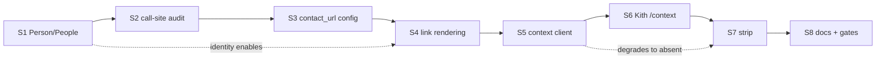

# SUPERB — CRM integration as a data mesh, up to the UI/UX

**Date:** 2026-10-29 17:52
**Status:** EXECUTING
**Scope:** make the optional Ledger CRM (Kith, `~/projects/crm`) integration
stop being "a name swap" and start being a real consumer of a published data
product, rendered honestly in the UI. Explicitly NOT in scope: copying CRM
records into webphone, a second data transport, browser→CRM calls, Tailwind
for our own markup.

---

## 0. The one rule

> **Do not verschlimmbessern.** Every step either makes the mesh boundary
> truer, makes a published fact reachable by a human, or removes a trap.
> Nothing here is a restyle.

---

## 1. What "data mesh" means here, concretely

The buzzword is only useful if it changes a decision. Four principles, each
mapped to a decision this repo must make:

| Principle | What it forbids | What it requires here |
| --- | --- | --- |
| **Domain ownership** | Copying another domain's facts into your store | Webphone keeps ZERO contact records from the CRM. No name cache in SQLite, no CRM contact id in `readmodels`, no CRM name in an event. The 6h TTL cache is a *render-time* memo, not a replica. |
| **Data as a product** | Reaching into the owner's internals (its SQLite, its event store, its HTML pages) | The CRM publishes *endpoints* with a stable shape. Webphone consumes those and nothing else. A consumer that scrapes `/rest/opportunities` and joins by contact id is re-implementing the owner's join — REJECTED (see D4). |
| **Self-serve platform** | A new fact requiring a new seam | The consumer-side plumbing (client → resolver → cache → view projection) must make "one more CRM fact on screen" a small diff: one wire type, one cache entry, one view prop. |
| **Federated governance** | One side dictating the other's validation; silent half-configs | Each side validates at its own door. Both-or-neither config. Bearer token never in a URL. Every degradation is *visible or documented*, never silent-and-unexplained. |

### 1.1 What the boundary must never become

- **No browser→CRM traffic.** The CRM is on the LAN and holds no CORS
  policy; exposing it to the phone's browser would move the trust boundary
  into the client. Webphone proxies, always.
- **No write amplification.** Webphone journals *phone facts* (calls,
  dispositions). It does not write contact records, deals, or tasks — those
  are the CRM's aggregate, and its machine API already owns the ops.
- **No UI lying about freshness.** The strip says what it knows and when
  the CRM last activity was; it never implies a live mirror.

---

## 2. Diagnosis — what the seam is today

Read: `internal/crm/{client,resolver}.go` (1031 lines with tests),
`internal/server/{panels,notifier,actions,textagent_api}.go`,
`internal/server/api/{calls,disposition}_api.go`,
`internal/web/views/helpers.go`, and Kith's `internal/machineapi`.

| # | Finding | Damage |
| --- | --- | --- |
| F1 | `Resolver.Names` returns `map[number]string`. `Match` already carries the CRM `ContactRef` — the resolver **throws the identity away**. | The UI can never link to the person it just named. Every surface is a dead end. |
| F2 | The seam publishes exactly one fact: a display name. | A phone that knows *who* but not *what is outstanding* cannot help the human act. The CRM's value (deals, tasks, last touch) never reaches the screen. |
| F3 | No navigation out. Even with an id, there is no deep link. | "Who is this?" is answered; "show me the deal" requires manual CRM search. |
| F4 | Failures are uniform and invisible: disabled, no-match, down, 401 → all `ok=false`. | Correct for rendering (raw number), wrong for governance: the operator cannot tell "not in the CRM" from "the mesh is broken". |
| F5 | `by-phone` returns the first match and drops email, phones, company. | The consumer's contract is narrower than the producer's data. Acceptable — the product is what is *published*, not what is *stored*. |
| F6 | `displayName(number, names)` is the only CRM-aware render helper. | Fine as a helper, but there is nowhere for a second fact to go without a second helper family. |
| F7 | `calls` + `disposition` are journaled; SMS/voicemail/fax are not. | The CRM's timeline sees half of the communication domain. This is a **product decision**, not a bug — recorded as an owner question (§7 Q3). |

**Root cause (one, not seven):** the seam's *type* is a lossy projection
(`number → string`). Identity, provenance, and freshness are destroyed at
the boundary, so no amount of view work can recover them. Fix the type
first; everything else becomes small.

---

## 3. Decisions

### D1 — `Person`, not `Match`; `People`, not `Names`

The seam returns the CRM's answer for a number as a **person**: the opaque
`ContactRef` plus the display name. Rename `crm.Match` → `crm.Person`,
`Resolver.Names(...) map[string]string` → `Resolver.People(...) map[string]Person`.

Rejected: keeping `Names` beside `People` (two homes for one fact → split
brain) and returning `map[string]string` plus a parallel URL map (a number
could be in one map and not the other).

### D2 — The view projection is not the domain type

Views get `views.CRMContacts` = `map[number]views.CRMContact{Name, URL}`.
`URL` is `""` unless a deep-link template is configured. One conversion
home (`handlers.crmContacts`), no view ever imports `internal/crm`.

Rationale: views own *render targets*; the seam owns *domain identity*. The
two shapes differ on purpose (the view needs a URL, the seam needs a ref),
so this is a projection, not a duplicate type.

### D3 — Deep links are config, not inference

`crm.contact_url` is a template (`https://crm.example/contacts/{id}`),
validated fail-closed: absolute http(s), must contain `{id}`, and requires
`crm.url`+`crm.token` (a link to a CRM this deployment cannot reach is a
dead affordance). Unset ⇒ byte-identical rendering to today.

Rejected: deriving the URL from `crm.url` (the machine API and the human UI
are different origins in every real deployment — the API is
`127.0.0.1:8080`, the UI is behind Caddy).

### D4 — Context arrives as an owner-computed product, never a consumer join

The strip needs company / open deals / next task / last touch. The CRM
publishes `GET /api/contacts/{id}/context`; webphone calls it for **one
contact at a time**, only on surfaces where a human is looking at that one
contact.

Rejected: fetching `/rest/opportunities` and filtering by `contact_id` in
webphone. That is the consumer performing the owner's join over a bounded
dump (up to 100k rows), i.e. exactly the anti-pattern a mesh exists to
prevent — and it would silently disagree with the CRM the day the shim
changes.

Rejected: fetching context for **list** surfaces (rail, thread list, fax
list, history). N contacts × M facts is an N+1 storm for facts no one reads
at list density. Lists get identity; the single-contact surfaces get context.

### D5 — Absence is a state, not a zero value

`Resolver.ContextOf` returns `(*Context, bool)`. `false` covers disabled /
no-match / endpoint not published (404) / transport failure; the strip
renders nothing. Negative results are cached (short TTL for "not published",
the normal negative TTL for "no contact") so a CRM without the endpoint is
asked once per window, not once per page view.

### D6 — The strip lives beside the head, never inside it

`ThreadHead` is a hot morph/outerHTML swap target (flag toggles re-render
it). The context strip is a sibling (`#wp-crm-context`) inside
`.wp-msg-detail`, so pinning a thread does not cost a CRM round trip and a
flag toggle cannot blank the strip.

### D7 — One new error code per failure class, registered in the same commit

`config.crm.contact_url`, `crm.context` (transport/shape), and the reuse of
`crm.http` for status failures. Registry drift reds CI (the 2026-10-24
lesson) — `TestErrorCodeRegistryIsFresh -update` runs in the same commit.

### D8 — Facts webphone already owns stay webphone's

`POST /api/contacts/{id}/calls` composes its own sentence from structured
facts (`composeCallBody`). Webphone sends facts, the CRM renders prose.
Any new fact (SMS/voicemail/fax journaling) is a separate owner decision
with a privacy dimension — see Q3.

---

## 4. The contract (consumer's declaration)

What webphone requires of the CRM, and what it does when the requirement is
unmet. This is the artifact that makes the integration *governable*: the
consumer states its baseline, the producer states its product.

| Product | Endpoint | Required since | Absent means |
| --- | --- | --- | --- |
| Identity lookup | `GET /api/contacts/by-phone?number=` | v1 (existing) | No names anywhere; raw numbers (today's zero-config product). |
| Call journal | `POST /api/contacts/{id}/calls` | v1 (existing) | Island toast on 502; verdict still stored locally. |
| Contact context | `GET /api/contacts/{id}/context` | v2 (this train) | No strip. Cached negative, one debug line, no toast. |

`/context` response shape webphone consumes (unknown fields tolerated,
missing optional fields tolerated):

```json
{
  "id": "01J…",
  "name": "Ada Lovelace",
  "company": "Analytical Engines Ltd",
  "tags": ["lead", "conference"],
  "open_deals": [
    { "title": "Retainer 2027", "stage": "proposal", "value_cents": 1200000, "currency": "EUR" }
  ],
  "open_tasks": 2,
  "next_task": { "title": "Send the revised offer", "due_at": "2026-11-02T09:00:00Z" },
  "last_activity_at": "2026-10-24T11:03:00Z"
}
```

Consumption rules: `id` and `name` required; everything else optional and
individually skippable; `404` means "no context for this contact / not
published"; any 5xx or transport error is a *degradation*, never an error
surface in the phone's UI.

---

## 5. Pareto — the steps, in order

| Tier | Step | Why first |
| --- | --- | --- |
| **1% → 51%** | S1 `crm.Person` + `People()` (identity survives) | The root defect. Every later step is cheap only because of it. |
| | S2 Spike scope: honest review of every call site | Prevents a half-migrated seam. |
| **4% → 64%** | S3 `crm.contact_url` + validation | Turns the recovered identity into a reachable one. |
| | S4 `views.CRMContacts` + link rendering on all 6 surfaces | Daily-visible: a name you can click. |
| **20% → 80%** | S5 `/context` client + negative cache + fail-open | Second fact class without a second seam. |
| | S6 Kith publishes `/api/contacts/{id}/context` | The product that makes S5 real. |
| | S7 Strip in the thread detail (i18n en+de) | "Who + what's outstanding" at the moment of a conversation. |
| **tail** | S8 Docs/gates: AGENTS, error contract, CHANGELOG, dom-contract | The rule must outlive the session. |

### 5.1 Execution graph



### 5.2 Micro steps (each ≤ 12 min, verifiable)

| # | Step | Verify |
| --- | --- | --- |
| S1.1 | Rename `Match`→`Person`, `Names`→`People` in the client/resolver | `go build ./internal/crm` |
| S1.2 | Update resolver tests to the typed shape | `go test ./internal/crm` |
| S2.1 | Migrate `notifier`, `panels`, `actions`, `textagent_api` | `go build ./...` |
| S3.1 | Add `crm.contact_url` to config + validation | `go test ./internal/config` |
| S3.2 | Register `config.crm.contact_url` | registry test |
| S4.1 | `views.CRMContacts` + `handlers.crmContacts` conversion | `go build` |
| S4.2 | Migrate the 6 view prop structs | `go test ./internal/web/views` |
| S4.3 | `crmNameLink` component, used where a link is meaningful | rendered-props test |
| S5.1 | `Context` type + client call + sentinels | `go test ./internal/crm` |
| S5.2 | Resolver cache with negative TTL + single-flight reuse | `go test ./internal/crm` |
| S6.1 | Kith handler + route | `go test ./internal/machineapi` |
| S6.2 | Kith BDD: context of a real contact, 404 for a ghost id | Kith suite |
| S7.1 | Strip component + i18n both maps | i18n parity test |
| S7.2 | Server wiring on the thread panel only | server test |
| S8.1 | AGENTS invariant + error contract + CHANGELOG | gates |

---

## 6. What this deliberately does NOT do

- **No CRM name caching in SQLite.** A replica is a mesh violation and a
  GDPR liability: webphone would hold personal data it does not own.
- **No "add this number to the CRM" write.** Kith's `POST /api/contacts` is
  email-keyed find-or-create; inventing a contact from a phone number
  manufactures records the owner never confirmed. The deep link lets the
  human decide.
- **No context on list surfaces** (D4).
- **No inline scripts, no new JS module.** The strip is server-rendered
  HTML; the CSP stays strict.
- **No polling / live CRM updates.** Freshness is the CRM's pull-model
  concern; a phone tab must not become a syncer.

---

## 7. Owner questions (only the owner can answer)

**Q1 — Should the deep link open in a new tab or replace the phone?**
This train opens a new tab (`rel="noopener noreferrer"`): losing the SIP
island to a navigation would tear down registration and any live call.
Confirm, or state that the CRM should be embeddable instead.

**Q2 — Is `crm.contact_url` the right config surface, or should the stack's
NixOS module derive it from a single `crm.ui_url`?** The module already
derives the passkey `rp_id`/origins from `caddy.hostName`; the same instinct
would derive the contact URL from a CRM vhost name.

**Q3 — Should SMS/voicemail/fax facts be journaled into the CRM contact
timeline, or is call activity the intended scope?** This has a privacy
dimension (message bodies are personal data, and the CRM is a different
processor) and a product dimension (a CRM timeline flooded by OTP codes is
noise). Not decided here.

**Q4 — Should the strip appear on the History call detail too?** Today
History is a log with `<details>` disclosure; adding a per-call CRM strip
would multiply context fetches across a page of rows. Default: no.

---

## 8. Execution ledger

Filled from actual runs, never pre-filled.

| # | Step | Status | Evidence |
| --- | --- | --- | --- |
| S1 | `Person` / `People` | ⏳ PENDING | |
| S2 | Call-site migration | ⏳ PENDING | |
| S3 | `crm.contact_url` | ⏳ PENDING | |
| S4 | Link rendering | ⏳ PENDING | |
| S5 | Context client | ⏳ PENDING | |
| S6 | Kith `/context` | ⏳ PENDING | |
| S7 | Strip | ⏳ PENDING | |
| S8 | Docs + gates | ⏳ PENDING | |
