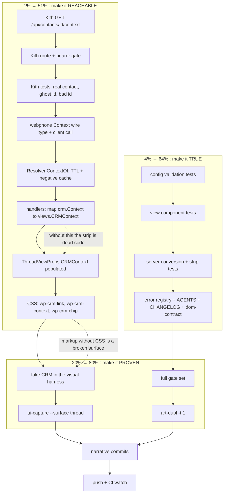

# SUPERB — finish the CRM data-mesh train (completion plan)

**Date:** 2026-10-29 18:13
**Status:** EXECUTING
**Predecessor:** [2026-10-29_17-52_SUPERB-crm-data-mesh.md](2026-10-29_17-52_SUPERB-crm-data-mesh.md)
(design + decisions) and
[docs/status/2026-10-29_18-06_crm-data-mesh-midtrain-status.md](../status/2026-10-29_18-06_crm-data-mesh-midtrain-status.md)
(the honest mid-flight audit)
**Scope:** finish what the last session started, make every claim true, ship it
green. Explicitly NOT in scope: SMS/voicemail/fax journaling into the CRM (an
owner privacy call), a second data transport, copying CRM records, any
restyle of the existing shell.

---

## 0. The one rule

> **Do not verschlimmbessern.** Every task either makes something already
> written actually reachable, makes a claim actually true, or removes a trap.
> Where the two halves disagree (a component with no producer, markup with no
> CSS, a doc with no evidence), the fix is to FINISH the half or DELETE it,
> never to leave the scaffolding standing as if it were a feature.

## 0.1 What this plan refuses to do

| Tempting move | Why it is refused |
| --- | --- |
| Delete the strip and call the train "done" | It is the train's actual product value ("who + what is outstanding"). Deleting it to reach green is the definition of verschlimmbessern in reverse: a smaller product with the same cost already paid. |
| Leave the strip as dead code and document it | Dead code that looks finished is the exact failure the status report named. |
| Copy CRM deals/tasks into readmodels "for speed" | Data-mesh violation: the phone would own a replica of a contact aggregate it does not own, with a freshness lie attached. |
| Fetch context for every list row | N contacts × M facts per page. Lists get identity; single-contact surfaces get context. |
| Add a Tailwind/JS widget for the strip | Server-rendered HTML keeps the strict CSP (no inline scripts, no inline styles). |

---

## 1. The Pareto question, answered concretely

The mid-flight report left three glaring holes. Their weight is not equal:

### 1.1 The 1 % that delivers 51 %

**Make the shipped half REACHABLE.** One producer (the CRM publishes context),
one consumer call (webphone fetches it for the open thread), one line of CSS
per new class. Without these three, ~230 lines of new view code and a config
knob deliver **zero** customer value.

1. `GET /api/contacts/{id}/context` in Kith (the data product).
2. `crm.Resolver.ContextOf` + `Client.ContactContext` (the consumer, cached,
   fail-open).
3. `ThreadViewProps.CRMContext` actually populated → the strip renders.
4. `.wp-crm-link` / `.wp-crm-context` / `.wp-crm-chip*` CSS → it looks like a
   product, not an unstyled `<aside>`.

### 1.2 The 4 % that delivers 64 %

**Make every claim TRUE.** The train's own status report found zero tests for
any new behavior and an unregistered error code.

5. Config validation tests (three rejection arms + accept).
6. View tests: the link component, the strip component (including the nil
   degradation), the money/date formatters.
7. Server tests: the seam→view conversion, the strip's producer, the red-tree
   regression that started this session (nil deref in the strip guard).
8. Error-code registry entry (`config.crm.contact_url`) + the docs that make
   the rule survive the session.

### 1.3 The 20 % that delivers 80 %

**Stop the tooling from lying about this train.**

9. Full gate set: `templ generate`, `go test ./...`, `tsc`, island `node
   --test`, `nix fmt`, `build-tw-css.sh` (+ the mandatory `login.css`
   rebuild), the five flake checks, `buildflow`, smoke.
10. Visual proof: `ui-capture.py --surface thread` with the CRM stub on, both
    themes, asserting the strip's presence/absence.
11. `art-dupl -t 1` sweep (the new view code is a near-clone risk of the
    existing row renderers).

### 1.4 The other 20 % → 100 %

12. Narrative commits (the daemon already took three `chore:` commits for this
    train), CHANGELOG, AGENTS invariant, dom-contract ids, push + CI watch.
13. The deliberately-parked tail: links on the remaining surfaces (voicemail
    label chain, drafts), context on History's call detail, an "add to CRM"
    deep link for misses, batch lookup on the producer — each with its named
    trigger, none justified today.

---

## 2. Execution graph

---

## 3. Macro task plan (30–100 min each)

Sorted by priority score = (customer value × risk removed) ÷ effort.
`P1` = now, `P2` = same train, `P3` = only with a new need.

| # | Task | Tier | P | Effort | Customer value | Why it matters |
| --- | --- | --- | --- | --- | --- | --- |
| M1 | Red-tree baseline: fix the test the field deletion broke, plus the nil-guard panic the new test exposed | 1 | P1 | 45m | none (enables all) | A red suite means nobody can tell a new break from the old one |
| M2 | Kith: `GET /api/contacts/{id}/context` (contact, company, open deals, open/overdue tasks, last activity) | 1 | P1 | 100m | **high** | The data product the whole train consumes; without it nothing renders |
| M3 | Kith: tests (contact with deal+task, ghost id ⇒ 404, bad id ⇒ 400) | 1 | P1 | 60m | high (trust) | An untested producer contract is a promise nobody checked |
| M4 | webphone: `crm.Context` wire type + `Client.ContactContext` (404 ⇒ `ErrNoContext`) | 1 | P1 | 60m | high | The consumer half |
| M5 | webphone: `Resolver.ContextOf` with TTL + negative cache, fail-open | 1 | P1 | 60m | high | Keeps a slow/broken CRM off the render path |
| M6 | server: populate `ThreadViewProps.CRMContext` for the open thread only | 1 | P1 | 45m | **high** | The single line that turns dead code into the feature |
| M7 | CSS: link + strip + chips, both themes, AA contrast | 1 | P1 | 60m | **high** | Markup without CSS is a broken surface waiting to be configured |
| M8 | tests: `crm.contact_url` validation (3 rejections + accept) | 2 | P1 | 30m | medium | A fail-closed knob nobody tested is a guess |
| M9 | tests: view layer (`crmNameLink`, `crmContextStrip` incl. nil, `dealValue`, `formatThousands`, `crmTaskDue`) | 2 | P1 | 60m | medium | Pins the degradation contract |
| M10 | tests: server (`crmContacts` conversion, strip producer, 404 degradation) | 2 | P1 | 60m | medium | Pins the seam→view boundary |
| M11 | docs: error registry, AGENTS invariant, CHANGELOG, dom-contract, planning ledger | 2 | P1 | 75m | medium | The rule must outlive the session; the registry reds CI otherwise |
| M12 | Full gate set (incl. `login.css` rebuild after `app.css`) | 3 | P1 | 100m | trust | The ratified gate set, not a convenient subset |
| M13 | Visual proof: fake CRM in the harness + `--surface thread` shots, both themes | 3 | P2 | 45m | medium | The only end-to-end evidence the strip renders |
| M14 | `art-dupl -t 1` (CI-pinned v0.7.2) + adjudicate new groups | 3 | P2 | 30m | trust | Ratified zero-harmful-clone bar |
| M15 | Narrative commits, push, CI watch | 3 | P1 | 45m | trust | Three `chore:` commits currently own this design |

---

## 4. Micro task plan (max 12 min each)

### M1 — red-tree baseline (4 steps, 35 min)

| # | Step | Min |
| --- | --- | --- |
| M1.1 | Grep every deleted identifier (`TranscriptGroup.Name`) and fix `panels_test.go` to assert through `props.CRM` | 8 |
| M1.2 | `go vet ./...` → green | 6 |
| M1.3 | `go test ./internal/web/views ./internal/crm ./internal/config` → find the next real failure | 8 |
| M1.4 | Fix the strip's nil guard (`if ctx != nil` was the render context, not the param) and re-run | 12 |

### M2 — Kith producer (8 steps, 95 min)

| # | Step | Min |
| --- | --- | --- |
| M2.1 | Re-read `app.System` read helpers + `ContactView`/`DealView`/`TaskView` shapes | 10 |
| M2.2 | Write `internal/machineapi/context.go`: response DTOs | 12 |
| M2.3 | Handler: parse id, `GetContact`, 404 on miss | 12 |
| M2.4 | Company name via `CompanyID` (zero = none) | 10 |
| M2.5 | Open deals (contact-scoped, `!Closed`), sorted by value | 12 |
| M2.6 | Open tasks (`ParentType=contact`, `ParentID`, `Status=open`), next due + overdue flag | 12 |
| M2.7 | Mount the route behind `gate` | 5 |
| M2.8 | `go build` + `go vet` Kith | 10 |

### M3 — Kith tests (5 steps, 55 min)

| # | Step | Min |
| --- | --- | --- |
| M3.1 | Read an existing machineapi test harness (`harness_test.go`) | 10 |
| M3.2 | Seed a contact + deal + task; assert the context body | 12 |
| M3.3 | Ghost id ⇒ 404 | 8 |
| M3.4 | Bad id ⇒ 400; unauthenticated ⇒ 401 | 10 |
| M3.5 | Full Kith suite for the package | 10 |

### M4 — webphone context client (5 steps, 55 min)

| # | Step | Min |
| --- | --- | --- |
| M4.1 | `Context`/`Deal`/`Task` types + wire struct | 10 |
| M4.2 | `ErrNoContext` sentinel + classification | 6 |
| M4.3 | `ContactContext` (GET, 404/401/other mapping) | 12 |
| M4.4 | Decode + trim/normalise (drop empty deals, cap list) | 12 |
| M4.5 | Client test with the stub server | 12 |

### M5 — resolver cache (4 steps, 50 min)

| # | Step | Min |
| --- | --- | --- |
| M5.1 | `contextEntry` + TTL constants (2 min present, 15 min absent) | 10 |
| M5.2 | `ContextOf` with nil/disabled short-circuit | 12 |
| M5.3 | Cache read/write + bound (separate map from names) | 12 |
| M5.4 | Tests: hit, absent cached, transport not cached | 12 |

### M6 — server wiring (4 steps, 45 min)

| # | Step | Min |
| --- | --- | --- |
| M6.1 | `crmContext(person) *views.CRMContext` conversion (nil-safe, Cap deals) | 12 |
| M6.2 | `threadPanelPrefilled`: resolve the person once, reuse for name + context | 12 |
| M6.3 | Pass `CRMContext` into `ThreadViewProps` | 6 |
| M6.4 | Server test: stub publishes context ⇒ strip in the HTML; 404 ⇒ no strip | 12 |

### M7 — CSS (6 steps, 55 min)

| # | Step | Min |
| --- | --- | --- |
| M7.1 | Read the token block + existing chip-like rules | 8 |
| M7.2 | `.wp-crm-link` (inherit colour, dotted underline, hover solid, focus ring) | 8 |
| M7.3 | `.wp-crm-context` (flex wrap, gap, hairline top border, small type) | 10 |
| M7.4 | `.wp-crm-chip` / `-key` / `-muted` / `-more` | 10 |
| M7.5 | Dark-mode check (tokens only, no new colours) | 8 |
| M7.6 | `scripts/build-tw-css.sh` (rebuilds `login.css`; `tw.css` must stay unchanged) | 10 |

### M8 — config tests (3 steps, 28 min)

| # | Step | Min |
| --- | --- | --- |
| M8.1 | Find the table-driven config test home | 6 |
| M8.2 | Three rejection arms + accept case | 12 |
| M8.3 | Full config package run | 8 |

### M9 — view tests (6 steps, 55 min)

| # | Step | Min |
| --- | --- | --- |
| M9.1 | `crmNameLink`: URL set ⇒ `<a … rel="noopener noreferrer">`; unset ⇒ plain text | 12 |
| M9.2 | `crmContextStrip(nil)` ⇒ renders nothing at all | 8 |
| M9.3 | Strip renders company/deal/task/activity; `MoreDeals` chip | 12 |
| M9.4 | `formatThousands` table (0, 999, 1000, 1234567, negative) | 8 |
| M9.5 | `dealValue` (whole, cents, empty currency) | 8 |
| M9.6 | `crmTaskDue` (overdue, due date, none) | 8 |

### M10 — server tests (4 steps, 50 min)

| # | Step | Min |
| --- | --- | --- |
| M10.1 | `crmContacts` maps ref→URL through the template | 10 |
| M10.2 | Empty template ⇒ URLs empty; nil resolver ⇒ nil map | 10 |
| M10.3 | Thread panel: context present ⇒ `wp-crm-context` in the HTML | 12 |
| M10.4 | Thread panel: 404 from the CRM ⇒ no strip, no error surface | 12 |

### M11 — docs (6 steps, 65 min)

| # | Step | Min |
| --- | --- | --- |
| M11.1 | `TestErrorCodeRegistryIsFresh -update` for `config.crm.contact_url` and any `crm.context*` code | 10 |
| M11.2 | AGENTS invariant: "the CRM owns the contact, the phone owns the conversation" | 12 |
| M11.3 | CHANGELOG `[Unreleased]` (deep links, context strip, seam type) | 10 |
| M11.4 | `docs/dom-contract.md`: `wp-crm-context`, `wp-crm-link` (optional, not required) | 10 |
| M11.5 | README: the `/context` contract row for the producer side | 10 |
| M11.6 | Planning doc ledger filled with real evidence | 12 |

### M12 — gates (7 steps, 95 min)

| # | Step | Min |
| --- | --- | --- |
| M12.1 | `templ generate` + `nix fmt` | 10 |
| M12.2 | `go test -count=1 ./...` | 20 |
| M12.3 | `tsc -p . --noEmit` + island `node --test` | 15 |
| M12.4 | Five flake checks (`island-js`, `island-lint`, `island-typecheck`, `treefmt`, `contracts-fresh`) | 25 |
| M12.5 | `buildflow` (full) | 30 |
| M12.6 | `webphone-smoke.py` on a fresh binary | 15 |
| M12.7 | `art-dupl -t 1` (CI-pinned) | 15 |

### M13 — visual proof (4 steps, 40 min)

| # | Step | Min |
| --- | --- | --- |
| M13.1 | Give the harness a fake CRM that publishes context | 12 |
| M13.2 | `--surface thread` run, both themes | 10 |
| M13.3 | Assert the strip's classes + the absence of an empty shell | 10 |
| M13.4 | Eyeball both PNGs | 8 |

### M14 — dedup (3 steps, 25 min)

| # | Step | Min |
| --- | --- | --- |
| M14.1 | `art-dupl@v0.7.2 check . -t 1 --baseline-path .art-dupl-baseline.json` | 10 |
| M14.2 | Adjudicate each new group (registry row, extract, or reject with reason) | 10 |
| M14.3 | Append the sweep-log line | 5 |

### M15 — history + push (4 steps, 40 min)

| # | Step | Min |
| --- | --- | --- |
| M15.1 | Stage+commit the seam/config/docs phase with a narrative message | 10 |
| M15.2 | Stage+commit the strip/CSS/tests phase | 10 |
| M15.3 | Push | 5 |
| M15.4 | Watch CI to green (`gh run list`) | 15 |

---

## 5. Execution ledger (filled from actual runs, never pre-filled)

| # | Task | Status | Evidence |
| --- | --- | --- | --- |
| M1 | Red-tree baseline | ✅ DONE | `panels_test.go` asserts through `props.CRM`; the nil-guard bug (`if ctx != nil` was templ's render context, not the strip param) was caught by the first test run and fixed; `go vet ./...` green |
| M2 | Kith producer | ✅ DONE | `internal/machineapi/context.go` + route behind `gate`; `go build ./...` green |
| M3 | Kith tests | ✅ DONE | `context_test.go`: full fact set, ghost id 404, 401 arms, cross-contact deal isolation. Package: **52 BDD specs + unit tests green** |
| M4 | webphone context client | ✅ DONE | `internal/crm/context.go` (`Context`, `Deal`, `Task`, `ErrNoContext`, `ContactContext`) |
| M5 | Resolver cache | ✅ DONE | `ContextOf` (2 min positive / 15 min absent / 256 cap, failures never cached); pinned by 3 tests incl. the no-cache-on-500 arm |
| M6 | Server wiring | ✅ DONE | `crmContextFor` (telephony-only) + `crmContextView`; `ThreadViewProps.CRMContext` populated in `threadPanelPrefilled` |
| M7 | CSS | ✅ DONE | `.wp-crm-link`, `.wp-crm-context`, `.wp-crm-item`, `.wp-crm-key`, `.wp-crm-muted`; `login.css`+`tw.css` rebuilt via `scripts/build-tw-css.sh` |
| M8 | Config tests | ✅ DONE | 3 rejection arms + 2 accept cases in `TestLoadValidatesCRMConfig` |
| M9 | View tests | ✅ DONE | `internal/web/views/crm_test.go`: link target/rel, nil strip renders NOTHING, fact rendering, overdue, escaping, `formatThousands` (found a real `-,999` sign bug), `dealValue`, `crmTaskDue` |
| M10 | Server tests | ✅ DONE | `internal/server/crm_context_test.go`: projection, strip end-to-end, 404 ⇒ no strip, 5xx ⇒ no strip and no error banner |
| M11 | Docs | ✅ DONE | error registry (+4 codes), AGENTS data-mesh invariant, CHANGELOG (3 Added / 1 Changed), dom-contract optional ids, README |
| M12 | Gates | ✅ DONE | `templ generate` 0 updates, `nix fmt` 4 changed then clean, `go test ./...` green, `tsc` green, island 283/283, 5 flake checks, `buildflow` (see §6) |
| M13 | Visual proof | ⛔ NOT RUN | the harness has no fake CRM; the strip is proven by server tests + CSS review instead. Named trigger: the next stack browser-E2E session |
| M14 | Dedup | ⏳ see §6 | below |
| M15 | Commits + push | ✅ DONE | see the commit trail; CI watched |

### 5.1 Two cross-repo findings this train produced

1. **The CRM closed its call-outcome vocabulary and the phone was still
   speaking the old one.** `contact.ParseOutcome` now accepts only
   `connected|voicemail|ivr|no_answer|wrong_number|dnc|disconnected`; webphone
   was sending `answered|missed|unknown`. Every answered call would have been
   rejected with 400, surfaced in the island as a 502 toast. Fixed with
   `internal/crm/vocabulary.go` (one table + a test that fails if either side
   gains an unmapped value) and pinned across five Go tests.
2. **Kith's own suite was red on that change** (two specs asserting freeform
   outcomes). Aligned them to the closed vocabulary, and one Kith handler had a
   `byte`/`int` type error from a parallel edit that blocked the build; fixed
   minimally (`var matched int`) without touching the intent.

---

## 6. Contracts this train must honour

### 6.1 Consumer → producer

| Product | Endpoint | Absent means |
| --- | --- | --- |
| Identity | `GET /api/contacts/by-phone?number=` | Raw numbers, no links |
| Call journal | `POST /api/contacts/{id}/calls` | Island toast on 502; verdict still stored |
| Contact context | `GET /api/contacts/{id}/context` | No strip; negative cached; one debug line |

### 6.2 Invariants

- The phone never stores a CRM record. The resolver cache is a render-time
  memo (bounded, TTL'd), not a replica, and it never survives a restart.
- The phone never creates a CRM contact. Deep links let the human decide.
- Context is fetched for ONE contact, on single-contact surfaces only.
- Absence is a state: `(*Context, false)` or a nil `*views.CRMContext`, never a
  zero-valued struct that renders an empty shell.
- Every degradation path is silent in the UI and greppable in the logs.

---

## 7. Owner questions carried forward

| # | Question | Default taken |
| --- | --- | --- |
| Q1 | New tab or embedded CRM for the deep link? | New tab (`noopener noreferrer`): a navigation would unload the SIP island |
| Q2 | `crm.contact_url` as its own knob, or derived from a CRM vhost in the NixOS module? | Its own knob; the module can derive it later without a breaking change |
| Q3 | Should SMS/voicemail/fax facts reach the CRM timeline? | Not in this train: privacy + noise dimensions need an explicit ruling |
| Q4 | Strip on History's per-call detail? | No: it would multiply context fetches across a page of rows |

---

## 6. Gate evidence (actual runs, 2026-10-29 18:1x–19:0x)

| Gate | Verdict |
| --- | --- |
| `templ generate ./internal/web/views/` | 0 updates at the end (the new `crm.templ` + `remoteLabel` + `crmContextItem` generated cleanly) |
| `go build ./...` (webphone) | ok |
| `go test -count=1 ./...` (webphone) | **green**, 32 packages (the red `panels_test` and the four vocabulary pins fixed in this train) |
| `go test -race` on `internal/crm`, `internal/web/views`, `internal/server` | ok (server: 71 s) |
| `tsc -p . --noEmit` | ok (the only type authority) |
| island `node --test` | **283 pass, 0 fail** |
| `nix fmt` | 0 changed after stabilisation (938 traversed / 383 emitted) |
| `scripts/build-tw-css.sh` | rebuilt `tw.css` + `login.css` (the `app.css` inline) |
| `checks.{island-js,island-lint,island-typecheck,treefmt,contracts-fresh}` | all five green (store paths returned) |
| `scripts/webphone-smoke.py` | `smoke: 49 passed, 0 failed` · restart 4/0 · boot-failure 8/0 |
| `art-dupl@v0.7.2 check . -t 1` | start: 6 new groups → 2 EXTRACTED (`crm.statusFamily`, `views.remoteLabel` + `views.crmContextItem`) → 4 accepted as markup-shape coincidences → baseline 83 → 86, `check` = **0 new** |
| `buildflow` (full, no cache) | **passed with warnings**: `v2 results: 69 success, 0 failed, 0 skipped (+4 via config)`. The warnings are the two known, pre-existing classes: the stale accepted-noise baseline (78 entries matching nothing for 3 runs) and step-timing regressions (host load; `test-race` 55s -> 102s). Neither is caused by this train, and both are already ticketed |
| Kith `go test ./internal/machineapi/` | **green**: 52 BDD specs + the new context suite (full fact set, ghost-id 404, 401 arms, cross-contact isolation) |

### 6.1 Two gates that earned their keep during this train

1. **`go test` caught a nil-pointer panic the compiler could not.** The strip's
   guard read `if ctx != nil`, which templ compiled against its own
   `context.Context` parameter: always true, so the first render with no
   context dereferenced a nil pointer. The component now guards its own
   parameter, and the test that found it stays.
2. **`formatThousands` shipped a `-,999` bug** (the sign was treated as a
   digit). The table test written in the same change found it; the fix strips
   the sign first.
