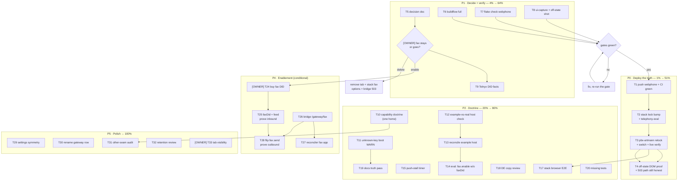

# SUPERB — Fax: deploy the truth, then decide (plan)

**Created:** 2026-10-30 02:29 CET
**Author:** Crush (session that shipped the fax capability declaration)
**Status:** PLAN — nothing in this document is shipped except where marked
`DONE` (the code train of 2026-10-30 01:57–02:14).
**Companion status report:** [docs/status/2026-10-30_02-25_fax-capability-honesty.md](../status/2026-10-30_02-25_fax-capability-honesty.md)

---

## 0. Context you need before touching anything

### 0.1 What actually happened (the honest one-paragraph version)

The Fax tab used to render a working compose form on a deployment that
cannot fax in either direction. The app now **declares** the two lanes —
`fax.send` / `fax.receive` (unset = on, so the zero-config product is
byte-identical) — and the panel, the Settings row and the SSE fragment all
obey that declaration. The stack derives the declaration from what it
knows (`receive = fax.feed.enable`, `send = false`). **None of this is
live on the PBX yet**, because the stack pins webphone by `flake.lock` and
the pinned revision predates the new config keys (koanf drops unknown keys
silently).

### 0.2 The five things that are still wrong (in order of pain)

1. **The deployment still lies.** The pinned webphone ignores `settings.fax`,
   so `/fax` on the host shows the old form.
2. **The train is unverified by the gates AGENTS demands.** `buildflow`
   never ran; `nix flake check` never ran; the visual harness never ran.
3. **The capability doctrine exists in one bullet** and nothing else reads
   it; the same lie is structurally possible for Paperless, CRM, ASR and
   push.
4. **Nobody decided whether fax should exist.** Everything downstream
   (DID purchase, outbound path, or deletion) hangs on that.
5. **The pin gap is invisible.** An older binary silently accepts a newer
   config and claims nothing.

### 0.3 Guardrails (read this before you type)

- **Do not verschlimmbessern.** No behaviour change outside the stated
  scope of a task. The zero-config rendering must stay byte-identical
  (there is a test for the fax panel and one for Settings parity; keep
  them green or make the change explicit and pinned).
- **One home per fact.** A capability is declared once (config), converted
  once (`handlers.faxCapability()`), consumed everywhere. Do not add a
  second boolean path.
- **Every served-markup change owes a pin check**: grep the three sites
  (Go tests, `scripts/webphone-smoke.py`, the stack's `tests/browser-e2e.py`)
  before editing markup.
- **Format before gates**: `nix fmt` (with `TREEFMT_NO_CACHE=1`) then
  `scripts/format-check.sh` — `nix fmt`'s cache lies.
- **Push is gated**: only after the phase's verification commands are green,
  and always re-check CI (`gh run list`) afterwards.
- **Owner decisions are marked `[OWNER]`** — do not silently decide them.

---

## 1. Pareto analysis

### 1.1 The 1% that delivers ~51%

> **Close the pin gap and make the deployed PBX show the truth.**

One action chain — push webphone → bump the stack's webphone input →
relock pbx-artmann → switch → verify `/fax` — converts ~1,000 lines of
already-tested code into user-visible honesty. Nothing else in this plan
matters if this does not happen, because until then the owner still sees a
form that cannot work.

**Single measurable outcome:** `curl` the deployed host, authenticated,
`GET /fax` contains `wp-fax-off` and does **not** contain `wp-compose-fax`.

### 1.2 The 4% that delivers ~64%

The 1% **plus** the three verification gaps that could make the 1% a lie:

1. `buildflow` (full, no result cache) — the repo's own quality gate.
2. `nix flake check` (webphone) — island lint/type/JS + module eval.
3. `ui-capture.py` — eyes on the off-state panel, both themes.

Plus **one recorded decision**: fax stays or fax goes `[OWNER]`. Without it
every "enable" task below is speculative and the middle state — which is
the only state that costs attention forever — persists.

### 1.3 The 20% that delivers ~80%

The 4% **plus** making the class of bug impossible:

- Capability doctrine in exactly ONE home, linked from the seams.
- Unknown-config-key boot warning (the silent-pin-mismatch killer).
- An eval check that compares the stack's *example* host with the *real*
  host for the lanes that matter (their disagreement is what seeded the
  false belief that fax shipped).
- Reconcile the stack's example host (`fax.enable = true`, no `faxDid`).
- Native-speaker read of the German copy (11 new strings shipped unseen).
- Re-run the stack browser E2E after the markup change.
- `docs/dom-contract.md` note that the fax compose form is conditional.
- Push-stall watch on a local timer (the stall was invisible for 3h44m).

### 1.4 The remaining 20% (to reach 100%)

Polish and the other seams: Settings symmetry ("show enabled lanes"), the
"Message & fax gateway" row rename, the Paperless/CRM/ASR/push capability
audit, retention review under both-lanes-off, tab-visibility decision,
`erraudit nolint-audit`, coverage read, docpin/example-JSON check, the
loopback+send ruling, and — only if the owner says yes — the actual fax
enablement (DID, `faxDid`, feed, outbound bridge or Telnyx Programmable
Fax, reconciler support).

---

## 2. Coarse plan (30–100 min per task), sorted

**Sort key:** tier (P0 first) → customer value (5 = the owner sees the
truth) → impact → effort asc. `[OWNER]` = needs a decision before work.

| ID | Task | Tier | Impact | Cust | Min | Depends |
|----|------|------|--------|------|-----|---------|
| T1 | Push webphone `main`, watch CI to green | P0 | 5 | 5 | 40 | — |
| T2 | Stack: bump `webphone` input, rebuild `telephony-eval` + `webphone-module` | P0 | 5 | 5 | 60 | T1 |
| T3 | pbx-artmann: relock to new stack rev, `nixos-rebuild switch`, verify `/fax` + `/settings` live | P0 | 5 | 5 | 90 | T2 |
| T4 | Post-deploy honest-evidence pass: off-state DOM proof + the `/fax/send` 503 path still reads honestly | P0 | 4 | 5 | 40 | T3 |
| T5 | `[OWNER]` Record the fax decision (enable with a DID + outbound path, or delete the lane) as a decision doc | P1 | 5 | 5 | 40 | — |
| T6 | `buildflow` full (`BUILDFLOW_NO_RESULT_CACHE=1`), triage, record findings | P1 | 4 | 3 | 80 | — |
| T7 | `nix flake check` (webphone): island-lint, island-js, webphone-module, backup VM (KVM-gated) | P1 | 4 | 2 | 90 | — |
| T7b | `nix flake check` (stack): at minimum `webphone-module` + VM suites | P1 | 3 | 2 | 90 | T2 |
| T8 | `ui-capture.py` both themes + add an off-state surface (`--fax-off`) | P1 | 4 | 4 | 100 | T1 |
| T9 | Telnyx account facts: which connection owns `+1727289311`, fax-capable DID options, price | P2 | 4 | 5 | 40 | — |
| T10 | Capability doctrine → ONE home in AGENTS, linked from FEATURES/README/lessons; record the `/config.js` decision | P2 | 4 | 3 | 50 | — |
| T11 | Unknown-config-key boot warning (list leftover `settings.*` keys at WARN) | P2 | 5 | 3 | 90 | — |
| T12 | Stack eval check: example host vs real host lane comparison (fax/recording/dashboard) | P2 | 4 | 2 | 80 | T2 |
| T13 | Reconcile the stack's example host fax block (wire `faxDid` or stop enabling fax) | P2 | 3 | 1 | 40 | T9 |
| T14 | Stack eval assertion: `fax.enable` with no `faxDid` anywhere | P2 | 3 | 1 | 40 | T13 |
| T15 | Ops automation: push-stall watch on a local timer + confirm where the smoke runs in CI | P2 | 3 | 2 | 60 | — |
| T16 | Clean pbx-artmann stale caches (`pytest`/`mypy` referencing moved tests) | P3 | 1 | 1 | 30 | — |
| T17 | Re-run the stack browser E2E against the deployment after the markup change | P2 | 4 | 3 | 90 | T3 |
| T18 | Native-speaker read of the 11 DE fax strings (+ 4 Settings strings) | P2 | 3 | 4 | 30 | — |
| T19 | Docs truth pass: dom-contract note (conditional fax nodes), release-runbook pin-predates-key trap, runbook fax note | P2 | 3 | 2 | 60 | — |
| T20 | Tests: receive-only with stored inbound fax, SSE off-state payload, capability-combination property test, Settings parity | P2 | 4 | 2 | 80 | — |
| T21 | Coverage + docpin audit: branch coverage of `faxCapability`/`faxUnavailableKey`, example-JSON pin | P3 | 2 | 1 | 30 | — |
| T22 | Record the ruling: no validation for `fax.send=true` under `gateway.mode=loopback` (demo mode) | P3 | 1 | 1 | 30 | — |
| T23 | `erraudit nolint-audit` sweep after the error-path-adjacent edits | P3 | 2 | 1 | 40 | T6 |
| T24 | `[OWNER]` Buy/port a dedicated fax-capable DID (or decide "no fax") | P4 | 5 | 5 | 60 | T5 |
| T25 | Wire `gateways.telnyx.faxDid` + `fax.feed.{enable,secretFile,from}`, prove inbound fax → TIFF → PDF → tab | P4 | 5 | 5 | 100 | T24, T3 |
| T26 | Outbound path: implement `/gateway/fax` in the bridge (Telnyx `/faxes` + status webhook) | P4 | 5 | 5 | 100 | T5 |
| T27 | Reconciler: `/fax_applications` support in `scripts/telnyx_reconcile.py` + `telnyx/desired.json` + tests | P4 | 3 | 3 | 100 | T26 |
| T28 | Flip `settings.fax.send = true`, add an outbound smoke/VM assertion, verify end-to-end | P4 | 4 | 4 | 40 | T26, T25 |
| T29 | `[OWNER]` Settings symmetry: always show both lanes ("enabled" rows) — tension with byte-parity | P5 | 2 | 2 | 40 | T5 |
| T30 | Rename Settings' "Message & fax gateway" row now that fax is separate | P5 | 2 | 2 | 30 | — |
| T31 | Capability audit for the other seams (Paperless, CRM, ASR, push): can the UI tell whether they work? | P5 | 4 | 3 | 100 | T10 |
| T32 | Retention review with both lanes off (do old fax documents still need sweeping?) | P5 | 2 | 1 | 30 | T5 |
| T33 | `[OWNER]` Tab visibility when both lanes are off (keep with history vs hide + export path) | P5 | 4 | 3 | 60 | T5 |

---

## 3. Fine plan — every task ≤ 12 minutes

Each coarse task is split so no single step exceeds 12 minutes. Steps are
sequential inside a task; a step that fails becomes its own fix-up task.

### P0 — Deploy the truth

| # | Step | Min |
|---|------|-----|
| 1.1 | `git -C webphone log origin/main..HEAD` — confirm the commits to push, note the oldest timestamp (the manual-push bar anchor) | 5 |
| 1.2 | Re-run `go test -count=1 ./...` + `scripts/format-check.sh` on HEAD (they were green at 02:13; confirm on the exact commit being pushed) | 12 |
| 1.3 | `git push origin main`; record the pushed SHA | 5 |
| 1.4 | `gh run list --limit 5` — capture the run id for the new SHA | 5 |
| 1.5 | Watch CI to green (`gh run watch <id>`); if red, open the failing job, triage, stop the phase and report | 12 |
| 1.6 | Attach the CI verdict + push SHA to the status report's header (facts, not optimism) | 5 |

| # | Step | Min |
|---|------|-----|
| 2.1 | `cd nix-international-telephony && nix flake update webphone` | 8 |
| 2.2 | `git diff flake.lock` — confirm ONLY the webphone node changed | 3 |
| 2.3 | `nix build .#checks.x86_64-linux.telephony-eval` (proves the derived `fax` block still evaluates) | 12 |
| 2.4 | `nix eval --json .#nixosConfigurations.pbx-prod.config.services.webphone.settings.fax` — expect `{"receive":false,"send":false}` | 5 |
| 2.5 | Build the webphone module check (`webphone-module`) if the stack exposes it; otherwise `nix eval` the host toplevel drvPath | 12 |
| 2.6 | Commit the lock bump (`chore(deps): bump webphone to <sha> (fax capability keys)`) | 5 |
| 2.7 | Push + `gh run list` verify (if the stack has CI) | 8 |

| # | Step | Min |
|---|------|-----|
| 3.1 | `cd pbx-artmann && nix flake update telephony` (or the stack input's name) | 8 |
| 3.2 | `git diff flake.lock` + tree cleanliness check (pbx-artmann's narHash covers the tree — it must be clean first) | 5 |
| 3.3 | `nixos-rebuild switch --flake .#<host>` on the PBX (or the repo's documented switch script, not a bare command) | 12 |
| 3.4 | `systemctl status webphone` — confirm the unit restarted and is healthy | 3 |
| 3.5 | Fetch `/healthz` + `/livez` on the deployed host; both must be 200 | 3 |
| 3.6 | Authenticated `GET /fax` — assert `wp-fax-off` present and `wp-compose-fax` absent | 8 |
| 3.7 | Authenticated `GET /settings` — assert the fax row text ("not configured — nothing can be sent or received") | 5 |
| 3.8 | Record the live evidence (URL, timestamp, byte snippets) in the status report | 8 |

| # | Step | Min |
|---|------|-----|
| 4.1 | `GET /fax` with the session cookie deleted — confirm 401/redirect, not a leaked notice | 5 |
| 4.2 | POST `/fax/send` with a PDF + CSRF from the deployed UI-less client — confirm the honest 422/502/503 shape (no fake success) | 10 |
| 4.3 | Check `/metrics` for a non-zero `webphone_http_requests_total` after the probe | 3 |
| 4.4 | Confirm the browser sees the notice in BOTH languages (`wp-lang=de` cookie) | 8 |
| 4.5 | Screenshot the deployed off-state panel (light+dark) as release evidence | 8 |

### P1 — Decide and verify

| # | Step | Min |
|---|------|-----|
| 5.1 | Ask the owner the three open questions (tab visibility, push now, fax yes/no) — already posed in the status report | 5 |
| 5.2 | Write `docs/planning/<date>_fax-decision.md` with the chosen outcome and the consequences (data, cost, ops) | 12 |
| 5.3 | If "delete": list every surface to remove (tab, stack fax options, bridge 503, FEATURES rows) | 8 |
| 5.4 | If "enable": list the carrier steps and their owner/cost | 8 |

| # | Step | Min |
|---|------|-----|
| 6.1 | `buildflow` at train start (full cache-bust) | 12 |
| 6.2 | Read the summary; list remaining findings by tool + tier | 12 |
| 6.3 | Triage tier-1 findings (fix or record why not) | 12 |
| 6.4 | Triage duplication findings against `docs/dedup-registry.md` (read before re-litigating) | 12 |
| 6.5 | Record the verdict block in the status report | 8 |
| 6.6 | If a fix landed: re-run the affected gate only | 10 |

| # | Step | Min |
|---|------|-----|
| 7.1 | `nix build .#checks.x86_64-linux.island-lint` | 10 |
| 7.2 | `nix build .#checks.x86_64-linux.island-js` (remember: this gate can now actually fail) | 10 |
| 7.3 | `nix build .#checks.x86_64-linux.island-typecheck` (authority; do not trust an editor) | 10 |
| 7.4 | `nix build .#checks.x86_64-linux.webphone-module` | 12 |
| 7.5 | `nix build .#checks.x86_64-linux.webphone-backup` if KVM is free, else record SKIP + reason | 12 |
| 7.6 | `nix run .#vulnix` and read the triage verdict | 12 |

| # | Step | Min |
|---|------|-----|
| 7b.1 | Identify the stack's check names (`webphone-module`, VM suites) | 8 |
| 7b.2 | `nix build .#checks.x86_64-linux.webphone-module` (or the stack's equivalent) | 12 |
| 7b.3 | Run the VM suite if KVM is free; else record SKIP + reason | 12 |
| 7b.4 | `nix fmt` the stack tree (only if files changed) and record its format check | 12 |

| # | Step | Min |
|---|------|-----|
| 8.1 | Build the binary for the harness (`nix build .#webphone`) | 8 |
| 8.2 | Run `ui-capture.py` with the documented PYSEL dance (light+dark, 24+ shots) | 12 |
| 8.3 | Open `07-fax-light` / `20-fax-dark`; confirm the compose form and the layout are unchanged from `ui-shots-before` | 8 |
| 8.4 | Add an off-state capture: boot with `WEBPHONE_FAX__SEND=false`, marker `.wp-fax-off`, into `ui-shots/` | 12 |
| 8.5 | Read the off-state shot: does the dashed notice read as "informational", not "error"? | 5 |
| 8.6 | Commit the new captures + the harness change with a note | 8 |

| # | Step | Min |
|---|------|-----|
| 9.1 | In Mission Control, find `+1727289311` and record its connection | 8 |
| 9.2 | Record what a fax-enabled DID costs and whether the number must be separate | 8 |
| 9.3 | Record whether the SIP FQDN connection supports T.38 today | 8 |
| 9.4 | Write the facts into the decision doc (5.2) | 8 |

### P2 — Doctrine and guardrails

| # | Step | Min |
|---|------|-----|
| 10.1 | Read the current AGENTS § "Failure → feedback" + the new capability bullet | 5 |
| 10.2 | Rewrite the rule to stand alone (declare capability, one conversion, all consumers) | 12 |
| 10.3 | Point README § Fax capabilities and lessons.md at it (delete duplicated doctrine) | 10 |
| 10.4 | Decide + record whether `/config.js` carries fax capability for the island (default: NO until a consumer exists) | 8 |
| 10.5 | Check AGENTS line count against the 377 cap | 3 |

| # | Step | Min |
|---|------|-----|
| 11.1 | Read how koanf unmarshals; find where unknown keys are dropped | 10 |
| 11.2 | Capture the raw keys (`k.All()`) and diff against the struct's koanf tags | 12 |
| 11.3 | Emit one WARN listing unknown keys (bounded, sorted, no secrets) | 12 |
| 11.4 | Test: a config file with `fax.nonsense` + a missing known key warns without failing boot | 12 |
| 11.5 | Test: zero unknown keys ⇒ no WARN (parity) | 8 |
| 11.6 | Document the warning in README's config section | 8 |
| 11.7 | Run `go test ./internal/config/...` + format | 8 |

| # | Step | Min |
|---|------|-----|
| 12.1 | Read `tests/eval.nix` fixture patterns + how `pbx-prod`/the stack example differ | 10 |
| 12.2 | Decide the comparable facts (fax lanes, recording, dashboard) | 8 |
| 12.3 | Write the comparison check (eval-only, no builds) | 12 |
| 12.4 | Wire it into the existing check loop | 5 |
| 12.5 | `nix build .#checks…telephony-eval` green | 12 |
| 12.6 | If it flags the real disagreement, do NOT auto-fix: record it for T13 | 5 |

| # | Step | Min |
|---|------|-----|
| 13.1 | Read the example host's fax block + its comment | 5 |
| 13.2 | Decide: wire a stand-in `faxDid` (documented) or drop `fax.enable` | 8 |
| 13.3 | Apply the edit | 8 |
| 13.4 | Re-run `telephony-eval` | 10 |
| 13.5 | Commit with the rationale | 5 |

| # | Step | Min |
|---|------|-----|
| 14.1 | Read the existing fax assertions in `default.nix` | 5 |
| 14.2 | Add the "fax enabled, no faxDid anywhere" assertion + message | 12 |
| 14.3 | Negative-test it (temporarily break the fixture, confirm the eval fails legibly) | 12 |
| 14.4 | Restore + re-run the check | 8 |

| # | Step | Min |
|---|------|-----|
| 15.1 | Read `scripts/push-stall-watch.sh` usage + `--dry-run` | 5 |
| 15.2 | `--dry-run` now; record the current stall status | 5 |
| 15.3 | Add the local timer (systemd user unit or the documented local seam) | 12 |
| 15.4 | Prove it fires: force a fake old unpushed commit in a scratch clone | 12 |
| 15.5 | Find where `webphone-smoke.py` runs in CI; if nowhere, file it as a row (not silently) | 10 |

| # | Step | Min |
|---|------|-----|
| 17.1 | Locate the stack's E2E entry point + budget (445 s) | 5 |
| 17.2 | Run it against the deployed host | 12 |
| 17.3 | If it dies in the known ~90 s transfer flake, re-run once, then record | 12 |
| 17.4 | If it asserts fax markup, update the assertion to the conditional pair | 10 |
| 17.5 | Record the verdict | 5 |

| # | Step | Min |
|---|------|-----|
| 18.1 | Extract the 11+4 new strings with context | 8 |
| 18.2 | Review DE grammar/idiom; fix in `i18n.go` | 12 |
| 18.3 | Re-run the i18n parity + unused-key tests | 8 |

| # | Step | Min |
|---|------|-----|
| 19.1 | Add the conditional fax nodes to `docs/dom-contract.md` § Notes | 8 |
| 19.2 | Add the "pin predates config key" trap to `docs/release-runbook.md` with the verify step | 10 |
| 19.3 | Add a one-paragraph fax note to the operator runbook | 10 |
| 19.4 | Grep the three pin sites for fax literals one more time | 8 |

| # | Step | Min |
|---|------|-----|
| 20.1 | Write `TestFaxPanelReceiveOffKeepsStoredInbound` | 12 |
| 20.2 | Write the SSE off-state test (fake fax event ⇒ off-state empty copy) | 12 |
| 20.3 | Write the capability-combination property/table test (exactly one notice or none) | 10 |
| 20.4 | Write `TestSettingsFaxRowAbsentWhenBothLanesOn` | 10 |
| 20.5 | Run the three affected packages | 10 |
| 20.6 | Format + format-check | 10 |

### P3 — Small truths

| # | Step | Min |
|---|------|-----|
| 16.1 | `git -C pbx-artmann status --short` — confirm the caches are untracked | 5 |
| 16.2 | `trash` the stale `.pytest_cache` / `.mypy_cache` entries (never `rm`) | 8 |
| 16.3 | Confirm `git status` is clean and nothing tracked was touched | 5 |

| # | Step | Min |
|---|------|-----|
| 21.1 | `go test -cover ./internal/web/views/ ./internal/server/` and read the fax coverage | 10 |
| 21.2 | Confirm each `faxUnavailableKey`/`faxEmptyKey` branch is hit | 8 |
| 21.3 | Check the README example-JSON block contains (or deliberately omits) the fax keys | 8 |
| 22.1 | Write the ruling into the decision doc: loopback+send is allowed (demo), no validation | 10 |
| 22.2 | Add a code comment at `config.Fax` pointing at the ruling | 5 |
| 23.1 | `erraudit nolint-audit` | 12 |
| 23.2 | Remove/downgrade stale directives, if any | 12 |

### P4 — Enablement (only after `[OWNER]` GO)

| # | Step | Min |
|---|------|-----|
| 24.1 | Choose number type/country; get owner sign-off | 12 |
| 24.2 | Order the DID; record the order id | 10 |
| 24.3 | Confirm fax capability with the carrier (in writing) | 8 |
| 25.1 | Set `fax.enable = true` on the real host | 5 |
| 25.2 | Set `gateways.telnyx.faxDid = <fax did>` (must differ from the voice DID) | 5 |
| 25.3 | Set `fax.feed.enable` + `feed.secretFile` + `feed.from` | 8 |
| 25.4 | Verify the eval derivation flips `fax.receive` to true | 8 |
| 25.5 | Switch; send a real fax from an external machine | 12 |
| 25.6 | Find the TIFF under `/var/lib/telephony/recordings/fax` | 5 |
| 25.7 | Confirm the PDF lands in the Fax tab (owner extension) | 8 |
| 25.8 | Confirm a failed inbound fax (`sender_call_dropped`) is visible, not swallowed | 10 |
| 26.1 | Read the bridge's multipart handler + error contract for `/gateway/message` | 12 |
| 26.2 | Define the `/gateway/fax` request/response (reuse the existing part headers) | 12 |
| 26.3 | Implement the Telnyx `/faxes` call (media_url or multipart contents) | 12 |
| 26.4 | Map provider errors onto the honest 422/502 shapes the app already phrases | 12 |
| 26.5 | Add the status webhook → `/hooks/fax/status` mapping | 12 |
| 26.6 | Unit-test the bridge (fixture-based, no live provider) | 12 |
| 26.7 | Wire it in `messaging.nix` if a new secret/env is needed | 12 |
| 27.1 | Read `scripts/telnyx_reconcile.py` plan/apply structure | 12 |
| 27.2 | Add `fax_application_name` to `desired.json` + schema validation | 10 |
| 27.3 | Add `/fax_applications` discovery + create/update steps | 12 |
| 27.4 | Attach the OVP + the fax DID (`PATCH /phone_numbers`) | 12 |
| 27.5 | Extend `tests/test_telnyx_reconcile.py` with the fax plan | 12 |
| 28.1 | Flip `settings.fax.send = true` in the host | 5 |
| 28.2 | Boot the app; confirm the compose form returns | 5 |
| 28.3 | Send a fax end-to-end; confirm `transmitted` | 8 |
| 28.4 | Confirm a provider refusal still lands at 422 with the provider's text | 8 |
| 28.5 | Add a staged assertion (VM/eval, never a live webhook smoke) | 12 |

### P5 — Polish

| # | Step | Min |
|---|------|-----|
| 29.1 | `[OWNER]` Decide: always-on lane rows vs conditional | 10 |
| 29.2 | If always-on, pin the byte change in the view test | 12 |
| 30.1 | Rename the row + its i18n keys (EN/DE) | 8 |
| 30.2 | Update the test that names the old copy | 8 |
| 31.1 | Paperless: can the UI tell whether archiving works? Write the finding | 12 |
| 31.2 | CRM: is "connected" enough? Write the finding | 12 |
| 31.3 | ASR: is the local/remote trust label rendered everywhere it matters? | 12 |
| 31.4 | Push: is "cannot ring closed apps" visible when it matters? | 12 |
| 31.5 | Turn findings into tasks (do not fix silently) | 10 |
| 32.1 | Read the retention sweep's fax branch | 8 |
| 32.2 | Decide + record the both-lanes-off policy | 8 |
| 33.1 | `[OWNER]` Tab visibility decision | 10 |
| 33.2 | If hide: add the export-path note + a redirect for old bookmarks | 12 |

---

## 4. Execution graph

**Reading the graph:** the only cycle is the gate loop (fix → re-run), and
the only branch that changes shape is the owner decision. Everything in
P1 must be green *before* T1 pushes, because "deploy the truth" on an
ungated tree is how a fix becomes a regression.

---

## 5. Definition of done

| Phase | Done means |
|---|---|
| P0 | Deployed `/fax` contains `wp-fax-off`, no `wp-compose-fax`; `/settings` names the missing lanes; `/fax/send` still honest; evidence recorded with timestamps; webphone CI green on the pushed SHA |
| P1 | `buildflow`, `nix flake check`, `ui-capture.py` all green (or their failures recorded with reasons); a written fax decision exists |
| P2 | Doctrine lives in one place and is linked; unknown config keys warn at boot; the stack can no longer disagree with its example host silently; DE copy reviewed; the fax markup is documented as conditional |
| P4 | A real fax arrives in the tab, and (if enabled) a real fax is transmitted; both proven with evidence |
| P5 | The remaining seams have written findings, not silent gaps |

---

## 6. Traceability — all 50 report items are in this plan

| Report item | Plan task |
|---|---|
| 1 push webphone | T1 |
| 2 CI green | T1.4–1.5 |
| 3 stack lock bump | T2 |
| 4 pbx-artmann relock/switch | T3 |
| 5 live `/fax` verify | T3.6 |
| 6 live 503 path | T4.2 |
| 7 buildflow | T6 |
| 8 webphone flake check | T7 |
| 9 stack flake check | T7b |
| 10 ui-capture + off-state | T8 |
| 11 stack browser E2E | T17 |
| 12 DE copy review | T18 |
| 13 Telnyx DID facts | T9 |
| 14 Paperless audit | T31.1 |
| 15 CRM audit | T31.2 |
| 16 ASR audit | T31.3 |
| 17 push audit | T31.4 |
| 18 `/config.js` capability | T10.4 |
| 19 unknown config keys | T11 |
| 20 example-vs-real lane check | T12 |
| 21 doctrine one home | T10 |
| 22 owner DID decision | T5 / T24 |
| 23 buy DID | T24 |
| 24 faxDid + feed wiring | T25 |
| 25 prove inbound | T25.5–25.8 |
| 26 outbound decision | T5 / T26 |
| 27 reconciler fax apps | T27 |
| 28 bridge `/gateway/fax` | T26 |
| 29 flip `fax.send` | T28 |
| 30 staged outbound assertion | T28.5 |
| 31 receive-off + stored inbound test | T20.1 |
| 32 SSE off-state test | T20.2 |
| 33 capability-combination test | T20.3 |
| 34 Settings parity test | T20.4 |
| 35 docpin / example JSON | T21.3 |
| 36 loopback+send ruling | T22 |
| 37 erraudit | T23 |
| 38 coverage read | T21 |
| 39 push-stall timer | T15 |
| 40 pbx-artmann caches | T16 |
| 41 release-runbook pin trap | T19.2 |
| 42 operator runbook fax note | T19.3 |
| 43 reconcile example host | T13 |
| 44 eval: fax.enable w/o faxDid | T14 |
| 45 AGENTS size/doctrine | T10.5 |
| 46 smoke in CI | T15.5 |
| 47 off-state link to Settings (design) | T33.1 |
| 48 settings lanes when on | T29 |
| 49 rename gateway row | T30 |
| 50 dom-contract note | T19.1 |

---

## 7. Risks and how this plan avoids them

| Risk | Mitigation baked in |
|---|---|
| Deploying an ungated tree (the classic red-main) | P0 starts with T6/T7/T8 green (the gate loop in the graph) |
| Byte-parity regressions in the zero-config UI | `TestFaxPanelDefaultMarkupIsUnchanged` + T20.4 Settings parity |
| A capability silently evaporating again | T11 (unknown-key WARN) + T12 (host comparison) |
| Re-litigating dedup/architecture | T6.4 reads `docs/dedup-registry.md` first |
| Touching the wrong repo's in-flight work | Concurrent-session rule: re-View before each Edit, commit per task in the same call as verification |
| Owner-decision drift | Every such task is marked `[OWNER]` and blocks its subtree |
| Over-scope | P4 is conditional on a written decision; P5 items are findings-first, not silent fixes |

---

## 8. What I will NOT do in this plan

- Not decide the fax fate for the owner (`[OWNER]` tasks 5, 24, 29, 33).
- Not re-design the capability seam for the other services before a second
  real consumer exists (YAGNI) — T31 produces findings, not a framework.
- Not touch the SIP/telephony call path, the session/CSRF lane, or the
  island's SIP modules.
- Not add a webhook-lane smoke for outbound fax (decided against; staged
  assertions only).
- Not "reflow the markdown corpus" or restructure docs beyond the rows
  listed.
