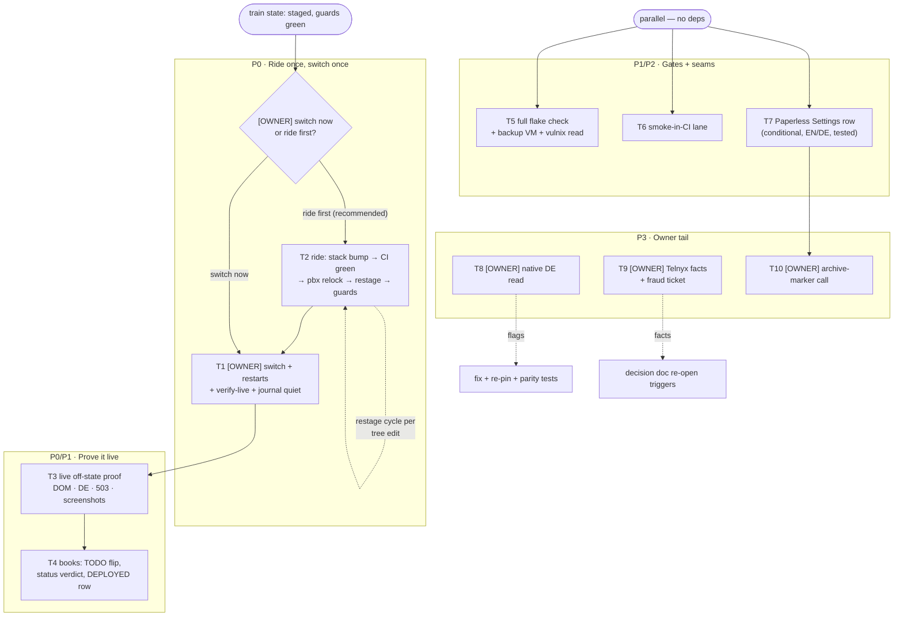

# SUPERB — Switch the truth, then close the seam gaps (plan)

**Created:** 2026-10-30 15:50 CET (date via CLI)
**Author:** Crush (the follow-through session that staged the deploy)
**Status:** PLAN — nothing here is shipped except where marked DONE.
**Position in the arc:** the fax-truth train (02:29 plan, executed
04:00–15:45) declared the lanes, closed every gate gap, recorded the
owner decisions and STAGED the deploy (pbx-artmann guards green at
`dw8zhd79…`, sheet at
`pbx-artmann/docs/runbooks/owner-switch-2026-10-30-fax-truth.md`).
This plan covers what remains: **the switch itself**, the live proof,
the ride for the commits that landed after staging, and the two seams
the audit filed.

**Companion docs:** status report §UPDATE
(`docs/status/2026-10-30_02-25_fax-capability-honesty.md`), decision
doc (`docs/planning/2026-10-30_04-15_fax-decision.md`), capability
audit (`docs/planning/2026-10-30_14-05_capability-seam-audit.md`),
owner switch sheet (pbx-artmann, above).

---

## 0. Ground truth you need before touching anything (verified 15:45 CET)

| Repo | HEAD | CI | Notes |
|---|---|---|---|
| webphone | `f6183562` (CHANGELOG tail fix) | green on every push today | 6 commits AHEAD of the stack's pin `b035e74e`: T29 always-on Settings row, T20 tests, T30 gateway-row rename |
| nix-international-telephony | `ad122b9` | flake check GREEN (run 41062742902) | pins webphone `b035e74e`; the `faxDid` eval assertion is scoped to trunk-hosts |
| pbx-artmann | `1245583` | pushed; local guard chain green | staged root `dw8zhd79…` FRESH; carries webphone `b035e74e` + the mail train `0fce4f0` |

**The one decision this plan asks up front (T1 vs T2 order):** the
staged root carries webphone `b035e74e`. Six commits later, webphone
main has the always-on Settings fax row and the "Message gateway"
rename — for the deployed host (both lanes OFF) the fax ROW text is
identical, but the RENAME is user-visible. **Recommendation: ride once
more before the switch (T2 → T1)** — one production restart, complete
UI truth — at the cost of ~60–90 min (stack CI + restage cycle). The
alternative (switch now, ride next train) is defensible if the PBX is
needed urgently; the sheet's legs do not change either way.

### Guardrails (same as ever)

- No verschlimmbessern: the staged state is GREEN — every tree edit in
  the ride re-runs the restage cycle; every markup change re-pins.
- No-ssh doctrine stands: the assistant never touches the PBX; the
  owner pastes the legs and reports verdicts.
- Owner decisions are marked `[OWNER]`.
- Push only after the phase's gates are green; re-check CI after every
  push; the auto-commit daemon races — stage + commit in ONE call.

---

## 1. Pareto analysis

### 1.1 The 1% that delivers ~51%

> **The owner runs the switch; the deployed PBX shows the truth.**

Everything already built is a claim until the switch happens. One
paste-chain — `nixos-rebuild switch` → restarts → `verify-live.sh` →
authenticated `GET /fax` contains `wp-fax-off`, not `wp-compose-fax` —
converts the whole train into user-visible honesty. **Single
measurable outcome:** live `/fax` DOM proof + a quiet journal
(no `unknown configuration keys` WARN — this binary reads every key
the stack emits).

### 1.2 The 4% that delivers ~64%

The 1% **plus** the gaps that could make it a lie:

1. **The ride (T2):** stack bump to webphone `f6183562`, pbx relock,
   restage — otherwise prod ships the renamed-row-less UI and the pin
   gap opens again silently.
2. **Live evidence (T3):** the old plan's T4 residuals — the 503
   outbound path probe, the DE-cookie rendering, screenshots — none of
   it is proven against the DEPLOYED host yet.
3. **Bookkeeping (T4):** TODO deployed-effect flip, status-report
   verdict, the pbx CHANGELOG DEPLOYED ledger row. An unrecorded
   switch is folklore.

### 1.3 The 20% that delivers ~80%

The 4% **plus** closing the two filed findings and the last gate:

- **Smoke-in-CI (T6):** the 6-scenario live smoke runs NOWHERE in CI —
  the single biggest untested surface left (filed TODO row).
- **Paperless capability surface (T7):** the audit's one real gap —
  the invisible seam. A conditional Settings row (+ DE).
- **Full `nix flake check` (T5):** the one webphone gate never run
  end-to-end this session (individual checks green; the KVM-gated
  backup VM suite inside it has not run).
- CHANGELOG hygiene (DONE pre-plan: the T30 line landed `f6183562`).

### 1.4 The remaining 20% (to 100%)

The owner-gated tail: native DE read, Mission-Control Telnyx facts
(DID/connection/outbound-fraud ticket), the per-fax archive-marker
shape call, and the unknown-key alarm's first real-fire drill (a
deliberate stale-pin boot in a VM — only if the next relock doesn't
exercise it naturally).

---

## 2. Coarse plan (30–100 min per task), sorted

Sort key: tier → customer value → impact → effort asc. `[OWNER]` =
needs the human; blocks its subtree.

| ID | Task | Tier | Impact | Cust | Min | Depends |
|----|------|------|--------|------|-----|---------|
| T1 | `[OWNER]` Switch: legs 2–4 from the deploy app (switch, restarts, verify-live) + §3 of the sheet | P0 | 5 | 5 | 45 | T2 (recommended) |
| T2 | The ride: stack bump webphone → `f6183562` (CHANGELOG attribution, CI green) → pbx relock → restage → baseline bullet | P0 | 5 | 4 | 90 | — |
| T3 | Live off-state proof: `/fax` DOM + `/settings` row + DE cookie render + `/fax/send` 503 probe + screenshots (old plan T4.1–4.5) | P0 | 4 | 5 | 40 | T1 |
| T4 | Bookkeeping: TODO deployed-effect flip, status-report switch verdict, pbx CHANGELOG DEPLOYED row | P1 | 4 | 3 | 30 | T3 |
| T5 | Full `nix flake check` (webphone) incl. KVM backup VM suite + read the vulnix verdict | P1 | 3 | 2 | 60 | — |
| T6 | Smoke-in-CI: add the job (webphone-smoke after the binary build), watch one green run | P2 | 4 | 2 | 60 | — |
| T7 | Paperless capability surface: conditional Settings row, i18n EN/DE, view test, CHANGELOG | P2 | 4 | 3 | 60 | — |
| T8 | `[OWNER]` Native DE read of the 16 new strings (flag → fix → re-pin) | P2 | 3 | 4 | 30 | — |
| T9 | `[OWNER]` Mission Control: which connection owns `+1727289311`, fax-DID options/prices, outbound-fraud ticket status | P3 | 3 | 3 | 40 | — |
| T10 | `[OWNER]` Paperless per-fax archive marker: build or decline (audit finding) | P3 | 2 | 2 | 30 | T7 |

---

## 3. Fine plan — every task ≤ 12 minutes

### P0 — The ride, then the switch

| # | Step | Min |
|---|------|-----|
| 2.1 | `cd nix-international-telephony && nix flake update webphone` → diff: ONLY the webphone node moved | 8 |
| 2.2 | CHANGELOG [Unreleased]: append the relock attribution row (old → new rev, delta story: T29/T20/T30, CI green on the target rev) | 12 |
| 2.3 | `nix eval --json .#nixosConfigurations.pbx-prod.config.services.webphone.settings.fax` → still `{"receive":false,"send":false}` | 3 |
| 2.4 | `nix build .#checks.x86_64-linux.telephony-eval` green | 10 |
| 2.5 | Commit (one call: add + commit, narrative message) + push | 5 |
| 2.6 | `gh run watch` the stack CI to green; STOP the phase if red | 12 |
| 2.7 | pbx-artmann: `nix run .#relock` (probe → update → re-probe → stage) | 12 |
| 2.8 | `nix eval` the REAL host's fax block again → `{"receive":false,"send":false}` | 3 |
| 2.9 | `nix build .#nixosConfigurations.pbx.config.system.build.toplevel -o /tmp/pbx-toplevel-root` (restage) | 12 |
| 2.10 | `nix run .#deploy` → ALL GUARDS GREEN; expect a docs-churn restage if the baseline bullet moved the tree — readlink is the truth | 12 |
| 2.11 | Commit the lock + baseline bullet (one call) + push | 8 |

| # | Step | Min |
|---|------|-----|
| 1.1 | `[OWNER]` Leg 2: `nixos-rebuild switch --flake .#pbx --target-host root@pbx.artmann.tech` | 12 |
| 1.2 | `[OWNER]` Leg 3: restart `telephony-secrets-perms webphone telephony-agent` | 5 |
| 1.3 | `[OWNER]` Leg 4: `./tests/installer/verify-live.sh` (expect the PASS battery) | 12 |
| 1.4 | `[OWNER]` Journal check: `journalctl -u webphone -n 40 | grep -i "unknown configuration"` → EMPTY (the pin-gap alarm's silence IS the success signal) | 5 |

### P0/P1 — Live proof + books

| # | Step | Min |
|---|------|-----|
| 3.1 | Authenticated `GET /fax`: `wp-fax-off` present, `wp-compose-fax` ABSENT; the notice names both missing lanes | 8 |
| 3.2 | `GET /settings`: Fax row = "not configured — nothing can be sent or received"; row copy "Message gateway" (proves the ride landed) | 5 |
| 3.3 | `wp-lang=de` cookie render: the DE notice reads idiomatically in situ | 8 |
| 3.4 | `POST /fax/send` without a lane (curl, CSRF dance): the honest 422/503 shape — no fake success | 10 |
| 3.5 | Session-less `GET /fax` → 401 (the notice never leaks anonymously) | 3 |
| 3.6 | Screenshot the live off-state panel (light) into the status report's evidence block | 6 |
| 4.1 | TODO_LIST §Fax enablement: the deployed-effect bullet flips INERT → LIVE with timestamp + verdict | 8 |
| 4.2 | Status report: append the switch verdict block (SHA, timestamp, probe outputs) | 12 |
| 4.3 | pbx CHANGELOG: the DEPLOYED ledger bullet (old → new closure paths, live-since) at the FILE TAIL | 10 |

### P1/P2 — Gates and seams

| # | Step | Min |
|---|------|-----|
| 5.1 | `nix flake check` (webphone) — full, KVM assumed free | 12 |
| 5.2 | If the backup VM suite is the long pole: run it alone (`nix build .#checks.x86_64-linux.webphone-backup`) and record | 12 |
| 5.3 | Read the vulnix verdict (`nix run .#vulnix` or buildflow's step); compare against the buildflow warning list | 10 |
| 5.4 | Record the three verdicts in the status report | 5 |
| 6.1 | Read `.github/workflows/ci.yml` job shapes; pick the insertion point (after `nix build .#webphone`) | 8 |
| 6.2 | Add the job: build binary → `python3 scripts/webphone-smoke.py --bin …` with the documented env; `continue-on-error: false` | 12 |
| 6.3 | Local dry-run of the exact CI command (the smoke is loopback-only; no PBX needed) | 10 |
| 6.4 | Commit + push + watch the FIRST green smoke-in-CI run | 12 |
| 6.5 | Strike the TODO row, note the runner cost in the row's place | 3 |
| 7.1 | `SettingsPanelProps`: add `Paperless bool` + wire `handlers.settingsProps` from `cfg.Paperless.Enabled()` (one conversion — the fax rule) | 10 |
| 7.2 | i18n: `settings.paperless` row copy EN+DE (missing-only pattern: "not configured — inbound faxes stay blob-store-only") | 10 |
| 7.3 | Render the row CONDITIONALLY (paperless on = no row, byte-parity for the zero-config panel) | 8 |
| 7.4 | View test: row absent when off, present with the copy when on (both languages) | 10 |
| 7.5 | CHANGELOG line + `nix fmt` + format-check + the views/server suites | 10 |
| 7.6 | Commit (one call) + push + CI watch | 8 |

### P3 — The owner tail

| # | Step | Min |
|---|------|-----|
| 8.1 | `[OWNER]` Read the 16 DE strings (list in the decision doc §DE review) | 12 |
| 8.2 | `[OWNER]` Flag wrongs; the next session fixes + re-pins + re-runs the i18n parity tests | 12 |
| 9.1 | `[OWNER]` Mission Control: record the owning connection for the voice DID | 12 |
| 9.2 | `[OWNER]` Record fax-DID options + prices; whether T.38 is offered on the FQDN connection | 12 |
| 9.3 | `[OWNER]` Check the outbound-fraud ticket (outbound 403s block any future fax send too) | 10 |
| 9.4 | Fold the facts into the decision doc's Telnyx section (re-open triggers stay live) | 8 |
| 10.1 | `[OWNER]` The archive-marker call: Settings row only (T7) vs per-fax marker (status-timeline entry) | 10 |
| 10.2 | If BUILD: file the marker task with the fax-timeline shape; if DECLINE: record the ruling in the audit doc | 10 |

---

## 4. Execution graph

**Reading the graph:** only the owner branches (switch now vs ride
first). T2's self-loop is the docs-churn restage cycle — expected,
bounded (two iterations observed this session; readlink is the
truth). T5–T7 are dependency-free and can run while stack CI cooks.

---

## 5. Definition of done

| Phase | Done means |
|---|---|
| P0 | Live `/fax` shows the notice, no form; journal is QUIET about config keys; `verify-live.sh` battery passes; the deployed binary reads every key the stack emits |
| P0/P1 | The evidence block (DOM bytes, DE render, 503 shape, screenshot) sits in the status report with timestamps; TODO + DEPLOYED ledger reflect LIVE |
| P1/P2 | `nix flake check` fully green (backup VM included); smoke runs in CI on every push and has one green run; the Paperless row exists, conditional, tested, EN/DE |
| P3 | DE flagged/fixed; Telnyx facts recorded in the decision doc; the archive-marker ruling written |

---

## 6. Traceability

| Source item | Plan task |
|---|---|
| Old plan T4.1–4.5 (live proof residuals) | T3 |
| Sheet §2–3 + deploy-app printed legs | T1 |
| webphone main ahead of the stack pin (6 commits) | T2 |
| Status report §UPDATE "deploy chain state" | T2, T1, T4 |
| TODO row "Live smoke in CI" | T6 |
| Audit finding "Paperless — INVISIBLE SEAM" | T7, T10 |
| Decision doc §DE review (native read owed) | T8 |
| Decision doc §Telnyx facts (unverified account state) | T9 |
| CHANGELOG T30 line | DONE pre-plan (`f6183562`) |
| Owner decisions 1–4 (2026-10-30) | closed; this plan executes their consequences |

---

## 7. Risks and baked-in mitigations

| Risk | Mitigation |
|---|---|
| The staged root rots while CI cooks (every tree move invalidates it) | The restage is mechanical and proven (three times today); readlink is the truth; the guard catches any miss |
| Riding again delays the switch | The alternative branch exists; the ride is ~90 min and lands the COMPLETE UI truth in ONE production restart |
| A docs append mid-ritual re-churns the closure | Bullets are written BEFORE the final restage; the baseline bullet carries the "readlink is the truth" clause up front |
| The unknown-key WARN never having fired for real | The journal quiet-check in T1.4 is the alarm's acceptance test; a VM drill is optional tail |
| Smoke-in-CI flakes on a loaded runner (the stack's lesson) | The smoke is loopback-only and self-booting; if it flakes, the job pins retry-once and the flake gets the fax-test treatment (wait, don't probe once) |
| Verschlimmbessern the Settings panel while adding Paperless | The row is ADDITIVE and conditional; the zero-config panel stays byte-identical (the same parity rule the fax row kept before owner decision 2) |

---

## 8. What this plan will NOT do

- Not ssh the PBX (no-ssh doctrine; the owner pastes, reports verdicts).
- Not re-open the fax enablement lane (owner decision 1: keep as-is;
  the re-open triggers live in the decision doc).
- Not build the per-fax archive marker without the owner's T10 call.
- Not grow a capability FRAMEWORK for other seams (T31's verdict:
  findings per seam; the second real consumer decides).
- Not touch the SIP island, session/CSRF lane, or the identity layer.
- Not absorb the mail train's story (that row belongs to its own
  session; this plan only names it in the shared closure).
