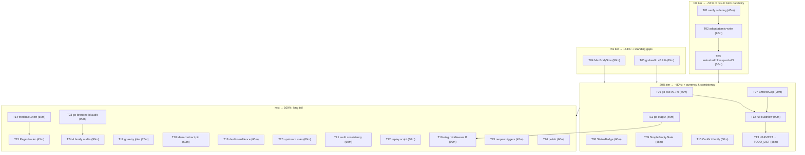

# SUPERB plan — fleet-libs audit closeout (Pareto-ranked)

**Created:** 2026-11-04 18:41 CET · **Provenance:** the 2026-11-04 fleet-libs utilization audit
(19 reports in `docs/review/libs/`, status snapshot `docs/status/2026-11-04_18-31_fleet-libs-audit-status.md`).
**Scope:** the audit's 50 open items ONLY. TODO_LIST.md was checked for overlaps first
(grep for maxbody / atomic-write / EnforceCap / StatusBadge / the three bumps / etag / retry /
Conflict: zero hits) — nothing here re-dispatches shipped or already-tracked work. The living
backlog's own trains (fax enablement, CRM tail, HITL, …) are a separate universe and are
deliberately NOT folded in.

**Guiding constraint:** do not verschlimmbessern. Every task below carries guards (§6) — a
well-intentioned "library adoption" that breaks a pinned contract, a reject-cap, or a
no-store fence is worse than the gap it closes.

---

## 1. Pareto breakdown

| Tier         | Result share | Tasks                                                                                                                                                                                           | Why this tier moves the needle                                                                                                                                                                                                                                                                                   |
| ------------ | ------------ | ----------------------------------------------------------------------------------------------------------------------------------------------------------------------------------------------- | ---------------------------------------------------------------------------------------------------------------------------------------------------------------------------------------------------------------------------------------------------------------------------------------------------------------- |
| **1%**       | **~51%**     | T01–T03 (blob durability train)                                                                                                                                                                 | The ONLY user-data-corruption-class gap found in 19 libraries: `blob.Save` writes attachments/fax PDFs with bare `os.WriteFile` — no fsync, no atomic rename. Fixing it removes the single way this product can silently destroy user data. Everything else in this plan is consistency, hygiene, or efficiency. |
| **4%**       | **~64%**     | + T04 (MaxBodySize), T05 (go-health v0.9.0)                                                                                                                                                     | MaxBodySize: the standing finding from the 2026-09-24 audit — 12 hand-rolled body caps vs the library's middleware; mechanical, closes an audit debt. go-health v0.9.0: `CoerceValidUTF8` closes a real breakage risk (probe JSON with non-UTF-8 driver bytes).                                                  |
| **20%**      | **~80%**     | + T06–T13 (go-sse bump, EnforceCap, StatusBadge, SimpleEmptyState, Conflict family, go-etag A, full-gate run, HARVEST)                                                                          | Version currency, engine-native caps replacing hand-rolled loops, the two cheapest visible templ wins, semantic honesty in the error taxonomy, the assets conditional-GET tidy-up, and the bookkeeping loops that make the audit stick.                                                                          |
| **rest 80%** | **→100%**    | T14–T26 (templ Alert/panelHead/forms, etag B, retry jitter, idem contract pin, dashboard fence, upstream asks, audit consistency, replay script, adjacent audits, reopen-trigger sweep, polish) | The long tail: each item real, none urgent; order by whichever train touches the file next.                                                                                                                                                                                                                      |

Minute shares (honest): the 1%-tier tasks are ~3h of the ~26h plan (~12% of effort) but carry
the majority of the risk reduction; tiers are ranked by RESULT, not by minute count.

## 2. Comprehensive plan (30–100 min tasks — ALL todos, 26 tasks)

Sort key: importance/impact first, effort and customer-value as tiebreakers. "Tier" = Pareto tier.

| #   | Task                                                                                          | Tier | Min | Impact   | Effort | Customer value          | Depends on      |
| --- | --------------------------------------------------------------------------------------------- | ---- | --- | -------- | ------ | ----------------------- | --------------- |
| T01 | Verify blob write ordering (file vs DB row) + `Save` signature claim                          | 1%   | 45  | High     | Low    | Data integrity          | —               |
| T02 | Adopt go-atomic-write: dep + `blob.Save` swap + CLI `WriteIfChanged` + tidy + vendorHash      | 1%   | 90  | High     | Med    | Data integrity          | T01             |
| T03 | Blob train verification: tests + smoke + buildflow + push + CI green                          | 1%   | 60  | High     | Med    | Trust                   | T02             |
| T04 | MaxBodySize consolidation: 12 `MaxBytesReader` sites → `httputil.MaxBodySize` + httpspec caps | 4%   | 90  | Med-High | Low    | Robustness              | —               |
| T05 | go-health v0.8.1→v0.9.0 + wire `CoerceValidUTF8` into probe JSON                              | 4%   | 60  | Med      | Low    | Correct /healthz        | —               |
| T06 | go-sse v0.6.2→v0.7.0 + ssetest breaking `WithLastEventID` fix                                 | 20%  | 75  | Med      | Low    | Currency                | —               |
| T07 | metaengine `EnforceCap` for transcripts + dial_windows trims; delete hand loops               | 20%  | 90  | Med      | Med    | Less code, engine-owned | —               |
| T08 | templ: FaxStatusBadge/OutboundStatusBadge/wp-status → `display.StatusBadge`                   | 20%  | 60  | Med      | Low    | Visual consistency      | —               |
| T09 | templ: 10 `wp-empty` paragraphs → `display.SimpleEmptyState`                                  | 20%  | 45  | Med      | Low    | Visual consistency      | —               |
| T10 | error-family: 409-shaped outcomes → Conflict family + family_tests + registry regen           | 20%  | 60  | Med      | Low    | Semantic honesty        | —               |
| T11 | go-etag v0.7.0: `entitytag` swap for assets.go `ifNoneMatch`                                  | 20%  | 45  | Low-Med  | Low    | Spec-exact 304s         | —               |
| T12 | Full buildflow over the audit HEAD (makes the done-bar gate claim TRUE)                       | 20%  | 90  | Med      | Low    | Audit credibility       | T02–T07 landed  |
| T13 | docs-health HARVEST: A-rank findings → TODO_LIST.md                                           | 20%  | 45  | Med      | Low    | Backlog integrity       | T12             |
| T14 | templ: error banner → `feedback.Alert` (first feedback import)                                | rest | 60  | Low-Med  | Low    | Consistency             | T08/T09 pattern |
| T15 | templ: panelHead → `display.PageHeader`                                                       | rest | 45  | Low      | Low    | Consistency             | T14             |
| T16 | go-etag B: `etag.New` middleware for `/openapi.json` + manifest, careful `Skip` set           | rest | 90  | Low-Med  | Med    | Conditional GETs        | T11             |
| T17 | go-retry: `ComputeDelay` jitter + `IsRetryable` gating in chatloop (or written decline)       | rest | 75  | Low-Med  | Med    | Calmer reconnects       | —               |
| T18 | go-idempotency: `contract.RunTests` pin over `DedupWindow` (test-only)                        | rest | 60  | Low      | Med    | Hardening               | —               |
| T19 | Dashboard fence decision: `WithMiddleware` vs written Caddy-fence contract                    | rest | 60  | Low-Med  | Low    | Defense-in-depth        | —               |
| T20 | Upstream asks (verify-before-filing): bounded AuditLog; go-sse/go-etag CHANGELOG drift        | rest | 60  | Low-Med  | Med    | Ecosystem               | —               |
| T21 | Audit consistency pass: scope note, movement columns, cwd prefixes, `--muted` check           | rest | 60  | Low      | Low    | Report accuracy         | —               |
| T22 | `scripts/audit-verify.sh` replay harness + AGENTS.md recipe                                   | rest | 60  | Low      | Low    | Repeatability           | —               |
| T23 | Adjacent audit: go-branded-id (open 68/100 finding from 09-24)                                | rest | 90  | Low      | Med    | Family completeness     | —               |
| T24 | Adjacent audits: go-flightrecorder, go-sqlitestore, go-datastar, go-paperless                 | rest | 90  | Low      | Med    | Family completeness     | T23 pattern     |
| T25 | NO-GO reopen-trigger sweep → written triggers in TODO_LIST/AGENTS                             | rest | 45  | Low      | Low    | Prevents re-litigation  | —               |
| T26 | Polish batch: index anchor, hero crop, 09-24 annotate, sampling pass, `Volume()` re-read      | rest | 60  | Low      | Low    | Report quality          | T21             |

Total ≈ 1,545 min ≈ 26 h.

## 3. Detailed breakdown (≤12 min micro-tasks — ALL todos, 138 steps)

| ID   | Step                                                                                               | Min | From | Tier |
| ---- | -------------------------------------------------------------------------------------------------- | --- | ---- | ---- |
| 1.1  | Read `internal/blob/store.go` fully (Save/Load/Open/ProbeWrite)                                    | 12  | T01  | 1%   |
| 1.2  | Trace `Save` callers (fax inbound, attachments) and their ordering vs DB persist                   | 12  | T01  | 1%   |
| 1.3  | Determine row-then-file vs file-then-row per path; name the real crash window                      | 12  | T01  | 1%   |
| 1.4  | Write verdict as errata into `go-atomic-write.md` + reword index finding                           | 12  | T01  | 1%   |
| 2.1  | Read go-atomic-write README + `Write`/`WriteIfChanged` signatures                                  | 12  | T02  | 1%   |
| 2.2  | `go get go-atomic-write@v0.6.2` + `go mod tidy` (immediately, per doctrine)                        | 12  | T02  | 1%   |
| 2.3  | Swap `blob.Save` to `atomicwrite.Write` (content in memory)                                        | 12  | T02  | 1%   |
| 2.4  | Swap `cmd/webphone/catalog.go` writers to `WriteIfChanged`                                         | 12  | T02  | 1%   |
| 2.5  | Swap `cmd/webphone/contracts.go` writer to `WriteIfChanged`                                        | 12  | T02  | 1%   |
| 2.6  | `go build ./... && go vet ./...`                                                                   | 12  | T02  | 1%   |
| 2.7  | vendorHash re-pin: `nix build .#webphone.goModules --rebuild` → apply `got:`                       | 12  | T02  | 1%   |
| 2.8  | Blob roundtrip test (Save→Load parity; no `.tmp` corpses left behind)                              | 12  | T02  | 1%   |
| 3.1  | `go test -count=1 ./internal/blob/... ./internal/fax/...`                                          | 12  | T03  | 1%   |
| 3.2  | Launch full buildflow (background)                                                                 | 12  | T03  | 1%   |
| 3.3  | Smoke: build `/tmp/webphone-bin` + `webphone-smoke.py`, grep verdict counts                        | 12  | T03  | 1%   |
| 3.4  | Stage+commit in ONE call (detailed message; not daemon-pattern)                                    | 12  | T03  | 1%   |
| 3.5  | Push + `gh run list` CI watch to green                                                             | 12  | T03  | 1%   |
| 4.1  | Read httputil `MaxBodySize` semantics (413 shape, streaming behavior)                              | 12  | T04  | 4%   |
| 4.2  | Inventory the 12 sites with their limits (upload 60M, transcribe 25M, passkey, hooks, api 4K JSON) | 12  | T04  | 4%   |
| 4.3  | Per-site mapping table: middleware vs keep + written ruling                                        | 12  | T04  | 4%   |
| 4.4  | Swap batch 1 (upload, transcribe)                                                                  | 12  | T04  | 4%   |
| 4.5  | Swap batch 2 (passkey ×2, hooks)                                                                   | 12  | T04  | 4%   |
| 4.6  | Swap batch 3 (api JSON guards) or write per-site rulings                                           | 12  | T04  | 4%   |
| 4.7  | httpspec body-cap spec + error-contract code check (413) + tests + commit                          | 12  | T04  | 4%   |
| 5.1  | `scripts/bump-preflight.sh go-health v0.8.1 v0.9.0`                                                | 12  | T05  | 4%   |
| 5.2  | `go get go-health@v0.9.0` + tidy; fix `InstanceID`/`StatusSince` breakage if surfaced              | 12  | T05  | 4%   |
| 5.3  | Wire `CoerceValidUTF8` into probe handler paths (livez/startupz/healthz responses)                 | 12  | T05  | 4%   |
| 5.4  | vendorHash re-pin + `go build ./...`                                                               | 12  | T05  | 4%   |
| 5.5  | healthz/readiness tests + commit + push + CI                                                       | 12  | T05  | 4%   |
| 6.1  | `scripts/bump-preflight.sh go-sse v0.6.2 v0.7.0`                                                   | 12  | T06  | 20%  |
| 6.2  | `go get go-sse@v0.7.0 go-sse/ssetest@latest` + tidy                                                | 12  | T06  | 20%  |
| 6.3  | Fix ssetest `WithLastEventID(sse.EventID)` compile breakage in sse tests                           | 12  | T06  | 20%  |
| 6.4  | `EventID` branding adjustments at any touched boundary                                             | 12  | T06  | 20%  |
| 6.5  | vendorHash re-pin                                                                                  | 12  | T06  | 20%  |
| 6.6  | SSE tests + notifier tests + commit + push + CI                                                    | 12  | T06  | 20%  |
| 7.1  | Read metaengine `cap.go` (EnforceCap/EnforceCaps + declaration option)                             | 12  | T07  | 20%  |
| 7.2  | Find the Query-decl cap option; confirm newest-rows semantics + bounded scan                       | 12  | T07  | 20%  |
| 7.3  | Declare cap on transcripts Query; delete `trimOwner`/`trimCall`                                    | 12  | T07  | 20%  |
| 7.4  | Declare cap on dial_windows Query; delete `trimWindows`                                            | 12  | T07  | 20%  |
| 7.5  | Update transcript tests (owner + per-call trim parity)                                             | 12  | T07  | 20%  |
| 7.6  | Update dial_windows tests                                                                          | 12  | T07  | 20%  |
| 7.7  | readmodels suite + commit + push                                                                   | 12  | T07  | 20%  |
| 8.1  | Read `display.StatusBadge` props (status→label/tone mapper)                                        | 12  | T08  | 20%  |
| 8.2  | Build fax/outbound status→label tables (en/de parity keys)                                         | 12  | T08  | 20%  |
| 8.3  | Swap FaxRow/FaxStatusBadge markup                                                                  | 12  | T08  | 20%  |
| 8.4  | Swap OutboundStatusBadge + messages `wp-status` spans                                              | 12  | T08  | 20%  |
| 8.5  | `build-tw-css.sh` + grep pin sites (smoke/E2E greps!) + panel tests + commit                       | 12  | T08  | 20%  |
| 9.1  | Read `SimpleEmptyState`; inventory the 10 `wp-empty` sites                                         | 12  | T09  | 20%  |
| 9.2  | Swap batch 1 (5 sites)                                                                             | 12  | T09  | 20%  |
| 9.3  | Swap batch 2 (5 sites)                                                                             | 12  | T09  | 20%  |
| 9.4  | tw.css rebuild + i18n parity + byte-pin greps + commit                                             | 12  | T09  | 20%  |
| 10.1 | Inventory true 409 writers (note_list_full, dial-gate, switch) — verify each is Conflict           | 12  | T10  | 20%  |
| 10.2 | Migrate `readmodels.note_list_full` to Conflict + family_test                                      | 12  | T10  | 20%  |
| 10.3 | Migrate remaining verified 409 outcomes                                                            | 12  | T10  | 20%  |
| 10.4 | Registry regen (`go test ./internal/arch -run TestErrorCodeRegistryIsFresh -update`) + review diff | 12  | T10  | 20%  |
| 10.5 | arch + server suites + commit                                                                      | 12  | T10  | 20%  |
| 11.1 | `scripts/bump-preflight.sh go-etag v0.6.1 v0.7.0`                                                  | 12  | T11  | 20%  |
| 11.2 | `go get go-etag/entitytag@v0.7.0` + tidy + vendorHash                                              | 12  | T11  | 20%  |
| 11.3 | Replace `ifNoneMatch` body with `ParseETagList`/`MatchesIfMatch`                                   | 12  | T11  | 20%  |
| 11.4 | Asset conditional tests (incl `*` and weak tags) + commit                                          | 12  | T11  | 20%  |
| 12.1 | Launch `buildflow` full at audit HEAD (background, no result cache)                                | 12  | T12  | 20%  |
| 12.2 | Read verdict; triage findings batch 1                                                              | 12  | T12  | 20%  |
| 12.3 | Triage/fix-forward batch 2 or record suppressions with reasons                                     | 12  | T12  | 20%  |
| 12.4 | Record the verdict in the status report errata (done-bar now TRUE)                                 | 12  | T12  | 20%  |
| 13.1 | Load docs-health HARVEST; map A-rank items → TODO_LIST format                                      | 12  | T13  | 20%  |
| 13.2 | TODO_LIST entries: blob train, MaxBodySize, go-health/go-sse bumps                                 | 12  | T13  | 20%  |
| 13.3 | TODO_LIST entries: EnforceCap, templ wins, Conflict family, etag A                                 | 12  | T13  | 20%  |
| 13.4 | Cross-link plan + status report from TODO_LIST rows                                                | 12  | T13  | 20%  |
| 14.1 | Read `feedback.Alert`/`InlineError` props                                                          | 12  | T14  | rest |
| 14.2 | Map errorBanner/ErrorPanel variants to Alert tone/props                                            | 12  | T14  | rest |
| 14.3 | Swap errorBanner markup                                                                            | 12  | T14  | rest |
| 14.4 | Swap panelError/seam-notice usages                                                                 | 12  | T14  | rest |
| 14.5 | tw rebuild + CSP-safe check (no inline style) + commit                                             | 12  | T14  | rest |
| 15.1 | Read `PageHeader`/`SectionHeading` props                                                           | 12  | T15  | rest |
| 15.2 | Pilot swap on ONE panel; compare rendered bytes                                                    | 12  | T15  | rest |
| 15.3 | Sweep remaining panels                                                                             | 12  | T15  | rest |
| 15.4 | tw rebuild + `panelHead` one-home test update + commit                                             | 12  | T15  | rest |
| 16.1 | Design the `Skip` set (never session/config/SSE surfaces)                                          | 12  | T16  | rest |
| 16.2 | Mount `etag.New` for `/openapi.json` route                                                         | 12  | T16  | rest |
| 16.3 | Mount for `/manifest.webmanifest` (serveEmbedded interaction)                                      | 12  | T16  | rest |
| 16.4 | Prove no-store surfaces untouched (test-pinned CSP/no-store suite)                                 | 12  | T16  | rest |
| 16.5 | httpspec 304/If-None-Match specs                                                                   | 12  | T16  | rest |
| 16.6 | Docs: error-contract/README note for the new conditional surface                                   | 12  | T16  | rest |
| 16.7 | Commit + push + CI                                                                                 | 12  | T16  | rest |
| 17.1 | Read `retry.ComputeDelay`/`WithJitter` API; write adopt-or-decline ruling FIRST                    | 12  | T17  | rest |
| 17.2 | If adopt: `go get go-retry@v0.9.0` + tidy (promote indirect→direct)                                | 12  | T17  | rest |
| 17.3 | Swap `NextBackoff` body to `ComputeDelay` (keep signature)                                         | 12  | T17  | rest |
| 17.4 | Gate reconnect loops on `errorfamily.IsRetryable` (Rejections stop loudly)                         | 12  | T17  | rest |
| 17.5 | chatloop tests (monotonic, capped, jitter bounds)                                                  | 12  | T17  | rest |
| 17.6 | vendorHash + matrix/signal loop tests + commit                                                     | 12  | T17  | rest |
| 18.1 | Read `contract.RunTests` harness API (13 invariants)                                               | 12  | T18  | rest |
| 18.2 | Write test-only `DedupWindow`→`go-idempotency.Store` adapter                                       | 12  | T18  | rest |
| 18.3 | Wire `contract.RunTests` into a readmodels/hooks test                                              | 12  | T18  | rest |
| 18.4 | Fix or document any invariant mismatches (check-first semantics!)                                  | 12  | T18  | rest |
| 18.5 | Commit (test-only; changelog-silent)                                                               | 12  | T18  | rest |
| 19.1 | Re-read dashboard mount + Caddy fence options in the stack module                                  | 12  | T19  | rest |
| 19.2 | Write the decision memo (WithMiddleware vs Caddy-contract)                                         | 12  | T19  | rest |
| 19.3 | Implement chosen path (middleware wrapper OR docs paragraph)                                       | 12  | T19  | rest |
| 19.4 | Tests (fenced/unfenced mounts)                                                                     | 12  | T19  | rest |
| 19.5 | Commit                                                                                             | 12  | T19  | rest |
| 20.1 | Load verify-before-filing + github-voice                                                           | 12  | T20  | rest |
| 20.2 | Verify AuditLog projection still memory-only at usermgmt HEAD                                      | 12  | T20  | rest |
| 20.3 | Draft + file the bounded-AuditLog upstream ask                                                     | 12  | T20  | rest |
| 20.4 | Verify go-sse/go-etag CHANGELOG-vs-tag drift; file changelog nudge(s)                              | 12  | T20  | rest |
| 20.5 | Link filed issues into plan errata + relevant lib reports                                          | 12  | T20  | rest |
| 21.1 | Add "adjacent family libs NOT audited" scope note to index.html                                    | 12  | T21  | rest |
| 21.2 | Add score-movement columns (vs 09-24) to the 6 reports with priors                                 | 12  | T21  | rest |
| 21.3 | Prefix all 19 verify blocks with their run directory                                               | 12  | T21  | rest |
| 21.4 | Check `--muted` token in the kit; fix caption CSS if falling back                                  | 12  | T21  | rest |
| 21.5 | Add rubric note + daemon-commit screenshot re-render to index                                      | 12  | T21  | rest |
| 22.1 | Write `scripts/audit-verify.sh` (extract console blocks, run from repo root, expect-check)         | 12  | T22  | rest |
| 22.2 | Selftest it against the current 19 reports (expect 66+ green)                                      | 12  | T22  | rest |
| 22.3 | AGENTS.md recipe line (audit-series verification)                                                  | 12  | T22  | rest |
| 22.4 | treefmt/format check + commit                                                                      | 12  | T22  | rest |
| 23.1 | Read the 09-24 branded-id section (68/100, "parse hand-rolled")                                    | 12  | T23  | rest |
| 23.2 | Re-verify "parse hand-rolled" against current domain/ids.go                                        | 12  | T23  | rest |
| 23.3 | Enumerate go-branded-id full surface (id.ID, MarshalText, BD-rules)                                | 12  | T23  | rest |
| 23.4 | Map webphone usage (6 brands + userauth ULID parse-at-door)                                        | 12  | T23  | rest |
| 23.5 | Gap analysis + score                                                                               | 12  | T23  | rest |
| 23.6 | Write `docs/review/libs/go-branded-id.md` + index row                                              | 12  | T23  | rest |
| 23.7 | Verify block + commit                                                                              | 12  | T23  | rest |
| 24.1 | go-flightrecorder report (surface vs trace.go seam usage)                                          | 12  | T24  | rest |
| 24.2 | go-sqlitestore report (store seam usage; is it still imported?)                                    | 12  | T24  | rest |
| 24.3 | go-datastar report (dashboard-only consumer?)                                                      | 12  | T24  | rest |
| 24.4 | go-paperless report (Archiver usage in fax seam)                                                   | 12  | T24  | rest |
| 24.5 | Index rows for all four                                                                            | 12  | T24  | rest |
| 24.6 | Verify blocks                                                                                      | 12  | T24  | rest |
| 24.7 | Commit                                                                                             | 12  | T24  | rest |
| 25.1 | Collect the written refresh/reopen triggers from the 5 NO-GO reports                               | 12  | T25  | rest |
| 25.2 | Add go-sse replay + server_timing spans triggers                                                   | 12  | T25  | rest |
| 25.3 | Write the consolidated trigger table into TODO_LIST (one section)                                  | 12  | T25  | rest |
| 25.4 | Cross-link from AGENTS.md fleet-libs line                                                          | 12  | T25  | rest |
| 26.1 | index.html sidebar anchor for the scorecard table                                                  | 12  | T26  | rest |
| 26.2 | Hero-crop screenshot variant for the research README row                                           | 12  | T26  | rest |
| 26.3 | Annotate the 09-24 fleet report (docs-health ANNOTATE: superseded-per-library)                     | 12  | T26  | rest |
| 26.4 | Sampling pass: 3 random 🟢 rows re-verified against source                                         | 12  | T26  | rest |
| 26.5 | metaengine `Volume(humanScaleVolume=1)` re-read; correct go-cqrs-lite.md if needed                 | 12  | T26  | rest |
| 26.6 | Commit + push                                                                                      | 12  | T26  | rest |

Micro total: 138 steps ≈ 1,656 min (overhead rounds included).

## 4. Execution graph

## 5. Verschlimmbessern guards (read before ANY train)

1. **Reject-caps stay app-side.** contacts (500) and call_reviews (2000) must NEVER adopt
   `EnforceCap` trim semantics — trimming silently evicts owner-authored content. Only
   transcripts + dial_windows (system facts, newest-window trim) may move.
2. **no-store fences are security properties.** The etag middleware (T16) must never see
   session/credential/config/SSE surfaces; the `Skip` set is test-pinned or the train does not ship.
3. **Greppable row classes are load-bearing.** Before any badge/class swap (T08/T09), grep the
   three pin sites (Go tests, `webphone-smoke.py`, stack `browser-e2e.py`) for the literal
   strings; keep `wp-fax-row`/`wp-thread-row`/`wp-bubble` byte-stable.
4. **CSS artifact ritual**: any templ utility-class change → `build-tw-css.sh` (TREEFMT_NO_CACHE
   is set inside); any app.css change → login.css rebuild too; `nix fmt` before gates; the
   authority is `nix build .#checks.x86_64-linux.format`.
5. **Dependency doctrine**: every `go get` → immediate `go mod tidy` → vendorHash re-pin
   (`nix build .#webphone.goModules --rebuild`) in the SAME train; bumps do NOT ride the daemon.
6. **New error codes** register in `docs/error-contract.md` in the same commit
   (`TestErrorCodeRegistryIsFresh -update`); auth-adjacent changes carry the `auth:` prefix and
   run the session-behavior suite.
7. **Served-markup changes** owe `TestServedPageHoldsTheDomContract` + the stack browser E2E
   (release-runbook obligation) — templ trains T08/T09/T14/T15 included.
8. **One render path**: master–detail Messages, container queries not @media inside tabs,
   morph-swap stability ids — badge swaps must not introduce new layout hooks.
9. **Commits**: stage+commit in ONE tool call (daemon race); never daemon-pattern messages on
   dependency trains; verify end states with `git ls-remote` + `gh run list`, not push logs.
10. **The reports are point-in-time.** Any train that lands a finding updates the per-lib
    report's score + the AGENTS.md outcome line in the SAME train (status §f item 50).

## 6. Errata / Step-0 verification notes

- Overlap grep against `TODO_LIST.md` + `CHANGELOG.md`: zero hits for all A-rank findings —
  nothing here re-dispatches shipped work. (CHANGELOG:1525 documents the original
  MaxBytesReader hand-roll — that IS the finding, not prior art.)
- go-sse "v0.7.0" and go-etag "v0.7.0" latests come from LOCAL tags (go-sse CHANGELOG still
  labels v0.7.0 "Unreleased"; go-etag has no 0.7.0 section) — T20 files the drift upstream;
  T19 of the status report re-checks the proxy before any bump.
