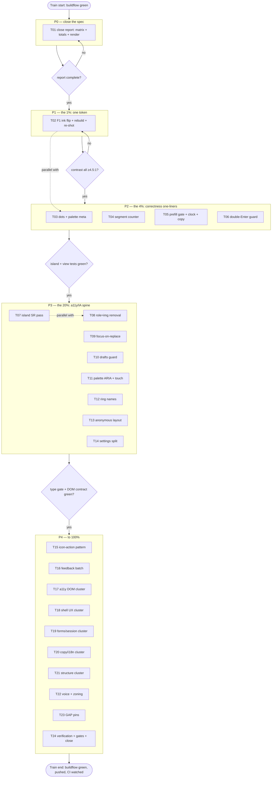

# SUPERB — Frontend UX fix train (Pareto plan)

> Created 2026-11-07 04:09. Executes the findings of
> [docs/review/2026-11-07_01-51_frontend-design-ux-review.html](../review/2026-11-07_01-51_frontend-design-ux-review.html)
> (20 carded findings + agent matrix + 8 flow GAPs, all discovered 2026-11-07
> against HEAD `a8d089ba` and fresh as of this plan — see the review's
> VERIFY marks; status trail:
> [docs/status/2026-11-07_02-09_frontend-design-ux-review-train.md](../status/2026-11-07_02-09_frontend-design-ux-review-train.md)
> and
> [docs/status/2026-11-07_04-05_frontend-ux-review-ia-roles-flows.md](../status/2026-11-07_04-05_frontend-ux-review-ia-roles-flows.md)).

## Context — what this train executes

A review-only pass produced: 1 WCAG-AA defect (dark-theme accent fills),
15 important findings, 5 polish cards, a ~46-item agent matrix, and 8 BDD
flow GAPs. Everything is specified with stable names; nothing here requires
new design decisions except the two owner calls already flagged (F1 ink
direction, F19 signed-out shape — this plan assumes the review's
recommendations: dark-ink flip; tabs removed when anonymous).

**Id space used throughout:**
- `R*` — report completion (matrix, totals, render check)
- `F1..F20` — the review's finding cards (one home: the report)
- `M1..M47` — matrix items (agent findings without their own card)
- `V*` — runtime verifications of hypothesis-flagged behavior

## Step 0 — errata (verify-open, freshness provenance)

- Every todo below was **discovered this session** from source reads, served
  bytes, pixel checks, or the live harness — no stale-backlog risk. CHANGELOG
  carries none of these fixes (nothing shipped yet).
- TODO_LIST.md carries none of them (verified 2026-11-07 04:07); a pointer
  subsection is added there citing this plan (the plan is the task
  inventory; TODO_LIST stays the living one-home via the next docs-health
  HARVEST).
- One item needs an owner decision before work: **F1 ink direction** (this
  plan assumes the review's recommendation) and **F19 signed-out shape**
  (assumes tabs removed). Both flagged at their tasks.

## Pareto breakdown

### The 1% that delivers 51% — ONE change

| id | task | why it is the 1% |
|----|------|------------------|
| **F1** | Flip dark-theme `--on-accent` to dark ink (`#0b0d11`) in BOTH mirrored token blocks (app.css + island/style.css), rebuild login.css, re-run contrast math, re-shot | One token value fixes the product's ONLY WCAG-AA failure on its five most-read surfaces (primary Call/Send buttons, every outbound bubble, failed bubbles) — 3.21:1 → 6.06:1 at rest, 1.87:1 → 10.42:1 on hover. A blind user, a sunlight reader, and a color-blind operator all stop being harmed by the same 2-line diff. |

### The 4% that delivers 64% — + the correctness one-liner batch

Adds: **F4** (settings dot, 1 line), **F2** (theme-color/manifest onto real
palette, 2 files one fact), **F13** (SMS counter counts UTF-16 units — the
counter stops lying on emoji), **F9a/F9c** (`#dial-error` becomes a live
region; the malformed ring announce fixed), **F6** (Prefill button gated on
its seam), **F5** (English clocks unified), **M19** ("Last call now ago"
broken copy), **M47** (double-Enter double-send guard). Eight small diffs,
each independently shippable, each a user-visible correctness win.

### The 20% that delivers 80% — + the accessibility/IA spine

Adds: **F8** (island focus-on-replace — keyboard users keep their place),
**F7** (ring shows caller names), **F9 rest** (reg-status live region
removed, island labels localized), **F10** (role="img" removal — 4 row
surfaces become readable to screen readers), **F11** (drafts poll can't eat
an edit), **F12** (palette: combobox ARIA + touch entry), **F19/F20** (the
two IA corrections), **R1–R3** (report closed and rendered-verified). This
is the spine: every screen-reader and keyboard user can actually operate
the app.

### The remaining 20% — to 100%

Polish cards (F14 chip-X, F15 empty state, F16 type-scale, F17
radius/spacing tokens, F18 uppercase zoning), the full agent matrix M1–M47
minus the ones already promoted, the 8 GAP flow scenarios converted into
pinned tests, and the runtime verification sweep (V1–V5). Consistency debt
that compounds quietly but never burns.

## Comprehensive plan (30–100 min tasks, ALL todos, sorted P0→P3)

Sort key: P0 = defect/AA + correctness (customer harm today), P1 = the
accessibility/IA spine (operability), P2 = consistency/polish, P3 = tests +
verification. "Cov" lists every todo id the task completes.

| # | Pri | Task (30–100 min) | Cov | Effort | Customer value |
|---|-----|-------------------|-----|--------|----------------|
| T01 | P0 | Close the review: appendix matrix from original agent reports, scorecard totals, browser-render check | R1 R2 R3 | 60m | The spec the whole train executes against is complete |
| T02 | P0 | **F1 ink flip**: both token blocks + `tokens_test.go` check + `scripts/build-tw-css.sh` (login.css inlines app.css) + contrast re-measure + re-shot | F1 | 100m | Every primary surface legible in dark theme; AA failure gone |
| T03 | P0 | One-liner batch A: F4 settings off-dot + F2 theme-color/manifest palette sync (+ M39 applyTheme meta sync) | F4 F2 M39 | 45m | Browser chrome matches the app; no dot-less service row |
| T04 | P0 | F13 segment counter UTF-16 units + counter unit test | F13 | 60m | "N SMS" stops under-counting emoji texts |
| T05 | P0 | Correctness batch: F6 prefill seam gate + F5 Kitchen clock + M19 just-now copy | F6 F5 M19 | 60m | No button promising what the server can't do; one clock; sane deny copy |
| T06 | P0 | M47 double-Enter guard (`hx-sync` or keydown) + stuck-bubble cleanup | M47 | 45m | No duplicate SMS; no bubble stuck at "sending" |
| T07 | P1 | F9 island SR pass: `#dial-error` role=status, drop `#reg-status` live region, fix ring announce argument, localize island aria-labels | F9 | 90m | Dial failures and labels exist for screen readers; German hears German |
| T08 | P1 | F10 role="img" removal on 4 row surfaces + view-test updates | F10 | 60m | Fax/history/admin rows readable by screen readers |
| T09 | P1 | F8 island focus-on-replace helper + 5 call sites + new pin | F8 | 100m | Keyboard users never dumped to page top mid-call |
| T10 | P1 | F11 drafts-poll skip-if-dirty guard + loss-scenario pin | F11 V4 | 60m | No silent loss of a half-typed reply |
| T11 | P1 | F12 palette: combobox ARIA + coarse-pointer button + badge-digit labels (M30) + Home/End + starts-with ranking (M41) | F12 M30 M41 | 100m | The flagship keyboard surface works for everyone |
| T12 | P1 | F7 ring caller-name resolution (shared contact lookup) + announce name | F7 | 90m | "Marta is calling" instead of "+4416…"; the ring answers "who" |
| T13 | P1 | F19 signed-out focused layout (nav conditional; OWNER-SHAPE CALL) | F19 | 90m | First impression is a door, not a floor plan |
| T14 | P1 | F20 Settings split: My preferences / My data / This server (+ i18n keys) | F20 | 90m | Users can tell what they can act on |
| T15 | P2 | F3 icon-action pattern: visible labels or confirm for thread-head trio + History row actions | F3 | 90m | No more one-tap archive accidents |
| T16 | P2 | Feedback batch: F14 chip-X 24px hit area + M25 toast dismissal affordance + M42 toast eviction focus guard | F14 M25 M42 | 60m | Touch users stop mis-tapping; focus never drops |
| T17 | P2 | M-cluster a11y DOM: M2 h1, M3 tabindex on panel h2, M27 skip-link target tabindex, M4 list semantics, M8 describedby/keypad names, M7 drafts badge label, M36 transcript aria-live, M35 lightbox focus return | M2 M3 M27 M4 M8 M7 M36 M35 | 90m | The screen-reader layer of the tabs becomes navigable |
| T18 | P2 | M-cluster shell UX: M26 tab-error slot above main + clear-on-success, M28 skeleton min-delay/counter, M29 draft-save race, M31 re-expand announce/sync, M32 palette re-expand, M38 missed-badge clear-on-success, M34 help [ / ], M33 overlay native dialog, M37 live-context reset/race, M43 SSE scroll-jump fix, M44 dir-select label | M26 M28 M29 M31 M32 M38 M34 M33 M37 M43 M44 | 100m | The shell stops lying about state in nine small ways |
| T19 | P2 | M-cluster forms & session: M5 maxlength, M6 htmx-indicator, M9 contacts disabled-elt, M10 panel label keys, M15 login in-flight, M21 logout confirm, M17 beforeunload, M18 in-call title, M46 native-validation routing, M24 transfer row errors | M5 M6 M9 M10 M15 M21 M17 M18 M46 M24 | 100m | Forms guide instead of punish; sessions protect live calls |
| T20 | P3 | M-cluster copy/i18n: M11 emoji→icons swap, M12 German rewords, M13 vocabulary drift, M14 compose-to inputmode decision, M16 429 toast key, M45 DTMF SR surface | M11 M12 M13 M14 M16 M45 | 90m | One voice, both languages, no platform emoji |
| T21 | P3 | M-cluster structure: M1 admin filter + read-only badge, M40 manifest raster "any", F16 type-scale tokens, F17 radius/spacing tokens, M22 mute/hold announces, M23 htmx.ajax catch | M1 M40 F16 F17 M22 M23 | 100m | Consistency debt paid in one sitting |
| T22 | P3 | F15 History empty-state voice + F18 uppercase zoning + reconnect-pill copy | F15 F18 | 45m | Empty states teach; the chrome calms down |
| T23 | P3 | GAP pins: convert the 8 [GAP] flow scenarios into behavioral pins (most pin the fixes above) | flow GAPs | 100m | Every finding becomes a regression-proof scenario |
| T24 | P3 | Runtime verification sweep V1–V5 (tab-error retarget scroll, double-Enter runtime, overlay containment, drafts-loss window, live-context race) + full gates + status-index + final re-shot | V1–V5 | 90m | No hypothesis ships as fact; the train closes verified |

## Micro breakdown (≤12 min each, ALL todos, sorted)

Rank follows the comprehensive order; `min` is the estimate. "done-when" is
the verifiable end state.

| # | Pri | Micro task | T | min | done-when |
|---|-----|------------|---|-----|-----------|
| 1 | P0 | Re-request nothing; write matrix from originals (M1–M47 rows) | T01 | 45 | matrix section exists, every agent finding a row |
| 2 | P0 | Scorecard total = 20 cards + matrix rows; drop "pending" | T01 | 5 | number matches rows |
| 3 | P0 | Open report in browser; check anchors + scrollspy | T01 | 10 | all 9 sections jump; no layout break |
| 4 | P0 | Read `tokens_test.go` + grep token pins | T02 | 10 | know every assertion the flip must keep green |
| 5 | P0 | Flip dark `--on-accent` in app.css `:root, :root[data-theme=dark]` | T02 | 5 | token = dark ink |
| 6 | P0 | Flip island/style.css `:root` mirror | T02 | 5 | tokens mirrored |
| 7 | P0 | Run `scripts/build-tw-css.sh` (login.css inlines app.css) | T02 | 10 | login.css bytes updated; treefmt clean |
| 8 | P0 | Re-run contrast script on the 5 filled surfaces | T02 | 5 | all ≥4.5:1 |
| 9 | P0 | Update review F1 card: add before/after numbers | T02 | 10 | card carries the fix evidence |
| 10 | P0 | Re-shot ui-capture; view dark thread + settings | T02 | 15 | screenshots show dark-ink bubbles/buttons |
| 11 | P0 | Add `wp-service-off` KV to `crmDetail` | T03 | 5 | all four CRM states carry a dot |
| 12 | P0 | Point layout.templ ThemeColor/DarkThemeColor at palette | T03 | 10 | meta colors = token values |
| 13 | P0 | Manifest theme_color/background_color sync | T03 | 5 | manifest = same values |
| 14 | P0 | `applyTheme` updates a media-less meta theme-color | T03 | 15 | forced theme recolors browser chrome |
| 15 | P0 | Templ regen after settings/layout edits | T03 | 5 | `*_templ.go` regenerated, compiles |
| 16 | P0 | Rewrite `ucs2Segments` to UTF-16 unit counting | T04 | 15 | astral chars cost 2 units |
| 17 | P0 | Add/extend counter unit test (emoji case) | T04 | 15 | test pins 70 emoji = 2 segments |
| 18 | P0 | Gate "Prefill from AI draft" behind the review-seam prop | T05 | 20 | button absent when seam off |
| 19 | P0 | `formatWhen` English → Kitchen time | T05 | 10 | History rows say 12h like bubbles |
| 20 | P0 | `agoLabel`/`cooldownNotice` "just now" branch en+de | T05 | 15 | deny line reads clean in both |
| 21 | P0 | Add `hx-sync="this:drop"` to composer forms (or keydown guard) | T06 | 15 | double-Enter sends once |
| 22 | P0 | Clear stuck `.wp-status-queued` on afterRequest failure | T06 | 15 | failed double-submit leaves one honest bubble |
| 23 | P1 | `role="status"` on `#dial-error` | T07 | 5 | dial failures announced |
| 24 | P1 | Remove aria-live from `#reg-status` | T07 | 5 | pill stops chattering |
| 25 | P1 | Fix ring announce argument (correct i18n call) | T07 | 10 | no malformed announce |
| 26 | P1 | `data-i18n-arialabel` support in `applyI18n` | T07 | 20 | island labels localize |
| 27 | P1 | Convert `#dest`/`#audio-output`/`#lang` labels to the mechanism | T07 | 15 | German SR hears German |
| 28 | P1 | Remove `role="img"` in fax.templ rows | T08 | 10 | content readable, chip carries the label |
| 29 | P1 | Remove `role="img"` in history.templ CDR rows | T08 | 10 | same |
| 30 | P1 | Remove `role="img"` in admin.templ rows (2 sites) | T08 | 10 | same |
| 31 | P1 | Run view tests; fix any assertions on the old labels | T08 | 15 | views tests green |
| 32 | P1 | Write `focusAfterReplace(node, fallback)` helper | T09 | 20 | helper exists + typed |
| 33 | P1 | Wire into `hideIncomingBanner` | T09 | 10 | answer keeps focus |
| 34 | P1 | Wire into `morphToEndedCard` | T09 | 10 | hangup keeps focus |
| 35 | P1 | Wire into `saveCallNote` + `confirmDisposition` | T09 | 15 | saves keep focus |
| 36 | P1 | Wire into `renderIncomingSlots` | T09 | 10 | queue rebuild keeps focus |
| 37 | P1 | Pin the focus flow in island-tests | T09 | 25 | new spec fails without helper |
| 38 | P1 | Capture thread id at input handler (draft race) | T10 | 15 | closure carries id |
| 39 | P1 | Skip poll swap while composer differs from last save | T10 | 25 | typing survives the 30s poll |
| 40 | P1 | Pin the dirty-composer scenario | T10 | 20 | new spec fails without guard |
| 41 | P1 | Add combobox roles to palette input + list | T11 | 25 | roles + expanded + controls present |
| 42 | P1 | `aria-activedescendant` sync in select/render | T11 | 20 | SR tracks selection |
| 43 | P1 | Header palette button (coarse pointers) | T11 | 20 | palette reachable without keyboard |
| 44 | P1 | Palette labels from the text span (M30) | T11 | 10 | no "Messages4" |
| 45 | P1 | Home/End keys + starts-with ranking | T11 | 20 | ends jump; prefix matches first |
| 46 | P1 | Shared contact-name lookup export (typeahead seam) | T12 | 25 | one resolver, reused |
| 47 | P1 | Render name on incoming banner + slots | T12 | 20 | banner shows "Name (digits)" |
| 48 | P1 | Announce the name in the assertive path | T12 | 10 | ring speaks the name |
| 49 | P1 | Missed-call toast + dock chips use the resolver | T12 | 20 | missed names resolved too |
| 50 | P1 | Conditional nav markup for anonymous (F19; owner shape) | T13 | 30 | no dead tabs when signed out |
| 51 | P1 | Center welcome + login stack in the signed-out column | T13 | 20 | door layout |
| 52 | P1 | Update DOM contract doc + `TestServedPageHoldsTheDomContract` | T13 | 20 | contract reflects conditional nav |
| 53 | P1 | Grep the three pin sites for nav markup literals | T13 | 15 | smoke/E2E updated or unaffected |
| 54 | P1 | Settings: wrap rows in three sub-sections (i18n heads) | T14 | 30 | My prefs / My data / This server |
| 55 | P1 | "This server" collapses by default (details) | T14 | 15 | operator voice folded away |
| 56 | P1 | Both dictionaries get the new keys | T14 | 15 | parity tests green |
| 57 | P2 | Thread-head trio: visible labels (or confirm on archive) | T15 | 40 | misfire-safe head |
| 58 | P2 | History row actions: labels + danger tint on delete | T15 | 30 | same, rows |
| 59 | P2 | Chip-X 24px hit expander | T16 | 15 | hit ≥24px, glyph unchanged |
| 60 | P2 | Toast close glyph + aria-label | T16 | 20 | dismissible visibly |
| 61 | P2 | Toast eviction skips focused toast | T16 | 20 | focus never drops to body |
| 62 | P2 | `h1` = brand (styled as today) | T17 | 10 | one page title |
| 63 | P2 | `tabindex="-1"` on panel-head h2 + skip target | T17 | 15 | post-swap focus has a home |
| 64 | P2 | ul/li for rail rows | T17 | 20 | list semantics announced |
| 65 | P2 | describedby onto inputs + Star/Hash aria-labels | T17 | 20 | errors associated; keys named |
| 66 | P2 | Drafts badge count-phrase label | T17 | 10 | no doubled heading |
| 67 | P2 | aria-live on the two transcript containers | T17 | 10 | transcriptions announced |
| 68 | P2 | Lightbox `close` listener refocuses opener | T17 | 15 | keyboard returns |
| 69 | P2 | Move `#wp-tab-error` above main + clear on success | T18 | 25 | banner visible where the eye is |
| 70 | P2 | Skeleton min-delay + in-flight counter | T18 | 25 | no flash; overlap safe |
| 71 | P2 | Re-expand announce + aria-expanded sync on live call | T18 | 20 | toggle tells the truth |
| 72 | P2 | Palette "Call a number" re-expands collapsed island | T18 | 10 | action never silently dead |
| 73 | P2 | Missed badge clears on successful swap only | T18 | 15 | failed nav keeps the badge |
| 74 | P2 | HELP_ITEMS gains `[` / `]` | T18 | 5 | help is complete |
| 75 | P2 | Palette → native `<dialog>` (or trap+scroll-lock) | T18 | 30 | ESC/backdrop/focus native |
| 76 | P2 | live-context error reset + remote-stamped race guard | T18 | 25 | stale caller context impossible |
| 77 | P2 | Drop `show:window:top` from SSE swaps (voicemail/contacts) | T18 | 10 | no scroll yank on push |
| 78 | P2 | `history.dir.label` key + wiring | T18 | 10 | direction select named |
| 79 | P2 | maxlength attrs per server caps (composer/contacts/snippets) | T19 | 25 | limits visible pre-submit |
| 80 | P2 | htmx-indicator on remaining submits | T19 | 20 | every click answers |
| 81 | P2 | contacts forms `hx-disabled-elt` | T19 | 10 | no double import |
| 82 | P2 | panel label keys (jump-latest, Attachments) both dicts | T19 | 15 | no hardcoded EN labels |
| 83 | P2 | Login in-flight guard + connecting pill | T19 | 20 | no double POST; feedback while signing in |
| 84 | P2 | Logout confirm when sessions live (second-click) | T19 | 20 | misclick never kills a call |
| 85 | P2 | `beforeunload` guard on live calls | T19 | 15 | tab close warns |
| 86 | P2 | In-call `document.title` from the render tick | T19 | 15 | "● in call · mm:ss" in other tabs |
| 87 | P2 | Dial form `novalidate` + route empty through `dialEmpty` | T19 | 15 | error bubble in UI language |
| 88 | P2 | Transfer: empty-dest announce + Escape closes row | T19 | 15 | no silent no-op |
| 89 | P3 | Emoji glyphs → icons package (7 sites) | T20 | 30 | one icon system |
| 90 | P3 | Strip ✖ out of `history.missed` key into markup | T20 | 10 | dictionaries carry no glyphs |
| 91 | P3 | German rewords (4 keys) + singular branch | T20 | 25 | natural German |
| 92 | P3 | Mailbox/„transcript lines" vocabulary fixes | T20 | 15 | one name per thing |
| 93 | P3 | compose-to inputmode: document or set | T20 | 10 | mobile keyboard deliberate |
| 94 | P3 | `noteThrottled` i18n key en+de | T20 | 10 | 429 speaks the UI language |
| 95 | P3 | `role="status"` on the tones trail (+ digit shortcuts opt) | T20 | 15 | DTMF confirmed by SR |
| 96 | P3 | Admin: `q` filter + `hx-push-url` + read-only badge | T21 | 40 | admin can find things |
| 97 | P3 | Manifest PNGs duplicated with purpose "any" | T21 | 10 | launchers get raster icons |
| 98 | P3 | Type-scale tokens (3 steps) + migrate hot sites | T21 | 30 | secondary scale is 3 values |
| 99 | P3 | Radius/spacing tokens; fold 8px outliers | T21 | 30 | no magic geometry |
| 100 | P3 | Mute/hold/resume settled announces | T21 | 20 | SR hears state changes |
| 101 | P3 | `.catch` + `tabRefreshFailed` on bare htmx.ajax | T21 | 15 | language switch can't half-apply |
| 102 | P3 | History empty state three-beat reword | T22 | 15 | teaches like Voicemail |
| 103 | P3 | Uppercase zoning: day divider + reconnect pill copy | T22 | 20 | calm chrome |
| 104 | P3 | Pin: ring names resolved | T23 | 15 | scenario pinned |
| 105 | P3 | Pin: focus survives transitions | T23 | 15 | (shares #37) |
| 106 | P3 | Pin: drafts poll dirty guard | T23 | 15 | (shares #40) |
| 107 | P3 | Pin: palette combobox states | T23 | 20 | scenario pinned |
| 108 | P3 | Pin: tab-error visible placement | T23 | 20 | scenario pinned |
| 109 | P3 | Pin: logout/beforeunload guards | T23 | 20 | scenarios pinned |
| 110 | P3 | Pin: prefill gating | T23 | 15 | scenario pinned |
| 111 | P3 | Runtime: tab-error retarget scroll behavior observed | T24 | 15 | V1 resolved |
| 112 | P3 | Runtime: double-Enter repro + guard proof | T24 | 15 | V2 resolved |
| 113 | P3 | Runtime: overlay containment walk | T24 | 10 | V3 resolved |
| 114 | P3 | Runtime: drafts-loss window repro | T24 | 10 | V4 resolved |
| 115 | P3 | Runtime: live-context race repro | T24 | 10 | V5 resolved |
| 116 | P3 | `nix fmt` + island gates (tsc/oxlint/tests) | T24 | 20 | all green |
| 117 | P3 | buildflow (train start AND end) | T24 | 15 | green run |
| 118 | P3 | status-index regen + docs-gates | T24 | 15 | indexed, ratchets held |
| 119 | P3 | Final commit + push + CI watch (`gh run list`) | T24 | 15 | main green on remote |

## Execution graph

## Gates & safety contracts (anti-verschlimmbessern)

1. **Token/CSS edits** (T02, F16/F17): `app.css` is INLINED by `login.css` —
   every app.css edit runs `scripts/build-tw-css.sh`; check
   `tokens_test.go` before and after (mirror rule between app.css and
   island/style.css is asserted somewhere — know where before flipping).
2. **Templ edits** (T03, T08, T13, T14, T17…): regenerate with the PINNED
   CLI matching go.mod (never the devshell templ); i18n keys go into BOTH
   dictionaries (parity + unused-key tests enforce).
3. **Served-markup changes** (T13 especially): grep the three pin sites
   FIRST — Go tests, `scripts/webphone-smoke.py`, the stack's
   `tests/browser-e2e.py`; the DOM contract test must stay green; island
   modules stay inside main.js's import closure.
4. **CSP**: no inline style/script, ever — hit areas and glyphs ride
   classes/SVG strings; bars stay `<meter>`.
5. **JS gates**: island type gate (`tsc -p . --noEmit`) is the only
   authority; oxlint island rules; `nix run nixpkgs#nodejs -- --test …`
   island specs; shell.js is served verbatim (no bundling).
6. **State changes** ride the machine tables (`state.js` CALL_TRANSITIONS,
   server `deliveryMoves`/`faxMoves`) — never branch-by-branch.
7. **Commit ritual**: `nix fmt` → stage+commit in ONE call (the daemon
   races split calls) → whitespace-drift gate passes → push → watch CI
   (`gh run list`) to green; dependency bumps stay out of daemon commits
   (hook enforces).
8. **buildflow at train start AND end**; version claims stay out until the
   release ritual (no "fixed in x.y" copy for unreleased code).
9. Each comprehensive task ends with its own targeted tests BEFORE the next
   begins (the micro "done-when" column is the acceptance check).

## Git ritual for this plan

Sweep the pending tree (review report IA chapters, status INDEX, two status
reports) + this plan into ONE detailed commit, push, verify remote + CI.
