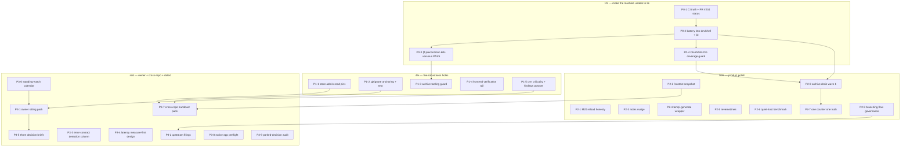

# SUPERB — post-v9 execution plan: from "all gates green" to "nothing can rot silently" (2026-11-07 18:46)

> **Status: PLAN (awaiting execution-mode approval).** Owner tasks are marked
> **OWNER**; everything else is assistant-executable in this checkout.
> **Inputs verified at** HEAD `9beabb1c` (2026-11-07 18:46): `origin/main` == HEAD
> (push DONE), CI run `9beabb1c` in flight, `docs-gates` wired NOWHERE
> (`grep -c docs-gates .github/workflows/ci.yml nix/devshell.nix` → 0), store
> coverage 64.8 % (`go test -cover ./internal/store/`), PR #234 OPEN + UNKNOWN
> mergeability, `docs-gates` matrix green at its pins (annotate 205, audit 333,
> cadence 70/45 d) from the v9 sweep 18:32 today.
> **Deduplication rule:** this plan does NOT restate each TODO row's evidence —
> it cites the TODO section, which is the ONE home. The plan owns ordering,
> sizing and gates.

---

## 0. Why this plan exists (and what changed under it)

Three sessions in two days shipped a large amount of documentation machinery
(v8 sweep: battery adopted, 68 reports archived; v9 sweep: the four executed
September plans drained, cadence green; the frontend-UX fix-train: 24
comprehensive tasks executed) and one real feature train (metaengine per-group
caps #114 + catalog v4.13). The corpus is now **clean enough to trust**, which
changes the frontier: the remaining work is no longer "fix the docs" or "close
the issue list" — it is **(a) make the alarms impossible to ignore, (b) close
the small number of real robustness holes, (c) hand the owner a sitting that
unblocks ~40 parked items, and (d) drain the archive residue with a proven
recipe.**

What this plan deliberately does NOT do: re-open any ruling with a written
reopen-trigger (TODO § Fleet-libs reopen-trigger registry), re-archive anything
the v9 sweep settled, or touch the DECLINED island-type-gate list.

## 1. Pareto analysis

### The 1 % that delivers 51 % — make the machine unable to lie

Four tasks, ~5 h total. Everything else in this document assumes a signal that
means something; right now **three of the repo's own alarms can pass while the
thing they police is broken**, and each was observed failing that way this week:

| What               | How it lied (observed)                                                                                     |
| ------------------ | ---------------------------------------------------------------------------------------------------------- |
| Freshness gate     | PASSED on the 2026-11-06 report because it had **no §f at all** — "nothing to check" (v8 finding)          |
| CHANGELOG bar      | the #114 cap train landed **with no `[Unreleased]` line**, nothing red (v8 finding)                        |
| The battery itself | never runs in CI; a local habit that a session can skip entirely (0 references in `ci.yml`/`devshell.nix`) |

Closing these is the highest-leverage work available because every later task
in this plan is verified BY these signals.

### The 4 % that delivers 64 % — the five robustness holes with real blast radius

| Hole                                                                                        | Why it is in the 4 %                                                                                                         |
| ------------------------------------------------------------------------------------------- | ---------------------------------------------------------------------------------------------------------------------------- |
| `internal/store` at 64.8 % (below the 75.3 % its 2026-09-20 owner-scoping suite reached)    | a store regression **leaks another extension's data**; the admin read seams and thread-flag columns are the untested surface |
| `.gitignore` name-based rules (`result`, `vendor/`, `dist/`, `build/`, `venv/`, `htmlcov/`) | silently swallowed a whole Go package once already; the sandbox build is the only alarm                                      |
| `/healthz` `crm` leg is critical while the library treats crm as non-critical               | one CRM outage reds readiness; the decision is cheap, the surprise is not                                                    |
| `buildflow` cannot exit 0 (50 pre-existing tier-3 findings)                                 | trains readers to ignore its exit code — the retired-baseline failure mode, one layer up                                     |
| archive tooling can mangle silently (escaped pipes; unshape-validated verdict text)         | every future sweep inherits the defect; the fix is a fixture + a guard                                                       |

### The 20 % that delivers 80 % — product polish with real user cost

Honest-UI and consistency work the frontend-UX train left behind: voicemail
reload failure copy (M20), the palette button's missing `aria-expanded`, admin
copy wrapping in German, the Settings three-audience pin (F20), the
`/context` contract snapshot, the History notes nudge, `templ-generate.sh`,
`reverseLines`, and the quiet-host benchmark re-run that two bump trains owe.

### The other 20 % to reach 100 % — owner-gated, cross-repo, and dated

The owner sitting (unblocks ~40 items), cross-repo handover packs (stack
`crm.caFile`, ring hook, `mod_enum`, #9 steps), standing watches (erraudit
2026-11-29, quarterly 2026-12-20, credentials 2026-12-30, modularize ~2027-01),
and the archive-residue drain (~1 600 rows, recipe proven by v9 on ten files).

---

## 2. Comprehensive plan — 28 tasks, 30–100 min each, ALL TODOs mapped

Sorted by importance → impact → effort → customer value. **Tier** is the Pareto
band. "TODO rc" names the source section (§ = section in TODO_LIST.md).

| ID   | Tier | Task                                                                                                                                                                                                                                                           | Source                                                         | Est  | Done when                                                                                                                                      |
| ---- | ---- | -------------------------------------------------------------------------------------------------------------------------------------------------------------------------------------------------------------------------------------------------------------- | -------------------------------------------------------------- | ---- | ---------------------------------------------------------------------------------------------------------------------------------------------- |
| P0-1 | 1 %  | Lock the deploy truth: watch CI on `9beabb1c` to a verdict; if red, attribute and file; then report PR #234's status (merge stays OWNER)                                                                                                                       | §2026-11-06 r1–r2                                              | 30m  | CI verdict quoted with a run id; #234 state restated with its mergeability                                                                     |
| P0-2 | 1 %  | Wire the battery into the machine: add `docs-gates` to `nix/devshell.nix`, add a `docs-gates` step to `.github/workflows/ci.yml`'s `fast-checks`, and call `scripts/docs-gates.sh` from the flake check (warn-only if the tool is absent)                      | §2026-11-06 r10                                                | 90m  | `nix develop -c bash scripts/docs-gates.sh` still green; CI job exists and is named in the workflow; a deliberately broken doc reds it locally |
| P0-3 | 1 %  | Kill the vacuous PASS: `scripts/docs-gates.sh` gains a precondition that the newest `docs/status/*.md` carries an `## f)` section (fail with an actionable message), and the upstream ask is recorded                                                          | §2026-11-06 r17                                                | 60m  | deleting the §f from a scratch copy makes the wrapper exit 1; upstream ask filed or drafted                                                    |
| P0-4 | 1 %  | Enforce CHANGELOG coverage: a small `scripts/changelog-guard.sh` (diff a commit range for non-test Go/JS/templ paths, require an `[Unreleased]` hunk) + a CI job on PRs, fail-open on a missing base ref                                                       | §2026-11-06 r18                                                | 90m  | a synthetic commit touching `internal/…/*.go` without a CHANGELOG line reds the guard; a docs-only commit passes                               |
| P1-1 | 4 %  | Store test train, slice 1: pin the ADMIN read seams (`ListAllThreads`, `GetThreadAny`, `AttachmentByIDAny`) — they are the only cross-owner reads in the codebase and therefore the ones a regression must never break silently                                | §2026-11-06 r9                                                 | 100m | new `store/admin_reads_test.go` cases assert owner-vs-admin visibility for both directions; `-cover ./internal/store/` rises above 68 %        |
| P1-2 | 4 %  | `.gitignore` anchoring audit: classify every rule as name-based vs path-anchored, anchor the directory rules that can shadow a real path, and add a test that walks `go list ./...` asserting no package directory is ignored                                  | §2026-11-06 r5                                                 | 90m  | `git check-ignore` over every `go list ./...` dir returns nothing; the test fails if a new unanchored rule reappears                           |
| P1-3 | 4 %  | Archive-tooling guard: a fixture in `scripts/` (or the wrapper) proving the escaped-pipe cell-split defect and the unshape-validated verdict defect, plus the local mitigation documented until upstream fixes the tool                                        | §2026-11-07 r21(a)(b)                                          | 90m  | a planted `\|`-in-code-span table is DETECTED before a strike is written; a garbage verdict value is refused                                   |
| P1-4 | 4 %  | Frontend verification tail: the three pins the UX train left — admin `calls.lines` DE wrapping, the F20 Settings structure pin (dl counts per section), `#wp-palette-open` `aria-expanded`                                                                     | §2026-11-07 r20                                                | 90m  | three tests/pins land; `tsc -p . --noEmit` + island specs green                                                                                |
| P1-5 | 4 %  | Decide + implement the two posture calls: `crm` health leg criticality (make it non-critical with a visible alarm row, or keep + document), and the findings-gate posture (a sanctioned, VISIBLE baseline file regenerated by CI — never a silent suppression) | §2026-11-06 r6–r7                                              | 100m | `/healthz` behaviour matches the decision and is pinned by a test; `buildflow`'s exit code becomes meaningful in both cases                    |
| P2-1 | 20 % | M20 honesty: the voicemail/contacts/history reload paths must name their failure the way the voicemail refresh already does (no silent `!res.ok`)                                                                                                              | §2026-11-07 UX r-M20                                           | 60m  | an induced 500 on each reload path renders the failure copy; island specs pin the strings                                                      |
| P2-2 | 20 % | `/context` contract snapshot: pin webphone's exact request + parse against the producer's published shape so a vocabulary drift fails in CI                                                                                                                    | §2026-11-06 r12 / CRM r3                                       | 90m  | a fixture-based test fails if a closed set in the response changes; the request shape is byte-asserted                                         |
| P2-3 | 20 % | History notes nudge: a `call_notes` PUT publishes one payload-less SSE nudge so a second open tab re-fetches (the F89 shape, different slot)                                                                                                                   | §2026-11-06 r13                                                | 60m  | two-tab behaviour verified in a test; Notifier policy table row added                                                                          |
| P2-4 | 20 % | `scripts/templ-generate.sh`: pin the regen compiler to go.mod's templ version and assert the generated header stamp                                                                                                                                            | §2026-11-06 r14                                                | 45m  | running it with a mismatched CLI fails loudly; a no-op regen leaves the tree clean                                                             |
| P2-5 | 20 % | `reverseLines` → `slices.Reverse` in `internal/readmodels/transcripts.go` (+ the surrounding tidy that keeps the file's comment honest)                                                                                                                        | §2026-11-06 r16                                                | 30m  | helper deleted, `go test ./internal/readmodels/` green, no behaviour change                                                                    |
| P2-6 | 20 % | Quiet-host benchmark: re-run `BenchmarkHubFanOut` with load < 8, append the dated section, and state a real verdict (or keep it inconclusive with the reason)                                                                                                  | §2026-11-06 r8                                                 | 45m  | baseline file gains a section with medians AND load; the "inconclusive" entry is either confirmed or replaced                                  |
| P2-7 | 20 % | One counter, one truth: make the live-report count derive from ONE function (the cadence gate, INDEX regen and raw `ls` disagreed 76/75/70 in one moment)                                                                                                      | §2026-11-07 r21(c)                                             | 90m  | `python3 scripts/status-index.py --check` and the cadence gate read the same number in a test                                                  |
| P2-8 | 20 % | Archive-residue drain, wave 1: ten oldest live reports through the proven v9 recipe (per-cell strikes with transcribed evidence, routed §f, gates BEFORE each move, banner, citation repoint)                                                                  | §2026-11-06 r11                                                | 100m | ten reports archived; every gate green; cadence pin lowered by ten                                                                             |
| P2-9 | 20 % | Branching-flow governance: absorb today's new findings (per-site rationale or fix), then re-save the baseline FROM THIS checkout                                                                                                                               | §Multi-actor HITL r6                                           | 90m  | `buildflow -s branching-flow` shows 0 unbudgeted findings; baseline ids resolve                                                                |
| P3-1 | rest | Owner sitting pack: consolidate the ROADMAP open questions + the 2026-10-29 packet's six + this plan's three decisions into ONE dated agenda with recommended answers and consequences                                                                         | §OWNER-calls                                                   | 90m  | a single file the owner can answer in one sitting; every open question links to its evidence                                                   |
| P3-2 | rest | Upstream filings batch: docs-gates (DF brittleness, standalone verbs, escaped pipes, verdict shape), htmx SSE `[object Event]`, branching-flow (phantom class scoping, panic FP precision)                                                                     | §2026-11-06 r19, §2026-11-07 r21, §Error-surface r3, §Dedup r2 | 90m  | each filing is a real issue URL (or a committed draft with the exact reproduction)                                                             |
| P3-3 | rest | Error-contract detection column (L9): add "how would anyone KNOW it happened" for the quiet classes                                                                                                                                                            | §ai-phone r3                                                   | 90m  | the table answers detection for every quiet row; registry test still green                                                                     |
| P3-4 | rest | Measure-first latency design (L3): write the dial-press → first-audio and ASR round-trip measurement plan (island metric + reporting home) without instrumenting yet                                                                                           | §ai-phone r4                                                   | 60m  | a one-page design with the t0 definition and where the number lands                                                                            |
| P3-5 | rest | Decision briefs (3): paperless seam shape, `F1` ink direction, `F19` signed-out shape + the attended-transfer button — one brief each, recommendation + consequence                                                                                            | §Paperless, §2026-11-07 UX, §2026-11-06 r15                    | 60m  | three briefs with a clear recommendation and the risk of the other branch                                                                      |
| P3-6 | rest | Standing-watch calendar refresh: re-date erraudit (11-29), quarterly re-check (12-20), credentials re-review (12-30), modularize (~2027-01), dedup quarterly (2027-01-11) and make them one dated list                                                         | §Standing watches                                              | 30m  | one dated table; each row names its trigger and its evidence home                                                                              |
| P3-7 | rest | Cross-repo handover pack: stack `crm.caFile` pass-through, `/hooks/ring` dialplan leg, `mod_enum` CI-ceiling repair, #9 token/deploy/verify steps — one runbook the owner can execute without re-reading five reports                                          | §Cross-repo, §2026-11-06 r3–r4, §issue #9 tails                | 90m  | a copy-paste-able pack with the exact paths/commands and the verification for each                                                             |
| P3-8 | rest | Native-app preflight (read-only): confirm `~/projects/webphone-android` is quiet, record what the first device train needs, and check the two KMP deferral triggers without touching Gradle                                                                    | §Native-app, §Language stance r3                               | 60m  | a go/no-go note; nothing mutated in the other repo                                                                                             |
| P3-9 | rest | Marinate the parked decisions honestly: scheduled sends (ratify the NO-GO), session messenger (parked), ssetest branding ride (trigger-gated), `#8` review dimensions (reopen on ask) — one paragraph each confirming nothing is accidentally lost             | §Scheduled sends, §Chat networks, §Fleet-libs r1, §Dialer r3   | 45m  | each parked item carries a live trigger and a home; no row silently disappears                                                                 |

**Owner-gated, deliberately NOT in this plan** (each has a live row and a
trigger; the plan's job is to hand them over, not to schedule them): the
owner-calls sitting itself (§OWNER-calls), prod/host legs (error-surface r1,
`/health` rebuild, mic ritual, passkey live proof), privacy/type decisions
(ASR #48, CRM Q1/Q2, matrix A1/E2EE, L7 config strictness, D2/D3/D4),
carrier/cross-repo work (fax legs, Kith push Q3, catalog v4.10, hub re-pin,
signal-cli stack unit), and the deferred KMP spike.

---

## 3. Fine breakdown — every task cut to ≤12 min (131 micro-tasks)

Sorted within each parent by execution order. "DoW" = the observable that closes
the micro-task. Micro-estimates sum to each parent's budget, never over it.

| ID   | Parent | Micro-task                                                                          | Est | DoW                                                 |
| ---- | ------ | ----------------------------------------------------------------------------------- | --- | --------------------------------------------------- |
| 1.1  | P0-1   | `gh run list --branch main --limit 3 --json` and quote the verdict for HEAD         | 3m  | run id + conclusion recorded                        |
| 1.2  | P0-1   | If red: `gh run view <id> --log-failed`; name the step and the owning commit        | 10m | attribution: commit + step                          |
| 1.3  | P0-1   | If the cause is a generated artefact (views, spec, registry), regenerate and commit | 12m | new commit; local gate green                        |
| 1.4  | P0-1   | `gh pr view 234 --json state,mergeable,statusCheckRollup`; record and stop          | 5m  | state quoted; merge left OWNER                      |
| 1.5  | P0-1   | Delete the stale "Push the 14 local commits" TODO row (it is done: origin == HEAD)  | 5m  | row gone, front matter notes it                     |
| 2.1  | P0-2   | `sed -n` the devShell's package list; pick the insertion point for docs-gates       | 5m  | line number noted                                   |
| 2.2  | P0-2   | Add the package (fleet flake input or nixpkgs attr) to `nix/devshell.nix`           | 12m | `nix develop -c docs-gates --version` works         |
| 2.3  | P0-2   | Add the battery as one `fast-checks` step in `.github/workflows/ci.yml`             | 12m | workflow diff shows the step                        |
| 2.4  | P0-2   | Make `scripts/docs-gates.sh` fail-open (WARN + exit 0) when the tool is absent      | 10m | a PATH without it prints WARN and exits 0           |
| 2.5  | P0-2   | Prove failure: break a doc in a scratch worktree, watch the step red, revert        | 12m | deliberate break detected                           |
| 2.6  | P0-2   | Re-run the wrapper green on the real tree; note the wall time                       | 8m  | matrix green; duration recorded                     |
| 3.1  | P0-3   | Add "newest report must carry `## f)`" to `scripts/docs-gates.sh`                   | 10m | scratch copy without §f exits 1                     |
| 3.2  | P0-3   | Make the message actionable (name the file, the missing section, the fix)           | 8m  | message names file + section                        |
| 3.3  | P0-3   | Verify against the real newest report (it has one) and against a stripped copy      | 10m | green on real, red on stripped                      |
| 3.4  | P0-3   | Write the upstream ask (docs-gates: WARN on a §f-less newest report) as a draft     | 10m | draft committed with reproduction                   |
| 4.1  | P0-4   | Design the path filter from a real commit (`--name-only` of a code train)           | 8m  | filter list written                                 |
| 4.2  | P0-4   | Write `scripts/changelog-guard.sh <base>..<head>`                                   | 12m | runs on HEAD~1..HEAD                                |
| 4.3  | P0-4   | Self-test: a code-only synthetic commit must red                                    | 12m | red observed                                        |
| 4.4  | P0-4   | Self-test: a docs-only synthetic commit must pass                                   | 8m  | green observed                                      |
| 4.5  | P0-4   | Wire it as a PR-only CI job with a fail-open base ref                               | 10m | job present, no-op on first push                    |
| 5.1  | P1-1   | `go test -coverprofile` + per-function coverage over `internal/store`               | 10m | the three `*Any` functions and their callers listed |
| 5.2  | P1-1   | Write the visibility matrix into the test header (owner/admin/other)                | 8m  | matrix comment                                      |
| 5.3  | P1-1   | `ListAllThreads`: admin sees two owners' threads, owner sees one                    | 12m | case passes                                         |
| 5.4  | P1-1   | `GetThreadAny` + `AttachmentByIDAny`: same two-direction assertion                  | 12m | cases pass                                          |
| 5.5  | P1-1   | Mutation check: delete one guard, confirm a case fails, restore                     | 10m | failure observed then reverted                      |
| 5.6  | P1-1   | Re-measure `-cover ./internal/store/` and append a dated delta                      | 8m  | new % in the baseline                               |
| 6.1  | P1-2   | Enumerate every `.gitignore` rule; tag name-based vs anchored                       | 8m  | rule table                                          |
| 6.2  | P1-2   | Anchor the directory rules that can shadow a package path                           | 10m | diff shows `/`-anchored forms                       |
| 6.3  | P1-2   | Write the `go list ./...` × `git check-ignore` test                                 | 12m | test green                                          |
| 6.4  | P1-2   | Plant an unanchored rule and confirm the test reds, then remove it                  | 10m | red observed                                        |
| 6.5  | P1-2   | Confirm the sandbox still sees the previously-swallowed package                     | 10m | module check builds                                 |
| 7.1  | P1-3   | Build the escaped-pipe fixture and reproduce the mangled strike                     | 10m | fixture shows the defect                            |
| 7.2  | P1-3   | Add a pre-scan refusal for `\|` inside a to-be-struck cell                          | 12m | fixture refused before any write                    |
| 7.3  | P1-3   | Build the garbage-verdict fixture ("UNMAPPED" as a verdict head)                    | 8m  | fixture demonstrates the hole                       |
| 7.4  | P1-3   | Add the canonical-verdict allowlist check                                           | 12m | garbage verdict refused                             |
| 7.5  | P1-3   | Document both mitigations in AGENTS' docs-health bullet                             | 8m  | bullet updated                                      |
| 8.1  | P1-4   | Reproduce the admin `calls.lines` German wrap at narrow width                       | 10m | failing width recorded                              |
| 8.2  | P1-4   | Fix the copy/CSS and pin the rendered text                                          | 12m | pin asserts the copy                                |
| 8.3  | P1-4   | Pin F20: `dl` row counts per Settings section                                       | 12m | test reds when a row is lost                        |
| 8.4  | P1-4   | `#wp-palette-open`: add `aria-expanded`/pressed state + update dom-contract note    | 10m | served bytes assert it                              |
| 8.5  | P1-4   | Re-run `tsc -p . --noEmit` + island specs                                           | 8m  | both green                                          |
| 9.1  | P1-5   | Establish what actually routes on `/healthz` today (unit, Caddy, docs)              | 10m | written verdict with the routing fact               |
| 9.2  | P1-5   | Implement the crm decision (non-critical + alarm row, or documented critical)       | 12m | healthz test asserts it                             |
| 9.3  | P1-5   | Inventory the ~50 tier-3 findings by class and owner                                | 12m | class table                                         |
| 9.4  | P1-5   | Choose the sanctioned baseline shape (generated file vs CI regen)                   | 10m | decision with the failure mode named                |
| 9.5  | P1-5   | Implement it so `buildflow`'s exit code becomes meaningful                          | 12m | exit 0 achievable, findings visible                 |
| 9.6  | P1-5   | Record both decisions in AGENTS (one bullet each)                                   | 10m | AGENTS updated                                      |
| 10.1 | P2-1   | List every reload path and whether it names its failure                             | 10m | table: path → silent/named                          |
| 10.2 | P2-1   | Add the honest-copy call at each silent site                                        | 12m | each names its failure                              |
| 10.3 | P2-1   | Pin the strings (en/de) in island specs                                             | 12m | specs red if the copy goes                          |
| 10.4 | P2-1   | Induce a 500 on each path and eyeball the rendered copy                             | 10m | three screenshots or DOM asserts                    |
| 10.5 | P2-1   | Record the M20 closure in TODO + CHANGELOG if code changed                          | 6m  | row closed, changelog line                          |
| 11.1 | P2-2   | Capture the producer's published `/context` shape into a fixture                    | 10m | fixture committed                                   |
| 11.2 | P2-2   | Byte-assert the request (path, headers, query)                                      | 12m | a header change fails                               |
| 11.3 | P2-2   | Assert the parse incl. the closed-set vocabulary translation                        | 12m | a renamed outcome fails                             |
| 11.4 | P2-2   | Assert the degraded answers stay empty 200s                                         | 10m | each degraded case pinned                           |
| 11.5 | P2-2   | Cross-link the CRM TODO rows to the new test                                        | 6m  | links added                                         |
| 12.1 | P2-3   | Locate the notes PUT handler and the Notifier policy table                          | 8m  | insertion point named                               |
| 12.2 | P2-3   | Publish one payload-less nudge on save                                              | 12m | second tab refreshes                                |
| 12.3 | P2-3   | Add the policy row + the handler test                                               | 10m | test green                                          |
| 12.4 | P2-3   | Verify morph-swap safety (no focus loss)                                            | 10m | manual/automated check                              |
| 13.1 | P2-4   | Resolve go.mod's templ version programmatically                                     | 8m  | variable printed                                    |
| 13.2 | P2-4   | Write the wrapper + the generated-header stamp assert                               | 12m | mismatch fails, match no-ops                        |
| 13.3 | P2-4   | Prove both directions with the pinned and a newer CLI                               | 12m | both observed                                       |
| 13.4 | P2-4   | Add to AGENTS commands + the templ bullet                                           | 8m  | AGENTS updated                                      |
| 14.1 | P2-5   | Replace `reverseLines` with `slices.Reverse`                                        | 8m  | helper deleted                                      |
| 14.2 | P2-5   | Run readmodels tests, `nix fmt`, re-run                                             | 8m  | green and formatted                                 |
| 14.3 | P2-5   | Close the originating TODO item with evidence                                       | 5m  | row deleted, reason recorded                        |
| 15.1 | P2-6   | Check `uptime`; if load ≥ 8, wait and say so                                        | 5m  | load recorded                                       |
| 15.2 | P2-6   | Run `-benchtime=1s -count=6` and keep all samples                                   | 12m | numbers + extremes                                  |
| 15.3 | P2-6   | Append the dated section with medians, extremes AND load                            | 10m | section written                                     |
| 15.4 | P2-6   | State the verdict honestly (or keep inconclusive with the reason)                   | 5m  | one trustworthy sentence                            |
| 16.1 | P2-7   | Find the three counters (INDEX regen, `ls`, cadence gate)                           | 8m  | each source line named                              |
| 16.2 | P2-7   | Define ONE function that counts live reports                                        | 12m | function exists                                     |
| 16.3 | P2-7   | Make cadence and the INDEX generator call it                                        | 12m | two callers                                         |
| 16.4 | P2-7   | Test agreement on a synthetic corpus (0, 1, many)                                   | 12m | counts equal                                        |
| 16.5 | P2-7   | Update AGENTS' index bullet with the single-truth rule                              | 8m  | bullet updated                                      |
| 17.1 | P2-8   | Pick the ten oldest live reports; run `bare-rows`/`check-rows`                      | 10m | offender list                                       |
| 17.2 | P2-8   | Enumerate their rows mechanically; map each to evidence                             | 12m | 0 unmapped rows                                     |
| 17.3 | P2-8   | `repair --dry-run` the spec; read EVERY matched line                                | 12m | dry-run matches line-for-line                       |
| 17.4 | P2-8   | Apply the strikes; re-run `check-rows` + `bare-rows`                                | 12m | both clean                                          |
| 17.5 | P2-8   | `dprint fmt`, then re-run both gates (the both-sides rule)                          | 10m | still clean                                         |
| 17.6 | P2-8   | Write banners + `git mv` (gates already green)                                      | 12m | ten files moved                                     |
| 17.7 | P2-8   | Grep every citation of the ten basenames; repoint                                   | 12m | zero broken paths                                   |
| 17.8 | P2-8   | Regen INDEX, lower the cadence pin by ten, re-run the battery                       | 10m | matrix green at the new pin                         |
| 18.1 | P2-9   | Pull today's new findings with their sites                                          | 10m | list                                                |
| 18.2 | P2-9   | Fix or rationale each (per-site nolint with reason)                                 | 12m | 0 unbudgeted                                        |
| 18.3 | P2-9   | `--save-baseline` from THIS checkout only                                           | 10m | baseline diff reviewed                              |
| 18.4 | P2-9   | Verify ids resolve against the live scan                                            | 8m  | 0 orphan ids                                        |
| 19.1 | P3-1   | Harvest every open owner question (ROADMAP + packet + plans + this plan)            | 12m | one list with links                                 |
| 19.2 | P3-1   | Attach a recommendation + the cost of the other branch                              | 12m | each row has a lean                                 |
| 19.3 | P3-1   | Group by blast radius (product / privacy / infra / tooling)                         | 8m  | four groups                                         |
| 19.4 | P3-1   | Publish the agenda file and link it from TODO's owner row                           | 10m | one file, one link                                  |
| 19.5 | P3-1   | Check each linked evidence file still exists                                        | 8m  | zero broken links                                   |
| 19.6 | P3-1   | Note which answers unlock which TODO rows (the payoff map)                          | 10m | payoff column filled                                |
| 20.1 | P3-2   | Draft the docs-gates issue (4 defects, one reproduction each)                       | 12m | draft committed                                     |
| 20.2 | P3-2   | Draft the htmx SSE `[object Event]` issue                                           | 10m | draft committed                                     |
| 20.3 | P3-2   | Draft the branching-flow phantom-scope issue                                        | 10m | draft committed                                     |
| 20.4 | P3-2   | Draft the branching-flow panic-FP issue with the 3 guard shapes                     | 10m | draft committed                                     |
| 20.5 | P3-2   | Choose channels + file or hand over per the owner's earlier posture                 | 10m | each draft has a home                               |
| 20.6 | P3-2   | Link the filings from the owning TODO rows                                          | 6m  | links added                                         |
| 21.1 | P3-3   | List the quiet classes in the error contract                                        | 10m | rows picked                                         |
| 21.2 | P3-3   | Write the detection answer for each                                                 | 12m | every quiet row answers "how do we know"            |
| 21.3 | P3-3   | Re-run the error-code registry test                                                 | 5m  | green                                               |
| 21.4 | P3-3   | Cross-check the stack runbook's copy of the table                                   | 8m  | both in sync                                        |
| 22.1 | P3-4   | Define t0 and the two intervals precisely                                           | 10m | definitions written                                 |
| 22.2 | P3-4   | Choose the reporting home (island metric vs server histogram)                       | 12m | one page                                            |
| 22.3 | P3-4   | Sketch the island instrumentation cost                                              | 10m | cost estimate                                       |
| 22.4 | P3-4   | File it as a design note, no code                                                   | 5m  | note committed                                      |
| 23.1 | P3-5   | Paperless seam brief (Settings row vs per-fax marker)                               | 12m | recommendation + risk                               |
| 23.2 | P3-5   | F1 ink-direction brief                                                              | 10m | recommendation + risk                               |
| 23.3 | P3-5   | F19 signed-out-shape brief                                                          | 10m | recommendation + risk                               |
| 23.4 | P3-5   | Attended-transfer button brief (hide / keep+warn / remove)                          | 12m | recommendation + risk                               |
| 23.5 | P3-5   | Link all four from TODO + ROADMAP                                                   | 6m  | links added                                         |
| 24.1 | P3-6   | Re-date every standing watch into one table                                         | 12m | dated table                                         |
| 24.2 | P3-6   | Add the trigger and the evidence home per row                                       | 10m | each row complete                                   |
| 24.3 | P3-6   | Cross-check against calendar-sensitive rows (erraudit, credentials, modularize)     | 8m  | no duplicate/contradicting dates                    |
| 25.1 | P3-7   | Stack `crm.caFile` steps + verification                                             | 12m | runbook section                                     |
| 25.2 | P3-7   | `/hooks/ring` dialplan steps + the ring probe                                       | 12m | runbook section                                     |
| 25.3 | P3-7   | `mod_enum` CI-ceiling repair steps                                                  | 12m | runbook section                                     |
| 25.4 | P3-7   | `#9` token/deploy/verify sequence                                                   | 12m | runbook section                                     |
| 25.5 | P3-7   | Verify every path/command in the pack against the repos                             | 12m | zero invented paths                                 |
| 25.6 | P3-7   | Publish + link from the Cross-repo section                                          | 6m  | link added                                          |
| 26.1 | P3-8   | Read-only: is `~/projects/webphone-android` quiet?                                  | 10m | answer recorded                                     |
| 26.2 | P3-8   | Check the two KMP deferral triggers (quiet + committed second target)               | 10m | go/no-go                                            |
| 26.3 | P3-8   | Record what the first device train needs (list)                                     | 12m | checklist                                           |
| 26.4 | P3-8   | Confirm nothing was mutated in the other repo                                       | 5m  | `git status` clean there                            |
| 27.1 | P3-9   | Confirm each parked item's trigger is live and homed                                | 12m | one paragraph each                                  |
| 27.2 | P3-9   | Ratify the scheduled-sends NO-GO wording (owner-gated; draft only)                  | 10m | draft                                               |
| 27.3 | P3-9   | File surviving upstream asks where they belong                                      | 12m | links or drafts                                     |
| 27.4 | P3-9   | Sweep for any row whose home moved (dead links)                                     | 10m | zero dead links                                     |

## 4. Execution graph

Reading: the battery (P0-2) is the hub — every later verification rides it. The
residue drain (P2-8) is deliberately downstream of P0-3/P0-4 so the drain cannot
re-introduce a vacuous green.

---

## 5. Guardrails — do NOT verschlimmbessern

1. **No blanket verdicts.** The archive drain strikes a row only with evidence
   verified this session (git grep / CHANGELOG quote / code path). A verdict
   that could apply to any file is noise.
2. **Never raise a ratchet.** `annotate_max` 205, `audit_max` 333, cadence
   70/45 d may only move DOWN; raising one needs its own written evidence.
3. **Closed history stays closed.** The pre-canon archived corpus keeps its 205
   findings. Do not rewrite its verdicts to buy a green.
4. **Do not re-open a ruling that has a written trigger** (reopen-trigger
   registry). The DECLINED island-type-gate list and the language-stance
   REJECTED list are final.
5. **Served bytes and the DOM contract**: any markup change re-owes the stack
   browser E2E (release-runbook standing rule) and must not add/remove a
   contracted id casually.
6. **Formatter discipline**: `nix fmt` + `dprint fmt` before gates; the
   annotate → gate → fmt → gate-again sequence is atomic for any sweep.
7. **Cross-repo**: no assistant ssh; webphone pushes before the stack re-pins;
   verified handovers only.
8. **Commit per phase** (this repo has eaten a narrative commit twice): stage +
   commit in the SAME call as the verification whenever the daemon is racing.

## 6. Verification per phase

| Phase                | Gate                                                                                                                                |
| -------------------- | ----------------------------------------------------------------------------------------------------------------------------------- |
| After P0-2/P0-3/P0-4 | `nix develop -c bash scripts/docs-gates.sh` green; a deliberate break reds it locally AND in CI; `changelog-guard` self-test passes |
| After P1-1           | `go test -count=1 ./internal/store/` green, `-cover` above 68 %                                                                     |
| After P1-2           | the ignore test green; `nix build .#webphone` still builds the ignored-name packages                                                |
| After P1-3           | both planted fixtures are refused; the corpus gates still green                                                                     |
| After P1-4           | `nix develop -c tsc -p . --noEmit` + island `node --test` + the three new pins                                                      |
| After P1-5           | `/healthz` test asserts the decision; `buildflow` exit code meaningful                                                              |
| After P2-*           | full `nix develop -c go test -count=1 ./...`, island specs, `bash scripts/docs-gates.sh`, `python3 scripts/status-index.py --check` |
| Before any push      | `nix flake check` (or the explicit reason it is deferred) + `scripts/push-stall-watch.sh`                                           |

## 7. What is intentionally not in this plan

- The owner sitting itself and every prod/host action (P3-1 prepares it).
- Cross-repo code (stack, pbx-artmann, Kith, eventcatalog-hub, webphone-android):
  P3-7 hands them over.
- The deferred KMP spike (trigger: the android repo is quiet AND a committed
  second target).
- Anything on a DECLINED/NO-GO list with a written trigger.
