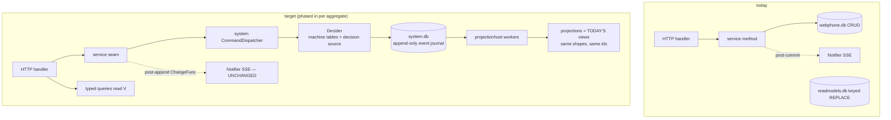
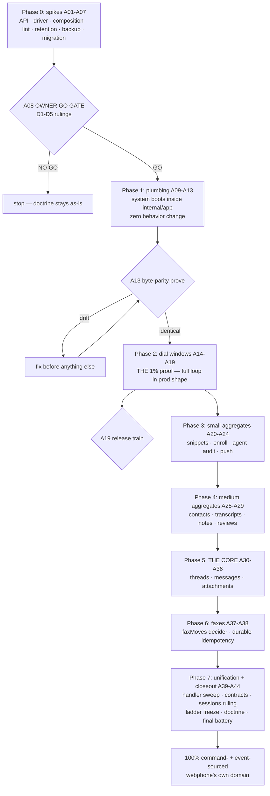

# SUPERB plan: 100% Command & Event-Sourcing via go-cqrs-lite — webphone

> **Date:** 2026-11-08 04:04 CET · **Status:** PLAN — owner-gated GO (Phase 0 spikes must pass the A08 gate first)
> **Owner decision (2026-11-08):** "I WANT 100% SUPERB Command & Event-Sourcing via go-cqrs-lite."
> This decision FIRES the ROADMAP revisit trigger ("revisit ONLY when webphone grows event-sourced state", wontfix closure 2026-09-30) and SUPERSEDES the fleet-libs no-ES row (`docs/review/libs/go-cqrs-lite.md`: "no event sourcing in this product").
> It does NOT supersede the N5/N6 two-file doctrine (engine-owned DDL never meets the hand ladder) — the system gets its OWN database file, exactly like `readmodels.db` today.
> Supersedes N2 of the 2026-10-14 metaengine-dogfooding plan (`store/messages.go` STAYS) — but only via the parity-first importer path, Phase 5, behind green gates.

---

## 1. READ / UNDERSTAND (what exists today — verified this session, 2026-11-08 03:56 audit)

| Surface | Today | Evidence |
|---|---|---|
| Write model (core) | Hand-written SQL CRUD, machine-table-guarded in-place transitions (`deliveryMoves`, `faxMoves`, `AppendToThread`) | `internal/store/messages.go`, `internal/domain/{delivery,fax,thread}.go` |
| Read models (11 collections) | metaengine facts via `Store.Apply(EventTypeName(…), payload)` + `OnRecord` folds → keyed views (`INSERT OR REPLACE` storage, no history) | `internal/readmodels/*`, sqliteengine `planned.go:170` |
| Commands | Procedural: HTTP handler → service method → store write. No dispatcher, no command journal | `internal/server/**`, `internal/messaging/service.go` |
| Events (SSE) | Closed 5-type nudge set, post-commit, ephemeral; `Notifier.Project` re-reads state | `internal/domain/events.go`, `internal/server/notifier.go` |
| Event sourcing | ONE island: usermgmt identity layer (`NewSQLEventStore` + projections + `/healthz` readiness), library-owned | `internal/userauth/userauth.go:96,121-133` |
| Doctrine | no-ES ratified; `system` module NOT in the module graph (all ES modules `// indirect`) | go.mod, ROADMAP:136-143 |

## 2. GOAL — what "100%" means, precisely

**In scope (webphone's OWN domain state becomes command-sourced + event-sourced):**
threads, messages, attachments, fax jobs, contacts, snippets, call transcripts, call notes, call reviews, dial windows + overrides, enroll tokens, push devices, agent audit — every one carried by a **decider** (command → events), an **append-only event journal** (source of truth), and **projections** (the exact read views the server renders today).

**Out of scope (with rationale — each is a deliberate boundary, not an omission):**
- **usermgmt identity layer** — ALREADY event-sourced, library-owned (cqrs-htmx). We align health wiring, nothing else.
- **Blobs** (attachments/fax PDFs) — filesystem bytes via go-atomic-write; the journal carries paths/metadata, never bytes.
- **CDR/History** — the PBX is the external source of truth; webphone only renders. No migration possible or wanted.
- **The sip.js island + SSE wire** — browser contract untouched. `ExtensionHubs`/go-sse STAY (upstream ruling: `transport/http.SSEBroker` is DEPRECATED per ADR-0127; journal-backed SSE is explicitly NOT adopted).
- **Sessions + app_flags** — DECISION POINT D2 (see §7): sessions are infrastructure leases, not domain aggregates. Recommendation: migrate to system-owned records/kv late (Phase 7), or document a cqrs-lint baseline. Owner rules at A08.

## 3. TARGET ARCHITECTURE

- **Composition:** `system.New(ctx, DomainConfig, DeploymentConfig)` runs INSIDE the samber/do container as ONE named eager service (`"cqrs"`) — it does NOT replace `internal/app`; `App.Start` calls `sys.Start`, shutdown calls `sys.Close` after the `ExtensionHubs` pre-drain.
- **One database:** `system.db` (engine-owned DDL, sqlite/modernc — sqliteengine v4.7.0 depends on `modernc.org/sqlite` v1.61.1, the same driver family webphone already uses; CGO-free, nix-safe).
- **Machine tables stay the ONE legality home:** `deliveryMoves`/`faxMoves`/`AppendToThread` are CONSUMED BY DECIDERS (the decide() function consults the table) instead of the store's append transaction. The AGENTS.md rule "new transitions go into the tables, never branch-by-branch" SURVIVES unchanged.
- **SSE byte-parity:** command handlers keep emitting `domain.ChangeFunc` post-append; `Notifier` is untouched; payloads stay bare fragments; the 5-type event set stays.
- **Fact-name continuity:** today's metaengine fact types (`ContactSaved`, `TranscriptAppended`, `FaxStatusAdvanced`, …) BECOME the stream event payload types under the SAME names — one home per fact, no split-brain vocabulary.

## 4. VERSCHLIMMBESSERN CONTRACT (hard invariants — every phase proves them)

1. **Behavior parity first:** wire bytes (SSE fragments, `/openapi.json`, `/config.js`, rendered HTML), DOM contract ids, i18n, and error codes are IDENTICAL per phase. Rule: "port logic verbatim first, refactor in a second, separately-verified change."
2. **Every phase is a full train:** gates green (`go test -count=1 ./...`, buildflow tiers 1+2, `nix flake check`, smoke scenarios, island tests) BEFORE the next phase starts; release per runbook; the consuming stack re-pins only at release boundaries.
3. **No data loss:** every cutover carries a one-time crash-safe importer with an `app_flags` marker (the proven legacy-import shape: flag only after full success; re-run retries); a dual-run verification harness diffs old-store reads vs new-projection reads row-by-row BEFORE the old path is deleted.
4. **Rollback:** each phase = one narrative commit set on `main`; rollback = `git revert` + restore `system.db`/`readmodels.db`/`webphone.db` from the backup snapshot; phases never straddle a release.
5. **Caps and scoping survive:** per-owner caps (500 contacts, 5000 transcripts, 500 dial windows, 100 snippets, 8 devices, 2000 reviews) and owner-scoping are enforced DECIDER-SIDE (aggregate state) — never weaker than today; `*Any`/`ListAll` admin seams stay the ONLY cross-owner reads.
6. **Auth-regression convention:** any phase touching session/CSRF/webhook-secret/passkey surfaces carries an `auth:` commit prefix + the session-behavior suite.
7. **Dependency bumps do NOT ride the daemon** (owner decision 2026-10-11): `go get` trains are manual, with `go mod tidy` + vendorHash re-pin + CI-watch.

## 5. RISK REGISTER (top 10)

| # | Risk | Mitigation |
|---|---|---|
| R1 | Journals grow unboundedly where tables were capped/trimmed (transcripts, dial windows) | Retention design spike A05 BEFORE any aggregate lands: per-class policy — projection-side trims STAY (view caps unchanged), journal-side retention/snapshot per stream class; unbounded audit classes are explicit owner calls (agent audit, auth) |
| R2 | Projection lag changes UX (stale list after send) | Notifier keeps re-reading AFTER command completion; dispatch is synchronous (decider commits before handler answers) — the read is never older than today's |
| R3 | Importer bugs corrupt history | Importer is idempotent, marker-flagged, dual-run diffed against the old store; backup snapshot taken immediately before every cutover |
| R4 | cqrs-lint flags the remaining hand-ladder seams as satellite SQL (E023) once system lands | A04 inventory BEFORE Phase 1; findings triaged per seam (migrate / baseline with rationale / retirement date) |
| R5 | system.New lifecycle fights the do container (double-shutdown, hollow-root WARN) | A03 composition contract spike; hollow-root is acceptable ONLY during Phase 1 (explicitly logged), forbidden after the first aggregate lands |
| R6 | Wire contract drift (`/openapi.json` pinned, asyncapi generated) | A40 runs the regen + byte-diff; drift is either zero or an INTENTIONAL documented change with pin updates in the same commit |
| R7 | EventCatalog/AsyncAPI exporter expects system registry shapes | Verified in A40 against the catalog module's `WithPlainRefIDs` governance export; the hand-built apidocs registry stays the wire truth until v5 forces the move |
| R8 | Decider OCC (Conflict family) vs today's unconditional updates | Optimistic-concurrency is a FEATURE (conflict = genuine concurrent writer); handlers map `Conflict` to the existing 409 shape where one exists (notes), else serialize per-owner (single-tenant, single-process by doctrine) |
| R9 | Codec surprise: event.DefaultCodec is CBOR | Journal bytes are internal; SSE stays server-rendered text. DECISION POINT D1 at A08: keep CBOR (compact) or pin JSON (debuggable). Recommendation: CBOR default, revisit only if journal forensics ever demand shell-inspectable bytes |
| R10 | Scope creep into usermgmt/browser | Out-of-scope list §2 is contractual; island and identity phases DO NOT EXIST in this plan |

## 6. PARETO BREAKDOWN

### 1% → 51% (the proof)
Phase 0 spikes (de-risk every unknown) + Phase 1 plumbing (system boots inside `internal/app`, zero behavior change) + **ONE real aggregate end-to-end: dial windows** — command dispatch, journal append, projection into today's view shape, importer, health, parity tests. After A19, the loop is PROVEN in production shape; every later aggregate is repetition, not invention.

### 4% → 64% (+ small aggregates)
Snippets, enroll tokens, agent audit (the audit journal IS the ES showcase — actor/causality enrichers land here), push devices. All bounded, all test-pinned, all importer-simple.

### 20% → 80% (+ medium aggregates)
Contacts (cap becomes decider state), transcripts (natural stream), call notes, call reviews. This is where the DURABLE audit value becomes real for daily use.

### The rest → 100%
The core (threads/messages/attachments — the mountain), fax lifecycle, command-lane unification on ALL write handlers, contracts/catalog alignment, sessions ruling, ladder freeze, doctrine rewrite, final battery + release.

## 7. DECISION POINTS (owner rules at gate A08)

| # | Decision | Recommendation |
|---|---|---|
| D1 | Journal codec: CBOR (library default) vs JSON (shell-inspectable) | Keep CBOR; document |
| D2 | Sessions + app_flags under the all-I/O-through-metaengine rule (ADR-0142) | Migrate sessions to system records in Phase 7; app_flags migration markers stay in webphone.db until ladder retirement; otherwise baseline cqrs-lint findings with rationale |
| D3 | Journal retention: keep-forever vs per-class trim/snapshot | Per-class: bounded domains trim WITH their views; audit classes keep-forever; transcripts trim to the projection cap |
| D4 | Cutover trains: one release per phase vs batched phases | One release per phase (P1, P2, P3, P4, P5, P6, P7) — rollback story stays trivial |
| D5 | Go +1 minor (deciders use generics heavily) — pin floor | No change; `system` targets go 1.27 like the rest of the fleet |

---

## 8. TABLE A — COMPREHENSIVE PLAN (30–100 min tasks, ALL of them, sorted by rank within phase; phases are the dependency spine)

| Rank | ID | Phase | Task | Effort | Impact | Value |
|---|---|---|---|---|---|---|
| 1 | A01 | P0 | `system/v4` adoption spike: resolve the version to ride, deep-read `constructor.go`/`config_types.go`/`register.go`/`system_lifecycle.go`/`lifecycle.go`, write the API notes + verdict into `docs/research/` | 90m | H | De-risks everything |
| 2 | A02 | P0 | sqlite driver + nix proof: verify sqliteengine's modernc registration path, build a hello-system binary in the devshell AND under `nix build`, record vendorHash deltas | 60m | H | Nix/CGO kill-switch |
| 3 | A03 | P0 | Composition contract: design system-in-do (named `"cqrs"`, eager, lifecycle order: HTTP drain → hubs pre-drain → `sys.Close` → do.Shutdown; Deps threading; Probe placement); write the contract doc | 90m | H | No lifecycle fights |
| 4 | A04 | P0 | cqrs-lint/buildflow inventory: stub-import system on a throwaway branch, run `-s cqrs-lint`, triage E023 satellite-sql class against every hand-ladder seam, write findings | 60m | H | No surprise reds |
| 5 | A05 | P0 | Retention/compaction design: read the retention surface (system `engine_config.go`, event types), write the per-class journal policy (bounded domains, audit classes, transcripts) — feeds D3 | 60m | H | Unbounded-growth guard |
| 6 | A06 | P0 | Backup/restore integration spec: `system.db` into the backup oneshot + drill + README restore path; list the drill changes | 60m | H | No data-loss story gaps |
| 7 | A07 | P0 | Migration strategy design: the importer pattern per aggregate (reuse `legacy_import` shape), `app_flags` markers, dual-run diff harness design | 90m | H | Data-safety backbone |
| 8 | A08 | P0 | OWNER GO GATE: present spike verdicts + D1–D5 decision points; record rulings in this plan's errata | 30m | H | The re-openable gate |
| 9 | A09 | P1 | Land dependencies: `go get system/v4` + transitive pins, `go mod tidy`, vendorHash re-pin (manual train: build → read `got:` → apply), CI-watch green | 90m | H | Foundation |
| 10 | A10 | P1 | `internal/app/cqrs.go`: the composition adapter — `NewCqrs` provider (named `"cqrs"`), DomainConfig skeleton, DeploymentConfig sqlite over `<dataDir>/system.db`, eager invoke + lifecycle assertion in `app.go` | 90m | H | The root |
| 11 | A11 | P1 | Shutdown ordering: place `sys.Close` after the `ExtensionHubs` pre-drain, before `do.Shutdown`; idempotence test | 60m | H | Clean restarts |
| 12 | A12 | P1 | `/healthz` cqrs leg: readiness from `sys.HealthCheck` + `WorkerStatus` (fail ⇒ 503 naming the worker), `/startupz` join; nil-fallback for test compositions | 60m | H | Honest readiness |
| 13 | A13 | P1 | Empty-boot prove: served-page byte-diff (no route changed), full smoke, `nix flake check`, buildflow — the zero-behavior-change proof | 60m | H | Parity guaranteed |
| 14 | A14 | P2 | Dial-window decider: `AttemptDial`/`SaveOverride` commands; ONE Decide = check+record (deny records NOTHING; override spent BY the allowed dial); events reuse `DialAttempted`/`DialOverrideSaved` names; 500/owner in aggregate state | 90m | H | The 1% proof |
| 15 | A15 | P2 | Registration + projection: `RegisterDecider`/`RegisterCommand` wiring; `dial_windows`/`dial_overrides` views via projection folds — SAME shapes the server reads today | 90m | H | Same views |
| 16 | A16 | P2 | Dial-gate port swap: `dial.Service` backend dispatches commands; `server.Deps.DialGate` contract unchanged; `/api/dials` handler untouched | 90m | H | Invisible swap |
| 17 | A17 | P2 | Dial importer: readmodels `dial_windows`/`dial_overrides` rows → synthetic events; `app_flags` marker; crash-safe re-run; dual-run diff | 90m | H | Data safety |
| 18 | A18 | P2 | Dial parity + scenario: `TestDialGate*` green on the new backend; `systemscenario` BDD spec (allow/deny/override-spend/unreachable-off-latch) | 90m | H | Proof by test |
| 19 | A19 | P2 | P2 gates + release train: smoke `dialgate` scenario, full gates, CHANGELOG, release per runbook | 60m | H | Ship it |
| 20 | A20 | P3 | Snippets aggregate: `SnippetSaved`/`SnippetDeleted` events, cap 100 decider-side, reply-composer projection parity | 90m | M | Daily value |
| 21 | A21 | P3 | Enroll tokens aggregate: `EnrollTokenMinted`/`EnrollTokenBurned`; 15-min TTL expiry classification stays at the userauth door; importer EXEMPT (in-flight links re-mint — existing doctrine) | 60m | M | Auth lane |
| 22 | A22 | P3 | Agent-audit aggregate: append-only stream (the journal IS the product); actor + causality enrichers adopted (`NewUserActor`, `CommandCausality`); Settings' newest-20 read rides the projection; auth-convention suite | 90m | M | Real audit trail |
| 23 | A23 | P3 | Push-devices aggregate: `PushDeviceRegistered`/`PushDeviceRemoved`; 8/owner cap decider-side; token stays write-only | 60m | M | Ring lane |
| 24 | A24 | P3 | P3 gates + release train (all four aggregates one release) | 60m | M | Ship |
| 25 | A25 | P4 | Contacts aggregate: owner-list aggregate state in the decider (count + newest index); cap 500 deterministic; rename keeps id/createdAt from aggregate state; `ErrListFull` Rejection mapping preserved | 90m | M | Flagship parity |
| 26 | A26 | P4 | Transcripts aggregate: append stream per (owner, call); 5000/owner projection trim STAYS; per-CALL floor keeps the loop (nested-cap gap unchanged — reopen trigger untouched) | 90m | M | History value |
| 27 | A27 | P4 | Call notes + reviews aggregates: one slot per (owner, call); notes 409 `note_list_full` = Conflict; reviews 2000/owner Rejection cap; "system-written, no owner PUT" doctrine carried into command shapes | 90m | M | Post-call value |
| 28 | A28 | P4 | P4 importers: contacts, transcripts, notes, reviews rows → events + markers + dual-run diffs | 90m | M | Data safety |
| 29 | A29 | P4 | P4 parity + gates + release train | 90m | M | Ship |
| 30 | A30 | P5 | Core stream design doc: per-thread streams keyed (owner, network, remote); `AppendToThread` as the decider's apply (thread+message invariants in ONE Decide); attachment rows as projection folds; explicit no-schema-change statement | 90m | H | The mountain's map |
| 31 | A31 | P5 | Delivery machine integration: `DeliveryAdvance` verdicts become decider decisions consuming `deliveryMoves`; self-send rejection = command Rejection AFTER persist (422 arm preserved); out-of-order verdicts legal from every state | 90m | H | Product core |
| 32 | A32 | P5 | Message projections: threads-list view + transcript view + attachments — same shapes, stable `thread-<id>` ids, byte-identical fragments (`wp-bubble`, `wp-thread-row` greppable classes) | 90m | H | SSE parity |
| 33 | A33 | P5 | `messaging.Service` swap: Receive/Send dispatch commands; `ChangeFunc` emission post-append preserved (list-only nudge rules intact); snippet/flag toggles dispatch | 90m | H | Invisible core swap |
| 34 | A34 | P5 | THE importer: webphone.db threads/messages/attachments → streams; full-success flag; crash-safe; dual-run row-by-row diff harness; backup snapshot pre-cutover | 100m | H | The risky moment |
| 35 | A35 | P5 | Core parity battery: `owner_scoping_test`, `admin_reads_test`, `threadsdual_test`, `threads_flags_test`, message byte-pins, `TestProviderFormPartHeaderBlockGolden` all green | 90m | H | No regressions |
| 36 | A36 | P5 | P5 gates + release train: full smoke (all scenarios), stack browser E2E budget 445s, docs sweep | 90m | H | Ship the core |
| 37 | A37 | P6 | Fax aggregate: `faxMoves` consumed by the decider; `FaxReceipted`/`FaxStatusAdvanced` events; `ApplyIdempotent` provider_ref dedup → command idempotency middleware (durable, fixing the process-local nuance found in the audit); paperless seam untouched | 90m | M | Fax lane |
| 38 | A38 | P6 | Fax importer + parity + P6 release train | 90m | M | Ship |
| 39 | A39 | P7 | Handler unification sweep: every remaining write surface dispatches through the system dispatcher; the arch-test service boundary rules updated for the new import directions | 90m | M | One command lane |
| 40 | A40 | P7 | Contracts/catalog: `/openapi.json` byte check, asyncapi regen diff, EventCatalog export diff (`catalog.home.lan` recipe); intentional drift documented + pins updated same-commit | 90m | M | Wire truth |
| 41 | A41 | P7 | Sessions + app_flags ruling execution (per D2): system-records migration OR the documented cqrs-lint baseline; `auth:` prefix + session-behavior suite | 90m | M | Doctrine completion |
| 42 | A42 | P7 | Ladder freeze: `store/db.go` accepts no new steps; retirement plan doc naming which tables die at which release | 60m | M | The end of CRUD |
| 43 | A43 | P7 | Doctrine docs: AGENTS.md rewrite (no-ES bullet → ES doctrine; machine-tables bullet: "tables feed deciders"), fleet-libs `go-cqrs-lite.md` re-score, ROADMAP annotation, FEATURES, TODO_LIST harvest, CHANGELOG | 90m | M | Memory updated |
| 44 | A44 | P7 | Final battery + release: buildflow full, `nix flake check`, VM tests (module check + backup drill WITH system.db), vulnix, full smoke, stack browser E2E, version bump + push + CI-watch + stack re-pin coordination | 100m | H | 100% shipped |

*(Deviation note: the pareto skill's default caps Table A at 27 tasks; the owner's instruction — "Include ALL TODOS" — wins, hence 44.)*

## 9. TABLE B — MICRO BREAKDOWN (≤12 min each, ALL of them, same order)

### Phase 0 — preflight (A01–A08)

| # | Task | From | Min |
|---|---|---|---|
| B01 | `git status` clean-check + record start state | A01 | 3 |
| B02 | `go list -m -versions github.com/larsartmann/go-cqrs-lite/system/v4` — pick the train version | A01 | 5 |
| B03 | Read `constructor.go` (New, options) | A01 | 12 |
| B04 | Read `config_types.go` (DomainConfig/DeploymentConfig/InstanceConfig fields) | A01 | 12 |
| B05 | Read `register.go` (RegisterDecider/RegisterCommand signatures + Op/Execute) | A01 | 12 |
| B06 | Read `system_lifecycle.go` + `lifecycle.go` (Start/Close semantics, idempotence) | A01 | 12 |
| B07 | Read `projection_builder.go` (RawQuery/ProjectionDeclaration) | A01 | 8 |
| B08 | Read `dedup.go` + `checkpoint_engine.go` (DedupStore access, checkpoints) | A01 | 8 |
| B09 | Write `docs/research/2026-11-08_system-v4-api-notes.md` verdict | A01 | 12 |
| B10 | Read sqliteengine `engine.go` driver-registration path (modernc init) | A02 | 12 |
| B11 | hello-system binary: build + run in devshell against a temp DSN | A02 | 12 |
| B12 | Same binary under `nix build` (sandbox) — record result + vendorHash delta | A02 | 12 |
| B13 | Write the A02 verdict into the research doc | A02 | 8 |
| B14 | Draft the system-in-do lifecycle order diagram (drain → hubs → sys.Close → do.Shutdown) | A03 | 12 |
| B15 | Map every today-lifecycle touchpoint in `app.go`/`cmd/webphone` that must move | A03 | 12 |
| B16 | Write the composition contract doc | A03 | 12 |
| B17 | Throwaway branch + stub `system.New` import | A04 | 12 |
| B18 | Run `buildflow -s cqrs-lint`; capture findings | A04 | 12 |
| B19 | Triage each finding: migrate / baseline / retirement-date | A04 | 12 |
| B20 | Write findings doc; delete throwaway branch | A04 | 8 |
| B21 | Read the retention surface (`engine_config.go`, event retention types) | A05 | 12 |
| B22 | Classify every aggregate: bounded-trim / keep-forever / snapshot | A05 | 12 |
| B23 | Write the per-class journal retention policy (feeds D3) | A05 | 12 |
| B24 | Read the backup oneshot + drill scripts; list system.db integration points | A06 | 12 |
| B25 | Write the backup/restore spec deltas | A06 | 12 |
| B26 | Re-read `store/legacy_import_test.go` + readmodels boot import; extract the pattern | A07 | 12 |
| B27 | Write the importer pattern spec (markers, idempotency, dual-run diff) | A07 | 12 |
| B28 | Draft D1–D5 decision memos (one paragraph each) | A08 | 12 |
| B29 | Present verdicts to owner; record rulings in the errata | A08 | 12 |
| B30 | Gate check: all P0 verdicts GO before P1 | A08 | 3 |

### Phase 1 — plumbing (A09–A13)

| # | Task | From | Min |
|---|---|---|---|
| B31 | `go get system/v4@<pin>` (manual train, no daemon) | A09 | 5 |
| B32 | `go mod tidy`; review go.mod delta (expect ES modules → direct) | A09 | 12 |
| B33 | `nix build .#webphone.goModules --rebuild` → read `got:` | A09 | 12 |
| B34 | Apply vendorHash; full `nix build` green | A09 | 12 |
| B35 | Push + CI-watch green (bump-train tail) | A09 | 12 |
| B36 | Scaffold `internal/app/cqrs.go` (provider + names) | A10 | 12 |
| B37 | DomainConfig skeleton (no commands yet — hollow-root WARN expected, logged) | A10 | 8 |
| B38 | DeploymentConfig: sqlite engine, combined RoleSourceOfTruth instance, DSN `<dataDir>/system.db` | A10 | 12 |
| B39 | Wire into `internal/app` injector (named `"cqrs"`, eager) | A10 | 12 |
| B40 | Lifecycle assertion in `app.go` (adapter-side conformance) | A10 | 8 |
| B41 | Unit test: container resolves `"cqrs"`; Close is idempotent | A10 | 12 |
| B42 | Place `sys.Close` in the shutdown cascade after hubs pre-drain | A11 | 12 |
| B43 | Shutdown-order test (fake system records close sequence) | A11 | 12 |
| B44 | `/healthz` cqrs leg from `sys.HealthCheck` + `WorkerStatus` | A12 | 12 |
| B45 | 503-names-the-worker formatting + test | A12 | 12 |
| B46 | `/startupz` join + nil-fallback for test compositions | A12 | 12 |
| B47 | Boot the smoke binary; diff every served page vs pre-change bytes | A13 | 12 |
| B48 | Full smoke suite + `nix flake check` + buildflow tiers | A13 | 12 |
| B49 | CHANGELOG `[Unreleased]` plumbing line; commit narrative; push; CI-watch | A13 | 12 |

### Phase 2 — dial windows (A14–A19)

| # | Task | From | Min |
|---|---|---|---|
| B50 | Type the commands: `AttemptDial{Owner, Remote, Override}` / `SaveOverride{Owner, Remote, Window}` | A14 | 12 |
| B51 | Define aggregate state struct (windows map, overrides, counts) | A14 | 12 |
| B52 | Write the Decide function: allowed ⇒ record; denied ⇒ record NOTHING; override spent BY the allowed dial | A14 | 12 |
| B53 | Emit `DialAttempted`/`DialOverrideSaved` events (SAME payload types as today's facts) | A14 | 12 |
| B54 | Map rejection shapes: off ⇒ the off-latch (404 semantics preserved), store failure ⇒ 502 family | A14 | 12 |
| B55 | Register decider + commands in DomainConfig | A15 | 8 |
| B56 | Declare `dial_windows` + `dial_overrides` projections via folds — byte-compare view structs vs today's | A15 | 12 |
| B57 | Start system in `App.Start`; projections run | A15 | 8 |
| B58 | Swap `dial.Service` backend to dispatch; keep the port + `Deps.DialGate` contract | A16 | 12 |
| B59 | Route `/api/dials` through the service (handler diff = nil) | A16 | 8 |
| B60 | Keep the `/config.js` `dialCooldownSeconds` pointer semantics (encoding/json v2 lesson) | A16 | 8 |
| B61 | Write the dial importer (readmodels rows → synthetic events) | A17 | 12 |
| B62 | `app_flags` marker + crash-safe re-run test (kill mid-import, re-run, diff) | A17 | 12 |
| B63 | Dual-run diff harness run: old readmodels reads vs new projections | A17 | 12 |
| B64 | Port `TestDialGate*` fakes to the new backend | A18 | 12 |
| B65 | `systemscenario` spec: allow / deny / override-spend / off-latch | A18 | 12 |
| B66 | Wiring-parity check (`TestAppWiresEveryServerDep`) still green | A18 | 8 |
| B67 | Smoke `dialgate` scenario + full gates | A19 | 12 |
| B68 | CHANGELOG + narrative commit + push + CI-watch | A19 | 12 |

### Phase 3 — small aggregates (A20–A24)

| # | Task | From | Min |
|---|---|---|---|
| B69 | Snippets commands + decider (cap 100 in state) | A20 | 12 |
| B70 | Snippets projection (quick-chips + picker reads) | A20 | 12 |
| B71 | Snippets port swap + importer + marker | A20 | 12 |
| B72 | Snippets parity tests (composer fill replaces textarea) | A20 | 12 |
| B73 | Enroll tokens commands/decider (Minted/Burned) | A21 | 12 |
| B74 | Expiry stays at the userauth door (Lookup exposes expiry — doctrine kept) | A21 | 12 |
| B75 | Enroll projection + port swap (importer EXEMPT — documented) | A21 | 12 |
| B76 | Enroll parity tests (`passkey_api_test.go` pins) | A21 | 8 |
| B77 | Agent-audit stream (Appended events; NO update folds — append-only) | A22 | 12 |
| B78 | Actor enricher (`NewUserActor`) + command causality on audit events | A22 | 12 |
| B79 | Settings newest-20 projection + port swap | A22 | 12 |
| B80 | `auth:` prefix + session-behavior suite green | A22 | 8 |
| B81 | Push-devices commands/decider (8/owner cap) | A23 | 12 |
| B82 | Token write-only projection (LIST never echoes token) | A23 | 12 |
| B83 | Push port swap + `push.*` family tests green | A23 | 12 |
| B84 | P4-aggregate smoke additions + full gates | A24 | 12 |
| B85 | CHANGELOG + commit + push + CI-watch | A24 | 12 |

### Phase 4 — medium aggregates (A25–A29)

| # | Task | From | Min |
|---|---|---|---|
| B86 | Contacts aggregate state (owner list: entries + count + newest order) | A25 | 12 |
| B87 | Contacts Decide: save (rename keeps id/createdAt), delete tombstone, cap Rejection | A25 | 12 |
| B88 | Contacts projection = today's `ContactView` shape byte-for-byte | A25 | 12 |
| B89 | Contacts port swap + `readmodels/contacts.go` becomes the projection adapter | A25 | 12 |
| B90 | Transcripts streams per (owner, call) + expunge events | A26 | 12 |
| B91 | Projection-side 5000/owner trim kept; floor loop unchanged | A26 | 12 |
| B92 | Notes aggregate: one slot per (owner, call); 409 Conflict mapping | A27 | 12 |
| B93 | Reviews aggregate: wholesale replace verdicts; 2000 Rejection cap | A27 | 12 |
| B94 | `readmodels.note_list_full` classification test still green | A27 | 8 |
| B95 | Contacts importer + marker + dual-run diff | A28 | 12 |
| B96 | Transcripts importer + marker + diff | A28 | 12 |
| B97 | Notes + reviews importers + markers | A28 | 12 |
| B98 | Parity: `admin_reads_test` + owner-scoping pins green on new backends | A29 | 12 |
| B99 | Full gates + smoke + CHANGELOG + commit + push + CI-watch | A29 | 12 |

### Phase 5 — the core (A30–A36)

| # | Task | From | Min |
|---|---|---|---|
| B100 | Core design doc: stream keys, event payloads, projection folds | A30 | 12 |
| B101 | `AppendToThread` becomes the decider apply (invariants in ONE Decide) | A30 | 12 |
| B102 | Design review vs `store/threads` tests (the invariants list) | A30 | 12 |
| B103 | Delivery decider consuming `deliveryMoves` (rows → decisions) | A31 | 12 |
| B104 | Self-send Rejection AFTER persist (422 arm preserved) | A31 | 8 |
| B105 | Thread-list projection (stable `thread-<id>` wrappers, `wp-thread-row`) | A32 | 12 |
| B106 | Transcript projection (`wp-bubble`, asr flags, delivery chips byte-parity) | A32 | 12 |
| B107 | Attachments folds + blob path rows unchanged | A32 | 8 |
| B108 | `messaging.Service.Receive` → dispatch | A33 | 12 |
| B109 | `messaging.Service.Send` → dispatch (+ delivery advances) | A33 | 12 |
| B110 | Flag toggles + compose-new address routing → dispatch | A33 | 12 |
| B111 | `ChangeFunc` emission points preserved (post-append) | A33 | 8 |
| B112 | Importer part 1: threads → stream heads | A34 | 12 |
| B113 | Importer part 2: messages + attachments → events | A34 | 12 |
| B114 | Full-success marker + crash-retry test | A34 | 8 |
| B115 | Dual-run row-by-row diff harness (old store vs projections, all owners) | A34 | 12 |
| B116 | `owner_scoping_test` + `threadsdual_test` green | A35 | 12 |
| B117 | `threads_flags_test` + message byte-pins green | A35 | 12 |
| B118 | `TestProviderFormPartHeaderBlockGolden` + webhook lane pins green | A35 | 8 |
| B119 | Full smoke (all scenarios incl. faxcap) | A36 | 12 |
| B120 | Stack browser E2E (445s budget; re-run-once flake rule) | A36 | 12 |
| B121 | CHANGELOG + commit + push + CI-watch | A36 | 12 |

### Phase 6 — faxes (A37–A38)

| # | Task | From | Min |
|---|---|---|---|
| B122 | Fax decider consuming `faxMoves` (outbound vs inbound `received` fact split kept) | A37 | 12 |
| B123 | Command idempotency middleware keyed on provider_ref (durable — supersedes process-local `ApplyIdempotent`) | A37 | 12 |
| B124 | Fax projection parity (`wp-fax-row`, badge tones) | A37 | 12 |
| B125 | Fax port swap + paperless seam untouched proof | A37 | 8 |
| B126 | Fax importer + marker + diff | A38 | 12 |
| B127 | faxcap smoke scenario + gates + release | A38 | 12 |

### Phase 7 — unification + closeout (A39–A44)

| # | Task | From | Min |
|---|---|---|---|
| B128 | Sweep all remaining write handlers → dispatcher | A39 | 12 |
| B129 | Update `internal/arch` rules for new import directions; all boundary tests green | A39 | 12 |
| B130 | `/openapi.json` byte-diff; intentional drift documented | A40 | 12 |
| B131 | `webphone contracts` regen + asyncapi diff | A40 | 8 |
| B132 | `catalog -o` render diff + governance-lint tree check | A40 | 12 |
| B133 | Execute the D2 sessions ruling (migrate or baseline) | A41 | 12 |
| B134 | Session-behavior suite (`go test ./internal/server/ -run TestServer`) green | A41 | 8 |
| B135 | Freeze the ladder: comment + no-new-steps guard note in `store/db.go` | A42 | 8 |
| B136 | Retirement plan doc (tables → death releases) | A42 | 12 |
| B137 | AGENTS.md rewrite: no-ES bullet → ES doctrine; machine-tables bullet → deciders | A43 | 12 |
| B138 | fleet-libs `go-cqrs-lite.md` re-score + verdict update | A43 | 12 |
| B139 | ROADMAP annotation (trigger fired + executed) + TODO_LIST harvest + FEATURES | A43 | 12 |
| B140 | CHANGELOG release section | A43 | 8 |
| B141 | buildflow full (`BUILDFLOW_NO_RESULT_CACHE=1`) green | A44 | 12 |
| B142 | `nix flake check` + VM tests (module check, backup drill WITH system.db) | A44 | 12 |
| B143 | `nix run .#vulnix` + triage | A44 | 8 |
| B144 | Full smoke + stack browser E2E final pass | A44 | 12 |
| B145 | `./update.sh`-independent version bump + release per runbook; push; CI-watch; stack re-pin note | A44 | 12 |

## 10. EXECUTION GRAPH

## 11. VERIFICATION MATRIX (per phase)

| Phase | Go suites | Buildflow | Nix | Smoke | Browser |
|---|---|---|---|---|---|
| P0 | research only | `-s cqrs-lint` on branch | hello-system build | — | — |
| P1 | `./internal/app`, shutdown tests | tiers 1+2 | flake check + vendorHash | full smoke, byte-diff | — |
| P2 | `TestDialGate*`, scenario, wiring-parity | tiers 1+2 | flake check | `dialgate` | — |
| P3 | family tests per aggregate, auth suite | tiers 1+2 | flake check | push/enroll paths | — |
| P4 | contacts/transcripts/notes/reviews pins, `admin_reads_test` | tiers 1+2 | flake check | history surfaces | — |
| P5 | owner-scoping, threadsdual, flags, byte-pins, webhook goldens | tiers 1+2 + erraudit | flake check | ALL scenarios | stack E2E 445s |
| P6 | fax family pins, idempotency tests | tiers 1+2 | flake check | `faxcap` | — |
| P7 | FULL `go test -count=1 ./...`, session suite | FULL no-cache | flake check + VM tests + vulnix | full | stack E2E |

## 12. RESEARCH APPENDIX — verified facts (sources)

- `system.New(ctx, DomainConfig, DeploymentConfig, …Option)` — local checkout `system/constructor.go:26`; `System.Start` `system_lifecycle.go:47`; `Close` `lifecycle.go:78`.
- `RegisterDecider[State]` register.go:44; `RegisterCommand[Cmd, State]` register.go:94; `RawQuery` projection_builder.go:60; roles incl. combined `RoleSourceOfTruth` roles.go:279; introspection: `HealthCheck`, `VerifyProjections`, `WorkerStatus`, `ShutdownOrder`, `Dedup()`, `NewManualClock` (tests).
- sqliteengine v4.7.0 go.mod: `modernc.org/sqlite v1.61.1` — same driver family as webphone; CGO-free.
- Doctrine: tombstone-over-delete, no `Delete` on Store (core.md §3.1, ADR-0114); CBOR default codec (§3.3); error families map 1:1 to webphone's existing errorfamily usage (§3.7); actor/causality/request-scope enrichers (§3.8); command idempotency middleware (§1 matrix); `systemscenario` BDD (§1, ADR-0153).
- SSE ruling: `transport/http.SSEBroker` DEPRECATED (ADR-0127) — journal-backed SSE deliberately NOT adopted; `ExtensionHubs`/go-sse stay.
- Prior-audit facts (2026-11-08 03:56 report): current-state storage `planned.go:170`; nudge-only `domain/events.go`; identity island `userauth.go:96`; no-ES doctrine rows.
- OPEN (Phase 0 resolves): exact DomainConfig field surface on the pinned version; retention semantics detail; cqrs-lint finding inventory; systemscenario import path on the pinned version.

## Errata

*(owner rulings from gate A08 land here; nothing recorded yet)*
