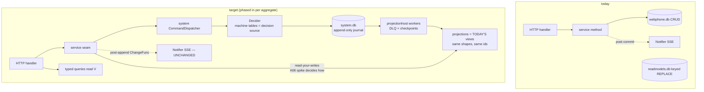
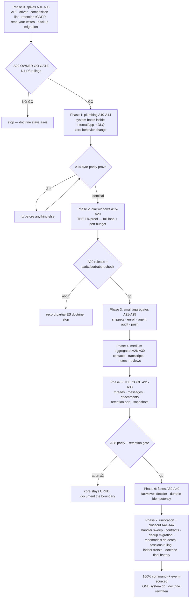

# SUPERB plan: 100% Command & Event-Sourcing via go-cqrs-lite — webphone

> **Date:** 2026-11-08 04:04 CET · **Revision 2** (same day, post-self-review: adds the retention/GDPR guarantee, the read-your-writes consistency spike, the terminal storage topology, OCC retry patterns, snapshots, DLQ, perf budgets, abort criteria — v1's §5 R2 claim "the read is never older than today's" was WRONG under async projectionhost and is retracted; see §5 and Errata)
> **Status:** PLAN — owner-gated GO (Phase 0 spikes must pass the A09 gate first)
> **Owner decision (2026-11-08):** "I WANT 100% SUPERB Command & Event-Sourcing via go-cqrs-lite."
> This decision FIRES the ROADMAP revisit trigger ("revisit ONLY when webphone grows event-sourced state", wontfix closure 2026-09-30) and SUPERSEDES the fleet-libs no-ES row (`docs/review/libs/go-cqrs-lite.md`: "no event sourcing in this product").
> It does NOT supersede the N5/N6 two-file doctrine in spirit — but the terminal topology changes it honestly: the engine world CONSOLIDATES to ONE `system.db` (journal + projections + dedup + caps + checkpoints + snapshots + DLQ); the hand ladder `webphone.db` keeps its own file until ladder retirement. Two files, one per world, as today — never mixed DDL.
> Supersedes N2 of the 2026-10-14 metaengine-dogfooding plan (`store/messages.go` STAYS) — but only via the parity-first importer path, Phase 5, behind green gates.

---

## 1. READ / UNDERSTAND (what exists today — verified 2026-11-08 03:56 audit + this session)

| Surface                      | Today                                                                                                                                                       | Evidence                                                                 |
| ---------------------------- | ----------------------------------------------------------------------------------------------------------------------------------------------------------- | ------------------------------------------------------------------------ |
| Write model (core)           | Hand-written SQL CRUD, machine-table-guarded in-place transitions (`deliveryMoves`, `faxMoves`, `AppendToThread`)                                           | `internal/store/messages.go`, `internal/domain/{delivery,fax,thread}.go` |
| Read models (11 collections) | metaengine facts via `Store.Apply(EventTypeName(…), payload)` + `OnRecord` folds → keyed views (`INSERT OR REPLACE` storage, no history)                    | `internal/readmodels/*`, sqliteengine `planned.go:170`                   |
| Commands                     | Procedural: HTTP handler → service method → store write. No dispatcher, no command journal                                                                  | `internal/server/**`, `internal/messaging/service.go`                    |
| Events (SSE)                 | Closed 5-type nudge set, post-commit, ephemeral; `Notifier.Project` re-reads state                                                                          | `internal/domain/events.go`, `internal/server/notifier.go`               |
| Retention                    | `retention_days` config (0 = keep forever, N = delete older) drives hard DELETEs of messages/threads in `store/sweep.go`; contacts deliberately never swept | `internal/config/config.go:118,842`, `internal/store/sweep.go:53-83`     |
| Event sourcing               | ONE island: usermgmt identity layer (`NewSQLEventStore` + projections + `/healthz` readiness), library-owned                                                | `internal/userauth/userauth.go:96,121-133`                               |
| Doctrine                     | no-ES ratified; `system` module NOT in the module graph (all ES modules `// indirect`)                                                                      | go.mod, ROADMAP:136-143                                                  |

## 2. GOAL — what "100%" means, precisely

**In scope (webphone's OWN domain state becomes command-sourced + event-sourced):** threads, messages, attachments, fax jobs, contacts, snippets, call transcripts, call notes, call reviews, dial windows + overrides, enroll tokens, push devices, agent audit — every one carried by a **decider** (command → events), an **append-only event journal** (source of truth), and **projections** (the exact read views the server renders today).

**Terminal storage topology (the end state this plan builds toward):**

| File            | After this plan                             | Contents                                                                                                                                                                           |
| --------------- | ------------------------------------------- | ---------------------------------------------------------------------------------------------------------------------------------------------------------------------------------- |
| `system.db`     | NEW, engine-owned (DDL never in the ladder) | event journal (per-aggregate streams), projections (all 11 former readmodels collections + the core views), dedup windows (`sys.Dedup()`), caps, checkpoints, snapshots, DLQ       |
| `readmodels.db` | DIES, collection by collection              | each aggregate phase deletes its collections from the engine plan; the final phase removes the engine registration + file (backup/restore paths updated per phase, not at the end) |
| `webphone.db`   | Shrinks                                     | threads/messages/attachments/faxes tables leave at their phase; sessions + `app_flags` remain until the D2 ruling executes (Phase 7)                                               |
| blob store      | UNCHANGED                                   | filesystem bytes via go-atomic-write; the journal carries paths/metadata, never bytes                                                                                              |

**Out of scope (each a deliberate boundary, not an omission):** the **usermgmt identity layer** (already event-sourced, library-owned — we align health wiring only); **blobs**; **CDR/History** (the PBX is the external truth); the **sip.js island + SSE wire** (`ExtensionHubs`/go-sse STAY — upstream ruled `transport/http.SSEBroker` deprecated, ADR-0127; journal-backed SSE is explicitly NOT adopted); **sessions + app_flags** (DECISION POINT D2).

## 3. TARGET ARCHITECTURE

- **Composition:** `system.New(ctx, DomainConfig, DeploymentConfig)` runs INSIDE the samber/do container as ONE named eager service (`"cqrs"`) — it does NOT replace `internal/app`; `App.Start` calls `sys.Start`, shutdown calls `sys.Close` after the `ExtensionHubs` pre-drain.
- **One engine world:** `system.db` is the ONLY engine-owned file; as each aggregate lands, its readmodels collections move into the system's store (same view structs) and the old engine plan shrinks.
- **Machine tables stay the ONE legality home:** `deliveryMoves`/`faxMoves`/`AppendToThread` are CONSUMED BY DECIDERS (decide() consults the table) instead of the store's append transaction. The AGENTS.md rule "new transitions go into the tables, never branch-by-branch" SURVIVES unchanged.
- **SSE byte-parity:** command handlers keep emitting `domain.ChangeFunc` post-append; `Notifier` is untouched; the 5-type event set stays.
- **Fact-name continuity:** today's metaengine fact types (`ContactSaved`, `TranscriptAppended`, `FaxStatusAdvanced`, …) BECOME the stream event payload types under the SAME names — one home per fact, no split-brain vocabulary.
- **Read-your-writes:** whether the post-command read (handler answer + Notifier re-read) sees the command's own effect is an OPEN consistency question (v1 wrongly assumed yes); spike A06 decides the mechanism BEFORE any aggregate lands.

## 4. VERSCHLIMMBESSERN CONTRACT (hard invariants — every phase proves them)

1. **Behavior parity first:** wire bytes (SSE fragments, `/openapi.json`, `/config.js`, rendered HTML), DOM contract ids, i18n, and error codes are IDENTICAL per phase. "Port logic verbatim first, refactor in a second, separately-verified change."
2. **Retention is a FEATURE, not a casualty:** `retention_days` must keep deleting old content. Journal-side retention = tombstone events + trim/compaction per the A05 policy; a green gate proves "delete actually deletes" (journal + projection + view) BEFORE any core cutover. A keep-forever journal for swept content is a PLAN VIOLATION, not a config choice.
3. **Every phase is a full train:** FULL `buildflow` at TRAIN START and at end (`BUILDFLOW_NO_RESULT_CACHE=1`), tiers 1+2 enforced, `go test -count=1 ./...`, `nix flake check`, smoke scenarios, island tests — green BEFORE the next phase; release per runbook.
4. **No data loss:** every cutover carries a one-time crash-safe importer with an `app_flags` marker (flag only after full success; re-run retries), a pre-cutover backup snapshot, and a dual-run harness diffing old-store reads vs new-projection reads row-by-row. **Importer timestamp fidelity:** list ordering folds read payload timestamps (`created_at`, `last_activity_at`), never journal append order — imported history must list in its original order.
5. **Rollback:** each phase = one narrative commit set on `main`; rollback = `git revert` + restore the dbs from the snapshot; phases never straddle a release.
6. **Caps and scoping survive:** per-owner caps (500 contacts, 5000 transcripts, 500 dial windows, 100 snippets, 8 devices, 2000 reviews) and owner-scoping are enforced DECIDER-SIDE (aggregate state) — never weaker than today; `*Any`/`ListAll` admin seams stay the ONLY cross-owner reads.
7. **Auth-regression convention:** any phase touching session/CSRF/webhook-secret/passkey surfaces carries an `auth:` commit prefix + the session-behavior suite (`go test ./internal/server/ -run TestServer`).
8. **Dependency bumps do NOT ride the daemon:** `go get` trains are manual — `go mod tidy` + vendorHash re-pin + push + CI-watch.
9. **ABORT CRITERIA (pre-committed exits, not failures):** P2 aborts if the dial parity battery or the perf budget (§11) cannot be met — then the doctrine records partial-ES and Phase 3+ never start. P5 aborts if byte-parity or the retention gate cannot be held after two full remediation attempts — the core stays CRUD, already-migrated aggregates keep their streams, and the doctrine records the boundary honestly. An abort is a DOCUMENTED outcome with a plan errata entry, never a silent half-migration.

## 5. RISK REGISTER (top 13 — renumbered from v1; R2 corrected, R7 strengthened, R11–R13 new)

| #   | Risk                                                                                  | Mitigation                                                                                                                                                                                                                                                |
| --- | ------------------------------------------------------------------------------------- | --------------------------------------------------------------------------------------------------------------------------------------------------------------------------------------------------------------------------------------------------------- |
| R1  | Journals grow unboundedly where tables were capped/trimmed                            | A05 retention policy per stream class: projection-side view caps STAY; journal-side trim/snapshot per class; unbounded keep-forever ONLY for owner-ruled audit classes                                                                                    |
| R2  | **Projection lag breaks read-your-writes** (v1 wrongly claimed synchronous reads)     | A06 consistency spike decides: in-process synchronous apply for the sqlite single-instance deployment, post-command catch-up await, or journal-derived reads for the answer path — BEFORE any aggregate lands; the chosen mechanism becomes a parity gate |
| R3  | Importer bugs corrupt history                                                         | Idempotent importer, marker-flagged, dual-run row-by-row diff, pre-cutover snapshot (§4.4)                                                                                                                                                                |
| R4  | cqrs-lint flags remaining hand-ladder seams as satellite SQL (E023) once system lands | A04 inventory BEFORE Phase 1; per-seam triage: migrate / baseline with rationale / retirement date                                                                                                                                                        |
| R5  | system.New lifecycle fights the do container (double-shutdown, hollow-root WARN)      | A03 composition contract; hollow-root acceptable ONLY during Phase 1 (explicitly logged), forbidden after the first aggregate                                                                                                                             |
| R6  | Wire contract drift (`/openapi.json` pinned, asyncapi generated)                      | A42 byte-diff; drift is zero or INTENTIONAL with pin updates in the same commit                                                                                                                                                                           |
| R7  | Concurrent commands on one stream conflict (two sends to the same thread)             | Repository-level bounded retry on Conflict (expected-version re-read; `middleware.Retry` exists upstream); single-tenant human-scale contention is rare; retry ceiling keeps the old UX (a send that would have succeeded today succeeds tomorrow)        |
| R8  | Codec surprise: `event.DefaultCodec` is CBOR                                          | D1 ruling at the gate; recommendation CBOR (journal bytes are internal; SSE stays server-rendered text)                                                                                                                                                   |
| R9  | Scope creep into usermgmt/browser                                                     | §2 out-of-scope list is contractual; no such phases exist                                                                                                                                                                                                 |
| R10 | Retention/GDPR: journal defeats `retention_days` deletes                              | §4.2 is the invariant; A05 designs tombstone+trim; P5 gate proves deletion end-to-end (journal + view); contacts' never-sweep doctrine preserved explicitly                                                                                               |
| R11 | Poison event wedges a projection worker                                               | projectionhost DLQ (`WithDeadLetterStore`) wired in Phase 1; `/healthz` names the worker (existing cqrs-htmx pattern); DLQ surface readable for ops                                                                                                       |
| R12 | Long-lived streams slow decider loads (threads grow for years)                        | Snapshot policy from A05; snapshot wiring task in P5; `NewCachedEventStore` available if load profiles demand                                                                                                                                             |
| R13 | EventCatalog/AsyncAPI exporters expect system registry shapes                         | A42 verifies against the catalog module's governance export; the hand-built apidocs registry stays the wire truth until v5 forces the move                                                                                                                |

## 6. PARETO BREAKDOWN

### 1% → 51% (the proof)

Phase 0 spikes (de-risk EVERY unknown: API, driver/nix, composition, lint, retention, consistency, backup, migration) + Phase 1 plumbing (system boots inside `internal/app` with DLQ + health, zero behavior change) + **ONE real aggregate end-to-end: dial windows** — command dispatch, journal append, projection into today's view shape, importer, perf budget, parity tests. After the P2 release the loop is PROVEN in production shape; every later aggregate is repetition, not invention.

### 4% → 64% (+ small aggregates)

Snippets, enroll tokens, agent audit (the audit journal IS the ES showcase — actor/causality enrichers land here), push devices. Bounded, test-pinned, importer-simple.

### 20% → 80% (+ medium aggregates)

Contacts (cap becomes decider state), transcripts (natural stream), call notes, call reviews. Durable audit value becomes real for daily use.

### The rest → 100%

The core (threads/messages/attachments — the mountain, with retention port + snapshots), fax lifecycle, command-lane unification, contracts, sessions ruling, dedup migration, ladder freeze, readmodels.db death certificate, doctrine rewrite, final battery + release.

## 7. DECISION POINTS (owner rules at gate A09)

| #  | Decision                                                                   | Recommendation                                                                                                                                                                                       |
| -- | -------------------------------------------------------------------------- | ---------------------------------------------------------------------------------------------------------------------------------------------------------------------------------------------------- |
| D1 | Journal codec: CBOR (default) vs JSON (shell-inspectable)                  | Keep CBOR; document                                                                                                                                                                                  |
| D2 | Sessions + app_flags under the all-I/O-through-metaengine rule (ADR-0142)  | Migrate sessions to system records in Phase 7; app_flags markers stay in webphone.db until ladder retirement; else baseline cqrs-lint with rationale                                                 |
| D3 | Journal retention classes (feeds §4.2)                                     | Bounded domains trim WITH their views; swept content (messages/threads under `retention_days`) gets tombstone+trim; audit classes (agent audit) keep-forever; transcripts trim to the projection cap |
| D4 | Cutover trains: one release per phase vs batched                           | One release per phase — trivial rollback                                                                                                                                                             |
| D5 | Toolchain floor                                                            | No change; system targets go 1.27 like the fleet                                                                                                                                                     |
| D6 | Terminal topology confirmation (§2 table)                                  | Confirm one `system.db`, readmodels.db dies collection-by-collection                                                                                                                                 |
| D7 | Read-your-writes mechanism (if A06 finds a choice, not one obvious answer) | Prefer the mechanism with zero added latency on the answer path                                                                                                                                      |
| D8 | Snapshot thresholds for long-lived threads                                 | Start conservative (snapshot every N events); tune from P5 perf data                                                                                                                                 |

---

## 8. TABLE A — COMPREHENSIVE PLAN (30–100 min tasks, ALL of them, sorted by rank within phase; phases are the dependency spine)

| Rank | ID  | Phase | Task                                                                                                                                                                                                                                                                    | Effort | Impact | Value                               |
| ---- | --- | ----- | ----------------------------------------------------------------------------------------------------------------------------------------------------------------------------------------------------------------------------------------------------------------------- | ------ | ------ | ----------------------------------- |
| 1    | A01 | P0    | `system/v4` adoption spike: resolve the version to ride, deep-read `constructor.go`/`config_types.go`/`register.go`/`system_lifecycle.go`/`lifecycle.go`, write API notes + verdict into `docs/research/`                                                               | 90m    | H      | De-risks everything                 |
| 2    | A02 | P0    | sqlite driver + nix proof: verify sqliteengine's modernc registration path, build a hello-system binary in the devshell AND under `nix build`, record vendorHash deltas                                                                                                 | 60m    | H      | Nix/CGO kill-switch                 |
| 3    | A03 | P0    | Composition contract: design system-in-do (named `"cqrs"`, eager; lifecycle order: HTTP drain → hubs pre-drain → `sys.Close` → do.Shutdown; Deps threading; Probe placement); write the contract doc                                                                    | 90m    | H      | No lifecycle fights                 |
| 4    | A04 | P0    | cqrs-lint/buildflow inventory: stub-import system on a throwaway branch, run `-s cqrs-lint`, triage E023 satellite-sql against every hand-ladder seam, write findings                                                                                                   | 60m    | H      | No surprise reds                    |
| 5    | A05 | P0    | Retention + GDPR design: journal retention per class (D3) incl. tombstone+trim mechanics for `retention_days` content, snapshot thresholds (D8), sweep-port design for `store/sweep.go` semantics                                                                       | 90m    | H      | The data-deletion invariant         |
| 6    | A06 | P0    | Read-your-writes consistency spike: determine how system applies projections for the sqlite single-instance deployment (sync in-process vs async host); choose + document the post-command read mechanism (D7); minimal proof that a read after Dispatch sees the write | 90m    | H      | Kills the R2 class before it exists |
| 7    | A07 | P0    | Backup/restore integration spec: `system.db` into the backup oneshot + drill + README restore path; per-phase deletion of readmodels collections updates the drill                                                                                                      | 60m    | H      | No data-loss story gaps             |
| 8    | A08 | P0    | Migration strategy design: importer pattern per aggregate (reuse `legacy_import` shape), `app_flags` markers, dual-run diff harness design, timestamp-fidelity rule                                                                                                     | 90m    | H      | Data-safety backbone                |
| 9    | A09 | P0    | OWNER GO GATE: present spike verdicts + D1–D8; record rulings in the errata                                                                                                                                                                                             | 30m    | H      | The re-openable gate                |
| 10   | A10 | P1    | Land dependencies: `go get system/v4` + transitive pins, `go mod tidy`, vendorHash re-pin (manual train), CI-watch green                                                                                                                                                | 90m    | H      | Foundation                          |
| 11   | A11 | P1    | `internal/app/cqrs.go`: composition adapter — `NewCqrs` provider (named `"cqrs"`), DomainConfig skeleton, DeploymentConfig sqlite over `<dataDir>/system.db`, eager invoke + lifecycle assertion                                                                        | 90m    | H      | The root                            |
| 12   | A12 | P1    | Shutdown ordering + DLQ: `sys.Close` after the hubs pre-drain, idempotence test; projectionhost `WithDeadLetterStore` wired + `/healthz` surfaces a wedged worker                                                                                                       | 90m    | H      | Clean restarts, poison immunity     |
| 13   | A13 | P1    | `/healthz` cqrs leg: readiness from `sys.HealthCheck` + `WorkerStatus` (fail ⇒ 503 naming the worker), `/startupz` join; nil-fallback for test compositions                                                                                                             | 60m    | H      | Honest readiness                    |
| 14   | A14 | P1    | Empty-boot prove: served-page byte-diff (no route changed), full smoke, `nix flake check`, train-start + train-end FULL buildflow                                                                                                                                       | 60m    | H      | Parity guaranteed                   |
| 15   | A15 | P2    | Dial-window decider: `AttemptDial`/`SaveOverride` commands; ONE Decide = check+record (deny records NOTHING; override spent BY the allowed dial); events reuse `DialAttempted`/`DialOverrideSaved`; 500/owner in aggregate state                                        | 90m    | H      | The 1% proof                        |
| 16   | A16 | P2    | Registration + projection: `RegisterDecider`/`RegisterCommand`; `dial_windows`/`dial_overrides` views via folds — SAME shapes the server reads today; dial collections removed from the readmodels engine plan (first readmodels.db shrink)                             | 90m    | H      | Same views                          |
| 17   | A17 | P2    | Dial-gate port swap: `dial.Service` backend dispatches commands; `server.Deps.DialGate` contract unchanged; `/api/dials` handler untouched; `/config.js` pointer semantics preserved                                                                                    | 90m    | H      | Invisible swap                      |
| 18   | A18 | P2    | Dial importer: readmodels rows → synthetic events; `app_flags` marker; crash-safe re-run; dual-run diff; timestamp fidelity proven (windows list order unchanged)                                                                                                       | 90m    | H      | Data safety                         |
| 19   | A19 | P2    | Dial parity + scenario + PERF BUDGET: `TestDialGate*` green; `systemscenario` BDD (allow/deny/override-spend/off-latch); command round-trip p95 benchmark vs the old SQL path recorded in the plan errata; `/metrics` surfaces unchanged                                | 90m    | H      | Proof by test + numbers             |
| 20   | A20 | P2    | P2 gates + release train: smoke `dialgate`, full gates, CHANGELOG, release per runbook                                                                                                                                                                                  | 60m    | H      | Ship the proof                      |
| 21   | A21 | P3    | Snippets aggregate: `SnippetSaved`/`SnippetDeleted` events, cap 100 decider-side, composer projection parity, readmodels collection retired                                                                                                                             | 90m    | M      | Daily value                         |
| 22   | A22 | P3    | Enroll tokens aggregate: `EnrollTokenMinted`/`EnrollTokenBurned`; TTL expiry classification stays at the userauth door; importer EXEMPT (re-mint doctrine); collection retired                                                                                          | 60m    | M      | Auth lane                           |
| 23   | A23 | P3    | Agent-audit aggregate: append-only stream; actor (`NewUserActor`) + command-causality enrichers; Settings newest-20 rides the projection; collection retired; `auth:` convention suite                                                                                  | 90m    | M      | Real audit trail                    |
| 24   | A24 | P3    | Push-devices aggregate: `PushDeviceRegistered`/`PushDeviceRemoved`; 8/owner cap decider-side; token stays write-only; collection retired                                                                                                                                | 60m    | M      | Ring lane                           |
| 25   | A25 | P3    | P3 gates + release train (four aggregates, one release)                                                                                                                                                                                                                 | 60m    | M      | Ship                                |
| 26   | A26 | P4    | Contacts aggregate: owner-list aggregate state (entries + count + newest index); cap 500 deterministic; rename keeps id/createdAt from aggregate state; `ErrListFull` Rejection preserved; never-sweep doctrine carried into D3; collection retired                     | 90m    | M      | Flagship parity                     |
| 27   | A27 | P4    | Transcripts aggregate: stream per (owner, call); 5000/owner projection trim STAYS; per-CALL floor keeps the loop (nested-cap gap untouched); collection retired                                                                                                         | 90m    | M      | History value                       |
| 28   | A28 | P4    | Call notes + reviews aggregates: one slot per (owner, call); notes 409 `note_list_full` = Conflict; reviews 2000/owner Rejection; system-written doctrine carried into command shapes; collections retired                                                              | 90m    | M      | Post-call value                     |
| 29   | A29 | P4    | P4 importers (contacts, transcripts, notes, reviews) + markers + dual-run diffs                                                                                                                                                                                         | 90m    | M      | Data safety                         |
| 30   | A30 | P4    | P4 parity + gates + release train                                                                                                                                                                                                                                       | 90m    | M      | Ship                                |
| 31   | A31 | P5    | Core stream design doc: per-thread streams keyed (owner, network, remote); `AppendToThread` as the decider's apply (thread+message invariants in ONE Decide); attachment rows as projection folds; Conflict-retry pattern (R7) specified                                | 90m    | H      | The mountain's map                  |
| 32   | A32 | P5    | Delivery machine integration: `DeliveryAdvance` verdicts become decider decisions consuming `deliveryMoves`; self-send rejection = Rejection AFTER persist (422 arm preserved); out-of-order verdicts legal from every state                                            | 90m    | H      | Product core                        |
| 33   | A33 | P5    | Message projections: threads-list + transcript + attachments — same shapes, stable `thread-<id>` ids, byte-identical fragments (`wp-bubble`, `wp-thread-row`); snapshot wiring per D8                                                                                   | 90m    | H      | SSE parity                          |
| 34   | A34 | P5    | `messaging.Service` swap: Receive/Send/flag-toggles dispatch; `ChangeFunc` emission post-append preserved (list-only nudge rules intact)                                                                                                                                | 90m    | H      | Invisible core swap                 |
| 35   | A35 | P5    | THE importer: webphone.db threads/messages/attachments → streams; full-success flag; crash-safe; dual-run row-by-row diff; timestamp fidelity (original list order); pre-cutover snapshot                                                                               | 100m   | H      | The risky moment                    |
| 36   | A36 | P5    | Retention port: `store/sweep.go` semantics move journal-side (tombstone + trim per D3); GATE: a message older than `retention_days` is GONE from journal AND views after a sweep (test-pinned); `retention_days=0` keep-forever behavior preserved                      | 90m    | H      | The deletion invariant              |
| 37   | A37 | P5    | Core parity battery: `owner_scoping_test`, `admin_reads_test`, `threadsdual_test`, `threads_flags_test`, message byte-pins, `TestProviderFormPartHeaderBlockGolden` green                                                                                               | 90m    | H      | No regressions                      |
| 38   | A38 | P5    | P5 gates + release train: full smoke, stack browser E2E (445s budget), perf re-check vs the P2 baseline                                                                                                                                                                 | 90m    | H      | Ship the core                       |
| 39   | A39 | P6    | Fax aggregate: `faxMoves` consumed by the decider; `FaxReceipted`/`FaxStatusAdvanced` events; provider_ref dedup → command idempotency middleware (durable — supersedes the process-local `ApplyIdempotent` nuance); paperless seam untouched; collection retired       | 90m    | M      | Fax lane                            |
| 40   | A40 | P6    | Fax importer + retention (faxes sweep if configured) + parity + P6 release                                                                                                                                                                                              | 90m    | M      | Ship                                |
| 41   | A41 | P7    | Handler unification sweep: every remaining write surface dispatches; arch-test boundary rules updated for new import directions                                                                                                                                         | 90m    | M      | One command lane                    |
| 42   | A42 | P7    | Contracts/catalog: `/openapi.json` byte check, `webphone contracts` asyncapi diff, EventCatalog export diff; intentional drift documented + pins updated same-commit                                                                                                    | 90m    | M      | Wire truth                          |
| 43   | A43 | P7    | Dedup migration: `hooksIdem`/`CallsIdem` windows move to `sys.Dedup()` (one dedup home); readmodels engine registration REMOVED — the readmodels.db death certificate (backup/restore paths updated)                                                                    | 90m    | M      | One engine world                    |
| 44   | A44 | P7    | Sessions + app_flags ruling execution (per D2): system-records migration OR documented cqrs-lint baseline; `auth:` prefix + session-behavior suite                                                                                                                      | 90m    | M      | Doctrine completion                 |
| 45   | A45 | P7    | Ladder freeze: `store/db.go` accepts no new steps; retirement plan doc naming which tables die at which release                                                                                                                                                         | 60m    | M      | The end of CRUD                     |
| 46   | A46 | P7    | Doctrine docs: AGENTS.md rewrite (no-ES bullet → ES doctrine; machine-tables bullet → deciders; two-file doctrine wording), fleet-libs `go-cqrs-lite.md` re-score, ROADMAP annotation, FEATURES, TODO_LIST harvest, CHANGELOG                                           | 90m    | M      | Memory updated                      |
| 47   | A47 | P7    | Final battery + release: FULL buildflow no-cache, `nix flake check`, VM tests (module check + backup drill WITH system.db, WITHOUT readmodels.db), vulnix, full smoke, stack browser E2E, version bump + push + CI-watch + stack re-pin coordination                    | 100m   | H      | 100% shipped                        |

_(Deviation note: the pareto skill's default caps Table A at 27 tasks; the owner's instruction — "Include ALL TODOS" — wins, hence 47.)_

## 9. TABLE B — MICRO BREAKDOWN (≤12 min each, ALL of them, same order)

### Phase 0 — preflight (A01–A09)

| #   | Task                                                                            | From | Min |
| --- | ------------------------------------------------------------------------------- | ---- | --- |
| B01 | `git status` clean-check + record start state                                   | A01  | 3   |
| B02 | `go list -m -versions system/v4` — pick the train version                       | A01  | 5   |
| B03 | Read `constructor.go` (New, options)                                            | A01  | 12  |
| B04 | Read `config_types.go` (DomainConfig/DeploymentConfig/InstanceConfig)           | A01  | 12  |
| B05 | Read `register.go` (RegisterDecider/RegisterCommand, Op/Execute)                | A01  | 12  |
| B06 | Read `system_lifecycle.go` + `lifecycle.go` (Start/Close semantics)             | A01  | 12  |
| B07 | Read `projection_builder.go` (RawQuery/ProjectionDeclaration)                   | A01  | 8   |
| B08 | Read `dedup.go` + `checkpoint_engine.go` (DedupStore, checkpoints)              | A01  | 8   |
| B09 | Write `docs/research/2026-11-08_system-v4-api-notes.md`                         | A01  | 12  |
| B10 | Read sqliteengine `engine.go` driver-registration (modernc init)                | A02  | 12  |
| B11 | hello-system binary: build + run in devshell on a temp DSN                      | A02  | 12  |
| B12 | Same binary under `nix build` — vendorHash delta recorded                       | A02  | 12  |
| B13 | Write the A02 verdict into the research doc                                     | A02  | 8   |
| B14 | Draft the system-in-do lifecycle order (drain → hubs → sys.Close → do.Shutdown) | A03  | 12  |
| B15 | Map every today-lifecycle touchpoint in `app.go`/`cmd/webphone`                 | A03  | 12  |
| B16 | Write the composition contract doc                                              | A03  | 12  |
| B17 | Throwaway branch + stub `system.New` import                                     | A04  | 12  |
| B18 | Run `buildflow -s cqrs-lint`; capture findings                                  | A04  | 12  |
| B19 | Triage each finding: migrate / baseline / retirement-date                       | A04  | 12  |
| B20 | Write findings doc; delete throwaway branch                                     | A04  | 8   |
| B21 | Read the retention surface (`engine_config.go`, event trim types)               | A05  | 12  |
| B22 | Re-read `store/sweep.go` + `retention_days` semantics; list every swept class   | A05  | 12  |
| B23 | Design tombstone+trim mechanics per swept class; contacts never-sweep carried   | A05  | 12  |
| B24 | Set snapshot thresholds (D8 draft) for long-lived streams                       | A05  | 12  |
| B25 | Write the retention policy doc                                                  | A05  | 12  |
| B26 | Read projectionhost apply model for sqlite single-instance (sync vs async)      | A06  | 12  |
| B27 | Write the minimal dispatch-then-read proof; measure visibility latency          | A06  | 12  |
| B28 | Choose + document the read-your-writes mechanism (D7 draft)                     | A06  | 12  |
| B29 | Read backup oneshot + drill scripts; list system.db integration points          | A07  | 12  |
| B30 | Write the backup/restore spec deltas (incl. per-phase readmodels shrink)        | A07  | 12  |
| B31 | Re-read `legacy_import_test.go`; extract the pattern                            | A08  | 12  |
| B32 | Write the importer spec (markers, idempotency, dual-run, timestamp fidelity)    | A08  | 12  |
| B33 | Draft D1–D8 decision memos                                                      | A09  | 12  |
| B34 | Present verdicts to owner; record rulings in the errata                         | A09  | 12  |
| B35 | Gate check: all P0 verdicts GO before P1                                        | A09  | 3   |

### Phase 1 — plumbing (A10–A14)

| #   | Task                                                                               | From | Min |
| --- | ---------------------------------------------------------------------------------- | ---- | --- |
| B36 | `go get system/v4@<pin>` (manual train)                                            | A10  | 5   |
| B37 | `go mod tidy`; review delta (ES modules → direct)                                  | A10  | 12  |
| B38 | `nix build .#webphone.goModules --rebuild` → read `got:`                           | A10  | 12  |
| B39 | Apply vendorHash; full `nix build` green                                           | A10  | 12  |
| B40 | Push + CI-watch green                                                              | A10  | 12  |
| B41 | Scaffold `internal/app/cqrs.go` (provider + names)                                 | A11  | 12  |
| B42 | DomainConfig skeleton (hollow-root WARN expected, logged)                          | A11  | 8   |
| B43 | DeploymentConfig: sqlite engine, combined RoleSourceOfTruth, `<dataDir>/system.db` | A11  | 12  |
| B44 | Wire into the injector (named `"cqrs"`, eager)                                     | A11  | 12  |
| B45 | Lifecycle assertion in `app.go`                                                    | A11  | 8   |
| B46 | Unit test: resolves `"cqrs"`; Close idempotent                                     | A11  | 12  |
| B47 | Place `sys.Close` after the hubs pre-drain                                         | A12  | 12  |
| B48 | Shutdown-order test (fake system records sequence)                                 | A12  | 12  |
| B49 | DLQ store wired into projectionhost config                                         | A12  | 12  |
| B50 | DLQ surface readable + health test (poison event ⇒ worker named)                   | A12  | 12  |
| B51 | `/healthz` cqrs leg from `sys.HealthCheck` + `WorkerStatus`                        | A13  | 12  |
| B52 | 503-names-the-worker formatting + test                                             | A13  | 12  |
| B53 | `/startupz` join + nil-fallback                                                    | A13  | 12  |
| B54 | Boot smoke binary; diff every served page vs pre-change bytes                      | A14  | 12  |
| B55 | Train-start FULL buildflow (no-cache) recorded                                     | A14  | 12  |
| B56 | Full smoke + `nix flake check` + train-end buildflow                               | A14  | 12  |
| B57 | CHANGELOG line; narrative commit; push; CI-watch                                   | A14  | 12  |

### Phase 2 — dial windows (A15–A20)

| #   | Task                                                                                    | From | Min |
| --- | --------------------------------------------------------------------------------------- | ---- | --- |
| B58 | Type the commands (`AttemptDial`, `SaveOverride`)                                       | A15  | 12  |
| B59 | Define aggregate state (windows, overrides, counts)                                     | A15  | 12  |
| B60 | Decide function: allowed ⇒ record; denied ⇒ NOTHING; override spent by the allowed dial | A15  | 12  |
| B61 | Emit `DialAttempted`/`DialOverrideSaved` (same payload types)                           | A15  | 12  |
| B62 | Rejection shapes preserved (off latch 404, store failure 502)                           | A15  | 12  |
| B63 | Register decider + commands in DomainConfig                                             | A16  | 8   |
| B64 | Declare `dial_windows`/`dial_overrides` folds — byte-compare view structs               | A16  | 12  |
| B65 | Remove dial collections from the readmodels engine plan (first shrink)                  | A16  | 12  |
| B66 | Backup/restore drill updated for the shrink                                             | A16  | 8   |
| B67 | Swap `dial.Service` backend to dispatch; port + `Deps.DialGate` unchanged               | A17  | 12  |
| B68 | `/api/dials` handler diff = nil; `/config.js` pointer semantics kept                    | A17  | 8   |
| B69 | Importer: readmodels rows → synthetic events                                            | A18  | 12  |
| B70 | Marker + crash-retry test (kill mid-import, re-run, diff)                               | A18  | 12  |
| B71 | Dual-run diff harness run                                                               | A18  | 12  |
| B72 | Timestamp fidelity test (window order unchanged post-import)                            | A18  | 12  |
| B73 | Port `TestDialGate*` fakes to the new backend                                           | A19  | 12  |
| B74 | `systemscenario` spec: allow/deny/override-spend/off-latch                              | A19  | 12  |
| B75 | Wiring-parity (`TestAppWiresEveryServerDep`) green                                      | A19  | 8   |
| B76 | Command round-trip p95 benchmark vs old SQL path; record in errata                      | A19  | 12  |
| B77 | `/metrics` surfaces unchanged check                                                     | A19  | 8   |
| B78 | Smoke `dialgate` + full gates                                                           | A20  | 12  |
| B79 | CHANGELOG + narrative commit + push + CI-watch                                          | A20  | 12  |

### Phase 3 — small aggregates (A21–A25)

| #   | Task                                                           | From | Min |
| --- | -------------------------------------------------------------- | ---- | --- |
| B80 | Snippets commands + decider (cap 100 in state)                 | A21  | 12  |
| B81 | Snippets projection (quick-chips + picker reads)               | A21  | 12  |
| B82 | Snippets port swap + importer + marker + collection retired    | A21  | 12  |
| B83 | Snippets parity tests (fill replaces textarea)                 | A21  | 12  |
| B84 | Enroll commands/decider (Minted/Burned)                        | A22  | 12  |
| B85 | Expiry stays at the userauth door (Lookup exposes expiry)      | A22  | 12  |
| B86 | Enroll projection + port swap (importer EXEMPT, documented)    | A22  | 12  |
| B87 | Enroll parity (`passkey_api_test.go` pins)                     | A22  | 8   |
| B88 | Agent-audit stream (Appended events, NO update folds)          | A23  | 12  |
| B89 | Actor enricher + command causality on audit events             | A23  | 12  |
| B90 | Settings newest-20 projection + port swap + collection retired | A23  | 12  |
| B91 | `auth:` prefix + session-behavior suite green                  | A23  | 8   |
| B92 | Push-devices commands/decider (8/owner cap)                    | A24  | 12  |
| B93 | Token write-only projection (LIST never echoes token)          | A24  | 12  |
| B94 | Push port swap + `push.*` family tests + collection retired    | A24  | 12  |
| B95 | Smoke additions + full gates                                   | A25  | 12  |
| B96 | CHANGELOG + commit + push + CI-watch                           | A25  | 12  |

### Phase 4 — medium aggregates (A26–A30)

| #    | Task                                                                               | From | Min |
| ---- | ---------------------------------------------------------------------------------- | ---- | --- |
| B97  | Contacts aggregate state (entries + count + newest order)                          | A26  | 12  |
| B98  | Contacts Decide: save (rename keeps id/createdAt), delete tombstone, cap Rejection | A26  | 12  |
| B99  | Contacts projection = `ContactView` byte-for-byte; collection retired              | A26  | 12  |
| B100 | Contacts port swap; `readmodels/contacts.go` becomes the adapter                   | A26  | 12  |
| B101 | Transcripts streams per (owner, call) + expunge events                             | A27  | 12  |
| B102 | 5000/owner projection trim kept; floor loop unchanged; collection retired          | A27  | 12  |
| B103 | Notes aggregate: one slot per (owner, call); 409 Conflict mapping                  | A28  | 12  |
| B104 | Reviews aggregate: wholesale replace; 2000 Rejection cap                           | A28  | 12  |
| B105 | `readmodels.note_list_full` classification test green                              | A28  | 8   |
| B106 | Contacts importer + marker + diff                                                  | A29  | 12  |
| B107 | Transcripts importer + marker + diff                                               | A29  | 12  |
| B108 | Notes + reviews importers + markers                                                | A29  | 12  |
| B109 | Parity: `admin_reads_test` + owner-scoping pins green                              | A30  | 12  |
| B110 | Full gates + smoke + CHANGELOG + commit + push + CI-watch                          | A30  | 12  |

### Phase 5 — the core (A31–A38)

| #    | Task                                                                  | From | Min |
| ---- | --------------------------------------------------------------------- | ---- | --- |
| B111 | Core design doc: stream keys, event payloads, projection folds        | A31  | 12  |
| B112 | `AppendToThread` becomes the decider apply (invariants in ONE Decide) | A31  | 12  |
| B113 | Conflict-retry pattern spec (bounded, expected-version re-read)       | A31  | 12  |
| B114 | Design review vs `store/threads` tests (invariants list)              | A31  | 12  |
| B115 | Delivery decider consuming `deliveryMoves`                            | A32  | 12  |
| B116 | Self-send Rejection AFTER persist (422 arm preserved)                 | A32  | 8   |
| B117 | Thread-list projection (stable `thread-<id>`, `wp-thread-row`)        | A33  | 12  |
| B118 | Transcript projection (`wp-bubble`, asr flags, delivery chips)        | A33  | 12  |
| B119 | Attachments folds + blob path rows unchanged                          | A33  | 8   |
| B120 | Snapshot wiring per D8; load-latency check                            | A33  | 12  |
| B121 | `messaging.Service.Receive` → dispatch                                | A34  | 12  |
| B122 | `messaging.Service.Send` → dispatch (+ delivery advances)             | A34  | 12  |
| B123 | Flag toggles + compose-new routing → dispatch                         | A34  | 12  |
| B124 | `ChangeFunc` emission points preserved (post-append)                  | A34  | 8   |
| B125 | Importer part 1: threads → stream heads                               | A35  | 12  |
| B126 | Importer part 2: messages + attachments → events                      | A35  | 12  |
| B127 | Full-success marker + crash-retry test                                | A35  | 8   |
| B128 | Dual-run row-by-row diff (all owners) + timestamp fidelity            | A35  | 12  |
| B129 | Pre-cutover backup snapshot taken + recorded                          | A35  | 8   |
| B130 | Sweep port: tombstone + trim mechanics per D3                         | A36  | 12  |
| B131 | Deletion gate test: swept content GONE from journal AND views         | A36  | 12  |
| B132 | `retention_days=0` keep-forever behavior preserved test               | A36  | 8   |
| B133 | `owner_scoping_test` + `threadsdual_test` green                       | A37  | 12  |
| B134 | `threads_flags_test` + message byte-pins green                        | A37  | 12  |
| B135 | `TestProviderFormPartHeaderBlockGolden` + webhook pins green          | A37  | 8   |
| B136 | Full smoke (all scenarios incl. faxcap)                               | A38  | 12  |
| B137 | Stack browser E2E (445s budget; re-run-once flake rule)               | A38  | 12  |
| B138 | Perf re-check vs P2 baseline; record                                  | A38  | 12  |
| B139 | CHANGELOG + commit + push + CI-watch                                  | A38  | 12  |

### Phase 6 — faxes (A39–A40)

| #    | Task                                                                  | From | Min |
| ---- | --------------------------------------------------------------------- | ---- | --- |
| B140 | Fax decider consuming `faxMoves` (inbound `received` fact split kept) | A39  | 12  |
| B141 | Command idempotency middleware keyed on provider_ref (durable)        | A39  | 12  |
| B142 | Fax projection parity (`wp-fax-row`, badge tones); collection retired | A39  | 12  |
| B143 | Fax port swap + paperless seam untouched proof                        | A39  | 8   |
| B144 | Fax importer + fax retention (if configured) + marker + diff          | A40  | 12  |
| B145 | `faxcap` smoke + gates + release                                      | A40  | 12  |

### Phase 7 — unification + closeout (A41–A47)

| #    | Task                                                                         | From | Min |
| ---- | ---------------------------------------------------------------------------- | ---- | --- |
| B146 | Sweep all remaining write handlers → dispatcher                              | A41  | 12  |
| B147 | Update `internal/arch` rules for new import directions                       | A41  | 12  |
| B148 | `/openapi.json` byte-diff; intentional drift documented                      | A42  | 12  |
| B149 | `webphone contracts` regen + asyncapi diff                                   | A42  | 8   |
| B150 | `catalog -o` render diff + governance-lint tree check                        | A42  | 12  |
| B151 | `hooksIdem`/`CallsIdem` windows → `sys.Dedup()`                              | A43  | 12  |
| B152 | readmodels engine registration removed; file retired; drill updated          | A43  | 12  |
| B153 | Restore-path test WITHOUT readmodels.db                                      | A43  | 12  |
| B154 | Execute the D2 sessions ruling (migrate or baseline)                         | A44  | 12  |
| B155 | Session-behavior suite green                                                 | A44  | 8   |
| B156 | Freeze the ladder (comment + no-new-steps note)                              | A45  | 8   |
| B157 | Retirement plan doc (tables → death releases)                                | A45  | 12  |
| B158 | AGENTS.md rewrite (ES doctrine; machine-tables → deciders; topology wording) | A46  | 12  |
| B159 | fleet-libs `go-cqrs-lite.md` re-score + verdict update                       | A46  | 12  |
| B160 | ROADMAP annotation + TODO_LIST harvest + FEATURES                            | A46  | 12  |
| B161 | CHANGELOG release section                                                    | A46  | 8   |
| B162 | FULL buildflow no-cache green                                                | A47  | 12  |
| B163 | `nix flake check` + VM tests (backup drill WITH system.db)                   | A47  | 12  |
| B164 | `nix run .#vulnix` + triage                                                  | A47  | 8   |
| B165 | Full smoke + stack browser E2E final pass                                    | A47  | 12  |
| B166 | Version bump + release per runbook; push; CI-watch; stack re-pin note        | A47  | 12  |

## 10. EXECUTION GRAPH

_(P3 and P4 are order-independent trains; the linear spine shows the default. P5 must not start before both are green.)_

## 11. VERIFICATION MATRIX (per phase)

| Phase | Go suites                                                                    | Buildflow                 | Nix                             | Smoke                 | Browser        | Perf                                                             |
| ----- | ---------------------------------------------------------------------------- | ------------------------- | ------------------------------- | --------------------- | -------------- | ---------------------------------------------------------------- |
| P0    | research only                                                                | `-s cqrs-lint` on branch  | hello-system build              | —                     | —              | dispatch-read visibility measurement (A06)                       |
| P1    | `./internal/app`, shutdown, DLQ, health tests                                | FULL at train start + end | flake check + vendorHash        | full smoke, byte-diff | —              | —                                                                |
| P2    | `TestDialGate*`, scenario, wiring-parity                                     | FULL start + end          | flake check                     | `dialgate`            | —              | command p95 vs old SQL path (budget: no regression beyond noise) |
| P3    | family tests per aggregate, auth suite                                       | FULL start + end          | flake check                     | push/enroll paths     | —              | —                                                                |
| P4    | contacts/transcripts/notes/reviews pins, `admin_reads_test`                  | FULL start + end          | flake check                     | history surfaces      | —              | —                                                                |
| P5    | owner-scoping, threadsdual, flags, byte-pins, webhook goldens, DELETION gate | FULL start + end          | flake check                     | ALL scenarios         | stack E2E 445s | p95 re-check vs P2 baseline                                      |
| P6    | fax family pins, idempotency tests                                           | FULL start + end          | flake check                     | `faxcap`              | —              | —                                                                |
| P7    | FULL `go test -count=1 ./...`, session suite                                 | FULL no-cache             | flake check + VM tests + vulnix | full                  | stack E2E      | final record                                                     |

## 12. RESEARCH APPENDIX — verified facts (sources)

- `system.New(ctx, DomainConfig, DeploymentConfig, …Option)` — local checkout `system/constructor.go:26`; `System.Start` `system_lifecycle.go:47`; `Close` `lifecycle.go:78`.
- `RegisterDecider[State]` register.go:44; `RegisterCommand[Cmd, State]` register.go:94; `RawQuery` projection_builder.go:60; combined `RoleSourceOfTruth` roles.go:279; introspection: `HealthCheck`, `VerifyProjections`, `WorkerStatus`, `ShutdownOrder`, `Dedup()`, `LagPerProjection`, `NewCachedEventStore`, `NewManualClock`.
- sqliteengine v4.7.0 go.mod: `modernc.org/sqlite v1.61.1` — same driver family as webphone; CGO-free.
- Doctrine: tombstone-over-delete, no `Delete` on Store (core.md §3.1, ADR-0114); CBOR default codec (§3.3); error families map 1:1 to webphone's errorfamily usage (§3.7); actor/causality/request-scope enrichers (§3.8); command idempotency middleware (§1); `systemscenario` BDD (ADR-0153); projectionhost DLQ `WithDeadLetterStore` (§ routing matrix); `middleware.Retry` for dispatch retry.
- SSE ruling: `transport/http.SSEBroker` DEPRECATED (ADR-0127) — journal-backed SSE deliberately NOT adopted; `ExtensionHubs`/go-sse stay.
- Retention: `config.RetentionDays` (`config.go:118`, validation `:842`, "0 = keep forever, N = delete content older than N days") drives hard DELETEs in `store/sweep.go:53-83`; contacts never swept (sweep.go:83 comment).
- Prior-audit facts (2026-11-08 03:56 report): current-state storage `planned.go:170`; nudge-only `domain/events.go`; identity island `userauth.go:96`; no-ES doctrine rows.
- OPEN (Phase 0 resolves): exact DomainConfig field surface on the pinned version; retention/trim mechanics detail; cqrs-lint finding inventory; systemscenario import path on the pinned version; projectionhost apply model for the sqlite single-instance deployment.

## 13. EFFORT ROLL-UP (what "100%" costs)

| Slice                  | Tasks                    | Focused hours |
| ---------------------- | ------------------------ | ------------- |
| P0 preflight + gate    | A01–A09                  | ~10.5h        |
| P1 plumbing            | A10–A14                  | ~6.5h         |
| P2 dial proof          | A15–A20                  | ~8.5h         |
| P3 small aggregates    | A21–A25                  | ~6.5h         |
| P4 medium aggregates   | A26–A30                  | ~7.5h         |
| P5 the core            | A31–A38                  | ~13h          |
| P6 faxes               | A39–A40                  | ~3h           |
| P7 unification + close | A41–A47                  | ~11.5h        |
| **Total**              | **47 tasks / 166 micro** | **~67h**      |

Focused hours exclude train gates, releases, and CI waits. Eight release trains at the repo's cadence ≈ 3–5 calendar weeks with everything else paused, longer realistically alongside live traffic. The abort criteria (§4.9) bound each train's exposure; the A09 owner gate bounds the program.

## Errata

### Phase 2 as-built notes (2026-11-08)

- **A19 benchmarks (this host, `go test -bench`, 200x):** journal
  attempt dispatch **805 µs/op** vs the engine-backed baseline **447
  µs/op** (~1.8×; both sub-millisecond, once per dial); deny
  (decision-only, no journal write) **30 µs/op**; projection read
  (Active scan) **76 µs/op**. The Phase-0 spike's 0.9-1.1 ms dispatch
  estimate holds.
- **systemscenario deviation:** the B74 Given/When/Then spec was
  realized as nine direct-system tests (`internal/cqrs/dial_test.go`:
  allow/deny, override spend, window expiry, owner scoping, cap
  expunge, journal reload, active list, plus the app-level import and
  domain-wiring pins) that boot the REAL system over the REAL
  domain+deployment — stronger than the scenario wrapper, and no new
  dependency for one phase. Revisit when a second aggregate wants the
  same shape.
- **A16 shrink deferred:** the dial collections STAY declared in the
  readmodels engine plan (import source + rollback lane — writes no
  longer reach them); the decl removal rides the phase that retires
  the legacy rows (P7's readmodels.db death certificate at the
  latest).
- **Branded stream ids never reach facts:** `id.StreamID.String()`
  renders `StreamMarker:<owner>`, so the commands carry the owner
  string explicitly — the journal's fact payloads key the
  owner-scoped rows exactly as the legacy rows did.

- **Revision 2 (2026-11-08, post-self-review):** retracted v1's R2 claim ("dispatch is synchronous — the read is never older than today's") — wrong under async projectionhost; replaced by spike A06 + risks R2/R7/R11-R13. Added: retention/GDPR invariant (§4.2, A05, A36, R10), terminal storage topology (§2, A43, A16 collection retirement), OCC conflict retry (R7, B113), snapshots (R12, D8, B120), DLQ (R11, A12), perf budgets (A19, §11), abort criteria (§4.9), train-start full buildflow (§4.3, §11), timestamp-fidelity rule (§4.4, B72/B128), decision points D6-D8.
- _(owner rulings from gate A09 land here)_
- **Gate A09 — Phase 0 verdicts + owner GO (2026-11-08, same day):** all eight spikes ran and passed; evidence: [system/v4 API notes + spike results](../research/2026-11-08_system-v4-api-notes.md) (A01/A02/A04/A06), [composition contract](2026-11-08_cqrs-composition-contract.md) (A03), [journal retention + GDPR policy](2026-11-08_journal-retention-policy.md) (A05), [system.db backup spec](2026-11-08_systemdb-backup-spec.md) (A07), [ES importer strategy](2026-11-08_es-importer-strategy.md) (A08). Spike headline numbers: dispatch 0.9–1.1 ms; read-your-writes visible 1.1–2.0 ms (NOT synchronous — bounded catch-up await is the D7 mechanism); replay rebuild 1.6 ms; CGO-free static binary; module delta = system/v4 + koanf-yaml only (plus **metaengine v4.21.0 → v4.22.0 floor**, discovered in A04). cqrs-lint E023: exactly 3 info-severity sites, all migrating with their phases — NO surprise reds. **A05 material finding:** journal trim does not exist upstream (interfaces carry no delete; tombstone is metadata-only) — the GDPR-delete invariant requires a same-owner upstream capability (TrimStream / TrimJournalBefore, lane B of the I/O rule); FILE IT in the Phase 1 train; it must ship + bump before the Phase 5 deletion gate or the §4.9 P5 abort fires. **Owner rulings D1–D8** (owner GO granted in-session 2026-11-08 — "execute the whole list" — with each D ruled per recommendation; re-open any by errata entry): **D1** CBOR (default codec; journal bytes internal; documented in the API notes). **D2** sessions migrate to system records in Phase 7; app_flags markers stay in webphone.db until ladder retirement. **D3** retention classes per the A05 policy table (GDPR-delete via tombstone+trim; cap-trim rides the same trim pass; reject-capped + agent-audit keep-forever; contacts never-sweep). **D4** one release per phase. **D5** toolchain floor unchanged (go 1.27). **D6** terminal topology confirmed: ONE system.db; readmodels.db dies collection-by-collection. **D7** read-your-writes = commands answer from the decider's own verdict where the answer IS the verdict; seams that re-read state await projection visibility of the command's own event IDs (bounded 250 ms, ~2 ms typical) before emitting the SSE nudge; budget-expiry emits anyway + WARN (availability posture, never data loss). **D8** snapshots: threads `EveryNEvents(200)` + read-pressure; small aggregates none; tune from P5 perf data.

### Phase 3 as-built notes (2026-11-08)

- **CBOR time quantization:** fact payloads carrying `time.Time`
  round-trip the journal with ~200 ns drift (float64 epoch encoding).
  Invisible at snippet granularity (the parity pin tolerates
  milliseconds), but Phase 5's timestamp-fidelity bar must not rely on
  sub-µs fact stamps for ordering — thread and
  message ordering needs the stream's event sequence as the tiebreak
  (or integer-epoch payload fields).
- **A21 replace-keeps-stamp:** the semantics moved INTO the decision
  (the decider knows the slot's stamp; the old store pre-read under a
  mutex) with microsecond fidelity per the note above.
- **Owner rulings ①② (2026-11-08, second gate):** ① templ: "use
  LATEST" — latest IS v0.3.1100 (proxy `@latest` and the GitHub tag
  list agree; the feared v0.3.1114 CLI exists as no tag anywhere), and
  the tree is already consistent on it: go.mod pin = CLI pin = all 15
  `*_templ.go` codegen markers. No bump; the pin rule stands. ② CBOR:
  **event-sequence tiebreaks ONLY** — no integer-epoch payload fields.
  Root cause confirmed in `go-codec` (README: "CBOR codecs use
  `TimeUnixDynamic` — float64 epoch with sub-second precision (9
  bytes)", a deliberate upstream design choice); forking each
  timestamp into a parallel integer field would split-brain one fact
  into two representations to win fidelity no phone surface renders
  (display granularity is milliseconds). If µs+ fidelity ever matters,
  the fix home is a `TimeUnixNano` mode upstream in go-codec, never
  webphone payloads.

### Phase 3 as-built notes, second train (A22–A24, 2026-11-08)

- **Zero-event decisions are legal dispatches** (empirically pinned by
  `TestEnrollBurnInertForUnknown` + `TestPushDevicesRegisterListRemove`'s
  second remove): a decider returning `(nil, nil)` commits nothing and
  answers success — the inert no-op contract no longer needs a
  pre-read or a rejection to express itself.
- **A22 enroll:** one stream per token HASH (a SHA-256 hex is a valid
  `id.ParseStreamID` key; there is no owner axis by construction); the
  mint-side opportunistic sweep survives as burn commands on each
  expired token's own stream, with a burned-set guard so projection
  lag cannot make the sweep re-dispatch (burns are inert at the
  decision anyway — the guard only saves no-op dispatches). Importer
  EXEMPT per the re-mint doctrine; the userauth door now takes the
  `readmodels.EnrollGate` interface (its tests keep seeding through the
  engine store — still the same contract).
- **A23 agent-audit:** audit events carry actor metadata via
  `id.ParseActorID("user:<email>")` — a UserID itself must be a ULID,
  so the email rides as the user-kind raw — plus
  `event.WithCausation("agent_audit.append", cmd.ID())`. The 500-row
  window trim moved INTO the decision (append + expunges in one event
  batch; the state is already bounded, no scan loop). Seq stays
  unix-nanos (int64 — exact under CBOR, unlike time.Time); ordering
  within the stream is the event sequence per the ② ruling.
- **A24 push-devices:** the 8-per-owner cap and rotation-replaces
  semantics answer from the decision; `ErrListFull` passes through
  dispatch verbatim (errors.Is). The ring hook (`hooks.Deps.Devices`)
  and the device API (`api.Deps.Devices`) both took the
  `readmodels.PushDeviceGate` interface.
- **The readmodels collections stay declared** (agent_audit,
  push_devices) per the A16 deferral — import source + rollback lane
  until P7's retirement; only enroll_tokens has no importer (EXEMPT).

### Phase 4 as-built notes (2026-11-08)

- **Per-OWNER streams for notes and reviews** (supersedes the §f
  wording of the phase-4 status report, which said per-(owner,call)):
  the 2000-note and 2000-review caps must REJECT from the DECISION, and
  a per-call stream cannot see the owner's slot count. Same ruling class
  as contacts: reject-caps need owner-wide aggregate state, so the
  stream key is the owner. The note cap surfaces as 409 Conflict
  (`WrapConflictf(readmodels.ErrNoteListFull, "cqrs.note_list_full")`);
  the review cap stays a 422 Rejection (nobody serializes against it).
- **The A27 panic (fixed by the battery):** transcripts' first append
  built its event slice with `make([]event.Event, 0,
  len(kept)-floor+1)` — NEGATIVE capacity on a stream below the floor.
  The aggregate battery caught it immediately; A27 had shipped
  "written" without ever running. Institutionalized: **a new aggregate
  is code-complete only when its battery (booting the REAL system over
  t.TempDir) is green** — the Errata rule for every later phase.
- **The EnforceCaps deadlock (upstream, go-cqrs-lite #123):** calling
  `sys.MetaEngine().EnforceCaps` synchronously from a backend method
  deadlocks order-dependently (60–600 s hangs) against the async
  projection worker: `EnforceCap` held the query's fold lock while
  waiting for a pooled connection; the worker held the only connection
  inside `RunInTx` wanting the same fold lock. Fixed upstream (de39a43a9:
  the trim now runs inside the engine transaction, fold lock INSIDE —
  the fold path's own order; regression test pre-fix FAIL/timeout,
  post-fix green ×3). Until webphone bumps the pin, the backends'
  posture is await-visibility-FIRST, then a 5 s-bounded
  `EnforceCaps` that WARNs and skips on expiry — the cap is the
  durability story, never an invariant (the next append retries).
- **Migration twins:** the phase exports three readmodels internals for
  the cqrs importers (`ReassembleTranscripts` joins the twins) —
  collected on the dedup-registry row; the engine-backed stores stay as
  import sources + rollback lanes per A16.
- **cqrs.engine_count:** `engineCount` owns ONE capability code;
  callers wrap with surface codes — the arch registry scan cannot see
  codes riding parameters (errorfamily doctrine, re-learned).
- **Decision-level cap tests for large caps** (2000/1500): full
  dispatch loops are too slow at those sizes; the battery asserts the
  cap at the decision via `errorfamilytest.AssertFamily`, while small
  caps (100/500) exercise the real dispatch path.
