# SUPERB — post-plan portfolio pareto: from "all gates green" to "every open row owned" (2026-11-08 06:35)

> **Status: PLAN (awaiting execution-mode approval).** Owner tasks are marked
> **OWNER**; everything else is assistant-executable in this checkout or the
> named sibling repo (read-verified paths, no assistant ssh). **Inputs verified
> at** HEAD `56771b0e` (2026-11-08 06:30): origin == HEAD, CI green through
> run `42440660594` (all seven jobs; the final docs-only run `42450705344`
> in flight), docs battery 5/5 PASS, buildflow findings gate GREEN with the
> 157-entry baseline (95/95 live findings resolve), erraudit 0 violations,
> store coverage 82.4 %, `internal/store` admin-read seams pinned both ways.
> **Deduplication rule:** this plan does NOT restate each TODO row's evidence —
> it cites the TODO section, the sitting pack, or the calendar, which are the
> ONE homes. The plan owns ordering, sizing, and gates.

## 0. Why this plan exists

The previous plan (post-v9, 2026-11-07) is FINISHED — all 27 tasks executed
and verified (its completion report is
`docs/status/2026-11-08_06-17_post-v9-execution-plan-completion.md`). The
machine can no longer lie: the docs battery runs in CI, the CHANGELOG bar has
teeth, the findings gate is green and attributable, the benchmark has a real
verdict, the standing watches are one dated calendar, and the owner sitting
pack consolidates every open ruling into one 60-minute surface.

What remains is no longer "fix the docs" or "close the machine": it is
**(a) get the sitting answered — the single unlock for ~40 parked items**,
**(b) drain the two documentation residues that still tax every sweep**
(~1 600 live-report rows; the annotate corpus at the 205/206 pin edge),
**(c) close the three silent-exposure hygiene holes the hygiene train
found** (CSP reports, freeform-secret guard, form-POST buckets), and
**(d) move the four cross-repo legs that gate the product's biggest
missing capability** (ring-while-closed needs the stack's ring hook;
every relock needs mod_enum).

What this plan deliberately does NOT do: re-open any ruling with a written
reopen trigger (TODO § Fleet-libs reopen-trigger registry — sweep THAT table
instead), re-litigate the sitting pack's recommendations, or schedule the
owner-terminal rituals against their gates.

## 1. Pareto analysis

### The 1 % that delivers 51 % — one sitting + one fleet fix

| The item                                                                  | Why it is the 1 %                                                                                                                                                                                                                                                                                           |
| ------------------------------------------------------------------------- | ----------------------------------------------------------------------------------------------------------------------------------------------------------------------------------------------------------------------------------------------------------------------------------------------------------- |
| **The owner sitting answered** (the pack's 58 rulings + F bulk)           | M05 config strictness, M07–M09 group rooms, M10–M11 E2EE, M13 signal groups, pma#348 authorization, the coverage floor, D3 agent-liveness GO, ASR #48, D2 veto-window, D4 delegation, ~38 briefing rows — roughly forty parked items unblock on ONE sitting. Nothing else in this plan has that multiplier. |
| **The pma hooks binding** (drop the `core.hooksPath=/var/empty` override) | Every guard this repo builds (whitespace-drift, node --check, the commit-msg deps guard) is advisory against the daemon — its most frequent committer — until this lands. Guards that do not guard is the "machine can lie" class one layer up.                                                             |

### The 4 % that delivers 64 % — five robustness holes with real blast radius

| Hole                                                                                          | Why it is in the 4 %                                                                                                                                                                                                                     |
| --------------------------------------------------------------------------------------------- | ---------------------------------------------------------------------------------------------------------------------------------------------------------------------------------------------------------------------------------------- |
| **The live-report archive residue** (~1 600 un-inventoried §a/§b rows)                        | Every docs sweep replays them; the cadence gate trips on every new report (twice this week); the v10 recipe is proven. Ten-file waves with gates before each move.                                                                       |
| **The `annotate_max` corpus** (206 findings at a 205 pin, zero headroom)                      | The same trip-every-sweep tax one gate over. A deliberate ANNOTATE session drains it below the pin with headroom.                                                                                                                        |
| **The three hygiene holes** (CSP violation reporting, freeform-secret guard, metrics fencing) | Silent-exposure classes: an XSS event nobody can see, secrets that can land in the world-readable store via `settings`, monitoring surfaces open when `caddy.enable = false`. All three are webphone-module-side (this repo), all small. |
| **The templ form-POST lanes are unbucketed**                                                  | `/messages/send`, `/fax/send`, contacts import, snippets, flags: every WRITE lane except `/api/*` is unlimited. One bucket or one documented bound.                                                                                      |
| **The stack legs** (ring hook, mod_enum, caFile)                                              | Ring-while-closed — the product's hardest requirement — is INERT until the dialplan POSTs `/hooks/ring`; every relock cancels at the mod_enum ceiling; the private-CA CRM lane has no stack option. Cross-repo, all read-verified.       |

### The 20 % that delivers 80 % — product polish with real user cost

The sitting pack's cheap product rulings turned into code (missed-badge
clearing A4b, search `?q=` deep-linking A5, the paperless Settings row,
"Add to CRM" for unknown callers), the latency beacon train (the measure-first
design exists; ~160 LOC makes "is the phone fast" answerable), the
provider-failure terminal rule STATED in the error contract, the golden
fixture for `/openapi.json`, the island spec re-verifications, and the
`server.Deps` accessor-collapse design note.

### The other 20 % to reach 100 % — owner-terminal rituals, cross-repo handovers, upstream filings, trigger-gated parks

The passkey/mic/`/health`/host-leg/prod-422 owner rituals, the release
announcements, PR #234 + the catalog v4.10 decision, the catalog hub re-pin,
the native-app first device train + its Dependabot housekeeping, the upstream
filings (go-idempotency clock, erraudit `tree`, file-size cap, the two
branching-flow drafts already drafted), the quarterly/monthly watch sweeps,
and the trigger-gated parks confirmed dormant (session messenger, ssetest
ride, KMP spike, #8 dimensions, scheduled sends — no action, triggers live).

## 2. Comprehensive plan — 32 tasks, 30–100 min each, ALL open TODOs mapped

Sorted by importance → impact → effort → customer value. **Tier** is the
Pareto band. "Home" names the TODO section (or pack row) that owns the row.

| ID    | Tier | Task                                                                                                                                                                                                                       | Who                    | Home                                                    | Est  | Done when                                                                                                                          |
| ----- | ---- | -------------------------------------------------------------------------------------------------------------------------------------------------------------------------------------------------------------------------- | ---------------------- | ------------------------------------------------------- | ---- | ---------------------------------------------------------------------------------------------------------------------------------- |
| P1-1  | 1 %  | **THE OWNER SITTING**: answer the pack inline (58 rulings + `F: all yes` or exceptions); the facilitator prep is a 15-min read                                                                                             | OWNER                  | sitting pack; TODO §OWNER-calls                         | 60m  | every `A1:`–`E14:` line filled; F answered; the pack becomes the record; TODO's OWNER row closes                                   |
| P1-2  | 1 %  | Execute the sitting's first wave: whatever M-rows unlock (M05 config strictness; M07–M09 group rooms start; the pma#348 PR; the coverage floor) — the wave ships the two cheapest unlocked trains same-day                 | assist.                | per unlocked row                                        | 100m | at least two unlocked trains landed with gates green                                                                               |
| P1-3  | 1 %  | pma hooks binding: the nix-config pma module drops the `GIT_CONFIG_*` override; verify the daemon then runs the repo hooks (a guarded-file daemon commit must now be REFUSED)                                              | OWNER+assist.          | TODO §unified-auth guard hole; pack D6                  | 60m  | a synthetic daemon-pattern commit touching go.mod is refused on the next sweep window                                              |
| P2-1  | 4 %  | Archive-residue wave 2: the next ten oldest live reports through the v10 recipe (per-row evidence strikes, routed §f, gates before each move, citation repoints, INDEX regen, cadence stays ≤65)                           | assist.                | TODO §GitHub-issue residue 11; pack D11                 | 100m | ten reports archived; battery green at cadence ≤65 without a new trip                                                              |
| P2-2  | 4 %  | Archive-residue wave 3: ten more (the live set halves toward the cadence floor; every wave lowers the count, never the pin)                                                                                                | assist.                | same                                                    | 100m | ten more archived; oldest live report < 20 days                                                                                    |
| P2-3  | 4 %  | The annotate_max drain: the archived corpus's verdict-shape findings one ANNOTATE pass at a time (206 → ≤180 with headroom), re-pinning DOWN only                                                                          | assist.                | pack §b3; the annotate gate's own message               | 100m | annotate findings ≤180; the pin lowered to the measured value; the planted control still catches                                   |
| P2-4  | 4 %  | CSP violation reporting: design + land the `/csp-report` endpoint (owner-decided landing: journal-only first, Caddy wiring documented) — a live XSS-class event becomes observable                                         | assist.                | TODO §hygiene 1                                         | 90m  | the header carries `report-to`; a planted violation lands in the journal; module check extended                                    |
| P2-5  | 4 %  | Freeform-secret guard: the NixOS module asserts `settings` carries no literal `gateway.webhook_secret`/TURN secret (world-readable store class); warn-or-refuse per the typed pattern                                      | assist.                | TODO §hygiene 3; nix/module-check-*.nix                 | 90m  | a planted literal secret fails the module check with a named-key message; the freeform passthrough of NON-secrets keeps evaluating |
| P2-6  | 4 %  | Metrics fencing: eval-time warning (or bind-interface default) when `caddy.enable = false` and `/metrics`,`/version`,`/openapi.json` are reachable — the silent-exposure class closes                                      | assist.                | TODO §hygiene 2                                         | 60m  | the warning fires on the bare-module eval; the module check pins both shapes                                                       |
| P2-7  | 4 %  | Templ form-POST buckets: bucket the five write lanes (or the documented session-gate bound if the sitting says so); rate-test pins per lane                                                                                | assist.                | TODO §hygiene 4                                         | 90m  | flood spec pins the bucket per lane; honest-429 copy on the templ surface                                                          |
| P2-8  | 4 %  | Stack leg: `/hooks/ring` dialplan POST on ring+ring-end with the Bearer secret + the VM-test scenario (handover pack Leg 2 is the recipe)                                                                                  | assist. (stack repo)   | TODO §Native-app; handover pack                         | 100m | the VM test asserts ring+end POSTs; a push device registered + browser closed rings it                                             |
| P2-9  | 4 %  | Stack leg: `mod_enum` repair-or-honest-exclusion; the stack CI completes under the ceiling twice consecutively                                                                                                             | assist. (stack repo)   | TODO §Cross-repo; handover pack Leg 3                   | 100m | two consecutive sub-ceiling stack CI runs                                                                                          |
| P2-10 | 4 %  | Stack leg: `crm.caFile` pass-through option + telephony-eval check (handover pack Leg 1)                                                                                                                                   | assist. (stack repo)   | TODO §GitHub-issue residue 3; pack Leg 1                | 60m  | the option evaluates through to `settings.crm.ca_file`; the eval check pins it                                                     |
| P3-1  | 20 % | Missed-badge clearing on the island's _Recent calls_ panel opening (pack A4b; the REJECT-not-missed half is ratify-only)                                                                                                   | assist.                | pack A4; TODO §OWNER-calls (A4)                         | 30m  | the badge clears when the panel opens; island spec pins both arms                                                                  |
| P3-2  | 20 % | Search `?q=` deep-linking (pushState on query, back-button unwinds; the rail and deep-link render path agree)                                                                                                              | assist.                | pack A5; ROADMAP §Open questions                        | 60m  | a typed search is shareable; back unwinds the filter; island spec pins                                                             |
| P3-3  | 20 % | Provider-failure terminal rule STATED in `docs/error-contract.md` (+ the stack runbook copy stays in sync) — the typed machine is already right; the ruling stops being implicit                                           | assist.                | pack A3; TODO §OWNER-calls (A3)                         | 30m  | the contract names the rule; registry test green; runbook pointer updated                                                          |
| P3-4  | 20 % | Latency beacon train per the design note: island watchers + `POST /api/metrics/latency` + histograms, opt-in flag default OFF, ~160 LOC                                                                                    | assist.                | TODO §ai-phone L3; the design note                      | 100m | histograms exist; beacons flow in the smoke; the flag-off product is byte-identical                                                |
| P3-5  | 20 % | Paperless Settings row (the capability declaration the T31 audit demanded; brief 1's recommended shape)                                                                                                                    | assist.                | TODO §Paperless; brief 1                                | 45m  | the Settings row renders on/off from the boot flag; en/de pinned; the no-config product byte-identical                             |
| P3-6  | 20 % | "Add to CRM" link for unknown callers (the CRM create-form deep link; still zero browser→CRM traffic)                                                                                                                      | assist.                | TODO §CRM tail 1                                        | 90m  | the link renders for unknown numbers when `crm.contact_url`-class config exists; absent config renders nothing                     |
| P3-7  | 20 % | Golden fixture for `/openapi.json` (byte-pinned generated spec; the ETag half is DONE) — closes the wire-contracts section's last owner call                                                                               | OWNER+assist.          | TODO §Wire contracts                                    | 30m  | the fixture test fails on an un-regenerated spec; `contracts` regen keeps it green                                                 |
| P3-8  | 20 % | `server.Deps` accessor-collapse DESIGN note (seven read-model fields → one engine handle; design only, no execution)                                                                                                       | assist.                | TODO §hygiene 5                                         | 60m  | the note names the seam, the migration order, and the test-composition impact                                                      |
| P3-9  | 20 % | D3 agent-liveness train (the design doc exists; owner-GO + security review unlock it): liveness ladder, slot release, named exit codes                                                                                     | assist.                | TODO §ai-phone 2; multi-actor §3                        | 100m | the ladder lands behind config; the 3s probe + 502 toast keep byte-parity when off                                                 |
| P3-10 | 20 % | XFF sanitization measurement on the stack (one spoofed-header curl against the vhost) — gates the `KeyExtractorFromClientIP` flip                                                                                          | OWNER (one curl)       | ROADMAP §Open questions; pack E6                        | 30m  | the verdict recorded in the rate-limit row; flip or keep per the answer                                                            |
| P3-11 | 20 % | Post-deploy deep-verify: reason card + offline toast + reconnect pill on the live deployment (island-JS-created, no E2E owed unless markup changed)                                                                        | OWNER                  | TODO §error-surface 4                                   | 30m  | three DOM checks pasted into the TODO row                                                                                          |
| P4-1  | rest | Host-leg verdicts (read-only ssh): NRestarts + panic grep + Caddy flush check + ring-hook probe                                                                                                                            | OWNER                  | TODO §error-surface 1                                   | 30m  | output pasted; a panic line reopens forensics                                                                                      |
| P4-2  | rest | Prod 422 bridge triage (the owner journal leg from 2026-09-19): telnyx-webhooks unit status → journal → test SMS → root cause recorded                                                                                     | OWNER                  | TODO §prod 422                                          | 30m  | the root cause named here + in the stack runbook                                                                                   |
| P4-3  | rest | Passkey live proof + fail-closed password-file drill + the enroll-posture ratification (ULID secrecy verdict)                                                                                                              | OWNER                  | TODO §Passkey tail                                      | 60m  | live proof recorded; the audit question closed                                                                                     |
| P4-4  | rest | Mic pre-warm live ritual (accept→speak sub-second, indicator at ring, warm release)                                                                                                                                        | OWNER                  | TODO §Mic                                               | 30m  | the ritual recorded; the PARTIALLY DONE row closes                                                                                 |
| P4-5  | rest | `/health` host rebuild + browser check (logged-out → SSO redirect; signed-in → cards)                                                                                                                                      | OWNER                  | TODO §/health                                           | 30m  | the deploy row closes; the fence behavior verified live                                                                            |
| P4-6  | rest | PR #234 merge (ginkgo bump, green, hash re-pinned) + the catalog v4.9.0→v4.10.0 ride decision                                                                                                                              | OWNER                  | TODO §GitHub-issue residue 2; §Wire contracts           | 15m  | both rows closed with the merge/decision recorded                                                                                  |
| P4-7  | rest | Upstream filings batch: go-idempotency clock ask; erraudit `tree` dedupe; `file-size-check` configurable cap; the two branching-flow drafts (phantom scoping, panic FP) — each through verify-before-filing + github-voice | assist.                | TODO §fleet-libs 3; pack D17/D10; TODO §dedup sitting 2 | 100m | real issue URLs or committed drafts with exact reproductions; checks pass                                                          |
| P4-8  | rest | Native-app first device train (needs P2-8): SIP UA vs live WSS, incoming INVITE, CallStyle, origin picker, sessionIdentity field assert; README honesty markers flip per leg                                               | OWNER+assist.          | TODO §Native-app; preflight checklist                   | 100m | the markers flip from UNTESTED to verified against the stack                                                                       |
| P4-9  | rest | Android housekeeping: merge/rebase the four Dependabot PRs (AGP, firebase-messaging, okhttp, gradle-wrapper)                                                                                                               | assist. (android repo) | preflight §1                                            | 60m  | four green merges; the repo still clean                                                                                            |
| P4-10 | rest | Catalog hub re-pin + build (the hub CI clones webphone@main; ritual = webphone push first)                                                                                                                                 | assist. (hub repo)     | TODO §Catalog                                           | 60m  | the hub build green on the new pin                                                                                                 |
| P4-11 | rest | Release announcements: refresh drafts for v2.9.x, owner picks channels + disclosure posture                                                                                                                                | OWNER                  | TODO §announcements                                     | 30m  | the posts exist or the row closes as declined                                                                                      |
| P4-12 | rest | Standing-watch sweep: run the calendar's due rows (erraudit monthly 12-08 is the next calendar date; the named triggers checked now)                                                                                       | assist.                | docs/watches calendar                                   | 30m  | each due row's check run + recorded in the calendar's evidence column                                                              |
| P4-13 | rest | Trigger-gated park CONFIRMATION (one read-through, no action): session messenger, ssetest ride, KMP spike, #8 dimensions, scheduled sends — triggers live, homes single (the parked audit's job, re-run next quarter)      | assist.                | parked-decisions audit                                  | 30m  | the audit file gains a re-confirmation line per item                                                                               |
| P4-14 | rest | Coverage-floor IMPLEMENTATION (if the sitting says GO on C5): the floor on hand-written unions + the upstream ask                                                                                                          | assist.                | pack C5; ROADMAP                                        | 90m  | the floor gates in CI; the upstream ask filed                                                                                      |

**Deliberately NOT in this plan** (trigger-gated, sitting-gated, or
terminal): session messenger (named triggers), ssetest `WithLastEventID`
(drop-class evidence), KMP spike (quiet + committed second target — half
met), #8 review dimensions (operator ask), scheduled sends (deferred-send
seam), `/events` heartbeat (drop-class evidence), ServerTiming spans (a
localizable latency investigation), keyset pagination (~10k rows/owner),
veto-window L2 (stack train first — surfaced as part of P3-9's neighborhood),
the auth-package carve (dormant trigger), every Fleet-libs reopen-trigger row
(sweep the registry table instead), and the ASR owner legs (M1/M2/M4/M6 —
each waits on its owner gate).

## 3. Fine breakdown — every task cut to ≤12 min (166 micro-tasks)

Sorted within each parent by execution order. "DoW" = the observable that
closes the micro-task.

| ID   | Parent | Micro-task                                                                                 | Est | DoW                                     |
| ---- | ------ | ------------------------------------------------------------------------------------------ | --- | --------------------------------------- |
| 1.1  | P1-1   | Print the pack's answer block; confirm the F bulk defaults list                            | 5m  | the block is in the owner's buffer      |
| 1.2  | P1-1   | Walk A group (7): confirm each recommendation's evidence link resolves                     | 10m | seven rows pre-verified                 |
| 1.3  | P1-1   | Walk B group (8)                                                                           | 10m | eight rows pre-verified                 |
| 1.4  | P1-1   | Walk C group (11)                                                                          | 12m | eleven rows pre-verified                |
| 1.5  | P1-1   | Walk D group (18)                                                                          | 12m | eighteen rows pre-verified              |
| 1.6  | P1-1   | Walk E group (14)                                                                          | 10m | fourteen rows pre-verified              |
| 1.7  | P1-1   | OWNER fills the answers inline; facilitator commits the answered pack                      | 5m  | the pack is the record; TODO row closes |
| 2.1  | P1-2   | Re-read the sitting's unlocked M-rows; pick the two cheapest                               | 10m | the wave list exists                    |
| 2.2  | P1-2   | Train A execution slice 1                                                                  | 12m | per-train                               |
| 2.3  | P1-2   | Train A execution slice 2                                                                  | 12m | per-train                               |
| 2.4  | P1-2   | Train A gates (`go test` targeted + fmt)                                                   | 10m | green                                   |
| 2.5  | P1-2   | Train A commit + CHANGELOG line                                                            | 8m  | committed                               |
| 2.6  | P1-2   | Train B execution slice 1                                                                  | 12m | per-train                               |
| 2.7  | P1-2   | Train B execution slice 2                                                                  | 12m | per-train                               |
| 2.8  | P1-2   | Train B gates + commit                                                                     | 12m | green + committed                       |
| 2.9  | P1-2   | Push + CI conclusion read                                                                  | 5m  | green run id recorded                   |
| 3.1  | P1-3   | Read the pma module's current GIT_CONFIG export                                            | 10m | the exact line named                    |
| 3.2  | P1-3   | Edit the module (drop the override; keep the rest)                                         | 10m | diff reviewed                           |
| 3.3  | P1-3   | Rebuild/redeploy the unit (owner side)                                                     | 12m | unit restarted                          |
| 3.4  | P1-3   | Synthetic daemon-pattern commit on a guarded file → expect refusal                         | 12m | refusal observed                        |
| 3.5  | P1-3   | Record the guard's first real catch in TODO                                                | 5m  | row updated                             |
| 4.1  | P2-1   | `ls -t docs/status/*.md` → the ten oldest live reports                                     | 5m  | the wave list exists                    |
| 4.2  | P2-1   | Per file: `check-rows --strict` + `bare-rows` inventory                                    | 10m | offender list                           |
| 4.3  | P2-1   | Per file: enumerate rows → map each to evidence (0 unmapped)                               | 12m | strike spec                             |
| 4.4  | P2-1   | `repair --dry-run`; read EVERY matched line                                                | 12m | matches line-for-line                   |
| 4.5  | P2-1   | Apply strikes; re-run both row gates                                                       | 12m | clean                                   |
| 4.6  | P2-1   | `dprint fmt`; re-run both (the both-sides rule)                                            | 10m | still clean                             |
| 4.7  | P2-1   | Banner + `git mv` (gates already green) × 10                                               | 12m | ten files moved                         |
| 4.8  | P2-1   | Grep basenames; repoint citations                                                          | 10m | zero broken paths                       |
| 4.9  | P2-1   | INDEX regen; battery re-run                                                                | 8m  | green                                   |
| 5.1  | P2-2   | Same loop, next ten (inventory)                                                            | 10m | wave list                               |
| 5.2  | P2-2   | Same loop, strikes                                                                         | 12m | spec                                    |
| 5.3  | P2-2   | Same loop, dry-run read                                                                    | 12m | matches                                 |
| 5.4  | P2-2   | Same loop, apply + gates                                                                   | 12m | clean                                   |
| 5.5  | P2-2   | Same loop, fmt + gates                                                                     | 10m | clean                                   |
| 5.6  | P2-2   | Banner + moves × 10                                                                        | 12m | moved                                   |
| 5.7  | P2-2   | Citations + INDEX + battery                                                                | 10m | green                                   |
| 6.1  | P2-3   | `docs-gates annotate . --annotate-max=500` → group findings by kind                        | 10m | the kind table                          |
| 6.2  | P2-3   | Verdict-shape findings: fix or annotate each (transcribed evidence)                        | 12m | batch 1                                 |
| 6.3  | P2-3   | Verdict-shape batch 2                                                                      | 12m | batch 2                                 |
| 6.4  | P2-3   | Verdict-shape batch 3                                                                      | 12m | batch 3                                 |
| 6.5  | P2-3   | Re-measure; move the pin DOWN to the measured value                                        | 8m  | `.docs-gates.json` updated              |
| 6.6  | P2-3   | Planted-nonsense control: plant one row, expect exactly one finding, remove                | 12m | the instrument proven                   |
| 6.7  | P2-3   | Battery green; AGENTS pin note updated                                                     | 8m  | recorded                                |
| 7.1  | P2-4   | Read the CSP const + the module vhost wiring; pick the report sink (journal-first)         | 10m | the sink decision                       |
| 7.2  | P2-4   | Add `report-to` + the endpoint (session-free, loopback-fenced, JSON body cap)              | 12m | header + route exist                    |
| 7.3  | P2-4   | Journal the violation (one greppable line per report)                                      | 10m | the journal line                        |
| 7.4  | P2-4   | Module check: the report-uri arm + the fence                                               | 10m | check extended                          |
| 7.5  | P2-4   | Planted-violation test (a nonce-less inline script → journal line)                         | 10m | test reds without the sink              |
| 7.6  | P2-4   | CHANGELOG + registry codes (`csp.report`)                                                  | 8m  | committed                               |
| 8.1  | P2-5   | Read the module's typed secret asserts; enumerate the freeform shapes                      | 10m | the assert list                         |
| 8.2  | P2-5   | Write the freeform-secret scan (keys named `*secret*`/`*token*` with literal values)       | 12m | the scan                                |
| 8.3  | P2-5   | Assert-time refusal with the named key                                                     | 10m | the error                               |
| 8.4  | P2-5   | Module check: planted-literal case reds, `environmentFile`-class passes                    | 10m | both arms pinned                        |
| 8.5  | P2-5   | Module-check suite green; flake check slice                                                | 8m  | green                                   |
| 9.1  | P2-6   | Read the module's caddy/metrics wiring; pick warn-vs-bind-default                          | 10m | the posture                             |
| 9.2  | P2-6   | Implement the eval-time warning (named surfaces listed)                                    | 12m | the warning                             |
| 9.3  | P2-6   | Module check: bare-module eval warns; caddy-on evals silent                                | 10m | both arms                               |
| 9.4  | P2-6   | AGENTS module-bullet note                                                                  | 5m  | recorded                                |
| 10.1 | P2-7   | Enumerate the five templ write lanes + their handler entries                               | 10m | the lane table                          |
| 10.2 | P2-7   | Pick the bucket class (session-keyed, port-stripped peer keys — the existing limiter)      | 8m  | the shape                               |
| 10.3 | P2-7   | Wire the bucket on lane 1 (`/messages/send`)                                               | 12m | lane 1 bucketed                         |
| 10.4 | P2-7   | Lanes 2–5                                                                                  | 12m | all bucketed                            |
| 10.5 | P2-7   | Flood spec per lane (honest 429 copy, en/de)                                               | 10m | specs green                             |
| 10.6 | P2-7   | Smoke + CHANGELOG                                                                          | 8m  | committed                               |
| 11.1 | P2-8   | Stack repo: locate the dialplan XML + the Telnyx-bridge auth pattern                       | 10m | the insertion point                     |
| 11.2 | P2-8   | Write the ring POST (ring + end states, Bearer, fire-and-forget)                           | 12m | the dialplan leg                        |
| 11.3 | P2-8   | The secret PATH wiring (`/var/lib/telephony-secrets/` slot)                                | 10m | the unit sees it                        |
| 11.4 | P2-8   | VM-test scenario: two legs, ring+end asserts                                               | 12m | the test                                |
| 11.5 | P2-8   | Stack CI green (sub-ceiling)                                                               | 10m | green                                   |
| 11.6 | P2-8   | Webphone side: real-device ring smoke note                                                 | 5m  | the row updated                         |
| 12.1 | P2-9   | Reproduce the enum build hang; capture the log tail                                        | 12m | the hang point                          |
| 12.2 | P2-9   | Grep the dialplan for enum resolution usage (exclusion honest?)                            | 10m | the usage verdict                       |
| 12.3 | P2-9   | Fix the build OR exclude `applications.enum` with the rationale comment                    | 12m | the fix/exclusion                       |
| 12.4 | P2-9   | Stack CI run 1                                                                             | 10m | sub-ceiling                             |
| 12.5 | P2-9   | Stack CI run 2 (consecutive)                                                               | 10m | two greens                              |
| 13.1 | P2-10  | Stack options.nix: add `crm.caFile`                                                        | 8m  | the option                              |
| 13.2 | P2-10  | default.nix: thread to `services.webphone.crm.caFile`                                      | 10m | threaded                                |
| 13.3 | P2-10  | telephony-eval check extension                                                             | 12m | the check pins it                       |
| 13.4 | P2-10  | Stack flake check green                                                                    | 8m  | green                                   |
| 14.1 | P3-1   | Locate the badge-clear site in calls.js + the panel-open hook                              | 10m | the site                                |
| 14.2 | P3-1   | Clear on panel open (+ keep the History-tab path)                                          | 10m | both paths                              |
| 14.3 | P3-1   | Island spec: badge clears on open, survives a miss otherwise                               | 10m | spec green                              |
| 14.4 | P3-1   | tsc + island suite + CHANGELOG                                                             | 8m  | committed                               |
| 15.1 | P3-2   | Read the search box + the filter path; pick the pushState point                            | 10m | the point                               |
| 15.2 | P3-2   | Implement `?q=` on submit; restore on load                                                 | 12m | deep-linkable                           |
| 15.3 | P3-2   | Back-button unwinds (popstate → clear)                                                     | 10m | unwind works                            |
| 15.4 | P3-2   | Island spec + tsc + CHANGELOG                                                              | 10m | committed                               |
| 16.1 | P3-3   | Write the rule paragraph in error-contract.md                                              | 10m | the rule                                |
| 16.2 | P3-3   | Cross-check the stack runbook pointer                                                      | 8m  | sync confirmed                          |
| 16.3 | P3-3   | Registry test + battery                                                                    | 5m  | green                                   |
| 17.1 | P3-4   | audio.js: the AnalyserNode + RMS watcher                                                   | 12m | the watcher                             |
| 17.2 | P3-4   | calls.js: t0 stamp + beacon call                                                           | 10m | dial leg                                |
| 17.3 | P3-4   | Transcript path: t0/t1 + beacon                                                            | 10m | asr leg                                 |
| 17.4 | P3-4   | Server: the beacon route (session-gated, 2 KiB cap, 204; 404 when off)                     | 12m | the route                               |
| 17.5 | P3-4   | Histograms + leg labels in the metrics consumer                                            | 10m | histograms                              |
| 17.6 | P3-4   | apidocs entry + registry codes (`metrics.beacon`) + `-update`                              | 10m | contract fresh                          |
| 17.7 | P3-4   | Island specs (scripted GraphStub) + tsc                                                    | 12m | specs green                             |
| 17.8 | P3-4   | Smoke arm (flag off = byte-identical; on = beacon visible) + CHANGELOG                     | 10m | committed                               |
| 18.1 | P3-5   | Settings view: the conditional row from the boot flag                                      | 10m | the row                                 |
| 18.2 | P3-5   | en/de keys + parity tests                                                                  | 8m  | both languages                          |
| 18.3 | P3-5   | Pin: renders on with both keys, off without; zero-config byte-identical                    | 12m | pin green                               |
| 18.4 | P3-5   | tw.css check + CHANGELOG                                                                   | 8m  | committed                               |
| 19.1 | P3-6   | Read the CRM contacts ladder + the create-form URL shape                                   | 10m | the shape                               |
| 19.2 | P3-6   | Config: the deep-link template (needs `crm.url`; fails closed on missing `{id}`)           | 12m | the config                              |
| 19.3 | P3-6   | Render the link only for unknown numbers in the ladder                                     | 10m | conditional                             |
| 19.4 | P3-6   | View pin + zero-config byte-identical + CHANGELOG                                          | 10m | committed                               |
| 20.1 | P3-7   | OWNER: ratify the golden fixture posture                                                   | 5m  | the call                                |
| 20.2 | P3-7   | Commit the generated spec as the fixture; the drift test                                   | 12m | drift reds                              |
| 20.3 | P3-7   | `contracts` regen keeps green; battery                                                     | 8m  | green                                   |
| 21.1 | P3-8   | Inventory the seven Deps read-model fields + their nil-503 conventions                     | 12m | the inventory                           |
| 21.2 | P3-8   | Design the engine-handle seam + the migration order                                        | 12m | the seam                                |
| 21.3 | P3-8   | Test-composition impact + the note published                                               | 10m | the note                                |
| 22.1 | P3-9   | Security review packet (scopes, loopback fence, constant-time)                             | 12m | the packet                              |
| 22.2 | P3-9   | `auth.agents` config + LoadCredential read                                                 | 12m | the config                              |
| 22.3 | P3-9   | `RequireAgent(scope)` middleware                                                           | 12m | the middleware                          |
| 22.4 | P3-9   | Scope→route-family map + tests                                                             | 12m | the map                                 |
| 22.5 | P3-9   | `actor=agent:<name>` through agentAudit                                                    | 10m | the audit                               |
| 22.6 | P3-9   | Liveness ladder (filler → goodbye → BYE; slot release on EOF)                              | 12m | the ladder                              |
| 22.7 | P3-9   | Named exit codes + docs + CHANGELOG                                                        | 10m | committed                               |
| 23.1 | P3-10  | OWNER: the spoofed-header curl against the vhost; paste the verdict                        | 10m | the verdict                             |
| 23.2 | P3-10  | Flip or keep per the answer; the row closes                                                | 8m  | closed                                  |
| 24.1 | P3-11  | OWNER: the three DOM checks on prod                                                        | 12m | pasted                                  |
| 24.2 | P3-11  | Record in the TODO row                                                                     | 5m  | closed                                  |
| 25.1 | P4-1   | OWNER: the ssh command set; paste output                                                   | 10m | pasted                                  |
| 25.2 | P4-1   | Triage: panic line? reopen-or-close the row                                                | 8m  | closed/reopened                         |
| 26.1 | P4-2   | OWNER: unit status → journal grep → creds → test SMS                                       | 12m | the steps                               |
| 26.2 | P4-2   | Root cause recorded here + stack runbook                                                   | 8m  | recorded                                |
| 27.1 | P4-3   | OWNER: the switch + ritual (baseline refresh)                                              | 12m | switched                                |
| 27.2 | P4-3   | Live passkey proof + fail-closed drill                                                     | 12m | proven                                  |
| 27.3 | P4-3   | ULID-secrecy verdict recorded                                                              | 8m  | closed                                  |
| 28.1 | P4-4   | OWNER: the mic ritual (accept→speak, indicator, warm release)                              | 12m | done                                    |
| 28.2 | P4-4   | Record; close the row                                                                      | 5m  | closed                                  |
| 29.1 | P4-5   | OWNER: host rebuild with the dashboard option                                              | 10m | rebuilt                                 |
| 29.2 | P4-5   | Browser check: logged-out → SSO; signed-in → cards                                         | 8m  | verified                                |
| 30.1 | P4-6   | OWNER: merge #234; watch tail                                                              | 5m  | merged                                  |
| 30.2 | P4-6   | OWNER: the catalog v4.10 ride decision recorded                                            | 8m  | recorded                                |
| 31.1 | P4-7   | go-idempotency filing: verify-before-filing gates + draft + check-draft                    | 12m | draft clean                             |
| 31.2 | P4-7   | go-idempotency filing: post + verify it landed                                             | 8m  | issue URL                               |
| 31.3 | P4-7   | erraudit `tree` filing: the two-runs reproduction + post                                   | 12m | issue URL                               |
| 31.4 | P4-7   | file-size cap ask: the 46-entry evidence + post                                            | 12m | issue URL                               |
| 31.5 | P4-7   | branching-flow phantom-scope: refresh the 10-11 draft at current HEAD + post               | 12m | issue URL                               |
| 31.6 | P4-7   | branching-flow panic-FP: same                                                              | 12m | issue URL                               |
| 32.1 | P4-8   | Stack legs prerequisite check (P2-8 done?)                                                 | 5m  | gate                                    |
| 32.2 | P4-8   | Device: REGISTER/INVITE/BYE/DTMF against the live WSS                                      | 12m | slice 1                                 |
| 32.3 | P4-8   | Device: hold + incoming INVITE + REFER/NOTIFY                                              | 12m | slice 2                                 |
| 32.4 | P4-8   | CallStyle notification composed real                                                       | 12m | slice 3                                 |
| 32.5 | P4-8   | Origin-picker settings UI                                                                  | 12m | slice 4                                 |
| 32.6 | P4-8   | sessionIdentity field assert (Kotlin side)                                                 | 12m | slice 5                                 |
| 32.7 | P4-8   | README honesty markers flip per leg                                                        | 10m | markers updated                         |
| 33.1 | P4-9   | Android: rebase each Dependabot branch on main                                             | 12m | per PR                                  |
| 33.2 | P4-9   | Build + smoke each merge                                                                   | 12m | green                                   |
| 33.3 | P4-9   | Merge four; repo clean                                                                     | 10m | merged                                  |
| 34.1 | P4-10  | Hub repo: bump the webphone pin; run the hub build                                         | 12m | built                                   |
| 34.2 | P4-10  | Verify the four seam events render from webphone@main                                      | 10m | verified                                |
| 35.1 | P4-11  | OWNER: refresh drafts for v2.9.x; pick channels                                            | 12m | drafts                                  |
| 35.2 | P4-11  | OWNER: post or decline-with-reason                                                         | 10m | row closed                              |
| 36.1 | P4-12  | erraudit monthly check + nolint-audit (next due 12-08; run early only with a train reason) | 10m | 0 violations recorded                   |
| 36.2 | P4-12  | Named-trigger sweep over the calendar's trigger-only rows                                  | 12m | each evaluated                          |
| 36.3 | P4-12  | Calendar evidence column updated                                                           | 8m  | recorded                                |
| 37.1 | P4-13  | Re-run the parked audit's four confirmations                                               | 12m | re-confirmed                            |
| 37.2 | P4-13  | Append the re-confirmation lines                                                           | 8m  | recorded                                |
| 38.1 | P4-14  | Measure hand-written package coverage union; set the floor (margin −2pts)                  | 12m | the floor number                        |
| 38.2 | P4-14  | Implement the CI leg (or the upstream ask if fleet-side)                                   | 12m | gating                                  |
| 38.3 | P4-14  | Regression simulation: revert one test file → floor reds → restore                         | 10m | proven                                  |
| 38.4 | P4-14  | Upstream ask filed (if fleet-side)                                                         | 8m  | issue URL                               |

## 4. Execution graph

```mermaid
graph TD
  subgraph "1% — the sitting + the fleet fix"
    P11[P1-1 OWNER SITTING]
    P12[P1-2 first unlocked wave]
    P13[P1-3 pma hooks binding]
  end
  subgraph "4% — robustness holes"
    P21[P2-1 residue wave 2]
    P22[P2-2 residue wave 3]
    P23[P2-3 annotate drain]
    P24[P2-4 CSP reports]
    P25[P2-5 freeform-secret guard]
    P26[P2-6 metrics fencing]
    P27[P2-7 form-POST buckets]
    P28[P2-8 stack ring hook]
    P29[P2-9 stack mod_enum]
    P210[P2-10 stack caFile]
  end
  subgraph "20% — product polish"
    P31[P3-1 badge clear]
    P32[P3-2 search ?q=]
    P33[P3-3 provider rule stated]
    P34[P3-4 latency beacons]
    P35[P3-5 paperless row]
    P36[P3-6 add-to-CRM]
    P37[P3-7 golden fixture]
    P38[P3-8 Deps collapse design]
    P39[P3-9 D3 liveness]
  end
  subgraph "rest — rituals, cross-repo, filings"
    P310[P3-10 XFF measure]
    P411[P4 rituals block]
    P47[P4-7 filings batch]
    P48[P4-8 device train]
    P412[P4-12 watch sweep]
    P414[P4-14 coverage floor]
  end

  P11 --> P12
  P11 --> P39
  P11 --> P414
  P13 --> P12
  P28 --> P48
  P29 --> P48
  P21 --> P22
  P22 --> P23
  P47 --> P11
  P34 --> P411
  P36 --> P48
  P412 --> P11
```

Reading: the sitting (P1-1) is the hub — five trains hang off it. The stack
ring hook (P2-8) gates the device train (P4-8). The residue waves (P2-1/P2-2)
and the annotate drain (P2-3) are parallelizable with everything else and
lower the tax every future session pays.

## 5. Guardrails — do NOT verschlimmbessern

1. **No blanket verdicts.** Every archive strike carries evidence verified
   the same session; a verdict that fits any file is noise.
2. **Never raise a ratchet.** annotate/audit/cadence move DOWN; a raise needs
   its own written evidence (this plan's P2-3 lowers by draining, not by
   moving).
3. **Closed history stays closed**; live reports get strikes, archived corpus
   gets transcribed verdicts per the sitting's D11 answer.
4. **No re-opening a ruling with a written trigger**; the Fleet-libs registry
   and the DECLINED/NO-GO lists are final.
5. **Served bytes and the DOM contract**: any markup change re-owes the stack
   browser E2E and must not add/remove a contracted id casually.
6. **Formatter discipline**: `nix fmt` + `dprint fmt` before gates; the
   annotate → gate → fmt → gate-again sequence is atomic for any sweep.
7. **Cross-repo**: no assistant ssh; webphone pushes before the stack
   re-pins; verified handovers only; the stack tree must be clean before a
   pbx-artmann relock.
8. **Commit per phase**, stage + commit in the SAME call as the verification
   (the daemon races).
9. **The `--save-baseline` footgun**: per-finding `baseline add` is the only
   safe writer; a blanket re-save against a green gate empties the file.

## 6. Verification per phase

| Phase            | Gate                                                                                                      |
| ---------------- | --------------------------------------------------------------------------------------------------------- |
| After P1-2/P1-3  | the unlocked trains' own suites; CI conclusion reads (never the watch exit)                               |
| After P2-1/P2-2  | battery 5/5 at cadence ≤65; `status-index --check`; strike gates green BEFORE each move                   |
| After P2-3       | annotate ≤ new pin; planted-nonsense control catches exactly one                                          |
| After P2-4…P2-7  | targeted Go suites + module checks + flood specs + CHANGELOG lines; `nix flake check` slice               |
| After P2-8…P2-10 | stack CI green sub-ceiling ×2; telephony-eval check; webphone unchanged byte-wise                         |
| After P3-*       | full `go test -count=1 ./...`; tsc; island specs; battery; smoke with the new arms (flag-off byte-parity) |
| Before any push  | `scripts/push-stall-watch.sh`; CI conclusion read after every push                                        |

## 7. What is intentionally not in this plan

- The sitting itself beyond P1-1's prep rows (the owner answers; the
  facilitator does not).
- Host mutations (every ssh/ops ritual is an OWNER row; the assistant's job
  is the ready-made command sheet).
- Second-target/KMP work (half a gate is no gate).
- Any dependency bump train (rides `buildflow update`/Dependabot with the
  tidy → re-pin → CI-watch tail per the ratified lane).
