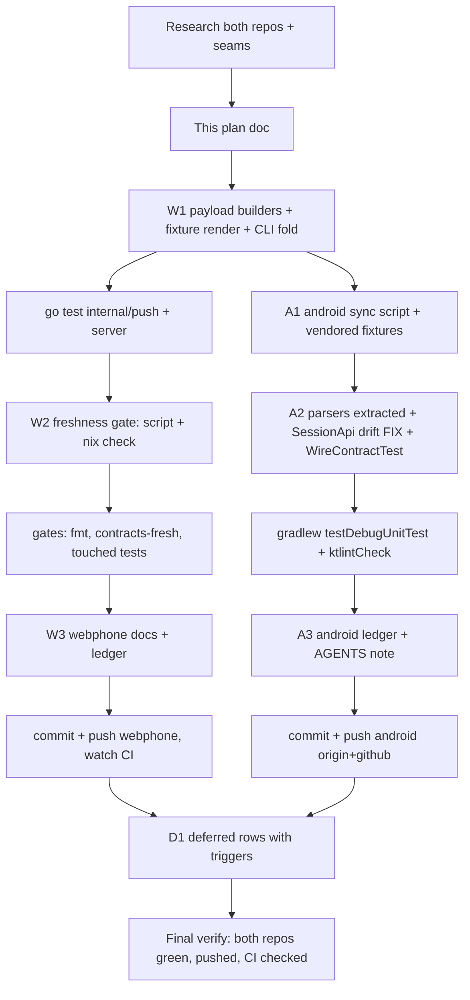

# SUPERB — Android wire-contract sync (webphone ⇄ webphone-android)

**Status:** EXECUTING (2026-11-10) · **Mandate:** keep `~/projects/webphone-android`
in sync and smartly integrated with this repo — contracts, not code.
· **Doctrine:** separate repos stay separate (2026-10-23 platform decision);
the sync surface is WIRE TRUTH only; no KMP, no ride-the-pin, no CI reliance
(android Actions billing is dead — every check must red LOCALLY).

## 1. Problem (verified against code today)

The Android shell hand-mirrors webphone's wire shapes in Kotlin. The mirrors
have no cross-repo check: field drift is caught "at the first device boot,
not before" (their own README). Concrete state:

1. **LIVE DRIFT FOUND (2026-11-10):** `SessionApi.resumeSession` reads
   `sip_domain` / `sip_password` / `websocket_url` from `GET /api/session` —
   the server's `sessionIdentity` (session_api.go) carries NONE of those keys.
   Real wire: `extension`, `did`, `display_name`, `numbers`, `extensions`,
   `password` (legacy arm) OR `sip_credential` (brokered arm), `agent_*`.
   SIP domain + websocket path live in `/config.js` (`PBX_CONFIG`), the
   island's source. The android shell has been reading EMPTY credential and
   domain fields — the exact no-ring / registration-failure class its own
   wake-lane diagnosis (d820810, same day) was chasing.
2. **Push facts pinned webphone-side only:** the `ring` / `ring_end` /
   `draft_ready` payload shapes (FCM data map + ntfy publish body) are pinned
   by `internal/push` Go tests; they appear in NO served document (contracts
   README: "internal-only … nothing in either document"). The android parsers
   (`FcmReceiver`, `NtfySubscriptionService`) decode them with zero shared truth.
3. **`/api/push-devices` registration** is the third seam: android ENCODES
   `PushDeviceRegisterRequest` (`device_id`/`transport`/`token`) and reads the
   list response — key names mirrored by hand in `SessionApi.registerPushDevice`.

## 2. Pareto breakdown

| Layer                | What                                                                                                                                                                                                                                                                        | Why it is the leverage                                                                                        |
| -------------------- | --------------------------------------------------------------------------------------------------------------------------------------------------------------------------------------------------------------------------------------------------------------------------- | ------------------------------------------------------------------------------------------------------------- |
| **1% → 51%**         | Committed wire FIXTURES generated from the Go types (both push transports, both sessionIdentity arms, push-device DTOs) + android JVM tests decoding them through the REAL Kotlin parsers + fix the live drift                                                              | Kills the only seam with zero drift detection AND the live bug; everything else is protocol around this truth |
| **4% → 64%**         | Freshness gate on the webphone side (contracts regen+diff extended to fixtures) + android sync script vendoring fixtures                                                                                                                                                    | Drift reds the SERVER repo at change time, not the client at boot time                                        |
| **20% → 80%**        | Protocol legs: release-runbook android leg, contracts README consumer section, CHANGELOG + TODO_LIST ledger rows in both repos                                                                                                                                              | Makes the sync a ritual, not a one-off                                                                        |
| **Other 20% → 100%** | Deferred, recorded as TODO rows with triggers: loopback live-check script (server-behavior proof), runtime contract-digest handshake at origin-config (the lean form of the open "android consumes the specs" row), device-train checklist refresh, KMP re-eval stays gated | Value real but not blocking; landing them untested would be verschlimmbesser                                  |

## 3. Design decisions (one-home doctrine respected)

- **ONE freshness home:** fixture rendering folds into the existing
  `webphone contracts` subcommand + `contracts-fresh` flake check +
  `scripts/contracts-fresh.sh`. No new CLI surface, no second gate.
- **No split brain:** `internal/push` gets small PURE payload builders
  (`fcmMessage`/`ntfyMessage` construction extracted from `Send`/`SendDraft`);
  fixtures render through the SAME funcs the senders use. Fixture truth can
  never diverge from wire truth.
- **sessionIdentity fixtures are type-true example instances** (both
  credential arms) — the JSON tags are the contract; values are fixed examples,
  documented as such.
- **Android consumption:** fixtures vendored into
  `app/src/test/resources/wire/` by `scripts/sync-wire-fixtures.sh`
  (WEBPHONE_DIR env, default `../webphone`; `--check` mode). JVM tests parse
  them through the real decode paths — parse helpers extracted verbatim from
  `FcmReceiver` / `NtfySubscriptionService` (port-then-test, no behavior change).
- **The drift FIX** is in-scope: landing fixtures while the mirror is known
  wrong would ship a known-red contract. `SessionApi` reads the real keys
  (`password` → `sip_credential` fallback) and pulls `sipDomain`/websocket
  from `/config.js` (regex-extract `PBX_CONFIG` fields, origin-derived
  fallback preserved).
- **NOT doing:** repo merge / subtree (platform decision), ride-the-pin
  (android consumes contracts, not the binary), KMP spike (gate unmet),
  full spec-derivation at bootstrap (open TODO row's heavy form — the digest
  handshake is the lean successor candidate), anything depending on GitHub
  Actions on the android side.

## 4. Task plan — coarse (30–100 min each, impact-sorted)

| #  | Task                                                                                                                                                     | Repo             | Impact | Effort   | Customer value                        | Depends on   |
| -- | -------------------------------------------------------------------------------------------------------------------------------------------------------- | ---------------- | ------ | -------- | ------------------------------------- | ------------ |
| W1 | Pure payload builders in `internal/push` + fixture render funcs in `internal/server` + fold into `contracts` CLI; committed `docs/contracts/wire/*.json` | webphone         | High   | ~90 min  | Ring-while-closed cannot silently rot | —            |
| W2 | Freshness gate: `scripts/contracts-fresh.sh` + `contracts-fresh` nix check cover `wire/`; regen + full gates                                             | webphone         | High   | ~45 min  | Drift reds at change time             | W1           |
| W3 | Protocol legs: runbook android leg, contracts README consumer section, CHANGELOG, TODO_LIST row updates                                                  | webphone         | Med    | ~40 min  | The ritual survives this session      | W1           |
| A2 | Android wire tests: extract pure parsers verbatim, `WireContractTest` over vendored fixtures, FIX `SessionApi` real keys + config.js seam                | webphone-android | High   | ~100 min | The phone actually registers + rings  | W1           |
| A1 | Android sync script + vendored fixtures under test resources                                                                                             | webphone-android | High   | ~40 min  | One-command re-sync forever           | W1           |
| A3 | Android ledger: CHANGELOG, TODO_LIST (live-contract-checks row unblocked locally), AGENTS sync-ritual note; gates `testDebugUnitTest` + `ktlintCheck`    | webphone-android | Med    | ~30 min  | Future sessions find the ritual       | A1, A2       |
| F1 | Detailed commits + push both repos + CI watch (webphone `gh run list`; android billing-red is expected, not code-red)                                    | both             | High   | ~30 min  | Landed, verified, pushed              | W1–W3, A1–A3 |
| D1 | Record deferred rows with triggers: loopback live-check script, runtime digest handshake, device-train checklist refresh                                 | both             | Low    | ~15 min  | The other 20% has owners + triggers   | F1           |

## 5. Task plan — fine (≤12 min each, impact-sorted within parent)

| #    | Micro-task                                                                                                                   | Parent | Verify                                                                    |
| ---- | ---------------------------------------------------------------------------------------------------------------------------- | ------ | ------------------------------------------------------------------------- |
| w1.1 | Extract `ringFcmPayload`/`draftFcmPayload` pure funcs from `FcmSender.Send*` (fcm.go)                                        | W1     | `go test ./internal/push/` green, fcm tests unchanged                     |
| w1.2 | Extract `ringNtfyBody`/`draftNtfyBody` pure funcs (ntfy.go)                                                                  | W1     | `go test ./internal/push/` green                                          |
| w1.3 | `internal/server/wirefixtures.go`: render fixtures (6 push files, 2 session arms, register + list DTOs) from the real types  | W1     | new golden test marshals match fixtures byte-for-byte                     |
| w1.4 | Fold `wire/` output into `cmd/webphone/contracts.go`; run regen; commit fixtures                                             | W1     | `contracts` writes wire/*.json; files present                             |
| w2.1 | Extend `scripts/contracts-fresh.sh` with wire diff                                                                           | W2     | script green on fresh tree                                                |
| w2.2 | Extend `contracts-fresh` nix check the same way                                                                              | W2     | `nix build .#checks.x86_64-linux.contracts-fresh` (or flake subset) green |
| w2.3 | `nix fmt` + touched-package `go test` + `scripts/contracts-fresh.sh`                                                         | W2     | all green                                                                 |
| w3.1 | Runbook android leg (push/session/apidocs seam change ⇒ re-sync + android train)                                             | W3     | doc read-through                                                          |
| w3.2 | contracts README: fixtures section + android consumer update                                                                 | W3     | doc read-through                                                          |
| w3.3 | CHANGELOG `[Unreleased]` + TODO_LIST row updates (spec-consumption row progress)                                             | W3     | lines present                                                             |
| a2.1 | Extract `FcmReceiver` data-map→fact parser verbatim (pure fun)                                                               | A2     | existing tests green                                                      |
| a2.2 | Extract ntfy message-JSON parser verbatim from `NtfySubscriptionService`                                                     | A2     | existing tests green                                                      |
| a2.3 | FIX `SessionApi.resumeSession`: `password`/`sip_credential` keys; config.js `sipDomain`/`websocketPath` seam (fallback kept) | A2     | WireContractTest pins both arms                                           |
| a2.4 | `WireContractTest.kt`: decode every vendored fixture through real parsers; assert register-encode keys                       | A2     | `testDebugUnitTest` green                                                 |
| a1.1 | `scripts/sync-wire-fixtures.sh` (copy + `--check` diff mode)                                                                 | A1     | run twice → idempotent                                                    |
| a1.2 | Vendor fixtures into `app/src/test/resources/wire/`                                                                          | A1     | tests find them                                                           |
| a3.1 | Android CHANGELOG + TODO_LIST rows (live-contract row unblocked-locally note; sync ritual row)                               | A3     | lines present                                                             |
| a3.2 | Android AGENTS.md: the sync ritual + fixture one-home note                                                                   | A3     | doc read-through                                                          |
| a3.3 | `nix develop -c ./gradlew testDebugUnitTest ktlintCheck`                                                                     | A3     | green                                                                     |
| f1.1 | Webphone: stage EXACT files (concurrent session on reports.templ — never `git add -A`), detailed commit                      | F1     | `git show --stat` clean                                                   |
| f1.2 | Push webphone main; `gh run list` watch to green                                                                             | F1     | CI green                                                                  |
| f1.3 | Android: stage + detailed commit; push origin + github                                                                       | F1     | both SHAs advance; mirror push ok (no workflow-file touch)                |
| d1.1 | Deferred rows into both TODO_LISTs with triggers                                                                             | D1     | rows present                                                              |

## 6. Execution graph

## 7. Verification contract for this train

- webphone: `go test ./internal/push/ ./internal/server/` green; fixture
  golden test green; `scripts/contracts-fresh.sh` green; `nix fmt` canonical
  (`scripts/format-check.sh`); buildflow tail green (train-start run already
  launched); CI green after push.
- webphone-android: `testDebugUnitTest` + `ktlintCheck` green in `nix develop`;
  push to both remotes; Actions-red = billing, not code (documented row).
- No file owned by the concurrent webphone session (reports.templ) is touched;
  no file owned by today's android wake-lane session is edited beyond additive
  seams (re-`git status` before every commit there).

## 8. Out of scope (recorded, not silently dropped)

- Loopback live-check script (boot webphone binary, curl the three seams,
  diff against fixtures) — deferred with trigger "first android release train".
- Runtime contract-digest handshake at origin-config — deferred as the lean
  successor of the open "android consumes the specs" TODO row; trigger: first
  real server/app version skew incident.
- KMP protocol spike — unchanged, both deferral gates required (preflight
  2026-11-08: half-met).
- Emulator/device train — operator-gated rows unchanged (first device train
  checklist refreshed only insofar as fixtures remove its contract-check leg).
