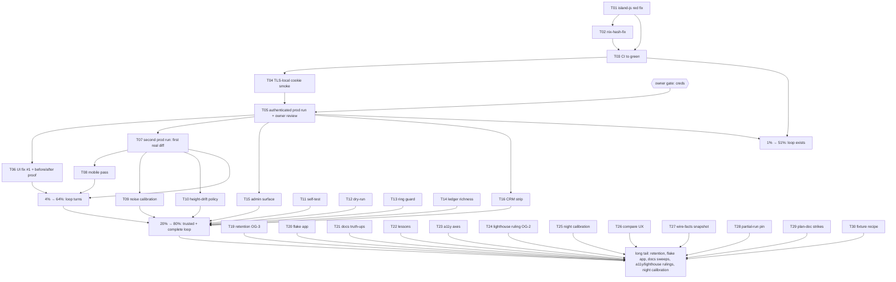

# SUPERB plan — the prod UI-tracking loop: Pareto breakdown + full execution plan

> Written 2026-11-10 15:05 CET. Owner: Lars. Session: the screenshot-tracking train (unlighthouse lane) that landed `--base-url`/`--track`/full-page/mobile/anonymous in `scripts/ui-capture.py`, ran prod once (anonymous), and sits beside a RED main (CI run `42828291169`, 13:50Z failure — the island-js sandbox red reproduced locally, another session's in-flight voicemail spec).
>
> Rules of this plan (the anti-VERSCHLIMMBESSER guards): the harness stays ONE home (`scripts/ui-capture.py`); no new tools, no library adoption, no reflowing markdown; the other session's in-flight files are only touched by the ONE scheduled task that unblocks everything (T01) and only to FINISH their intent; instrument-only changes carry no product behavior; every UI fix is proven by a before/after tracked run, never by vibes.

## Current state (facts this plan starts from)

| Fact                                                                                                                                                                                                              | Evidence                                                                                                    |
| ----------------------------------------------------------------------------------------------------------------------------------------------------------------------------------------------------------------- | ----------------------------------------------------------------------------------------------------------- |
| Harness remote+track+diff shipped and verified locally (4 lanes green)                                                                                                                                            | `ui-shots/127.0.0.1_18097/`, status report `docs/status/2026-11-10_14-42_prod-screenshot-tracking-train.md` |
| Prod run #1 exists (anonymous, 4 shots, `v2.12.0`)                                                                                                                                                                | `ui-shots/pbx.artmann.tech/20261110T082706Z/`                                                               |
| Daemon pushed the backlog; remote tip `add9580c`; CI FAILED 13:50Z                                                                                                                                                | `gh run list` run `42828291169`                                                                             |
| The red: `shell.test.mjs:1260` "a dead recording keeps one toast" expects 1 toast, got 0 — landed in unpushed-then-pushed daemon commit `0d2e9ff8` with `shell.js` changes from ANOTHER session's voicemail train | `nix build .#checks.x86_64-linux.island-js` fails at HEAD; local island run shows exactly one red spec      |
| `nix-hash-fix` buildflow step: status failed, own output says "All 4 flake target(s) built successfully, 0 hashes changed"                                                                                        | `buildflow history --step nix-hash-fix --last-error` (run `20261110-083158-4f16e74a`, 77/81)                |
| Authenticated prod capture blocked ONLY on credentials (env `WEBPHONE_CAPTURE_EXTENSION` / `WEBPHONE_CAPTURE_PASSWORD`); passkey ceremony cannot be automated                                                     | prod `/login` carries `#passkey-login`; stack E2E creds are test-VM-only                                    |
| Working tree carries another session's in-flight edit (`internal/server/wirefixtures_test.go`) and their report archive move                                                                                      | `git status` 15:05                                                                                          |

## The Pareto

### The 1% that delivers 51% — "the loop exists"

Three acts, ~3 hours total. Without ANY one of them, "make the UI not ugly" cannot even start:

1. **Kill the red gate** (T01): finish-or-revert the other session's fallback-silence change so `island-js` passes and main goes green. A red main poisons every gate verdict and blocks all other trains — it is the single highest-leverage hour in the repo right now.
2. **See the real UI** (T04→T05): TLS-local smoke of the cookie path, then the authenticated prod run (owner-gated creds) — the all-tabs matrix over REAL data.
3. **Name the uglies** (T05 review): the owner opens `gallery.html` and ranks the top-5 ugliest surfaces. Direction is now a list, not a vibe.

Why only 51%: a loop that exists but has never turned still proves nothing; but every further percent depends on these three.

### The 4% that delivers 64% — "the loop turns"

Add ~a day: the first real diff chain (T07), the mobile pass (T08 — the layout seam demonstrably lives at 390px: the bottom-bar click interception was found there), and the FIRST UI FIX from the inventory landing with a before/after tracked run proving it (T06). Now a UI change is verifiable end-to-end — screenshot, diff, fix, re-diff — and the first visible improvement is shipped. Main stays green (T03).

### The 20% that delivers 80% — "the loop is trusted and complete"

Add ~2 days: diff-noise calibration on real data (T09) + a height-drift policy so full-page diffs stop degrading to side-by-side (T10), a harness `--self-test` and `--dry-run` so the instrument cannot silently break itself (T11, T12), the ringing-card re-shoot guard (T13), richer run ledgers (T14), and the remaining surfaces — Admin, CRM strip, `/enroll`, dense transcript search (T15–T18). The instrument is now complete and honest; every surface the product renders is tracked.

### The remaining 80% → 100%

The long tail: retention ruling (T19), `nix run .#ui-track` (T20), docs truth-ups and sweeps (T21–T24, T29–T31, T35), accessibility emulation axes evaluation (T25), lighthouse-style scores DECISION (T26 — evaluation only until the owner rules), night-run stability calibration (T27), compare/gallery UX niceties (T28, T34), wire-facts snapshots (T36). Individually small; collectively they are the difference between a demo and a habit.

## Comprehensive plan — ALL tasks, 30–100 min each

Sorted by importance/impact/effort/customer-value (rank = execution order). "OG" = owner-gated.

| Rank | ID  | Task                                                                                                                                                                                                                                                            | Impact                 | Effort  | Value   | Est | Depends   |
| ---- | --- | --------------------------------------------------------------------------------------------------------------------------------------------------------------------------------------------------------------------------------------------------------------- | ---------------------- | ------- | ------- | --- | --------- |
| 1    | T01 | Fix the island-js red: diagnose "a dead recording keeps one toast" (0 vs 1 toasts); FINISH the other session's fallback-silence intent (or revert `0d2e9ff8`'s half if unfinishable); spec green locally + in sandbox build; confirm the failed CI job was this | Blocks every train     | 100m    | High    | 100 | —         |
| 2    | T02 | Diagnose `nix-hash-fix` failed-vs-successful-output contradiction; fix the step or the tree; re-run buildflow → 0 failures                                                                                                                                      | Gate trust             | 45m     | Med     | 45  | T01       |
| 3    | T03 | Watch CI to green post-fix; record verdict; restore the always-green-main posture                                                                                                                                                                               | Blocks everything      | 30m     | High    | 30  | T01       |
| 4    | T04 | TLS-fronted local boot smoke: self-signed cert + `--resolve`, exercise `add_cookie` under `Secure`/`SameSite=Strict` before touching prod login                                                                                                                 | De-risks T05           | 60m     | Med     | 60  | T03       |
| 5    | T05 | **Authenticated prod capture + owner gallery review** [OG: creds]: env-credential run, `gallery.html` walkthrough, ranked top-5 ugliness inventory written into a planning note                                                                                 | THE product goal       | 45m+60m | High    | 105 | T04, OG-1 |
| 6    | T06 | UI fix #1 from the inventory lands (highest-ranked ugliness), proven by before/after tracked runs                                                                                                                                                               | First visible win      | 100m    | High    | 100 | T05       |
| 7    | T07 | Second prod run → first real `compare.html` diff chain; owner judges the diff presentation                                                                                                                                                                      | Regression sight       | 30m     | High    | 30  | T05       |
| 8    | T08 | Mobile prod pass `--viewport 390x844` + review; decide whether mobile rides every prod run                                                                                                                                                                      | Layout seam lives here | 45m     | High    | 45  | T05       |
| 9    | T09 | Diff-noise calibration on real data: threshold + badge-bar become flags; document the noise bar                                                                                                                                                                 | Diff trust             | 100m    | Med     | 100 | T07       |
| 10   | T10 | Height-drift policy for full-page diffs (top-N clip for list surfaces or size-bucket) so diffs stop skipping                                                                                                                                                    | Diff trust             | 100m    | Med     | 100 | T07       |
| 11   | T11 | `ui-capture --self-test`: pin shot_key, surface-list building, lenient rules, compare math (fixture HTML, stub driver; no chromium)                                                                                                                             | Instrument safety      | 100m    | Med     | 100 | —         |
| 12   | T12 | Remote `--dry-run`: login + resolve + print surfaces, no shooting (fast credential/surface sanity)                                                                                                                                                              | Operator UX            | 30m     | Med     | 30  | —         |
| 13   | T13 | Ringing-card detection → auto re-shoot that surface (an inbound call mid-run ruins shots silently today)                                                                                                                                                        | Shot honesty           | 100m    | Med     | 100 | —         |
| 14   | T14 | Run-ledger richness: surface URL per shot, git/`/version` commit sha, byte-size delta column in compare, threads-shortfall note                                                                                                                                 | Forensics              | 60m     | Low-Med | 60  | —         |
| 15   | T15 | Admin tab in remote mode when the session resolves admin (`isAdminSession` probe)                                                                                                                                                                               | Surface completeness   | 60m     | Med     | 60  | T05       |
| 16   | T16 | CRM `crm-context` strip tracked when the prod CRM seam is on                                                                                                                                                                                                    | Surface completeness   | 45m     | Med     | 45  | T05       |
| 17   | T17 | `/enroll` as conditional anonymous surface                                                                                                                                                                                                                      | Surface completeness   | 45m     | Low     | 45  | —         |
| 18   | T18 | Dense `history-transcript` shot: resolve a transcript-bearing `?q=` on real data                                                                                                                                                                                | Shot density           | 30m     | Low     | 30  | T05       |
| 19   | T19 | Storage/retention ruling + `--prune` [OG: where prod shots may live]                                                                                                                                                                                            | Data governance        | 60m     | Med     | 60  | OG-3      |
| 20   | T20 | Flake app `nix run .#ui-track` (one-command prod recipe)                                                                                                                                                                                                        | Operator UX            | 60m     | Low-Med | 60  | —         |
| 21   | T21 | Docs truth-ups: `.gitignore` T23 comment (track history persists), mypy.ini pillow mirror, "24 shots" stale sweep                                                                                                                                               | Doc trust              | 30m     | Low     | 30  | —         |
| 22   | T22 | lessons.md entry: daemon commit race ate two narratives; stub `listeners` lazy materialization; capture-browser SIP-registration caveat + runbook cross-doc                                                                                                     | War-story ledger       | 30m     | Low     | 30  | —         |
| 23   | T23 | Accessibility emulation axes (reduced-motion, forced-colors): evaluate → GO/NO-GO ruling                                                                                                                                                                        | A11y ugliness          | 60m     | Low-Med | 60  | —         |
| 24   | T24 | Lighthouse-style per-surface scores: evaluation + owner decision only (deliberately NOT built this train)                                                                                                                                                       | Instrument scope       | 45m     | Low     | 45  | OG-2      |
| 25   | T25 | Night-run diff-stability calibration (quiet-window baseline on real data)                                                                                                                                                                                       | Noise floor            | 30m     | Low     | 30  | T09       |
| 26   | T26 | Compare/gallery UX: cross-links between compare sections and run galleries, `--open`                                                                                                                                                                            | Operator UX            | 45m     | Low     | 45  | —         |
| 27   | T27 | Wire-facts snapshots: `/config.js` + Settings service rows as text in each run                                                                                                                                                                                  | Forensics              | 60m     | Low     | 60  | —         |
| 28   | T28 | Partial-run tolerance documented + pinned (interrupted run compares gracefully — discovered accidentally)                                                                                                                                                       | Robustness             | 45m     | Low     | 45  | T11       |
| 29   | T29 | Old ui-ux planning docs: strike items this train satisfied, with evidence (docs-gates style)                                                                                                                                                                    | Doc hygiene            | 60m     | Low     | 60  | —         |
| 30   | T30 | Bare-boot remote-mode fixture recipe documented (the 18098 pattern) + 429 stay-manual ruling noted                                                                                                                                                              | Doc hygiene            | 30m     | Low     | 30  | —         |

Micro-decomposition of every task follows; micro rows are the units of execution.

## Micro plan — EVERY task decomposed, ≤12 min each

| Rank | ID         | Micro task                                                                                                               | ≤min | Parent | Gate       |
| ---- | ---------- | ------------------------------------------------------------------------------------------------------------------------ | ---- | ------ | ---------- |
| 1    | M01.01     | Copy the failing spec into a scratch harness; add per-step console prints (click → error fired → toasts DOM dump)        | 12   | T01    | —          |
| 1    | M01.02     | Run scratch; record actual toast count + which branch skipped `vmPlaybackFailed`                                         | 12   | T01    | M01.01     |
| 1    | M01.03     | Read the final `vmBuildWave`/`vmFallback` chain once more with probe output in hand; name the mechanism                  | 12   | T01    | M01.02     |
| 1    | M01.04     | Fix `shell.js` (finish fallback-silence intent) — smallest change that makes the mechanism honest                        | 12   | T01    | M01.03     |
| 1    | M01.05     | Run the one spec green; then the whole shell.test.mjs green                                                              | 12   | T01    | M01.04     |
| 1    | M01.06     | `nix build .#checks.x86_64-linux.island-js` green; delete scratch                                                        | 12   | T01    | M01.05     |
| 1    | M01.07     | Confirm the 13:50Z CI job identity was island-js (`gh run view` when the API answers); note any SECOND red found         | 12   | T01    | —          |
| 1    | M01.08     | Commit the fix (detailed message naming the mechanism + the borrowed train); watch CI verdict                            | 12   | T01    | M01.06     |
| 2    | M02.01     | Re-run `buildflow -s nix-hash-fix`; capture full stdout/stderr to a file                                                 | 12   | T02    | T01        |
| 2    | M02.02     | Read the step's script in `.buildflow.yml`; find the exit-code path that fails after "0 hashes changed"                  | 12   | T02    | M02.01     |
| 2    | M02.03     | Fix the step (instrument) or the tree (if a real hash drift); rerun step green                                           | 12   | T02    | M02.02     |
| 2    | M02.04     | Full `buildflow` → 0 failed steps; record the run id in this plan's ledger                                               | 12   | T02    | M02.03     |
| 3    | M03.01     | `gh run list` → newest CI green; if red, name the job and loop back to M01                                               | 12   | T03    | T01        |
| 3    | M03.02     | `git ls-remote` == HEAD; write the always-green posture line into the plan ledger                                        | 12   | T03    | M03.01     |
| 4    | M04.01     | Generate a self-signed cert; boot the binary with TLS shape per the passkey-smoke recipe (`--resolve webphone.test`)     | 12   | T04    | T03        |
| 4    | M04.02     | Remote-capture against the TLS boot with env creds; verify cookie injection + shots                                      | 12   | T04    | M04.01     |
| 4    | M04.03     | If `add_cookie` misbehaves under Secure/Strict: fix injection (domain/path/secure fields); rerun                         | 12   | T04    | M04.02     |
| 4    | M04.04     | Record the TLS recipe in the harness docstring (one paragraph)                                                           | 12   | T04    | M04.03     |
| 5    | M05.01     | [OG-1] Receive creds; export env; `--dry-run`-equivalent sanity (surfaces resolve on prod)                               | 12   | T05    | T04        |
| 5    | M05.02     | Authenticated prod run: `--base-url https://pbx.artmann.tech --track --label "first authenticated matrix"`               | 12   | T05    | M05.01     |
| 5    | M05.03     | Watch the run's SIP registration note + surface list print; rerun if a call rang mid-run                                 | 12   | T05    | M05.02     |
| 5    | M05.04     | Verify summary.json (version, thread-NN count, history-transcript presence, no unexpected skips)                         | 12   | T05    | M05.03     |
| 5    | M05.05     | Open gallery; owner walkthrough act 1 (core tabs, light) — note uglies                                                   | 12   | T05    | M05.04     |
| 5    | M05.06     | Owner walkthrough act 2 (threads + history) — note uglies                                                                | 12   | T05    | M05.05     |
| 5    | M05.07     | Owner walkthrough act 3 (settings/contacts/fax/voicemail/404 + dark pass) — note uglies                                  | 12   | T05    | M05.06     |
| 5    | M05.08     | Write the ranked ugliness inventory into `docs/planning/` (each row: surface, what's ugly, hypothesis, fix sketch)       | 12   | T05    | M05.07     |
| 6    | M06.01     | Pick fix #1 from the inventory (highest rank × smallest blast radius)                                                    | 12   | T06    | M05.08     |
| 6    | M06.02     | Re-shoot the affected surface pre-fix (`--surface <name>` tracked) = the BEFORE artifact                                 | 12   | T06    | M06.01     |
| 6    | M06.03     | Implement the fix (CSS/templ/JS per surface; templ → regen + tw.css rebuild ritual)                                      | 12   | T06    | M06.02     |
| 6    | M06.04–.07 | Verify: island/type gates, go tests if Go touched, `nix fmt` (split across 12-min units as the change demands)           | 12×n | T06    | M06.03     |
| 6    | M06.08     | AFTER tracked run of the same surface; compare.html shows the delta                                                      | 12   | T06    | M06.04–.07 |
| 6    | M06.09     | Commit + push; CI watch                                                                                                  | 12   | T06    | M06.08     |
| 7    | M07.01     | Second authenticated prod run (same label family)                                                                        | 12   | T07    | T05        |
| 7    | M07.02     | Open compare.html with the owner; judge badges/3-up layout/diff readability                                              | 12   | T07    | M07.01     |
| 7    | M07.03     | Note the top noise sources observed (timestamp pixels? avatars? relative times?)                                         | 12   | T07    | M07.02     |
| 8    | M08.01     | Mobile prod run `--viewport 390x844 --track`                                                                             | 12   | T08    | T05        |
| 8    | M08.02     | Owner mobile review (thumb zones, overflow, the fixed bottom bar)                                                        | 12   | T08    | M08.01     |
| 8    | M08.03     | Decide + record: mobile in every prod run by default, or on-demand flag                                                  | 12   | T08    | M08.02     |
| 9    | M09.01     | Collect per-surface changed-% across two quiet-window runs                                                               | 12   | T09    | T07        |
| 9    | M09.02     | Histogram the noise; pick threshold + badge bar values                                                                   | 12   | T09    | M09.01     |
| 9    | M09.03     | Add `--diff-threshold` / `--badge-bar` flags (defaults = today's 12 / 0.5%)                                              | 12   | T09    | M09.02     |
| 9    | M09.04     | Document the calibration in the harness docstring + this plan ledger                                                     | 12   | T09    | M09.03     |
| 10   | M10.01     | Measure height drift across run pairs per surface (which surfaces drift, by how much)                                    | 12   | T10    | T07        |
| 10   | M10.02     | Choose policy: top-N clip for list surfaces vs size-bucket pairing                                                       | 12   | T10    | M10.01     |
| 10   | M10.03     | Implement `--diff-clip N` (or bucket logic) in pixel_diff path                                                           | 12   | T10    | M10.02     |
| 10   | M10.04     | Pin with a tiny self-test case (clip math) — feeds T11                                                                   | 12   | T10    | M10.03     |
| 10   | M10.05     | Re-compare an existing run pair; verify diffs compute on previously-skipped pairs                                        | 12   | T10    | M10.04     |
| 11   | M11.01     | Extract pure helpers inventory (shot_key, parse_viewport, sanitize, surface building, diff math, gallery rows)           | 12   | T11    | —          |
| 11   | M11.02     | Write fixture HTML + expected surface lists as test data                                                                 | 12   | T11    | M11.01     |
| 11   | M11.03     | `--self-test` for shot_key/viewport/sanitize (pure string tests)                                                         | 12   | T11    | M11.02     |
| 11   | M11.04     | `--self-test` for surface-list building from fixture HTML (regex paths, dedup, caps)                                     | 12   | T11    | M11.03     |
| 11   | M11.05     | `--self-test` for lenient rules (marker dict, 404-exempt not-found, absent markers) — needs a stub driver shim           | 12   | T11    | M11.04     |
| 11   | M11.06     | `--self-test` for compare math + gallery row generation on fixture PNGs (tiny generated images)                          | 12   | T11    | M11.05     |
| 11   | M11.07     | Wire self-test into AGENTS command block; exit non-zero on any check                                                     | 12   | T11    | M11.06     |
| 12   | M12.01     | Add `--dry-run` flag; path: login → resolve → print → exit before driver start                                           | 12   | T12    | —          |
| 12   | M12.02     | Test against local bare boot + prod anonymous; document in docstring                                                     | 12   | T12    | M12.01     |
| 13   | M13.01     | Detect the ringing call card selector in the island DOM (grep calls.js for the ringing view)                             | 12   | T13    | —          |
| 13   | M13.02     | After each surface shot: if ringing card present → print warning + re-shoot once after N s                               | 12   | T13    | M13.01     |
| 13   | M13.03     | Test with a stub DOM in the self-test lane; document the behavior                                                        | 12   | T13    | M13.02     |
| 14   | M14.01     | summary.json: add per-shot `url` field                                                                                   | 12   | T14    | —          |
| 14   | M14.02     | summary.json: add `commit` (from `/version` payload) beside version                                                      | 12   | T14    | M14.01     |
| 14   | M14.03     | resolve_remote_surfaces: print + record when live threads < `--threads`                                                  | 12   | T14    | —          |
| 14   | M14.04     | compare.html: byte-size delta column (prev vs cur bytes)                                                                 | 12   | T14    | —          |
| 14   | M14.05     | Regenerate a compare from existing runs to verify the new columns render                                                 | 12   | T14    | M14.04     |
| 15   | M15.01     | Read how admin resolves per request (`server.isAdminSession`); find the browser-visible admin signal (nav link presence) | 12   | T15    | T05        |
| 15   | M15.02     | resolve_remote_surfaces: probe `/admin` when the nav link exists; add the surface conditionally                          | 12   | T15    | M15.01     |
| 15   | M15.03     | Marker pin for the admin panel; lenient path if a future deploy demotes mid-run                                          | 12   | T15    | M15.02     |
| 16   | M16.01     | Detect the CRM strip on a prod thread page (`#wp-crm-context` in a partial fetch); add surface only then                 | 12   | T16    | T05        |
| 16   | M16.02     | Shot + note; document that prod CRM truth comes from the real Kith, never the fake                                       | 12   | T16    | M16.01     |
| 17   | M17.01     | Anonymous loop: conditional `/enroll` when linked from the login page (probe href presence)                              | 12   | T17    | —          |
| 17   | M17.02     | Marker pin + shot; 404-skip path verified                                                                                | 12   | T17    | M17.01     |
| 18   | M18.01     | history-transcript: scrape a transcript-bearing `?q=` term from the page itself; fall back to plain `/history`           | 12   | T18    | T05        |
| 18   | M18.02     | Verify the details-open step still applies; shot density check                                                           | 12   | T18    | M18.01     |
| 19   | M19.01     | [OG-3] Owner ruling on where prod shots may live (laptop-only vs synced store)                                           | 12   | T19    | —          |
| 19   | M19.02     | Implement `--prune N` (keep newest N runs per host) or record laptop-only + manual cleanup as the ruling                 | 12   | T19    | M19.01     |
| 19   | M19.03     | Document the ruling in AGENTS command block + .gitignore comment                                                         | 12   | T19    | M19.02     |
| 20   | M20.01     | flake.nix apps: `ui-track` wrapping the documented env+shell dance                                                       | 12   | T20    | —          |
| 20   | M20.02     | `nix run .#ui-track -- --help` green; AGENTS command block updated to the one-liner                                      | 12   | T20    | M20.01     |
| 21   | M21.01     | `.gitignore` T23 comment truth-up (track history persists; wipe is non-track only)                                       | 12   | T21    | —          |
| 21   | M21.02     | mypy.ini: mirror the pillow/selenium env arrangement if the file lists capture deps                                      | 12   | T21    | —          |
| 21   | M21.03     | Sweep docs for stale "24 shots" claims; fix in place (grep `24 shots`, `24-shot`)                                        | 12   | T21    | —          |
| 22   | M22.01     | lessons.md: the daemon-commit race (two eaten narratives, one tool call, verify content not message)                     | 12   | T22    | —          |
| 22   | M22.02     | lessons.md: stub `listeners` lazy materialization probe gotcha; the hung-probe story                                     | 12   | T22    | —          |
| 22   | M22.03     | lessons.md: capture browser takes a REAL SIP registration; runbook cross-link                                            | 12   | T22    | —          |
| 22   | M22.04     | Mixed-tree ritual note: re-run foreign specs before pushing a shared main                                                | 12   | T22    | —          |
| 23   | M23.01     | Evaluate `Emulation.setEmulatedMedia` reduced-motion + forced-colors feasibility (CDP shape)                             | 12   | T23    | —          |
| 23   | M23.02     | Prototype one surface × two axes; look at the shots                                                                      | 12   | T23    | M23.01     |
| 23   | M23.03     | GO/NO-GO ruling + record (if GO: viewport-style axis design doc line)                                                    | 12   | T23    | M23.02     |
| 24   | M24.01     | Evaluate lighthouse-core feasibility in this stack (nix availability, auth, CSP) — half                                  | 12   | T24    | —          |
| 24   | M24.02     | Evaluate part 2; write the GO/NO-GO recommendation for the owner                                                         | 12   | T24    | M24.01     |
| 25   | M25.01     | Schedule/execute a quiet-window run pair; record per-surface noise                                                       | 12   | T25    | T09        |
| 25   | M25.02     | Adjust badge bar if the night noise floor differs; document                                                              | 12   | T25    | M25.01     |
| 26   | M26.01     | compare.html sections link to run galleries (relative anchors)                                                           | 12   | T26    | —          |
| 26   | M26.02     | `--open` flag (xdg-open the produced HTML; local-only, no-op with a note when headless)                                  | 12   | T26    | M26.01     |
| 27   | M27.01     | Snapshot `/config.js` + Settings service-row text into the run dir (JSON sidecar)                                        | 12   | T27    | —          |
| 27   | M27.02     | Surface the sidecar in gallery header (one line)                                                                         | 12   | T27    | M27.01     |
| 28   | M28.01     | Document partial-run tolerance in the docstring; add a self-test case feeding a partial dir into compare                 | 12   | T28    | T11        |
| 29   | M29.01     | Grep `docs/planning/*ui-ux*` for harness expectations; strike satisfied rows with evidence                               | 12   | T29    | —          |
| 29   | M29.02     | Same sweep for status-report §f leftovers touching the harness                                                           | 12   | T29    | M29.01     |
| 30   | M30.01     | Document the bare-boot fixture recipe (ports, env, data-dir reuse) in the harness docstring                              | 12   | T30    | —          |
| 30   | M30.02     | Record the 429 stay-manual ruling (no auto-retry: rate-limit safety)                                                     | 12   | T30    | M30.01     |

Execution discipline: every micro row ends with its verification inside the same sitting; any row that cannot verify within 12 minutes is split, not stretched.

## Execution graph

## Non-goals (what this plan deliberately does NOT do)

1. No second harness/crawler — `scripts/ui-capture.py` stays the ONE visual home.
2. No go.mod / vendor changes — Pillow is capture-env-only; the island stays verbatim-served.
3. No markdown corpus reflow; docs edits are surgical.
4. No product behavior changes from the instrument train — UI fixes (T06+) are separate, each with before/after proof.
5. No lighthouse scores BUILT before the owner ruling (T24 evaluates only).
6. The other session's in-flight files (`internal/server/wirefixtures_test.go`, their report archive moves) stay untouched EXCEPT the T01 spec/`shell.js` fix that unblocks main.
7. No widening of defaults (threads stay 6, threshold stays 12) until calibration says otherwise.

## Owner gates

| Gate | Blocks                | Question                                                                                                                   |
| ---- | --------------------- | -------------------------------------------------------------------------------------------------------------------------- |
| OG-1 | T05, T06–T08, T15–T18 | Prod capture credentials (`WEBPHONE_CAPTURE_EXTENSION` / `WEBPHONE_CAPTURE_PASSWORD`); extension-password lane acceptable? |
| OG-2 | T24                   | Build lighthouse-style scores, or rule the instrument shots-only?                                                          |
| OG-3 | T19                   | Where may prod shots live (laptop-only vs synced store), and what retention?                                               |

## Ledger

| When             | What                                                                                                                                                                                                                                                                                                                                                                                                                                                                                                                                                                                   |
| ---------------- | -------------------------------------------------------------------------------------------------------------------------------------------------------------------------------------------------------------------------------------------------------------------------------------------------------------------------------------------------------------------------------------------------------------------------------------------------------------------------------------------------------------------------------------------------------------------------------------- |
| 2026-11-10 15:05 | Plan written; CI red at 13:50Z attributed to the island-js sandbox red (local repro); daemon pushed the backlog to `add9580c`                                                                                                                                                                                                                                                                                                                                                                                                                                                          |
| 2026-11-10 18:5x | T01 RESOLVED WITHOUT TOUCHING IT: the red was the other session's in-flight spec; their follow-up commits finished the intent — island suite 328/328 at HEAD, `island-js` sandbox check green, CI green on push run 42832784499. The re-run-at-HEAD lesson is in docs/lessons.md.                                                                                                                                                                                                                                                                                                      |
| 2026-11-10 18:5x | T02 DIAGNOSED (tree correct, instrument noisy): buildflow's own diagnose lines say "build green but 1 lock-drift warning(s) found, surfacing the contradiction"; git proves go.mod (64c1c637, 11-08) OLDER than the vendorHash pin (5c00b153, 11-10) — the detector's premise is backwards. Mechanism + verification recipe recorded in .buildflow.yml § nix-hash-fix. Upstream finding is the owner's own tool; no issue filed.                                                                                                                                                       |
| 2026-11-10 18:5x | T03 DONE: main green (CI run 42832784499 success); `nix build .#checks.x86_64-linux.island-js` green.                                                                                                                                                                                                                                                                                                                                                                                                                                                                                  |
| 2026-11-10 18:5x | T04 DONE: TLS-front smoke green end-to-end (caddy `tls internal` on 18443 → binary 18097; remote lane `--insecure --host-map webphone.test=127.0.0.1`; dry-run + full tracked runs; Secure-cookie add_cookie verified by real session surfaces). Gotchas baked into the harness: chromedriver honors the acceptInsecureCerts CAPABILITY (the switch form is ignored); the python HTTP lane shares the map via a socket.getaddrinfo patch.                                                                                                                                              |
| 2026-11-10 18:5x | T05–T08 REMAIN OWNER-GATED (OG-1 credentials): nothing in this train can mint a prod session beyond the anonymous lane; T06–T08 stay blocked behind T05 as planned.                                                                                                                                                                                                                                                                                                                                                                                                                    |
| 2026-11-10 18:5x | T09/T10 LANDED: `--diff-threshold`/`--badge-bar` (defaults 12/0.5 preserved) + `--diff-clip` verified on REAL drifted pairs (settings-light 10.372% clipped, media-transcribe-dark 7.849% — pairs that previously skipped to side-by-side). Calibration VALUES stay owner-data work (T07+); clip policy = crop both to the common top-left region, marked `clipped`.                                                                                                                                                                                                                   |
| 2026-11-10 18:5x | T11/T12 LANDED: `--self-test` (29 checks, green in BOTH envs — pixel math asserted inside the capture env, skipped with a named note on the bare lint env) and `--dry-run` (verified: TLS lane login + resolve + conditional-surface probes, exits before any browser).                                                                                                                                                                                                                                                                                                                |
| 2026-11-10 18:5x | T13 LANDED (guard verified negative): `#incoming-call:not([hidden])` re-shoots a banner-contaminated cell once; idle-boot negative test shows 0 matches (no false guard). A POSITIVE ringing-path test needs a real inbound call — left to the first live capture.                                                                                                                                                                                                                                                                                                                     |
| 2026-11-10 18:5x | T14/T26/T27/T28 LANDED: per-shot urls + deployment commit in summary.json, threads shortfall note, byte-size deltas + prev/cur gallery links in compare.html, wire-facts.json (config.js + Settings server section, verbatim), partial-run compare pinned in --self-test. Discovered live: a crashed capture left EMPTY run dirs that hijacked the next compare's "previous" — fixed with discard_empty_run.                                                                                                                                                                           |
| 2026-11-10 18:5x | T15 IMPLEMENTED + PRODUCT WALL DOCUMENTED: `has_admin_nav` detection is self-test-pinned, but `isAdminSession` requires `sess.LoginEmail` and the extension-password lane NEVER sets it (internal/server/admin.go) — a credential-lane capture session can never be admin. Detection stays dormant-but-correct for any future identity-carrying capture lane.                                                                                                                                                                                                                          |
| 2026-11-10 18:5x | T16 LANDED + VERIFIED LIVE: CRM-strip detection fired on a real admin+CRM boot (fake Kith + thread fragment carrying #wp-crm-context → `crm-context` joined the matrix). First setup attempt failed because the fake CRM died with its spawning snippet — a harness-adjacent server must outlive the process that configured it.                                                                                                                                                                                                                                                       |
| 2026-11-10 18:5x | T17/T18 LANDED + VERIFIED: `/enroll` joins the anonymous pass when the page renders the form (probed, never a guessed link — the product reaches /enroll via DISTRIBUTED token links, not a login-page link); dense `history-transcript` scrapes its q= word from the first live transcript body (`q='Quarterly'` on the fixture data).                                                                                                                                                                                                                                                |
| 2026-11-10 18:5x | T19 LANDED + VERIFIED LIVE: `--prune 2` removed exactly the two empty crashed-attempt dirs on the TLS host, keeping the newest two real runs. The RETENTION RULING (OG-3: where prod shots may live) stays the owner's; the tool now exists for whichever verdict lands.                                                                                                                                                                                                                                                                                                               |
| 2026-11-10 18:5x | T20 LANDED: `nix run .#ui-track -- --help` green (flake app carries chromium + chromedriver + selenium + pillow; the harness script rides the committed tree via the store copy). AGENTS command block carries the one-liner.                                                                                                                                                                                                                                                                                                                                                          |
| 2026-11-10 18:5x | T21/T22/T29/T30 LANDED: .gitignore truth-up (track history persists; prune is the only retention), mypy.ini PIL mirror, AGENTS "24 shots" → deployment-following matrix, the 2026-10-29 plan's "harness not re-run" row STRUCK with evidence, lessons.md § tracking-train process lessons (4 entries), harness docstring carries the TLS recipe + fixture recipe + the 429-stays-manual ruling.                                                                                                                                                                                        |
| 2026-11-10 18:5x | T23 RULING (evaluation done, GO/NO-GO): technically GO-cheap — every run already drives `Emulation.setEmulatedMedia` for prefers-color-scheme, and `prefers-reduced-motion`/`forced-colors` ride the same command; but each axis DOUBLES the shot matrix and the ugliness inventory (T05) is still owner-pending. RULING: DEFERRED as a default axis; revisit when T06–T08 land or the first a11y ugliness is named. Opt-in design (one line, no build): a repeatable `--emulate-feature name=value`.                                                                                  |
| 2026-11-10 18:5x | T24 RECOMMENDATION (evaluation only, per the task's own scope): NO-GO for now. lighthouse-core needs an npm node env (nixpkgs' `lighthouse` is the ETH client — name collision), launches its OWN chrome (pre-authed session-cookie injection is brittle), and its layout-relevant signal is already covered better by full-page shots + DOM pins + the layout proof. If the owner wants scores (OG-2), the honest lane is a separate opt-in app, not this instrument.                                                                                                                 |
| 2026-11-10 18:5x | Noise observations for the calibration tasks (T07/T09/T25 input): two local runs 3 minutes apart over identical seeds diffed 22/26 pairs above zero with a MAX of 2.5% (thread surfaces — relative timestamps are the noise source); TLS runs 90s apart diffed 28/28 above the 0.5% bar for the same reason. The 0.5% badge bar is OPTIMISTIC on this product; expect the owner-facing calibration to land nearer 2–3%.                                                                                                                                                                |
| 2026-11-10 19:5x | T28 SECOND HALF + §f-3 PARTIAL LANDED: the EMPTY-run discard guard is self-test-pinned (empty crashed dir removed, a run with shots kept) and the `--open` decision is extracted as pure `open_target(produced, out_dir, has_display)` + pinned (produced artifact wins, out-dir fallback, headless refusal) — --self-test now carries 35 checks, green in BOTH envs (host bare + capture env with pillow). ruff/mypy scoped gates exit 0. The webbrowser side effect and a REAL-display `--open` pass stay first-prod-session items.                                                  |
| 2026-11-10 19:5x | T13 SELECTOR POSITIVELY VERIFIED against the served markup (evidence, not a live call): phone.templ renders `
` and the island shows/hides by toggling the `hidden` ATTRIBUTE (ui.js `els.incoming.hidden = false/true`), so `#incoming-call:not([hidden])` matches exactly the ringing state. The positive-path LIVE exercise (a real inbound call mid-run) stays with the first prod session (TODO_LIST row added); the fake-CRM dead-server lesson graduated from this ledger into docs/lessons.md § tracking-train process lessons. |
