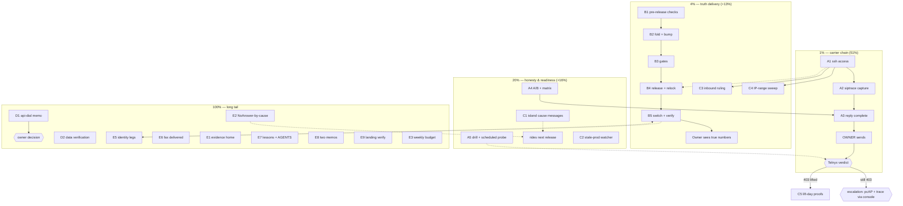

# SUPERB Pareto Plan — Trunk Lift & Truth Delivery (2026-11-10 16:20)

> **Scope**: the 38 open items this session surfaced (status report `docs/status/2026-11-10_16-03_trunk-screened-reports-fix-pending-release.md`). Cross-repo by nature: the carrier lane lives in `pbx-artmann`/`nix-international-telephony`, the truth lane lives here (webphone). This plan does NOT re-dispatch other trains' work — their rows in TODO_LIST.md stay theirs.
> **The result this plan buys**: a phone that can dial out again (carrier lift), an owner who sees true numbers (the Reports fix reaching prod), and failures that say what actually happened (honest surfaces).
> **Claims context**: probe evidence fresh at 14:19Z today (SCREENED, `403 Q.850;cause=21`); prod runs `v2.12.0`/`dbc36933` (2026-11-09) while the fix sits on main since 11:49; ssh:22 from the dev box newly filtered. All verified this session with fresh commands.

## Errata — already done (do NOT re-dispatch)

- Reports C1–C5 (seconds parse, honest all-undated, contact naming, NoAnswer card, pins): LANDED today, `cabdeeb8`..`c73f6be3`, on origin/main.
- Both Telnyx-prescribed trunk fixes (X-Telnyx-Username header closure `04sm922dd` 18:41Z; +E.164 From closure `2id2kbrn` 00:14:26Z): DEPLOYED, probes still 403. Config-side exhausted.
- Runbook repro superseded + `trunk-lift-watch` row updated with the 14:19Z probe: LANDED this session (daemon-committed; landing verification is task E9, not a redo).

## Verschlimmbesser guards (read before executing)

1. **The release ships FINISHED work only.** C1 (island cause messages) does NOT ride v2.13.0 — bundling new code into a release whose purpose is delivering finished work delays truth and risks the gates. C1 rides the next train.
2. **No external mail without the owner's send word** (2026-10-28 precedent). A3 ends at "paste-ready + owner sends".
3. **Host mutations stay inside the documented capture procedure** (siptrace on → one probe → off → journal grep). No config edits on the host outside the runbook's recovery recipes.
4. **Probe economics**: a screened probe is free (rings nobody); a lift-day probe completes a real call (~1 cent, rings the own DID ~3 s). The A/B home-IP probe rings real phones — run it deliberately, once.
5. **Tree-clean rule**: before every release step, `git status` — never stage another session's files.
6. **The 1% chain's domino is host access.** If ssh turns out deliberately blocked (owner answer pending), the fallback is NetBird or the Hetzner console — do NOT "fix" a deliberate firewall decision silently.

## Pareto tiers

| Tier     | Cumulative value | Content                                                                                                                                                                                                                                                        |
| -------- | ---------------- | -------------------------------------------------------------------------------------------------------------------------------------------------------------------------------------------------------------------------------------------------------------- |
| **1%**   | **51%**          | The carrier-resolution chain: **restore host access → siptrace capture → send the re-engage reply**. Without Telnyx lifting the screening, every outbound call still dies — nothing else in the plan matters until this moves. Three acts, twelve micro-tasks. |
| **4%**   | **64%**          | 1% + the **Reports-fix delivery chain** (release → deploy → verified in prod) + the **inbound-health ruling** (rule out the second silent outage; the 0-Incoming anomaly + the Telnyx voice-IP feed phase-in window).                                          |
| **20%**  | **80%**          | 4% + the surfaces that prevent recurrence and shorten future outages: **island dial-failure cause mapping**, **fresh evidence pack** (A/B + debug matrix), **lift-day drill readiness**, **stale-prod watcher**.                                               |
| **100%** | rest             | The long tail: hygiene verifications, api-dial decision, NoAnswer-by-cause, evidence home, budget, identity legs, fax completion, docs/lessons, the two small decision memos.                                                                                  |

## Level 1 — Comprehensive plan (25 tasks, 30–100 min each, sorted by impact)

| #  | Task                                                                                                                      | Tier | Report items | Est        | Impact   | Lane         |
| -- | ------------------------------------------------------------------------------------------------------------------------- | ---- | ------------ | ---------- | -------- | ------------ |
| A1 | Diagnose + restore dev-box→PBX ssh access; add nightly ssh canary                                                         | 1%   | 1, 36        | 60–90 min  | Critical | pbx-artmann  |
| A2 | Siptrace capture + wire-truth verification (From/username header bytes on the trunk INVITE) + closure deploy-status reads | 1%   | 2, 27, 19    | 30–45 min  | Critical | pbx-artmann  |
| A3 | Complete the re-engage reply (slots + capture) + GV-MMS coordinates; owner sends                                          | 1%   | 3, 4, 15     | 30–45 min  | Critical | pbx-artmann  |
| B1 | Pre-release verification batch (CI on fix trains, fixture-commit triage, browser-E2E obligation, content freeze)          | 4%   | 16, 17, 29   | 45–60 min  | Critical | webphone     |
| B2 | Release fold: CHANGELOG dated section + FEATURES/TODO sync + narrative commit + bump `webphoneVersion`                    | 4%   | 5, 30        | 45–60 min  | Critical | webphone     |
| B3 | Release gates: buildflow doctor + full run, `go test -count=1`, `nix flake check`, smoke `--bin`, vulnix                  | 4%   | 5, 31        | 60–100 min | Critical | webphone     |
| B4 | `release.sh` (tag+push) → stack re-pin → browser E2E (445 s) → pbx-artmann relock + staging                               | 4%   | 6            | 60–100 min | Critical | all three    |
| B5 | Owner switch (identity train rides) + post-deploy verification (`/version`, prod ui-capture of Reports, CI)               | 4%   | 6, 32        | 30–45 min  | Critical | all three    |
| C3 | Inbound-health ruling: verdict read + CDR window + one real inbound DID test call                                         | 4%   | 7            | 30–45 min  | High     | pbx-artmann  |
| C4 | Telnyx voice-IP sweep (`voice.json` vs `allowedCidrs` + hosts pin); extend if drift                                       | 4%   | 8            | 30–45 min  | High     | pbx-artmann  |
| C1 | Island dial-failure honesty: hangup-cause → distinct message mapping (ends the `callFailedUnknown` conflation)            | 20%  | 11           | 60–100 min | High     | webphone     |
| C2 | Stale-prod watcher arm (prod `/version` commit vs origin/main; issue past threshold)                                      | 20%  | 12           | 45–60 min  | High     | webphone     |
| A4 | Fresh evidence pack: home-IP A/B re-run + `trunk-debug-matrix.sh` (7 cells), folded into the ticket block                 | 20%  | 9, 10        | 30–45 min  | High     | pbx-artmann  |
| A5 | Lift-day drill checklist pre-staged + scheduled probe (watcher arm or host timer)                                         | 20%  | 13, 20       | 30–40 min  | Medium   | pbx-artmann  |
| D1 | api-dial stopgap decision memo (wiring sketch, costs, privacy; owner decides)                                             | 100% | 14           | 45–60 min  | High     | webphone/pbx |
| D2 | Post-data verification: 24-answered-all-internal + `pifo42h1` identification + contact naming for 9100/2000/*98           | 100% | 21, 22, 35   | 30–45 min  | Medium   | pbx-artmann  |
| E2 | Reports NoAnswer-by-cause bucket (CDR cause → a subline under the NoAnswer card)                                          | 100% | 23           | 60–100 min | Medium   | webphone     |
| E5 | Identity-train owner legs support (provisioner restart evidence, enroll prep, Super Admin check)                          | 100% | 26           | 45–60 min  | Medium   | pbx-artmann  |
| E6 | First REAL outbound fax (delivered verdict; the 11-09 train dialed a voice line)                                          | 100% | 28           | 30–45 min  | Medium   | pbx-artmann  |
| E1 | Durable evidence home for probe/capture blocks; move /tmp repros in                                                       | 100% | 25           | 30–45 min  | Low      | pbx-artmann  |
| E7 | Docs: stale-binary lesson (webphone lessons.md) + trunk state into pbx-artmann AGENTS + dnsblockd allowlist check         | 100% | 33, 37       | 30–45 min  | Medium   | both         |
| E8 | Two decision memos: +41 inbound lane (Swiss entity cost) + `pstn_denied` reason surface                                   | 100% | 34, 38       | 30–45 min  | Low      | pbx-artmann  |
| E9 | Landing verification: doc edits pushed + CI green (closures already read in A2)                                           | 100% | 18, 19       | 30 min     | Low      | pbx-artmann  |
| E3 | `reports.weekly_talk_budget` — pick the number with the owner, set it in the host config                                  | 100% | 24           | 30 min     | Low      | pbx-artmann  |
| C5 | _(reserved)_ — capacity buffer for the lift-day proofs themselves (probe rc=3 + first real PSTN dial + CDR row)           | 20%  | 20           | 30–45 min  | High     | pbx-artmann  |

## Level 2 — Micro-breakdown (~100 tasks, ≤12 min each, ALL todos covered)

### Tier 1% — carrier chain (A1→A2→A3; the domino is A1)

| ID   | Micro-task                                                                                                     | Task | Est |
| ---- | -------------------------------------------------------------------------------------------------------------- | ---- | --- |
| a1.1 | Re-test ssh from a second vantage (hotspot/second host) — proves source-IP-keyed filtering vs host-side change | A1   | 12  |
| a1.2 | Diff nix-config/SystemNix + edge.nix recent commits for a port-22 rule change                                  | A1   | 12  |
| a1.3 | Local-side ruling: known_hosts, route, MTU, local firewall — eliminate this box                                | A1   | 12  |
| a1.4 | Fallback path armed: NetBird on the dev box OR owner's Hetzner console handoff                                 | A1   | 12  |
| a1.5 | Once reachable: read `journalctl -u ssh`, `nft list ruleset`/`iptables -L` — name the actual blocker           | A1   | 12  |
| a1.6 | Fix the rule (revert accidental block) OR document the deliberate posture in the host config                   | A1   | 12  |
| a1.7 | Add nightly ssh canary (`ssh -o ConnectTimeout=5 … true` + alarm)                                              | A1   | 12  |
| a2.1 | `fs_cli` presence + `sofia status profile external` sanity before touching anything                            | A2   | 12  |
| a2.2 | siptrace on → ONE probe → siptrace off (exact runbook procedure)                                               | A2   | 12  |
| a2.3 | Journal grep → capture file; verify the From (`+`E.164) + `X-Telnyx-Username` bytes actually sent              | A2   | 12  |
| a2.4 | Direct deploy-status reads of `2id2kbrn` + `04sm922dd` (retire the trusted-row proof)                          | A2   | 12  |
| a3.1 | Fill `<E164-RESULT>` + repro slots with 00:19Z / 14:19Z / siptrace data                                        | A3   | 12  |
| a3.2 | GV-side message-ID pull from the kanyu seat (Telnyx's inbound-MMS re-ask)                                      | A3   | 12  |
| a3.3 | Assemble the paste-ready final reply in the runbook's slot block                                               | A3   | 12  |
| a3.4 | OWNER: send the reply (assistant hands off, never sends)                                                       | A3   | 12  |

### Tier 4% — truth delivery (B-lane parallel to A; C3/C4 need A1)

| ID   | Micro-task                                                                         | Task | Est    |
| ---- | ---------------------------------------------------------------------------------- | ---- | ------ |
| b1.1 | `gh run list`: CI verdict on the fix trains (`cabdeeb8`..HEAD)                     | B1   | 12     |
| b1.2 | Triage `6936be2a` (fixture bytes fix) — confirm authorship, tree clean             | B1   | 12     |
| b1.3 | Check whether the reports train owes the stack browser E2E (served bytes changed)  | B1   | 12     |
| b1.4 | Run the browser E2E if owed (445 s budget) or record why not                       | B1   | 12     |
| b1.5 | Freeze v2.13.0 content (list the trains the tag carries)                           | B1   | 12     |
| b2.1 | CHANGELOG `[Unreleased]` → dated 2026-11-10 section                                | B2   | 12     |
| b2.2 | FEATURES / TODO_LIST / ROADMAP sync for the fold                                   | B2   | 12     |
| b2.3 | Explicit narrative commit (never let the daemon sweep be the record)               | B2   | 12     |
| b2.4 | Bump `webphoneVersion` in flake.nix (equal to the new tag)                         | B2   | 12     |
| b3.1 | `buildflow doctor` prelude                                                         | B3   | 12     |
| b3.2 | Launch + babysit `BUILDFLOW_NO_RESULT_CACHE=1 buildflow` (full)                    | B3   | 12+run |
| b3.3 | Launch + babysit `go test -count=1 ./...` (with `env -u GOEXPERIMENT` discipline)  | B3   | 12+run |
| b3.4 | `nix flake check` (island-typecheck + island-js ride here)                         | B3   | 12+run |
| b3.5 | Smoke: boot fresh binary, `--expect-version` asserts the new tag                   | B3   | 12     |
| b3.6 | `nix run .#vulnix` gate                                                            | B3   | 12     |
| b4.1 | Run `release.sh` (tag + push + proxy propagation)                                  | B4   | 12     |
| b4.2 | Verify the tag resolves: `go list -m` against the proxy                            | B4   | 12     |
| b4.3 | Stack repo: bump the webphone lock input                                           | B4   | 12     |
| b4.4 | Stack eval + telephony-eval + toplevel build                                       | B4   | 12+run |
| b4.5 | Stack browser E2E run (445 s budget; launch + monitor)                             | B4   | 12+run |
| b4.6 | pbx-artmann relock onto the stack rev + `lock-drift-probe`                         | B4   | 12     |
| b4.7 | gates-contract run + staging build (x86)                                           | B4   | 12+run |
| b5.1 | OWNER: `nixos-rebuild switch` (identity train rides the same switch)               | B5   | 12     |
| b5.2 | Verify prod `/version` carries v2.13.0                                             | B5   | 12     |
| b5.3 | Prod ui-capture of the Reports surface on REAL data; inspect the panel             | B5   | 12     |
| b5.4 | CI + `git ls-remote` end-state verification on all three repos                     | B5   | 12     |
| c3.1 | Read inbound-health verdict + the inbound CDR window (is 0-Incoming plausible?)    | C3   | 12     |
| c3.2 | OWNER: one real inbound DID call (mobile) — ring, answer, CDR row                  | C3   | 12     |
| c3.3 | Verdict recorded: inbound healthy / second outage found (then it jumps the queue)  | C3   | 12     |
| c4.1 | `curl -s https://sip.telnyx.com/voice.json` and diff vs `allowedCidrs` + hosts pin | C4   | 12     |
| c4.2 | If drift: extend `allowedCidrs`/hosts pin ADDITIVELY (never replace)               | C4   | 12     |
| c4.3 | Eval both arches + stage + note for the next switch                                | C4   | 12     |
| c4.4 | Record the sweep baseline (version + zero-drift datapoint) in the runbook          | C4   | 12     |

### Tier 20% — honesty & readiness

| ID   | Micro-task                                                                                       | Task | Est |
| ---- | ------------------------------------------------------------------------------------------------ | ---- | --- |
| c1.1 | Read `calls.js` failure path: what cause data does the island actually receive?                  | C1   | 12  |
| c1.2 | Design the cause→message table (CALL_REJECTED / 486 / 488 / 503 / timeout / auth) + honest copy  | C1   | 12  |
| c1.3 | Implement cause extraction + message selection                                                   | C1   | 12  |
| c1.4 | i18n keys in BOTH maps (en/de parity tests)                                                      | C1   | 12  |
| c1.5 | Island node:test specs for the mapping                                                           | C1   | 12  |
| c1.6 | Gates: tsc + oxlint + `nix fmt` (next train's release carries it)                                | C1   | 12  |
| c2.1 | Design: threshold, issue shape, reuse main-red-watch patterns                                    | C2   | 12  |
| c2.2 | Implement the prod-version fetch + origin/main compare                                           | C2   | 12  |
| c2.3 | Wire into watch.yml schedule + `--dry-run` pass                                                  | C2   | 12  |
| c2.4 | Self-test against a stale fixture (proves it can fire)                                           | C2   | 12  |
| a4.1 | Home-IP A/B probe re-run (`--skip-register`, 3 s hold, one cent)                                 | A4   | 12  |
| a4.2 | `trunk-debug-matrix.sh` full run (7 cells, exit 3 = deviation)                                   | A4   | 12  |
| a4.3 | Fold both verdicts into the ticket evidence block                                                | A4   | 12  |
| a5.1 | Write the lift-day drill checklist into the runbook (rc3 → real dial → CDR → inbound green → UI) | A5   | 12  |
| a5.2 | Implement the scheduled probe (watch.yml arm or host timer, hourly)                              | A5   | 12  |
| a5.3 | Test the arm fires + records the verdict + alerts on CHANGED                                     | A5   | 12  |
| c5.1 | LIFT DAY: probe answers rc=3 → capture the block                                                 | C5   | 12  |
| c5.2 | First real webphone PSTN dial + CDR row + recording check                                        | C5   | 12  |
| c5.3 | Inbound-health green window confirmed; strike `trunk-lift-watch` with evidence                   | C5   | 12  |

### Tier 100% — the long tail

| ID   | Micro-task                                                                     | Task | Est |
| ---- | ------------------------------------------------------------------------------ | ---- | --- |
| d1.1 | Read the existing api-dial lane shape (agent dispatch)                         | D1   | 12  |
| d1.2 | Draft the wiring sketch (webphone dial → gateway → call-control)               | D1   | 12  |
| d1.3 | Costs/limits/privacy table (originating DID, recording, spend cap)             | D1   | 12  |
| d1.4 | Decision memo to owner (wire it / decline / defer)                             | D1   | 12  |
| d2.1 | Pull the 24 answered CDR rows; verify all-internal story                       | D2   | 12  |
| d2.2 | Identify `pifo42h1`'s CDR row (1 call, 1 h 45 m)                               | D2   | 12  |
| d2.3 | Contacts-store naming check for 9100/2000/*98 rows                             | D2   | 12  |
| e2.1 | Confirm CDR rows carry the hangup cause field                                  | E2   | 12  |
| e2.2 | Extend `reports.Totals` with cause buckets                                     | E2   | 12  |
| e2.3 | View: cause subline under the NoAnswer card                                    | E2   | 12  |
| e2.4 | i18n both maps + tests + view suite                                            | E2   | 12  |
| e3.1 | Pick the weekly talk budget with the owner                                     | E3   | 12  |
| e3.2 | Set `reports.weekly_talk_budget` in the host config + eval                     | E3   | 12  |
| e5.1 | Post-ssh: provisioner restart + journal verify (`Creating user hikaru`)        | E5   | 12  |
| e5.2 | OWNER: hikaru's passkey via the one-time access link                           | E5   | 12  |
| e5.3 | Webphone enroll command with her address                                       | E5   | 12  |
| e5.4 | Super Admin 3-surface check (Pocket ID / Stalwart webadmin / NetBird)          | E5   | 12  |
| e6.1 | Owner picks a real fax destination                                             | E6   | 12  |
| e6.2 | Send the outbound fax from the Fax tab                                         | E6   | 12  |
| e6.3 | Watch webhooks → delivered verdict → record in CHANGELOG                       | E6   | 12  |
| e1.1 | Create the durable evidence convention (docs/ or reports/ home)                | E1   | 12  |
| e1.2 | Move today's probe blocks in; regenerate 1109/1101 if /tmp already ate them    | E1   | 12  |
| e1.3 | Runbook pointer update (durable path replaces the /tmp references)             | E1   | 12  |
| e7.1 | Lessons entry: "a fix on main is not a fix in prod until /version matches"     | E7   | 12  |
| e7.2 | pbx-artmann AGENTS.md: trunk config-exhausted state paragraph                  | E7   | 12  |
| e7.3 | Check the dnsblockd allowlist fix landed (artmann.tech zone block-page class)  | E7   | 12  |
| e8.1 | +41 inbound lane memo (Swiss-entity requirements recap + costs + alternatives) | E8   | 12  |
| e8.2 | `pstn_denied` surface evaluation (silent hangup by design vs a reason line)    | E8   | 12  |
| e9.1 | Verify the runbook/TODO edits landed (ls-remote + CI green)                    | E9   | 12  |

**Coverage audit**: all 38 report items map to exactly one Level-1 task and at least one micro-task (mapping column above). No item dropped, no duplicates with other trains' rows.

## Execution graph

**Parallelism**: the A-lane (carrier) and B-lane (release) are independent — run B while A's ssh investigation proceeds. C3/C4 wait on A1. The reply (A3) absorbs A4's fresh evidence if timing allows. Nothing host-side starts before A1 lands.

## Harvest note

After execution, `docs-health` HARVEST pulls: A5's checklist + C2 + the ssh canary into TODO_LIST.md as owned rows; C1/E2 ride the next webphone train's section; the two memos (D1, E8) are owner-decision rows. Items already owned (`siptrace-send-round`, `trunk-lift-watch`) are UPDATED, never duplicated.

## Verification protocol

Every micro-task ends with its own check (the command's exit, the file's bytes, the verdict line). The plan's own acceptance: tier 1% done = the reply is in Telnyx's queue WITH the capture; tier 4% done = prod `/version` carries v2.13.0 AND the fixed Reports panel renders dated data AND inbound is ruled in/out; tier 20% done = a dial failure produces a cause-specific message on next train, the watcher runs, the drill is staged. `git ls-remote` + CI green on every pushed repo.
