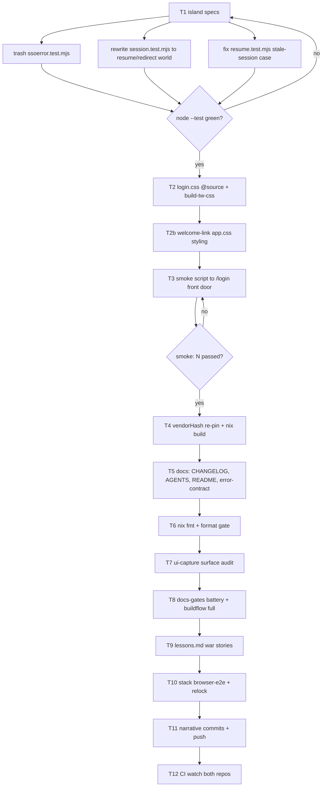

# SUPERB plan: finish the auth → one `/login` front-door train

> Written 2026-11-11 13:44 CET. Owns the REMAINING work after the
> library release (loginpage v4.18.0, pushed + tagged) and the webphone
> rewiring (Go suites green, tsc green). The full state snapshot lives
> in docs/status/2026-11-11_12-31_auth-one-login-page-train.md.

## Where the train stands (context for every task below)

- **Shipped**: loginpage `Config.ExtraSection` + optional `Service`
  (library, v4.18.0, tag on origin, module proxy resolves it).
- **Landed, Go-green**: `/login` in every mode (library page +
  `views.LoginPageExtra` + `/assets/login-page.js`), anonymous `/` →
  303 `/login`, island login card deleted, SSO failures land on
  `/login?sso_error=`, dom-contract restructured, all touched Go
  packages pass, `tsc -p . --noEmit` exit 0.
- **Known-red**: 11 island node:test failures + 1 dead spec
  (`ssoerror.test.mjs`) — all reference the deliberately deleted
  island login (`createSession`, login-form ids, ssoerror module).
- **Known-stale**: smoke script (still pins the island card),
  login.css (new templ utilities not @source'd), vendorHash (go.sum
  changed), docs (AGENTS/README/CHANGELOG/error-contract), ui-capture
  surfaces, stack browser E2E.

## The Pareto cut

| Slice     | Share of result | What it is                                                                                                                                              |
| --------- | --------------- | ------------------------------------------------------------------------------------------------------------------------------------------------------- |
| 1%        | 51%             | Island specs green, login.css rebuilt, smoke updated+green, vendorHash re-pinned — the four gates between "works on my machine" and "CI can even start" |
| 4%        | 64%             | + CHANGELOG/AGENTS/README/error-contract, format gate, welcome-link styling — the contracts that keep future sessions honest                            |
| 20%       | 80%             | + ui-capture audit, docs-gates battery, buildflow full run, lessons.md entries — the hygiene + evidence lane                                            |
| other 20% | 100%            | + stack E2E/relock, both repos' CI verdicts, push+watch, optional release preflight                                                                     |

## Execution graph

## Plan A — the 30–100 min tasks (importance × impact ÷ effort, desc)

| #   | Task                                                                            | Size      | Why it matters (impact)                                            | Depends on     |
| --- | ------------------------------------------------------------------------------- | --------- | ------------------------------------------------------------------ | -------------- |
| T1  | Island specs to the resume/redirect world (session/resume/ssoerror)             | 60–90 min | island-js is a CI gate; red blocks every push                      | —              |
| T2  | login.css @source + rebuild (tw.css + login.css), welcome-link styling          | 30 min    | the customer-facing /login form renders unstyled without it        | —              |
| T3  | Smoke script to the /login front door + full smoke green                        | 60 min    | the boot-level product proof (grep-verified verdicts)              | T2             |
| T4  | vendorHash re-pin + `nix build .#webphone`                                      | 30 min    | every nix gate reds on a stale FOD hash                            | —              |
| T5  | Docs: CHANGELOG, AGENTS.md, README, error-contract                              | 60 min    | one-home doctrine; future sessions read AGENTS first               | T1–T4 outcomes |
| T6  | `nix fmt` + `scripts/format-check.sh` green                                     | 15 min    | the format gate is CI; oxfmt≠treefmt trap                          | —              |
| T7  | ui-capture surface audit (login surfaces follow the redirect)                   | 30 min    | LOCAL-ONLY but the DOM asserts per shot; stale surface = false red | T2             |
| T8  | docs-gates battery + full `buildflow`                                           | 45 min    | the repo's own quality ritual, train-end obligation                | T5             |
| T9  | lessons.md war stories (go.work, master-branch, daemon mid-edit, pre-push gate) | 30 min    | cross-session memory; three of these already cost hours            | —              |
| T10 | Stack `tests/browser-e2e.py` to the /login flow (+relock)                       | 90 min    | AGENTS: served-markup changes owe a fresh stack E2E                | T3             |
| T11 | Narrative commits (detailed messages) + push                                    | 15 min    | the train lands as reviewable units                                | T1–T10         |
| T12 | CI watch both repos to green                                                    | 30 min    | pushes go unverified = the 4h-red class                            | T11            |

## Plan B — the ≤12 min subtasks (same sort, ALL of them)

| #   | Subtask                                                                                                                            | ≤12 min                            | Parent  |
| --- | ---------------------------------------------------------------------------------------------------------------------------------- | ---------------------------------- | ------- |
| B1  | `trash island-tests/ssoerror.test.mjs` (module it specs is trashed)                                                                | 2                                  | T1      |
| B2  | Read session.test.mjs + resume.test.mjs stubs (helpers.mjs shapes)                                                                 | 8                                  | T1      |
| B3  | Rewrite session.test.mjs: drop createSession specs; add adoptServerSession + switch + destroy coverage check (already exists?)     | 12                                 | T1      |
| B4  | Rewrite login-flow specs → assert `fetch` POST /api/session moved OUT of island (island has NO login POST anymore)                 | 10                                 | T1      |
| B5  | Fix resume.test.mjs refused-REGISTER case → redirect assertion (location.replace `/login?error=`)                                  | 12                                 | T1      |
| B6  | Run island suite → 0 fail                                                                                                          | 4                                  | T1      |
| B7  | login.css.input: add `@source` for `views/login_page.templ` (+ login dir js not needed — no utilities there)                       | 6                                  | T2      |
| B8  | `nix develop -c scripts/build-tw-css.sh` (rebuild tw.css + login.css; TREEFMT_NO_CACHE=1 already in script)                        | 8                                  | T2      |
| B9  | app.css: `.wp-welcome-signin` rule (link styling, mirrored token rule check)                                                       | 8                                  | T2      |
| B10 | Re-run B8 after app.css edit (app.css change ⇒ login.css rebuild rule)                                                             | 6                                  | T2      |
| B11 | Read smoke script main flow + list every island-login pin site                                                                     | 10                                 | T3      |
| B12 | Update smoke step 1: GET /login (200, form ids, csrf meta, no-store) instead of island login card                                  | 10                                 | T3      |
| B13 | Update restart/metrics/dialgate scenario anonymous-CSRF extraction to /login                                                       | 10                                 | T3      |
| B14 | Add smoke assertions: anonymous `/` answers 303; /login?sso_error= renders the translated alert text; /assets/login-page.js serves | 10                                 | T3      |
| B15 | Build binary + run full smoke → grep verdict lines                                                                                 | 12                                 | T3      |
| B16 | `nix build .#webphone.goModules --rebuild` → read `got:` → apply vendorHash → rebuild                                              | 12                                 | T4      |
| B17 | `nix build .#webphone` green                                                                                                       | 10                                 | T4      |
| B18 | CHANGELOG [Unreleased] entry (the train's user-visible shape)                                                                      | 10                                 | T5      |
| B19 | AGENTS.md: passkey bullet rewrite + smoke lines + island-card removal note                                                         | 12                                 | T5      |
| B20 | README § Passkey sign-in / login section rewrite                                                                                   | 12                                 | T5      |
| B21 | error-contract.md: /login alert + ?error= surfaces row                                                                             | 8                                  | T5      |
| B22 | `nix fmt` then `scripts/format-check.sh`                                                                                           | 10                                 | T6      |
| B23 | ui-capture.py: grep login surfaces, update fixture boot surface list                                                               | 12                                 | T7      |
| B24 | docs-gates battery (`scripts/docs-gates.sh`) + status INDEX regen check                                                            | 12                                 | T8      |
| B25 | `buildflow` full run (BUILDFLOW_NO_RESULT_CACHE=1 if cache suspected)                                                              | 40 (runs unattended; hands-on ≤12) | T8      |
| B26 | lessons.md: 4 war-story entries (go.work/master/pre-push-gate/daemon mid-edit)                                                     | 12                                 | T9      |
| B27 | Stack repo: read browser-e2e login flow; update to /login form drive                                                               | 30 (two subtasks of 12+18)         | T10     |
| B28 | Stack relock ritual (ride webphone main) + its fast checks                                                                         | 12                                 | T10     |
| B29 | git status → stage+commit narrative messages per phase (ONE call each)                                                             | 12                                 | T11     |
| B30 | push webphone + cqrs-htmx CI check + webphone CI watch                                                                             | 12                                 | T11/T12 |

## Do-NOT-break (VERSCHLIMMBESSER fence)

- The working Go-green state: every edit above re-runs the three Go
  packages when it touches Go; island edits re-run the island suite.
- login.css is a COMMITTED artifact: only `build-tw-css.sh` regenerates
  it; never hand-edit; `app.css` change ⇒ login.css rebuild (the
  2026-10-29 lesson).
- The smoke script PRINTS counts; never hardcode them in assertions.
- vendorHash via the rebuild recipe only; never hand-compute.
- The daemon commits AND pushes: stage+commit narrative units in ONE
  tool call; verify with `git ls-remote` + `gh run list`, never push
  logs.
