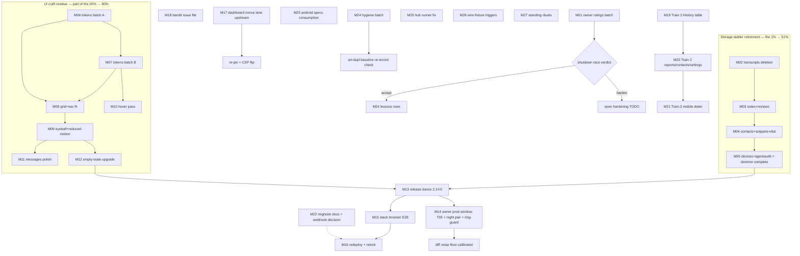

# SUPERB plan — storage-ladder completion, UI craft residue, and the gated-cluster unblock (the 80/20 of the open TODO corpus)

> Mandate: 2026-11-11 20:21 CET (paste_1). Format note: the owner's
> instruction (.md file + mermaid/d2 graph at
> `docs/planning/<YYYY-MM-DD_HH-MM_SUPERB-NAME>.md`) overrides the
> pareto-planning skill's HTML default — this file IS the plan of record.
> Skill process followed: Step 0 errata duty done (§2), Pareto tiers (§4),
> medium table 30–100 min capped at 27 tasks (§5), fine table ≤12 min
> covering every TODO (§6), execution graph (§7), guardrails (§8).

## 1. Sources inventoried (ALL open TODOs, verified 20:21 CET)

| #   | Source row / item                                                                                                                                                                                                     | Group            |
| --- | --------------------------------------------------------------------------------------------------------------------------------------------------------------------------------------------------------------------- | ---------------- |
| S1  | TODO 19 — Train 2 per-surface desktop IA (History table, Reports dashboard, contacts/settings)                                                                                                                        | UI               |
| S2  | TODO 22 — Train 3 mobile dialer surface                                                                                                                                                                               | UI               |
| S3  | Train-1 §f residue ×12 (row-gap cycle, text ramp, state tokens, focus-ring, 4px grid, 18-shots eyeball, hover capture, reduced-motion pass, bubble burst, rail clamp, nav 1280 fit, archive-plate probe)              | UI               |
| S4  | Train-1 §c: empty-state icon-in-tonal-circle upgrade; `nix flake check` at session end                                                                                                                                | UI               |
| S5  | The staged `[2.14.0]` release dance (release.sh clean clone, tag, stack re-pin)                                                                                                                                       | Release          |
| S6  | TODO 33 — stack redeploy riding main; TODO 36 — host-side diagnostics                                                                                                                                                 | Stack            |
| S7  | TODO 40 — stack coverage arms (browser E2E voicemail playback + the front door)                                                                                                                                       | Stack            |
| S8  | TODO 74 — T05 authenticated prod capture (owner-gated); TODO 90 — night-run stability pair; TODO 105 — ring-guard positive path                                                                                       | Prod calibration |
| S9  | TODO 116 — bandit-provider issue (owner banner unchecked)                                                                                                                                                             | Upstream         |
| S10 | TODO 210 — hub runner durable fix; TODO 214 — ALERT_WEBHOOK_URL decision; TODO 219 — ringhook operator docs + typed module front                                                                                      | Hub/stack        |
| S11 | TODO 290–298 — dashboard `/health` unsafe-eval retirement (library lane → re-pin → tag)                                                                                                                               | Upstream         |
| S12 | TODO 1024 — OWNER-GATED catalog v4.10.0 bump                                                                                                                                                                          | Owner            |
| S13 | TODO 1029 — webphone-android consumes the specs (remaining half)                                                                                                                                                      | Android          |
| S14 | TODO 1043 — wire-fixture follow-ups (trigger-gated)                                                                                                                                                                   | Contracts        |
| S15 | **Storage-ladder remainder**: the Engine's seven test-implementer stores (transcripts, notes, reviews, contacts, snippets, dialwindows, push devices, agentaudit) — the faxes+enroll recipe applies verbatim          | Code health      |
| S16 | The three unanswered owner rulings (fix-forward authority; detached-review shutdown race; TODO strike canon)                                                                                                          | Owner rulings    |
| S17 | Hygiene: lessons row for the synctest+projectionhost bubble; runbook row for the archive-banner home; art-dupl baseline re-record opportunity; lychee redirect-gap re-check; ci-flake proxy-class row (trigger-gated) | Hygiene          |
| S18 | Standing rituals: erraudit monthly (due 2026-12-08), dedup quarterly (2027-01-11), cadence candidates archive per filing                                                                                              | Rituals          |

**Errata (Step-0 corrections so nobody re-dispatches shipped work):** the
cqrs-lint "185 warnings" premise of old rows is DEAD — the pinned v4.21.0
reports six findings, two already fixed, four adjudicated (TODO strike
landed 15:08 report era); the readmodels faxes+enroll stores are DELETED
(the recipe and its pins live in the struck row + the 15-18 report — do
not re-plan them); the sibling's `50253c4b` jscpd `work/` exclusion
supersedes the morning scan scope my jscpd attribution ran under; the
17-22 report's §f rows about the login front door are SHIPPED (the
sibling's front-door train landed; only the stack E2E + relock legs
remain, now S7).

## 2. Pareto tiers

- **The 1% that delivers ~51%: the next storage-ladder deletion train
  (S15, transcripts + notes + reviews first).** The faxes+enroll deletion
  proved the entire recipe in one session (port tests → flip consumers →
  delete store → registry regen → art-dupl verify → full suite green);
  transcripts is the largest remaining twin surface, and these three
  stores carry most of the duplicated code volume left in readmodels.
  One train removes the biggest maintenance boundary in the codebase and
  nearly completes the ratified ONE-journal-world doctrine.
- **The 4% that delivers ~64%: the 1% + the owner-rulings batch (S16) +
  the contacts/snippets/dialwindows deletion + the stack E2E/relock
  (S7 + the relock half of S5/S6).** The rulings unblock six gated rows
  in one sitting; the second deletion train empties the small stores;
  the stack legs are the only thing standing between the landed front
  door/UI work and prod (customer-visible).
- **The 20% that delivers ~80%: the 4% + the UI craft residue (S3/S4) +
  the release dance (S5) + the prod-calibration window (S8) + the
  dashboard nonce lane (S11) + the bandit filing (S9).** This is where
  customer-visible quality lives: token fixes and the verify passes
  polish what every user sees; the release ships the staged 2.14.0; the
  prod window calibrates the tracking loop; the nonce lane retires the
  last CSP exception.
- **The remaining ~20% to reach 100%: Trains 2 and 3 (S1/S2 — the big
  design trains), the push-devices/agentaudit deletion closeout, the
  hub/stack docs rows (S10), android consumption (S13), the trigger-gated
  tail (S14, S17's trigger rows), and the standing rituals (S18).** None
  of these is urgent; all are real; the plan keeps them sequenced so the
  corpus actually drains instead of churning the top tier forever.

## 3. Execution principle

Owner-ruling and owner-present items are BATCHED into the fewest possible
sittings (one rulings call, one prod window) so the executable trains are
never starved waiting on the owner. Code trains ride the proven recipes
(storage-ladder: faxes+enroll; UI: the sibling's Train-1 pin protocol).
Every train ends with its gates: registry regen, art-dupl, docs battery
BEFORE commit, buildflow at train start AND end.

## 4. Comprehensive plan (medium granularity, 30–100 min each, 27 tasks)

Rank = importance × customer-value ÷ effort, ties broken by dependency
order. All 18 source groups covered.

| Rank | ID  | Task (30–100 min)                                                                                                                                                                                   | Min | Sources | Depends on         |
| ---- | --- | --------------------------------------------------------------------------------------------------------------------------------------------------------------------------------------------------- | --- | ------- | ------------------ |
| 1    | M01 | Owner rulings batch: the three §g questions (fix-forward protocol; detached-review shutdown race accept-vs-harden; strike canon) — verdicts recorded, rows struck/opened                            | 30  | S16     | owner present      |
| 2    | M02 | Storage-ladder train A: transcripts engine store deletion (port Recent/RecentAll/Export/bench tests to the cqrs backend, flip consumers, delete store, registry regen, art-dupl verify, full suite) | 100 | S15     | —                  |
| 3    | M03 | Storage-ladder train B: notes + reviews engine stores deletion (same recipe; admin_reads/summary pins move)                                                                                         | 60  | S15     | M02 pattern        |
| 4    | M04 | Storage-ladder train C: contacts + snippets + dialwindows deletion (same recipe; dial_bench moves)                                                                                                  | 90  | S15     | M03                |
| 5    | M05 | Storage-ladder closeout: push devices + agentaudit deletion; readmodels = gates + views ONLY; AGENTS/lessons/backup-set sweep; doctrine-complete row                                                | 60  | S15     | M04                |
| 6    | M06 | UI token fix batch A: `--row-gap` cycle fix + render verify (header-actions/skeleton/rail); `--text-lg/xl/2xl` ramp + panel-head migration                                                          | 45  | S3      | —                  |
| 7    | M07 | UI token fix batch B: `--state-hover/focus/pressed` tokens + `--focus-ring` + keyboard-walk screenshot pass; flat-hover sweep                                                                       | 60  | S3      | M06                |
| 8    | M08 | 4px-grid row-internals sweep + nav single-row fit at 1280 (tighten paddings or snap strip) + archive-plate keep-or-kill probe                                                                       | 45  | S3      | M06                |
| 9    | M09 | Visual verify pass: eyeball ≈18 shots × light/dark (fax, voicemail, history, transcripts, contacts, settings, reports, enroll, 404) + reduced-motion pass                                           | 60  | S3/S4   | M06–M08            |
| 10   | M10 | Hover-state capture pass (harness `--hover` flag or driver) + fix what it exposes                                                                                                                   | 45  | S3      | M07                |
| 11   | M11 | Messages polish: bubble burst grouping (adjacent-sibling margins) + desktop rail 2-line clamp; pins + captures                                                                                      | 45  | S3      | M09                |
| 12   | M12 | Empty-state upgrade: icon-in-tonal-circle + action affordance (templ regen + pin protocol + captures)                                                                                               | 60  | S4      | M09                |
| 13   | M13 | Release dance: `[2.14.0]` from a clean clone (release.sh, tag, CI green, stack re-pin per tri-repo ritual, `nix flake check` at the end)                                                            | 100 | S5/S6   | M06–M12 landed     |
| 14   | M14 | Owner prod window: T05 authenticated capture + night-run pair (≥8h apart) scheduling + ring-guard path during a live call                                                                           | 90  | S8      | M13 (prod current) |
| 15   | M15 | Stack browser E2E (front door + voicemail playback arm) vs the deployed flow; fix what it catches                                                                                                   | 90  | S7      | M13 + stack deploy |
| 16   | M16 | Stack redeploy riding main + host-side diagnostics read + webphone-relock completion                                                                                                                | 60  | S6/S7   | M15                |
| 17   | M17 | go-health-dashboard nonce lane: implement upstream, tag, re-pin webphone, flip `/health` CSP assertion, retire the unsafe-eval exception                                                            | 90  | S11     | —                  |
| 18   | M18 | Bandit-provider issue file (owner banner check first)                                                                                                                                               | 30  | S9      | owner              |
| 19   | M19 | Train 2 part 1 — History as a scannable table (restructure + morph pins + captures; acceptance = RESTRUCTURE visible)                                                                               | 100 | S1      | M12                |
| 20   | M20 | Train 2 part 2 — Reports dashboard layout + contacts/settings fitted layouts                                                                                                                        | 100 | S1      | M19                |
| 21   | M21 | Train 3 — mobile dialer surface (island-as-tab + bottom-bar integration + captures)                                                                                                                 | 100 | S2      | M20                |
| 22   | M22 | Ringhook operator docs (stack deploy recipe) + typed webphone-module front design note + ALERT_WEBHOOK_URL decision recorded                                                                        | 45  | S10     | owner input        |
| 23   | M23 | webphone-android consumes the specs (remaining half: the wire-contract sync)                                                                                                                        | 45  | S13     | —                  |
| 24   | M24 | Hygiene batch: lessons synctest-bubble row + runbook archive-banner recipe row + art-dupl baseline re-record (clean set-diff check) + lychee redirect-gap re-check                                  | 45  | S17     | —                  |
| 25   | M25 | Hub runner durable fix (ExecStartPre provisioning in the hub's deployment) + hub TODO sync                                                                                                          | 30  | S10     | hub access         |
| 26   | M26 | Wire-fixture follow-ups (a)–(d) reviewed against their triggers; open or strike each                                                                                                                | 30  | S14     | triggers           |
| 27   | M27 | Standing rituals: erraudit monthly re-measure (due 2026-12-08), cadence-candidates pass, dedup quarterly prep; cqrs-lint/ci-flake trigger rows checked                                              | 30  | S18/S17 | due dates          |

## 5. Fine breakdown (≤12 min each, ALL TODOs)

Sorted by the same rank. Parent = the medium task. Total 96 micro-tasks.

| #  | Micro-task                                                                                                  | Min | Parent |
| -- | ----------------------------------------------------------------------------------------------------------- | --- | ------ |
| 1  | Re-read the three §g questions + the evidence in the 15-18/14-45 reports                                    | 10  | M01    |
| 2  | Ruling 1: fix-forward protocol — write the verdict into AGENTS beside the concurrent-session rule           | 10  | M01    |
| 3  | Ruling 2: shutdown race — accept (lessons row) or open a hardening TODO row                                 | 5   | M01    |
| 4  | Ruling 3: strike canon — record the chosen TODO_LIST style in AGENTS conventions                            | 5   | M01    |
| 5  | Strike/adjust the affected TODO rows per the three verdicts                                                 | 10  | M01    |
| 6  | Train-start gates: full `buildflow` in background while M02 proceeds                                        | 5   | M02    |
| 7  | Read the transcripts engine store + its test surface (fetchSegments twins, admin_reads, dial_bench, export) | 10  | M02    |
| 8  | Port transcripts read tests to the cqrs backend (Recent/RecentAll/fixtures)                                 | 10  | M02    |
| 9  | Port the export test + the bench to cqrs                                                                    | 10  | M02    |
| 10 | Flip server/consumers off `engine.Transcripts()`                                                            | 10  | M02    |
| 11 | Delete readmodels transcripts store + Engine field/accessor/Plan entry                                      | 5   | M02    |
| 12 | Registry `-update` regen (drop `readmodels.transcript_*`)                                                   | 5   | M02    |
| 13 | art-dupl verify (0 clones reference the deleted file) + full package tests                                  | 10  | M02    |
| 14 | Sweep stale comments naming the transcripts engine store                                                    | 10  | M02    |
| 15 | AGENTS/TODO strike for train A with evidence; commit+push (narrative)                                       | 10  | M02    |
| 16 | Read notes + reviews stores + their consumers (note_api, review_api, admin pins)                            | 10  | M03    |
| 17 | Port notes tests to cqrs (note_list_full 409 class pin moves)                                               | 10  | M03    |
| 18 | Port reviews tests to cqrs (2000-cap REJECT, wholesale replace)                                             | 10  | M03    |
| 19 | Flip consumers off `engine.Notes()`/`engine.Reviews()`; delete both stores                                  | 10  | M03    |
| 20 | Registry regen + art-dupl verify + package tests                                                            | 10  | M03    |
| 21 | Strike train B; commit+push                                                                                 | 5   | M03    |
| 22 | Read contacts/snippets/dialwindows stores + consumers                                                       | 10  | M04    |
| 23 | Port contacts tests (fuzz fixture incl.) to cqrs                                                            | 10  | M04    |
| 24 | Port snippets tests to cqrs                                                                                 | 10  | M04    |
| 25 | Port dialwindows tests + dial_bench to cqrs                                                                 | 10  | M04    |
| 26 | Flip consumers; delete the three stores; Engine trim                                                        | 10  | M04    |
| 27 | Registry regen + art-dupl verify + package tests                                                            | 10  | M04    |
| 28 | Strike train C; commit+push                                                                                 | 5   | M04    |
| 29 | Port push-devices + agentaudit tests to cqrs                                                                | 10  | M05    |
| 30 | Delete the last two stores; assert readmodels = gates + view types only (an arch test?)                     | 10  | M05    |
| 31 | AGENTS ONE-journal-world bullet final update + backup-set mention audit                                     | 10  | M05    |
| 32 | Doctrine-complete row + full `go test -count=1 ./...` + commit+push                                         | 10  | M05    |
| 33 | Fix `--row-gap: var(--row-gap)` cycle at app.css:72 (intended ~12px)                                        | 5   | M06    |
| 34 | Verify header-actions/skeleton/rail gaps render (screenshots light+dark)                                    | 10  | M06    |
| 35 | Add `--text-lg/xl/2xl` ramp tokens (app.css + island/style.css mirror)                                      | 10  | M06    |
| 36 | Migrate panel heads/subheads onto the ramp; `nix fmt`; tw/login rebuild                                     | 10  | M06    |
| 37 | Add `--state-hover/focus/pressed` tokens                                                                    | 10  | M07    |
| 38 | Sweep flat color-flip hovers onto state layers                                                              | 10  | M07    |
| 39 | Create `--focus-ring` token; wire it into the focus styles                                                  | 5   | M07    |
| 40 | Keyboard-walk screenshot pass over every control; fix offsets found                                         | 10  | M07    |
| 41 | 4px-grid sweep of row internals (`--row-pad` steps only)                                                    | 10  | M08    |
| 42 | Nav single-row fit at 1280 (tighten paddings or snap strip) + capture                                       | 10  | M08    |
| 43 | Archive-button pale-red plate probe on a FREE port; keep-or-kill note for owner eye                         | 10  | M08    |
| 44 | Eyeball pass 1: fax + voicemail + history shots (light)                                                     | 10  | M09    |
| 45 | Eyeball pass 2: transcripts + contacts + settings (light)                                                   | 10  | M09    |
| 46 | Eyeball pass 3: reports + enroll + 404 (light)                                                              | 10  | M09    |
| 47 | Eyeball pass 4: the same set dark (findings list)                                                           | 10  | M09    |
| 48 | Reduced-motion visual pass (animations off; panels/statics intact)                                          | 10  | M09    |
| 49 | Fix/track every eyeball finding (file rows or fix inline)                                                   | 10  | M09    |
| 50 | Add the `--hover` capture flag (or driver script) to ui-capture.py                                          | 10  | M10    |
| 51 | Run the hover pass; diff what changed; fix exposed flaws                                                    | 10  | M10    |
| 52 | Bubble burst grouping via adjacent-sibling margins (CSS)                                                    | 10  | M11    |
| 53 | Rail preview 2-line clamp (`-webkit-line-clamp`)                                                            | 5   | M11    |
| 54 | Pins + captures for both; docs-gates battery BEFORE commit                                                  | 10  | M11    |
| 55 | Empty-state markup: icon-in-tonal-circle + action affordance (templ)                                        | 10  | M12    |
| 56 | templ regen + grep the three pin sites (Go tests, smoke, stack E2E)                                         | 10  | M12    |
| 57 | Captures light+dark; strike the row; commit+push                                                            | 10  | M12    |
| 58 | `scripts/docs-gates.sh` + `pre-push-gates.sh` full pass before the release                                  | 10  | M13    |
| 59 | release.sh from a CLEAN clone (version bump, tag, CI watch to green)                                        | 10  | M13    |
| 60 | Push webphone before the stack re-pin; verify `git ls-remote` end state                                     | 5   | M13    |
| 61 | Stack re-pin per the tri-repo ritual (narHash; pbx-artmann relock)                                          | 10  | M13    |
| 62 | `nix flake check` at the end (sandbox build + KVM-gated VM test)                                            | 10  | M13    |
| 63 | Mint the prod session (env creds → POST /api/session dance)                                                 | 10  | M14    |
| 64 | T05 authenticated capture run (full matrix, ASR on)                                                         | 10  | M14    |
| 65 | Night-run pair schedule (two runs ≥8h apart; cron/reminder recorded)                                        | 5   | M14    |
| 66 | Ring-guard positive path: real inbound call during a tracked run                                            | 10  | M14    |
| 67 | Set the diff noise floor from the pair; calibrate the 0.5% badge bar                                        | 10  | M14    |
| 68 | Stack E2E: front-door flow (the sibling's updated Python side)                                              | 10  | M15    |
| 69 | Stack E2E: voicemail playback zero-config + default arms                                                    | 10  | M15    |
| 70 | Fix whatever the E2E catches; re-run once on the known transfer flake                                       | 10  | M15    |
| 71 | Stack redeploy riding main; read host diagnostics afterwards                                                | 10  | M16    |
| 72 | Complete the webphone-relock ritual rows (CHANGELOG lock-move etc.)                                         | 10  | M16    |
| 73 | Implement the nonce lane in go-health-dashboard (data-nonce + csp.go)                                       | 10  | M17    |
| 74 | Tag the dashboard release; re-pin webphone; vendorHash tail (tidy → re-pin → push → CI watch)               | 10  | M17    |
| 75 | Flip `TestAppDashboardMountsHealthSubtree` to the nonce form; delete the unsafe-eval exception              | 10  | M17    |
| 76 | Owner banner check on the bandit draft; file with github-voice                                              | 10  | M18    |
| 77 | Train 2: History table restructure (templ)                                                                  | 10  | M19    |
| 78 | History table: morph pins + `wp-*` row classes preserved                                                    | 10  | M19    |
| 79 | History table captures + acceptance check (RESTRUCTURE visible)                                             | 10  | M19    |
| 80 | Train 2: Reports dashboard layout                                                                           | 10  | M20    |
| 81 | Train 2: contacts/settings fitted layouts                                                                   | 10  | M20    |
| 82 | Train 2 captures + strike; commit+push                                                                      | 10  | M20    |
| 83 | Train 3: island-as-tab scaffolding (mobile surface)                                                         | 10  | M21    |
| 84 | Train 3: bottom-bar integration + ring/dial reachability                                                    | 10  | M21    |
| 85 | Train 3: mobile captures + strike                                                                           | 10  | M21    |
| 86 | Ringhook: stack deploy-doc recipe (config keys, secret slot, dialplan arms)                                 | 10  | M22    |
| 87 | Ringhook: typed webphone-module front design note; ALERT_WEBHOOK_URL decision recorded + secret set         | 10  | M22    |
| 88 | Android: the remaining specs-consumption half (wire-contract sync)                                          | 10  | M23    |
| 89 | Android: verify-gate green + strike                                                                         | 10  | M23    |
| 90 | Lessons row: synctest+projectionhost bubble hazard (fax archiver test)                                      | 5   | M24    |
| 91 | Runbook row: archive-banner home recipe (title → banner → claims)                                           | 5   | M24    |
| 92 | art-dupl baseline re-record check (clean set-diff now possible?)                                            | 10  | M24    |
| 93 | Lychee redirect-gap re-check (newer version? file upstream?)                                                | 5   | M24    |
| 94 | Hub runner durable fix: ExecStartPre provisioning + hub TODO sync                                           | 10  | M25    |
| 95 | Wire-fixture follow-ups: adjudicate (a)–(d) against recorded triggers                                       | 10  | M26    |
| 96 | Ritual sweep: erraudit monthly, cadence candidates, dedup quarterly prep; check the two trigger rows        | 10  | M27    |

## 6. Execution graph

Read order: the ladder (M02→M05) and the UI residue (M06→M12) are the two
parallelizable spines; everything release-shaped (M13) waits on both;
the owner-present windows (M01, M14) batch at the edges; Trains 2/3
(M19→M21) run after the craft residue so they restructure on finished
tokens.

## 7. Verschlimmbern guardrails (what this plan must NOT do)

- Do NOT re-run the faxes+enroll deletion or re-litigate its rulings —
  it is the WORKED EXAMPLE, cited, not re-planned (errata §1).
- Do NOT raise the docs-gates ratchets to buy green; archive a clean
  candidate per filing (the runbook rule stands).
- Do NOT touch the sibling session's in-flight files (their Train 2/3
  rows are theirs unless they hand them over; this plan only sequences).
- Do NOT push dependency bumps through the auto-commit daemon (the
  vendorHash-tail rule stands: tidy → re-pin → push → CI watch).
- Do NOT convert the plan into work without the M01 rulings if a task's
  verdict depends on them (M24's lessons row, M02's test placement).
- Every train keeps its existing pins and one-homes; nothing here moves a
  fact's home.
