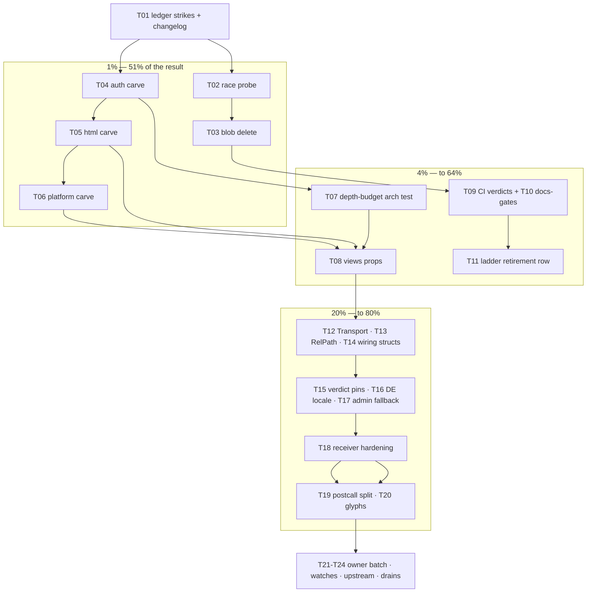

# SUPERB plan — deepening + integrity: the 80/20 on webphone's open work

**Created:** 2026-11-12 05:25 · **Source:** the 2026-11-12_05-22 session status (six-skill
review series + deepening candidates), the 44 open TODO_LIST rows, the standing watch
calendar, and the fleet-libs reopen-trigger registry. Owner-ordered Pareto breakdown:
1% → 4% → 20% → the rest.

**Verschlimmbessern guards:** every task names its verification; every task is one
revertable commit; ratified rulings (single go.mod, ONE journal world, no Flutter,
store-ladder freeze) are NOT re-litigated; owner-gated rows stay grouped as owner
calls — nothing here self-answers a sitting question.

---

## The Pareto read

| Tier     | Share of result | What it is                                                                                                                                                                      | Why it's the lever                                                                                                                                                                        |
| -------- | --------------- | ------------------------------------------------------------------------------------------------------------------------------------------------------------------------------- | ----------------------------------------------------------------------------------------------------------------------------------------------------------------------------------------- |
| **1%**   | **51%**         | The `internal/server` carve (arch P1, trigger fired) + the two integrity items (thread-split race probe, blob-orphan delete)                                                    | server is where every future surface lands (106 files, 342 exports, Ce=25 — the god-package the last two reviews flagged); the integrity items are the only open data-correctness defects |
| **4%**   | **64%**         | + views prop typing (arch P2), the depth-budget arch test, ledger hygiene (strikes + CHANGELOG), CI verdicts + docs-gates battery                                               | kills the last arch finding, makes debt mechanical instead of narrative, and un-reds the ritual debt last night's trains accrued                                                          |
| **20%**  | **80%**         | + data-model open items (push.Transport, DocumentPath, wiring structs, machineSurface), UI/locale honesty fixes, verdict-lane UI pins, receiver hardening, carve follow-through | everything the review series verified with site markers — mechanical, low-risk, review-series closure                                                                                     |
| **rest** | **100%**        | standing watches, owner-calls batch, cross-repo legs, release hygiene, upstream drafts, announcements, ASR/native tails                                                         | the calendar and the owner's own terminal items                                                                                                                                           |

---

## Comprehensive plan (30–100 min tasks, all TODOs, best-first)

| #   | Task                                                                                                                                                                      | Tier | Impact | Effort | Value                              | Verification                                               |
| --- | ------------------------------------------------------------------------------------------------------------------------------------------------------------------------- | ---- | ------ | ------ | ---------------------------------- | ---------------------------------------------------------- |
| T01 | Strike landed TODO rows (hold verdict, ring fan-out) + CHANGELOG entries for the four deepening refactors                                                                 | 4%   | Med    | 30m    | ledger truth                       | TODO_LIST grep clean; changelog renders                    |
| T02 | Thread-split race probe (two-goroutine Receive, unseen remote; instrument FindThread visibility window)                                                                   | 1%   | High   | 60m    | correctness                        | probe test committed; verdict recorded in TODO row         |
| T03 | Blob-orphan compensating delete on AppendMessage/Append failure paths + sweep decision note                                                                               | 1%   | High   | 45m    | no orphaned user files             | failure-path test asserts zero orphans                     |
| T04 | Server carve step 1: `server/auth` (login_page, session_api, passkey_api, passkey_settings, sso_api, auth_audit move; wiring thin)                                        | 1%   | High   | 100m   | locality of auth bugs              | go build/test ./... green; arch tests green                |
| T05 | Server carve step 2: `server/html` (pages, panels, actions, notifier, sse)                                                                                                | 1%   | High   | 100m   | render surfaces one home           | same gates                                                 |
| T06 | Server carve step 3: `server/platform` (assets, metrics, csp_report, trace, proxy, internal_directory, islandlatency, latency, configjs, export) + server-leftovers sweep | 1%   | High   | 100m   | exports 342 → wiring-thin          | same gates; rg export census in commit msg                 |
| T07 | Depth-budget arch test (per-package LOC/export ceilings; server carve is the first passing subject)                                                                       | 4%   | Med    | 60m    | debt mechanical                    | arch test fails on a planted 400-line dump, passes on tree |
| T08 | Views prop typing: view-owned CDR/Voicemail/textagent/reports prop types; convert at the server boundary; delete views→pbx/store/messaging/textagent edges                | 4%   | High   | 100m   | views depend on views+domain only  | `go list` import census in commit; suites green            |
| T09 | CI verdicts for the night's pushed commits + push-stall check (scripts/ci-verdict.sh per sha)                                                                             | 4%   | Med    | 30m    | main proven green                  | verdict log in commit/TODO strike                          |
| T10 | docs-gates battery over this week's doc volume; ratchet re-measure                                                                                                        | 4%   | Med    | 45m    | ledger ratchets honest             | docs-gates exit 0 (or ratchet rows updated with evidence)  |
| T11 | Store-ladder retirement row (detection command + owner date) + legacy-reader header corrections                                                                           | 4%   | Low    | 30m    | ladder end state owned             | TODO row + comments; no behavior change                    |
| T12 | push.Transport defined type + ParseTransport (fanout map key swap, boot rejection)                                                                                        | 20%  | Med    | 60m    | config typos die at boot           | push family pins; config_test                              |
| T13 | FaxJob.DocumentPath → domain.RelPath (parse at the two constructors; sweep consumers)                                                                                     | 20%  | Med    | 45m    | brands cross the seam              | fax suites green; marker retired                           |
| T14 | asr/matrix wiring structs (kill the three-string constructor trains) + machineSurface bool-last                                                                           | 20%  | Low    | 45m    | position-capture traps gone        | asr/matrix/server suites                                   |
| T15 | Verdict-lane UI pins: rejected/timeout/send-failed arms at the calls-test level (the stubs now make them testable)                                                        | 20%  | Med    | 45m    | honesty contract pinned end-to-end | island suite grows ≥3 specs                                |
| T16 | DE locale fixes: reports weekday, crm month label (+DE pins), unreadDivider aria-label                                                                                    | 20%  | Med    | 60m    | German UI honest                   | panels/crm/reports view tests w/ DE asserts                |
| T17 | Admin CDR party fallback (firstNonEmpty reuse) + AdminPanel structural test ladder                                                                                        | 20%  | Low    | 45m    | admin renders honest               | new view test                                              |
| T18 | Receiver hardening: matrix oversized-sync streaming decode + garbage-cursor self-heal; FCM 401/403 token invalidation; CRM body caps                                      | 20%  | Med    | 100m   | receivers self-heal                | matrix/signal/push/crm tests                               |
| T19 | postcall.js extraction from calls.js (note/disposition/summarize/ended-reason family)                                                                                     | 20%  | Med    | 100m   | calls.js ~2 000 → ~1 400           | island suite green; import closure pin                     |
| T20 | Glyph→SVG sweep in panels.js + unreadDivider/dialer-focus residue from the cross-train tangle                                                                             | 20%  | Low    | 45m    | icon vocabulary one idiom          | oxlint + island suite                                      |
| T21 | Owner-calls batch session prep (one doc: the pending questions Q1–Q3 CRM, cqrs-lint gating, C044, B5 authority, traces-in-backup, M1 first-live)                          | rest | Med    | 45m    | owner decisions unblock rows       | doc committed; questions numbered                          |
| T22 | Standing-watch discharge: erraudit nolint-audit (post-refactor decay check) + train-specific decay after last night's sweeps                                              | rest | Med    | 60m    | calendar honest                    | 0 stale directives                                         |
| T23 | cqrs-lint upstream drafts (suppression state machine + D005) filed after owner tick                                                                                       | rest | Low    | 45m    | upstream debt offloaded            | filed links in TODO strike                                 |
| T24 | Release-adjacent tails: 18-08 drain train (before ~2026-12-07 cadence), flight-recorder/docs cluster, release-log archival policy                                         | rest | Low    | 100m   | cadence debt drained               | archives pass gates                                        |

## Fine breakdown (≤12 min tasks, ALL todos, best-first)

| #   | Task (≤12 min)                                                                                                                                | Parent | Tier | Order |
| --- | --------------------------------------------------------------------------------------------------------------------------------------------- | ------ | ---- | ----- |
| F01 | TODO_LIST: strike hold-verdict row (evidence: calls.js:141 verdict lane + test)                                                               | T01    | 4%   | 1     |
| F02 | TODO_LIST: strike ring-fan-out row (evidence: push.Fan + ring.go:63 handoff)                                                                  | T01    | 4%   | 2     |
| F03 | CHANGELOG: four deepening entries (sessionAnswer, Fanout.Fan, thread vocabulary, verdict lane)                                                | T01    | 4%   | 3     |
| F04 | Commit + push the ledger batch                                                                                                                | T01    | 4%   | 4     |
| F05 | Write the race probe test skeleton (two goroutines, same unseen remote, WaitGroup)                                                            | T02    | 1%   | 5     |
| F06 | Instrument/inspect FindThread visibility window (D7 budget vs gate re-scan)                                                                   | T02    | 1%   | 6     |
| F07 | Run probe; record verdict (split confirmed / not reproducible) in TODO row                                                                    | T02    | 1%   | 7     |
| F08 | If split: add (owner,network,remote) uniqueness guard at FindThread; else strike with evidence                                                | T02    | 1%   | 8     |
| F09 | messaging.Send: compensate saved blobs on AppendMessage error (Remove loop)                                                                   | T03    | 1%   | 9     |
| F10 | Same for Receive (inbound)                                                                                                                    | T03    | 1%   | 10    |
| F11 | Same for fax send/receive (fax/service.go:118-126, 219-226)                                                                                   | T03    | 1%   | 11    |
| F12 | Failure-path test: persist fails → blob tree empty (both lanes)                                                                               | T03    | 1%   | 12    |
| F13 | TODO blob-orphan row: strike the compensating half; keep sweep decision as owner question                                                     | T03    | 1%   | 13    |
| F14 | Carve step 1a: `git mv` the six auth files + package clause + imports                                                                         | T04    | 1%   | 14    |
| F15 | Carve step 1b: unexport what wiring doesn't need; fix test files' package refs                                                                | T04    | 1%   | 15    |
| F16 | Carve step 1c: server.go wiring calls auth package; build + server suite green                                                                | T04    | 1%   | 16    |
| F17 | Carve step 1d: commit (one revertable unit) + arch tests                                                                                      | T04    | 1%   | 17    |
| F18 | Carve step 2a: move pages/panels/actions/notifier/sse → server/html                                                                           | T05    | 1%   | 18    |
| F19 | Carve step 2b: fix cross-references (views, api consumers); suites green                                                                      | T05    | 1%   | 19    |
| F20 | Carve step 2c: commit + export census in message                                                                                              | T05    | 1%   | 20    |
| F21 | Carve step 3a: move the ten platform files → server/platform                                                                                  | T06    | 1%   | 21    |
| F22 | Carve step 3b: wiring-thin pass; delete moved-out re-exports; suites green                                                                    | T06    | 1%   | 22    |
| F23 | Carve step 3c: export census (342 → target ≤80 across the three); commit                                                                      | T06    | 1%   | 23    |
| F24 | Depth-budget test: read package census (go list), assert ceilings (LOC ≤ 1 500 non-test, exports ≤ 60; server carve exempted until F23 lands) | T07    | 4%   | 24    |
| F25 | Plant a violation in a scratch file → test red → revert (mutation-proof)                                                                      | T07    | 4%   | 25    |
| F26 | Commit the arch test + AGENTS one-liner                                                                                                       | T07    | 4%   | 26    |
| F27 | Define views prop types: ReportsPanelProps.CDR, VoicemailProps, AdminProps (readmodels/view-owned)                                            | T08    | 4%   | 27    |
| F28 | server boundary converters (crmNumbers-style one-homes); templ props swap                                                                     | T08    | 4%   | 28    |
| F29 | Delete views→pbx/store/messaging/textagent imports; `go list` census proof in commit                                                          | T08    | 4%   | 29    |
| F30 | View suites + arch import tests green; commit                                                                                                 | T08    | 4%   | 30    |
| F31 | ci-verdict.sh over the night's pushed shas; log the table                                                                                     | T09    | 4%   | 31    |
| F32 | push-stall check; push if the anchor bar fires                                                                                                | T09    | 4%   | 32    |
| F33 | docs-gates run; if red: fix prose, not ratchets                                                                                               | T10    | 4%   | 33    |
| F34 | Ratchet re-measure rows in .docs-gates.json with evidence comments                                                                            | T10    | 4%   | 34    |
| F35 | Ladder-retirement TODO row: detection SQL + owner date proposal                                                                               | T11    | 4%   | 35    |
| F36 | Legacy-reader headers: point at the release-chain import; mark test-only                                                                      | T11    | 4%   | 36    |
| F37 | push.Transport: defined struct type + ParseTransport + registry key swap                                                                      | T12    | 20%  | 37    |
| F38 | push config boot rejection of unknown transports + family pin                                                                                 | T12    | 20%  | 38    |
| F39 | domain.RelPath on FaxJob: parse in the two constructors; sweep assign sites                                                                   | T13    | 20%  | 39    |
| F40 | Retire the fax.go:119 marker; fax suites green                                                                                                | T13    | 20%  | 40    |
| F41 | asr.ClientConfig + matrix.ClientConfig wiring structs; call-site swap                                                                         | T14    | 20%  | 41    |
| F42 | machineSurface param reorder (flag last) + retire the marker                                                                                  | T14    | 20%  | 42    |
| F43 | calls-test verdict arms: rejected + timeout + send-failed specs (stubs drive the delegate)                                                    | T15    | 20%  | 43    |
| F44 | announce copy pins for the three failure verdicts (en/de)                                                                                     | T15    | 20%  | 44    |
| F45 | weekdayLabel reuse in reports.templ + DE pin                                                                                                  | T16    | 20%  | 45    |
| F46 | monthLabel mini-map in crm.go + DE pin                                                                                                        | T16    | 20%  | 46    |
| F47 | unreadDivider aria-label fix (drop the em-dash leak) + pin                                                                                    | T16    | 20%  | 47    |
| F48 | Admin CDR fallback + structural ladder test (CDROff/Failed/None)                                                                              | T17    | 20%  | 48    |
| F49 | matrix do() streaming decode + distinct too-large transient + reset-to-fresh-sync test                                                        | T18    | 20%  | 49    |
| F50 | Garbage next_batch: Rejection arm → cursor.Save("") + fresh sync (receiver test)                                                              | T18    | 20%  | 50    |
| F51 | FCM invalidateToken on 401/403 + cache test                                                                                                   | T18    | 20%  | 51    |
| F52 | crm.read/context_read io.LimitReader caps + overflow-transient tests                                                                          | T18    | 20%  | 52    |
| F53 | postcall.js: move noteRow/dispositionRow/summarize/ended-reason family + tests import swap                                                    | T19    | 20%  | 53    |
| F54 | Glyph→SVG: redial/save/call/remove icons via iconSvg; delete text glyphs                                                                      | T20    | 20%  | 54    |
| F55 | Owner-calls prep doc: number every sitting question with its evidence link                                                                    | T21    | rest | 55    |
| F56 | erraudit nolint-audit post-refactor decay check (expect 0 stale)                                                                              | T22    | rest | 56    |
| F57 | Draft the two cqrs-lint upstream issues (local verify-first per verify-before-filing)                                                         | T23    | rest | 57    |
| F58 | 18-08 drain: check-rows --strict + bare-rows before any `git mv` (the archive gates)                                                          | T24    | rest | 58    |
| F59 | Flight-recorder/observability doc rows (FEATURES /metrics wording + traces-backup question into owner doc)                                    | T24    | rest | 59    |
| F60 | Release-log archival policy row (tmpfiles purge lesson → plan the evidence home)                                                              | T24    | rest | 60    |
| F61 | Standing calendar sweep: confirm next-due dates still true after this week's landings                                                         | T22    | rest | 61    |
| F62 | brandid-lint posture + Client polish #48 + ASR deploy-proof rows: verify still owner-gated, re-link evidence                                  | T21    | rest | 62    |

## Execution graph

## Ordering constraints (the dependencies that matter)

- F01–F04 (ledger) FIRST: every later commit cites honest rows.
- T02 before T03's sweep-decision note: both touch messaging persistence; probe
  verdict may add a guard the delete test must respect.
- Carve steps strictly sequential (T04 → T05 → T06): each is one revertable commit;
  never two moves in flight.
- T07 (depth budget) AFTER the carve: the ceilings are calibrated on the carved
  tree; planting the violation proves the test can fail.
- T08 (views props) after the html carve: the converters land in the new home once,
  not twice.
- T15 depends on last night's stub changes (already in tree).
- Owner-gated rows (T21) never self-answer; the prep doc only numbers and links.

## What this plan deliberately does NOT do

- No go.mod split (ratified 5×; trigger structurally disarmed).
- No Datastar, no session protocol, no Flutter (ruled NO-GO).
- No AuditLog projection wiring (owner call, refresh trigger armed).
- No corpus-wide markdown reflow (formatter-unowned by ruling).

## Execution amendments (2026-11-12, same-session — the "plan says X, code says Y" rule)

- **T05 (server/html carve) RULED OUT structurally.** pages.go holds the
  `handlers` hub itself; panels/actions reference admin/crm/unread/auth-audit
  in both directions. Moving the five files renames the package rather than
  splitting it. The god-package's honest end state: the FOUR surface carves
  (api/hooks/auth/platform — auth + platform landed this session) plus the
  T07 depth budget, which pins the html residual (server 5 200 LOC ceiling)
  as the named, measured exemption. Reopen ONLY on a real architecture
  change (per-tab render packages over a shared render kernel). Evidence:
  TODO_LIST carve section, `1dbc1bd5`.
- **T08's scope shrank before execution**: readmodels.ThreadSummary (the
  vocabulary move) and reports.* (the pure-projection ruling) are RATIFIED
  homes, not leaks — the real edges were pbx.VoicemailMessage/VoicemailSummary,
  textagent.Draft/Reviews/Frozen/Suppressed, pbx.CDR and the
  messaging.MaxBodyLength scalar (moved to domain). All swapped 2026-11-12
  (`190a8c2e`); views' census = domain + readmodels + reports only.
- **Measured export reality vs F23's framing**: the "342 exports" figure
  came from a method-counting grep. The honest instrument is top-level
  exported declarations: server 13, auth 27, platform 29, api 33, hooks 21.
  The depth budget's export axis uses that instrument.
- **T09 found a real instrument bug**: `gh run list --commit` answers empty
  on this repo; ci-verdict.sh now queries the API's head_sha filter
  (`9529ca64`), exit contract + self-test unchanged. One real red surfaced
  and was repaired the same session (art-dupl: dead TURN oracle deleted,
  writeJSON twins baselined 117→110, CI green on `a960d19c`).
- **T14 note**: machineSurface moved to `internal/server/platform` with the
  carve — F42's bool-last reorder now targets the platform home.
