# SUPERB plan — product surface + fleet-libs + production legs: the 80/20 on the REST of the backlog

**Created:** 2026-11-12 06:17 · **Source:** the 2026-11-12 04-10 fleet-libs self-review (§f), the 32 open TODO_LIST rows NOT owned by the sibling plan, the fleet-libs reopen-trigger registry, and the owner's 2026-11-11 UI/UX rulings (the bar is the OWNER'S EYES; GREEN is the brand; the destination doc is the ONE home).

**Relationship to the sibling plan (ONE HOME PER FACT):** [`2026-11-12_05-25_SUPERB-deepening-and-integrity-plan.md`](2026-11-12_05-25_SUPERB-deepening-and-integrity-plan.md) (the 05-22 session) OWNS the deepening + integrity frontier — server carve (T04–T06), thread-split race probe, blob-orphan delete, views prop typing, data-model items (push.Transport, DocumentPath, wiring structs), receivers hardening, postcall.js, owner-calls prep. **This plan does NOT re-dispatch any of it.** This plan owns the complement: the UI/UX destination + token/craft residue (16 rows, the owner's stated #1 surface), the fleet-libs corpus residue (the 04-10 report §f), the production/deploy legs (voicemail verdict, prod capture), and the small cross-repo/filing tails. Where both plans touch a file, the sibling's code shape wins; this plan's rows are its own surfaces.

**Verschlimmbessern guards:** every task names its verification; concurrent-session files (readmodels gate refactor in flight 2026-11-12) are NEVER edited — fix-forward protocol; ratified rulings are not re-litigated (green hue, single go.mod, ONE journal world, no webfonts, store-ladder freeze); owner-gated rows are grouped and never self-answered; the UI/UX destination doc is amended only where a row says so (wording), never rewritten.

---

## Step-0 verification record (what this plan checked before ranking)

| Claim checked                                             | Verdict at 06:10–06:17                                                                                                                                                      |
| --------------------------------------------------------- | --------------------------------------------------------------------------------------------------------------------------------------------------------------------------- |
| Red Phone-tab island spec (the 04-09 report §d-1, "64/1") | **HEALED** — island suite 333/333, exit 0 (the 0131bd0a heal + later trains). Not dispatched here.                                                                          |
| Fleet-audit verify claims                                 | **99/99 green** after the floor re-pins (errorfamily `>= 115`, icons `>= 29`, wp-empty `>= 22`).                                                                            |
| Storage-ladder / readmodels gate refactor                 | **IN FLIGHT by a concurrent session** (contacts/dialwindows/snippets gate files moving 04:00–06:00). Excluded; only the watch row (M26's battery) references it, read-only. |
| Audit corpus counts                                       | Live tree: errorfamily point count walked 133→124 under the refactor; floors now sit below the transient band on purpose.                                                   |
| Upstream currency                                         | All scored families at latest; behinds = go-paperless v0.5.2, go-datastar v0.7.0 (rides consumers), catalog/v4 v4.15.0 — none change a consumed surface.                    |

---

## The Pareto read (owner-ordered: 1% → 4% → 20% → the rest)

| Tier     | Share of result | What it is (this plan's frontier)                                                                                                                                                                                                                   | Why it's the lever                                                                                                                                                                                                                                                |
| -------- | --------------- | --------------------------------------------------------------------------------------------------------------------------------------------------------------------------------------------------------------------------------------------------- | ----------------------------------------------------------------------------------------------------------------------------------------------------------------------------------------------------------------------------------------------------------------- |
| **1%**   | **51%**         | The owner's-eyes loop: stack redeploy + voicemail verdict recording (M18), the authenticated prod capture + gallery walkthrough (M19), the two index.html consistency repairs (M13), the owner-call consolidation + destination-doc truth fix (M04) | Four acts make everything downstream OBSERVABLE: the live voicemail defect names itself, the owner SEES the product in tracked shots, the audit index stops lying to itself, and the sitting owner questions get batched once instead of blocking rows one by one |
| **4%**   | **64%**         | + the verifiable-LOOK set: Train-3 tap-through proof (M01), hover matrix (M05), seeded phone-focus capture (M06), the two cheap flow/honesty checks (M02, M03), the §f harvest + docs-gates battery (M26)                                           | The owner's bar is LOOKS; these make looks CAPTURABLE and provable (flow proof, hover states, mobile dialer layout) and keep the ledger ratchets honest while the tree is hot                                                                                     |
| **20%**  | **80%**         | + the craft-residue sweep (M07–M12), the two bump trains (M14, M15), corpus hygiene (M16), CI-verdict sweep + render decision (M27)                                                                                                                 | Mechanical, low-risk closure of the review-series tails; every row carries its own verification                                                                                                                                                                   |
| **rest** | **100%**        | deep prose sweep of the ten Nov-5/6 reports (M17), night-run stability pair (M20), ring-guard live path (M21), wire-contract rows (M22), Datastar + cross-repo residue (M23, M24), the BuildFlow bandit filing (M25)                                | waiting-gated legs (calibration windows, real inbound calls), long tails, and upstream filings — valuable, none blocking                                                                                                                                          |

---

## Comprehensive plan — medium tasks (30–100 min each, ALL open rows this plan owns, best-first)

Sorted by importance → customer value → impact/effort. ⏳ = owner-gated (cannot self-dispatch).

| #   | Task                                                                                                                                                                                                            | Tier | Impact | Effort | Customer value                                       | Verification                                                            |
| --- | --------------------------------------------------------------------------------------------------------------------------------------------------------------------------------------------------------------- | ---- | ------ | ------ | ---------------------------------------------------- | ----------------------------------------------------------------------- |
| M13 | **Audit-index consistency repairs**: dep-tree "declined" line moves atomic-write + etag to adopted; issue-1 card gets `issue-landed` framing (match issue-2's shape)                                            | 1%   | High   | 30m    | the corpus stops contradicting itself                | visual re-read; `audit-verify` 99/99 unchanged                          |
| M18 | ⏳ **Stack redeploy riding main + voicemail verdict**: click play on prod, RECORD the toast text (the live trigger's name)                                                                                      | 1%   | High   | 60m    | the standing live defect finally diagnosed           | verdict line in the TODO row; `journalctl` class named if accessible    |
| M19 | ⏳ **Authenticated prod capture (T05)**: `nix run .#ui-track -- --base-url https://pbx.artmann.tech --track` + owner gallery walkthrough (`--open`)                                                             | 1%   | High   | 60m    | the owner SEES the product; unblocks T06/T07/T08–T10 | run dir under `ui-shots/pbx.artmann.tech/`; gallery.html + summary.json |
| M04 | **Owner-call consolidation + doc truth**: Phone-label i18n question, empty-state action buttons (owner eyes) batched with the sibling plan's owner doc; destination-doc Train-3 wording aligned to what shipped | 1%   | Med    | 30m    | one batched owner session instead of drips           | doc committed; questions numbered; destination doc diff is wording-only |
| M01 | **Train-3 tap-through proof**: driver script taps Phone → island full-screen → a real tab returns, capturing the three states                                                                                   | 4%   | High   | 60m    | the shipped mobile FLOW is proven, not assumed       | 3-state capture set; script lands beside `scripts/ui-capture.py` flags  |
| M05 | **Hover matrix per surface**: `--hover SURFACE=SELECTOR` pairs so each shot can vary its hover lane                                                                                                             | 4%   | High   | 45m    | interactive states become capturable per shot        | self-test case + matrix shots in a local run                            |
| M06 | **`wp-phone-focus` seeded capture**: 390-wide pass with the focus class pre-seeded — dialer-focus LAYOUT without taps                                                                                           | 4%   | Med    | 30m    | the mobile dialer look is in the ledger              | shot pair in the local run + summary row                                |
| M02 | **Stack E2E strip assumption**: confirm `tests/browser-e2e.py` never assumes a strip child count (refreshNav is safe by construction — prove it)                                                                | 4%   | Med    | 30m    | no future stack E2E red from our button              | grep + one-line note in the TODO row; stack E2E untouched if clean      |
| M03 | **German stacked-table lane**: longest DE labels ("Zeit"/"Dauer") fit `td[data-label]` cells at 390px                                                                                                           | 4%   | Med    | 30m    | German mobile History is honest                      | 390px capture + measured fit note                                       |
| M26 | **§f harvest + docs-gates battery**: land the 04-10 §f rows into TODO_LIST (the living source), then run `scripts/docs-gates.sh --check` and re-measure ratchets                                                | 4%   | Med    | 45m    | ledger truth while the tree is hot                   | docs-gates exit 0; new section carries every §f row                     |
| M08 | **`.wp-day-head` split + table focus ring**: one class two semantics → split at both homes; focus-visible check inside the scroll wrapper                                                                       | 20%  | Med    | 45m    | transcripts + CDR table behave independently         | view tests green; ring visible in a seeded capture                      |
| M09 | **Sticky-head stacking check**: thead z-index (1) vs palette (200) vs toasts (100) — confirm no bleed, write the ruling                                                                                         | 20%  | Low    | 30m    | no mid-scroll UI surprise                            | CSS table comment + capture if bleed found                              |
| M07 | **Harness honesty pair**: fixed-element caveat print (full-page CDP renders `position:fixed` at viewport bottom) + helpers.mjs registry-root doc at the stub                                                    | 20%  | Med    | 30m    | the next "bar mid-image" misread prevented           | `--self-test` case; doc line where spec authors read it                 |
| M10 | **Island state-layer ruling**: `island/style.css` took tokens but not the hover state-layer sweep — decide deliberate vs gap, WRITE it                                                                          | 20%  | Med    | 30m    | island buttons get one documented idiom              | ruling line in TODO row; CSS diff if gap                                |
| M11 | **art-dupl sweep of the grid idioms**: table-stack lane / reports grid / contacts grid — adjudicate fresh clones against the pinned baseline (CI-pinned detector v0.7.2 only)                                   | 20%  | Med    | 60m    | dedup registry stays the truth                       | `art-dupl check` green; sweep-log line appended                         |
| M14 | **go-paperless v0.5.2 bump train**: preflight → tidy → vendorHash re-pin → push → CI-watch (no consumed surface changed — boring by design)                                                                     | 20%  | Low    | 60m    | currency debt paid cheaply                           | CI green; report currency line flips to current                         |
| M15 | **catalog/v4 v4.15.0 bump train**: resolvability check FIRST (`go list -m -versions`), then the train; carries `@eventcatalog/core` ^5.9.1 → re-render catalog tree + governance lint                           | 20%  | Low    | 100m   | hub recipe current with the pin                      | catalog render byte-diff green; CI green                                |
| M16 | **Corpus hygiene batch**: mean-derivation note (80-vs-81) in the index method section; "how to add a report" note; floor-pin convention recorded                                                                | 20%  | Low    | 30m    | the next sweep inherits conventions                  | index appendix diff; audit-verify still 99/99                           |
| M27 | **CI-verdict sweep + render decision**: `scripts/ci-verdict.sh` for the night's shas; decide index-render.jpg refresh vs re-caption (owner question)                                                            | 20%  | Med    | 30m    | main proven green; no stale render lie               | verdict log; footer captioned or refreshed                              |
| M17 | **Deep prose sweep of the ten Nov-5/6 reports**: verify non-verify prose (path references, file counts) against the post-refactor tree                                                                          | rest | Low    | 60m    | corpus prose stops drifting                          | per-report errata lines; replay green                                   |
| M20 | ⏳ **Night-run stability pair**: two quiet-window tracked runs ≥8h apart → diff noise floor + badge threshold calibration                                                                                       | rest | Med    | 60m    | compare.html badges mean something                   | calibration values recorded in the tracking plan                        |
| M21 | ⏳ **Ring-guard positive path**: exercise `#incoming-call:not([hidden])` re-shoot during a REAL inbound call in a tracked run                                                                                   | rest | Med    | 30m    | the ring state is in the ledger                      | the re-shot frame exists in the run dir                                 |
| M22 | **Wire-contracts three rows** (the 2026-10-24 SHIPPED section's residue): resolve each against the current generators                                                                                           | rest | Low    | 60m    | contracts README truth                               | `webphone contracts` regen clean; rows struck with evidence             |
| M23 | **Datastar deep-dive residue (3 rows)**: the /health unsafe-eval→nonce-lane retirement + its TODO rows adjudicated                                                                                              | rest | Low    | 45m    | CSP posture one notch stricter                       | rows struck or owned; CSP test updates if changed                       |
| M24 | **Cross-repo 11-09 residue (3 rows)**: stack/pbx-artmann legs — check which the storage-ladder landing already satisfied                                                                                        | rest | Low    | 45m    | tri-repo obligations current                         | rows struck with the satisfying commit shas                             |
| M25 | **BuildFlow bandit draft filing**: the drafted upstream issue (owner banner still unchecked) — get the banner or archive the draft                                                                              | rest | Low    | 30m    | no zombie drafts                                     | filed issue link or archived draft note                                 |

27 tasks — the complete complement to the sibling plan. Gate math: 4 owner-gated (M18, M19, M20, M21) + everything else self-dispatchable in dependency order (see graph).

---

## Fine breakdown — max 12 min per task

Grouped by parent; order inside a group is execution order. "g:" = the gate that proves the group.

### G-M13 audit-index consistency (2)

| #    | Fine task (≤12m)                                                                                                        | Verify                                      |
| ---- | ----------------------------------------------------------------------------------------------------------------------- | ------------------------------------------- |
| F001 | Rewrite the index.html dep-tree declined line: adopted line gains atomic-write + etag; declined keeps the 8 true NO-GOs | line reads consistent; no orphan references |
| F002 | Reframe issue-1 card: `issue-landed` class + LANDED badge + past-tense prose; scorecard "0 open gaps" now matches       | visual pass; `python3` tag-balance check    |

### G-M18 voicemail verdict ⏳ (3)

| #    | Fine task (≤12m)                                                                                  | Verify                            |
| ---- | ------------------------------------------------------------------------------------------------- | --------------------------------- |
| F003 | Redeploy the stack riding webphone main (the runbook's relock ritual, owner hands or delegated)   | stack commit sha named in the row |
| F004 | On prod: click voicemail play; capture the toast text verbatim                                    | toast text recorded               |
| F005 | Map the toast to the trigger class (audio-404 vs proxy vs codec); strike or re-route the TODO row | row names the class + evidence    |

### G-M19 prod capture ⏳ (3)

| #    | Fine task (≤12m)                                                                    | Verify                          |
| ---- | ----------------------------------------------------------------------------------- | ------------------------------- |
| F006 | Run the staged ui-track command with env creds; verify run dir + summary.json       | run dir exists; /version logged |
| F007 | `--open` walkthrough pass on a display; note the first three ugliness candidates    | 3-row ranked inventory seed     |
| F008 | Strike T05 in TODO_LIST with the run stamp; queue T06 (first fix with before/after) | strike line carries evidence    |

### G-M04 owner-call consolidation (3)

| #    | Fine task (≤12m)                                                                                                                                  | Verify                             |
| ---- | ------------------------------------------------------------------------------------------------------------------------------------------------- | ---------------------------------- |
| F009 | Collect the three open owner questions (Phone-label i18n, empty-state buttons, render-refresh preference) into the sibling plan's owner-calls doc | questions numbered in the doc      |
| F010 | Destination-doc Train-3 wording: "ring-while-closed parity" → navigation-focus truth                                                              | wording diff only; no plan rewrite |
| F011 | Strike §f-15/§f-23/§f-29 rows as consolidated                                                                                                     | rows point at the owner doc        |

### G-M01 Train-3 tap-through (4)

| #    | Fine task (≤12m)                                                                                                | Verify                         |
| ---- | --------------------------------------------------------------------------------------------------------------- | ------------------------------ |
| F012 | Write the 3-state driver stub (tap Phone → full-screen → real tab returns) against the existing capture helpers | script runs headless locally   |
| F013 | Run at 390x844; assert the three states in the DOM before each shot                                             | asserts pass or the run aborts |
| F014 | Land the shots in the local run dir + summary rows                                                              | 3 frames in the ledger         |
| F015 | Strike §f-13 with the capture evidence                                                                          | strike line                    |

### G-M05 hover matrix (4)

| #    | Fine task (≤12m)                                               | Verify                 |
| ---- | -------------------------------------------------------------- | ---------------------- |
| F016 | Extend `--hover` to repeatable `SURFACE=SELECTOR` pairs        | `--help` text updated  |
| F017 | Add the matrix to `--self-test` (pure parsing cases)           | self-test count grows  |
| F018 | One local run exercising 3 surfaces with different hover lanes | 3 hover shots captured |
| F019 | Strike §f-18                                                   | strike line            |

### G-M06 seeded phone-focus capture (2)

| #    | Fine task (≤12m)                                                                   | Verify                           |
| ---- | ---------------------------------------------------------------------------------- | -------------------------------- |
| F020 | Add `--seed-class SELECTOR=CLASS` (or reuse `--eval`) to pre-seed `wp-phone-focus` | self-test case                   |
| F021 | 390-wide capture pass with the class seeded; strike §f-32                          | dialer-focus frame in the ledger |

### G-M02 + M03 cheap honesty checks (3)

| #    | Fine task (≤12m)                                                                                      | Verify                                 |
| ---- | ----------------------------------------------------------------------------------------------------- | -------------------------------------- |
| F022 | Grep the stack's browser-e2e.py for strip child-count assumptions; write the verdict into §f-14's row | verdict line; stack untouched if clean |
| F023 | Render the DE History stack at 390px with longest labels; measure cell fit                            | measured note + capture                |
| F024 | Strike §f-14/§f-12 (or file the follow-up they name)                                                  | strike lines                           |

### G-M26 harvest + battery (4)

| #    | Fine task (≤12m)                                                                                                       | Verify                            |
| ---- | ---------------------------------------------------------------------------------------------------------------------- | --------------------------------- |
| F025 | Add the "Fleet-libs 2026-11-11 refresh residue" section to TODO_LIST carrying every 04-10 §f row not already harvested | section present; rows unchecked   |
| F026 | Run `scripts/docs-gates.sh --check` (full battery)                                                                     | exit 0 or ratchet evidence rows   |
| F027 | Re-measure `annotate_max`/`audit_max` if the battery asks; move DOWN only with evidence                                | `.docs-gates.json` diff justified |
| F028 | Regenerate `docs/status/INDEX.md` (status-index.py) and commit                                                         | `--check` green                   |

### G-M08 day-head + focus ring (4)

| #    | Fine task (≤12m)                                                          | Verify                                 |
| ---- | ------------------------------------------------------------------------- | -------------------------------------- |
| F029 | Introduce the second class (transcript vs CDR table) at both render homes | view tests green                       |
| F030 | Sweep app.css for the dual-context rules; split them                      | `rg wp-day-head` shows two clean homes |
| F031 | Add the focus-visible-inside-wrapper rule; seeded capture proves the ring | ring visible in shot                   |
| F032 | Strike §f-21/§f-22                                                        | strike lines                           |

### G-M09 + M07 + M10 small rulings (5)

| #    | Fine task (≤12m)                                                                      | Verify                          |
| ---- | ------------------------------------------------------------------------------------- | ------------------------------- |
| F033 | Tabulate thead/palette/toast z-index; write the no-bleed ruling (or the fix if bleed) | ruling comment in app.css       |
| F034 | Add the fixed-element caveat print to the capture harness                             | print appears on full-page runs |
| F035 | Write the registry-root doc line into helpers.mjs                                     | doc line at the stub            |
| F036 | Decide island state-layer (deliberate `:active` scale vs gap); write the ruling       | §f-25 row resolved              |
| F037 | Strike §f-19/§f-20/§f-25/§f-35                                                        | strike lines                    |

### G-M11 art-dupl sweep (3)

| #    | Fine task (≤12m)                                                        | Verify                        |
| ---- | ----------------------------------------------------------------------- | ----------------------------- |
| F038 | Run the CI-pinned detector (v0.7.2) over the three grid lanes           | findings list                 |
| F039 | Adjudicate each finding (intentional → baseline row; harmful → fix now) | dedup-registry sweep-log line |
| F040 | Strike §f-30                                                            | strike line                   |

### G-M14 paperless bump (4)

| #    | Fine task (≤12m)                                            | Verify                        |
| ---- | ----------------------------------------------------------- | ----------------------------- |
| F041 | `scripts/bump-preflight.sh go-paperless v0.5.0 v0.5.2`      | pre-read output saved         |
| F042 | `go get` + `go mod tidy` inside nix develop                 | graph clean                   |
| F043 | vendorHash re-pin via the goModules rebuild recipe          | `got:` applied                |
| F044 | Full gates + push + CI-watch; flip the report currency line | CI green; report says current |

### G-M15 catalog bump (5)

| #    | Fine task (≤12m)                                                         | Verify                           |
| ---- | ------------------------------------------------------------------------ | -------------------------------- |
| F045 | Resolvability check: `go list -m -versions .../catalog/v4` shows v4.15.0 | listed (else record the blocker) |
| F046 | Preflight + `go get` + tidy                                              | graph clean                      |
| F047 | vendorHash re-pin                                                        | `got:` applied                   |
| F048 | Re-render the catalog export tree + governance lint (npm pin ^5.9.1)     | render byte-diff acceptable      |
| F049 | Gates + push + CI-watch; update go-cqrs-lite.md currency note            | CI green                         |

### G-M16 + M27 hygiene + verdicts (5)

| #    | Fine task (≤12m)                                                                                   | Verify                     |
| ---- | -------------------------------------------------------------------------------------------------- | -------------------------- |
| F050 | Write the mean-derivation line into the index method note (compute 727/9, state the rounding rule) | the 80-vs-81 question dead |
| F051 | Write the "how to add a report" note into the index appendix                                       | note present               |
| F052 | Record the floor-pin convention (when floors vs points) beside it                                  | note present               |
| F053 | Run `scripts/ci-verdict.sh` for the night's pushed shas; log verdicts                              | verdict log in the commit  |
| F054 | Re-caption index-render.jpg as the Nov-4 edition (owner may refresh later)                         | caption honest             |

### G-M17 prose sweep (3)

| #    | Fine task (≤12m)                                                                            | Verify                         |
| ---- | ------------------------------------------------------------------------------------------- | ------------------------------ |
| F055 | Sweep go-atomic-write + go-etag + go-retry reports' prose vs the tree                       | errata lines where paths moved |
| F056 | Sweep go-idempotency + httputil-server-timing + go-health prose                             | same                           |
| F057 | Sweep the four absence reports (filewatcher, daemon, output, credentials-store) + go-appkit | same                           |

### G-M22 wire contracts (3)

| #    | Fine task (≤12m)                                                     | Verify                    |
| ---- | -------------------------------------------------------------------- | ------------------------- |
| F058 | Read the three open rows; regen `webphone contracts` and diff        | regen clean               |
| F059 | Adjudicate each row (done-by-a-train → strike with sha; open → keep) | rows updated              |
| F060 | Update docs/contracts/README if the split rule moved                 | README matches generators |

### G-M23 + M24 + M25 tails (6)

| #    | Fine task (≤12m)                                                                     | Verify               |
| ---- | ------------------------------------------------------------------------------------ | -------------------- |
| F061 | Datastar: adjudicate the unsafe-eval→nonce-lane retirement row (scope: /health only) | row owned or struck  |
| F062 | Datastar: strike the deep-dive residue rows the NO-GO affirmation satisfies          | strike lines         |
| F063 | Cross-repo: check each 11-09 row against the storage-ladder landing commits          | shas named           |
| F064 | Cross-repo: execute or re-home the remaining legs                                    | rows resolved        |
| F065 | BuildFlow bandit draft: request the owner banner decision (into the owner doc)       | question added       |
| F066 | File or archive per the answer                                                       | link or archive note |

### G-M20 + M21 waiting-gated ⏳ (3)

| #    | Fine task (≤12m)                                                       | Verify                      |
| ---- | ---------------------------------------------------------------------- | --------------------------- |
| F067 | Schedule the night-run pair (two runs ≥8h apart) in the watch calendar | calendar rows               |
| F068 | Derive noise floor + badge thresholds from the pair                    | calibration values recorded |
| F069 | During any tracked run with a live caller: verify the ring re-shoot    | the ring frame exists       |

**69 fine tasks** — every medium task decomposed, none over 12 minutes, all carrying verification.

---

## Execution graph

```mermaid
flowchart TD
    subgraph ONE["1% — the owner's-eyes loop (51%)"]
        M13[M13 index consistency]
        M18["M18 ⏳ redeploy + voicemail verdict"]
        M19["M19 ⏳ prod capture + gallery"]
        M04[M04 owner-call consolidation]
    end
    subgraph FOUR["4% — the verifiable LOOK (→64%)"]
        M01[M01 Train-3 tap-through]
        M05[M05 hover matrix]
        M06[M06 seeded phone-focus]
        M02[M02 stack strip check]
        M03[M03 DE stacked lane]
        M26[M26 harvest + docs-gates]
    end
    subgraph TWENTY["20% — craft + currency + hygiene (→80%)"]
        M08[M08 day-head + ring]
        M09[M09 z-index ruling]
        M07[M07 harness honesty]
        M10[M10 island state-layer]
        M11[M11 art-dupl sweep]
        M14[M14 paperless bump]
        M15[M15 catalog bump]
        M16[M16 corpus hygiene]
        M27[M27 CI verdicts + render caption]
    end
    subgraph REST["the other 20% (→100%)"]
        M17[M17 prose sweep]
        M20["M20 ⏳ night-run pair"]
        M21["M21 ⏳ ring-guard live"]
        M22[M22 wire contracts]
        M23[M23 datastar rows]
        M24[M24 cross-repo legs]
        M25[M25 bandit filing]
    end
    SIB["sibling plan 05-25: deepening + integrity<br/>(server carve, probes, data-model) — NOT dispatched here"]

    M13 --> M16
    M19 --> M20 --> M21
    M19 --> M01
    M05 --> M06
    M26 --> M11
    M18 --> M22
    M04 --> M25
    M15 --> M17
    SIB -.coordinates.-> M04
    SIB -.shares CI watch.-> M27

    classDef one fill:#e63946,color:#fff
    classDef four fill:#1d3557,color:#fff
    classDef rest fill:#f4f4f0,color:#111,stroke:#999
    class M13,M18,M19,M04 one
    class M01,M05,M06,M02,M03,M26 four
    class M17,M20,M21,M22,M23,M24,M25 rest
```

Critical path: **M19 → M20 → M21** (the capture chain is calendar-gated, so M19 fires at the first owner-creds window). Everything in the 20% band is parallel-safe with the sibling plan (different files; the readmodels refactor is never touched).

---

## What this plan deliberately does NOT do

- No re-dispatch of the 05-25 sibling frontier (server carve, race probe, data-model, receivers, postcall.js).
- No edits to in-flight concurrent files (readmodels gate files, island call/island-test files under the craft sessions).
- No dependency bump outside the two named trains; go-datastar v0.7.0 stays rides-the-consumers.
- No UI/UX destination rewrite — one wording fix (§f-29) only.
- No Verschlimmbessern: every task's verification is named above; anything that comes back red gets fixed forward or reverted in full, never papered.

## Errata / corrections found during Step 0

1. The 04-09 report's "suite 64/1" red-spec claim is STALE — healed (333/333 at 06:15). Recorded here so no plan re-dispatches it.
2. TODO_LIST's open-row census reads 32 checkboxes, but the sibling plan cites "44 open rows" from the 05-22 session — the delta is rows harvested/struck between 05:22 and 06:10 (the harvest machinery working). This plan ranks against the 06:10 census.
3. The fleet-audit count claims are floor-pinned as of 06:15; the readmodels refactor may walk point counts further — floors were placed below the transient band precisely so this plan's tasks don't chase them.
