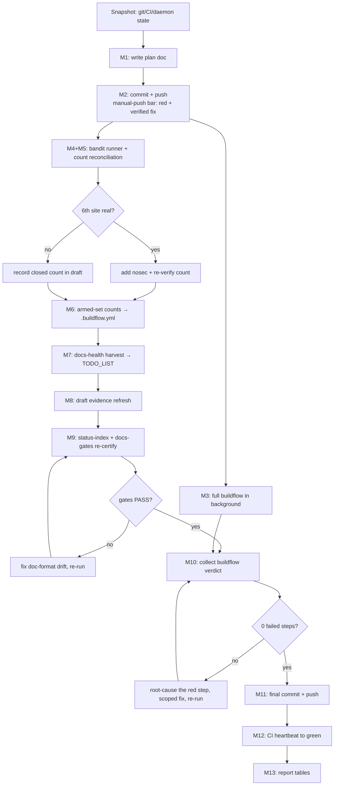

# SUPERB: gate-setup hardening — the five-scoped-run triage closeout

> Created 2026-11-12 16:14 CET. Scope: make the BuildFlow/quality-gate setup
> SUPERB after the 2026-11-12 five-scoped-run triage
> (docs/status/2026-11-12_15-57_five-scoped-buildflow-triage.md). This plan
> owns the GATE/TOOLING surface only — the product-surface and fleet-libs
> tracks live in today's earlier plans (06-17, 07-05) and are NOT re-dispatched
> here (Step-0 read: TODO_LIST.md, ROADMAP.md, the three plans above, the
> 2026-11-11 cqrs-lint triage report, CHANGELOG head).

## The one-paragraph goal

Main carries a triaged, verified, locally-green gate setup (cqrs-lint 11
armed findings = the recorded steady state; samber-linter 0; io-surface 6
ruled ACCEPT; jscpd 16 ruled ACCEPT; bandit furniture explained upstream and
the 5 real sites nosec'd) — but none of it is CI-certified yet: the tree sits
ahead of origin, CI is in flight on a docs-health battery that local gates
already PASS, the full-buildflow certification has not run post-triage, the
bandit count has one unreconciled issue, and the triage's actionable residue
is not yet in TODO_LIST. This plan ships the tree, certifies it end-to-end,
closes the bandit count with a real local run, makes silent lint-directive
loss visible via armed-set counts, and harvests the residue — WITHOUT
touching any product surface, formatter scope, or concurrent session's files.

## Non-negotiable fences (the verschlimmbesser guard)

1. **Only established homes are edited**: `.buildflow.yml` triage note (the
   recorded ruling home), `TODO_LIST.md` (docs-health format), the bandit
   draft (append-only addenda), this plan. No new linters, no formatter-scope
   changes, no AGENTS.md growth (203→? — cap 377; leave untouched).
2. **No path-pinning tests for lint directives.** The status report's §f8 idea
   (arch test pinning directive sites) is REJECTED here — it false-reds on
   every legitimate file move, trading a silent loss for a loud wrong alarm.
   The zero-brittleness substitute: expected armed-set COUNTS recorded in
   `.buildflow.yml`, so a future scoped run's total is a one-glance diff.
3. **Concurrent sessions own their files.** `git add` by explicit path only;
   never `-A`; never revert anything not authored here.
4. **Push is sanctioned by the standing bar** (ratified 2026-10-11): main is
   RED (docs-health battery, runs 43237282217/43240080029) with a VERIFIED fix
   in hand (local `docs-gates.sh` PASS on every gate, twice). Anchor for the
   stall clause: the oldest unpushed commit at plan time is `033cacb1`
   (16:13:45) — under the 60-minute bar; the red-clause is the invoked one.

## Pareto breakdown

### The 1% that delivers 51% — make the setup TRUSTED again

- **P1 — Ship the verified tree.** The whole triage (directives, rulings,
  nosec set, docs, index) sits local; CI certifies nothing until it is pushed.
  `git status` → detailed commit → push → CI watch to green. Without this,
  every other task decorates an uncertified tree.
- **P2 — Certify the setup end-to-end.** One full `buildflow` run over the
  post-triage tree: the single verdict that exercises every gate (and closes
  the 2026-11-11 report's open b2: fmt + full suite + full run).

### The 4% that delivers 64% — make it CORRECT and DURABLE (adds to the 1%)

- **P3 — Close the bandit count.** Verify a local bandit runner
  (`nix run nixpkgs#python312Packages.bandit`), enumerate the REAL issues
  fresh, reconcile the 6th-issue question (metrics say 6; 5 locations
  recovered), correct the nosec set if a sixth site surfaces, and refresh the
  draft's evidence with the locally-reproducible command.
- **P4 — Make silent directive loss VISIBLE.** Record the expected scoped
  finding counts in `.buildflow.yml` (cqrs-lint 11, samber-linter 0,
  io-surface 6, jscpd 16): the F031-class loss hid for hours because the
  finding total coincidentally stayed 12 — a recorded count turns every
  future scoped run into a one-glance diff.
- **P5 — Harvest the residue.** The status report's §f is a timestamped
  tombstone; docs-health HARVEST moves the actionable rows into TODO_LIST.md
  (house format: `- **Task** (source): detail`, Evidence cited) so the setup
  work survives the session.

### The 20% that delivers 80% — make it LOUD and FORWARD-POINTER (adds to the 4%)

- **P8 — The upstream filing package.** The bandit draft (reobservation
  appended, #64 linkage, root-cause chain) is filing-ready; refresh its
  evidence with the locally-reproducible bandit command from P3 so the
  reviewer can re-derive every number.

### The remaining 20% to 100% — parked, with owners and triggers (NOT dropped)

- **P7 — Owner/infra packaging.** BuildFlow binary rebuild (`8936ca0`→`39c4789`),
  templ-fmt devshell pin (v0.3.1020 vs pinned v0.3.1100), dprint plugin
  nix-store pin, io-history-ratchet `--profile-io` pass, BuildFlow state-DB
  purge decision — each becomes a TODO_LIST/ROADMAP row with its trigger;
  none is executable from this session (owner infra or tree-mutating during
  concurrent activity).
- **P9 — Calendar-gated items verified armed.** Monthly tier re-measure due
  2026-12-08 (watch calendar), quarterly art-dupl baseline audit (last
  2026-11-11), post-`-f json` nosec re-verification (blocked upstream).

## Comprehensive plan (30–100 min tasks, sorted by impact)

| #  | Task (30–100 min)                                                                                                              | Impact | Effort | Customer value |
|----|--------------------------------------------------------------------------------------------------------------------------------|--------|--------|----------------|
| P1 | Ship the verified triage tree: commit plan + residue by explicit path, push, CI watch to green (manual-push bar invoked, anchor stated) | High   | 45 min | The certified-setup deliverable itself |
| P2 | Full `buildflow` certification run over the post-triage tree; record per-tool verdicts; triage any red step to root cause       | High   | 100 min (wall-clock) | One green verdict covering every gate |
| P3 | Bandit count closure: local runner verified, fresh issue enumeration, 6th-issue reconciled, nosec set corrected if needed        | High   | 45 min | Honest security-signal count; kills the recurring ambiguity |
| P4 | Armed-set finding counts recorded in `.buildflow.yml` (the anti-silent-loss guard, zero brittleness)                            | High   | 30 min | Future triages diff in one glance; the F031 class becomes visible |
| P5 | docs-health HARVEST of the actionable residue into TODO_LIST.md (house row format, Evidence cites)                              | High   | 45 min | The setup work survives the session |
| P6 | Cosmetic-noise verification (stale B105 nosec audit — verify-only decision documented, no deletions)                             | Low    | 30 min | Stops future sessions re-litigating the warnings |
| P7 | Owner/infra parked rows packaged with triggers (BuildFlow rebuild, templ pin, dprint pin, io-ratchet, state-DB purge)            | Medium | 60 min | The 100% list exists with owners |
| P8 | Upstream filing package: bandit draft evidence refreshed with the reproducible local command                                     | Medium | 30 min | The ask becomes reviewer-verifiable |
| P9 | Calendar-gated items verified armed (2026-12-08 tier re-measure, quarterly baseline audit, post-json nosec re-check)             | Medium | 30 min | Nothing silently falls off the calendar |

## Micro-breakdown (≤12 min each, sorted by impact — THIS session's execution list)

| #  | Task (≤12 min)                                                                                                          | Verify                                            |
|----|--------------------------------------------------------------------------------------------------------------------------|---------------------------------------------------|
| M1 | Write this plan doc (Pareto ladder, both tables, mermaid graph, errata)                                                   | File exists; docs-gates green on the corpus       |
| M2 | `git status` → commit by explicit path (plan doc) with detailed message; push; state the manual-push-bar anchor           | `git ls-remote` shows the new tip                 |
| M3 | Kick off FULL `buildflow` in the background (P2)                                                                          | Run id recorded; job alive                        |
| M4 | Verify `nix run nixpkgs#python312Packages.bandit -- --version` (fall back to `nix shell`)                                 | Version printed                                   |
| M5 | Fresh bandit enumeration over `scripts/` + reconcile the 6th-issue count; correct the nosec set only if a real 6th site exists | Issue count stated with locations                 |
| M6 | Armed-set counts appended to the `.buildflow.yml` triage note (P4)                                                        | `grep` shows the counts; cqrs-lint scoped re-run agrees |
| M7 | Load docs-health SKILL.md; HARVEST actionable rows into TODO_LIST.md in house format (P5)                                 | Rows cite Evidence; no format drift               |
| M8 | Refresh the bandit draft evidence with the reproducible local command (P8)                                                | Draft diff names the command + fresh count        |
| M9 | `python3 scripts/status-index.py` + `scripts/docs-gates.sh` re-certify (P5/P8 doc edits)                                  | PASS on all gates                                 |
| M10| Collect the full buildflow verdict; if red, root-cause ONE step before proceeding (P2)                                    | `buildflow history` shows 0 failed steps          |
| M11| Final commit (detailed message) + push (P1 completion)                                                                    | `git ls-remote` matches local HEAD                |
| M12| CI watch: `scripts/ci-verdict.sh` heartbeat until exit 0 (long waits print a heartbeat, never silent sleep)               | exit 0, workflow-name-verified                    |
| M13| Report back: Pareto ladder + both tables + every verdict (the chat table)                                                 | All rows carry their verification                 |

Parked micro-tasks (deliberately NOT in this session's execution list): stale
B105 deletions (verify-only per the fences), BuildFlow rebuild/reinstall,
templ-fmt pin change, dprint plugin pin, io-ratchet profiling, state-DB purge —
each lands as a TODO_LIST/ROADMAP row in M7 with its trigger, none mutates the
tree while concurrent sessions hold in-flight files.

## Execution graph

## Errata (Step-0 corrections, so the next session is not misled)

1. The status report's §f8 "directive-survival arch test" is superseded by
   P4's armed-set counts — a path-pinning test would false-red on legitimate
   moves (the exact verschlimmbesser shape the owner warned about); the
   count makes the same loss visible with zero brittleness.
2. The status report's §f12 "stale B105 nosec cleanup" is demoted to
   verify-only (P6): deleting documented suppressions to silence cosmetic
   warnings is churn against a detector whose `-f json` lane will remove the
   warnings upstream; bandit exit stays 0 either way.
3. The status report's §f14 CHANGELOG audit is reduced: the `[Unreleased]`
   section already carries today's concurrent-train entries (verified head at
   16:14); the residue is a spot-check that `e897efe8` (admin CDR rows) has a
   line — folded into M7's harvest pass, not a standalone task.

## Verification matrix (what "done" means)

| Deliverable              | Verified by                                                              |
|--------------------------|---------------------------------------------------------------------------|
| Tree shipped             | `git ls-remote` == local HEAD; `scripts/ci-verdict.sh <sha>` exit 0      |
| Setup certified          | `buildflow history`: 0 failed steps on the post-triage run               |
| Bandit count closed      | Fresh enumeration output quoted in the draft addendum; count reconciled  |
| Silent loss visible      | `.buildflow.yml` carries the four expected counts; scoped runs diff clean |
| Residue durable          | TODO_LIST rows cite Evidence; `docs-gates.sh` PASS post-edit             |
| Nothing broken           | Worktree clean of foreign files; go build/tests untouched surfaces green  |
