# SUPERB Pareto triage plan — webphone open work, 2026-11-13

_Snapshot: ranked 2026-11-13 10:05 CET against `TODO_LIST.md` (1564 lines; 17 open checkbox rows + bold-headed open clusters + the reopen-trigger registry), `ROADMAP.md`, the standing-watch calendar (`docs/watches/2026-11-08_standing-watch-calendar.md`), the owner sitting pack (`docs/planning/2026-11-07_21-30_owner-sitting-pack.md`, 58 rulings), and this repo's freshest status reports (2026-11-12/13). Every task below was checked against its TODO evidence line; struck rows were dropped. Owner-gated items are included and marked — they are inventory, not agent-executable._

_Method: Pareto first (1%→51%, 4%→64%, 20%→80%, other 20%→100%), then a medium plan (30–100 min tasks, T01–T27, ALL open work), then the fine breakdown (≤12 min units, F-xx, ALL tasks). Sort key: importance (unblocks-the-most first) → customer value (owner/operator/fleet) → impact → effort (cheaper first at equal impact). No verschlimmbessern: nothing here rewrites landed rulings; every fleet item defers to its report's refresh trigger._

---

## 1. The Pareto ladder

### The 1% that delivers 51%

| #   | The one thing                                                                                                                                                | Why it is HALF the result                                                                                                                                                                                                                                                                                                                                                                                      |
| --- | ------------------------------------------------------------------------------------------------------------------------------------------------------------ | -------------------------------------------------------------------------------------------------------------------------------------------------------------------------------------------------------------------------------------------------------------------------------------------------------------------------------------------------------------------------------------------------------------- |
| 1%a | **The owner-calls sitting pack** (58 rulings, one sitting; every surface consolidated 2026-11-08)                                                            | ~15 trains are parked behind these rulings: the T13/T15 production cutover (SIP credential brokering LIVE = the directory password never reaching the browser), the CRM policy trio (Q1–Q3), traces-in-backup, remote-leg-only ASR (#48), the orphan-sweep decision, cqrs-lint gating posture. Half the open inventory by value is gated on ONE human sitting. The prep is done; only the answers are missing. |
| 1%b | **Trunk-green hygiene triple**: templ-fmt devshell pin alignment (v0.3.1020→v0.3.1100) + `buildflow format` quiet-window re-verify + bandit runner pin       | Retires three RECURRING advisory classes that tax every single session (the fingerprint-drift warn fired on every scoped run 2026-11-12; bandit needs PATH hunts; the drift is the root of the warn). Compounding: every future train gets cheaper and quieter.                                                                                                                                                |
| 1%c | **The v2.13.x production proof battery**: stack redeploy riding `main` + B5 post-switch verification battery + the voicemail click-play verdict on real data | Converts "shipped and CI-green" into "verified on the deployment the owner actually uses" — the 2026-11-10/11 UX trains and the voicemail fix are unproven on prod until this runs.                                                                                                                                                                                                                            |

### The 4% that delivers 64% (the 1% plus)

| #   | Addition                                                                                                                                                                                 | Why                                                                                                                                                                                                |
| --- | ---------------------------------------------------------------------------------------------------------------------------------------------------------------------------------------- | -------------------------------------------------------------------------------------------------------------------------------------------------------------------------------------------------- |
| 4%a | **go-health-dashboard v0.13.3 bump + live `'unsafe-eval'`-drop test**                                                                                                                    | Zero-collision (floor = current pins); closes the CSP-hardening lane the 2026-11-12 adjudication left to upstream — and upstream just shipped the SDK-side half.                                   |
| 4%b | **Island small-hardening residue** (4 items: note-textarea bytes-vs-chars, login-page.js localStorage try/catch, dial-form double-submit guard, `htmx.ajax` unhandled-rejection catches) | Four REAL user-hit-able defect classes (multibyte truncation, private-mode login death, double INVITE, silent restore failures) — the 2026-10-27 owner ruling makes an invisible error path a bug. |
| 4%c | **Cadence/18-08 drain tranches** (102 bare rows in the oldest live report; threshold age ~2026-12-07; bank headroom to ≤63 unarchived)                                                   | Deadline-bound: missing it re-reds main's docs battery for days (the exact class that cost a red-CI morning this week).                                                                            |
| 4%d | **Flight-recorder/metrics cluster core** (NixOS-module declared surface + `/internal/flightrecorder` rate limit + startup log + snapshots metric)                                        | The operator's only debug seam for the 2s/5xx class; today it is env-only, unrate-limited, and invisible in `/metrics`.                                                                            |
| 4%e | **Raceprobe #249 fix decision**                                                                                                                                                          | A live red `-count>1` suite class blocks the file-size train's closure and erodes trust in the suite; decide await-poll vs semantics, fix or pin.                                                  |

### The 20% that delivers 80% (the 4% plus)

| #    | Addition                                                                                                                                                                                                 | Why                                                                                                                                                                |
| ---- | -------------------------------------------------------------------------------------------------------------------------------------------------------------------------------------------------------- | ------------------------------------------------------------------------------------------------------------------------------------------------------------------ |
| 20%a | Flight-recorder cluster remainder (arch pin `h.notFound` sole-404-writer, sendfile cost, IPv6 `::1` case, quarterly `http.NotFound` re-rule)                                                             | Depth: the cluster's guard rails so the core cannot rot.                                                                                                           |
| 20%b | Fleet-libs follow-through: untagged-release-commit sweep + `scripts/fleet-tags.sh` + catalog v4.15.0 rider + upstream asks (idempotency clock, etag #5, appkit #59-61 status) + RUN-OK→`# expect` anchor | Keeps the 25-report audit corpus HONEST (this week's near-miss: a mangled tag sweep nearly wrote 4 false claims); collective-improvement feed for the whole fleet. |
| 20%c | Voicemail playback coverage arms (stack browser-E2E arm + `verify-live.sh` authenticated audio fetch + `operator.nix` 206-through-proxy pin)                                                             | The fix shipped blind — zero automated surface covers the playback path; every regression re-opens the 2026-11-10 incident class.                                  |
| 20%d | Ring-guard positive path + night-run stability pair (visual harness trust)                                                                                                                               | The prod screenshot ledger's two trust gaps; cheap, harness-only.                                                                                                  |
| 20%e | cqrs-lint/cqrs upstream filings (suppression state-machine + D005, owner-tick prep) + `/*` lexer tracking + S001 heuristic confirm                                                                       | Removes DEAD directive mines in six files (directives below a `/*` comment are silent no-ops until upstream fixes).                                                |
| 20%f | Wire-fixture follow-ups + webphone-android consumption handover (origin-picker/CallStyle spec pack)                                                                                                      | The Android shell's remaining half is spec-blocked; the handover pack is webphone's side of it.                                                                    |
| 20%g | Hub runner durable fix (ExecStartPre) + ringhook operator docs + typed mirror                                                                                                                            | The EventCatalog hub keeps rotting on reboot; the ring seam is shipped but undocumented for the deploy.                                                            |
| 20%h | Docs-truth batch: observability FEATURES/ROADMAP rows, lessons candidates (2), go-appkit report refresh (direct-dep fact), AGENTS one-liners (error-registry regen + b5 directive convention)            | The corpus the next session reads; stale docs manufacture wrong work (proven repeatedly).                                                                          |
| 20%i | Branching-flow baseline refresh + `erraudit nolint-audit` decay pass                                                                                                                                     | Detector noise floor maintenance; quarterly calendar item pulled into the train that touches the files.                                                            |
| 20%j | T05 authenticated prod capture + night-run support pack (owner-gated prep)                                                                                                                               | The visual ledger against REAL data — owner-gated but prep is agent work.                                                                                          |

### The other 20% to reach 100%

Owner postings and dated watches (release announcements; standing-watch calendar upkeep — erraudit 2026-12-08, buildflow quarterly 2026-12-20, credentials 2026-12-30); owner+carrier items with no agent half (fax enablement; CRM mesh Q1–Q3; ai-phone steal-list remainder; storage-ladder §5 owner date; aarch64 toplevel ruling — revisit only with a builder host); release-hygiene quiet-host items (`.buildflow.yml` stale baseline 157-entry decision, timings re-baseline, SQLITE_BUSY correlation); deferred spikes with named triggers (schema-export spike behind owner g1; scheduled sends NO-GO behind gateway; session messenger NO-GO standing).

---

## 2. Medium plan — ALL open work in 30–100 min tasks (sorted)

| ID  | Task                                                                                                                                                          | Tier | Impact  | Effort              | Value / gate                                                        |
| --- | ------------------------------------------------------------------------------------------------------------------------------------------------------------- | ---- | ------- | ------------------- | ------------------------------------------------------------------- |
| T01 | Owner sitting pack, part 1 (rulings A product/UX + B privacy/data, ~30 of 58)                                                                                 | 1%a  | Massive | 100m (owner)        | Unparks cutover cluster prep, CRM trio, ASR #48                     |
| T02 | Owner sitting pack, part 2 (C infra + D tooling + E cross-repo + F bulk)                                                                                      | 1%a  | Massive | 100m (owner)        | cqrs-lint posture, traces-in-backup, orphan sweep, watch thresholds |
| T03 | templ-fmt devshell pin alignment (v0.3.1020→v0.3.1100) + regenerate + verify no codegen delta                                                                 | 1%b  | High    | 45m                 | Retires the fingerprint-drift warn CLASS at its root                |
| T04 | `buildflow format` quiet-window re-verify (tree-mutating; needs no concurrent sessions)                                                                       | 1%b  | High    | 45m                 | Cached verdicts re-verified under the true formatter identity       |
| T05 | Bandit runner pin (`python312Packages.bandit` in devshell or `scripts/bandit.sh`)                                                                             | 1%b  | Medium  | 30m                 | Reproducible triage without PATH hunts                              |
| T06 | Stack redeploy riding `main` + B5 post-switch battery (`/version`, journal quiet, `ui-capture --track` on real data) + voicemail click-play verdict           | 1%c  | Massive | 100m (deploy)       | Prod proof of v2.13.x + the UX/voicemail trains                     |
| T07 | go-health-dashboard v0.13.3 bump train (tidy → vendorHash → gates) + live test whether `csp.go` drops `'unsafe-eval'` on a nonce'd host                       | 4%a  | High    | 90m                 | CSP hardening; report + TODO row already arm it                     |
| T08 | Island hardening A: note-textarea bytes-vs-chars cap + login-page.js localStorage try/catch                                                                   | 4%b  | High    | 45m                 | Two user-hit defect classes                                         |
| T09 | Island hardening B: dial-form double-submit guard + `htmx.ajax` unhandled-rejection catches (restoreLastTab, live-context)                                    | 4%b  | High    | 60m                 | Double-INVITE + silent-restore classes                              |
| T10 | 18-08 drain tranche 1 (annotate pin 260 on its way down; gates-first strikes; ~40 rows)                                                                       | 4%c  | High    | 100m                | Deadline ~2026-12-07; oldest live report                            |
| T11 | 18-08 drain tranche 2 + cadence headroom banking to ≤63 unarchived + ratchet re-measure                                                                       | 4%c  | High    | 100m                | Next report birth stays green                                       |
| T12 | Flight-recorder core: NixOS-module declared surface + `/internal/flightrecorder` rate limit + startup log line                                                | 4%d  | High    | 90m                 | Operator debug seam becomes declared + fenced                       |
| T13 | Flight-recorder metrics: snapshots-taken (count+bytes) + disk-aware `maxBytes`                                                                                | 4%d  | Medium  | 75m                 | Observability of the debug tool itself                              |
| T14 | Raceprobe #249: reproduce `-count>1`, decide await-poll vs semantics, fix or explicit pin+wontfix, ledger row                                                 | 4%e  | High    | 100m                | Un-reds a suite class; closes the file-size train                   |
| T15 | Fleet follow-through A: per-submodule refspec tag script (`scripts/fleet-tags.sh`) + untagged-release-commit sweep (20 repos)                                 | 20%b | Medium  | 60m                 | Kills the tag-mangle class; the v0.13.0-untagged class              |
| T16 | Fleet follow-through B: catalog v4.15.0 rider + go-idempotency injectable-clock ask + etag #5 / appkit #59-61 status checks + RUN-OK→expect anchor            | 20%b | Medium  | 75m                 | Audit corpus stays honest; upstream feed                            |
| T17 | Voicemail coverage arms: browser-E2E playback arm + `verify-live.sh` authenticated audio fetch + `operator.nix` 206 pin                                       | 20%c | High    | 90m                 | The fix ships blind today (stack repo, co-owned)                    |
| T18 | Ring-guard positive path exercise + night-run stability pair (quiet-window runs)                                                                              | 20%d | Medium  | 100m                | Visual-ledger trust                                                 |
| T19 | cqrs-lint upstream: owner-tick prep for suppression-SM + D005 drafts; track `/*` lexer fix; confirm S001 heuristic drift                                      | 20%e | Medium  | 45m                 | Six files carry dead-directive mines                                |
| T20 | Wire-fixture follow-ups (a)/(b) with named triggers + android consumption handover pack (origin-picker + CallStyle spec)                                      | 20%f | Medium  | 75m                 | Unblocks webphone-android's remaining half                          |
| T21 | Hub runner durable fix (ExecStartPre provisioning) + `ALERT_WEBHOOK_URL` decision + ringhook operator docs + typed mirror                                     | 20%g | Medium  | 90m                 | Hub survives reboots; ring seam documented                          |
| T22 | Docs-truth batch: FEATURES `/metrics`+flight-recorder rows, ROADMAP observability entry, 2 lessons candidates, go-appkit report refresh, AGENTS one-liners ×2 | 20%h | Medium  | 60m                 | The corpus the next session trusts                                  |
| T23 | Branching-flow baseline refresh + `erraudit nolint-audit` decay pass (calendar pull-forward)                                                                  | 20%i | Medium  | 75m                 | Detector noise floor                                                |
| T24 | T05 authenticated prod capture (owner-gated) + `--threads` deep-link matrix on real data                                                                      | 20%j | Medium  | 100m (owner-assist) | Real-data visual ledger                                             |
| T25 | Raceprobe-dependent residue: branching-flow baseline numbers fold + ci-flake-ledger row + file-size train closeout strikes                                    | 20%i | Low     | 30m                 | Depends on T14                                                      |
| T26 | Owner quiet-host release hygiene: `.buildflow.yml` stale-baseline decision (157 entries), timings re-baseline, SQLITE_BUSY correlation                        | 100% | Low     | 60m (owner)         | Named in the 2026-11-10 five-attempt class                          |
| T27 | Standing-watch upkeep: calendar refresh after this plan lands (erraudit 2026-12-08, buildflow 2026-12-20, credentials 2026-12-30, dedup 2027-01-11)           | 100% | Low     | 30m                 | One calendar stays the truth                                        |

_Owner-only rows already counted above where they have an agent half (T01/T02/T24/T26). Pure owner actions with NO agent half — release announcements posting, fax enablement (owner+carrier), CRM mesh Q1–Q3, storage-ladder §5 date, aarch64 ruling, R-URI/C5-lift/owner-legs sitting (1492) — stay in TODO_LIST as their own rows; a plan table duplicating them adds no value._

## 3. Fine plan — ALL tasks in ≤12 min units (sorted by parent, then impact/effort)

| ID  | Unit (≤12 min each)                                                                   | Parent  |
| --- | ------------------------------------------------------------------------------------- | ------- |
| F01 | Read owner pack §A product/UX rows; answer or annotate defaults                       | T01     |
| F02 | Read owner pack §B privacy rows; answer or annotate defaults                          | T01     |
| F03 | Draft the T13/T15 cutover runbook checklist from pack rows (post-ruling)              | T01     |
| F04 | Read owner pack §C infra rows; answer or annotate                                     | T02     |
| F05 | Read owner pack §D tooling rows; answer or annotate                                   | T02     |
| F06 | Read owner pack §E/F cross-repo + bulk table; answer or annotate                      | T02     |
| F07 | Record rulings into TODO_LIST strikes + ROADMAP prune in one pass                     | T01/T02 |
| F08 | Bump devshell templ pin in `nix/devshell.nix`; rebuild shell                          | T03     |
| F09 | `templ generate` with new pin; diff `*_templ.go` (expect no codegen delta)            | T03     |
| F10 | Run `nix fmt` + `scripts/format-check.sh`; commit pin train                           | T03     |
| F11 | Verify no in-flight files (git status clean-ish); stage scoped run                    | T04     |
| F12 | `buildflow format` re-verify; read fingerprint verdict; commit                        | T04     |
| F13 | Add `python312Packages.bandit` to devshell (or write `scripts/bandit.sh`)             | T05     |
| F14 | Full-tree bandit scan; confirm 0 issues + 6 `# nosec` sites stand; commit             | T05     |
| F15 | Push `main` → trigger stack redeploy (or hand owner the one-liner)                    | T06     |
| F16 | Post-switch checks: `/version` = expected, journal unknown-key grep                   | T06     |
| F17 | `ui-capture --track` Reports subline + voicemail toast on real data                   | T06     |
| F18 | Click voicemail play; record verdict line (toast text = trigger name)                 | T06     |
| F19 | `go get` dashboard v0.13.3; `go mod tidy`; inspect `go.sum` delta                     | T07     |
| F20 | vendorHash re-pin via `nix build .#webphone.goModules --rebuild` recipe               | T07     |
| F21 | Boot with dashboard on + nonce'd host; grep served CSP for `unsafe-eval`              | T07     |
| F22 | If eval droppable: pin with `TestAppDashboardMountsHealthSubtree` update              | T07     |
| F23 | Full gates + smoke; update go-health-dashboard.md + TODO row strikes                  | T07     |
| F24 | Note-textarea: audit `maxlength` vs JS cap; align bytes/chars for multibyte           | T08     |
| F25 | Note-textarea test (multibyte fixture: emoji/CJK) + island spec                       | T08     |
| F26 | login-page.js: wrap `localStorage` reads in try/catch; private-mode test              | T08     |
| F27 | Commit island A train: fmt, island tests, type gate                                   | T08     |
| F28 | Dial form: disable submit on pending; re-enable on settled verdict                    | T09     |
| F29 | Dial-form double-submit spec (two rapid submits → one INVITE)                         | T09     |
| F30 | restoreLastTab: catch `htmx.ajax` rejection → console + fallback tab                  | T09     |
| F31 | live-context fetch: catch rejection → empty-slot (200-degraded parity)                | T09     |
| F32 | Commit island B train: fmt, island tests, type gate, lint                             | T09     |
| F33 | Rebuild annotool from skill assets (`/tmp` wipe)                                      | T10     |
| F34 | 18-08 tables 1–3: check-rows → strike with in-report evidence                         | T10     |
| F35 | 18-08 tables 4–6: strike + route survivors to TODO rows                               | T10     |
| F36 | 18-08 tables 7–9: strike + route                                                      | T10     |
| F37 | 18-08 tables 10–13: strike + route; `check-rows --strict` green                       | T10     |
| F38 | dprint fmt + `bare-rows` zero; commit tranche 1                                       | T10     |
| F39 | Tranche 2: remaining tables to zero bare rows                                         | T11     |
| F40 | `docs-gates run .` full battery; annotate pin re-measure (DOWN only)                  | T11     |
| F41 | Bank headroom: verify ≤63 unarchived; index regen; commit                             | T11     |
| F42 | NixOS module: `settings.debug.flightrecorder` bool → env plumbing                     | T12     |
| F43 | Module-check stand-in + `nix build .#checks.x86_64-linux.webphone-module`             | T12     |
| F44 | `/internal/flightrecorder`: keyed rate limit (bucket + 429 + test)                    | T12     |
| F45 | Startup log line when recorder on (one slog Info) + test                              | T12     |
| F46 | Snapshot metric: count + bytes counters at snapshot write seam                        | T13     |
| F47 | Disk-aware `maxBytes`: statvfs-style check before snapshot; test                      | T13     |
| F48 | Reproduce #249: `-count=5` raceprobe; capture failing assertion                       | T14     |
| F49 | Decide await-poll vs semantics; write decision + ledger row                           | T14     |
| F50 | Implement fix (or pin + wontfix directive); suite green ×5                            | T14     |
| F51 | Write `scripts/fleet-tags.sh` (refspec per submodule; self-test)                      | T15     |
| F52 | Run untagged sweep over 20 repos; record findings in index.html                       | T15     |
| F53 | catalog v4.15.0 bump: tidy → vendorHash → gates → report note                         | T16     |
| F54 | File go-idempotency injectable-clock issue (verify-before-filing)                     | T16     |
| F55 | Check etag #5 + appkit #59/#60/#61 statuses; record in reports                        | T16     |
| F56 | Strengthen go-idempotency.md verify line to `# expect` anchor                         | T16     |
| F57 | Stack E2E: author voicemail playback arm (seed + play + toast assert)                 | T17     |
| F58 | verify-live.sh: authenticated audio fetch leg                                         | T17     |
| F59 | operator.nix: pin 206-through-proxy behavior                                          | T17     |
| F60 | Ring-guard: force one guarded state; assert the guard fires                           | T18     |
| F61 | Night-run ×2: schedule quiet-window; compare summaries; ledger                        | T18     |
| F62 | Owner-tick pack: assemble suppression-SM + D005 filing bodies                         | T19     |
| F63 | Track `/*` lexer: TODO row with bump-trigger; S001 confirm upstream                   | T19     |
| F64 | Wire-fixture (a): the deferred trigger check; document or do                          | T20     |
| F65 | Wire-fixture (b): second follow-up with its trigger                                   | T20     |
| F66 | Android handover: origin-picker + CallStyle spec pack draft                           | T20     |
| F67 | Hub: ExecStartPre provisioning unit (stack repo PR)                                   | T21     |
| F68 | Hub: ALERT_WEBHOOK_URL decision row for owner pack addendum                           | T21     |
| F69 | Ringhook operator docs + typed settings mirror draft                                  | T21     |
| F70 | FEATURES.md: `/metrics` histogram + beacon + flight-recorder rows                     | T22     |
| F71 | ROADMAP.md: observability-depth entry                                                 | T22     |
| F72 | Lessons: "plan says X, code pins Y — amend same turn"                                 | T22     |
| F73 | Lessons: "backup/test-path consequence of new dataDir artifacts"                      | T22     |
| F74 | go-appkit.md: flightrecorder direct-dep fact refresh                                  | T22     |
| F75 | AGENTS one-liner: error-registry regen note                                           | T22     |
| F76 | AGENTS one-liner: cqrs-lint directive convention (b5)                                 | T22     |
| F77 | `erraudit nolint-audit` run; retire stale directives                                  | T23     |
| F78 | Branching-flow: `-s branching-flow --save-baseline` refresh (moved-checkout protocol) | T23     |
| F79 | T05 prod capture: owner env creds; `--track` run; gallery + compare                   | T24     |
| F80 | T05: `--threads N` deep-link shots on real threads                                    | T24     |
| F81 | Fold T14 verdict into baseline numbers; strike residue rows                           | T25     |
| F82 | ci-flake-ledger conditional row; file-size train closeout strikes                     | T25     |
| F83 | Quiet-host: `.buildflow.yml` baseline delete-or-refresh decision                      | T26     |
| F84 | Quiet-host: `buildflow timings --regressions` re-baseline                             | T26     |
| F85 | SQLITE_BUSY correlation if recurs (grep attempt-2 tail)                               | T26     |
| F86 | Calendar: re-derive next-due after this plan; commit                                  | T27     |
| F87 | Post-plan harvest check: new tasks → TODO_LIST (docs-health HARVEST)                  | T27     |
| F88 | df-brittle pins re-measure (`generic_df` from line count; control plant)              | T11     |
| F89 | Watch: daemon push of this plan; `scripts/ci-verdict.sh <sha>`                        | all     |

---

## 4. Execution graph

```mermaid
flowchart TD
    subgraph P1["1% → 51%"]
        T01[T01/T02 owner sitting 58 rulings]
        T03[T03 templ-fmt pin]
        T04[T04 buildflow format re-verify]
        T05[T05 bandit pin]
        T06[T06 prod proof battery]
    end
    subgraph P4["4% → 64%"]
        T07[T07 dashboard v0.13.3 + eval-drop]
        T08[T08 island hardening A]
        T09[T09 island hardening B]
        T10[T10 18-08 drain tranche 1]
        T11[T11 drain 2 + headroom bank]
        T12[T12 flight-recorder core]
        T13[T13 flight-recorder metrics]
        T14[T14 raceprobe #249 decision]
    end
    subgraph P20["20% → 80%"]
        T15[T15 fleet-tags.sh + untagged sweep]
        T16[T16 fleet follow-through B]
        T17[T17 voicemail coverage arms]
        T18[T18 ring-guard + night-run]
        T19[T19 cqrs-lint upstream filings]
        T20[T20 wire-fixtures + android pack]
        T21[T21 hub runner + ringhook docs]
        T22[T22 docs-truth batch]
        T23[T23 baseline + nolint decay]
        T24[T24 prod capture owner-gated]
        T25[T25 file-size closeout]
    end
    subgraph P100["other 20% → 100%"]
        T26[T26 quiet-host hygiene owner]
        T27[T27 watch calendar upkeep]
    end

    T01 --> T24
    T03 --> T04
    T14 --> T25
    T25 --> T23
    T10 --> T11
    T12 --> T13
    T06 --> T17
    T07 --> T16
    T15 --> T16
    T11 --> T27
    T22 --> T27
    T26 --> T27

    DEADLINE{{"2026-12-07 cadence age threshold"}}
    T10 -.deadline.-> DEADLINE
    T11 -.deadline.-> DEADLINE
    WATCH{{"2026-12-08 erraudit / 2026-12-20 buildflow"}}
    T23 -.calendar.-> WATCH
```

## 5. Verification and errata

- Struck-row audit: every TODO section listed here was read 2026-11-13; sections whose rows are all struck (UI/UX destination trains, deepening T17–T23, full-code-review four of five, Reports C1–C5) are excluded. The fifth full-code-review row (raceprobe reopen #249) is T14.
- Fleet-libs rows come from THIS session's re-verified corpus (audit-verify 106/106 green at plan time).
- New tasks surfaced by this plan: none beyond TODO_LIST's existing rows (the plan is a ranking, not a source; F87 runs the harvest check anyway).
- Known concurrent-session risk: T04 and T11 mutate shared trees — run only with a quiet working tree (fix-forward protocol otherwise).

## 6. Standing rule

This plan is a snapshot. TODO_LIST.md stays the interactive ledger; when a task here lands, strike it THERE with evidence and let the next cadence sweep drain this file.
