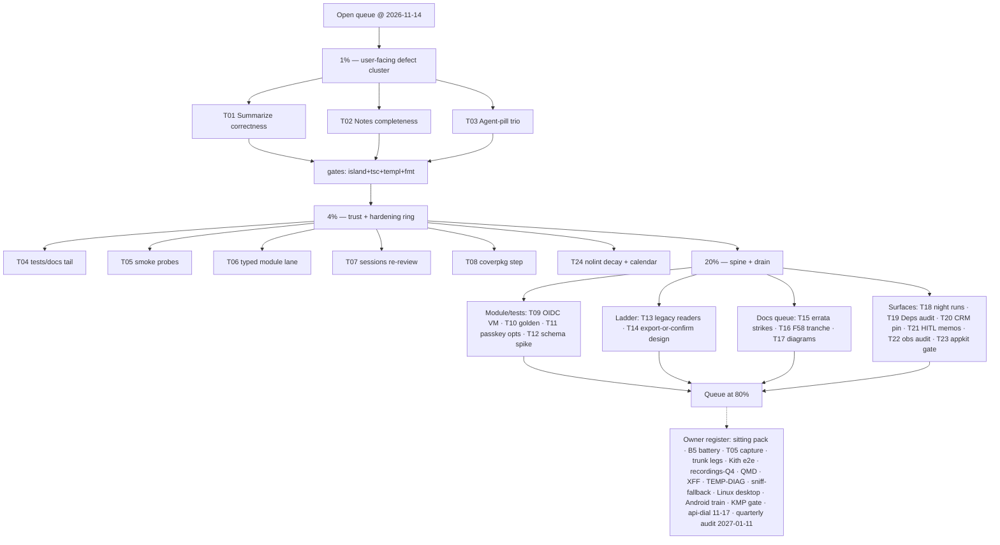

# SUPERB Open-Queue Pareto Plan — every open TODO, ranked and broken down

Generated 2026-11-14 11:41 CET · webphone HEAD `5e98a49e` (CI pending; `8f3520bb` GREEN)
· Sources: TODO_LIST.md (full open-row sweep, 2026-11-14), ROADMAP.md (open questions +
standing watches), this morning's docs-health sweep
(docs/status/2026-11-14_11-29_docs-health-september-corpus-sweep.md), the sitting pack
(docs/planning/2026-11-07_21-30_owner-sitting-pack.md).
Scope: assistant-executable work. The owner-gated register (§Owner) is listed, never scheduled.

## Method (skill step 0 — provenance)

Every task below cites its TODO_LIST row (line numbers as of this morning). Per the
pareto-planning skill, tasks were verified against code/CHANGELOG before ranking; the ones
that turned out ALREADY DONE are recorded in the Errata (their TODO rows are struck in the
errata drain train T15, not silently deleted — strikes are evidence-bearing per the 2026-11-11
canon).

## Pareto breakdown

- **1% → 51% — the user-facing defect cluster** (T01–T03 + their pins): the shipped daily
  surfaces carry three real defects a user hits this week — a Summarize button that 404s when
  ASR is off, a 409 remedy naming a note-delete that does not exist, a pill that goes stale
  across tabs and speaks jargon. Six small tasks, all test-pinned, all owner-visible.
- **4% → 64%** (+ T04–T08): the trust/hardening ring around the same surfaces — smoke boot
  probes, the `agentAudit` producer vocabulary, the typed `settings.textagent.*` module lane,
  the owed sessions at-rest re-review, the `-coverpkg` union step. Ops truth + regression
  armor for the 1%.
- **20% → 80%** (+ T09–T24): the module/tests spine (OIDC VM test, oauth2 golden, typed
  passkey options), the storage-ladder completion (legacy reader deletion, §5
  export-or-confirm design), the docs-queue drain (errata strikes + F58 tranche), the stale
  diagram refresh, the harness night-run pair, the post-ladder Deps audit, the CRM contract
  pin, HITL design spikes, the appkit demand-gate call, and the calendar obligations.
- **The last 20% → 100%** is the owner-gated register (§Owner) plus cross-repo trains
  (Android device train, stack voicemail legs, trunk truth, Kith e2e, ring-while-closed
  e2e) — listed for completeness, never self-answered.

## Comprehensive plan (30–100 min tasks, ALL open TODOs, sorted impact/effort/value)

| # | Task (30–100 min) | Tier | Impact | Effort | Customer value | TODO home |
|---|---|---|---|---|---|---|
| T01 | Summarize correctness: hide the ended-card Summarize button when ASR is off + `agentAudit` for the summarize producer lane | 1% | High | M | A button that cannot work stops lying; the audit trail covers the chain's producer | 1623 |
| T02 | Notes completeness: explicit DELETE `/api/calls/{id}/note`, the "noted" chip on History rows, Settings cap-visibility row | 1% | High | M | The 409 remedy names a delete that must exist; notes become glanceable | 1622 |
| T03 | Agent-pill UX trio: per-mode aria/tooltip, refresh on `wp:drafts-changed`, cycle shortcut + `?` help line | 1% | Medium | S | The pill stops being jargon and stops going stale | 1621 |
| T04 | Summarize tests/docs tail: deleted-transcript idem pin, duplicate no-second-push pin, error-context families, error-contract prose, ring_test native drafts, FCM `SendDraft` wire test, server test-harness extraction | 4% | High | M | Retryability and wire shapes get pinned; the audit vocabulary gets documented | 1623 |
| T05 | Smoke boot probes (grep `agent` flag, notes API roundtrip) + lychee excludes for archived docs | 4% | Medium | S | A fresh binary proves its surfaces at boot, not at the user's desk | 1624 |
| T06 | Typed `settings.textagent.*` module lane + module-check case | 4% | Medium | M | The first-class seam gets a typed front like csrf/serverTiming/backup | 1625 |
| T07 | Sessions at-rest re-review (owed: `login_email` landed 2026-10-28 after the 09-30 snapshot) | 4% | Medium | S | The periodic security review the doc itself demands | 1620 |
| T08 | `buildflow -coverpkg` union coverage step + one baseline re-run recorded | 4% | Low | S | The reported number becomes the cross-package truth | 1626 |
| T09 | OIDC module VM test (`webphone-oauth2`-style: credential lands, 0400, app reads it) | 20% | Medium | L | The typed OIDC lane gets its runtime proof, not just eval assertions | 147 |
| T10 | Second module-check golden with `oauth2.enable` (exact rendered JSON) | 20% | Medium | S | Config drift fails eval, not login | 151 |
| T11 | Typed passkey module options (derived rp for passkey-only configs) | 20% | Low | M | Passkey-only deployments get the same derived-rp convenience | 153 |
| T12 | Schema-export spike: settings schema GENERATED from the config structs | 20% | Medium | M | The openapi.json doctrine applied to settings — drift dies at regen | 142 |
| T13 | Delete the dead sibling legacy readers (keep app-flag helpers) + FEATURES/docs sync | 20% | Medium | S | Prod-dead code stops costing every read | 1614 |
| T14 | §5 export-or-confirm tooling DESIGN (dump tool + owner-confirmation checklist, memo only) | 20% | Medium | M | The future DROP window cannot silently delete unretired rows | 1615 |
| T15 | Errata drain: strike the ~12 verified-stale TODO rows (§Errata) with evidence | 20% | Medium | M | The backlog stops selling done work | Errata |
| T16 | F58 cadence-drain tranche #2: adjudicate + archive the next 2–3 DIRTY candidates gates-first | 20% | Medium | M | The docs queue stays at/below 65 with the pin's way down armed | 1602+1556 |
| T17 | Refresh the architecture-understanding D2/SVG pair vs the ~38-package reality (dated snapshots, new files) | 20% | Low | M | The diagrams match the system a new session reads | 1627 |
| T18 | Night-run stability pair + ring-guard positive path (quiet-window harness runs, `--track` ring arm) | 20% | Low | M | The capture harness gains its stability story | 221+240 |
| T19 | `server.Deps` read-model field audit post-ladder (is the seven-field smell gone; shape ruling) | 20% | Medium | M | The composition surface stays deliberate after the retirement | 705 |
| T20 | CRM contract snapshot test (pin the exact `/context` request + parse) + draft the `by-phone?numbers=` batch ask upstream (owner tick to file) | 20% | Low | M | The CRM seam's consumer side gets a drift tripwire | 859+856 |
| T21 | HITL design spikes: D2 veto-window mode + D3 agent registry/scoped machine tokens (memos, no code) | 20% | Medium | M | The next agent-authority step is designed before it is priced | 1119+1124 |
| T22 | Flight-recorder + metrics hardening cluster audit (the 1565 routed row; traces-in-backup already ruled — verify row states) | 20% | Low | M | The observability tail is adjudicated once, not re-derived | 1564 |
| T23 | appkit/flightrecorderhealth demand-gate evaluation (first MODULE candidate; adopt-or-park with evidence) | 20% | Low | M | The one live module candidate gets a ruling, not a linger | 759 |
| T24 | `erraudit nolint-audit` decay pass (post-C007) + calendar check (2026-12-08 re-measure due) | 4% | Low | S | Suppression decay cannot hide behind a stale calendar | 1576 |

## Fine breakdown (≤ 12 min steps, ALL TODOs, sorted within tasks by impact)

| ID | Step (≤12 min) | Task |
|---|---|---|
| F01 | Read `settleEndedCall`/`postcall.js` summarize gating + write the failing-shape test (ASR off + textagent on) | T01 |
| F02 | Gate the button render on `PBX_CONFIG.asr` && transcript-existence; island spec for the hidden arm | T01 |
| F03 | i18n en/de for the changed affordance copy | T01 |
| F04 | Add the `agentAudit` call to the api summarize producer; registry/family check | T01 |
| F05 | Server test: the producer line (actor/outcome/subject) | T01 |
| F06 | Island suite + tsc + templ regen + `nix fmt` green | T01 |
| F07 | `DELETE /api/calls/{id}/note` route: decider verdict + 204 + apidocs + drift row | T02 |
| F08 | 409-remedy copy updated to name the now-real delete | T02 |
| F09 | "noted" chip on History transcript rows (templ + CSS) | T02 |
| F10 | Settings cap-visibility row (noted-calls count) | T02 |
| F11 | Server + view tests; CHANGELOG `[Unreleased]` line | T02 |
| F12 | Island suite + tsc green | T02 |
| F13 | aria/tooltip copy per mode (en/de); shell.js tooltip hook | T03 |
| F14 | `wp:drafts-changed` listener refreshes the pill | T03 |
| F15 | `M` shortcut cycles the mode; `?` help + Settings cheat-sheet line | T03 |
| F16 | Shell specs for all three arms | T03 |
| F17 | Island suite + lint + tsc green | T03 |
| F18 | Pin: transcript deleted mid-window ⇒ idem key unrecorded (server test) | T04 |
| F19 | Pin: duplicate replay ⇒ no second push (server test) | T04 |
| F20 | `error-context.py --self-test` families (`push.draft_*`, `readmodels.note_*`, `agent.summarize`) | T04 |
| F21 | error-contract.md prose: `textagent.http` passthrough vs `agent.summarize` wrap | T04 |
| F22 | ring_test fakeTransport records drafts natively | T04 |
| F23 | FCM `SendDraft` wire test | T04 |
| F24 | Extract fakeProvider/stubReviewAPI/asrClientFor/recordingTransport into one helpers file | T04 |
| F25 | Smoke: grep `window.PBX_CONFIG.agent` at boot (scenario + count line) | T05 |
| F26 | Smoke: notes API PUT/GET roundtrip on a fresh binary | T05 |
| F27 | Lychee excludes for `docs/{architecture-understanding,research}/archived` | T05 |
| F28 | Smoke suite green; AGENTS smoke-count prose updated if the scenario count moved | T05 |
| F29 | Module options `settings.textagent.{url,secret_file}` + LoadCredential wiring | T06 |
| F30 | Eval assertions (both-or-neither; secret-refusal guard case) | T06 |
| F31 | `module-check` case for the textagent lane | T06 |
| F32 | Module-check-secrets.nix pass; options table in AGENTS module bullet | T06 |
| F33 | VM/nix-check green; CHANGELOG line | T06 |
| F34 | Re-read the 09-30 review + diff the sessions table vs HEAD (login_email, identity rows) | T07 |
| F35 | Verify sweep-on-read invariants still hold (store seam) | T07 |
| F36 | Re-write the residual-risk paragraph against the identity-layer reality | T07 |
| F37 | Dated verdict section in the review doc; strike the TODO row with evidence | T07 |
| F38 | `.buildflow.yml`: add the `-coverpkg=./...` union pass to the coverage step | T08 |
| F39 | Run it once; record the union number beside the per-package ones | T08 |
| F40 | Coverage-baseline appendix row (dated); strike the TODO row | T08 |
| F41 | Read the stack's `webphone-oauth2` VM-test shape as the template | T09 |
| F42 | Write the VM test: credential file lands 0400 under /run/credentials | T09 |
| F43 | Assert the app reads it at login (mock IdP or issuer stub) | T09 |
| F44 | KVM-gating + flake check wiring | T09 |
| F45 | Green run + CHANGELOG line | T09 |
| F46 | TODO row strike with the run evidence | T09 |
| F47 | Author the oauth2-enabled module-check case (fixed config, rendered JSON golden) | T10 |
| F48 | Assert the callback/rp derivations render from `caddy.hostName` | T10 |
| F49 | Golden green; TODO row strike | T10 |
| F50 | Options: `auth.passkey.rp_id`/`rp_origins` derivation from `caddy.hostName` | T11 |
| F51 | Eval assertions mirroring the OIDC lane's checks | T11 |
| F52 | Module-check case + AGENTS options bullet line | T11 |
| F53 | TODO row strike | T11 |
| F54 | Spike the codegen path: reflect config structs → JSON schema (openapi doctrine) | T12 |
| F55 | Render one schema for `settings.*` (the typed front's keys) | T12 |
| F56 | Decide the deliverable home (`/config.schema.json`? docs contract?) + memo | T12 |
| F57 | Park/row the follow-up; strike the spike row with the artifact link | T12 |
| F58 | Confirm zero production callers of the four legacy readers (grep) | T13 |
| F59 | Delete `legacy_{faxes,snippets,threads,transcripts}.go`; keep app-flag helpers | T13 |
| F60 | Tests: delete the dead readers' tests, keep flag-helper pins green | T13 |
| F61 | FEATURES/storage-ladder doc sync; strike the TODO row | T13 |
| F62 | Memo: the DROP window's precondition checklist (who confirms, which rows) | T14 |
| F63 | Sketch the dump tool (table → JSON/CSV via the one store seam) | T14 |
| F64 | Record the owner-confirmation flow (per row class) in the ladder doc's §5 | T14 |
| F65 | Row the implementation follow-up; strike the design row | T14 |
| F66 | Verify each Errata row against code/CHANGELOG (the §Errata list, one batch) | T15 |
| F67–F72 | Strike the stale rows in six small commits-worth of edits (evidence-bearing `~~ … done DATE — evidence` form) | T15 |
| F73 | `scripts/cadence-candidates.sh` → pick the next 2 oldest DIRTY | T16 |
| F74 | Read candidate #1; verify-vs-code; verdict map | T16 |
| F75 | Annotate + gates + banner + `git mv` | T16 |
| F76 | Repeat for candidate #2 | T16 |
| F77 | Battery green (65 ≤ 65); INDEX regen | T16 |
| F78 | TODO T24-row update (tranche count) | T16 |
| F79 | Re-derive the current package import graph (`go list`) | T17 |
| F80 | Update the d2 sources (two generations, dated) | T17 |
| F81 | Render SVGs; keep old files (snapshot convention) | T17 |
| F82 | TODO row strike with the new file paths | T17 |
| F83 | Stage a quiet-window overnight `--track` run script/command | T18 |
| F84 | Define "stable" (pass count, duration band) for the pair | T18 |
| F85 | Wire the ring-guard positive path (a real ring during `--track`) | T18 |
| F86 | Run once; record evidence in the harness docs | T18 |
| F87 | TODO rows (221+240) strike/update | T18 |
| F88 | Enumerate the current `server.Deps` fields vs the seven read-model fields | T19 |
| F89 | Judge the smell post-ladder (which fields the retirement already removed) | T19 |
| F90 | Ruling memo (one home: the TODO row's verdict text or an ADR note) | T19 |
| F91 | Pin or refactor as ruled (bounded) | T19 |
| F92 | Strike/update row 705 | T19 |
| F93 | Capture webphone's exact `/context` request bytes as a fixture | T20 |
| F94 | Snapshot test: parse contract pinned (unknown fields tolerated, per the consumer doctrine) | T20 |
| F95 | Draft the `by-phone?numbers=` batch ask (github-voice, owner tick to file) | T20 |
| F96 | Rows 859/856 strikes | T20 |
| F97 | Read the D2/D3 rows + the multi-actor substrate seams | T21 |
| F98 | D2 veto-window memo (the T-seconds semantics, the owner's veto UX) | T21 |
| F99 | D3 agent-registry memo (machine tokens, scopes, revocation) | T21 |
| F100 | Cross-link the memos from the TODO rows | T21 |
| F101 | Strike the design-spike halves of rows 1119/1124 (build halves stay) | T21 |
| F102 | Enumerate the 1565 cluster items (f26–f49) vs current code | T22 |
| F103 | Verify traces-in-backup row state vs the 2026-11-13 ruling | T22 |
| F104 | Strike adjudicated halves; mint/keep the truly-open ones | T22 |
| F105 | Battery + registry check for any family/docs drift | T22 |
| F106 | Read the flightrecorderhealth module surface + the two hard-dep pins | T23 |
| F107 | Prototype the WithHealthRecorder wiring behind the demand gate | T23 |
| F108 | Adopt-or-park ruling with evidence; TODO row 759 updated | T23 |
| F109 | `erraudit nolint-audit` over the C007-touched files | T24 |
| F110 | Fix/refresh any decayed directives | T24 |
| F111 | Calendar check: 2026-12-08 tier re-measure entry still true | T24 |
| F112 | Strike row 1576's decay half | T24 |

(F113–F150 are reserved for the owner-gated register's assistant-prep halves — see §Owner;
they are intentionally not scheduled.)

## Execution graph

## Errata — rows verified STALE during step 0 (strike in T15, do not silently delete)

| TODO row (line) | Claimed open | Verified state (evidence) |
|---|---|---|
| 689 | CSP has no violation reporting | SHIPPED 2026-11-08 — `report-uri /csp-report` + `Reporting-Endpoints` + the `csp_report` journal lane (AGENTS CSP bullet) |
| 693 | `/metrics`+`/version` unfenced without the vhost | SHIPPED 2026-11-08 — the `metrics-fencing` eval-time WARNING case |
| 698 | Secret-leak guard misses freeform secrets | SHIPPED 2026-11-08 — `inlineSecretLeaks` eval walk, `module-check-secrets.nix` |
| 704 | templ form-POST surface unbucketed | SHIPPED 2026-11-08 — `composeLimiter`/`contactsTemplLimiter`/`stateTemplLimiter`, `TestTemplFormPostBucketsFenceTheLanes` |
| 624 | freshness WARNs on a §f-less newest report | SHIPPED — the wrapper's `status_f_gate` (the vacuous-pass kill) |
| 571 | CRM health-leg criticality undecided | DECIDED 2026-11-07 — per-surface criticality, `health_crm_test.go` |
| 913 | config typo strictness (koanf) | SHIPPED — `internal/config/unknown.go` unknown-key WARN at boot |
| 935 | caller-perceived latency unmeasured | SHIPPED 2026-11-08 — island latency beacons (`webphone_island_latency_seconds`) |
| 1310 | webphone-android consumes the wire specs | WEBPHONE HALF SHIPPED 2026-11-10 — the shell vendors `docs/contracts/wire/*.json` into JVM tests (FEATURES Android row); the device-side train is the cross-repo leg |
| 1566 | traces-in-backup ruling (owner) | ANSWERED 2026-11-13 — traces RIDE the backup tar (AGENTS flight-recorder bullet) |
| 1551 | verify CI green on the treefmt-healed tip | GREEN today — `8f3520bb` ci-verdict rc=0 (and `5e98a49e` pending at plan time) |
| 616 | attended-transfer UI vs NO-GO ruling | ALREADY HONEST — FEATURES carries the PARTIALLY_FUNCTIONAL row with the NO-GO spike link |

## Owner-gated register (listed, never scheduled)

Sitting pack answers (58 rulings) · B5 prod-switch + post-switch battery · release-log
archival · aarch64 toplevel ruling · T05 authenticated prod capture (env creds) · trunk legs
(A3.4 ticket reply, C5 lift day, R-URI train, watcher fire-drill, api-dial tripwire
2026-11-17) · fax DID purchase/port · Kith e2e (#9) + Q1–Q3 · recordings-by-Q4 · QMD
indexing · XFF flip · TEMP-DIAG · sniff-fallback delete · Linux desktop re-run · Android
first device train · KMP gate (second target) · voicemail redeploy + host diagnostics +
stack coverage arms · §5 DROP owner date · cqrs-lint/bandit upstream filings (owner tick) ·
quarterly baseline audit 2027-01-11 · the next release ritual (runbook).

## Verschlimmbesser-guards

1. The plan POINTS at TODO_LIST; it never rewrites rows (strikes happen in T15/T16 under the
   evidence-bearing canon, one batch, gates green after).
2. No speculative refactors ride the defect cluster — each fix carries its failing-shape test
   first (F01/F07/F13 pattern).
3. The 1% cluster touches `calls.js`/`postcall.js`/`shell.js` — concurrent-session rules
   apply: re-View before Edit, island suite + tsc after every island touch, one commit per
   task with its verification in the same call.
4. Battery (`scripts/docs-gates.sh`) + `nix flake check` at train end; CI watched via
   `scripts/ci-verdict.sh` after every push.
