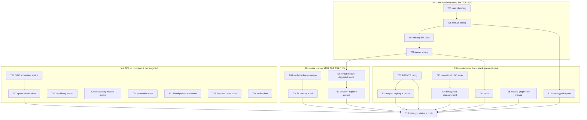

# SUPERB: pbx-lens read-only integration + decision closeout + identity-backup debt

Generated 2026-11-15 15:06 CET · webphone HEAD `f034ce81` · worktree clean
· Scope: executes TODO_LIST row 1658 (harvested from the 11:17 decision
analysis) and its companion debt. This is a TRANCHE, not a replacement for
`docs/planning/2026-11-14_11-41_SUPERB-open-queue-pareto-plan.md`; it
registers in that plan's queue under the cross-repo/governance tier.

## Why this plan exists (the decision, restated)

The question was: merge `pbx-lens` into `webphone`, or extract a common
data layer? The evidence answered both:

- **Merge: NO-GO.** The two apps share vocabulary, not data. webphone has
  no call aggregate and no CDR storage (`pbx.CDR` is an 8-field wire DTO);
  lens owns a 19-field source-normalized `CallView` over an event-sourced
  index. Retention doctrines are opposite (hard delete vs tombstone on a
  re-derivable index), the composition roots are different frameworks
  (samber/do + httputil vs go-appkit, a standing NO-GO), and an in-process
  merge would add a 27 MB analytics binary to a service whose recorded
  tolerance rejected +10.4 MB (+68%).
- **Common data layer: NO-GO now.** The only real duplicate is the OIDC
  engine (`oidclogin` ≈ 752 non-test lines vs `sso` ≈ 361), and its right
  home is upstream in the fleet, not a private two-repo module. Everything
  genuinely common (CQRS engine, health, HTTP, error families, templ
  components) is already a fleet library.
- **What IS worth doing:** (1) a READ-ONLY deep link from History rows into
  the lens call detail — the operator sees one workflow without one
  process; (2) close the identity-backup gap the analysis surfaced; (3)
  record the ruling and its reopen triggers so this is not re-litigated.

## Pareto breakdown

### 1% → 51%: the History → lens call-detail link (T05–T08)

The operator's highest-value click: from a History row to the full call
record (transcript, recording, cost, MOS, insight). It is four small
changes because the join key already exists on the wire — the stack's
operator API emits `uuid` (`packages/telephony-operator/api.py:332`), and
webphone's DTO simply never decoded it. No stack change is needed for the
link itself.

### 4% → 64%: risk + regression armor (T03, T04, T09, T10)

The identity database is not in `package/backup-script.nix`'s coverage
(`webphone.db`, `system.db`, `files/` only). If nothing else backs it up,
a restore loses passkey identities and the auth-audit journal. The link
itself needs a threat model (user-controlled uuid, operator-configured
base URL), a degraded-mode rule (lens down must affect nothing), and a
smoke pin.

### 20% → 80%: decision hygiene, docs, stack arm, measurement (T01, T02, T11–T15, T18)

Record the ruling in both AGENTS files and the reopen registry; document
the seam; expose the browser-facing URL through the stack module; replace
the session's unnormalized LOC claim with a reproducible script; measure
the binaries and module graphs; close with the full battery.

### Last 20% → 100%: upstream, structural, owner-gated (T16, T17, T19–T24)

The OIDC extraction blueprint and upstream ask; the one-repo/two-binaries
evaluation; the shared-vocabulary module decision; the identity-retention
alignment memo; the Reports-tab-becomes-lens-backed spike; the revisit
date. None of these should be self-answered.

## Execution graph

## Comprehensive plan — macro tasks (30–100 min), sorted

| #   | Task                                                                   | Tier | Impact | Effort | Customer value                                                       | Depends | TODO home |
| --- | ---------------------------------------------------------------------- | ---- | ------ | ------ | -------------------------------------------------------------------- | ------- | --------- |
| T05 | Decode the CDR `uuid` through `pbx.CDR` and `views.CDREntry`           | 1%   | High   | S      | The row gains the identity the deep link needs                       | —       | 1658      |
| T06 | Add `lens.url` config with fail-closed validation and tests            | 1%   | High   | M      | Wrong config fails boot, never a dead link                           | T05     | 1658      |
| T07 | Render the History-row anchor (i18n, new tab, off = byte-identical)    | 1%   | High   | M      | One click from a call row to the full call record                    | T06     | 1658      |
| T08 | Wire the link builder through the server and pin on/off parity         | 1%   | High   | M      | The affordance appears exactly when the deployment has a lens        | T07     | 1658      |
| T03 | Verify whether `usermgmt.db` is backed up anywhere (stack/host/module) | 4%   | High   | S      | Passkey identities either are safe or the gap is proven              | —       | 1658      |
| T04 | Extend the backup script + VM/restore assertions for `usermgmt.db`     | 4%   | High   | L      | A restore keeps passkey logins and the auth journal                  | T03     | 1658      |
| T09 | Threat-model the link and pin the degraded-mode contract               | 4%   | Medium | S      | A down lens can never break a page; user input cannot escape the URL | T08     | 1658      |
| T10 | Add a smoke boot check for the link and decide the capture surface     | 4%   | Medium | M      | A fresh binary proves the seam at boot                               | T09     | 1658      |
| T01 | Record the ruling in both AGENTS files                                 | 20%  | Medium | S      | The next session does not re-litigate the merge                      | —       | 1658      |
| T02 | Add reopen triggers + a revisit date to the registry                   | 20%  | Medium | S      | The decision has an expiry and an evidence bar                       | T01     | 1658      |
| T11 | Document the seam (README, FEATURES, AGENTS, CHANGELOG)                | 20%  | Medium | S      | Operators can find and enable the integration                        | T08     | 1658      |
| T12 | Add the typed `lens.url` option + eval case in the stack repo          | 20%  | Medium | M      | The deployment stops hand-writing raw settings                       | T06     | stack     |
| T13 | Add `scripts/loc-normalized.sh` with a self-test                       | 20%  | Low    | M      | Size comparisons become reproducible instead of anecdotal            | —       | 1658      |
| T14 | Measure both binaries (size + RSS) and record                          | 20%  | Low    | S      | The merge-cost claim becomes a measurement                           | T13     | 1658      |
| T15 | Diff `go mod graph` and run the co-change analysis                     | 20%  | Low    | S      | The "only structural fork" claim gets evidence                       | —       | 1658      |
| T18 | Full battery + closeout status + push + CI verdict                     | 20%  | High   | L      | The tranche lands green, not "probably fine"                         | all     | 1658      |
| T16 | Write the OIDC extraction API sketch from both implementations         | 100% | Medium | L      | The only real duplicate gets a real extraction design                | —       | 1658      |
| T17 | Draft the upstream cqrs-htmx OIDC-provider ask                         | 100% | Low    | M      | The dedup has an upstream home, not a private fork                   | T16     | 1658      |
| T19 | Evaluate the one-repo/two-binaries middle path (memo)                  | 100% | Low    | L      | If maintenance is the goal, the cheapest real option is costed       | T13–T15 | 1658      |
| T20 | Decide the shared call-vocabulary module (memo + trigger)              | 100% | Low    | M      | Stops a premature module; records the gate-2 trigger                 | T16     | 1658      |
| T21 | Promotion notes: lens backup lib + FTS read-model pattern              | 100% | Low    | S      | Reusable pieces get a decision, not a copy-paste                     | —       | 1658      |
| T22 | Identity/retention alignment memo (MaxUsers=1 vs multi-user; GDPR)     | 100% | Medium | M      | Cross-repo data policy is written down, not implied                  | —       | 1658      |
| T23 | Spike: could the Reports tab become lens-backed?                       | 100% | Low    | L      | The one product overlap gets a costed answer                         | T16–T17 | 1658      |
| T24 | Set the revisit date and owner-tick note                               | 100% | Low    | S      | The ruling cannot silently rot                                       | T02     | 1658      |

## Task context (what and why, 2–4 sentences each)

**T05 — uuid plumbing.** The operator API already returns `uuid` in every
CDR row; webphone's `pbx.CDR` and `views.CDREntry` simply omit it. Add the
field and its mapping without touching the History join semantics (the
transcript/disposition join stays as-is this tranche). The two comments
claiming "CDR rows carry no call uuid" must be rewritten to the new truth:
the wire carries one, the product uses it for deep links only.

**T06 — `lens.url` config.** Model it on the CRM seam: zero value = off,
URL alone enables, validation fails the boot on a non-absolute or
credential-bearing URL. Document the crucial distinction: this is the
BROWSER-facing base URL, not the stack's loopback `lensUrl` used by the
textagent; a loopback URL in a browser link is a dead link by
construction.

**T07 — the anchor.** Render "Open in pbx-lens" on each History row, in
both UI languages, as a normal anchor with `target="_blank"` and
`rel="noopener noreferrer"`. When `lens.url` is empty the rendered bytes
must be identical to today's output; pin that with a test, not a promise.

**T08 — server wiring.** Build the link server-side from the configured
base plus `/calls/freeswitch-cdr/<uuid>` (lens's own route shape), and
pass it per row. The server owns configuration; the view never reads
globals. Keep the builder in one helper and test it with a hostile uuid.

**T03 — verify the backup claim.** The analysis observed that
`package/backup-script.nix` backs up `webphone.db`, `system.db` and
`files/`, never `usermgmt.db`. Before calling it a bug, search the stack's
backup module, host-level units and docs for an identity-DB lane. The
verdict (covered vs real gap) decides whether T04 proceeds or closes with
a pointer.

**T04 — the backup fix.** If it is a gap: add a guarded `if [ -f
"${cfg.dataDir}/usermgmt.db" ]` `.backup` in both the steady and dated
branches, then extend the VM test's presence/integrity assertions and the
restore drill. Additive only: no rotation or retention change. The DB only
exists when passkey is on, so the guard is load-bearing.

**T09 — threat model.** Two inputs reach the URL: the operator-configured
base (validated at boot) and the CDR uuid (remote-controlled by the PBX
record). Escape/segment-validate the uuid, pin the anchor attributes, and
document that a down lens degrades to a link that opens an unreachable
host — never a fetched fragment, never a page error.

**T10 — smoke.** Boot a binary with a lens URL and assert the row carries
the link; boot without one and assert byte parity. If the UI-capture
harness can prove the surface cheaply, add it; otherwise record why the
smoke is the right instrument (config-gated, one anchor, no layout).

**T01/T02 — decision records.** One line in each AGENTS file plus the
consolidated reopen-trigger registry: the verdict, the doc link, the named
triggers (a second real call-model consumer; a ratified two-binary
middle path), and the revisit date. This is the difference between a
decision and a conversation.

**T11 — docs.** README gains the optional seam paragraph (browser-facing
URL, read-only, no data dependency); FEATURES gets the row; AGENTS gets
the bullet; CHANGELOG gets one `[Unreleased]` line because this is a
committed code-path change.

**T12 — stack arm.** Add a typed `services.telephony.webphone.lens.url`
option that renders into `settings.lens.url`, with an eval case for the
on/off shapes. The raw `settings` lane still works; the typed one is the
first-class front, like csrf/serverTiming/backup.

**T13–T15 — measurements.** `scripts/loc-normalized.sh` counts non-test,
non-generated Go lines per package (the analysis's first answer quoted
test+generated totals and had to be corrected). Build both binaries and
record size/RSS; diff `go mod graph`; run the co-change query. These
replace estimates with numbers and are cheap to keep.

**T16–T17 — OIDC.** The lens `oidclogin` header literally says it
implements "the webphone sso doctrine". Write the shared engine's API
(discovery, PKCE S256, nonce, RS256, secret-file read, group gate) and map
both consumers (lens → usermgmt's `OAuth2Provider` payload; webphone →
identity + SIP directory password). Then draft the upstream ask; do not
build a private shared module.

**T19–T24 — deferred/owner.** Each is a memo or a calendar row, not code:
the two-binary monorepo cost, the vocabulary module's gate-2 trigger, the
lens backup/FTS promotion notes, the identity/retention alignment, the
Reports-tab spike, the revisit date.

## Micro plan — every task ≤ 12 minutes, sorted

| #    | Micro task                                                      | Parent | Est | Verification                          |
| ---- | --------------------------------------------------------------- | ------ | --- | ------------------------------------- |
| 05.1 | Add `UUID` to `pbx.CDR` with a source comment                   | T05    | 6   | `gofmt`; field visible in `client.go` |
| 05.2 | Add `UUID` to `views.CDREntry`                                  | T05    | 5   | type compiles                         |
| 05.3 | Update `cdrEntries` to copy the uuid                            | T05    | 5   | mapping reads uuid                    |
| 05.4 | Extend the CDR decode test with a uuid fixture                  | T05    | 10  | `go test ./internal/pbx`              |
| 05.5 | Rewrite the two "no call uuid" comments to the new truth        | T05    | 10  | grep shows no stale claim             |
| 05.6 | Run `go test ./internal/pbx ./internal/server`                  | T05    | 10  | green                                 |
| 06.1 | Read the CRM config + validation as the pattern                 | T06    | 8   | notes in the task log                 |
| 06.2 | Add the `Lens` struct + `Config` field + koanf tag              | T06    | 6   | compiles                              |
| 06.3 | Add validation: absolute http(s), no userinfo, no fragment      | T06    | 10  | invalid fixtures rejected             |
| 06.4 | Normalize a trailing slash in one helper                        | T06    | 6   | unit test                             |
| 06.5 | Add config tests: empty/valid/invalid                           | T06    | 10  | `go test ./internal/config`           |
| 06.6 | Document browser-facing vs loopback in the struct comment       | T06    | 6   | comment present                       |
| 06.7 | Run `go test ./internal/config`                                 | T06    | 8   | green                                 |
| 07.1 | Add the en+de i18n keys for the link label                      | T07    | 6   | parity + unused-key tests             |
| 07.2 | Read the History row markup; pick the anchor slot               | T07    | 8   | notes                                 |
| 07.3 | Render the anchor (new tab, rel, label)                         | T07    | 12  | templ generate                        |
| 07.4 | View tests: rendered when set, absent when empty                | T07    | 10  | `go test ./internal/web/views`        |
| 07.5 | Escaping test with a crafted uuid                               | T07    | 8   | no raw injection                      |
| 07.6 | Run the views suite                                             | T07    | 8   | green                                 |
| 08.1 | Give the handlers access to the configured lens base            | T08    | 8   | compiles                              |
| 08.2 | Write the link builder (`base + /calls/freeswitch-cdr/ + uuid`) | T08    | 8   | unit test                             |
| 08.3 | Wire the builder into `cdrEntries`/`historyPanel`               | T08    | 8   | rows carry the link                   |
| 08.4 | Server test: on/off parity                                      | T08    | 10  | green                                 |
| 08.5 | Run `go test ./internal/server`                                 | T08    | 10  | green                                 |
| 03.1 | Grep the stack for `usermgmt.db` and identity backup            | T03    | 10  | hits or none recorded                 |
| 03.2 | Check the stack backup module, timers and host docs             | T03    | 10  | verdict note                          |
| 03.3 | Check webphone docs/README for backup claims                    | T03    | 8   | verdict note                          |
| 03.4 | Record covered-vs-gap in the plan/status                        | T03    | 6   | written                               |
| 03.5 | Close the debt with a pointer or keep T04 armed                 | T03    | 5   | TODO row updated                      |
| 04.1 | Read `package/backup-script.nix` in full                        | T04    | 8   | notes                                 |
| 04.2 | Add the guarded steady-branch `.backup` for `usermgmt.db`       | T04    | 10  | shellcheck-clean                      |
| 04.3 | Add the same to the dated-snapshot branch                       | T04    | 8   | shellcheck-clean                      |
| 04.4 | Read the backup assertions in `nix/vm-tests.nix`                | T04    | 8   | notes                                 |
| 04.5 | Add presence + `integrity_check` assertions                     | T04    | 10  | check builds                          |
| 04.6 | Add the restore-drill assertion                                 | T04    | 10  | drill builds                          |
| 04.7 | Update the AGENTS backup bullet + README                        | T04    | 10  | docs consistent                       |
| 04.8 | Run the module check and the KVM backup test                    | T04    | 12  | green (long-running)                  |
| 04.9 | Commit + push the backup fix                                    | T04    | 10  | CI verdict pending/armed              |
| 09.1 | Threat-model the link inputs                                    | T09    | 8   | written                               |
| 09.2 | Pin the anchor attributes in a test                             | T09    | 8   | green                                 |
| 09.3 | Document lens-down behavior (plain anchor, no fetch)            | T09    | 8   | doc line                              |
| 09.4 | Decide and record the non-https public-host stance              | T09    | 10  | WARN or refusal documented            |
| 09.5 | Run the focused tests                                           | T09    | 8   | green                                 |
| 10.1 | Read the smoke boot/config pattern                              | T10    | 8   | notes                                 |
| 10.2 | Add the lens-URL boot variant                                   | T10    | 8   | boots                                 |
| 10.3 | Assert link-present and link-absent                             | T10    | 12  | script prints a verdict line          |
| 10.4 | Run the smoke script                                            | T10    | 12  | counts recorded                       |
| 10.5 | Decide the capture surface and record why                       | T10    | 8   | decision note                         |
| 01.1 | Read the webphone AGENTS insertion points                       | T01    | 8   | notes                                 |
| 01.2 | Read the lens AGENTS insertion point                            | T01    | 6   | notes                                 |
| 01.3 | Draft the one-line ruling + doc link                            | T01    | 6   | text ready                            |
| 01.4 | Apply to webphone AGENTS; verify line count < 377               | T01    | 8   | `wc -l`                               |
| 01.5 | Apply to lens AGENTS (re-View before edit)                      | T01    | 8   | diff clean                            |
| 01.6 | Commit both repos separately                                    | T01    | 10  | two commits                           |
| 02.1 | Read the TODO row and the reopen registry                       | T02    | 8   | notes                                 |
| 02.2 | Decide the registry home                                        | T02    | 5   | written                               |
| 02.3 | Add the triggers row/pointer                                    | T02    | 10  | table stable                          |
| 02.4 | Add the revisit date + owner tick                               | T02    | 5   | row complete                          |
| 02.5 | Verify formatting with dprint                                   | T02    | 6   | clean                                 |
| 11.1 | README seam paragraph                                           | T11    | 10  | rendered                              |
| 11.2 | FEATURES row                                                    | T11    | 6   | rendered                              |
| 11.3 | AGENTS bullet                                                   | T11    | 8   | line count                            |
| 11.4 | CHANGELOG `[Unreleased]` line                                   | T11    | 6   | entry present                         |
| 11.5 | Run the docs gates                                              | T11    | 10  | `docs-gates --check`                  |
| 12.1 | Read the module settings rendering                              | T12    | 8   | notes                                 |
| 12.2 | Add the typed lens option                                       | T12    | 10  | eval builds                           |
| 12.3 | Render into settings + eval assertion                           | T12    | 10  | eval green                            |
| 12.4 | Run the module check                                            | T12    | 10  | green                                 |
| 12.5 | Commit in the stack repo                                        | T12    | 10  | separate commit                       |
| 13.1 | Write `scripts/loc-normalized.sh`                               | T13    | 10  | runs on both repos                    |
| 13.2 | Add the self-test fixture                                       | T13    | 10  | selftest green                        |
| 13.3 | Run and record both numbers                                     | T13    | 10  | 34 492 / 12 525 (today)               |
| 13.4 | Commit the script                                               | T13    | 8   | commit                                |
| 14.1 | Build webphone                                                  | T14    | 10  | binary exists                         |
| 14.2 | Build lens                                                      | T14    | 10  | binary exists                         |
| 14.3 | Measure size + idle RSS                                         | T14    | 8   | numbers recorded                      |
| 14.4 | Add to the evidence appendix                                    | T14    | 6   | written                               |
| 15.1 | Run `go mod graph` for both                                     | T15    | 8   | outputs saved                         |
| 15.2 | Diff the module sets                                            | T15    | 8   | delta list                            |
| 15.3 | Run the co-change query                                         | T15    | 10  | top shared files                      |
| 15.4 | Record the results                                              | T15    | 6   | written                               |
| 16.1 | Diff `oidclogin` vs `sso`                                       | T16    | 10  | shared/unique list                    |
| 16.2 | List engine vs adapter concerns                                 | T16    | 10  | written                               |
| 16.3 | Draft the API surface                                           | T16    | 10  | sketch                                |
| 16.4 | Map both consumers onto it                                      | T16    | 10  | sketch                                |
| 16.5 | Note error codes and config shapes                              | T16    | 8   | sketch                                |
| 16.6 | Write the sketch doc                                            | T16    | 10  | file exists                           |
| 17.1 | Read the appkit-asks draft format                               | T17    | 6   | notes                                 |
| 17.2 | Write the cqrs-htmx OIDC ask                                    | T17    | 10  | draft                                 |
| 17.3 | Add the provenance banner                                       | T17    | 5   | banner present                        |
| 17.4 | Link it from the TODO row                                       | T17    | 6   | row updated                           |
| 18.1 | `nix fmt`                                                       | T18    | 10  | clean                                 |
| 18.2 | `docs-gates --check`                                            | T18    | 12  | green                                 |
| 18.3 | `buildflow`                                                     | T18    | 12  | green (may background)                |
| 18.4 | `go test -count=1 ./...`                                        | T18    | 12  | green (may background)                |
| 18.5 | Write the closeout status report                                | T18    | 10  | file exists + indexed                 |
| 18.6 | Regenerate `docs/status/INDEX.md`                               | T18    | 6   | `--check` green                       |
| 18.7 | Commit + push                                                   | T18    | 10  | remote sha                            |
| 18.8 | Read the CI verdict                                             | T18    | 10  | `scripts/ci-verdict.sh` rc=0          |
| 19.1 | Enumerate what a two-binary repo shares                         | T19    | 10  | memo bullets                          |
| 19.2 | Cost the AGENTS/gate merge                                      | T19    | 10  | memo numbers                          |
| 19.3 | Write the memo                                                  | T19    | 10  | file exists                           |
| 20.1 | Extract the candidate vocabulary types                          | T20    | 10  | list                                  |
| 20.2 | Write the gate-2 analysis                                       | T20    | 10  | memo                                  |
| 20.3 | Record the trigger                                              | T20    | 6   | TODO row                              |
| 21.1 | Evaluate the lens backup-lib promotion                          | T21    | 10  | note                                  |
| 21.2 | Evaluate the FTS read-model pattern note                        | T21    | 10  | note                                  |
| 21.3 | Record both                                                     | T21    | 6   | memo                                  |
| 22.1 | Compare `MaxUsers: 1` vs the multi-user mapping                 | T22    | 10  | note                                  |
| 22.2 | Compare retention/GDPR semantics                                | T22    | 10  | note                                  |
| 22.3 | Write the memo                                                  | T22    | 10  | file exists                           |
| 23.1 | Define the lens API the Reports tab would need                  | T23    | 10  | list                                  |
| 23.2 | Sketch TTL/caching/SSE                                          | T23    | 10  | sketch                                |
| 23.3 | Cost the change                                                 | T23    | 10  | numbers                               |
| 23.4 | Write the spike                                                 | T23    | 10  | file exists                           |
| 24.1 | Pick the revisit date                                           | T24    | 5   | date                                  |
| 24.2 | Add it to the calendar/TODO row                                 | T24    | 5   | row updated                           |
| 24.3 | Commit                                                          | T24    | 5   | commit                                |

## Non-goals (do NOT do in this tranche)

1. **Do not merge the repositories.** The evidence bar is a second real
   consumer of a call model or an owner-ratified middle path (T19).
2. **Do not merge the binaries.** The 27 MB analytics binary against a
   recorded +68% tolerance is a measured NO-GO.
3. **Do not build a shared private data-layer module.** The fleet libs
   already own the common layer; the only candidate is upstream OIDC.
4. **Do not change the History join semantics.** The uuid is for the deep
   link only; disposition/transcript joins keep their current shape and
   their comments are corrected, not redesigned.
5. **Do not touch the concurrent session's in-flight files** (sidebar/rail
   train, Pareto execution). Re-View shared files before every edit.
6. **Do not raise `.docs-gates.json` ratchets.** If the status corpus
   grows, drain one report gates-first.

## Verification (definition of done)

- `lens.url` empty: the History panel's bytes are unchanged (pinned).
- `lens.url` set: every CDR row with a uuid carries a new-tab anchor to
  `/calls/freeswitch-cdr/<uuid>`; rows without a uuid render no link.
- A malformed `lens.url` fails the boot with the config's normal error
  contract.
- The backup script + VM test + restore drill cover `usermgmt.db` when it
  exists and skip cleanly when passkey is off (or the debt is closed with
  a verified pointer).
- `nix fmt`, `docs-gates --check`, `buildflow`, `go test ./...` green;
  CI verdict read through `scripts/ci-verdict.sh` after push.
- The ruling + triggers + revisit date are committed in both repos.

## Risks and guardrails

| Risk                                                     | Guardrail                                                              |
| -------------------------------------------------------- | ---------------------------------------------------------------------- |
| Operator configures the loopback `lensUrl` as `lens.url` | Document "browser-facing" in the option, the struct, and README        |
| A crafted uuid injects into the URL                      | Segment-validate/escape; pin in a test                                 |
| Off-state HTML drifts                                    | Byte-parity test for the empty config                                  |
| Backup change hides a missing file                       | Guarded `if [ -f ]` + a VM assertion that proves presence when enabled |
| UUID is absent in an older operator API                  | Empty uuid renders no link; the seam degrades silently and visibly     |
| Concurrent edits collide                                 | Re-View before edit; stage only this tranche's files; separate commits |
| The plan competes with the open-queue Pareto plan        | This doc is registered as a tranche, references the plan of record     |

## Evidence appendix (from the 11:17 analysis)

| Fact                                   | Value                                                          |
| -------------------------------------- | -------------------------------------------------------------- |
| webphone code size (non-test, non-gen) | 34 492 lines                                                   |
| pbx-lens code size (non-test, non-gen) | 12 525 lines                                                   |
| webphone call aggregate                | none (CDR is a wire DTO + pure fold)                           |
| lens call aggregate                    | 1 173 non-test lines                                           |
| CDR fields on the wire                 | 8 (webphone DTO) vs 19 (lens CallView)                         |
| Identity key                           | CDR uuid (operator API sends it) vs SIP Call-ID in webphone    |
| Retention doctrine                     | hard delete (webphone) vs tombstone/re-derivable (lens)        |
| Composition root                       | samber/do + httputil (webphone) vs go-appkit (lens)            |
| OIDC duplication                       | 752 vs 361 non-test lines; lens header cites webphone doctrine |
| Backup coverage                        | `webphone.db`, `system.db`, `files/` — `usermgmt.db` omitted   |
| AGENTS files                           | 215 + 218 lines (cap 377; a repo merge cannot fit)             |
| lens binary                            | 27 MB on disk                                                  |

## Owner-gated register (listed, never self-answered)

1. May pbx-lens stop being a public, `go install`-able product?
2. Is the goal one operator surface, less maintenance, or one database?
3. Is `usermgmt.db` deliberately host-managed, or is T04 a bug fix?
4. Should the OIDC extraction be implemented upstream now or only drafted?
5. Should the one-repo/two-binaries path be evaluated for real (T19)?
