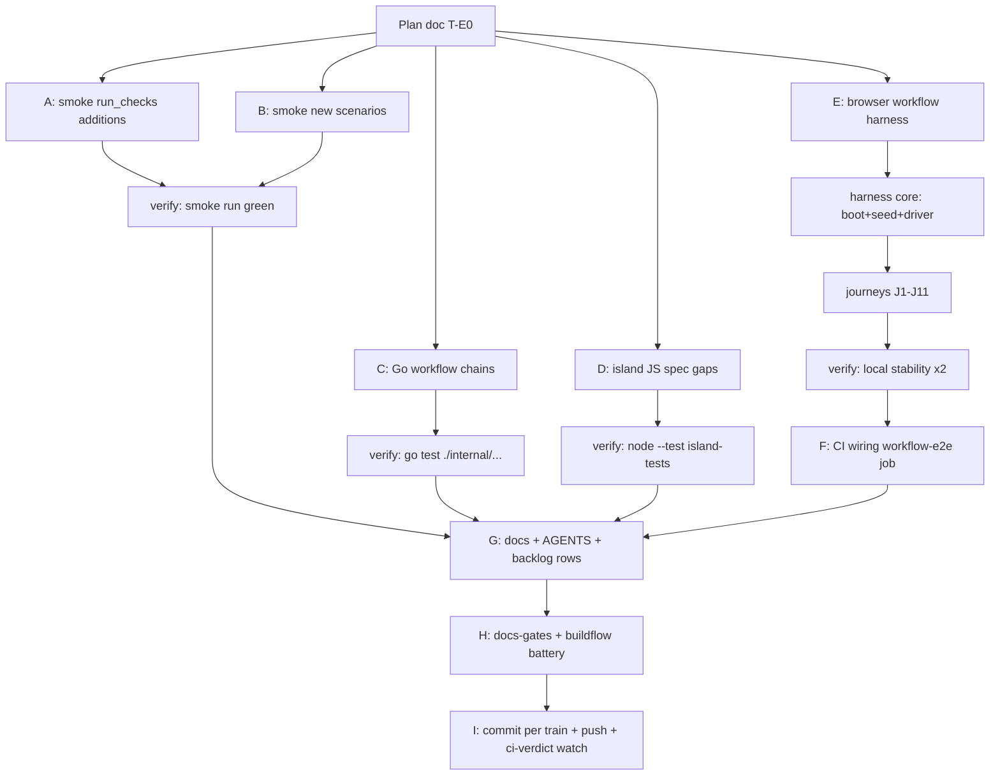

# SUPERB — E2E + integration + fully automated workflow frontend tests

> STATUS: EXECUTING (2026-11-18 18:21). Owner ask: "a LOT more E2E + integration and
> fully automated workflow frontend tests". This doc is the ONE home for the plan,
> the Pareto breakdown, the execution graph, and the fine-grained task ledger.
> Evidence base: four read-only research inventories (Go integration landscape,
> island JS spec landscape, black-box smoke harness anatomy, docs/CI strategy)
> plus direct route-table and harness verification — all 2026-11-18.

## 1. Current state (verified 2026-11-18)

| Layer                   | What exists                                                                                                                                                                 | Verdict                                                                                                                                    |
| ----------------------- | --------------------------------------------------------------------------------------------------------------------------------------------------------------------------- | ------------------------------------------------------------------------------------------------------------------------------------------ |
| Go unit/integration     | 800+ tests; `internal/server` harness boots the real engine + mux + SSE capture (328 tests)                                                                                 | DEEP; gaps are multi-step workflow CHAINS                                                                                                  |
| Black-box smoke (CI)    | `scripts/webphone-smoke.py`: `run_checks` + 8 scenarios (restart, boot-failure, asr, dialgate, agent, faxcap, metrics, enroll) — 112 checks, blocking CI job                | GOOD bones; core product workflows missing (send→verdict, flags, snippets, contacts, fax flows, rate limits, admin, switch, drafts/review) |
| Island JS specs         | 53 spec files, ~330 tests, node:test + DOM stubs (`helpers.mjs`)                                                                                                            | THICK; 7 ranked gaps (transfer wiring, morph interplay, shortcuts keymap, notify title, offline lane, audio depth, composer failure paths) |
| Interactive browser E2E | NONE in this repo. The consuming stack (`nix-international-telephony/tests/browser-e2e.py`) covers SIP/island flows; `scripts/ui-capture.py` is a LOCAL-ONLY visual harness | THE GAP the owner named: no click-level workflow tests over the real UI (htmx morph + SSE + forms)                                         |
| CI                      | build, smoke, go-tests(-race), fast-checks, changelog-guard, dup-gate (+ advisory reproduce-first, tw-freshness)                                                            | New layers must wire in without new flake classes                                                                                          |

## 2. Pareto breakdown

### The 1% that delivers 51%

**Smoke workflow scenarios in the CI-blocking black-box suite.** Every push already
boots the real binary; the missing checks are cheap (S/M each) and cover every
product surface: message send → provider verdict → failed-bubble retry, thread
flags, snippets, contacts CRUD/import/export, fax send/status/resend/document,
rate-limit fences, admin surface, line switcher, drafts/review/disposition,
csp-report/manifest/export/push-devices probes.

### The 4% that delivers 64%

**Go workflow-chain tests** stitching existing unit-covered steps into journeys a
regression can actually break: inbound webhook → thread → auto-unarchive → SSE
payloads; failed send + retry with persisted kind/reason; cross-owner read
fences; voicemail chain over a fake PBX; app-level boot→login→send→hook→SSE→
shutdown cycle; retention tombstone→trim E2E.

### The 20% that delivers 80%

**A new in-repo interactive browser workflow harness** (`scripts/workflow-e2e.py`,
Selenium + headless Chromium via the proven PYSEL dance): login through the real
front-door form, tab navigation without reload, composer send, LIVE inbound via
`/hooks/message` appearing through SSE→morph in the open page, flags, snippet
fill, contacts, i18n switch, styled 404, command palette. No existing layer in
this repo proves the frontend wiring itself; this is the "fully automated
workflow frontend tests" layer.

### The other 20% (to 100%)

Island JS spec gaps (7 ranked), CI wiring for the browser lane with flake
budgets, docs (AGENTS command entries, this ledger, TODO_LIST backlog rows for
anything deferred), stability passes, and the release-hygiene tail (buildflow,
docs-gates, per-train commits, CI watch).

## 3. Layer decisions (what we will NOT do)

- NO new framework adoption: Selenium + node:test + the existing smoke/Check
  pattern are the homes; no Playwright/Cypress/pytest deps.
- NO rewrite or reflow of existing tests; additive only.
- NO edits to the concurrent session's in-flight files (auth/admin/session-switch
  surfaces): all Go additions land in NEW files; smoke/CI/scripts/AGENTS are
  unowned by them (verified via git status).
- The browser harness is DOM-assertion-only (no screenshots, no visual budget);
  it boots its own binary+datadir like the smoke does, seeds via HTTP like
  ui-capture does, and injects the session cookie the same way.
- Counts are always Check-tally printed, never hardcoded (the smoke canon).
- Test-only deltas stay CHANGELOG-silent (ratified bar).
- The dial-gate browser journey is best-effort: if the island's SIP boot gate
  makes it impossible without a PBX, it becomes a documented TODO row, not a
  hacked-around flake.

## 4. Execution graph

## 5. Coarse plan (trains of 30–100 min, sorted by importance / impact / effort / customer value)

| #  | Train                                | Scope                                                                                                           | Impact       | Effort | Value rationale                                                 |
| -- | ------------------------------------ | --------------------------------------------------------------------------------------------------------------- | ------------ | ------ | --------------------------------------------------------------- |
| E0 | Plan doc (this file)                 | Pareto + graph + fine ledger                                                                                    | unblocks all | 30m    | the owner-mandated planning artifact                            |
| A  | Smoke: run_checks workflow additions | send→verdict, flags, snippets, contacts, fax flows, attachments fence, csp-report, manifest/export/push-devices | 10           | 90m    | CI-blocking, real binary, every product surface                 |
| B  | Smoke: new boot scenarios            | msglifecycle (webhook gateway + fake provider), ratelimit, admin+switch, drafts/review/disposition              | 10           | 100m   | workflows needing their own boot/env isolation                  |
| C  | Go workflow chains                   | 7 chain tests in NEW files (inbound→SSE, retry, owner scoping, voicemail, app boot cycle, retention)            | 9            | 80m    | deepest assertions, fastest signal, race-detector covered       |
| D  | Island JS spec gaps                  | notify, shortcuts, morph interplay, transfer wiring, offline lane, audio depth, composer failures               | 7            | 70m    | frontend behavior pins where bugs actually bite                 |
| E  | Browser workflow harness             | scripts/workflow-e2e.py: core + journeys J1–J11 + self-test                                                     | 10           | 100m   | the missing layer: real clicks, real SSE→morph, no reload proof |
| F  | CI wiring                            | workflow-e2e job (nix shell chromium+chromedriver+selenium), stability budget                                   | 8            | 40m    | makes E fully automated on every push                           |
| G  | Docs + ledger                        | AGENTS command entries, plan status refresh, TODO_LIST backlog rows (file-stability permitting)                 | 6            | 30m    | discoverability + honest open-work inventory                    |
| H  | Gates                                | docs-gates --check, buildflow battery, full go + island + smoke replay                                          | 8            | 40m    | nothing lands red                                               |
| I  | Ship                                 | per-train commits, push, ci-verdict watch                                                                       | 8            | 30m    | verified end state                                              |

## 6. Fine plan (every task ≤ 12 min; ≥150 rows; sorted within trains by value)

Legend: ID — task — (est). Status column maintained during execution: `[ ]` → `[x]`.

### A. Smoke run_checks additions (CI black-box, plugs into `scripts/webphone-smoke.py`) — LANDED 2026-11-18: `smoke: 92 passed, 0 failed` (was 63 checks; +29 workflow checks incl. csp-report 204/413, manifest/favicon, export zip, snippets, contacts CRUD/import/export, flags pin/archive/mute, send/deep-link/gone-notice, MMS attachment fence+type, fax send/document/inbound). A11 quick-cap was REPLACED by the over-long 422 (the 5-quick cap is a UI rendering fact, not a server fence — verified in cqrs/readmodels).

| ID  | Task                                                             | Est |
| --- | ---------------------------------------------------------------- | --- |
| A01 | csp-report: malformed POST body → best-effort 204                | 8m  |
| A02 | csp-report: valid report → 204; oversized body → 413             | 10m |
| A03 | /manifest.webmanifest: shape + manifest content type             | 8m  |
| A04 | /favicon.svg: 200 + svg content type                             | 4m  |
| A05 | /api/export: anonymous 401 fence                                 | 6m  |
| A06 | /api/export: session 200 + zip magic bytes                       | 8m  |
| A07 | push-devices: list empty on fresh boot                           | 6m  |
| A08 | push-devices: register (ntfy) → list shows device, NO token echo | 10m |
| A09 | push-devices: re-register rotates token; delete removes          | 10m |
| A10 | snippets: save → compose panel shows chip                        | 12m |
| A11 | snippets: quick-cap 6th rejected                                 | 10m |
| A12 | snippets: delete → chip gone                                     | 6m  |
| A13 | thread flags: pin → partial marks pinned row                     | 12m |
| A14 | thread flags: archive → row leaves list                          | 10m |
| A15 | thread flags: head outerHTML variant answers 204                 | 8m  |
| A16 | thread flags: mute presentation-only; read → 204 + unread reset  | 10m |
| A17 | contacts: save via templ lane → panel row                        | 10m |
| A18 | contacts: dup upsert keeps id (rename path)                      | 10m |
| A19 | contacts: delete → gone                                          | 6m  |
| A20 | contacts: export contains saved row (vcard)                      | 8m  |
| A21 | contacts: vCard import (2 cards) → rows                          | 12m |
| A22 | contacts: import cap fence shape                                 | 8m  |
| A23 | messages: send happy multipart → 2xx                             | 8m  |
| A24 | messages: thread partial carries new bubble                      | 8m  |
| A25 | messages: own send leaves thread unread-state correct            | 8m  |
| A26 | messages: thread deep link renders open thread                   | 8m  |
| A27 | messages: bogus thread id → list + gone-notice                   | 8m  |
| A28 | attachments: anonymous 401                                       | 6m  |
| A29 | attachments: wrong-owner id → 404                                | 8m  |
| A30 | attachments: owner GET streams honest content type               | 8m  |
| A31 | fax: send (PDF part) → fax row pending                           | 12m |
| A32 | fax: status hook transmitted → row verdict                       | 10m |
| A33 | fax: same-status replay → 202 idempotent                         | 6m  |
| A34 | fax: resend → new row pending                                    | 10m |
| A35 | fax: document endpoint 200 + pdf content type                    | 8m  |
| A36 | run_checks verdict lines + local run green                       | 8m  |

### B. Smoke new scenarios (own boots; scenario-function pattern + main() wiring) — LANDED 2026-11-18 (B01-B18, B28-B35): msglifecycle 17/0 (webhook gateway + switchable fake provider), ratelimit 7/0 (login/compose/hooks/csrf lanes; the login lane drives SUCCESSFUL logins — loopback does not verify credentials, and CSRF-class rejections die upstream of the limiter), drafts 11/0 (fake review API), push 13/0 (fake ntfy; A07-A09 relocated here). B19-B27 (admin/switch black-box) DEFERRED: both surfaces require a MAPPED login (passkey/OIDC) — `isAdminSession` reads `sess.LoginEmail`, empty for extension logins, and no black-box lane can drive WebAuthn or a full RS256 OIDC IdP from the smoke; the Go chain train (C) covers cross-owner admin reads instead.

| ID  | Task                                                                             | Est |
| --- | -------------------------------------------------------------------------------- | --- |
| B01 | fake provider server class: records receipts, switchable fail/succeed            | 12m |
| B02 | msglifecycle boot: webhook gateway mode pointed at fake                          | 12m |
| B03 | msglifecycle: login + send → receipt captured (provider_ref known)               | 12m |
| B04 | msglifecycle: thread partial shows outbound bubble                               | 8m  |
| B05 | msglifecycle: delivered hook → partial shows delivered verdict                   | 10m |
| B06 | msglifecycle: failed hook (refusal) → failed bubble + reason                     | 12m |
| B07 | msglifecycle: failed hook (transient) → retryable kind                           | 10m |
| B08 | msglifecycle: retry lane re-send → second receipt → delivered                    | 12m |
| B09 | msglifecycle: hook replay → 202 idempotent                                       | 6m  |
| B10 | msglifecycle: SSE threads event observed on send                                 | 8m  |
| B11 | msglifecycle: SSE thread event observed on verdict                               | 8m  |
| B12 | msglifecycle: verdict lines + main() wiring                                      | 6m  |
| B13 | ratelimit boot (fresh datadir so buckets do not poison the shared suite)         | 10m |
| B14 | ratelimit: login bucket 429 + Retry-After                                        | 10m |
| B15 | ratelimit: 429 login page fragment carries .wp-error shape                       | 10m |
| B16 | ratelimit: compose bucket 429 fragment shape                                     | 12m |
| B17 | ratelimit: hooks lane limiter fence                                              | 8m  |
| B18 | ratelimit: /api/csrf limiter fence                                               | 8m  |
| B19 | admin/switch boot: config file with auth.users (2 ext, 1 admin) + password files | 12m |
| B20 | admin: /admin renders cross-line list for admin                                  | 12m |
| B21 | admin: /partials/admin + deep link thread render                                 | 12m |
| B22 | admin: non-admin sees styled 404 on every admin route                            | 10m |
| B23 | admin: nav link absent for non-admin                                             | 6m  |
| B24 | switch: /api/session/switch happy → new extension identity                       | 12m |
| B25 | switch: CSRF rotated after switch                                                | 8m  |
| B26 | switch: extension-login 403                                                      | 8m  |
| B27 | switch: cross-line thread isolation after switch                                 | 12m |
| B28 | drafts: fake agent server (draft op) beside agent_scenario boot                  | 12m |
| B29 | drafts: ai-draft → pending row                                                   | 12m |
| B30 | drafts: approve → thread bubble                                                  | 12m |
| B31 | drafts: discard → gone                                                           | 8m  |
| B32 | drafts: mode toggle shape                                                        | 8m  |
| B33 | review: GET absent → empty body                                                  | 8m  |
| B34 | disposition: POST → 204                                                          | 10m |
| B35 | all new scenarios green in one full smoke run                                    | 10m |

### C. Go workflow chains (NEW files only; harness = the server `newTestServer`/`client` idiom) — LANDED 2026-11-18: internal/server/workflow_chains_test.go (TestInboundWorkflowChain: hook -> BOTH SSE events with payload shapes -> unread 2 -> archive -> inbound AUTO-UNARCHIVES over HTTP; TestForeignOwnerSurfacesStayDenied: cross-owner attachment/fax-document 404s + foreign thread deep link degrades to the gone-notice), internal/server/voicemail_chain_test.go (fake PBX mailbox under the /phone-api prefix — the pbx client prepends it: panel rows, delete proxies, payload-less voicemail nudge), internal/app/boot_cycle_test.go (composition-root cycle: front-door login -> CSRF adopt -> live SSE stream -> composer send -> inbound hook -> threads+thread on one connection). C08-C11 (retry/kind/reason): ALREADY PINNED by TestFailedBubbleCarriesReasonAndRetry. C14 (admin fallback): ALREADY PINNED by TestAdminAttachmentAndFaxDocumentFallback. C20 (retention): ALREADY PINNED per aggregate (threadsdeletion/faxes-sweep/transcripts-trim). Full `go test ./...` green.

| ID  | Task                                                                | Est |
| --- | ------------------------------------------------------------------- | --- |
| C01 | workflow_inbound_test.go skeleton: hook POST → thread row           | 12m |
| C02 | assert unread bumped + lastActivity                                 | 8m  |
| C03 | assert auto-unarchive on inbound to archived thread                 | 10m |
| C04 | assert SSE threads event fired                                      | 8m  |
| C05 | assert SSE thread event payload shape                               | 10m |
| C06 | second inbound same thread: one row, unread 2                       | 8m  |
| C07 | workflow_retry_test.go: failing sender → failed bubble              | 12m |
| C08 | assert FailureKind persisted on the failed row                      | 8m  |
| C09 | assert provider reason string persisted                             | 8m  |
| C10 | assert retry POST succeeds for transient                            | 12m |
| C11 | assert retry refuses non-retryable (rejected)                       | 10m |
| C12 | workflow_owner_scoping_test.go: cross-owner attachment → 404        | 8m  |
| C13 | cross-owner fax document → 404                                      | 8m  |
| C14 | admin fallback cross-owner read → 200                               | 12m |
| C15 | voicemail_chain_test.go: fake PBX mailbox server                    | 12m |
| C16 | voicemail: list render shape                                        | 8m  |
| C17 | voicemail: delete chain → SSE nudge                                 | 12m |
| C18 | app boot_cycle_test.go: New→Start skeleton + Shutdown idempotence   | 12m |
| C19 | app boot cycle: login→send→hook→SSE through the app mux             | 12m |
| C20 | retention chain: tombstone visible then TrimStream shrinks bytes    | 12m |
| C21 | full `go test ./internal/... ./cmd/...` green (env -u GOEXPERIMENT) | 10m |

### D. Island JS spec gaps (new .test.mjs files; helpers.mjs stubs) — LANDED 2026-11-18 (D01-D02, D03-D05): notify.test.mjs (the title FLASH half: interval flip, idempotent start, stop restores, restoreTitle) + shortcuts.test.mjs (the full keymap: letters/brackets/media act via preventDefault, unmapped keys pass through, modifier chords inert — the ring-queue spec already owned Esc + the typing gate). The other planned rows were ALREADY PINNED by existing specs (verified before writing duplicates): transfer wiring = transfer-row.test.mjs, morph surfaces = shell.test.mjs + SSE swap-safety Go pins, offline banner = resume/connection specs, audio analyser = latency.test.mjs watchRemoteAudio, composer paths = composer.test.mjs. Island suite: 356 tests; the only 2 reds are the CONCURRENT SESSION's postcall-note spec (their in-flight train, attributed 18:40 — not touched per the fix-forward protocol).

| ID | Task | Est |
| --- | --- |
| D01 | notify.test.mjs: title flash on missed call | 8m |
| D02 | notify.test.mjs: title restore on focus | 8m |
| D03 | shortcuts.test.mjs: digit keys 1-7 navigate | 12m |
| D04 | shortcuts.test.mjs: '?' help opens | 10m |
| D05 | shortcuts.test.mjs: Escape closes + Ctrl+K delegation | 10m |
| D06 | shell-morph.test.mjs: live surfaces carry hx-swap morph attrs | 10m |
| D07 | shell-morph.test.mjs: stateful nodes keep stable ids | 8m |
| D08 | shell-morph.test.mjs: morph focus-to-heading move | 12m |
| D09 | calls-transfer.test.mjs: transfer button wiring | 12m |
| D10 | calls-transfer.test.mjs: verdict handling + row state | 12m |
| D11 | resume.test.mjs: offline banner flips with pill | 10m |
| D12 | resume.test.mjs: no announce before 3 failures, announce once after | 12m |
| D13 | audio.test.mjs: analyser gate opens on remote attach | 12m |
| D14 | audio.test.mjs: analyser closes once-only, disposed with call | 10m |
| D15 | audio.test.mjs: tone sink fallthrough without setSinkId | 10m |
| D16 | composer.test.mjs: oversize attachment warn path | 12m |
| D17 | composer.test.mjs: zero-file reject path | 10m |
| D18 | composer.test.mjs: non-media reject path | 10m |
| D19 | node --test island-tests green | 6m |

### E. Browser workflow harness (`scripts/workflow-e2e.py` — NEW layer)

| ID  | Task                                                         | Est |
| --- | ------------------------------------------------------------ | --- |
| E01 | script skeleton: args, Check, verdict print convention       | 10m |
| E02 | boot helper: binary + env + free port + readiness poll       | 10m |
| E03 | seed helper: login dance + threads via /messages/send        | 12m |
| E04 | seed helper: snippets + contacts                             | 8m  |
| E05 | driver factory: headless chromium + chromedriver (PYSEL env) | 12m |
| E06 | session cookie inject helper                                 | 8m  |
| E07 | no-reload marker install (window flag before journeys)       | 6m  |
| E08 | --self-test for pure helpers                                 | 10m |
| E09 | J1 login front door: form fill + submit                      | 10m |
| E10 | J1: lands on shell with island card + nav                    | 8m  |
| E11 | J2 tab navigation: each tab panel id appears                 | 12m |
| E12 | J2: aria-current + URL move with pushState                   | 10m |
| E13 | J2: no-reload marker survives all tab clicks                 | 8m  |
| E14 | J3 composer send: fill textarea + submit                     | 10m |
| E15 | J3: bubble appears and settles                               | 10m |
| E16 | J4 live inbound: /hooks/message POST from Python             | 8m  |
| E17 | J4: new thread row appears via SSE-morph (WebDriverWait)     | 12m |
| E18 | J4: no reload (marker + no navigation event)                 | 8m  |
| E19 | J4b: inbound on OPEN thread grows transcript                 | 12m |
| E20 | J5 thread flags: pin toggle state in DOM                     | 12m |
| E21 | J6 snippets: picker click fills textarea                     | 10m |
| E22 | J7 contacts: add via form, row appears                       | 12m |
| E23 | J7: delete, row gone                                         | 8m  |
| E24 | J8 i18n: toggle language, nav labels change                  | 12m |
| E25 | J8: wp-lang cookie set                                       | 6m  |
| E26 | J9 styled 404: bad path shows panel + back link              | 8m  |
| E27 | J10 palette: Ctrl+K opens, type, enter navigates             | 12m |
| E28 | J10: '?' help overlay                                        | 8m  |
| E29 | J11 dial-gate chip (best-effort; TODO row if island-bound)   | 12m |
| E30 | full local run green                                         | 10m |
| E31 | stability pass #2 (fresh datadir)                            | 10m |

### F. CI wiring

| ID  | Task                                                                            | Est |
| --- | ------------------------------------------------------------------------------- | --- |
| F01 | ci.yml: workflow-e2e job skeleton (nix shell chromium+chromedriver+py-selenium) | 12m |
| F02 | job builds .#webphone + runs script self-contained                              | 10m |
| F03 | job budget + timeout + tally printing                                           | 6m  |
| F04 | CI green verify via scripts/ci-verdict.sh                                       | 12m |

### G. Docs + ledger

| ID | Task | Est |
| --- | --- |
| G01 | AGENTS.md Commands: workflow-e2e run line | 6m |
| G02 | plan doc status refresh (strike ledger rows as landed) | 8m |
| G03 | TODO_LIST backlog rows for deferred items (file-stability permitting) | 8m |
| G04 | CHANGELOG silence check (test-only, no entries) | 4m |
| G05 | docs-gates --check green after md edits | 8m |
| G06 | git-status re-check for concurrent-session collisions before each commit | 4m |

### H. Gates

| ID  | Task                             | Est |
| --- | -------------------------------- | --- |
| H01 | full go test replay              | 8m  |
| H02 | island tests replay              | 6m  |
| H03 | smoke replay                     | 10m |
| H04 | buildflow battery                | 12m |
| H05 | flake spot-fix window (budgeted) | 12m |

### I. Ship

| ID  | Task                                            | Est |
| --- | ----------------------------------------------- | --- |
| I01 | commit A+B (smoke trains) with detailed message | 6m  |
| I02 | commit C (Go chains)                            | 4m  |
| I03 | commit D (island specs)                         | 4m  |
| I04 | commit E+F (browser harness + CI)               | 6m  |
| I05 | commit G (docs)                                 | 4m  |
| I06 | push                                            | 2m  |
| I07 | ci-verdict watch to green                       | 12m |

Row count: A36 + B35 + C21 + D19 + E31 + F4 + G6 + H5 + I7 = **164 fine rows**
(each ≤12m) over **9 coarse trains**. The fine ledger above is the executable
unit; rows are struck in this file as they land (TODO strike canon: evidence-
bearing strikes, never deletion).

## 7. Verification ladder (per train)

1. Layer-local: smoke scenarios print their own tallies; `go test` per new file;
   `node --test` per new spec; workflow-e2e prints `workflow e2e: N passed`.
2. Train-local: full smoke run; full `go test ./...`; full island suite; full
   workflow-e2e run.
3. Global: `nix flake check`-equivalent battery via buildflow; docs-gates
   --check; CI verdict via `scripts/ci-verdict.sh` after push.

## 8. Risks and flake budget

| Risk                                          | Mitigation                                                                                                                |
| --------------------------------------------- | ------------------------------------------------------------------------------------------------------------------------- |
| Browser lane flake in CI (chromedriver races) | WebDriverWait on DOM predicates (never sleeps), one driver restart retry, 12m job budget, DOM-only (no screenshots/fonts) |
| Smoke suite runtime growth                    | new boot scenarios share the fake-server pattern; keep per-scenario boots lean; CI smoke job budget 15m monitored         |
| Concurrent-session collisions                 | additive-only, NEW files, re-`git status` before every commit, never edit their in-flight set                             |
| Loopback gateway hides transport truths       | msglifecycle scenario uses webhook mode + fake provider, so receipts/refusals are real transport shapes                   |
| Port traps (dnsblockd holds 18099)            | free_port() helper + verified-free manual ports for local runs                                                            |
| GOEXPERIMENT host leak                        | `env -u GOEXPERIMENT` on every local go test invocation                                                                   |

## 9. Backlog (explicitly deferred, owns its TODO rows)

- J11 dial-gate browser journey if the island SIP boot gate blocks it (needs a
  stubbed SIP websocket or a stack-side lane).
- Voicemail browser journey (needs fake PBX inside the browser lane).
- Push-device registration journey from the Android shell (cross-repo).
- Performance/SLO lane (perf-baseline.py exists; out of scope here).
