# SUPERB Pareto backlog execution plan — 2026-11-19 19:46

> **Point-in-time snapshot** of the 37 open `TODO_LIST.md` rows (R01–R37,
> renumbered; the 00:51 interrupted session's R20 strike is already done and
> pushed). Freshness verified this session: R25 (notes in search corpus),
> R29 (workflow-e2e still advisory), R17 (flightrecorderhealth unpinned) all
> re-checked against code; today's harvested rows (R30–R37) are
> review-verified against source. Predecessor:
> `docs/status/2026-11-19_00-51_pareto-plan-interrupted-session-status.md`
> (its in-context synthesis was lost — this plan re-derives and supersedes it).
>
> **Anti-verschlimmbesser bar:** every task below is already-ruled open work;
> nothing re-litigates a standing NO-GO (Flutter, Datastar client-side,
> go-appkit framework, Ginkgo ports of pinned paths). Owner-gated and
> trigger-gated rows are MARKED, never silently converted into agent work.

## 1. Pareto breakdown

### The 1% that delivers 51% — redeploy production

**R06 (stack redeploy) + R07 (host-side diagnostics).** Production still
serves the pre-rail `v2.14.0`-era build while ~422 commits of finished,
CI-green work sits on main: the line-ownership model, notes autosave, the
docked sidebar rail, the /login front door, and today's 8-fix review batch.
NONE of it is real to the only customer until the stack re-pins and the
deploy is verified click-play. One runbook window converts the entire
backlog's shipped half into product.

### The 4% that delivers 64% — the prod-truth window + data safety

**R09 + R10 + R11 (one prod verification window)**: authenticated capture,
the night-run stability pair, the ring-guard positive path — the difference
between "CI green" and "known-good in production".
**+ the `usermgmt.db` backup gap** (R20's companion debt, verified REAL by
the 00:51 session: `package/backup-script.nix` covers only webphone.db +
system.db — passkey identities and the durable auth-audit journal ride NO
backup; a data-loss-class gap, cheap to close).
**+ R12** (hardening-parity pin) **+ R13** (file the drafted BuildFlow
bandit-provider issue).

### The 20% that delivers 80% — durability, integrity, the fleet

- **Verification lanes**: R29 (flip workflow-e2e to blocking), R26/R27/R28
  (admin+switcher / dial-gate chip / voicemail browser journeys).
- **Codebase integrity from today's reviews**: R30 (fax Resend×retention —
  the one data-integrity edge), R31 (catalog ReviewSaved drift), R32/R33
  (naming + type tails), R34–R37 (small truths).
- **The §5 DROP unlock**: R24 (export-or-confirm tool).
- **Stack legs**: R04 (drift audit), R08 (coverage arms), R16 (ringhook
  docs + typed mirror).
- **Cross-repo**: R01/R18 (android lines[] wire + spec consumption),
  R02 (SSO-only stack verify), R03 (pma push heuristic).
- **Fleet health**: R14 (hub runner durable fix), R15 (ALERT_WEBHOOK_URL),
  R17 (appkit/flightrecorderhealth, demand-gated).
- **Product surface**: R25 (notes in search corpus), R05 (CUE ruling
  record), R36 (cadence pre-drain automation).

### The other 20% to reach 100% — gated rows (not agent-convertible)

R21 (owner ticks the pbx-lens 5-question register), R22 (stack-repo lens
option), R23 (lens spike, sequenced after read-only integration proves
traffic), R19 (wire-fixture follow-ups — trigger-gated), the v2.15.0
release-order decision (owner), and the five design questions on the
ThreadGate deepening pick (owner confirm-or-redirect).

## 2. Comprehensive plan — 27 tasks, 30–100 min each

Sorted by importance / impact / effort / customer-value (customer = the
owner-operator on production).

| #   | Task                                                                                                                     | Rows          | Impact                        | Effort | Value   | Gate            |
| --- | ------------------------------------------------------------------------------------------------------------------------ | ------------- | ----------------------------- | ------ | ------- | --------------- |
| T01 | Stack redeploy: bump the stack's webphone lock, build, switch, `/version` verify, login + tab-nav click-play             | R06+R07       | Critical                      | 90m    | Highest | CI green (have) |
| T02 | Prod verification window A: authenticated capture (`ui-capture --base-url`, env creds) + ring-guard positive path        | R09+R11       | Critical                      | 60m    | Highest | T01             |
| T03 | Prod verification window B: night-run stability pair (`ui-night-pair.sh`) + anchor the repeat                            | R10           | High                          | 60m    | High    | T01             |
| T04 | Close the `usermgmt.db` backup gap: extend `package/backup-script.nix`, restore-drill assertion                          | R20-companion | High (data safety)            | 30m    | High    | —               |
| T05 | Fax Resend×retention integrity: copy-blob-on-Resend or sweep reference-check + shared-path sweep test                    | R30           | High (integrity)              | 90m    | High    | —               |
| T06 | Flip `workflow-e2e` CI job to blocking (clean-run check + job edit)                                                      | R29           | High (durability)             | 90m    | High    | 2 clean runs    |
| T07 | Browser journey: admin + line-switcher black-box scenario                                                                | R26           | Medium                        | 30m    | Medium  | —               |
| T08 | Browser journey: dial-gate chip (deny → inline state → "Dial anyway" → spent override)                                   | R27           | Medium                        | 30m    | Medium  | —               |
| T09 | Browser journey: voicemail (play, delete, empty state)                                                                   | R28           | Medium                        | 30m    | Medium  | —               |
| T10 | §5 export-or-confirm tool (`webphone export-legacy`/`-check`) per the 2026-11-14 design                                  | R24           | High (unblocks DROP)          | 100m   | High    | —               |
| T11 | Catalog: add ReviewSaved row + derive `TestCatalogSchemaParity` exhaustively                                             | R31           | Medium                        | 45m    | Medium  | —               |
| T12 | Naming train 1: `FindThread` → `ResolveThreadID` (gate iface + 2 impls + messaging + tests)                              | R32a          | Medium                        | 90m    | Medium  | —               |
| T13 | Type tails: `asr.Locality` constants, `ASRProvider` enum, `LoginPageExtra` question-form params                          | R33           | Medium                        | 60m    | Medium  | —               |
| T14 | Comment truths: apidocs response-header lie (fix + AGENTS bullet) + favicon token unification                            | R34+R35       | Low-Med                       | 30m    | Low-Med | —               |
| T15 | fcr small-findings batch: FCM single-flight, zero-predicate sweep, fax inbound cap, blob brand-before-write, seq comment | R37           | Medium                        | 60m    | Medium  | —               |
| T16 | Cadence pre-drain automation (sweep that pre-computes the gates-passing archive set)                                     | R36           | Medium (kills a red-CI class) | 60m    | Medium  | —               |
| T17 | Stack window: drift audit + coverage arms (stack repo, mirrored-module eval check)                                       | R04+R08       | Medium                        | 45m    | Medium  | —               |
| T18 | Ringhook operator docs + typed mirror option                                                                             | R16           | Medium                        | 30m    | Medium  | —               |
| T19 | Android train start: adopt the `lines[]` wire (fixtures exist; Kotlin `WireContractTest` home)                           | R01           | Medium (P1 shell)             | 100m   | Medium  | android repo    |
| T20 | Android spec consumption + wire-fixture trigger check (execute only fired triggers)                                      | R18+R19       | Low-Med                       | 30m    | Low-Med | trigger-gated   |
| T21 | SSO-only identity resolution verified end-to-end in the stack fixture                                                    | R02           | Medium                        | 30m    | Medium  | —               |
| T22 | Fleet health batch: pma push heuristic, hub runner durable fix, ALERT_WEBHOOK_URL decision                               | R03+R14+R15   | Medium                        | 60m    | Medium  | —               |
| T23 | Record the CUE ruling durably (AGENTS/README one-liner + pointer)                                                        | R05           | Low                           | 30m    | Low     | —               |
| T24 | Notes-in-search corpus design spike (query shape, corpus boundary, migration)                                            | R25           | Medium (product)              | 30m    | Medium  | —               |
| T25 | Hardening-parity pin (the parity test the 00:51 session specced)                                                         | R12           | Medium                        | 45m    | Medium  | —               |
| T26 | File the BuildFlow bandit-provider issue (draft: `docs/drafts/2026-10-11_…`)                                             | R13           | Low                           | 30m    | Low     | —               |
| T27 | appkit/flightrecorderhealth adoption IF demand-live (health-batch trace capture); else record the gate                   | R17           | Low-Med                       | 30m    | Low-Med | demand-gated    |

**Gated (NOT tasks — owner/cross-repo rows tracked in TODO_LIST):** R21
(owner register tick), R22 (stack repo lane), R23 (spike, sequenced),
v2.15.0 release order, ThreadGate deepening questions Q1–Q5.

## 3. Micro breakdown — ≤12 min per task, ALL todos

Micro-ids map to their medium task (T01→m01.\*). Sorted within task by
execution order; global order = the §2 table order.

| ID    | Micro task                                                                                                        | Min | T   |
| ----- | ----------------------------------------------------------------------------------------------------------------- | --- | --- |
| m01.1 | Re-read `docs/release-runbook.md` § stack relock; list the exact commands                                         | 10  | T01 |
| m01.2 | Bump the stack's webphone lock (per-train ritual; clean tree check first)                                         | 8   | T01 |
| m01.3 | `nix build` the stack; watch the narHash resolve                                                                  | 12  | T01 |
| m01.4 | Switch the deployment; `nixos-rebuild switch` on the PBX host                                                     | 12  | T01 |
| m01.5 | Verify `/version` answers the new commit; screenshot-grade the login page                                         | 8   | T01 |
| m01.6 | Click-play: login, tab nav without reload, island boot probe green                                                | 10  | T01 |
| m01.7 | Host diagnostics: `systemctl status webphone`, journal tail, Caddy vhost health                                   | 10  | T01 |
| m01.8 | Record the verdict in a one-paragraph status note (owner-facing)                                                  | 8   | T01 |
| m02.1 | Mint the prod session via `POST /api/session` with env creds; verify cookie                                       | 10  | T02 |
| m02.2 | Run `ui-capture.py --base-url … --track` (desktop 1280x900) + review summary.json                                 | 12  | T02 |
| m02.3 | Compare.html delta review vs previous run; flag any changed-% ≥ 0.5                                               | 10  | T02 |
| m02.4 | Ring-guard positive path: trigger one test ring through the hook; confirm the device rings + end stand-down       | 12  | T02 |
| m03.1 | Read `ui-night-pair.sh`; schedule the pair window (cron or systemd timer)                                         | 10  | T03 |
| m03.2 | Run the first pair; verify both legs land in `ui-shots/` with ledgers                                             | 12  | T03 |
| m03.3 | Diff the pair; record the stability verdict in the tracking ledger                                                | 10  | T03 |
| m04.1 | Read `package/backup-script.nix`; add `usermgmt.db` to both branches                                              | 8   | T04 |
| m04.2 | Add presence/integrity assertions to the backup VM test                                                           | 12  | T04 |
| m04.3 | Run the backup-drill check (`nix build .#checks.x86_64-linux.webphone-backup-drill`)                              | 12  | T04 |
| m04.4 | Strike the companion-debt clause in the pbx-lens row with evidence                                                | 5   | T04 |
| m05.1 | Read `fax/service.go` Resend + `retention.go` sweep; pick the fix shape (copy vs ref-check)                       | 12  | T05 |
| m05.2 | Implement the chosen arm; keep the machine-table doctrine untouched                                               | 12  | T05 |
| m05.3 | Write the shared-path sweep test (resend → sweep → document still readable)                                       | 12  | T05 |
| m05.4 | Run fax + retention suites; `nix fmt`; changelog line                                                             | 10  | T05 |
| m06.1 | Check the last N workflow-e2e runs for flakes; fix any real one                                                   | 12  | T06 |
| m06.2 | Edit `.github/workflows/ci.yml`: rename job, drop the advisory marker                                             | 6   | T06 |
| m06.3 | Verify the required-checks list still passes on the next PR/push                                                  | 8   | T06 |
| m07.1 | Extend `workflow-e2e.py`: admin tab + line-switcher journey (login as multi-line user)                            | 12  | T07 |
| m07.2 | Assert the switcher's "DID · extension" labels + whoami active-line first                                         | 10  | T07 |
| m07.3 | Run locally; land with `--self-test` green                                                                        | 8   | T07 |
| m08.1 | Extend the journey: dial-gate deny path (seeded window)                                                           | 12  | T08 |
| m08.2 | Assert the inline state line + the "Dial anyway" chip + spent-override re-run                                     | 12  | T08 |
| m08.3 | Run; land                                                                                                         | 6   | T08 |
| m09.1 | Extend the journey: voicemail play (fake mailbox), delete, empty state                                            | 12  | T09 |
| m09.2 | Assert the honest-toast-once contract on a dead recording                                                         | 10  | T09 |
| m09.3 | Run; land                                                                                                         | 6   | T09 |
| m10.1 | Read the 2026-11-14 export-or-confirm design; re-verify its invariants against HEAD                               | 12  | T10 |
| m10.2 | Implement `export-legacy -table contacts -format json\|csv` (read-only SELECT, sha256+count header)               | 12  | T10 |
| m10.3 | Implement `-check` (in-both/legacy-only/unparseable/new-world totals; nonzero while unconfirmed)                  | 12  | T10 |
| m10.4 | Tests: fixture DBs both worlds + the nonzero-exit contract                                                        | 12  | T10 |
| m10.5 | Wire the §5 checklist pointer; changelog; gates                                                                   | 10  | T10 |
| m11.1 | Add the ReviewSaved row to `domain/catalog.go` with the closed-set shape                                          | 10  | T11 |
| m11.2 | Replace the hand-maintained parity pair list with derived enumeration                                             | 12  | T11 |
| m11.3 | Run the catalog + parity tests; `webphone contracts` regen check                                                  | 10  | T11 |
| m12.1 | Rename `FindThread` → `ResolveThreadID` via LSP rename (gate iface + 2 impls)                                     | 12  | T12 |
| m12.2 | Fix messaging call sites ×2 + test call sites                                                                     | 10  | T12 |
| m12.3 | Full server+messaging+cqrs test run; `nix fmt`; changelog                                                         | 12  | T12 |
| m13.1 | `type Locality string` + `LocalityLocal/Remote` consts; swap the settings.templ comparison                        | 12  | T13 |
| m13.2 | `ASRProvider` enum + validation fold (4 homes → 1)                                                                | 12  | T13 |
| m13.3 | `LoginPageExtra(primary, sso)` → question-form params; call-site fix; tests                                       | 12  | T13 |
| m13.4 | Type-tail tests + gates                                                                                           | 10  | T13 |
| m14.1 | Fix apidocs.go header comment + the AGENTS bullet (response-header support EXISTS)                                | 8   | T14 |
| m14.2 | Favicon: derive `#17a467` from one source (or comment-fence; owner call recorded)                                 | 10  | T14 |
| m14.3 | dprint + docs-gates                                                                                               | 6   | T14 |
| m15.1 | FCM token-mint single-flight (sso's shape); test                                                                  | 12  | T15 |
| m15.2 | Delete dead zero-predicates (RelPath.IsZero dupe, Address/Phone/Token.IsZero)                                     | 8   | T15 |
| m15.3 | Fax inbound byte cap at the service seam + trust comment                                                          | 10  | T15 |
| m15.4 | Blob brand-before-write reorder; test the malformed-ext edge                                                      | 12  | T15 |
| m15.5 | Seq-as-retention-clock comment; run touched suites                                                                | 6   | T15 |
| m16.1 | Draft the pre-drain sweep (reuses check-rows/bare-rows on the oldest candidates)                                  | 12  | T16 |
| m16.2 | Emit the ready-ritual file list + banner text; self-test on the current corpus                                    | 12  | T16 |
| m16.3 | Wire into docs-gates as a WARN-lane; battery green                                                                | 12  | T16 |
| m17.1 | Stack repo: diff nixpkgs revs + module set vs the mirrored FS modules (`telephony-eval`)                          | 12  | T17 |
| m17.2 | Coverage arms: add the missing check cases the audit names                                                        | 12  | T17 |
| m18.1 | Ringhook docs page + typed `ringhook.*` option mirror + module-check case                                         | 12  | T18 |
| m19.1 | Android repo: read the fixtures + current wire model; branch                                                      | 10  | T19 |
| m19.2 | Adopt `lines[{extension,did}]` in the wire parse + UI labels ("DID · extension")                                  | 12  | T19 |
| m19.3 | Update `WireContractTest` fixtures; run the Gradle suite                                                          | 12  | T19 |
| m19.4 | Cross-check the deleted parallel `numbers`/`extensions` lists are gone client-side                                | 8   | T19 |
| m20.1 | Check wire-fixture triggers; execute only FIRED follow-ups; record the rest                                       | 10  | T20 |
| m21.1 | Stack fixture: boot SSO-only shape; drive login; assert whoami resolves the identity                              | 12  | T21 |
| m21.2 | Fix the fixture gap if red; land the fixture                                                                      | 12  | T21 |
| m22.1 | pma: design the push heuristic (the stall anchor already exists in `push-stall-watch.sh`)                         | 12  | T22 |
| m22.2 | Hub runner durable fix per the fleet decision record                                                              | 12  | T22 |
| m22.3 | ALERT_WEBHOOK_URL decision + wire if yes                                                                          | 10  | T22 |
| m23.1 | Write the CUE ruling one-liner into AGENTS/README with the pointer                                                | 8   | T23 |
| m24.1 | Notes-search spike: corpus boundary (bodies vs transcripts), query shape, FTS vs LIKE                             | 12  | T24 |
| m24.2 | Write the spike note into docs/planning; TODO row re-scoped with the verdict                                      | 10  | T24 |
| m25.1 | Hardening-parity pin: write the test per the 00:51 spec                                                           | 12  | T25 |
| m25.2 | Green run; land                                                                                                   | 8   | T25 |
| m26.1 | Read the bandit draft; verify claims still current                                                                | 10  | T26 |
| m26.2 | File the upstream issue (github-voice + verify-before-filing gates)                                               | 12  | T26 |
| m27.1 | Check demand: health-batch failures wanting traces? If yes adopt `appkit/flightrecorderhealth` (both deps pinned) | 12  | T27 |
| m27.2 | If no: record the gate verdict in the row; strike-with-evidence or leave gated                                    | 8   | T27 |

**Gated rows (no micro tasks — they are NOT agent-convertible):** R21 owner
register tick; R22 stack-repo lens lane; R23 lens spike; v2.15.0 order;
ThreadGate Q1–Q5.

## 4. Execution graph

```mermaid
flowchart TD
  subgraph G1["1% → 51%"]
    T01["T01 stack redeploy + click-play"]
  end
  subgraph G2["4% → 64%"]
    T02["T02 prod capture + ring-guard"]
    T03["T03 night-run pair"]
    T04["T04 usermgmt.db backup gap"]
    T25["T25 hardening-parity pin"]
    T26["T26 bandit issue filing"]
  end
  subgraph G3["20% → 80%"]
    T05["T05 fax integrity M1"]
    T06["T06 workflow-e2e blocking"]
    T07["T07 admin journey"]
    T08["T08 dial-gate journey"]
    T09["T09 voicemail journey"]
    T10["T10 export-or-confirm"]
    T11["T11 catalog parity"]
    T12["T12 naming train 1"]
    T13["T13 type tails"]
    T14["T14 comment truths"]
    T15["T15 small-findings batch"]
    T16["T16 cadence pre-drain"]
    T17["T17 stack drift+arms"]
    T18["T18 ringhook docs"]
    T19["T19 android lines[]"]
    T20["T20 android triggers"]
    T21["T21 SSO-only fixture"]
    T22["T22 fleet health"]
    T23["T23 CUE record"]
    T24["T24 notes-search spike"]
    T27["T27 flightrecorderhealth"]
  end
  subgraph G4["gated 20% → 100%"]
    O1["owner: v2.15.0 order"]
    O2["owner: pbx-lens register + ThreadGate Q1–Q5"]
    O3["stack repo: lens lane + drift follow-ups"]
  end
  CI["CI green on main"] --> T01
  T01 --> T02 --> T03
  T01 --> T07
  T06 --> T07
  T06 --> T08
  T06 --> T09
  T10 --> O4["§5 DROP window"]
  T19 --> O5["android wire live"]
  T01 -.->|deploy lands the shipped work| VALUE["everything on main becomes product"]
```

## 5. Errata / continuity

- Renumbering: the 00:51 session's R01–R27 → today's R01–R37 (their R20
  strike landed; today's R20+ are the lens/harvest tail). Cross-walk kept
  in the §2 "Rows" column by CURRENT ids.
- Their in-context tier synthesis is re-derived here verbatim-verified, not
  copied blind: the backup gap was re-confirmed against
  `package/backup-script.nix` content cited at 00:51; R25/R29/R17
  re-checked open TODAY.
- Deviation from the skill's HTML default: the owner's directive explicitly
  demands an `.md` file with a mermaid graph — honored (3× repeated paste).
