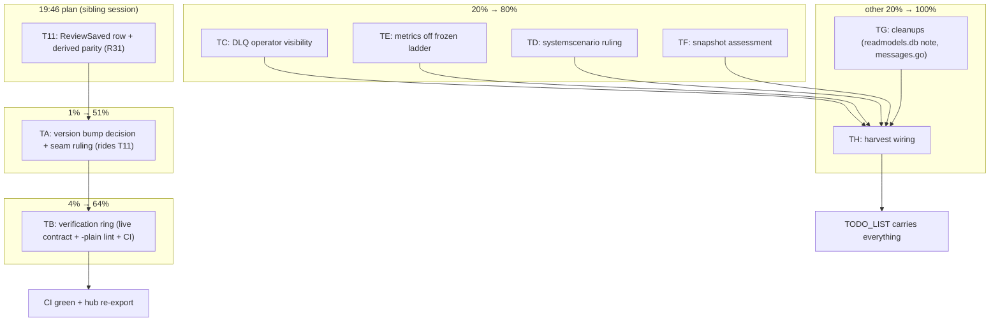

# SUPERB catalog-integrity verification ring + CQRS hygiene — 2026-11-19 20:51

> **Point-in-time snapshot.** Scope: the DELTA surfaced by the 20:23
> CQRS/event-sourcing/catalog assessment session
> (`docs/status/2026-11-19_20-23_cqrs-es-catalog-adoption-assessment.md`)
> that is NOT already owned by
> `docs/planning/2026-11-19_19-46_SUPERB-pareto-backlog-execution-plan.md`
> (the 19:46 whole-backlog plan, T01–T27). This plan COMPOSES with that
> one: it adds what it lacks, rides its T11 train where riding is cheaper
> than sequencing, and harvests its own new rows into `TODO_LIST.md`.
> No overlap: every task here was checked against R01–R37 + the two
> 2026-11-19 harvest sections before inclusion (dedupe map in §7).

**What the session verified (evidence base):** live catalog exports (both
trees, exit 0); command/decider/event inventories by grep (26 commands,
11 deciders, 30 journal event types, 28 folds, 11 `metaengine.Query`);
composition root read; server seam map with spot-checked citations; the
ReviewSaved gap (`internal/domain/events.go:54` live, `BuildCatalog`
missing it — independently corroborated by the sibling full-code-review
as fcr-02 M2 / TODO row R31). **Not verified:** live hub contract URL,
hub-side `-plain` lint config, `go test` runs (read-only session).

## 1. Pareto breakdown

### The 1% that delivers 51% — complete the already-scheduled T11 train

The ReviewSaved fix is SCHEDULED (19:46 T11) but its three micro items
stop at "add the row + derive parity". Without this plan's delta the
train ships HALF: an added message with no `CatalogVersion` decision
(the zlota44 class the code comment itself warns about), and no
seam-scope ruling (the next session re-asks "should the 30 journal
events be cataloged?" from scratch). **TA (45m)** supplies the missing
decisions and comments — it rides T11, it does not duplicate it.

### The 4% that delivers 64% — the real-hub verification ring

Today's compliance verdict rests on OUR tests plus a stand-in schema:
the hub's live v2 contract URL was never fetched, the hub's `-plain`
lint lane was assumed (not read), and CI only checks the render tree.
**TB (60m)** closes all three: one live-contract run, one cross-repo
config read, one CI lane. Converts "compliant by our own pins" into
"compliant against the real oracle, enforced forever".

### The 20% that delivers 80% — CQRS hygiene tier

The event-sourced core has exactly one unobservable failure mode
(poisoned projections in the DLQ — is there ANY operator surface?) and
three deferred-hygiene items: the `systemscenario` question (library
recommends it; repo hand-rolls boots), metrics counts still reading the
frozen `webphone.db` ladder, and unbounded stream versions (snapshots
never assessed). **TC/TE (75m)** do the two that bite operators;
**TD/TF (60m)** produce written rulings for the two that are owner-taste
or long-horizon.

### The other 20% to reach 100% — cleanups + wiring

`readmodels.db` orphan note for operators, the test-only
`internal/store/messages.go` deletion candidate, and the TODO_LIST
harvest wiring that keeps this plan from entombing its own rows.

## 2. Comprehensive plan — 8 tasks, 20–100 min each

Sorted by importance / impact / effort / customer-value (customer = the
owner-operator; "rides T11" = merges into the 19:46 plan's T11 train).

| #   | Task                                                                                                    | Impact                     | Effort | Value   | Gate            |
| --- | ------------------------------------------------------------------------------------------------------- | -------------------------- | ------ | ------- | --------------- |
| TA  | T11 delta: CatalogVersion bump decision (rec. 1.0.0→1.1.0, owner-vetoable) + bump-policy comment + seam-only ruling + ReviewSaved summary wording | High (completes the scheduled fix) | 45m | High | 19:46 T11 |
| TB  | Verification ring: live hub v2 contract run + hub `-plain` lint config read + CI `-plain` export lane     | High (real-oracle compliance) | 60m | High | TA landed |
| TC  | DLQ operator visibility: inspect what exists, add depth surface (metric or log line) + Settings/ops note | Medium-High (only blind failure mode) | 45m | High | — |
| TE  | Metrics off the frozen ladder: assess what `ReadCounts`/`FlagPresent` measure post-retention, reroute or retire | Medium | 30m | Medium | — |
| TD  | `systemscenario` spike + written ruling for the cqrs Ginkgo boots (notes suite first; adopt or why-not)  | Medium (test infra)        | 30m | Medium | — |
| TF  | Snapshot assessment: stream-version growth (threads per owner), metaengine snapshot support, verdict row | Low-Med (long horizon)     | 30m | Low-Med | — |
| TG  | Cleanups: `readmodels.db` orphan operator note + delete test-only `internal/store/messages.go`          | Low                        | 20m | Low    | — |
| TH  | Harvest wiring: TODO_LIST rows for TC–TG, annotate the status report's open (b)/(c) items                | Medium (process)           | 15m | Medium | TC–TG verdicts |

## 3. Micro breakdown — ≤12 min per task, ALL todos

| ID    | Micro task                                                                                                                  | Min | T  |
| ----- | --------------------------------------------------------------------------------------------------------------------------- | --- | -- |
| a01.1 | Decide the bump: adding a declared message changes catalog content ⇒ rec. `CatalogVersion` 1.0.0→1.1.0 (constant + all refs) | 6   | TA |
| a01.2 | Write the bump-policy sentence into `catalog.go`'s comment block (when to bump: message added/changed/removed)               | 6   | TA |
| a01.3 | Write the seam-only ruling comment: catalog documents the 5 seam events; the 30 journal events are internal, never cataloged  | 8   | TA |
| a01.4 | Draft ReviewSaved's catalog summary incl. payload-less nudge semantics (History re-reads its own store)                      | 6   | TA |
| a01.5 | Hand TA's artifacts to the T11 executor (or land them in the same train); record in the R31 row                              | 5   | TA |
| a01.6 | Re-export both trees; eyeball `webphone-1.1.0` refs + the 5th event frontmatter                                              | 8   | TA |
| b01.1 | Run `check-catalog-contract.py --export <fresh>` against the LIVE v2 URL (needs the hub up); capture verdict                 | 10  | TB |
| b01.2 | If red: fix the exporter call, not the schema; re-run to clean                                                               | 12  | TB |
| b01.3 | Read the hub repo's lint config: confirm it consumes the `-plain` tree (cross-repo read; record path+commit)                 | 12  | TB |
| b01.4 | Add a CI step: second `catalog -o … -plain` export + contract check over that tree                                            | 12  | TB |
| b01.5 | Push, watch the `catalog-contract` job go green on both trees; `scripts/ci-verdict.sh <sha>`                                  | 10  | TB |
| c01.1 | Inspect DLQ surfaces today: `projectionhost` logging, `/metrics`, healthz — grep + live boot probe                           | 12  | TC |
| c01.2 | Pick the surface: depth metric `webphone_projection_dlq_depth{worker}` (aggregates-only rule) vs WARN log line               | 8   | TC |
| c01.3 | Implement + unit test (poison one projection in a test boot; assert the surface fires)                                        | 12  | TC |
| c01.4 | Ops note: one line in README §operators + AGENTS flight-recorder-adjacent bullet                                             | 8   | TC |
| e01.1 | Trace `ReadCounts`/`FlagPresent` callers + what they measure now that retention empties legacy rows                          | 12  | TE |
| e01.2 | Verdict: reroute through gate counts (journal-side) or retire the metrics; implement the cheap arm                            | 12  | TE |
| e01.3 | Update the `/metrics` leak-test fixtures if names change; changelog line                                                      | 6   | TE |
| d01.1 | Spike: boot the notes suite via `systemscenario.System` in a scratch branch; compare ergonomics + runtime                     | 12  | TD |
| d01.2 | Write the ruling (adopt-with-train or why-not) into the TODO row; delete the branch                                           | 10  | TD |
| f01.1 | Measure: longest stream versions in a prod-shaped db (threads per owner after months of traffic)                              | 12  | TF |
| f01.2 | Check metaengine snapshot support surface; write the verdict row (adopt-later trigger: measured versions > N)                 | 12  | TF |
| g01.1 | README upgrade note: `readmodels.db` is an inert orphan post-v2.12; safe to delete                                            | 6   | TG |
| g01.2 | Verify `internal/store/messages.go` is test-only (grep importers); delete + run store tests                                   | 8   | TG |
| h01.1 | Append the harvest subsection to TODO_LIST (TC–TG rows + R31 delta note); docs-gates `--check`                                | 10  | TH |
| h01.2 | Annotate the 20:23 status report's (b)/(c) items with outcomes (non-destructive)                                              | 5   | TH |

## 4. Execution graph

## 5. Decisions (the session's three open questions, resolved)

1. **Land the ReviewSaved fix + bump?** YES — already scheduled as T11;
   this plan adds the bump decision (recommend 1.1.0, reversible
   constant, owner may veto at execution). Rationale: the in-code rule
   says the version covers CATALOG CONTENT and every exported message
   must carry the stamp; adding a message is a content change under any
   honest reading.
2. **Seam-only catalog scope permanent?** YES — codified as a ruling
   comment (a01.3): the catalog documents the service seam (5 events),
   never the 30 internal journal events. A future "complete the
   catalog" urge now dies at the comment.
3. **systemscenario?** TD produces the written ruling instead of a blind
   migration — the current boots are real-system and green; migration
   is taste until the spike says otherwise.

## 6. Anti-verschlimmbesser bar

- No journal events enter the catalog (ruling §5.2).
- No blind test-framework migration (TD spikes first).
- No edits to the 19:46 plan's files or its T-ownership; TA hands its
  artifacts to T11's executor or lands beside it in the same train.
- No metrics label expansion (aggregates-only rule holds — c01.2 picks
  a worker label only if the leak-test pattern already allows it, else
  log line).
- Markdown-only + one CI yaml step + comment blocks: nothing here
  touches Go behavior except TC/TE, both test-pinned.

## 7. Dedupe map (vs the 19:46 plan + 2026-11-19 harvests)

| This plan | 19:46 / TODO_LIST says | Verdict |
| --- | --- | --- |
| ReviewSaved row + parity | T11 / R31 / fcr-02 M2 | NOT duplicated — TA adds only the delta |
| Run catalog pins | m11.3 | folded into a01.6 |
| faxesgate purity check | resolved 2026-11-11 carve (faxesgate.go IS the home) | DROPPED (stale — my status report's item 7) |
| store.Messages | registration deleted 2026-11-12; test-only file remains | kept, file-deletion only (g01.2) |
| DLQ, systemscenario, snapshots, metrics-ladder, live-contract, -plain lane, readmodels.db note | no row anywhere | NEW (harvested by TH) |

## 8. Errata / continuity

- The 20:23 status report's (f) items 1–3 map to T11+TA; items 4–16 map
  to TB–TG here; item 7 (faxesgate) was already resolved — recorded so
  docs-health does not re-harvest it.
- If the hub's live URL is unreachable from CI, b01.1 degrades to a
  locally cached copy of the v2 schema (fetch once, commit under
  `scripts/` fixtures) — decided at execution, not now.
- Two sessions are active (telltale: the 19:46 plan landed mid-session).
  Re-read `TODO_LIST.md` + `ci.yml` tails before every edit this plan
  touches.
