# SUPERB evening pareto replan — 2026-11-19 22:05

> Snapshot discipline: this plan supersedes `2026-11-19_19-46_SUPERB-pareto-backlog-execution-plan.md`
> (same day, three sessions of work landed since — errata in §5). The living
> source of truth is `TODO_LIST.md`; this file only ranks its OPEN rows.
> Inventory taken at 21:58 from TODO_LIST @ HEAD `f5336593`: **48 open rows
> across 14 sections** (struck rows excluded by scan, `- [ ]` unstruck only).
> Customer = the owner + the users of the live pbx.artmann.tech deployment.

## 1. Pareto breakdown

### The 1% that delivers 51% — DEPLOY the accumulated work

**Stack redeploy (row "Stack redeploy", §voicemail-playback residue).**
~50 landed trains sit on `main` behind prod's pin (the 00-51 report's own
Q2: redeploy so they reach pbx.artmann.tech, then the voicemail click-play
verdict). NOTHING else in the backlog touches a customer until the binary
ships — every other row is either pre-deploy hardening (invisible until
shipped) or post-deploy verification (impossible before). One train, one
ritual (`docs/release-runbook.md`: webphone pushed → stack lock bump →
stack tree CLEAN → pbx-artmann relock → `/version` verify).
**Gate: the 00-51 report's owner question ("do I run the deploy or is
deployment owner-only on the live host?") is UNANSWERED — this plan treats
the deploy as the first executable ONLY after that answer.**

### The 4% that delivers 64% — prove the deploy + make CI mean it

1. **Prod verification window** (rows: authenticated capture T05-residue,
   night-run stability pair, ring-guard positive path, host-side
   diagnostics): `ui-capture.py --base-url` with env creds + the
   night-pair + the ring-guard arm. Converts "shipped" into "proven on the
   real PBX" — the ui-shots ledger is the owner's eyes.
2. **CI durability**: flip `workflow-e2e` to blocking (2 clean advisory
   runs exist — verify, then flip) + the CI-verdict watch on the deploy
   push (`scripts/ci-verdict.sh <sha>`, name-verified per the 11-11 rule).

### The 20% that delivers 80% — durability, integrity, governance

The release gate and the next red-CI classes, in one batch:

- **file-size disposition** (the §D10 owner call now BITES the release
  gate — nothing deploys repeatedly until the posture is chosen);
- **depth-pin runway design note** (5 packages ≤ one train from ceilings —
  tonight's arch review F1+F4; prevents the next mid-train red);
- **§5 export-or-confirm tool** (unblocks the storage DROP migration);
- **cadence pre-drain automation** (tonight red CI again on exactly this —
  two ratchet re-pins were the emergency valve);
- the **quality batch**: naming remainder (4 renames), type tails +
  data-model remainder (6 small fixes), fcr remainder (3), favicon,
  templ ratchet, catalog/CQRS assessment rows, notes-in-search.

### The other 20% to reach 100% — gated rows (not freely agent-convertible)

Owner calls (deepening pick, bump-train timing, lens register,
DOMAIN_LANGUAGE, §5 DROP date), cross-repo rows (stack drift/coverage,
ringhook, hub fleet, android, lens T12/T23), and trigger-gated rows
(wire fixtures, appkit adoption, F6 latencyInterval, browser journeys
needing SIP/WebAuthn seams). Each has a named trigger or owner in its row.

## 2. Comprehensive plan — 26 tasks, 30–100 min each (ALL 48 rows)

Sorted by importance → impact → effort → customer-value. "Rows" cites
TODO_LIST titles. G = gate/precondition.

| #   | Task                                                                                                                                                                                                                                                        | Rows                                                                                        | Impact                      | Effort | Value   | G                          |
| --- | ----------------------------------------------------------------------------------------------------------------------------------------------------------------------------------------------------------------------------------------------------------- | ------------------------------------------------------------------------------------------- | --------------------------- | ------ | ------- | -------------------------- |
| T01 | **Owner answer → stack redeploy** per release-runbook (lock bump, clean tree, pbx relock, `/version` + click-play verify)                                                                                                                                   | Stack redeploy                                                                              | Critical                    | 90m    | Highest | owner answer (00-51 §g Q2) |
| T02 | Prod verification window A: authenticated capture matrix + voicemail click-play verdict + host-side diagnostics leg                                                                                                                                         | T05 residue; host-side diagnostics; night-run? no—A only                                    | Critical                    | 90m    | Highest | T01                        |
| T03 | Prod verification window B: night-run stability pair + anchor repeat + ring-guard positive path                                                                                                                                                             | night-run pair; ring-guard                                                                  | High                        | 60m    | High    | T01                        |
| T04 | CI durability: verify 2 clean workflow-e2e runs → flip to blocking; ci-verdict watch on T01's push                                                                                                                                                          | flip-workflow-e2e                                                                           | High                        | 45m    | High    | 2 clean runs               |
| T05 | **File-size disposition owner call + landing** (§D10 posture: split-on-sight vs cap vs warn-only; un-gates the release findings_gate)                                                                                                                       | BuildFlow file-size-check disposition                                                       | Critical (release gate)     | 60m    | Highest | owner posture              |
| T06 | Depth-pin runway design note (app/api/config/platform seam sketches + server valve ratification + domain exports annotation)                                                                                                                                | Depth-pin runway design note                                                                | High                        | 60m    | High    | —                          |
| T07 | §5 export-or-confirm tool (`webphone export-legacy -table contacts` + `-check`) per the 11-14 design                                                                                                                                                        | Implement the §5 export-or-confirm tool                                                     | High (data safety)          | 100m   | High    | —                          |
| T08 | Cadence pre-drain automation (pre-compute gates-passing archive set; tonight's red proves the class)                                                                                                                                                        | cadence pre-drain automation                                                                | Medium (kills red-CI class) | 60m    | Medium  | —                          |
| T09 | Type tails + data-model remainder: `asr.Locality`, `ASRProvider` enum, `LoginExtra`, `push.Transport`→Upsert, disposition echo, F7 feed maps (3 lanes)                                                                                                      | type tails; data-model #6 remainder                                                         | Medium                      | 100m   | Medium  | —                          |
| T10 | Naming train remainder: `FindThread`→`ResolveThreadID`, VoicemailItem, authmap.Map→Ownership, Shell ×2                                                                                                                                                      | naming adjudication train                                                                   | Medium                      | 90m    | Medium  | —                          |
| T11 | fcr remainder: FCM token-mint single-flight, blob brand-before-write, Seq-as-retention-clock comment                                                                                                                                                        | fcr small-findings batch                                                                    | Medium                      | 45m    | Medium  | —                          |
| T12 | Catalog/CQRS assessment batch A: verification ring vs the REAL hub; DLQ operator visibility; metrics off the frozen ladder                                                                                                                                  | verification ring; DLQ; metrics-off-ladder                                                  | Medium                      | 90m    | Medium  | —                          |
| T13 | Catalog/CQRS assessment batch B: systemscenario ruling, snapshot assessment, readmodels.db orphan note + test-only store/messages.go deletion                                                                                                               | systemscenario; snapshot; readmodels.db orphan                                              | Medium                      | 60m    | Medium  | —                          |
| T14 | Notes-in-search corpus (query shape, corpus boundary, migration; the product-visible win)                                                                                                                                                                   | Notes: note bodies in transcript search                                                     | Medium (product)            | 60m    | Medium  | —                          |
| T15 | templ-under-ratchet registry act + server-root test-drain policy note rides it                                                                                                                                                                              | Bring .templ under the depth ratchet                                                        | Medium                      | 30m    | Medium  | —                          |
| T16 | favicon token unification (`--accent` one source)                                                                                                                                                                                                           | favicon green split brain                                                                   | Low-Med                     | 30m    | Low-Med | —                          |
| T17 | Hardening-parity pin (backup oneshot vs main unit directive parity test)                                                                                                                                                                                    | Hardening-parity pin                                                                        | Medium                      | 45m    | Medium  | —                          |
| T18 | vm-tests.nix split (decompose the KVM-gated suite for parallel legs)                                                                                                                                                                                        | vm-tests.nix split                                                                          | Medium                      | 90m    | Medium  | —                          |
| T19 | erraudit JS `.catch` directive-form triage + go-structure-linter info tail                                                                                                                                                                                  | erraudit JS; go-structure-linter                                                            | Low-Med                     | 30m    | Low-Med | —                          |
| T20 | Stack window: drift audit R04 (**dedupe: rows 171 + 1592 name the same work — one pass closes both**), ringhook docs + typed mirror, stack coverage arms                                                                                                    | Stack drift audit ×2; ringhook; stack coverage                                              | Medium                      | 90m    | Medium  | stack repo                 |
| T21 | Fleet health: pma push heuristic, hub runner durable fix, ALERT_WEBHOOK_URL decision                                                                                                                                                                        | pma daemon push heuristic; Hub runner; ALERT_WEBHOOK_URL                                    | Medium                      | 60m    | Medium  | —                          |
| T22 | Record the CUE ruling durably (AGENTS/README one-liner + pointer)                                                                                                                                                                                           | Record the CUE ruling durably                                                               | Low                         | 30m    | Low     | —                          |
| T23 | Android train: adopt `lines[]` wire (fixtures exist; WireContractTest home) + spec-consumption check                                                                                                                                                        | android lines[] adoption; android consumes specs                                            | Medium (P1 shell)           | 100m   | Medium  | android repo               |
| T24 | Voicemail browser journey (`--phone-api` fake-mailbox flag on the harness)                                                                                                                                                                                  | Voicemail browser journey                                                                   | Low-Med                     | 60m    | Low-Med | harness flag               |
| T25 | Gated register sweep (one pass, XS each): deepening owner pick presentation, bump-train arming check, lens 5-question register, DOMAIN_LANGUAGE + §5 DROP owner prompts, wire-fixture triggers check, appkit demand check, admin+dial-gate journey triggers | deepening pick; bump trains; lens register; wire fixtures; appkit; admin/dial-gate journeys | per-row                     | 60m    | Low-Med | owners/triggers            |
| T26 | pbx-lens read-only integration design (webphone side: lens.url deep-link seam per the CRM pattern; T12/T23 stack legs stay cross-repo)                                                                                                                      | pbx-lens integrate read-only; lens T23 spike                                                | Low                         | 30m    | Low     | lens T12 landed            |

**Not converted to tasks (owner-only / other-repo, with homes):** the
release §D10 posture decision itself (T05 presents it), deployment
authorization (T01's gate), lens T12 stack option, DOMAIN_LANGUAGE
ratification, §5 DROP date, the deepening pick. ROADMAP raw ideas stay in
ROADMAP.

## 3. Micro breakdown — ≤12 min each (ALL todos)

| ID    | Micro task                                                                                                       | Min | T   |
| ----- | ---------------------------------------------------------------------------------------------------------------- | --- | --- |
| m01.1 | Ask/collect the 00-51 §g Q2 owner answer (deploy authorization); record it in the runbook margin                 | 5   | T01 |
| m01.2 | Re-read release-runbook §stack relock; list exact commands + clean-tree checks                                   | 10  | T01 |
| m01.3 | Bump the stack's webphone lock to `main` HEAD; eval the stack                                                    | 12  | T01 |
| m01.4 | Stack build + switch; `/version` asserts the new webphoneVersion                                                 | 12  | T01 |
| m01.5 | pbx-artmann relock (rev pin) after stack tree CLEAN check                                                        | 12  | T01 |
| m01.6 | Deploy-verify: login + tab-nav + a call click-play on prod; journal the verdict                                  | 12  | T01 |
| m01.7 | ci-verdict.sh on the deploy push sha; record green                                                               | 5   | T01 |
| m02.1 | Boot prod capture: `ui-capture.py --base-url https://pbx.artmann.tech --track` with env creds                    | 12  | T02 |
| m02.2 | Review summary.json + compare.html deltas; file fixture-mismatch warns                                           | 10  | T02 |
| m02.3 | Voicemail click-play verdict (the row's own ask) through the real mailbox                                        | 10  | T02 |
| m02.4 | Host-side diagnostics leg: the playback-failure probe checklist from the 11-10 report                            | 12  | T02 |
| m03.1 | Night-run: `ui-night-pair.sh` evening leg; ledger anchor                                                         | 12  | T03 |
| m03.2 | Night-run: morning leg + diff; repeat-anchor decision                                                            | 12  | T03 |
| m03.3 | Ring-guard positive path: urgent ring wake → answer → end stand-down on prod push seam                           | 12  | T03 |
| m04.1 | Verify 2 clean advisory workflow-e2e runs (gh annotations scan)                                                  | 10  | T04 |
| m04.2 | Delete `continue-on-error` from the workflow-e2e job; commit                                                     | 6   | T04 |
| m04.3 | Watch the next CI run name-verified green post-flip                                                              | 8   | T04 |
| m05.1 | Draft the §D10 posture options one-pager (split-on-sight / raise-cap / warn-only with costs)                     | 12  | T05 |
| m05.2 | Owner presentation + verdict capture                                                                             | 8   | T05 |
| m05.3 | Land the posture (cap table / CI config / policy row) per verdict                                                | 12  | T05 |
| m05.4 | Re-run buildflow findings_gate scoped; verify the release gate unblocks                                          | 10  | T05 |
| m06.1 | Draft app/adapters seam sketch from app.go's 797-LOC glue inventory                                              | 12  | T06 |
| m06.2 | Draft server/api resource-family sketch (conditional) + config validate-lane + platform family notes             | 12  | T06 |
| m06.3 | Write the server pin-riding valve ratification + domain exports-axis annotation paragraphs                       | 10  | T06 |
| m06.4 | Review note vs depthbudget_test.go pins; land as docs/planning note                                              | 10  | T06 |
| m07.1 | Scaffold `webphone export-legacy` cmd (flags, exit codes) from the 11-14 design §4                               | 12  | T07 |
| m07.2 | Implement `-table contacts` raw sqlite dump + sha256/count header                                                | 12  | T07 |
| m07.3 | Implement `-check` classification (in-both/legacy-only/unparseable totals)                                       | 12  | T07 |
| m07.4 | Tests: dump round-trip + classification fixtures + nonzero-exit arm                                              | 12  | T07 |
| m07.5 | Docs: runbook §DROP window checklist references the tool; CHANGELOG                                              | 8   | T07 |
| m08.1 | Script: enumerate docs/status reports; run annotate check-rows per candidate                                     | 12  | T08 |
| m08.2 | Script: pre-compute the gates-passing archive set (verdict-ready list)                                           | 12  | T08 |
| m08.3 | Wire into docs-gates cadence output as the suggested batch; selftest                                             | 12  | T08 |
| m09.1 | asr.Locality type + constants + retype Deps/props/wire edge + tests                                              | 12  | T09 |
| m09.2 | ASRProvider enum at config.Load + Google()/app selection typed + tests                                           | 12  | T09 |
| m09.3 | LoginExtra struct + call site + view regen + shape pins                                                          | 10  | T09 |
| m09.4 | push.Transport through Upsert + SavePushDevice + gate tests                                                      | 12  | T09 |
| m09.5 | Disposition echo guard + SetDisposition changed-bool + twin test                                                 | 12  | T09 |
| m09.6 | Typed feed maps (3 owner lanes) + delete the mappedUsers panic class + tests                                     | 12  | T09 |
| m09.7 | Family/registry regen if error codes moved; full package tests                                                   | 10  | T09 |
| m10.1 | FindThread→ResolveThreadID: gate iface + 2 impls + messaging + test updates                                      | 12  | T10 |
| m10.2 | VoicemailItem split-brain resolution (one home)                                                                  | 12  | T10 |
| m10.3 | authmap.Map→Ownership rename + call sites                                                                        | 10  | T10 |
| m10.4 | Shell ×2 renames + arch/test greps re-pinned                                                                     | 12  | T10 |
| m10.5 | naming-review.md amendment (Mast* shipped note already there; strike 4 renames)                                  | 6   | T10 |
| m11.1 | FCM token-mint single-flight (sso's shape); test                                                                 | 12  | T11 |
| m11.2 | blob brand-before-write (orphan-on-malformed-ext edge); test                                                     | 12  | T11 |
| m11.3 | Seq-as-retention-clock comment at transcriptsstore SweepBefore                                                   | 6   | T11 |
| m11.4 | fcr batch row strike with evidence; CHANGELOG                                                                    | 8   | T11 |
| m12.1 | Verification ring vs REAL hub: federate + governance-lint run + diff                                             | 12  | T12 |
| m12.2 | DLQ operator visibility: surface cqrs DLQ counts (metrics/admin) per the 20:23 row                               | 12  | T12 |
| m12.3 | Metrics off the frozen webphone.db ladder: identify + move probes to system.db seams                             | 12  | T12 |
| m12.4 | Tests + registry regen for the new codes                                                                         | 10  | T12 |
| m13.1 | systemscenario ruling for cqrs Ginkgo boots (write the ruling; apply)                                            | 12  | T13 |
| m13.2 | Snapshot assessment for long-lived streams (numbers + ruling)                                                    | 12  | T13 |
| m13.3 | readmodels.db orphan operator note (upgrade doc) + delete test-only store/messages.go                            | 12  | T13 |
| m14.1 | Notes-in-search: corpus builder seam read + query shape options                                                  | 12  | T14 |
| m14.2 | Implement note-body indexing into the transcript search corpus                                                   | 12  | T14 |
| m14.3 | Search tests incl. note-only hits + delete-removes-from-corpus                                                   | 12  | T14 |
| m15.1 | measureDepth templ column (or views-only pin) + registry-commit with reason                                      | 12  | T15 |
| m15.2 | Test-drain policy note rides the same commit (carve pattern pointer)                                             | 6   | T15 |
| m16.1 | favicon: derive auth.go literal from the CSS `--accent` token (one source); visual pin                           | 10  | T16 |
| m17.1 | Hardening-parity: extract the shared directive list; extend the unit-hardening fixture                           | 12  | T17 |
| m17.2 | Dedup-registry ruling row for the shared attrset                                                                 | 8   | T17 |
| m18.1 | vm-tests split: inventory legs; choose per-leg jobs                                                              | 10  | T18 |
| m18.2 | Split backup vs module vs oauth2 VM legs; keep KVM gating per leg                                                | 12  | T18 |
| m18.3 | CI: parallel job wiring + timing comparison                                                                      | 12  | T18 |
| m19.1 | erraudit JS triage: run the tool on island assets; classify `.catch` directives                                  | 12  | T19 |
| m19.2 | go-structure-linter info tail: adjudicate remaining infos (fix/directive)                                        | 12  | T19 |
| m20.1 | Stack drift audit: read the stack's module assertions vs internal/config keys (closes BOTH rows)                 | 12  | T20 |
| m20.2 | File stack-repo rows for found drift; strike both webphone rows with pointers                                    | 8   | T20 |
| m20.3 | Ringhook operator docs + typed mirror option (stack-side prep, webphone note)                                    | 12  | T20 |
| m20.4 | Stack coverage arms: voicemail E2E leg + verify-live audio + 206 pin checks                                      | 12  | T20 |
| m21.1 | pma push heuristic: measure current stall behavior; adjust heuristic per row                                     | 12  | T21 |
| m21.2 | Hub runner durable fix (ExecStartPre shape) on the host repo                                                     | 12  | T21 |
| m21.3 | ALERT_WEBHOOK_URL: present decision + wire if answered                                                           | 10  | T21 |
| m22.1 | CUE ruling one-liner + pointer in AGENTS/README; strike row                                                      | 10  | T22 |
| m23.1 | Android: read the lines[] fixtures + WireContractTest shape                                                      | 10  | T23 |
| m23.2 | Android: implement the lines[] picker + identity model consumption                                               | 12  | T23 |
| m23.3 | Android: spec-consumption check + fixture regen trigger sweep                                                    | 12  | T23 |
| m24.1 | Harness: `--phone-api` fake-mailbox flag (boot fakeMailbox beside the app)                                       | 12  | T24 |
| m24.2 | Voicemail journey spec: play, delete, empty-state morph assertions                                               | 12  | T24 |
| m25.1 | Gated register: assemble the owner pack (deepening pick, bump timing, lens register, DOMAIN_LANGUAGE, DROP date) | 12  | T25 |
| m25.2 | Trigger sweep: wire fixtures, appkit demand, admin/dial-gate seams — record each as fired/not                    | 12  | T25 |
| m26.1 | pbx-lens read-only design note (lens.url seam, CRM-pattern conformance)                                          | 12  | T26 |
| m26.2 | Cross-ref the lens T23 spike row (stays gated on integration)                                                    | 5   | T26 |

## 4. Execution graph

```mermaid
flowchart TD
    subgraph ONE["1% → 51%"]
        T01[T01 stack redeploy]
    end
    subgraph FOUR["4% → 64%"]
        T02[T02 prod window A]
        T03[T03 prod window B]
        T04[T04 CI durability]
    end
    subgraph TWENTY["20% → 80%"]
        T05[T05 file-size disposition]
        T06[T06 pin-runway note]
        T07[T07 export-legacy tool]
        T08[T08 cadence pre-drain]
        T09[T09 type tails + dm remainder]
        T10[T10 naming remainder]
        T11[T11 fcr remainder]
        T12[T12 catalog batch A]
        T13[T13 catalog batch B]
        T14[T14 notes-in-search]
        T15[T15 templ ratchet]
    end
    subgraph REST["other 20% → 100%"]
        T16[T16 favicon]
        T17[T17 hardening parity]
        T18[T18 vm-tests split]
        T19[T19 linter tails]
        T20[T20 stack window]
        T21[T21 fleet health]
        T22[T22 CUE ruling]
        T23[T23 android lines]
        T24[T24 voicemail journey]
        T25[T25 gated register]
        T26[T26 lens design]
    end
    OWNER{{owner: deploy authorization + §D10 posture}} --> T01
    OWNER --> T05
    T01 --> T02 --> T03
    T01 --> T04
    T05 --> REL[repeated release gate green]
    T06 --> RED1[next red-budget class killed]
    T08 --> RED2[cadence red-CI class killed]
    T07 --> DROP[§5 DROP unblocked]
    T09 & T10 & T11 & T12 & T13 & T14 & T15 --> QUAL[quality floor held]
    T20 & T21 & T23 & T26 --> XREPO[cross-repo debts closed]
    T25 -.triggers/owner.-> T23 & T24 & T12
```

## 5. Errata vs the 19-46 plan (statuses verified tonight)

| 19-46 task                 | Status at 22:00                                                                                                                                               | Evidence                                          |
| -------------------------- | ------------------------------------------------------------------------------------------------------------------------------------------------------------- | ------------------------------------------------- |
| T04 usermgmt.db backup gap | **DONE 2026-11-19**                                                                                                                                           | both backup branches + VM asserts (row struck)    |
| T05 fax Resend×retention   | **DONE 2026-11-19** (verification session)                                                                                                                    | blob-copy-on-Resend + `TestResendOwnsItsBlobCopy` |
| T11 catalog ReviewSaved    | **DONE 2026-11-19**                                                                                                                                           | parity count cross-check landed                   |
| T14 apidocs comment        | **DONE 2026-11-19**; favicon half REMAINS (T16 here)                                                                                                          | row states                                        |
| T15 fcr batch              | 3 of 5 DONE (zero-predicate sweep deleted; fax inbound cap ruled deliberate-trust); FCM single-flight, blob brand-before-write, seq comment REMAIN (T11 here) | row strikes                                       |
| T13 type tails             | still open; scope EXTENDED here by the evening data-model entry (transport-through-gate, echo symmetry, F7 3-lane feed maps)                                  | rows 1729 + 1740                                  |
| NEW since 19-46            | catalog/CQRS harvest (6 rows), verification-session harvest (6 rows), evening skills harvest (4 rows), stack-drift duplicate row (deduped in T20)             | §2 table                                          |

## 6. Guards (the nicht-verschlimmbessern clause)

- Release ritual order is law: webphone pushed → stack CLEAN → pbx relock; T01 follows `docs/release-runbook.md` verbatim.
- No dependency bumps ride the daemon (T25's bump-arming check only reports; bumps go through buildflow update with the vendorHash tail).
- Concurrent sessions: three live today — re-View before every edit, fix-forward protocol, never touch in-flight files.
- Every quality task (T09–T19) keeps its own gates green before commit (nix fmt for island/css, templ generate for views, registry regen for moved codes).
- The plan adds NO new TODO_LIST rows — all 48 inventoried rows already live there; this file is the ranked snapshot.

_Generated 2026-11-19 22:05 CET · inventory TODO_LIST @ f5336593 · supersedes
2026-11-19_19-46_SUPERB-pareto-backlog-execution-plan.md (errata §5) ·
authors: the evening triple-review session._
