# SUPERB post-deploy pareto replan — 2026-11-24 01:24

> Snapshot discipline: this plan supersedes
> `2026-11-19_22-05_SUPERB-evening-pareto-replan.md` (§5.1 carries its errata).
> The living source of truth is `TODO_LIST.md`; this file only ranks OPEN rows.
> Inventory taken 2026-11-24 01:05 to 01:20 from TODO_LIST @ `3427c887` plus the
> newest status reports: **148 rows** (60 open, 27 blocked — one of them
> superseded, 42 standing triggers, 15 done-but-unstruck, 4 report rows already
> resolved) and the 38 rows of the
> `2026-11-23_00-52` status report. Every open and blocked row was re-verified
> against code, CHANGELOG or the live system by three inventory passes
> (`/tmp/pareto/inv-1.md` … `inv-3.md`) and spot-checked by the orchestrator.
> **16 unstruck `- [ ]` rows are live, 3 are already done.** Customer = the
> owner + the users of the live pbx.artmann.tech deployment (v2.15.0, live
> since 2026-11-22 14:37Z). L-numbers cite TODO_LIST @ `3427c887`, before this
> session's harvest insert. Format: Markdown with a mermaid graph, as the
> owner asked (the skill's HTML default is overridden for this run); the
> graph was render-checked with mermaid-cli 12.

## 1. Pareto breakdown

### The 1% that delivers 51% — ONE owner sitting, prepared

The last plan's 1% (deploy v2.15.0) is DONE: the owner activated it on
2026-11-22 at 14:37Z (pbx-artmann deploy ledger, line 9371; live `/version`
answers v2.15.0 @ `75913f1a`). With the binary live, the backlog's shape is
unambiguous: of the 87 open or blocked rows, about fifty are owner calls,
owner-only acts or upstream waits, and every row rated 5/5 for customer value
sits behind an owner act — except the android train.

- Outbound SMS on prod answers 422; the fix is an ssh ritual on the host
  (L1750).
- The CRM caller-name seam waits on a minted token and two host steps
  (L824 / L1180).
- Passkey, the xml_curl cutover and live transcription wait on owner switches
  (L1734, L1690, L1722).
- The whole prod-verification window waits on two capture credentials that
  were asked for twice (L432, L448, L470, L1292).
- The UI train waits on two taste rulings (L58).

One prepared sitting — the 58-ruling pack refreshed, the post-deploy asks
added, a top-12 sheet with one recommendation per ask — turns about thirty
owner minutes into the unblock of most of the remaining customer value. T01
prepares it (60 min, no gate); T02 converts the answers (30 min). This tier
is 90 of the plan's 1,575 minutes and delivers nothing without the owner.
That is the point: the 1% is the owner's time, not the agent's.

### The 4% that delivers 64% — close the release loop, make "green" true

Three things are false or unfinished right after the deploy, and an agent can
fix all three without any gate (235 minutes):

1. **webphone's own records.** No CHANGELOG deploy ledger, no FEATURES
   closure stamp, no smoke-against-prod record for v2.15.0 (L54). → T03.
2. **"Green".** Main sat red for 31 hours while the only greens showing were
   the watch lane's, and `scripts/ci-verdict.sh` — the named authority —
   answered NO-RUN because one API page cannot hold a day of 15-minute watch
   runs. T04 fixes the script; T05 puts `audit-verify.sh` in the watch lane
   and writes the pma detection-lane ask (four missed red windows now).
3. **The backlog.** 15 rows say "open" and are done, three of them still
   telling the owner to deploy (T06). T07 repairs the defects of the
   2026-11-22 run: a wrong vulnerability id in three living places, a
   cross-contaminated index cell, a dead path in the index's own verify
   block.

### The 20% that delivers 80% — durability, integrity, the stack

- **Currency.** The cqrs-htmx + branded-id dependency train (T08); the
  fleet-tags fix with the re-sweep it silently skipped (T09).
- **Mechanical QC of the 25-report corpus.** The citation sweep as a script
  (T10), the two read-throughs (T11, T12), the index polish and trace (T13),
  one adoption decision (T14).
- **Memory.** Six lessons, two AGENTS one-liners, the SKILLS runbook (T15).
- **The stack.** 404-health residues (T16), hardening tail slice 1 (T17),
  paperless option slice 1 (T19).
- **Cadence.** The two big 2026-11-10 reports before the ~2026-12-07 window
  (T18).
- **Product-adjacent.** Announcements v2.9 → v2.15 (T20); android slice 1
  (T21).

840 minutes.

### The other 20% to reach 100% — gated rows (not freely agent-convertible)

T22 to T27 (410 minutes) run only when their gate opens: the owner's GO for
the HITL builds (T22, T23), the capture credentials for the prod window
(T24), the drain recipe from T18 (T26), and the trigger sweep itself (T27).
Each gated row below keeps its named trigger or owner in its TODO row.

**Not converted to tasks (with homes):**

- Owner-only acts on the live host, prepared by T01 and T02, performed by the
  owner: the SMS-422 ssh ritual (L1750), the Kith token → push-secrets →
  deploy steps (L824), the passkey switch and fail-closed drill (L1734), the
  xml_curl cutover cluster with its rollback drill (L1690), the ASR provider
  and Speaches gates (L1722), the trunk owner legs and the C5 lift day
  (L1873, L1875, L1877), the first real fax (L162), the mic-prewarm live call
  (L1813), host-side diagnostics (L394), host-leg verdicts (L1279), the
  `/health` signed-in check and exposure policy (L1586), D4 delegation
  (L1459), the ring proof with a registered push device (L1864).
- Long cross-repo builds beyond their first slice: android remainder (about
  400 min, L1865), stack hardening tail remainder (about 400, L1691), stack
  residues remainder (about 240, L1835), chat-network deploy remainder
  (about 180, L1553), Matrix rooms / E2EE / Signal groups after rulings
  (L1561, L1564, L1573), the api-dial bridge (L1877), the R-URI dialplan
  train after Telnyx (L1874), the KMP spike (L1310, deferred).
- Quiet-host or upstream-wait tooling: the full no-cache buildflow run and
  the baseline-staleness question (S22-1559-1, L1878), the hub fan-out
  benchmark (L844), the watcher fire-drill (L1876, ssh), the S001 heuristic
  check (L1914), per-cell table strikes in `annotate.go` (S22-1409-3, 120
  min, SKILLS), the upstream filings awaiting the owner tick (L895, L918,
  L1289, L1503, L1702, L1912), the d2 cheat-sheet and markdownlint posture
  (L1855, L1857).
- The bulk verdict pass beyond two slices (L857, 480+ min): further drain
  slices before the ~2026-12-07 cadence window.
- The 42 standing triggers: 24 registry rows (swept 2026-11-24, zero fired in
  substance), the watch calendar, and the policy rows (L992, L1285, L1355,
  L1364, L1522, L1533, L1546, L1627, L1706, L1756, L1782, L1887, L1904,
  L1907, L1913, L1949, L1995, L2010) — not tasks; T27 and the calendar sweep
  them.
- `ROADMAP.md` (open ideas, the WORTH_CONSIDERING cluster, the cqrs-htmx long
  tail, raw ideas) stays in ROADMAP; it is not ranked here.

## 2. Comprehensive plan — 27 tasks, 30–90 min each (ALL rows)

Sorted by importance → impact → effort → customer-value. "Rows" cites
TODO_LIST rows (L-numbers @ `3427c887`) or status-report items. G =
gate/precondition.

| #   | Task                                                                                                                                                                                            | Rows                                                                                                                     | Impact                       | Effort | Value   | G                                   |
| --- | ----------------------------------------------------------------------------------------------------------------------------------------------------------------------------------------------- | ------------------------------------------------------------------------------------------------------------------------ | ---------------------------- | ------ | ------- | ----------------------------------- |
| T01 | **Owner-sitting refresh + the top-12 sheet**: prune answered rulings from the 58-ruling pack, add the post-deploy asks, order by customer value, one recommendation per ask                     | L1765; L1750; L824/L1180; L1734; L1690; L1722; L432; L58; L1164/L1167; L1414/L1432/L1209; L1873/L1875; L162/L1813; L1724 | Critical                     | 60m    | Highest | —                                   |
| T02 | **Post-sitting conversion pass**: record each answer where its row lives, turn every GO into an executable row, re-rank                                                                         | every answered row above                                                                                                 | Critical                     | 30m    | Highest | owner sitting (T01)                 |
| T03 | **Release closure in webphone's own docs**: CHANGELOG deploy ledger for v2.15.0, FEATURES closure stamp, `webphone-smoke.py --base` against prod                                                | L54 residual                                                                                                             | High                         | 30m    | High    | —                                   |
| T04 | **`scripts/ci-verdict.sh`: paginate past the watch-lane flood** + self-test + re-verify on the red and the green tips + AGENTS one-liner                                                        | 00-52 §f 3                                                                                                               | High (CI truth)              | 60m    | High    | —                                   |
| T05 | **Red-window detection**: `audit-verify.sh` in the watch lane, tip-unchanged skip, the watcher's fourth missed window → pma detection-lane ask                                                  | 00-52 §f 15, 37; S22-1409-4                                                                                              | High                         | 55m    | High    | pma touch for the ask               |
| T06 | **Backlog truth**: strike the 15 done-but-unstruck rows and the 1 superseded row with evidence; dedupe the twins; retire the stale premises                                                     | §5.2                                                                                                                     | High (every later plan)      | 45m    | Medium  | —                                   |
| T07 | **Own defects from the 2026-11-22 run**: the vulnerability id ×3, the index go-health row, the appendix block, Strengths and Findings cards, the stale cite                                     | 00-52 §f 2, 4–6, 16                                                                                                      | High                         | 45m    | Medium  | —                                   |
| T08 | **Dependency train**: cqrs-htmx root v4.19.0, usermgmt v4.21.0, loginpage v4.19.0, identity-model v4.18.0 + go-branded-id v0.8.0                                                                | 00-52 §f 10                                                                                                              | Medium (currency)            | 90m    | Medium  | bump-preflight; `auth:` prefix      |
| T09 | **`fleet-tags.sh`**: heading without `v`, coverage line, self-test, re-sweep incl. submodules, latest re-derivation                                                                             | 00-52 §f 13, 25                                                                                                          | Medium                       | 45m    | Medium  | —                                   |
| T10 | **Citation sweep as a repo script** + hygiene: the stale cite, the 4 ambiguous, the library-side cites                                                                                          | 00-52 §f 14, 16–18                                                                                                       | Medium                       | 60m    | Low-Med | —                                   |
| T11 | **Report read-through A** (11 reports: cqrs-htmx, cqrs-lite, templ-components, appkit, cmdguard, httputil ×2, etag, codec, health, dashboard) + provenance lines + the dprint reflow inspection | 00-52 §f 9, 22, 29                                                                                                       | Medium                       | 75m    | Low-Med | —                                   |
| T12 | **Report read-through B** (the other 14 reports) + latest re-derivation for the 25 families                                                                                                     | 00-52 §f 9, 25, 29                                                                                                       | Medium                       | 75m    | Low-Med | —                                   |
| T13 | **Index polish + trace + vision QA**                                                                                                                                                            | 00-52 §f 19–21, 30, 31                                                                                                   | Medium                       | 45m    | Low-Med | a vision-capable model              |
| T14 | **`RegisterStdlibDefaults`: adopt, or write the decline**                                                                                                                                       | 00-52 §f 24                                                                                                              | Medium                       | 30m    | Low-Med | —                                   |
| T15 | **Lessons + memory batch**: `docs/lessons.md` ×6, two AGENTS one-liners, the SKILLS runbook (repo: SKILLS)                                                                                      | 00-52 §f 23, 27, 36; S22-1559-3; S22-1739-1                                                                              | Medium                       | 45m    | Medium  | —                                   |
| T16 | **Stack window A** (repo: nix-international-telephony): styled-404 rule in `browser-e2e.py`, dashboard-on VM leg; wire fixtures a + b                                                           | L1840; L1646                                                                                                             | Medium                       | 60m    | Medium  | stack repo                          |
| T17 | **Stack window B** (repo: …): hardening-tail slice 1 — `fs-directory` operatorWatchedUnits, secretFile fixture, answer-count helper, sipcred vector, suite merge                                | L1691 (slice 1 of ~6)                                                                                                    | Medium                       | 75m    | Medium  | stack repo                          |
| T18 | **Status-report drain slice 1**: the two big 2026-11-10 reports (38 + 27 rows), gates-first; ratchet re-measure DOWN                                                                            | L1889; L1908; L1941                                                                                                      | Medium (cadence ~2026-12-07) | 75m    | Low     | annotate gates                      |
| T19 | **Stack residues slice 1** (repo: …): paperless module option + module-check, deploy.md secret column, demo-call recipe                                                                         | L1835 (slice 1 of ~5)                                                                                                    | Medium                       | 60m    | Medium  | stack repo                          |
| T20 | **Announcements refresh v2.9.0 → v2.15.0**: one consolidated draft; the owner picks the channel                                                                                                 | L1778                                                                                                                    | Low-Med                      | 30m    | Low-Med | owner channel                       |
| T21 | **Android slice 1** (repo: webphone-android): `lines[]` state, build + wire tests, SIP-UA-vs-FreeSWITCH smoke checklist, origin-picker first screen, CallStyle wiring check                     | L1865 (slice 1 of ~6)                                                                                                    | Medium (P1 shell)            | 75m    | Medium  | android repo; operator unblock      |
| T22 | **D2 veto-window, webphone side**: countdown chip, veto button + handler, expiry audit, tests, contracts                                                                                        | L1414                                                                                                                    | High (HITL)                  | 90m    | High    | owner GO + stack 5th mode           |
| T23 | **D3 agent liveness slice 1**: filler ladder, EOF slot release, named exit codes, scoped machine tokens behind a flag, audit attribution                                                        | L1209; L1432                                                                                                             | High (HITL)                  | 90m    | High    | owner GO + security review          |
| T24 | **Prod verification window**: authenticated capture, ugliness inventory, night-run pair, ring-guard, post-deploy deep-verify, click-play note + paste-backs                                     | L432; L448; L470; L1292; L391 residual; L54 paste-backs                                                                  | Critical                     | 75m    | Highest | owner capture creds                 |
| T25 | **Chat-network stack slice 1** (repo: …): signal-cli unit + QR bootstrap + module-check; matrix homeserver choice memo                                                                          | L1553 (slice 1 of ~4)                                                                                                    | Medium                       | 60m    | Medium  | homeserver ruling for the remainder |
| T26 | **Status-report drain slice 2**: the 2026-11-19 … 11-22 cohort (8 reports), gates-first                                                                                                         | L1889; L857 (slice 2)                                                                                                    | Medium                       | 65m    | Low     | T18's recipe                        |
| T27 | **Gated register sweep**: one pass over every gated row; upstream ticks batch; registry + calendar stay the trigger homes                                                                       | L1874; L1875; L1961; L1959; L645; 00-52 §f 11, 35; S22-1409-1/-5; S22-1559-2; L1144; L1702; L1912; L844                  | Low-Med                      | 30m    | Low-Med | owners / triggers                   |

Totals: 27 tasks, 1,575 minutes (26.25 h). Tier minutes: 1% = 90, 4% = 235,
20% = 840, other 20% = 410.

## 3. Micro breakdown — ≤12 min each (ALL tasks, 150 micro tasks)

| ID    | Micro task                                                                                                                                                                                                     | Min | T   |
| ----- | -------------------------------------------------------------------------------------------------------------------------------------------------------------------------------------------------------------- | --- | --- |
| m01.1 | Read the 58-ruling owner-sitting pack; list each ruling's ticked state against TODO_LIST and CHANGELOG evidence                                                                                                | 12  | T01 |
| m01.2 | Grep every unticked ruling's distinctive tokens across TODO_LIST, CHANGELOG and docs/planning: answers given elsewhere get ticked with evidence                                                                | 12  | T01 |
| m01.3 | Collect the post-deploy asks the pack predates: SMS-422 ritual, Kith e2e, passkey switch, xml_curl cutover, ASR gates, capture creds, UI rulings, CRM Q1/Q2, D2/D3 GO, trunk legs, fax + mic call, #48 privacy | 12  | T01 |
| m01.4 | Write the top-12 sheet as a dated section of the pack: ask, one-line recommendation, what it unblocks, owner minutes                                                                                           | 12  | T01 |
| m01.5 | Fold the answered rulings away (strike with evidence) so the pack holds ONE live list                                                                                                                          | 6   | T01 |
| m01.6 | dprint + `docs-gates.sh --check` on the pack; narrative commit                                                                                                                                                 | 6   | T01 |
| m02.1 | Record each answer where its row lives: owner-call rows struck with the ruling as evidence                                                                                                                     | 12  | T02 |
| m02.2 | Turn every GO into an executable row (creds → T24; GO → T22/T23; token → the Kith e2e legs) and mark its gate met                                                                                              | 12  | T02 |
| m02.3 | Re-rank: the next pareto replan starts from the converted rows                                                                                                                                                 | 6   | T02 |
| m03.1 | CHANGELOG: the v2.15.0 deploy-ledger entry (owner activation 2026-11-22 14:37:11Z; verify-live 97/0/10/12), citing the pbx-artmann ledger                                                                      | 10  | T03 |
| m03.2 | FEATURES.md: the v2.15.0 closure stamp in the file's own stamp convention (grep the prior stamps first)                                                                                                        | 10  | T03 |
| m03.3 | `python3 scripts/webphone-smoke.py --base https://pbx.artmann.tech --expect-version v2.15.0` (anonymous arms); record the verdict                                                                              | 10  | T03 |
| m04.1 | Read `scripts/ci-verdict.sh` end to end; note both query sites and the existing self-test's shape                                                                                                              | 10  | T04 |
| m04.2 | Fix: follow the `next` pages of `actions/runs?head_sha=` until `total_count` is covered (or filter `event=push`)                                                                                               | 12  | T04 |
| m04.3 | Self-test fixture: 100 watch rows, the CI failure on page 2 → must answer rc 2 RED                                                                                                                             | 12  | T04 |
| m04.4 | Run it on `10327ed8` (expect RED), `3f91cf61` and `7f39d6a7` (expect GREEN)                                                                                                                                    | 8   | T04 |
| m04.5 | AGENTS.md ci-verdict paragraph: the one-page blind spot in one sentence; `gh run list --workflow ci.yml` as the cross-check for tips older than a day                                                          | 10  | T04 |
| m04.6 | Run the self-test; commit `fix(ci-verdict): page past the watch-lane flood`                                                                                                                                    | 8   | T04 |
| m05.1 | Read `.github/workflows/watch.yml` + `scripts/main-red-watch.sh`: how the watcher decides red (does it read ci-verdict.sh?)                                                                                    | 12  | T05 |
| m05.2 | Add `scripts/audit-verify.sh` as a watch-lane step with the watcher's dedup (one tracker issue per failing report)                                                                                             | 12  | T05 |
| m05.3 | Watch-lane tip-unchanged skip: no run when HEAD equals the last-seen tip for more than N cycles                                                                                                                | 10  | T05 |
| m05.4 | Write the pma detection-lane ask with the four missed windows (2026-11-22 17:12Z → 2026-11-24 01:04Z is the longest)                                                                                           | 11  | T05 |
| m05.5 | Commit + push; confirm the next watch run lists both steps                                                                                                                                                     | 10  | T05 |
| m06.1 | Re-verify the 15 done-but-unstruck rows and the 1 superseded row at HEAD in one grep pass (§5.2 is the checklist)                                                                                              | 12  | T06 |
| m06.2 | Strike them with evidence (`~~…~~ → done DATE — evidence`); L391 keeps its click-play caveat as a one-line residual                                                                                            | 12  | T06 |
| m06.3 | Dedupe the twins (L824/L1180; L1889/L1908/L1941/L857) and retire the stale premises (L1883 parts, L1951)                                                                                                       | 12  | T06 |
| m06.4 | Gates: `docs-gates.sh --check` (annotate must not rise), `status-index.py --check`; commit                                                                                                                     | 9   | T06 |
| m07.1 | Vulnerability id: `GO-2026-97054` → `GO-2026-6859` / `CVE-2026-97054` at `AGENTS.md:12`, `index.html:1023`, `:1082`; grep-verify zero left                                                                     | 8   | T07 |
| m07.2 | Index go-health row: drop `RegisterStdlibDefaults`; put it in the go-error-family row                                                                                                                          | 8   | T07 |
| m07.3 | Index appendix block: date label; `metaengine/v4/cap.go`; Strengths bullets (limiters, Query count)                                                                                                            | 7   | T07 |
| m07.4 | Index Findings cards 3, 4, 5 against the reports (templ fully ruled; EnforceCap fired and landed; etag v0.6.2, drift resolved)                                                                                 | 7   | T07 |
| m07.5 | `templ-components.md:19`: the stale cite `textagent_api_test.go:251` → the current line of the `wp-error` pin; `audit-verify.sh`                                                                               | 8   | T07 |
| m07.6 | dprint check + narrative commit                                                                                                                                                                                | 7   | T07 |
| m08.1 | `scripts/bump-preflight.sh` for the five modules (root v4.19.0, usermgmt v4.21.0, loginpage v4.19.0, identity-model v4.18.0, branded-id v0.8.0)                                                                | 12  | T08 |
| m08.2 | In `nix develop`: `go get` the five pins, then `go mod tidy`                                                                                                                                                   | 10  | T08 |
| m08.3 | `templ generate ./internal/web/views/` if any consumed view moved; `nix fmt`                                                                                                                                   | 12  | T08 |
| m08.4 | Build + the session-behavior suite `go test ./internal/server/ -run TestServer`                                                                                                                                | 12  | T08 |
| m08.5 | `env -u GOEXPERIMENT go test -count=1 ./...` (the host jsonv2 leak)                                                                                                                                            | 12  | T08 |
| m08.6 | vendorHash: `nix build .#webphone.goModules --rebuild` → read `got:` → apply, in ONE command                                                                                                                   | 12  | T08 |
| m08.7 | `buildflow` + `nix flake check --no-build`; re-pin any golden that moved                                                                                                                                       | 10  | T08 |
| m08.8 | Commit `auth: deps train …` (passkey surfaces); push; watch `gh run list --workflow ci.yml` to green                                                                                                           | 10  | T08 |
| m09.1 | `repo_latest_version`: accept an optional `v` in the heading; print swept and skipped counts                                                                                                                   | 12  | T09 |
| m09.2 | Self-test fixture: a `## [0.8.0]` heading with no tag → must report UNTAGGED                                                                                                                                   | 12  | T09 |
| m09.3 | Re-run the sweep over the 24 repos and their submodule CHANGELOGs; adjudicate every finding                                                                                                                    | 10  | T09 |
| m09.4 | Registry sweep-log line + commit (the self-test in the message)                                                                                                                                                | 11  | T09 |
| m10.1 | Port the throwaway sweep to `scripts/citation-sweep.py` (repo-relative, absolute, `<lib>/`-qualified against `~/projects`, unique-basename, en-dash ranges)                                                    | 12  | T10 |
| m10.2 | Self-test: a fixture report with one good, one stale, one library-qualified cite                                                                                                                               | 12  | T10 |
| m10.3 | Call it at the tail of `scripts/audit-verify.sh` as an advisory lane (never gating until green on the corpus)                                                                                                  | 10  | T10 |
| m10.4 | Run on the 25 reports; fix the 4 basename-ambiguous cites with directory-qualified paths                                                                                                                       | 12  | T10 |
| m10.5 | Fix the library-side stale cites it names; re-run to zero                                                                                                                                                      | 8   | T10 |
| m10.6 | AGENTS Commands one-liner + commit                                                                                                                                                                             | 6   | T10 |
| m11.1 | `cqrs-htmx.md`: read the body; re-derive 10+ citations; recount the 100/100 inputs                                                                                                                             | 12  | T11 |
| m11.2 | `go-cqrs-lite.md`: body, citations, the 96/100 inputs (14-row frame)                                                                                                                                           | 12  | T11 |
| m11.3 | `templ-components.md` + `cmdguard.md`: body, citations, score inputs (50/100; absent)                                                                                                                          | 11  | T11 |
| m11.4 | `go-appkit.md` + `go-etag.md`: body, citations (absent; adopted)                                                                                                                                               | 11  | T11 |
| m11.5 | `httputil.md` + `httputil-server-timing.md`: body, citations, score inputs (95; 67)                                                                                                                            | 10  | T11 |
| m11.6 | `go-codec.md` + `go-health.md`: body, citations, score inputs (test-only; 100)                                                                                                                                 | 10  | T11 |
| m11.7 | `go-health-dashboard.md` + the dprint reflow inspection of the 9 files + provenance header lines for these 11                                                                                                  | 9   | T11 |
| m12.1 | `go-sse.md` + `go-datastar.md`: body, citations, score inputs (67; NO-GO)                                                                                                                                      | 11  | T12 |
| m12.2 | `go-idempotency.md` + `go-retry.md`: body, citations (test-only; adopted)                                                                                                                                      | 11  | T12 |
| m12.3 | `go-error-family.md`: body, citations, the 64/100 inputs, row 6 evidence                                                                                                                                       | 12  | T12 |
| m12.4 | `go-atomic-write.md` + `go-filewatcher.md`, `go-daemon.md`, `go-output.md`, `go-credentials-store.md`                                                                                                          | 11  | T12 |
| m12.5 | `go-branded-id.md` + `go-paperless.md` + `go-flightrecorder.md` + `go-sqlitestore.md` + provenance lines for these 14                                                                                          | 9   | T12 |
| m12.6 | Latest re-derivation for all 25 families with exact refspecs; record the deltas in each header                                                                                                                 | 11  | T12 |
| m12.7 | Errata lines for whatever A and B found; `audit-verify.sh` to 0 failed; commit                                                                                                                                 | 10  | T12 |
| m13.1 | Index: the 18 verdict cells to one line each; the go-cqrs-lite row a real pin and latest pair                                                                                                                  | 12  | T13 |
| m13.2 | Index summary: a current-state block plus a dated history list (rewrite, not append)                                                                                                                           | 12  | T13 |
| m13.3 | Trace stylesheet (print media lifts the table cap); regenerate `index-render.jpg` full-page                                                                                                                    | 11  | T13 |
| m13.4 | Vision QA on a vision-capable model dispatch; fix what it names; commit                                                                                                                                        | 10  | T13 |
| m14.1 | Read `RegisterStdlibDefaults` in go-error-family and the 9 `RegisterClassifications` prod sites                                                                                                                | 12  | T14 |
| m14.2 | Decide with evidence: does any prod path surface a raw stdlib sentinel to a user or a 500?                                                                                                                     | 12  | T14 |
| m14.3 | Adopt (register once at boot + a family test; registry regen if codes move) or write the decline in row 6; commit                                                                                              | 6   | T14 |
| m15.1 | `docs/lessons.md`: the awk-mangle tag-query recurrence + the fleet-tags v-prefix hole                                                                                                                          | 12  | T15 |
| m15.2 | `docs/lessons.md`: the ci-verdict page-one blind spot + relayed identifiers (relay = re-derive)                                                                                                                | 11  | T15 |
| m15.3 | `docs/lessons.md`: the `go test -overlay` negative-proof pattern; AGENTS one-liners: the binary-freshness class, the clone-not-worktree rehearsal                                                              | 11  | T15 |
| m15.4 | SKILLS repo: the library-deep-dive fleet runbook additions (relay = re-derive; narrative commit per group; the vision `model` override; ratchet headroom)                                                      | 11  | T15 |
| m16.1 | Stack: read `tests/browser-e2e.py` 404 handling + the webphone-module VM checks                                                                                                                                | 12  | T16 |
| m16.2 | Stack: the styled-404 shape rule in `tests/browser-e2e.py`                                                                                                                                                     | 12  | T16 |
| m16.3 | Stack: the dashboard-on VM test leg (the module-check stand-in carries `dashboard.enable`)                                                                                                                     | 12  | T16 |
| m16.4 | Wire fixture (b): pin the `sipDomain` / `websocketPath` keys in the config.js golden (webphone)                                                                                                                | 12  | T16 |
| m16.5 | Wire fixture (a): the android loopback live-check script                                                                                                                                                       | 6   | T16 |
| m16.6 | Stack gates (eval + the touched checks) + a narrative commit in the stack repo; tick L1840/L1646 legs                                                                                                          | 6   | T16 |
| m17.1 | Stack: read the sipcred / xml_curl test suite; list the named gaps with file:line                                                                                                                              | 12  | T17 |
| m17.2 | Stack: `fs-directory` in `operatorWatchedUnits` (pbx.nix)                                                                                                                                                      | 12  | T17 |
| m17.3 | Stack: the `secretFile` fixture for the xml_curl bridge tests                                                                                                                                                  | 12  | T17 |
| m17.4 | Stack: the answer-count journal helper                                                                                                                                                                         | 12  | T17 |
| m17.5 | Stack: the sipcred HMAC vector test                                                                                                                                                                            | 12  | T17 |
| m17.6 | Stack: suite merge + the fail2ban interplay leg (land it, or write the design)                                                                                                                                 | 7   | T17 |
| m17.7 | Stack gates + narrative commit; tick the landed legs on L1691                                                                                                                                                  | 8   | T17 |
| m18.1 | Read the drain recipe on L1889 + release-runbook § train-hygiene; build the annotate tool with `go run`, never a prebuilt binary                                                                               | 10  | T18 |
| m18.2 | Report `2026-11-10_16-03`: rows 1–13 verdict pass (verified inline: `done at` / NOT-DO / routed)                                                                                                               | 12  | T18 |
| m18.3 | Report 16-03: rows 14–26                                                                                                                                                                                       | 12  | T18 |
| m18.4 | Report 16-03: rows 27–38 + `check-rows --strict` + `bare-rows`                                                                                                                                                 | 12  | T18 |
| m18.5 | Report `2026-11-10_19-14`: rows 1–14                                                                                                                                                                           | 12  | T18 |
| m18.6 | Report 19-14: rows 15–27 + both gates                                                                                                                                                                          | 12  | T18 |
| m18.7 | Archive both (`git mv` + banner); re-measure annotate_max / audit_max DOWN; `status-index.py`; commit                                                                                                          | 5   | T18 |
| m19.1 | Stack: read `modules/telephony/web*.nix`; find where fax and paperless would mount                                                                                                                             | 10  | T19 |
| m19.2 | Stack: option `services.telephony.webphone.paperless` (url plain, token via LoadCredential)                                                                                                                    | 12  | T19 |
| m19.3 | Stack: the module-check case (paperless on → config keys present, secret via credential, no store leak)                                                                                                        | 12  | T19 |
| m19.4 | Stack: the deploy.md secret PATH column                                                                                                                                                                        | 10  | T19 |
| m19.5 | Stack: the demo-call recipe                                                                                                                                                                                    | 10  | T19 |
| m19.6 | Stack gates + narrative commit; tick the landed legs on L1835                                                                                                                                                  | 6   | T19 |
| m20.1 | Inventory `docs/announcements` + the CHANGELOG headings v2.9.0 → v2.15.0                                                                                                                                       | 10  | T20 |
| m20.2 | Draft one consolidated announcement in the customer's voice (what changed for the person at the phone)                                                                                                         | 12  | T20 |
| m20.3 | Hand it to the owner with channel options; commit the draft                                                                                                                                                    | 8   | T20 |
| m21.1 | Android repo: read AGENTS, README and TODO; confirm the `lines[]` wire adoption state                                                                                                                          | 12  | T21 |
| m21.2 | Build the app; run its unit tests incl. the wire-contract test                                                                                                                                                 | 12  | T21 |
| m21.3 | SIP UA vs live FreeSWITCH WSS: the smoke checklist + the stack-side prerequisites                                                                                                                              | 12  | T21 |
| m21.4 | Origin-picker UI: the first screen per its design doc                                                                                                                                                          | 12  | T21 |
| m21.5 | CallStyle notification path: manifest + ring-intent wiring check                                                                                                                                               | 12  | T21 |
| m21.6 | Record findings in the android TODO + on L1865's legs                                                                                                                                                          | 7   | T21 |
| m21.7 | Commit in the android repo; cross-ref in the webphone TODO; commit                                                                                                                                             | 8   | T21 |
| m22.1 | Read the 2026-11-14 D2 design memo; list the webphone-side deliverables                                                                                                                                        | 10  | T22 |
| m22.2 | Countdown chip (templ) + the SSE plumbing for the stack's veto mode                                                                                                                                            | 12  | T22 |
| m22.3 | Veto button + POST handler (session-gated, CSRF, its own limiter bucket)                                                                                                                                       | 12  | T22 |
| m22.4 | Expiry audit event (the agentAudit line + the journal)                                                                                                                                                         | 12  | T22 |
| m22.5 | Tests: chip render, veto accepted, expiry path                                                                                                                                                                 | 12  | T22 |
| m22.6 | DOM contract + openapi golden + asyncapi regen if the wire changed                                                                                                                                             | 10  | T22 |
| m22.7 | `build-tw-css.sh` if utility classes moved; `nix fmt`; the gates                                                                                                                                               | 12  | T22 |
| m22.8 | CHANGELOG `[Unreleased]` line; commit `feat(hitl): veto window`                                                                                                                                                | 10  | T22 |
| m23.1 | Read the 2026-10-29 liveness design + L1209/L1432; fix the slice-1 scope                                                                                                                                       | 10  | T23 |
| m23.2 | Filler ladder: typed states + slot release on EOF                                                                                                                                                              | 12  | T23 |
| m23.3 | Named exit codes + the liveness contract types                                                                                                                                                                 | 12  | T23 |
| m23.4 | Scoped machine tokens (`wat_v1_*`, scope → route) behind a config flag, OFF by default                                                                                                                         | 12  | T23 |
| m23.5 | `actor=agent:<name>` attribution through agentAudit                                                                                                                                                            | 12  | T23 |
| m23.6 | Tests: ladder, EOF release, scope refusal                                                                                                                                                                      | 12  | T23 |
| m23.7 | Registry regen (new error codes) + openapi golden                                                                                                                                                              | 10  | T23 |
| m23.8 | CHANGELOG line; commit `auth: agent liveness slice 1`; push for the owner's security review                                                                                                                    | 10  | T23 |
| m24.1 | Owner hands `WEBPHONE_CAPTURE_EXTENSION` / `WEBPHONE_CAPTURE_PASSWORD` into the session env (never written to the repo)                                                                                        | 6   | T24 |
| m24.2 | `nix run .#ui-track -- --base-url https://pbx.artmann.tech --track`                                                                                                                                            | 12  | T24 |
| m24.3 | Review `summary.json` + `compare.html`; write the ranked ugliness inventory for the owner's walkthrough                                                                                                        | 12  | T24 |
| m24.4 | Launch the night-run pair (`scripts/ui-night-pair.sh`, 8 h apart or more)                                                                                                                                      | 10  | T24 |
| m24.5 | Ring-guard positive path during a real inbound call (owner + a caller)                                                                                                                                         | 11  | T24 |
| m24.6 | Post-deploy deep-verify on live: reason card, offline toast, reconnect pill title                                                                                                                              | 12  | T24 |
| m24.7 | Voicemail click-play acceptance note + the owner's paste-backs (unit states, rail capture)                                                                                                                     | 12  | T24 |
| m25.1 | Stack: read how webphone's signal receiver reaches signal-cli (socket path + config)                                                                                                                           | 12  | T25 |
| m25.2 | Stack: the `signal-cli` unit option (enable, socket path, data dir)                                                                                                                                            | 12  | T25 |
| m25.3 | Stack: the linked-device QR bootstrap runbook step                                                                                                                                                             | 12  | T25 |
| m25.4 | Stack: the eval-check stand-in + the module-check case                                                                                                                                                         | 12  | T25 |
| m25.5 | Matrix homeserver choice memo (options + recommendation) for the owner                                                                                                                                         | 6   | T25 |
| m25.6 | Stack gates + narrative commit; tick L1553's signal leg                                                                                                                                                        | 6   | T25 |
| m26.1 | Drain cohort 1: the 2026-11-22 14-09 and 15-59 reports (verdict pass, gates-first)                                                                                                                             | 12  | T26 |
| m26.2 | Drain cohort 2: 2026-11-22 17-39 + 2026-11-21 23-30                                                                                                                                                            | 12  | T26 |
| m26.3 | Drain cohort 3: 2026-11-21 19-50 + the 2026-11-20 00-05 pareto-execution report                                                                                                                                | 12  | T26 |
| m26.4 | Drain cohort 4: the next three live 2026-11-19/20 reports, newest first                                                                                                                                        | 12  | T26 |
| m26.5 | `check-rows --strict` + `bare-rows` over the eight; archive gates-first (`git mv` + banner)                                                                                                                    | 12  | T26 |
| m26.6 | Re-measure the ratchets DOWN; `status-index.py`; commit                                                                                                                                                        | 5   | T26 |
| m27.1 | Trigger sweep, one line each: Telnyx #832080, trunk lift, android v0.2.3, lens register, §5 DROP date, `nix eval nixpkgs#go_1_27.version`                                                                      | 10  | T27 |
| m27.2 | Upstream ticks batch for the owner + agent drafts: go-structure-linter #13, cqrs-lint P012, the go-sse `[0.7.0]` note, the branching-flow, docs-gates and htmx-SSE filings                                     | 12  | T27 |
| m27.3 | Record fired or not on every gated row; registry + calendar stay the trigger homes; commit                                                                                                                     | 8   | T27 |

## 4. Execution graph

```mermaid
flowchart TD
    subgraph ONE["1% → 51%: one owner sitting"]
        T01["T01 sitting pack + top-12 sheet"]
        T02["T02 post-sitting conversion"]
    end
    subgraph FOUR["4% → 64%: release closure + CI truth"]
        T03["T03 release closure docs"]
        T04["T04 ci-verdict pagination"]
        T05["T05 red-window detection"]
        T06["T06 backlog truth"]
        T07["T07 own defects cleanup"]
    end
    subgraph TWENTY["20% → 80%: durability, integrity, the stack"]
        T08["T08 deps train"]
        T09["T09 fleet-tags fix + re-sweep"]
        T10["T10 citation sweep"]
        T11["T11 read-through A"]
        T12["T12 read-through B"]
        T13["T13 index polish + trace"]
        T14["T14 RegisterStdlibDefaults"]
        T15["T15 lessons + memory"]
        T16["T16 stack window A"]
        T17["T17 stack window B"]
        T18["T18 report drain 1"]
        T19["T19 stack residues 1"]
        T20["T20 announcements"]
        T21["T21 android slice 1"]
    end
    subgraph REST["other 20% → 100%: gated builds"]
        T22["T22 D2 veto window"]
        T23["T23 D3 liveness slice 1"]
        T24["T24 prod verification window"]
        T25["T25 chat-network stack 1"]
        T26["T26 report drain 2"]
        T27["T27 gated register sweep"]
    end
    T01 --> OWNER{{"owner: one sitting on the top-12 sheet"}}
    OWNER --> T02
    T02 --> T22
    T02 --> T23
    T02 --> T25
    CREDS{{"owner: capture credentials"}} --> T24
    T03 --> LIVE["v2.15.0 live: ledger + stamp + smoke recorded"]
    T04 --> TRUTH["green means green"]
    T05 --> TRUTH
    T06 --> HONEST["every later plan starts from an honest backlog"]
    T07 --> HONEST
    T08 --> CUR["deps current"]
    T09 --> CUR
    T10 --> QC["corpus QC is mechanical"]
    T11 --> QC
    T12 --> QC
    T13 --> QC
    T14 --> QC
    T15 --> MEM["memory paid"]
    T16 --> STACK["stack debts closed"]
    T17 --> STACK
    T19 --> STACK
    T21 --> AND["android first device"]
    T18 --> DRAIN["cadence window met"]
    T18 --> T26
    T26 --> DRAIN
    T27 -.triggers and owner ticks.-> T22
    T27 -.-> T24
```

## 5. Errata (statuses verified 2026-11-24)

### 5.1 The 2026-11-19 22:05 plan, task by task

| 19-46/22-05 task                                                               | Status at 2026-11-24                                                                                                                                               | Evidence                                                              |
| ------------------------------------------------------------------------------ | ------------------------------------------------------------------------------------------------------------------------------------------------------------------ | --------------------------------------------------------------------- |
| T01 stack redeploy                                                             | **DONE 2026-11-22** (owner activation)                                                                                                                             | pbx-artmann CHANGELOG line 9371; live `/version` v2.15.0 @ `75913f1a` |
| T02 / T03 prod windows A and B                                                 | OPEN, owner-gated: capture credentials never provided; no live failure to diagnose                                                                                 | rows L432, L448, L470, L394; `ui-shots/` newest 2026-11-18            |
| T04 CI durability                                                              | `workflow-e2e` blocking **DONE** (ci.yml, no `continue-on-error`); the ci-verdict leg is the blind spot this plan fixes (T04)                                      | `.github/workflows/ci.yml`; status report 00-52 §d 1                  |
| T05 file-size disposition                                                      | reversible default **LANDED 2026-11-21** (`max_file_size: 1500`); v2.15.0 cut; owner ratify open                                                                   | row L2011 refresh                                                     |
| T06 depth-pin runway note                                                      | **DONE**                                                                                                                                                           | `docs/planning/2026-11-21_01-48_depth-pin-runway-design.md`           |
| T07 export-legacy tool                                                         | **DONE**; the DROP itself waits on the owner's date                                                                                                                | `cmd/webphone/exportlegacy.go`; row L645                              |
| T08 cadence pre-drain automation                                               | **DONE 2026-11-21** (the wrapper's `predrain` gate; today READY 0 / BLOCKED 49)                                                                                    | struck row; the 2026-11-24 battery output                             |
| T09–T11 type tails, naming, fcr                                                | **DONE** (three struck rows)                                                                                                                                       | TODO_LIST rows struck 2026-11-19/20                                   |
| T12 / T13 catalog batches                                                      | DLQ, systemscenario, readmodels.db orphan **DONE** (struck); "verification ring" and "metrics off" matched no row by title — no open row surfaced in the inventory | struck rows; inventory slice 2                                        |
| T14 notes-in-search                                                            | matched no row by title; no open row surfaced in the inventory (wording unverified)                                                                                | inventory slices 1–3                                                  |
| T15–T19 templ ratchet, favicon, hardening parity, vm-tests split, linter tails | **DONE** (struck; vm-tests and erraudit JS landed 2026-11-20)                                                                                                      | struck rows                                                           |
| T20 stack window                                                               | drift audit and coverage arms **DONE** (struck); the typed ringhook front is the remainder                                                                         | struck rows; L1864                                                    |
| T21 fleet health                                                               | **DONE** (pma push heuristic, hub runner, ALERT_WEBHOOK_URL struck)                                                                                                | struck rows                                                           |
| T22 CUE ruling                                                                 | **DONE** (struck)                                                                                                                                                  | row struck                                                            |
| T23 android `lines[]` / specs                                                  | OPEN, standing: the runtime digest-handshake trigger has not fired                                                                                                 | row L1627                                                             |
| T24 voicemail browser journey                                                  | **DONE**                                                                                                                                                           | `- [x]` row                                                           |
| T25 gated register sweep                                                       | **RAN 2026-11-21** (zero triggers fired); the gated rows stay gated                                                                                                | registry sweep log                                                    |
| T26 pbx-lens design                                                            | matched no row by title; no open row surfaced in the inventory (wording unverified)                                                                                | inventory slice 3                                                     |

### 5.2 Backlog errata — done but still unstruck (strike in T06)

| Row   | What the row still says                      | Evidence it is done                                                                                                                   | Plan                      |
| ----- | -------------------------------------------- | ------------------------------------------------------------------------------------------------------------------------------------- | ------------------------- |
| L49   | pbx-artmann relock + staging                 | pbx-artmann CHANGELOG `## 2026-11-22 (15:37 cet — deployed)`; hold `ccd3249` → `e880465`; webphone pin = tag commit                   | strike                    |
| L159  | Owner: host switch on pbx.artmann            | same ledger: activation 2026-11-22 14:37:11Z; live `/version` v2.15.0 @ `75913f1a` (inventory fetch)                                  | strike                    |
| L391  | Stack redeploy so voicemail fixes reach prod | `git merge-base --is-ancestor fc352e66 75913f1a` true; verify-live 97/0/10/12 incl. the vm-audio arm; human click-play never recorded | strike + residual → T24.7 |
| L816  | Push the 14 local commits                    | `216ed28e` is on origin/main                                                                                                          | strike                    |
| L819  | Merge PR #234 (ginkgo)                       | `go.mod:49` pins ginkgo v2.34.0                                                                                                       | strike                    |
| L821  | Stack `crm.caFile` pass-through              | stack CHANGELOG:1253; `modules/telephony/web.nix:134`; `tests/eval.nix:192`                                                           | strike                    |
| L840  | Findings-gate posture                        | sanctioned baseline at `.buildflow.yml:64`; counts re-pinned 2026-11-22                                                               | strike (ratify = L2011)   |
| L1004 | File the go-idempotency clock ask            | filed as go-idempotency#15 (train 4 receipt)                                                                                          | strike                    |
| L1141 | "Add to CRM" affordance                      | `create_url` ×4 in `internal/config/config.go`; deep-link arms tested                                                                 | strike                    |
| L1151 | Full flake check as ONE gate                 | `ci.yml:165–175` builds webphone-module; KVM legs 2026-11-11                                                                          | strike                    |
| L1155 | Push the Kith branch                         | crm repo master == origin/master                                                                                                      | strike                    |
| L1169 | Q3 who pushes Kith                           | moot: the push landed                                                                                                                 | strike                    |
| L1478 | Absorb 7 branching-flow findings             | sites present in `.buildflow-baseline.json`                                                                                           | strike                    |
| L1669 | openapi golden fixture                       | `internal/server/testdata/openapi.golden.json` (80 KB)                                                                                | strike                    |
| L1886 | Release-log archival                         | `docs/release-runbook.md:284` § train-hygiene rules                                                                                   | strike                    |
| L1885 | Post-switch battery (v2.13.0 flavor)         | superseded by the v2.15.0 handover; the residual is L54 → T03                                                                         | strike as superseded      |

Duplicates and stale premises (T06): L824 = L1180 (Kith e2e); L1889 ≈ L1908 ≈
L1941 ≈ L857 (the drain, four rows); L1883 is partly stale (the B5 switch
happened); L1951 is likely redundant with the AGENTS strong-id bullet.

## 6. Harvest ledger (disposition per report row; premises re-checked 2026-11-24)

### 6.1 Status report `2026-11-23_00-52` §f (38 rows) → TODO_LIST § 2026-11-24 fleet-libs re-audit harvest

| Report row                   | Disposition                                                    | Destination / reason                                                |
| ---------------------------- | -------------------------------------------------------------- | ------------------------------------------------------------------- |
| §f 1 push `3f91cf61`         | done in session                                                | pushed; CI run on `3f91cf61` success                                |
| §f 2 vulnerability id        | new row                                                        | fleet-libs harvest row 1 → T07                                      |
| §f 3 ci-verdict              | new row                                                        | row 2 → T04                                                         |
| §f 4, 5, 6 index             | merged                                                         | one reconciliation row → T07                                        |
| §f 7 harvest                 | done in session                                                | this ledger                                                         |
| §f 8 routing                 | done in session                                                | rows + 3 registry rows + 1 calendar row + sweep-log line            |
| §f 9 read-through            | new row                                                        | → T11 / T12                                                         |
| §f 10 deps train             | new row                                                        | → T08                                                               |
| §f 11 Go 1.27.4 roll         | new row (gated)                                                | nixpkgs reads 1.27.3 on 2026-11-24 → row + watch-calendar row → T27 |
| §f 12 CI confirm             | done for `3f91cf61`; `3427c887` verified in the commit handoff | `gh run list --workflow ci.yml`                                     |
| §f 13 fleet-tags             | new row                                                        | → T09                                                               |
| §f 14, 16, 17, 18 cites      | merged                                                         | one citation row → T10 (the stale cite also → T07)                  |
| §f 15, 37 watch lane         | merged                                                         | one red-window row → T05                                            |
| §f 19, 30, 31 index          | merged                                                         | one index-polish row → T13                                          |
| §f 20, 21 trace + vision     | merged                                                         | one row → T13                                                       |
| §f 22 dprint reflow          | merged into the read-through row                               | → T11                                                               |
| §f 23, 36 lessons            | merged                                                         | one lessons row → T15                                               |
| §f 24 RegisterStdlibDefaults | new row                                                        | → T14                                                               |
| §f 25 latest re-derive       | merged into the fleet-tags row and T12.6                       | → T09 / T12                                                         |
| §f 26, 28, 32, 38 calls      | one owner-call row (four scope calls)                          | → T01 pack; the AuditLog trigger also became a registry row         |
| §f 27 SKILLS runbook         | new row (repo: SKILLS)                                         | → T15                                                               |
| §f 29 provenance lines       | merged into the read-through row                               | → T11 / T12                                                         |
| §f 33 WithOIDC trigger       | registry row, not a task                                       | Fleet-libs reopen-trigger registry                                  |
| §f 34 core/v5 trigger        | registry row, not a task                                       | Fleet-libs reopen-trigger registry                                  |
| §f 35 go-sse note            | new row (repo: go-sse)                                         | → T27                                                               |

### 6.2 The 2026-11-22 status reports (14-09, 15-59, 17-39) → TODO_LIST § 2026-11-24 report-harvest batch

| Report row                             | Disposition       | Destination / reason                                                                                           |
| -------------------------------------- | ----------------- | -------------------------------------------------------------------------------------------------------------- |
| 14-09 §f go-structure-linter #13       | new row           | (repo: go-structure-linter) → T27                                                                              |
| 14-09 §f resume-tail first use         | declined as a row | a trigger on the next stalled release tail; its home is the release runbook (`--resume-tail` verified shipped) |
| 14-09 §f per-cell strikes              | new row           | (repo: SKILLS); not in this plan — a 120-minute skill feature                                                  |
| 14-09 §f red-main watcher              | new row           | extended with the fourth missed window → T05                                                                   |
| 14-09 §f android v0.2.3 decision       | owner-call row    | → T01 pack                                                                                                     |
| 15-59 §f 2 full no-cache buildflow run | new row (gated)   | quiet host window                                                                                              |
| 15-59 §f 6 cqrs-lint P012 ask          | new row           | → T27                                                                                                          |
| 15-59 §f 9 overlay lesson              | new row           | → T15                                                                                                          |
| 15-59 §f 4 `/tmp` overlay cleanup      | done in code      | files absent                                                                                                   |
| 15-59 §f 5 push + CI watch             | done              | on origin; CI green on `3f91cf61`                                                                              |
| 17-39 §f 1 binary-freshness warn       | done              | installed buildflow contains `d57a64a`                                                                         |
| 17-39 §f 2 harvest routing             | done in session   | this ledger                                                                                                    |
| 17-39 §f 7 AGENTS one-liner            | new row           | → T15                                                                                                          |

## 7. Guards (the nicht-verschlimmbessern clause)

- Nothing in this plan touches the live host. Owner-only acts (ssh, switches,
  token minting, credentials) are PREPARED by T01 and T02 and performed by the
  owner; the release ritual order in `docs/release-runbook.md` is law.
- No dependency bump rides the daemon. T08 runs bump-preflight → `go get` →
  tidy → the vendorHash re-pin in ONE command → an `auth:` commit → the CI
  watch.
- The Go 1.27.4 roll waits for nixpkgs (the registry read 1.27.3 on
  2026-11-24). No hand-rolled toolchain.
- The docs gates have no headroom (audit-all 74 of 74, annotate 254 of 260):
  every report and every TODO edit is rehearsed in a local clone before it
  touches the repo (the wrapper refuses worktrees), and the ratchets move
  DOWN only.
- Every TODO_LIST addition is PRE-FLIGHTED first
  (`docs-gates freshness . --pre-flight` with the exact new lines on stdin,
  run on a pristine tree; the tool drops `.docs-gates-preflight.json` into
  the repo — trash it before the daemon sweeps it). The first harvest draft
  of this session was 130 dense lines and crossed a dozen token boundaries
  (`coverage`, `durable`, `consumer`, `brand` …), which would have flipped
  six old report items to unharvested and reddened audit-all at 79; the
  landed harvest is 27 compact lines and pre-flights SAFE. Detail lives in
  this plan, not in TODO_LIST.
- Concurrent sessions: re-View before every edit, never touch in-flight
  files, and put the narrative commit in the same call as the verification.
- Cross-repo slices (T15, T16, T17, T19, T21, T25) land in THEIR repos under
  their gates and come back as ticks on the webphone rows; the `(repo: …)`
  tags stay on the rows.
- Every quality task keeps its own gates green before it commits: `nix fmt`,
  `templ generate`, `build-tw-css.sh`, the error-code registry regen.
- The plan re-opens nothing that is ruled: the 2026-11-24 registry sweep found
  zero triggers fired in substance.
- T22 and T23 build only what their design memos name, behind OFF-by-default
  flags, and wait for the owner's security review before anything is switched
  on.

_Generated 2026-11-24 01:24 CET · inventory TODO_LIST @ `3427c887` + the
2026-11-23_00-52 status report · supersedes
2026-11-19_22-05_SUPERB-evening-pareto-replan.md (errata §5.1) · authors: the
pareto-planning session._
