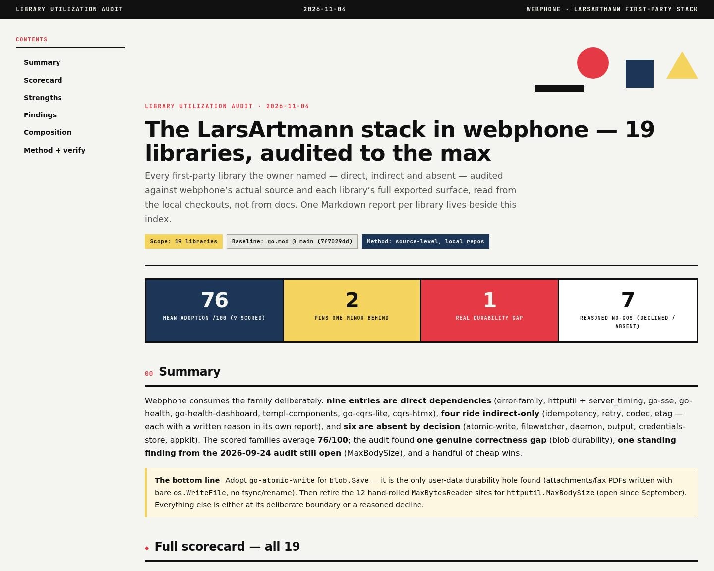
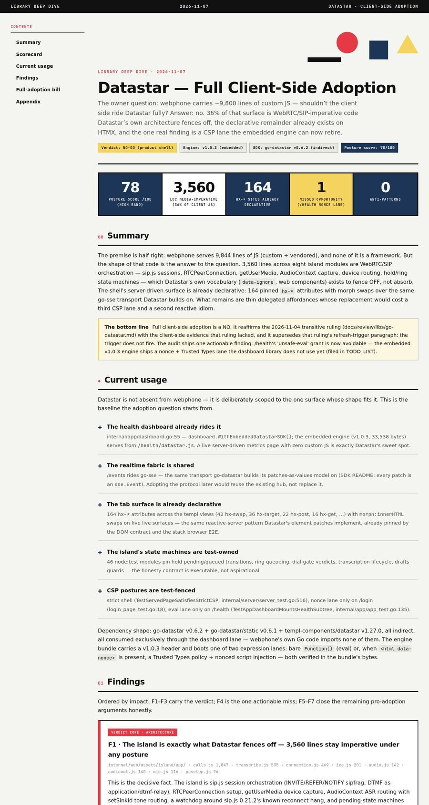

# Research index

One row per library deep-dive in this directory (the `library-deep-dive`
skill's output home). Newest last matches the filename dates; each row
carries the verdict a session needs before re-litigating an adoption.
Plans and status reports live in `docs/planning/` and `docs/status/`.

| Report                                                                                                                                                                                                                | Library                  | Verdict (one line)                                                                                                                                                                                                                                                                                                                                                                                                                                                                                            |
| --------------------------------------------------------------------------------------------------------------------------------------------------------------------------------------------------------------------- | ------------------------ | ------------------------------------------------------------------------------------------------------------------------------------------------------------------------------------------------------------------------------------------------------------------------------------------------------------------------------------------------------------------------------------------------------------------------------------------------------------------------------------------------------------- |
| [2026-09-18 cqrs-htmx deep-dive](2026-09-18_cqrs-htmx-deep-dive.html)                                                                                                                                                 | cqrs-htmx                | First-pass adoption audit; superseded by the 09-19 revision below.                                                                                                                                                                                                                                                                                                                                                                                                                                            |
| [2026-09-19 cqrs-htmx deep-dive](2026-09-19_cqrs-htmx-deep-dive.html)                                                                                                                                                 | cqrs-htmx                | Root-library baseline audit; its usermgmt/loginpage rejection was overturned by the 2026-10-04 passkey decision — superseded by the 2026-10-25 revision below.                                                                                                                                                                                                                                                                                                                                                |
| [2026-09-19 modernc-sqlite deep-dive](2026-09-19_modernc-sqlite-deep-dive.html)                                                                                                                                       | modernc.org/sqlite       | CGO-free SQLite validated as the storage substrate (webphone.db + usermgmt.db + readmodels.db).                                                                                                                                                                                                                                                                                                                                                                                                               |
| [2026-09-22 templ-components deep-dive](2026-09-22_templ-components-deep-dive.html)                                                                                                                                   | templ-components         | Adopted `layout.Base` (+ `NoThemeScript`), `display.EmptyState`, icons; `display.RelativeTime`/`CountBadge`/errorpage REJECTED (coexistence verdict).                                                                                                                                                                                                                                                                                                                                                         |
| [2026-09-24 larsartmann-stack deep-dive](2026-09-24_larsartmann-stack-deep-dive.html)                                                                                                                                 | LarsArtmann family stack | Fleet-wide library landscape; per-module adopt/decline calls for the consuming stack.                                                                                                                                                                                                                                                                                                                                                                                                                         |
| [2026-10-23 go-appkit deep-dive](2026-10-23_go-appkit-deep-dive.html)                                                                                                                                                 | go-appkit                | NOT a dependency, stays that way — every module re-wraps what webphone composes directly; `errorpages` declined (styled 404 must ride the session shell).                                                                                                                                                                                                                                                                                                                                                     |
| [2026-10-24 catalog deep-dive](2026-10-24_go-cqrs-lite-catalog-deep-dive.html)                                                                                                                                        | go-cqrs-lite/catalog     | Audit found zero usage and two hand-rolled doc surfaces; the gap closed the SAME DAY (eventcatalog + OpenAPI + AsyncAPI lanes shipped) — read its Addenda section first.                                                                                                                                                                                                                                                                                                                                      |
| [2026-10-25 cqrs-htmx deep-dive](2026-10-25_cqrs-htmx-deep-dive.html)                                                                                                                                                 | cqrs-htmx                | Round 3, authoritative: 71/100 at audit time, re-scored 100/100 the SAME DAY (§07 Addendum) — all findings shipped by the SUPERB train (projections readiness wired, identity train landed + clone detection/journal verified live, hub Shutdown pre-drain). Remaining gap: bounded AuditLog read projection (upstream).                                                                                                                                                                                      |
| [2026-11-04 fleet libs audit](../review/libs/index.html)                                             | 19 scored + 5 adjacent   | Full-utilization sweep with per-library reports in `docs/review/libs/*.md`: 9 direct families scored (mean 76→79 after same-day adoptions), 2 indirect reasoned NO-GO (idempotency, codec), 6 absences affirmed — and the closeout train LANDED the top findings the same day (blob durability, MaxBodySize mounts, go-health wave, Conflict family, go-etag both halves, go-retry jitter) plus five adjacent audits (branded-id 74, flightrecorder 88, paperless 85, datastar/sqlitestore NO-GO transitive). |
| [2026-11-07 Datastar deep-dive](2026-11-07_datastar-deep-dive.html)  | Datastar                 | Full client-side adoption NO (posture 78/100): 36% of the 9.8k client-JS LOC is media-imperative and stays behind Datastar's own fences (`data-ignore`/web components), the tabs are already declarative on htmx (164 pinned hx-* sites), expressions are eval-shaped vs the strict CSP. Supersedes the 2026-11-04 go-datastar adjacent ruling's trigger paragraph (trigger does not fire; sharpened to a live-Reports-shaped surface); ships the /health unsafe-eval→nonce-lane retirement as a TODO.        |

## Peer-project and practice deep dives

Not library adoption audits, so no verdict column: the neighbour report is
graded item by item in its own body.

| Report                                                                | Subject                     | Takeaway (one line)                                                                                                                                                                                      |
| --------------------------------------------------------------------- | --------------------------- | -------------------------------------------------------------------------------------------------------------------------------------------------------------------------------------------------------- |
| [2026-10-26 practice scan](2026-10-26_ai-agent-error-management.html) | AI in error management      | Ten proven failure-side practices, Pareto-ranked against this repo's error culture; no rulings.                                                                                                          |
| [2026-10-27 attended-transfer](2026-10-27_attended-transfer-spike.md) | Consult-then-transfer (M19) | NO-GO on this host: the stack has no Replaces-aware dialplan and no FS lab exists, so the missing piece is evidence, not island code.                                                                    |
| [2026-10-29 ai-phone deep dive](2026-10-29_ai-phone-deep-dive.html)   | oxnw/ai-phone               | A server-side AI phone agent read against the island: ten mechanics, two adopted the same session (docs-versus-code pin, generation-closing for late segments), five actions filed, six declines stated. |
